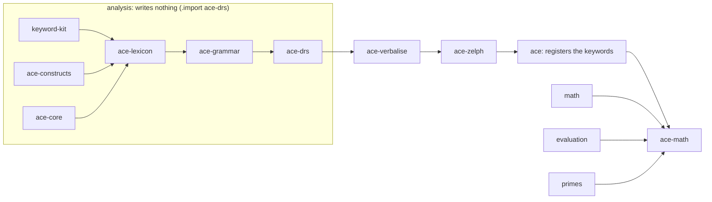

# Modules, API and Data Shapes

The ACE front end is not part of zelph's C++ core. It is a set of modules in zelph's standard library, written in Janet and zelph, that `.import ace` loads exactly as `.import sparql` loads `stdlib/sparql.zph`. The engine does not know that ACE exists: the modules use the same Janet API as the [SPARQL front end](../sparql.md) and every other script, and the engine features they rely on are documented zelph features, released with zelph 1.1.0 and listed in [What zelph Already Provides](foundation.md).

Each stage of the way from an `ace` block to graph writes and answers is a public Janet function that takes and returns plain Janet values: tuples, structs, strings and keywords. The stages up to the plan of the zelph to be written read no node and write none. That boundary is what makes the front end testable: the parser's output is compared with the official ACE parser's, case by case over that parser's regression corpus, without any graph ([Layer A: Text to DRS](tests.md#layer-a-text-to-drs)), a program can call each stage on its own, and the WebAssembly playground runs the same code. The stages after the boundary touch the graph only through documented zelph bindings, and only in the ways listed under [Engine Idioms the Modules Follow](#engine-idioms-the-modules-follow).

This page is the reference for the modules, their public functions, the values that pass between them and the names `ace` gives the nodes it writes. It is written mainly for the sessions that implement the front end. A reviewer gets the picture from the two sessions below and from the first paragraph of each section.

The first session uses only the analysis modules. `ace/analyse` turns a text into the Discourse Representation Structure (DRS) of the public ACE DRS report, written as a Janet value; it says whether zelph can use every construct the text holds, and names the construct when it cannot; a text that is not ACE comes back with its error message. Nothing is written to the graph. Lines that start with `%` are Janet, zelph's embedded scripting language ([Scripting with Janet](../janet.md)). The sessions on this page leave out the notice that `.import ace` prints once, as transcripts leave out module banners.

!!! example "Specified session — the behaviour this specification requires, not yet implemented"

    ```
    zelph> .import ace-drs
    zelph> %(defn show [x] (zelph/out (string/format "%j" x)))
    <function show>
    zelph> %(show (get (ace/analyse "John is a man.") :status))
    :accepted
    zelph> %(show (get (ace/analyse "John is a man.") :drs))
    {:refs (R1 R2) :conds ((:object R1 "man" :countable :na :eq "1" (1 4)) (:predicate R2 "be" (:named "John") R1 (1 2)))}
    zelph> %(show (get (ace/analyse "John waits or Mary waits.") :status))
    :refused
    zelph> %(show (get (ace/analyse "John waits or Mary waits.") :refused))
    (:or/in-head-or-statement)
    zelph> %(zelph/out (get (ace/analyse "John is a man.\n\nJohn own Mary.") :message))
    Not ACE [ace/syntax]: sentence 2, line 3, column 6: found 'own', expected 'is', 'does' or a verb in the third person singular.
      John <>own Mary.
      Did you mean 'owns'?
    ```

"John waits or Mary waits." is correct ACE, but zelph has no way to store that one of two statements holds without saying which, so the analysis refuses it by the construct id `:or/in-head-or-statement` instead of writing something wrong ([Without a Route in v1](constructs.md#without-a-route-in-v1)). The last text is not ACE: its second sentence, after a blank line and so on line 3, lacks the third-person form. Every word of it is in the shipped vocabulary (`own` is one of its verbs), so the message points at the verb and suggests its form; the position is that of the token where the parse failed. The layout of a message and its ids are normative, its wording illustrative ([Messages](block.md#messages)).

The second session runs the mapping. `ace/execute-drs!` takes a DRS, plans the zelph it means, writes it and runs one quiet inference; its result carries the plan, and `ace/zelph-of` prints that plan as native zelph, one statement per line. The native query that follows, typed under `.lang ace`, meets what `ace/execute-drs!` wrote and what its inference derived.

!!! example "Specified session — the behaviour this specification requires, not yet implemented"

    ```
    zelph> .import ace
    zelph> %(defn native [text] (zelph/out (ace/zelph-of (get (ace/execute-drs! (get (ace/analyse text) :drs)) :plan))))
    <function native>
    zelph> %(native "John is a man. Every man is a human. Is John a human?")
    John ~ man
    (*{(X ~ man)} ~ conjunction) => (X ~ human)
    # yes/no: John ~ human
    zelph> .lang ace
    ace> X ~ human
    Answer: John ~ human
    ```

The three lines are ordinary zelph: a fact, a rule, and the question as a comment. The rule line is the form in which zelph itself lists a rule of one condition that `ace` built: the condition stands in a one-element condition set, so that every rule `ace` builds has a condition set ([The Rule Idiom](#the-rule-idiom)). Typed under `.lang ace`, each line meets what was written instead of adding to it ([Verbalising Nodes and `ace/zelph-of`](#verbalising-nodes-and-acezelph-of) shows it on today's zelph). The proposed work is the mapping between the two sides, written as stdlib `.zph` modules.

## The Modules

### Files

All files live in `stdlib/`. The CMake glob and the WebAssembly embed pick them up without build changes. A module states its dependencies as `.import` lines, as `stdlib/math.zph` does, never as `(zelph/import …)` calls from Janet.

| File | What it holds | Imports | Registers keywords |
|---|---|---|---|
| `keyword-kit.zph` | Generic helpers for keyword languages, prefix `kit/`: masking comments and strings, finding a region still open at the end, line and column of an offset, the error marker, recording the furthest parse failure. It carries no ACE knowledge, so its names survive a later adoption by `sparql.zph` | — | — |
| `ace-constructs.zph` | `ace/state` (all mutable state), `ace/milestone`, the construct table `ace/constructs`, the message catalogue `ace/messages`, the private table of syntax-error labels `ace-constructs/labels`, the private documentation generator `ace-constructs/markdown`, and their accessors | — | — |
| `ace-core.zph` | The shipped vocabulary as Janet data only: `ace-core/ulex` (prepositions and particles, measurement nouns, the entries that must exist because function words are never guessed, about 300 person nouns with gender, the ACE example names with gender), `ace-core/irregular` (irregular forms), `ace-core/particles`. It calls no function of another module and is never written to the graph | — | — |
| `ace-lexicon.zph` | Function words, illegal words, the English function words ACE lacks, core spellings, morphology in both directions, the lexicon store and cache, `ace-lexicon/add-shipped`, the ulex reader, guessing, `ace/tokenize`, `ace/annotate`, `ace/predicate-name`, and the handler function of the `ace-lexicon` keyword. At the end of its import it registers the shipped entries with `(ace-lexicon/add-shipped "core" {:ulex ace-core/ulex})` | `keyword-kit`, `ace-constructs`, `ace-core` | — |
| `ace-grammar.zph` | The rule builders, and the grammar in four variants built from them (plain, diagnostic, counting, backtracking); `ace/parse`, `ace/expected` | `ace-lexicon` | — |
| `ace-drs.zph` | `ace/drs-raw`, `ace/refres`, the classifier, normalization, `ace/plan`, `ace/individual-name`, `ace/zelph-of`, `ace/analyse`; the reader and printer of APE's DRS notation, the proper-name normalizer, the well-formedness check and the DRS matcher used by the tests | `ace-grammar` (at M0, before the grammar exists, `ace-constructs`) | — |
| `ace-verbalise.zph` | DRS plus bindings → ACE text; a fact node → ACE text (from M4); `ace/math-text`, the pure printer of formulas | `ace-drs` | — |
| `ace-zelph.zph` | Everything that writes the graph: word resolution (`ace/concept!`, `ace/concept-node!`, the profile table `ace-zelph/wikidata-profile`), `ace/senses`, plan execution (the profile pin and the individual marks included), inference, questions, contradiction reports, `ace/load!`, `ace/load-text!`, and from M9 the removal behind `ace-retract` (`ace-zelph/retract!`) | `ace-verbalise` | — |
| `ace.zph` | `ace/handler`, `ace/incomplete?`, `ace/option`, from M9 `ace/retract-handler`; the keyword registrations and the import notice | `ace-zelph` | `ace`, `ace-lexicon`; from M9 `ace-retract` |
| `evaluation.zph` | A general arithmetic module with `exquo`, `difference` and `compare`; it holds no `ace/` name, and `math.zph` does not import it ([The Evaluation Module](math.md#the-evaluation-module)) | per [Numbers and Formulas](math.md#modules-the-hook-and-the-load-order) | — |
| `ace-math.zph` | `ace/num!`, `ace/math-term!`, `ace/math-indet-node!`, `ace/math-order!`, `ace/math-value!`, `ace/math-decide!`, `ace/math-numeral`, `ace/math-nf-text`, `ace/math-plan`; the math vocabulary as shipped Janet data, registered with `(ace-lexicon/add-shipped "math" …)` and never written to the graph; the hook table `(ace/state :math)` | `ace`; then, under `.lang zelph`, `math`, `evaluation`, `primes` | — |

Only two imports write the graph. `evaluation` writes its rules, and `ace-math` loads the math stack. Measured on the current tree, `.import math` alone gives 5661 nodes and 418 rules, with `primes` 5854 and 433, and `math`, the evaluation module's starting text and `primes` together, as `ace-math` imports them, 6135 nodes and 456 rules; the finished module is measured again ([Costs](math.md#costs)). Every other module only defines Janet functions and data, and registering a keyword adds no node either, so `.import ace` leaves the graph exactly as it was.

The dependency chain is linear, with the math module beside it:



An arrow points from a module to the module that imports it. Three rules of direction follow from the table:

- `ace-core.zph` is a data module without imports, and `ace-lexicon.zph` imports it. So every importer of the lexicon, `.import ace-drs` included, has the shipped vocabulary. An overlay loaded with `:replace` hides those entries, while `ace/inflect` and lemma recovery keep reading `ace-core/irregular` and `ace-core/particles` directly. The math vocabulary is shipped data of `ace-math.zph` in the same way (decision [DEC-LEX-STORE](decisions.md#dec-lex-store)).
- `ace-math.zph` imports `ace`, sets `.lang zelph` through `zelph/lang` (remembering the caller's language), imports `math`, `evaluation` and `primes`, restores the caller's language, registers its vocabulary and stores the hook table last. The import always succeeds. Math imported earlier under another language is the same stack, because every module of the arithmetic stack starts with `.lang zelph` and a module's `.lang` ends with the module ([Scripts and Modules](../modules.md#multi-language-support)).
- `ace.zph` never imports `ace-math`. Arithmetic in a block is refused with `[ace/needs-math]` until the user types `.import ace-math` (decision [DEC-MATH-IMPORT](decisions.md#dec-math-import)): importing math changes the whole session, and that should be the user's visible act, not the side effect of one sentence.

### What a Partial Import Does

The split exists so that the parser, the DRS stages and the corpus tests can run without keywords, math or nodes. `.import ace-drs` is the import of every parser, DRS and corpus test, and it MUST:

- define the functions and data of `keyword-kit`, `ace-constructs`, `ace-core`, `ace-lexicon`, `ace-grammar` and `ace-drs`;
- register no keyword, print nothing beyond the host's import lines, create no node (`.stat` Nodes unchanged), and import no math and no number substrate;
- give a lexicon that holds the shipped vocabulary of `ace-core` and no user entry. The blind gates of the test suite ([The Guessing Gates B, N and W](tests.md#the-guessing-gates-b-n-and-w)) use it as it is; the corpus session adds the small lexicon of the official parser as an overlay with `:replace true`, which hides the shipped entries.

`.import ace-zelph` adds `ace-verbalise` and `ace-zelph` with the same guarantees. Only `.import ace` registers keywords and prints the notice, and only `.import ace-math` loads math. Within one graph a further `.import ace-core` is skipped by the host; after a replacing load, which clears the host's import registry and so runs every module again, it changes nothing either. At M0 only `ace-constructs` and the oracle half of `ace-drs` exist: `ace-drs.zph` imports `ace-constructs` and switches to `.import ace-grammar` when the grammar arrives. No stub modules are written.

Without the keyword, a line that starts with `ace` is native zelph:

!!! example "Specified session — the behaviour this specification requires, not yet implemented"

    ```
    zelph> .import ace-drs
    zelph> ace ~ card
    zelph> X ~ card
    Answer: ace ~ card
    ```

Tests: `ace keyword: the sub-modules import without math, keyword or nodes` (M0), `ace keyword: the import writes no node` and `ace lexicon: analysing a text creates no node` (M1).

### Invariants

Nine rules hold for every module. Each exists because breaking it has a concrete cost, named with it.

1. **One shared Janet environment, one state table.** All modules share the Janet environment of the session. Public names are `ace/<name>`, private helpers `ace-<module>/<name>` (`ace-grammar/peg`), `keyword-kit`'s public names `kit/<name>`, and the test glue in `test_ace.cpp` uses `ace-test/<name>`. There are no bare top-level names and no top-level `var`: mutable state lives only in the table `ace/state`, defined in `ace-constructs.zph`, mutated with `put`, one key per owner (table below).
2. **Module state is a cache.** Nothing that must survive `.save` and `.load` lives only in Janet; provenance lives in node annotations (decision [DEC-PROV](decisions.md#dec-prov)). Every cache of graph-derived data — node ids, readings of user entries, word-resolution results, announcements, the rule registry, reported contradictions, the math hook table, and from M8 the memo of declared opaque predicates — belongs to one value of `(zelph/epoch)`, and the first block of a new epoch drops them. A replacing load does not repair a Janet value that holds a node, so nothing outside these epoch-keyed caches may hold a node across blocks (decision [DEC-RELOAD](decisions.md#dec-reload)).
3. **Graph writes happen only in functions whose name ends in `!`**, in `ace-zelph.zph` and in the store functions of `ace-lexicon.zph`. `zelph/resolve`, which creates a node when the name is new, is called only inside them. `ace/concept!` is the one `!` function that writes no graph: its `!` marks that it fills the session's resolution cache. Every graph write runs on the main thread: the host refuses writes from other threads, and a keyword handler runs outside the event loop, so it cannot use `ev/*` either.
4. **No feature detection.** A binding `ace` needs is added to zelph first, in C++; no module tests whether a `zelph/…` binding exists.
5. **No interim workaround.** A construct that needs a zelph change that has not landed is refused by its construct id until the change lands; nothing is built that the change would throw away ([How v1 Lives Without Them](prerequisites.md#how-v1-lives-without-them)).
6. **Explicit languages** (decision [DEC-CONTENT-NS](decisions.md#dec-content-ns)). Every node `ace` names is named in an explicit language ([Naming Languages](#naming-languages)), never in the current `.lang`. Every public function that may create a node, a scratch node included — `ace/handler`, `ace/lexicon-handler`, `ace/analyse`, `ace/execute!`, `ace/execute-drs!`, `ace/load!`, `ace/load-text!`, and `ace/annotate` when it rebuilds the lexicon cache — runs under `.lang zelph`, set and restored through `zelph/lang` on every exit path. So the nodes zelph names implicitly (rule and query variables, characters) land in `zelph`, and the user's `.lang` never changes what `ace` resolves.
7. **Nothing in the `ace` path is linear in the size of the graph.** Allowed: `zelph/lookup`; `zelph/lookup-all` (the candidates of one label); `zelph/exists … :exact`; `zelph/degree`; `zelph/name … :strict`; `zelph/parse`; writing facts; queries inside a scratch cluster; drops of a cluster `ace` filled (linear in the cluster, plus, for an older node the cluster first used as a predicate, a walk over that node's facts to decide whether its relation-type declaration goes with the drop); one `(zelph/strata)` per block that writes a rule while the theory holds a rule with a negated condition (linear in the rules in force); `zelph/sources` and `zelph/targets` on nodes whose degree the block or the lexicon bounds (a record's members, a helper, a lexicon vocabulary node); and the upward subclass walk from the class of a rule head, read with `zelph/closure` over the subclass predicate, which the predicate index serves (a bounded walk of 25 to 113 classes on Wikidata). Never: a scan of a name map; `zelph/sources` or `zelph/targets` on a node of unbounded degree; `zelph/exists` without `:exact` (on a miss, once a fact with more than one object may exist, which a load assumes unless the saved file records that none does, it matches like a rule condition instead of making one hash probe), except in the one place named below; a query outside a scratch cluster.

    The exception is the second probe of a yes/no question in `ace/ask` (decision [DEC-YESNO-WIDER](decisions.md#dec-yesno-wider)). The question's ground atom is checked with `(zelph/exists s p o :exact)` first and, only after that exact probe missed, with the plain `(zelph/exists s p o)`, which reads a fact with several objects as a rule condition does: a native fact `John sees Mary Bill` answers "Does John see Mary?" with yes. The engine asks its condition matcher there only while the graph may hold a ground fact with more than one object (a flag that such a fact sets, as do a name merge that involves a statement or a set constant and a load, unless the saved file records that no fact has more than one object); otherwise the second probe is a hash probe like the first. Its cost is bounded by the subject's adjacency for the predicate, with no scan; it is timed on the `-small` network at M3, as a row of the [budgets](tests.md#budgets-counts-always-timings-only-on-an-idle-machine). The test of this rule, `ace work: the ace sources make no forbidden graph call`, admits exactly this call, and `ace questions: a native fact with several objects answers a single-member yes/no question` (M3) pins the answer.
8. **Inside a rule-building thunk** (`zelph/dedup-rule`) only node-building calls (`zelph/var`, `zelph/fact`, `zelph/conjunction`, `zelph/collection`, `zelph/negate`, `zelph/path`, `zelph/list`, `zelph/list-chars`, `zelph/set`, `zelph/resolve`, the math hook `:term!`) and reads such as `zelph/exists` are used. The host refuses `zelph/cluster` (even without an argument), `zelph/cluster-drop`, `zelph/query`, `zelph/import`, `zelph/load`, `zelph/save`, the run functions, `zelph/prune-fact`, `zelph/holders`, `zelph/dependents` and every nested rule build there. Inside a thunk `zelph/mention` only builds, because the rule build marks what it writes. Resolution, cluster switches and queries happen before the thunk. The thunk returns the `=>` fact; anything else is refused. `:focus` is the parser's option and `ace` does not pass it.
9. **Every module survives a second run in the same Janet environment** (decision DEC-RELOAD). A replacing load clears the host's import registry, so `.import ace` (or `ace-math`, `ace-drs`, …) after a load runs the module again in the same session. `zelph/register-keyword` replaces the handlers; `ace/state` is created only when it does not exist yet, so `:options`, `:session`, `:warned`, `:blocks`, `:reported` and the lexicon overlay survive the second run (the graph-derived caches are dropped by the epoch anyway); `ace-lexicon/add-shipped` is idempotent; the import notice is printed once per Janet VM; no module keeps state in a top-level binding that a second run would split from the functions compiled in the first. Test: `ace keyword: importing ace again after a load keeps the options and the keyword works`.

The keys of `ace/state`:

| Key | Owner | Content |
|---|---|---|
| `:options` | `ace.zph` | `@{:show-zelph false :warnings true :guess true :atomic :keep :max-answers 100 :echo false :justify false}` ([Options](#options-aceoption)) |
| `:blocks` | `ace-zelph` | the block counter of the session (the `:block` of every Src) |
| `:epoch` | `ace-zelph` | the `(zelph/epoch)` that the graph-derived caches below belong to |
| `:lexicon` | `ace-lexicon` | the cache form → readings, the overlay, the version stamp ([Cache and freshness](grammar.md#cache-and-freshness)) |
| `:resolution` | `ace-zelph` | the cache of label lookups keyed by (label word, role), and the words already announced per (word, role) ([Word Resolution](#word-resolution)) |
| `:session` | `ace-zelph` | a token drawn once per Janet VM and written into the provenance annotations; not graph-derived, so a new epoch keeps it (`.new` rebuilds the VM and with it the token) |
| `:rules` | `ace-zelph` | the rule registry of this epoch (`=>` node → `{:payload :srcs :serves}`) and the may-derive graph over it, read by the context checks of `ace/plan` |
| `:reported` | `ace-zelph` | the contradictions already reported in this session |
| `:warned` | `ace-zelph` | the keys of the once-per-session warnings already shown: the `:once` keys of `w-lemma`, `w-compound` and `w-multiword` (per name), and `w-old-labels`, `w-index-incomplete`, `w-profile` |
| `:math` | `ace-math` | the hook table, stored last by `ace-math` with the `(zelph/epoch)` of its import; it counts only while that epoch is current, because a replacing load takes the math stack with the graph |
| `:work` | `ace-grammar` | the work count of the last analysis run with `{:count true}`, and the backtracking interpreter's steps alone |
| `:fail` | `ace-grammar` | the furthest offset and label keys of the last diagnostic match or backtracking run |

There is no `:provenance` key: provenance is written to the node annotations of the built nodes from M1 on, under the key `ace:src` ([Provenance and the Rule Registry](semantics.md#provenance-and-the-rule-registry)).

### When Each Part Arrives

The functions arrive with the [milestones](plan.md#the-milestones) of the work plan:

| Milestone | Modules and functions |
|---|---|
| M0 | `ace-constructs` with every DRS-level and context row and the message skeleton; the oracle half of `ace-drs`: `ace/ape->drs`, `ace/drs->ape`, `ace/normalise-ape-names`, `ace/drs-wellformed?`, `ace/drs-equivalent?`, `ace/drs-constructs`, `ace/drs-families` |
| M1 | `keyword-kit`; `ace-core`; `ace-lexicon` (store, ulex reader, morphology both ways, `ace/tokenize`, `ace/annotate` with guessing, multi-word names); the smoke grammar with its backtracking variant; `ace/drs-raw`, `ace/refres`, `ace/normalise`, `ace/plan`, `ace/zelph-of`, `ace/analyse` over the smoke shapes; `ace/concept!`, `ace/concept-node!`, `ace/execute!`, `ace/execute-drs!`, `ace/infer!`, `ace/ask` for yes/no questions, `ace/contradictions`, `ace/senses`; the answer verbaliser; `ace.zph` with both keywords and `ace/option` |
| M2 | the complete grammar for all of ACE 6.7; `ace/analyse` complete, with APE's paragraph semantics; `ace/expected`, `ace/last-work`; `ace/load!`, `ace/load-text!` |
| M3 | no new public function; the plan, the execution and the verbaliser grow construct by construct, as in every later milestone |
| M4 | `ace/verbalise-node` for the fact shapes of rules and negation; `(ace/option :atomic :consistent)` |
| M5 | `ace-math.zph` and `evaluation.zph` |
| M6-M8 | no new public function |
| M9 | `ace/retract-handler` and the keyword `ace-retract`; the options `:echo` and `:justify`; `ace/verbalise-node` for every fact node and for derivations |

## The Public API

### Effect Classes and Errors

Every function belongs to exactly one effect class:

- **pure** — no graph access. It may read `ace/state` (the lexicon cache included) and write only the state keys its own module owns as a cache or scratch table (`:lexicon`, `:work`, `:fail`).
- **reads** — what pure may, plus only non-creating `zelph/*` calls, or nodes created inside a scratch cluster that the function opens and drops itself, restoring the caller's cluster with `(zelph/cluster prev)`. `.stat` Nodes is unchanged by the call. A reads function may fill its own module's cache keys.
- **state** — no graph access; sets a session setting in `ace/state` (`:options`). Only `ace/option`.
- **writes** — the name ends in `!`; creates or changes graph state in the active cluster.

Inside `ace`, a failure is a **message record** `{:ace/id id :args {…}}`, raised with `ace/fail`. Three kinds of boundary turn records into something else:

- **raises** — the function signals a message record. The pure and reading stages (`ace/tokenize`, `ace/parse`, `ace/refres`, `ace/plan`, …) do this; callers and tests catch them with `protect`.
- **raises strings (boundary)** — the function formats the record with `ace/message` and raises the string. These are the keyword handlers and every function documented as callable from a `%` line: `ace/declare!`, `ace/load-ulex!`, `ace/execute!`, `ace/execute-drs!`, `ace/load!`, `ace/load-text!`, `ace/senses`. Internal callers use private record-raising variants (`ace-lexicon/declare-record!`, `ace-zelph/execute-record!`, …), so the handler still receives the record. Any other error value that reaches a boundary becomes `[ace/internal]` with its Janet text, because a non-string error value loses its text at the host.
- **total** — never raises, for any input. `ace/analyse` is total and returns a failure as data.

`ace/option` is the exception: a wrong key or value raises a plain Janet error string that names the valid keys or values. That is a misuse of the API, not an `ace/messages` entry.

### keyword-kit

| Function | Returns | Effect | Errors |
|---|---|---|---|
| `(kit/mask text spec)` | a string of the same byte length, every region blanked, newlines kept | pure | total |
| `(kit/open-region text spec)` | nil, or `{:kind k :off n}` for a region still open at the end | pure | total |
| `(kit/line-col text off)` | `(line col)`, 1-based, columns in code points | pure | total |
| `(kit/marked line col)` | the line with the marker `<>` inserted before column `col` | pure | total |
| `(kit/expect patt label fail)` | a PEG that records the furthest failure in the table `fail`, behaviour unchanged | pure | total |

A region spec is a tuple of descriptors `{:kind k :open o :close c :escape e}`; `:close "\n"` makes a line region, and `:escape` is optional. `kit/mask` scans left to right: outside a region the first descriptor whose `:open` matches starts one, and inside a region only its own `:close` (not preceded by its `:escape`) ends it, so other delimiters inside are text. Every byte of a region, its delimiters included, becomes a space and `\n` stays, so offsets map one to one and a block of comments masks to whitespace. `kit/open-region` makes the same scan; a line region is never open at the end. `kit/line-col` counts code points (UTF-8 lead bytes) from the start of the line, a tab counting one. `kit/marked` with `col` one past the end appends the marker. `kit/expect` is `(+ patt (cmt (* ($) (constant label)) note))`, where `note` keeps in `fail` the largest failure offset `:off` and the labels recorded there `:labels` (first-seen order, no duplicates, a larger offset resets them) and returns nil, so the alternative fails and the language matched is unchanged. The region lists of `ace` (`ace-lexicon/ace-regions`, `ace-lexicon/ulex-regions`) belong to the lexicon ([Region lists](grammar.md#region-lists)).

### ace-constructs

| Name | Returns | Effect | Errors |
|---|---|---|---|
| `ace/constructs`, `ace/messages`, `ace/milestone`, `ace/state` | data | — | — |
| `(ace/construct id)` | the row, or nil | pure | total |
| `(ace/supported? id)` | boolean | pure | total |
| `(ace/unsupported ids)` | sorted tuple of the ids not supported now | pure | total |
| `(ace/families-of ids)` | sorted letter string of the ids' corpus families, `T` never included | pure | total |
| `(ace/supported-families)` | the letters all of whose DRS-level rows are supported (informational) | pure | total |
| `(ace/message id args)` | the formatted message string | pure | total |
| `(ace/fail id args)` | — | pure | raises the record `{:ace/id id :args args}` |

`(ace/supported? id)` holds exactly when the row's `:since` is set and not later than `ace/milestone` (a `(def ace/milestone :Mn)` in `ace-constructs.zph`, which the tests' gate pins), and its `:import` module, if any, is imported and usable; for `"ace-math"` that means `(ace/state :math)` is set for the current `(zelph/epoch)`. Advancing a milestone edits `ace/milestone` and nothing else. `ace/messages` maps each id to `{:class <class key> :text <format string> :hint <format string or nil>}`; it is the only place where message wording lives, as string literals in our own words ([The Message Catalogue](block.md#the-message-catalogue) lists them). `ace/construct` is a read accessor; there is no run-time API for users to add rows in v1 ([The Construct Table](constructs.md#the-construct-table)).

### ace-lexicon

| Function | Returns | Effect | Errors |
|---|---|---|---|
| `(ace/tokenize text)` | token tuple ([Token](#token)) | pure | raises (Not ACE) |
| `(ace/annotate tokens &opt opts)` | annotated record ([Reading and Annotated Record](#reading-and-annotated-record)); `opts` `{:guess bool}` | reads | total |
| `(ace/readings form)` | tuple of readings | reads | total |
| `(ace/inflect lemma slot)` | the form string, or nil when the slot has no form (no synthetic comparative) | reads | total |
| `(ace/predicate-name kind lemma &opt opts)` | node name string ([Predicate Names](#predicate-names)); `opts` `{:subj-obj s :as-written bool}` | pure | total |
| `(ace/reserved? name)` | boolean: the name is a core spelling | pure | total |
| `(ace/declare! entry &opt opts)` | nil; `opts` `{:source s}` | writes (facts in `ace-lex`) | raises strings (boundary; Lexicon error) |
| `(ace/load-ulex! path &opt opts)` | the number of entries; `opts` `{:source s :replace bool :generate bool :guess bool}` | writes (facts in `ace-lex`); with `:replace true` an overlay in `ace/state` and no graph write | raises strings (boundary; Lexicon error) |
| `(ace/lexicon-handler text)` | `:incomplete` or nil | writes | raises strings (boundary) |

- `ace/inflect` takes the slots `:sg :pl :third :inf :pp :comp :sup`. For a symbol with declared forms it gives the first declared one, so it is also the inverse lookup symbol → form that answers use (`Acme_Corporation` → `Acme`); otherwise the irregular-table form, otherwise the rule form. It works for a lemma without an entry too.
- `ace/predicate-name` takes the preposition from the lemma and the degree from the kind; the kinds are listed under [Predicate Names](#predicate-names).
- An `entry` for `ace/declare!` is a ulex tuple `(Pred Form Symbol Third?)` with `Pred` a keyword, as the ulex reader produces it: `(:noun_sg "man" "man" "human")`, `(:tv_finsg "lives-at" "live-at")`, `(:dv_infpl "give" "give" "to")`. Its symbol may be a Wikidata id (`noun_sg(man, 'Q8441', masc)`), which binds the word to that item.
- The entries of one `ace-lexicon` block or ulex file are all-or-nothing: every check runs before any write.
- `ace/lexicon-handler` lives in `ace-lexicon.zph`, but the keyword `ace-lexicon` is registered by `ace.zph`, so `.import ace-drs` registers nothing.

### ace-grammar

| Function | Returns | Effect | Errors |
|---|---|---|---|
| `(ace/parse annotated &opt opts)` | AST ([AST Envelope](#ast-envelope)), the parse's warnings in the `:text` node's `:warnings`; `opts` `{:count true}` selects the counting variant | pure | raises (Not ACE) |
| `(ace/expected text)` | `{:offset n :expected (label …)}` | reads | total |
| `(ace/ast-constructs ast)` | struct construct id → tuple of sentence ids | pure | total |
| `(ace/last-work &opt kind)` | integer: the work of the last analysis run with `{:count true}`, the backtracking interpreter's steps included; with `kind` `:backtrack` those steps alone, 0 when no sentence had a guessed reading | pure | total |

`ace/parse` uses the backtracking variant for every sentence with a guessed reading, and raises the reading warnings `w-lemma`, `w-compound`, `w-guess-reading`, `w-ing` and `w-multiword` into the `:text` node's `:warnings`; `ace/annotate` only marks the readings that can warn, since only the parse knows which reading a token takes ([The backtracking variant](grammar.md#the-backtracking-variant)).

### ace-drs

| Function | Returns | Effect | Errors |
|---|---|---|---|
| `(ace/drs-raw ast)` | pre-resolution DRS ([Pre-Resolution Markers](#pre-resolution-markers)) | pure | raises (internal only) |
| `(ace/refres drs)` | `{:drs d :warnings (record …)}` | pure | raises (Not ACE) |
| `(ace/drs-constructs drs)` | struct construct id → tuple of sentence ids | pure | total |
| `(ace/drs-families drs)` | sorted letter string, `T` included when a sentence id above 1 occurs | pure | total |
| `(ace/normalise drs)`; `(ace/norm-<pass> drs)` | normalized DRS | pure | raises (internal only) |
| `(ace/plan ndrs ctx)` | plan ([Plan](#plan)) | pure | raises (Correct ACE: context ids) |
| `(ace/individual-name term)` | the name string of a `(:skolem …)` or `(:hyp …)` term | pure | total |
| `(ace/zelph-of plan &opt res)` | native zelph text, one statement per line; with a resolution map `res`, display lines for the resolved nodes | pure | total |
| `(ace/analyse text &opt opts)` | result ([The Result of ace/analyse](#the-result-of-aceanalyse)); `opts` `{:guess bool :count bool}` | reads | total |
| `(ace/ape->drs text)` | DRS, or nil | pure | total |
| `(ace/drs->ape drs)` | APE notation, referents renamed A, B, … in order of occurrence | pure | total |
| `(ace/normalise-ape-names drs)` | DRS (the expected side of corpus comparisons) | pure | total |
| `(ace/drs-wellformed? drs)` | true, or a reason string | pure | total |
| `(ace/drs-equivalent? a b &opt opts)` | true, false or `:budget` | pure | total |

- `ace/analyse` applies APE's text semantics (paragraphs, sentence ids continuing). With `:count true` it passes `{:count true}` to `ace/parse`, whose work `ace/last-work` then reads; otherwise it uses the plain variant. It never raises, writes nothing, resolves no word and leaves no discourse state behind.
- `ace/plan` raises the context ids it can find without the graph; the ones that need the graph are raised by the resolution step of `ace/execute!` ([Step 3: Resolution and Checks](block.md#step-3-resolution-and-checks)).
- `ace/zelph-of` needs no graph: plans hold names, never nodes. Its rendering rules are under [Verbalising Nodes and ace/zelph-of](#verbalising-nodes-and-acezelph-of).
- The oracle functions (`ace/ape->drs` to `ace/drs-equivalent?`) are the test suite's comparison with the official parser; their semantics, the work bound of `ace/drs-equivalent?` and `{:ignore-sid true}` are [The Oracle Functions](tests.md#the-oracle-functions)'. The reader keeps APE's token ids, so `ace/drs->ape` after `ace/ape->drs` is the identity on all 3779 corpus terms up to referent names.
- `ace-drs/unresolved-definite`, the single branch for a definite noun phrase that refers to nothing earlier, stays private.

### ace-verbalise

| Function | Returns | Effect | Errors |
|---|---|---|---|
| `(ace/verbalise drs &opt bindings)` | ACE text, or `{:refused id}` | reads (lexicon) | total |
| `(ace/verbalise-node node)` | the ACE sentence of a fact node, or nil | reads | total |
| `(ace/math-text formula)` | the ACE text of a DRS formula or term, in ACE precedence | pure | total |

`bindings` maps a DRS referent to a rendered spelling (a string), a data term, or `(:some C)` for an unnamed node, C its class or nil. `ace/verbalise-node` reads the fact with `zelph/parse`; it covers the fact shapes of rules and negation from M4 (it writes the report lines of derived contradictions and of `[ace/w-naf-final]`) and derivations from M9. The templates are those of [The Verbaliser](answers.md#the-verbaliser).

### ace-zelph

| Function | Returns | Effect | Errors |
|---|---|---|---|
| `(ace/concept! term)` | resolution record of a content term ([Word Resolution](#word-resolution)); creates nothing | reads (fills `:resolution`) | raises (Lexicon error: `reserved-word`, or `unknown-word` for an explicit id the graph does not hold) |
| `(ace/concept-node! res)` | the node of a resolution record, created in the active cluster when the record is of step 4 (a new word) | writes | raises (internal) |
| `(ace/term-node! term xctx)` | the node of a plan term; `xctx` carries the resolution map and the current naming scope | writes | raises (internal) |
| `(ace/execute! plan ctx)` | result ([The Result of ace/execute!](#the-result-of-aceexecute)) | writes | raises strings (boundary; Contradiction, Correct ACE, Lexicon error, internal) |
| `(ace/execute-drs! drs &opt ctx)` | as `ace/execute!` | writes | raises strings (boundary; as `ace/execute!`, plus Correct ACE for a refused construct) |
| `(ace/infer!)` | the quiet run's result ([The Result of ace/execute!](#the-result-of-aceexecute)) | writes | raises (internal) |
| `(ace/ask action xctx)` | tuple of answer lines | reads | raises (internal) |
| `(ace/contradictions)` | tuple of the graph's contradiction-record nodes ([Contradiction Records](#contradiction-records)) | reads | total |
| `(ace/senses word &opt role)` | prints the Wikidata candidates of `word` and returns them as a tuple of `{:id :node :label :class :chosen}` | reads | raises strings (boundary) |
| `(ace/load! path)` | nil; reads an ACE document and executes it as one theory | writes | raises strings (boundary) |
| `(ace/load-text! text)` | as `ace/load!`, for a string | writes | raises strings (boundary) |

- `ace/execute!` performs the resolution, the checks, the dry run, the real run, the inference, the contradiction reports and the questions of a block, in that order; it sets `.lang zelph` itself when called directly. The handler adds the veto, the context and the analysis in front, and the output behind ([What a Block Does](block.md#what-a-block-does)).
- `ace/execute-drs!` adds classification, normalization and planning in front of `ace/execute!`: it is the public entry for a DRS that did not come from the parser, such as an expected DRS of the corpus (decision [DEC-DRS-ENTRY](decisions.md#dec-drs-entry); a `drs` keyword is outside v1). A missing `ctx` gets a default one without `:ids`, `:as-written` and `:quoted`.
- `ace/infer!` is the only inference call: `(zelph/run-delta :quiet)`, and from M9, while `(ace/option :echo)` is true, `(zelph/run-delta :quiet :derived)`.
- `ace/senses` lists at most 20 rows (id, label, one superclass, the chosen one marked); `role` defaults to `:noun`, and to `:name` for a capitalized word. It writes nothing and announces nothing; on a graph without current labels it prints one line saying why there is nothing to list and returns `()` ([Choosing Another Sense](words.md#choosing-another-sense)).
- `ace/load!` and `ace/load-text!` arrive at M2 (decision [DEC-LOAD](decisions.md#dec-load)); `ace/load-text!` is the only route in the WebAssembly build. The document semantics are under [Loading ACE Documents](#loading-ace-documents).
- There is no `ace/bind!`. A word is bound to a node by a lexicon entry whose symbol is a Wikidata id, or by an `ace` name the user gives a node natively ([Word Resolution](#word-resolution)).

### ace

| Function | Returns | Effect | Errors |
|---|---|---|---|
| `(ace/handler text)` | `:incomplete` or nil | writes | raises strings (boundary) |
| `(ace/retract-handler text)` | `:incomplete` or nil; the handler of `ace-retract` (M9) | writes (removes facts) | raises strings (boundary) |
| `(ace/incomplete? text)` | boolean | pure | total |
| `(ace/option key &opt value)` | the value, after setting it when a value is given | state | raises a plain Janet error string naming the valid keys or values |

The handlers' step-by-step contract is [What a Block Does](block.md#what-a-block-does), the veto of `ace/incomplete?` is [What ace Adds: the Veto](block.md#what-ace-adds-the-veto), and `ace-retract`'s removal is [Taking a Statement Back: ace-retract](block.md#taking-a-statement-back-ace-retract).

### ace-math

| Function | Returns | Effect | Errors |
|---|---|---|---|
| `ace/num!`, `ace/math-term!`, `ace/math-indet-node!`, `ace/math-order!` | nodes, or nil | writes | per [Numbers and Formulas](math.md) |
| `(ace/math-value! mts resolve)` | a tuple with one decimal text or nil per term of `mts`; one call takes all ground terms of a block's write actions, so a block opens one scratch cluster `ace:math` for them | writes (inside `ace:math`, which the call opens and drops) | per [Numbers and Formulas](math.md) |
| `(ace/math-decide! mf kinds resolve)` | verdict record `{:verdict :d :why}`, `:verdict` one of `:true :false :unknown` | writes (inside its own `ace:math`, opened and dropped) | per [Numbers and Formulas](math.md) |
| `ace/math-numeral` | the decimal text of a canonical number node | reads (no run, no write) | per [Numbers and Formulas](math.md) |
| `ace/math-nf-text`, `ace/math-plan` | text / plan actions | pure | per [Numbers and Formulas](math.md) |

`ace-drs`, `ace-verbalise` and `ace-zelph` are compiled before `ace-math`. Janet compiles a function body when it is defined: a function compiled before the number substrate is imported keeps calling the fallback `zelph/number`, which cannot represent a number, and naming `zelph/int` or a later `ace/math-*` function there is a compile error. So these three modules MUST NOT name `zelph/number`, `zelph/int` or any `ace/math-*` function other than `ace/math-text`. They reach math only through the hook table `(ace/state :math)`:

| Key | Function | Called by |
|---|---|---|
| `:num!` | `ace/num!` | `ace/term-node!` for a `(:num Text)` term |
| `:term!` | `ace/math-term!` | `ace/term-node!` for a `(:math MT)` term |
| `:plan` | `ace/math-plan` | `ace/plan`, for every box that holds a comparison formula or an arithmetic term, and for every conditional holding a formula |
| `:native` | a function from an arithmetic term to its native zelph text | `ace/zelph-of` |
| `:numeral` | `ace/math-numeral` | `ace-verbalise`, for number nodes in answers |
| `:value!` | `ace/math-value!` | the check step, for ground terms in atoms |
| `:execute` | runs a math `:check` or `:ask-value` payload; a payload that already carries `:verdict` is answered without it | `ace/execute!` |

The table counts only while the epoch stored with it is current. A hook call without a current table is `[ace/internal]`: the refusal of every arithmetic construct by its `:import "ace-math"` guarantees that no arithmetic action reaches planning or execution without it.

### Options: `ace/option`

`(ace/option key value)` sets an option, `(ace/option key)` reads it. The options live in `(ace/state :options)`; they survive blocks and a second `.import ace`, also the one after a replacing load, but not `.new`.

| Key | Default | Meaning |
|---|---|---|
| `:show-zelph` | false | print the `ace/zelph-of` lines of a block's write actions |
| `:warnings` | true | false silences the class Warning; never the `word-senses` note, errors or answers |
| `:guess` | true | the guessing mode of unknown words (decision [DEC-UNKNOWN](decisions.md#dec-unknown)); false is APE's strict mode |
| `:atomic` | `:keep` | `:keep` reports a contradiction the block's own inference meets and keeps the block; `:consistent` (from M4) runs that inference inside the dry run and rejects such a block. Setting `:consistent` before `ace/milestone` reaches M4 raises a Janet error |
| `:max-answers` | 100 | at most this many answer lines per question, then `… and N more answers.` |
| `:echo` | false | true prints the derivation echo of each block: every derived sentence with the sentences it rests on (M9) |
| `:justify` | false | true adds to each yes/no and wh answer the sentences it rests on (M9) |

Setting `:echo` or `:justify` true before `ace/milestone` reaches M9 raises a Janet error (decision [DEC-ECHO](decisions.md#dec-echo)). Their layout is that of [The Derivation Echo](answers.md#the-derivation-echo) and [Why: Justified Answers](answers.md#why-justified-answers). Test: `ace options: the defaults`.

!!! example "Specified session — the behaviour this specification requires, not yet implemented"

    ```
    zelph> .import ace
    zelph> %(ace/option :max-answers)
    100
    zelph> %(ace/option :show-zelph true)
    true
    zelph> ace John is a man. Every man is a human.

    John ~ man
    (*{(X ~ man)} ~ conjunction) => (X ~ human)
    ```

### Lexicon Options and the Guessing Mode

`ace/load-ulex!` takes four options:

- `:source` — the `:source` of the readings it creates.
- `:replace true` — load into an **overlay** that is never written to the graph and hides every other entry while it is set; a later `:replace true` load replaces it, `.new` clears it. Without `:replace` the entries are user entries: graph facts on word nodes in the language `ace-lex`, which persist with `.save`.
- `:generate false` — only the declared forms exist; no plural, participle or comparative is generated (decision [DEC-LEX-GEN](decisions.md#dec-lex-gen)).
- `:guess` — with `:replace`, the guessing mode while the overlay is set.

The corpus overlay is `{:source "ape-small" :replace true :generate false :guess false}` (decision [DEC-CORPUS](decisions.md#dec-corpus)): the strict gates then measure the grammar, not form generation or guessing.

The **guessing mode of one analysis** is the `:guess` of the call's `opts` when given; else the overlay's `:guess` while an overlay that carries one is set; else the option `:guess`, which is true by default. The modules compiled before `ace.zph` (`ace-lexicon`, `ace-grammar`, `ace-drs`) cannot call `ace/option`, because a Janet function compiled before a name is defined cannot name it; they read `(ace/state :options)` directly. Under `.import ace-drs` alone that key does not exist, and guessing is on.

### Loading ACE Documents

`ace/load!` and `ace/load-text!` (M2) read a document with APE's text semantics: paragraphs are split at blank or whitespace-only lines outside comments, anaphora and variables reset per paragraph, and sentence ids continue across paragraphs. The whole document is analysed first and rejected as a whole on any error, with the file's line and column. Then one dry run over all paragraphs, the real run paragraph by paragraph (each paragraph counts as one block for provenance), one inference, and the questions in textual order. A document whose later paragraph fails, like corpus case 3598, is rejected as a whole. Multi-paragraph text exists only for `ace/analyse`, `ace/load!` and `ace/load-text!`; a keyword block is always one paragraph.

### Contradiction Records

`ace/contradictions` reads the contradiction records the engine keeps ([Contradiction Detection](../logic.md#contradiction-detection)). A record is a subject S of a fact `(S ~ refuted)` that is a set constant, not a fact node: `(zelph/parse S)` is nil and S has `in` members. A refuted fact F is also a subject of `(F ~ refuted)`, but it is a refutation, not a record. A record's marking answers no query, matches no condition, is no step of a closure, and `zelph/exists` does not find it (decision [DEC-BOOKKEEPING](decisions.md#dec-bookkeeping)). So the records are read structurally: `(zelph/sources "~" "refuted")` lists every subject of a `~ refuted` fact, records and refuted facts alike, and the set constants among them are the records. That creates nothing and needs no scratch cluster; its cost is the number of refutations and records, which the session creates, not the graph. The block path does not use it: a block's reports come from the return value of its quiet run.

### Private Helpers Named by the Specification

Private helpers are the implementers' choice, except the ones the specification names, because other parts refer to them:

| Helper | Module | Purpose |
|---|---|---|
| `ace-lexicon/read-ulex` | ace-lexicon | the ulex reader behind `ace/lexicon-handler`, `ace/load-ulex!`, `ace-lexicon/add-shipped` and the corpus |
| `ace-lexicon/add-shipped` | ace-lexicon | registers shipped vocabulary (`"core"`, `"math"`); idempotent |
| `ace-lexicon/lemma-candidates` | ace-lexicon | lemma recovery for guessed words |
| `ace-lexicon/lexical-error` | ace-lexicon | the lexical message records |
| `ace-lexicon/canonical-name` | ace-lexicon | the canonical symbol of a proper name |
| `ace-lexicon/declare-record!` | ace-lexicon | the record-raising variant of `ace/declare!` |
| `ace-lexicon/ace-regions`, `ace-lexicon/ulex-regions` | ace-lexicon | the region lists of `ace` blocks and of `ace-lexicon` blocks |
| `ace-lexicon/function-words`, `ace-lexicon/never-guessed` | ace-lexicon | the closed word lists |
| `ace-grammar/ast`, `ace-grammar/peg` | ace-grammar | AST construction, the compiled grammar |
| `ace-constructs/labels`, `ace-constructs/markdown` | ace-constructs | syntax-error label phrases; the generator of the documentation regions |
| `ace-drs/build` | ace-drs | the construction state of one `ace/drs-raw` call |
| `ace-drs/unresolved-definite` | ace-drs | the single branch for an unresolved definite noun phrase |
| `ace-drs/substitutable` | ace-drs | which side of a copula may be substituted, shared by the classifier and normalization |
| `ace-drs/atoms-of` | ace-drs | simple condition → atoms, shared by the classifier and `ace/plan` |
| `ace-drs/class-pattern` | ace-drs | the only builder of class atoms and `(:class …)` patterns |
| `ace-drs/groups` | ace-drs | the top box → referent-disjoint groups |
| `ace-drs/may-derive` | ace-drs | the may-derive graph of the stratification, endless-generation and hypothesis checks; its subclass test is an argument, so the module stays pure |
| `ace-drs/canonical-text`, `ace-drs/fnv16` | ace-drs | canonical rendering and the 16-hex-digit hash ([Canonical Text and the Hash](#canonical-text-and-the-hash)) |
| `ace-zelph/wikidata-profile` | ace-zelph | the Wikidata profile data ([Word Resolution](#word-resolution)) |
| `ace-zelph/resolve-plan` | ace-zelph | the resolution step's work on the plan |
| `ace-zelph/execute-record!` | ace-zelph | the record-raising variant of `ace/execute!` |
| `ace-zelph/report-contradictions` | ace-zelph | contradiction and defeated-NAF reports from the quiet run's result |
| `ace-zelph/retract!` | ace-zelph | the removal of `ace-retract` (M9) |
| `ace-zelph/render` | ace-zelph | a node → a re-entering ACE spelling |
| `ace-zelph/support-lines` | ace-zelph | the sentences a derived fact or an answer rests on (M9) |
| `ace-verbalise/line` | ace-verbalise | one answer line from a box and bindings |
| `ace-core/ulex`, `ace-core/irregular`, `ace-core/particles` | ace-core | the shipped vocabulary |
| `ace-math/ulex`, `ace-math/math-words` | ace-math | the math vocabulary |

### Retired Names

Earlier drafts of the specification used names that no longer exist; an implementation does not define them. `(:vocab :isa)` is gone: class atoms use `(:vocab :instance)`, `(:vocab :subclass)` and the pattern `(:class …)`, while markings, tags and opacity declarations use `(:vocab :tilde)`, the core `~`. `(:vocab :named)` and the named-constant marks became `(:vocab :individual)`, the mark on individuals. The pin is one internal fact, not an `ace` name with a name setter. The quiet run's `:naf-defeated` is `:naf-final`. `:rule/ground-mentioned` is `:sub/ground-conditional`, `:command` is `:command/imperative`, and `:object/cardinality` is split into `:object/at-most` and `:object/at-least`; `:modal/complex-in-condition` and `:sub/complex-in-condition` are gone, because a box of several conditions is matched by its members ([Retired and Renamed Ids](constructs.md#retired-and-renamed-ids)). A content term is `(:name N Role)` and `(:id Id Role)`, with the role. `ace/stdlib-names`, `w-proper-name`, `w-stdlib-name` and `[ace/math-lang]` are removed. `ace/math-value` and `ace/math-decide` are `ace/math-value!` and `ace/math-decide!`, because they write in a scratch cluster; `ace/math-text` lives in `ace-verbalise`; `ace/individual-name` takes the term only; and `ace/predicate-name`'s opts are `{:subj-obj :as-written}`.

## Data Shapes

### General Rules

- Every stage output is an immutable Janet value made of tuples and structs, so `deep=` compares it and `%j` prints it.
- `%j` prints every tuple built at run time in parentheses; only `tuple/brackets` prints `[…]`. A struct prints its keys in hash order: the same text for the same key set in every run and for every insertion order, but a different text once a key is added. Tests MUST pin `%j` of tuples, and of a struct only after projecting it onto the keys under test.
- A Janet struct cannot hold nil: a field whose value is nil is absent, and readers use `(get x :k)`. Tuples may hold nil.
- Types carry meaning. **Symbols** are DRS referents and nothing else; **keywords** are closed enumerations and kinds; **strings** are open-class words, names, operators and numerals; **integers** are positions and indices only. Every number that is data, counts in object conditions included, is decimal text: no float rounding, no precision limit.

### Token

`ace/tokenize` returns a tuple of tokens, one struct each. The values of the fields are given in [Token fields](grammar.md#token-fields).

| Field | Type | Meaning |
|---|---|---|
| `:i` | integer | 0-based index in the text's token tuple |
| `:k` | keyword | kind: `:word` (a word), `:pword` (a prefixed word such as `n:books`), `:qword` (a backquoted name), `:var` (a variable such as `X` or `X1`), `:num`, `:str` (a `"…"` string), `:fw` (a function word), `:punct` (`. ? ! ,`), `:op` (another operator), `:gen` (the Saxon genitive `'s` or `'`) |
| `:text` | string | the source text |
| `:norm` | string | the lookup form (a sentence-initial function word lower-cased; the word of a `:pword`) |
| `:sid` | integer | 1-based sentence number, continuing across paragraphs |
| `:para` | integer or absent | the paragraph number among paragraphs that hold tokens, for paragraph 2 on; absent in the first |
| `:line`, `:col` | integer | 1-based position in the handler's text, columns in code points |
| `:off` | integer | byte offset in the handler's text |
| `:init` | true or absent | first token of its sentence |
| `:pfx` | string or absent | the short prefix of a `:pword`: `"n" "v" "a" "p" "h" "m" "f"` |
| `:value` | string or absent | the canonical text of a `:num` (`007` → `"7"`), the content of a `:str` or `:qword` |
| `:guessed` | true or absent | set by `ace/annotate` on a `:word` whose readings were guessed (no lexicon entry) |

A `:pword` whose word matches `^[QP][0-9]+$` is an **explicit Wikidata id** (`p:Q42`, `n:P50`). A bare `Q42` is a `:var`, as in APE, and stays one; `` `Q42` `` is the literal name "Q42", unless the same block also writes `p:Q42` ([Collisions](#collisions)).

```
{:norm "man" :i 3 :col 11 :text "man" :off 10 :k :word :sid 1 :line 1}
{:norm "007" :i 5 :col 15 :text "007" :off 29 :k :num :sid 2 :value "7" :line 2}
{:norm "man" :i 9 :col 13 :text "man" :off 61 :k :word :para 2 :sid 3 :line 5}
```

### Reading and Annotated Record

A **reading** is one way the lexicon (or guessing) can read a token: a struct with at least `:tag`, the grammar's reading tag, and `:lemma`, the entry's logical symbol, i.e. the DRS lemma (for an entry whose symbol is a Wikidata id, that id). The further fields:

| Field | Value |
|---|---|
| `:gender` | `:undef :neutr :human :masc :fem`, or `:guess` for a guessed noun, fixed per lemma and paragraph by `ace/parse` from the first `who` or `which` after the noun |
| `:prep` | the dependent preposition of a ditransitive reading (`""` for the double-object form); the preposition of a transitive adjective |
| `:source` | `"core"`, `"math"`, `"user"`, or the source of an overlay; absent on prefixed, guessed and undeclared readings |
| `:pfx` | the prefix of a `:pword` |
| `:id` | a Wikidata id (`"Q42"`, `"P155"`) for a `:pword` whose word is one, and for a lexicon entry whose symbol is one |
| `:guessed` | true on a reading guessed from the word's position |
| `:marked` | true on a marked guessed reading (the singular reading of a form that also analyses as a plural); the backtracking variant prefers parses with fewer of them |
| `:alternatives` | the other lemma candidates, when rule order alone chose `:lemma`; drives `[ace/w-lemma]` |
| `:compound` | on a guessed adjective reading: the known compound it starts; drives `[ace/w-compound]` |
| `:verb-stem` | on the guessed adjective reading of an `-ing` form: the lemma of the known verb its stem gives; drives `[ace/w-ing]` |
| `:undeclared` | true on a proper-name reading made for lack of an entry |
| `:known` | on the reading of a merged run of capitalized words: true when it is a known name; its absence drives `[ace/w-multiword]` |
| `:math` | `{:kind K :node "<math-stack name>"}` on the readings of the math vocabulary |

The reading tags are `n-sg n-pl n-mass` (nouns), `mn-sg mn-pl` (measurement nouns), `pn-sg pn-pl pnt-sg pnt-pl` (proper names, `pnt` requiring `the`), `iv-fin iv-inf`, `tv-fin tv-inf tv-pp`, `dv-fin dv-inf dv-pp` (verbs), `adj adj-comp adj-sup`, `adjt adjt-comp adjt-sup` (intransitive and transitive adjectives), `adv adv-comp adv-sup`, `prep`, `var` and `str`. Guessed readings use the same tags.

`(ace/annotate tokens &opt opts)` returns the **annotated record**:

```
{:tokens (token+readings …) :str s :offsets (n …) :unknown (i …) :ids (sym …) :merged {Sid {:str s :offsets (n …) :runs ({:first i :last j :readings (…)} …)} …}}
```

- Every token gains `:readings`, a tuple, empty for function words.
- `:str` is the **annotated string** the grammar matches: the tokens joined by single spaces, each content word followed by its tag block, e.g. `John{,pn-sg,} is a man{,n-sg,} .`; `(get offsets i)` is the start of token `i` in `:str`. Its full syntax is in [The annotated string](grammar.md#the-annotated-string).
- `:unknown` lists the tokens that raise `[ace/unknown-word]`: in strict mode every lower-case word without a reading; in guessing mode only the never-guessed words (the English function words ACE lacks) and near-miss typos (one typing edit from a lexicon form or an `ace` name). The caller raises for all of them at once; a core spelling among them raises `[ace/reserved-word]` instead.
- `:ids` lists the symbols that are explicit Wikidata ids in this text: the words of id-shaped `:pword`s and the id-shaped symbols of lexicon readings used. Within one text a symbol is either an id or a literal name, and an explicit id wins.
- `:merged`, in guessing mode only, holds for each sentence with a run of capitalized words its merged variant: `:str` that sentence alone with every run rendered as one item `@i{…}`, `:offsets` every token index of the sentence → its offset in that string (the tokens of a run all map to the run's item), and `:runs` the runs with their readings. It is absent when no sentence has a run (decision [DEC-MULTIWORD](decisions.md#dec-multiword)).

`ace/annotate` is total and raises no warning. It only marks the readings that can warn (`:alternatives`, `:compound`, `:verb-stem`, `:marked`, `:known`), because only the parse knows which reading a token takes.

```
{:ids () :str "John{,pn-sg,} is a man{,n-sg,} ." :offsets (0 14 17 19 31) :tokens ({:norm "John" :i 0 :col 1 :readings ({:gender :masc :lemma "John" :source "core" :tag "pn-sg"}) :text "John" :init true :off 0 :k :word :sid 1 :line 1}) :unknown ()}
```

(The token tuple is cut after the first token.)

### AST Envelope

Every node of the abstract syntax tree is a struct with these keys; kind-specific fields come on top:

| Key | Meaning |
|---|---|
| `:n` | node kind keyword |
| `:c` | the construct id of the row whose builder made the node. MUST be present on every node a builder makes, leaves included |
| `:span` | `(first last)` token indices, inclusive; absent on leaves |
| `:sid` | sentence number; absent on `:text` and on leaves |

A leaf is `{:n :w :c <id> :tok i :tag t :lemma l …}`. A field whose value would be nil, false or empty is absent, except `:adjs`, `:pre`, `:post` and `:sents`, which are always tuples. The kinds are `:text :sent :clause :cond :topic :frame :formula :coord :np :pro :nbar :app :of :rel :vp :verb :copula :passive :that :to :pp :adv :wh :ap :term :w`; their fields are in [The AST](grammar.md#the-ast). The construct id on every node is what links the grammar to the construct table: it is how a syntax construct is found in a text, and how the tests check that every syntax row's examples produce their id. The noun phrase "a man":

```
{:c :np/indefinite :nbar {:c :nbar/noun :adjs () :noun {:c :lex/noun :gender :human :lemma "man" :tok 3 :n :w :tag "n-sg"} :span (3 3) :n :nbar :sid 1} :det :a :span (2 3) :n :np :sid 1}
```

### DRS Value Grammar

The DRS is the pivot of the front end. The parser produces it in the shape of the public ACE DRS report, so it can be compared with the official parser's output case by case, and everything zelph-specific happens only after that comparison point, in normalization and planning. In Janet:

```
DRS     = {:refs (Ref …) :conds (Cond …)}
Ref     = symbol R<n>        R1, R2, … in order of introduction per text; events share the sequence
Cond    = Simple | Complex | Marker            Marker only before ace/refres
Simple  = (Functor Arg … Pos)                  argument order = APE's, slot table below
Functor = :object | :predicate | :property | :relation | :modifier_adv | :modifier_pp
        | :has_part | :query | :formula
Complex = (:neg DRS) | (:naf DRS) | (:imp DRS DRS) | (:or DRS DRS)
        | (:can DRS) | (:must DRS) | (:should DRS) | (:may DRS)
        | (:question DRS) | (:command DRS) | (:label Ref DRS) | (:group (Cond …))
Pos     = (Sid Tid)          Sid ≥ 1; Tid = integer | nil (APE "-S") | :empty (APE "-S/''")
Arg     = Ref | Word | Enum | Data | nil   nil only in the event slot of a normalized plain predicate
Word    = string             lemma, preposition, adverb, unit
Enum    = keyword            :countable :mass :dom :na :eq :geq :greater :leq :less :exactly
                             :pos :comp :sup :pos_as :comp_than :subj :obj
                             :who :what :which :how :where :when :howm
Data    = (:named Name) | (:int Num) | (:int Num Unit) | (:real Num) | (:real Num Unit)
        | (:string Text) | (:list (Arg …)) | (:set (Arg …)) | (:expr Op Arg Arg)
Num     = string             canonical decimal text ("-7", "-2.2"); equal to what ace/ape->drs reads from APE
Op      = "+" "-" "*" "/" "^" "&"        formula operators: "=" "\\=" "<" ">" "=<" ">="
```

| Simple condition | Slots |
|---|---|
| `object` | `(:object R Lemma Count Unit QType QNum Pos)`; Lemma a string, or `:na` for a group; Count `:countable :mass :dom`; Unit `:na` or a string; QType `:na :eq :geq :greater :leq :less :exactly`; QNum `:na` or a Num |
| `predicate` | `(:predicate E Verb S Pos)`, `(… E Verb S O Pos)`, `(… E Verb S DO IO Pos)`; Verb is APE's lemma, `"be"` the copula; E is nil after `ace/norm-events` for a plain predicate |
| `property` | `(:property R Adj Deg Pos)`, `(… R Adj Deg R2 Pos)`, `(… R Adj R2 Deg SubjObj R3 Pos)` |
| `relation` | `(:relation R1 "of" R2 Pos)` |
| `modifier_adv`, `modifier_pp` | `(:modifier_adv E Adv Deg Pos)`, `(:modifier_pp E Prep R Pos)` |
| `has_part` | `(:has_part G M Pos)` |
| `query` | `(:query R QWord Pos)` |
| `formula` | `(:formula A Op B Pos)` |

APE's notation and the Janet form map one to one: `=>` ↔ `:imp`, `-` ↔ `:neg`, `~` ↔ `:naf`, `v` ↔ `:or`, `L:D` ↔ `(:label L D)`, `[C1,…]` ↔ `(:group …)`, `named(N)` ↔ `(:named N)`, and APE variables become `R<n>` in order of first occurrence. Conditions are tuples because APE's terms are positional: reader and printer are a one-to-one map, `match` destructures by position, and `%j` prints them in element order.

- `:imp` puts its consequent box inside the scope of the antecedent; `:or`'s second box sees the first box's referents; `:question` is pushed onto the outer box, as APE does.
- The parser writes `Tid` as the 1-based token number within the sentence, used only to point messages at a token. Token ids are never compared: `ace/drs-equivalent?` compares `Sid` only, and ignores it under `{:ignore-sid true}`. The reader keeps APE's `Tid`.
- Slot order and lemma conventions come from the public DRS report (ACE 6.6; ACE 6.7 adds `query(R, howm)`), never from APE's sources.
- The DRS keeps APE's lemma and name forms; canonical node names are made at planning ([Naming in the Graph](#naming-in-the-graph)).

```
"John is a man."         {:refs (R1 R2) :conds ((:object R1 "man" :countable :na :eq "1" (1 4)) (:predicate R2 "be" (:named "John") R1 (1 2)))}
"Every man waits."       {:refs () :conds ((:imp {:refs (R1) :conds ((:object R1 "man" :countable :na :eq "1" (1 2)))} {:refs (R2) :conds ((:predicate R2 "wait" R1 (1 3)))}))}
data arguments           ((:int "30") (:int "180" "cm") (:real "-2.2") (:string "abc") (:list ((:int "3") (:int "4"))) (:set ((:named "John"))) (:expr "+" (:int "1") R3))
complex conditions       ((:neg {:refs () :conds ()}) (:naf {:refs () :conds ()}) (:or {:refs () :conds ()} {:refs () :conds ()}) (:can {:refs () :conds ()}) (:question {:refs () :conds ()}) (:command {:refs () :conds ()}) (:label R4 {:refs () :conds ()}) (:group ((:has_part R5 R6 (1 nil)))))
positions                ((1 4) (1 nil) (3 :empty))
```

### Pre-Resolution Markers

`ace/drs-raw` builds the DRS before anaphora are resolved. Where a noun phrase introduces a referent, names something, or refers back, it leaves a **marker** in the condition list of the box that is current when the noun phrase is met; `ace/refres` then resolves every anaphor and removes the markers. Markers are our own design, not APE's internal terms. A marker is a struct, so `(struct? c)` tells it from a condition tuple. Every marker has `:mk` (one of `:intro :name :anaphor`) and `:pos`:

| `:mk` | Further fields |
|---|---|
| `:intro` | `:ref R`, `:npid n`, `:kind` (`:indef :quant :wh :group`), `:head` (the noun lemma, or absent), `:gender` (`:undef :neutr :human :masc :fem :guess`), `:number` (`:sg :pl :mass`), `:var` (`"X"`, absent if none) |
| `:name` | `:name "John"`, `:npid n`, `:gender` |
| `:anaphor` | `:kind` (`:definite :pronoun :variable`), `:ref R` (a placeholder), `:npid n`, `:refs` and `:conds` (the noun phrase's own material, definite only; empty otherwise), `:head`, `:gender`, `:number`, `:subj` (pronoun only), `:var`, `:text` (the noun phrase's surface text) |

`:guess` is the gender of a guessed noun that no relative pronoun fixed; `:undef` the gender of an unknown or quoted proper name. After `ace/refres` no marker remains, and every referent used is declared in an accessible box exactly once.

```
{:number :sg :gender :masc :conds () :kind :pronoun :pos (2 1) :npid 3 :text "He" :mk :anaphor :ref R3}
```

### Plan

The **plan** is what the front end will write and ask, before anything touches the graph. It is a tuple of actions `(Kind Payload Src)`. Plans hold **names, never nodes** (decision [DEC-INDIVIDUALS](decisions.md#dec-individuals)): `ace/plan` and `ace/zelph-of` need no graph. Everything graph-dependent — which node a word denotes, the instance and subclass predicates, identities between named constants — is decided in the resolution step of `ace/execute!`. So the same text gives the same plan with and without Wikidata.

#### Actions

| Kind | Payload | `ace/execute!` does | `ace/zelph-of` renders |
|---|---|---|---|
| `:fact` | Atom | `zelph/fact` (a claim) | `John ~ man` |
| `:refute` | Atom | `zelph/refute` | `¬(John waits nil)` |
| `:rule` | `{:if (Pat …) :then (Head …)}` | the [rule idiom](#the-rule-idiom) | `(*{(X ~ man)} ~ conjunction) => (X ~ human)` |
| `:denial` | `{:if (Pat …)}` | the rule idiom, consequence `!` | `((X ~ man), (X ~ woman)) => !` |
| `:helper-rule` | `{:if (Pat …) :then (Atom) :helper Name}` | the rule idiom (a Lloyd-Topor helper, decision [DEC-NEG](decisions.md#dec-neg)) | as `:rule` |
| `:check` | an asserted formula ([Statements](math.md#statements)); for an identity between named constants, decided in the resolution step without the math hook (decision [DEC-NEQ](decisions.md#dec-neq)) | decided before the dry run; nothing stored | `# check: …` |
| `:infer` | nil | `ace/infer!` when the block asks a question, or wrote and auto-run is on | not rendered |
| `:ask-yn` | `{:atoms (Item …)}` or `{:pattern (Pat …)}`, plus `:drs` (the question box); for a conditional in a question also `:assume` and `:counter` | evaluated in a scratch cluster | `# yes/no: John ~ human` |
| `:ask-wh` | `{:pattern (Pat …) :vars (Var …) :answer {Ref VarName …} :drs DRS}` | `zelph/query` in a scratch cluster | the query line |
| `:ask-value` | [Questions and Answers](math.md#questions-and-answers) | a math request in a scratch cluster | `# value: …` |
| `:warn` | `{:id Id :args {…}}` | collected, printed first | not rendered |

- The items of `:ask-yn :atoms` are an Atom, `(:refuted Atom)` or `(:naf Atom)`, all ground.
- Several ask actions of one sentence (a disjunction in a question, the describing rule of "Who is John?") share one Src; `ace/execute!` groups them by the Src's `:sid` when answering.
- Every question box that holds a comparison formula or an arithmetic term is an `:ask-value`, and every conditional holding a formula is offered to the math hook first; neither is mapped to `:ask-yn`, `:ask-wh` or `:rule` directly.
- **A conditional inside a question** (`:rule/in-question`, decision [DEC-QUNIV](decisions.md#dec-quniv)) is an `:ask-yn` with `:counter (Pat …)` (the if-box's patterns plus the then-box atoms as `(:refuted …)`: a known instance whose then-atom is refuted gives the answer "No"; queried first, before anything is asserted), `:assume (Atom …)` (the if-box atoms over `(:hyp …)` terms, asserted inside the question's scratch cluster) and `:atoms` or `:pattern` (the then-box over the same terms, checked after one quiet run there). The evaluation is in [Questions That Hold a Conditional](answers.md#questions-that-hold-a-conditional).

#### Terms

| Term | Meaning | Node |
|---|---|---|
| `(:name N Role)`, `(:name N Role Label)` | a content word: N its node name (the canonical symbol of a proper name, the lemma of a noun or adjective, the `ace/predicate-name` of a predicate); Role one of `:noun :name :relation :verb :adjective`; Label (transitive adjectives only) the word the label lookup uses when it differs from N | resolved by `ace/concept!`, created by `ace/concept-node!` ([Word Resolution](#word-resolution)) |
| `(:id Id Role)` | an explicit Wikidata id (`p:Q42`, `n:Q8441`, `n:P50`, `v:P155`, `a:Q3142`, or a lexicon symbol that is an id) | step 1 of word resolution |
| `(:vocab K)` | internal or core vocabulary; K a keyword, or the string `"ace:naf-<h>"` of a helper predicate | [Internal Vocabulary](#internal-vocabulary) |
| `(:skolem Ref Head Key)` | a top-level individual (plural members and portions included), Head the head-noun lemma | named by `ace/individual-name` in `ace`; looked up, else created, and marked `I ace:individual nil` in the same run, outside any rule thunk |
| `(:skolem Ref Head Key)` in an opaque box | a referent that a modal or that-clause box declares (M8); its Key includes the box | named by `ace/individual-name` in `ace`, but written only inside the mention scope (unclaimed) and without the mark |
| `(:skolem E :event Key)` | an occurrence individual (M6) | `ace:event-<h>` in `zelph` |
| `(:hyp Ref Head Key)` | a hypothetical witness of a conditional in a question (M4) | `ace:hyp-<h>` in `zelph`, created only inside the question's scratch cluster |
| `(:var Name)` | a rule or query variable, Name per [Variables](#variables) | `zelph/var`, created once per name and naming scope inside the thunk and reused for every occurrence |
| `(:num Text)` | integer data (decision [DEC-DATA](decisions.md#dec-data)) | `((get (ace/state :math) :num!) Text)` |
| `(:math MT)` | an arithmetic term, also in predicate position | `((get (ace/state :math) :term!) MT resolve)` |
| `(:chars Text)` | string data, Text non-empty | `(zelph/list-chars Text)` under `.lang zelph`; the empty string is `(:vocab :empty-string)` |
| `(:list (Term …))` | an ordered list (the two objects of a ditransitive verb) | `zelph/list` |
| `(:set (Term …))` | a set constant (M7) | `zelph/set` |
| `(:stmt Atom)` | a statement as an argument of an opaque predicate (M8, decision [DEC-MODAL](decisions.md#dec-modal)) | outside a rule thunk `zelph/mention`; inside one `zelph/fact`, which the rule build marks anyway |
| `(:atom S P O)` | a statement; P a `:name`, `:id`, `:vocab` or `:math` term, or in a pattern a `:var` (the where/when/how questions of M6); S and O any term, a nested `(:atom …)` included | `zelph/fact` |

`ace/term-node!` keeps a table per naming scope and calls `zelph/var` once per name, because every `zelph/var` call is a new variable whatever its name: a rule built with one call per occurrence prints the same and never joins ([Variables](#variables) shows it).

#### Patterns and Heads

Patterns are what rule bodies, helper bodies and questions match:

| Pattern | Meaning | zelph |
|---|---|---|
| Atom | a positive condition | the atom |
| `(:naf Atom)` | negation as failure | `zelph/negate` → `¬(…)` |
| `(:refuted Atom)` | the atom is refuted | `((Atom) ~ refuted)`, `refuted` in `zelph` |
| `(:ne T T)` | the two terms are different nodes | `T != T` |
| `(:class T C V)` | T is an instance of class C; V a variable of the scope reserved for the intermediate class, named `_c<n>` in the plan ([Variables](#variables)) | without a subclass predicate `T <instance> C`; with one `T <instance> V, ((V <subclass> C) closure zero-or-more)` |
| `(:naf (:class T C V))` | questions only: T is not provably an instance of C | none: `¬(…)` holds one pattern and the expansion may give two, so it is evaluated in Janet (the class pattern queried with T bound, the item holding where it has no row); a rule body routes it through a positive helper |
| `(:path Atom Mode)` | a closure condition, Mode `"zero-or-more"` or `"one-or-more"` | `((S p O) closure Mode)` |
| `(:same A B)` | an undecided ground identity between two terms (named constants or individuals), in a rule body or head | none: the resolution step replaces it by its verdict before either run (a condition or head dropped, the rule dropped with `[ace/w-vacuous]` or turned into a denial, or a refusal), so no run and no thunk sees it |

Heads are:

- an Atom; a derived marking `((F) ~ refuted)` is the Atom `(:atom F (:vocab :tilde) (:vocab :refuted))`;
- `(:same A B)`, as above;
- `(:imp {:if (Pat …) :then (Head …)})`, a rule as consequence, i.e. a rule generator: for a switch (the outer if-box declares no referent and the inner rule keeps a variable), and for an inner rule that uses a referent the outer then-box introduces ("Every man owns a dog that every cat hates."). Every other nested conditional is flattened into one `:rule` (decision [DEC-NESTED-IMP](decisions.md#dec-nested-imp));
- `(:vocab :false)`, only as the single head of an inner rule: a generated denial, consequence `!`.

**Class atoms.** A statement or head that says "T is a C" is `(:atom T (:vocab :instance) C)`; a condition or question item that asks it is `(:class T C V)`. A ground class item of a yes/no question is a pattern too, because a path is not checked with `zelph/exists`. One function, `ace-drs/class-pattern`, builds every class atom.

**`(:unless-property Rel X)`**, X an atom or a pattern, stands wherever X may stand: the class atom of a relational noun (`R1 <instance> N` of "the N of R2"). The resolution step drops it when the term Rel, the relational noun in its `:relation` role, resolves to a Wikidata property, and replaces it by X otherwise (decision [DEC-OF](decisions.md#dec-of)): Wikidata states `Q… P50 Q42`, not that Q42 is an instance of "author".

#### The Rule Idiom

Every `:rule`, `:denial` and `:helper-rule` is written the same way (MUST):

- one `=>` fact carrying all heads as objects, built inside `zelph/dedup-rule`, so that re-entering the same rule finds the existing one;
- every `zelph/var` created inside the thunk, once per name;
- `zelph/conjunction` for two or more conditions; **one condition is a one-element tagged condition set**, `(zelph/collection cond)` plus `(zelph/fact c "~" "conjunction")`, so that every rule `ace` builds has a condition set (decision [DEC-RECORD-SINGLE](decisions.md#dec-record-single); `zelph/conjunction` refuses a single condition). Such a rule lists and prints as `(*{(X ~ man)} ~ conjunction) => …`, and `ace/zelph-of` prints it in exactly this form (decision [DEC-ONE-CONDITION-PRINT](decisions.md#dec-one-condition-print)), because this is what `.list-rules` shows for the rule `ace` builds. Typed on a graph that lacks the rule as `(X ~ man) => …` or `((X ~ man)) => …` (the parentheses only group), a line builds the plain rule instead, which lists in the plain form; its contradictions are recorded as those of the set form are, with the same set constant as record. On a graph that already holds the rule in force, in either form, each of the three lines meets that rule, because rule identity reads a one-member condition set as its condition;
- the thunk returns the `=>` node.

Never `zelph/rule`: it does not look for an existing equal rule, so re-entering a block would add a second one, and it returns the condition set instead of the `=>` node. Never a fact that names a rule node as subject or object: it turns the rule off ([Mentioning a Rule Is Not Asserting It](../logic.md#mentioning-a-rule-is-not-asserting-it)). An inner rule of a generator is written as a `=>` fact inside the outer thunk, never with a nested `zelph/dedup-rule`, which the host refuses.

A head whose predicate is a `:var` is bound by a condition. Every rule builder, `zelph/dedup-rule` included, refuses a consequence whose predicate is a variable no condition binds when the rule is written (a negated condition binds nothing; a generator's inner rule, whose predicate the generator may bind, is excepted; decision [DEC-UNBOUND-PRED](decisions.md#dec-unbound-pred)). A `=>` written with plain `zelph/fact` that no builder checks itself — at the top of a block, or inside a builder's thunk beside the rule it returns — is checked when the outermost Janet evaluation ends and before every run or save: if it is still a rule in force then, it is refused with a message that names the variable, a `=>` the call created being removed and one it claimed out of a mention left a mention (decision [DEC-FACT-RULE](decisions.md#dec-fact-rule)). `ace` writes every `=>` inside `zelph/dedup-rule`, so the builder's check is the one it meets.

A rule that `ace` writes down without asserting it is written with `zelph/mention`: from M8 the rule of a that-clause, which stands inside an opaque holder statement ("Mary believes that every dog barks."). A `=>` written that way is a mention: it is not in force, not listed and does not fire until something claims it, and a rule over rules does not read it (decision [DEC-MENTION-RULE](decisions.md#dec-mention-rule); [Modality and That-Clauses](semantics.md#modality-and-that-clauses)). [Engine Idioms the Modules Follow](#engine-idioms-the-modules-follow) shows why `ace` builds the one-element set, and that it is recorded as the plain single condition is.

#### Order and Src

Actions follow one order (decision [DEC-QTIME](decisions.md#dec-qtime)): `:warn` anywhere; `:check` first; then the write actions (`:fact :refute :rule :denial :helper-rule`) in sentence order; then at most one `:infer`, emitted whenever the block writes or asks; then the question actions in sentence order. A block is one theory: all writes, one inference, then the questions.

Every action carries a **Src** `{:block B :sid S :span (First Last) :text T}`: `:block` the session's block counter, `:span` the sentence's first and last token index (end mark included), `:text` the sentence's characters from its first to its last token, every whitespace run replaced by one space. `:infer`'s Src is `{:block B}`. The Src is what provenance records and what reports quote.

#### Example

The plan of "John is a man. Every man is a human. Is John a human?" (the question box shortened), and a few terms:

```
(:fact (:atom (:name "John" :name) (:vocab :instance) (:name "man" :noun)) {:text "John is a man." :block 1 :span (0 4) :sid 1})
(:rule {:then ((:atom (:var "X") (:vocab :instance) (:name "human" :noun))) :if ((:class (:var "X") (:name "man" :noun) (:var "_c1")))} {:text "Every man is a human." :block 1 :span (5 10) :sid 2})
(:infer nil {:block 1})
(:ask-yn {:drs {:refs () :conds ()} :pattern ((:class (:name "John" :name) (:name "human" :noun) (:var "_c1")))} {:text "Is John a human?" :block 1 :span (11 15) :sid 3})
terms    ((:skolem R1 "man" "6f1c2a9e1d2b3c4f") (:id "Q42" :name) (:name "is fond of" :relation "fond-of") (:num "30") (:chars "abc") (:list ((:name "book" :noun) (:name "Mary" :name))) (:naf (:atom (:var "X") (:name "waits" :verb) (:vocab :nil))) (:refuted (:atom (:var "X") (:name "waits" :verb) (:vocab :nil))) (:ne (:var "X") (:var "Y")) (:vocab "ace:naf-0123456789abcdef"))
```

`ace/zelph-of` of the first three actions, without Wikidata:

```
John ~ man
(*{(X ~ man)} ~ conjunction) => (X ~ human)
# yes/no: John ~ human
```

### ctx

`ctx` is the read-only context of one block, built by the handler before analysis:

```
{:block B :text T :tokens (…) :sentences ({:sid :span :text :line :col} …) :options {…}
 :milestone :M3 :math bool :rules R :ids (sym …) :as-written (lemma …) :quoted (sym …) :guess bool}
```

`:rules` is the snapshot of `(ace/state :rules)` that the context checks of `ace/plan` read. ctx holds nothing of the graph's profile. The handler adds three keys after annotation, from the annotated record:

- `:ids` — the explicit Wikidata ids of the block;
- `:as-written` — the words of its `:pword` tokens with `:pfx "v"` that are no id; the DRS keeps such a verb's lemma as written, and `ace/plan` passes `{:as-written true}` to `ace/predicate-name` for them;
- `:quoted` — the `:value`s of its `:qword` tokens, the symbols `ace/plan` keeps verbatim instead of making the canonical symbol, since a quoted and an unquoted name give the same `(:named N)` in the DRS (decision [DEC-QWORD](decisions.md#dec-qword)).

All three are keyed by symbol for the whole block: a lemma written once with `v:` is named as written everywhere in that block, and a name quoted once is verbatim everywhere in it. Functions that take `ctx` never mutate it. `ace/execute!` derives an execution context **xctx** from it: ctx plus the resolution map of the resolution step and the variable table of the naming scope being built.

Open for M1: the specification names no public function that builds a ctx from a text. The handler builds one, and `ace/execute-drs!` builds its default one internally; whether a builder is exported, for `ace/plan` and `ace/execute!` called on their own and for the tests that plan a sentence without a graph, is decided when the handler is written.

### The Result of `ace/analyse`

```
{:warnings () :drs {:refs () :conds ()} :status :accepted :constructs {:copula/noun (1) :object/count (1) :name/proper (1)}}
{:drs {:refs () :conds ()} :status :refused :constructs {:name/proper (1) :modal/can (1)} :message "…" :refused (:modal/can)}
{:line 3 :status :rejected :id :syntax :column 6 :message "…" :class :not-ace :sid 2}
```

(The DRSs are shortened, and so are the `:constructs` maps, which also hold the syntax ids of the text, such as `:sent/statement`, `:np/proper` and `:np/indefinite`; the second line shows a milestone before M8, when `:modal/can` is still refused.)

- `:status` is `:accepted`, `:refused` (correct ACE that zelph cannot use now) or `:rejected` (not ACE, or a lexicon error).
- `:drs` is the resolved, unnormalized DRS, the one compared with the official parser's.
- `:constructs` merges `ace/drs-constructs` and `ace/ast-constructs`: construct id → tuple of sentence ids.
- `:refused` is `(ace/unsupported …)` of the DRS-level ids. Context ids need a plan and are not in it.
- `:message` is the formatted text the keyword would raise.
- A rejection carries `:id`, `:class`, `:sid`, `:line` and `:column` of the message.
- The empty text (corpus case 14) is `:accepted` with the empty DRS.

### The Result of `ace/execute!`

```
{:answers (line …) :warnings (record …) :notes (record …) :built ({:sid s :nodes (…)} …)
 :contradictions (entry …) :naf-final (entry …)
 :resolved {(N role) node-or-:new … :instance n :subclass n} :plan plan}
```

- `:answers` — the answer lines of the block's questions, in sentence order, sorted within one question.
- `:warnings`, `:notes` — message records collected on the way; the handler prints them.
- `:built` — per sentence the node of every `:fact` (the fact node), `:refute` (the refuted fact node), `:rule`, `:denial` and `:helper-rule` (the `=>` node).
- `:contradictions`, `:naf-final` — the entries of the block's quiet run (below).
- `:resolved` — the resolution map of the resolution step: per content term, keyed by its node name N and role, the node, or `:new` for a term the run creates; plus the block's instance and subclass predicates (`:subclass` absent without one). It is what `ace/zelph-of` takes as `res`.
- `:plan` — the plan. It holds names, never nodes, and the profile is never part of it; the nodes and predicates the resolution step chose are in `:resolved`.

Open for M1: whether `:plan` is the plan as `ace/plan` made it or as the resolution step left it, with a `(:same …)` replaced by its verdict, an `(:unless-property …)` dropped or replaced, and the class patterns expanded and their scopes named again. Without Wikidata and without an identity between named constants both print alike in `ace/zelph-of`.

`ace/infer!` returns the struct of `(zelph/run-delta :quiet)` ([Running quietly](../janet.md#running-quietly)):

```
{:contradictions C :naf-final N}
```

- C is a tuple with one entry per distinct contradiction the run met, in the order first met: `{:rule <the => node> :conditions <the instantiated positive condition facts, sorted by node> :conclusion <core !, or the fact the consequence would assert or refute> :record <:new | :existing | :none> :bindings <variable → node>}`. An entry for a consequence the engine refused to build has `:refused <reason>` and no `:conclusion`. A derived refutation that meets a claimed fact has that fact as `:conclusion`, and `:conditions` leaves it out.
- N is a tuple of `{:fact F :rule R}`: the facts derived under a negated condition whose pattern has since come to hold, while negation records are kept.
- From M9, with `(ace/option :echo true)`, the run is `(zelph/run-delta :quiet :derived)` and the struct adds `:derived D`, a tuple in derivation order of `{:fact :rule :premises :absent :bindings}`, from which the derivation echo is built.

How the block reports these entries is in [Contradictions and Defeated Conclusions](block.md#contradictions-and-defeated-conclusions).

### Message Records

A message record is `{:ace/id id :args {…}}`, raised with `ace/fail`, formatted by `ace/message` from the catalogue `ace/messages`:

```
{:args {:construct :modal/can :tok 2 :sid 1} :ace/id :unsupported}
```

This is the record of "John can fly." before M8. Its `:tok` is token 2, "fly", not "can": a message's position is the token of its evidence condition, and for a modal box that is the first simple condition inside the box, so the message points at line 1, column 10, while its text still names the word `can`. No record ever reaches the host: a keyword handler or a `%`-callable function formats it into a string first ([Effect Classes and Errors](#effect-classes-and-errors)). The classes, layout, positions and ids are in [Messages](block.md#messages).

### Construct Rows

A row of `ace/constructs` describes one construct of the language: its id, where it is found, since which milestone zelph supports it, and the data its refusal message and documentation need. The fields:

| Field | Meaning |
|---|---|
| `:id` | keyword `<namespace>/<name>`; stable; the message argument, the docs anchor `ace.md#c-<namespace>-<name>`, the test name |
| `:family` | `:basic` or one of `:Q :C :R :N :F :D :M :S :A :L :P :U :V`, the corpus family whose DRS evidence the construct produces (never `:T`, a property of a text) |
| `:level` | `:drs` (found by `ace/drs-constructs`), `:context` (found by `ace/plan`, or at execution), `:syntax` (found in the AST) |
| `:since` | `:M0` … `:M9`, the milestone from which it is supported; nil means no route in v1 |
| `:import` | nil, or a module whose import it needs (`"ace-math"`) |
| `:needs` | host item and decision ids that `:since` rests on |
| `:summary` | short user-facing name for refusal messages |
| `:reason` | message key of the hint for a row without a route |
| `:examples`, `:negatives` | own sentences that must be accepted once supported, or must be rejected |
| `:corpus` | the corpus ids it mirrors |
| `:zelph` | the native form, for the docs |
| `:verbalise` | the verbaliser template |

```
{:needs (:DEC-NAMES) :level :drs :zelph "John \"is in\" Park-6f1c2a9e1d2b3c4f" :summary "noun phrase + is + preposition + noun phrase" :since :M3 :examples ("John is in a park.") :negatives () :id :copula/located :corpus (259) :family :V}
```

The complete table of ids is in [Construct Ids by Milestone](constructs.md#construct-ids-by-milestone) and [Without a Route in v1](constructs.md#without-a-route-in-v1).

## Naming in the Graph

`ace` writes nodes on the user's behalf, so it has to decide how each one is named and in which naming language. The rules below make three things true: a node `ace` creates never takes over a Wikidata label; the same text gives the same names on every graph; and everything `ace` writes can be met again by a native zelph line under `.lang ace`.

### Variables

A rule or query variable MUST have zelph's native variable shape, a single capital letter or a name starting with `_`, because natively `X1` is a constant: re-entering a printed rule that uses `X1` would create new nodes and a duplicate rule. Names MUST be distinct within one rule or query, because `zelph/query` keys its result rows by display name. There is one naming scope per top-level rule (a generator's inner rule included; a helper rule is a top-level rule of its own) and per query, and one `zelph/var` node per name within it. Variables are named in order of first occurrence in the rule or query as it is built (conditions left to right, then heads): first `X`, `Y`, `Z`, then `A` to `W` in alphabetical order, then `_v27`, `_v28`, … (decision [DEC-VAR-LETTERS](decisions.md#dec-var-letters)). A class pattern takes a letter only where it has a variable of its own. With a subclass predicate, `(:class T C V)` expands to `T <instance> V, ((V <subclass> C) closure zero-or-more)`, and V takes its letter at that point of the order; in the core profile the pattern is `T ~ C`, and V takes none. So "Every man owns a dog." is `(*{(X ~ man)} ~ conjunction) => (X owns Y) (Y ~ dog)` in the core profile, and `((X <instance> Y), ((Y <subclass> man) closure zero-or-more)) => (X owns Z) (Z <instance> dog)` on a graph with a subclass predicate.

The plan is the same with and without Wikidata, so it carries the names the core profile gives: a referent's variable under its letter there, and the V of a class pattern under a name outside the letters, `_c1`, `_c2`, … in order within its scope. The resolution step, which expands the class patterns, names again every scope in which a V survives, in the order above, the `:vars` and `:answer` of an `:ask-wh` included; `ace/zelph-of` names what it prints in the same way. So a `_c` name never reaches the graph or a printed line.

The plan carries a name as `(:var Name)`, never as a Janet symbol such as `'X`: a symbol denotes one variable for the whole handler call until the next `zelph/query` ([The Scope of a Variable Symbol](../janet.md#the-scope-of-a-variable-symbol-one-block)), which would join variables of different rules. Variables are created under `.lang zelph`. Tests: `ace re-entry: rule variables have the native variable shape`, `ace re-entry: one variable per referent and rule, so the conditions join`.

Why one `zelph/var` per name and not one per occurrence: every call makes a new variable whatever its name. Both rules below print `X` in every position, but only the second, built with one `zelph/var` for the name, joins its conditions. The first, built with one call per occurrence, derives an anonymous witness `??` from two unrelated facts. Auto-run is off, so that the one quiet run at the end lists what each rule derives:

```
zelph> .auto-run
Auto-run is now disabled.
zelph-> tom ~ man
zelph-> tom waits nil
zelph-> bob ~ man
zelph-> ann waits nil
zelph-> %(zelph/dedup-rule (fn [] (def c (zelph/conjunction (zelph/fact (zelph/var "X") "~" "man") (zelph/fact (zelph/var "X") "waits" "nil"))) (zelph/fact c "=>" (zelph/fact (zelph/var "X") "is" "patient"))))
<zelph/node ((X waits nil), (X ~ man)) => (X is patient)>
zelph-> %(zelph/dedup-rule (fn [] (def x (zelph/var "X")) (def c (zelph/conjunction (zelph/fact x "~" "man") (zelph/fact x "waits" "nil"))) (zelph/fact c "=>" (zelph/fact x "is" "calm"))))
<zelph/node ((X ~ man), (X waits nil)) => (X is calm)>
zelph-> %(each e ((zelph/run :quiet :derived) :derived) (zelph/out (string/format "%q" (e :fact))))
<zelph/node ?? is patient>
<zelph/node tom is calm>
```

### Naming Languages

zelph names a node separately in each language ([Scripts and Modules](../modules.md#multi-language-support)), and one name maps to one node within a language. `ace` uses five languages, each for one kind of node:

| What | Language | Resolved or created by |
|---|---|---|
| content nodes `ace` creates: nouns, proper names, predicate phrases (`likes`, `is`, `"is in"`, `"is fond of"`, `"is taller than"`), adjectives, adverbs, individuals; and the `ace` names a user gives nodes | `ace` | `ace/concept!` and `ace/concept-node!`, `ace/individual-name` |
| Wikidata labels (`en`, including the importer's `mul` fallback) | `en` | the label step of word resolution, through `zelph/lookup-all`; never created by `ace` |
| Wikidata ids (`Q42`, `P31`) | `wikidata` | the explicit-id step, the profile, the verbaliser's fallback; never created by `ace` |
| user lexicon entries: word nodes and lexicon vocabulary (`ace:noun`, `ace:p-<prep>`, …) | `ace-lex` | the lexicon store ([The store](grammar.md#the-store)) |
| internal vocabulary (`refuted`, `opaque`, `ace:individual`, `ace:occurrence`, `ace:manner`, `ace:naf-<h>`, `ace:event-<h>`, `ace:hyp-<h>`, `ace:empty-string`, `ace:can` …, the pin's `ace:profile ace:uses ace:wikidata ace:core`), the importer's marker `wikidata:labels-v2`, characters, digits, the math stack, rule and query variables | `zelph` | `ace/term-node!` with an explicit `"zelph"`; variables and characters under `.lang zelph` |
| core nodes `~ => ! != -> in nil cons conjunction negation` | the same node in every language | never content ([Collisions](#collisions)) |

Why a language of its own for content (decision DEC-CONTENT-NS): `en` is Wikidata's label space, where one name maps to one node, and a node `ace` creates for a verb ("likes"), an adjective ("red") or an individual must never take or merge a label that a Wikidata item holds. With content in `ace`, behaviour is the same with and without Wikidata, except that nodes are created; the standard library's internal names live in `zelph`, so content never collides with them; and a node named only in `ace` displays by that name in every language.

The price is that a native line meets `ace`'s content only under `.lang ace`. Under the default `.lang zelph` a typed `man` is another node. Under `.lang ace` the internal vocabulary and the math stack, which live in `zelph`, are other nodes when typed. The user documentation names `.lang ace` as the language for meeting ACE content. The session below writes two facts as `ace` writes them, with the content resolved in `ace`, and then asks natively in both languages. Under `.lang zelph` the query finds nothing, and the `man` it typed is a node of its own; under `.lang ace` it answers, printing the name that holds a space quoted, which is how it re-enters natively. The last line shows that a core spelling is the same node in every language:

```
zelph> %(zelph/fact (zelph/resolve "John" "ace") "~" (zelph/resolve "man" "ace"))
<zelph/node John ~ man>
zelph> %(zelph/fact (zelph/resolve "Douglas Adams" "ace") "~" (zelph/resolve "man" "ace"))
<zelph/node "Douglas Adams" ~ man>
zelph> %(nil? (zelph/lookup "man" "zelph"))
true
zelph> X ~ man
zelph> %(nil? (zelph/lookup "man" "zelph"))
false
zelph> %(= (zelph/lookup "man" "zelph") (zelph/lookup "man" "ace"))
false
zelph> .lang ace
ace> X ~ man
Answer: John ~ man
Answer: "Douglas Adams" ~ man
ace> %(= (zelph/lookup "negation" "ace") (zelph/lookup "negation" "zelph"))
true
```

Tests: `ace interop: native input meets ace's content under .lang ace only`, `ace interop: .lang never changes what ace resolves`, `ace interop: ace executes under .lang zelph and restores the user's language`, `ace interop: internal vocabulary works under another .lang`.

### Word Resolution

Every content term of a plan, `(:name …)` and `(:id …)`, is resolved in the resolution step of `ace/execute!`, before the dry run, by `ace/concept!`, which **creates nothing**. The nodes of new words are created by `ace/concept-node!` in the dry run and again in the real run, so a rejected block leaves nothing behind (decision [DEC-WIKIDATA](decisions.md#dec-wikidata)). This section gives the contract; [Resolving a Word](words.md#resolving-a-word) explains the behaviour a user sees, the announcements and how to choose another sense.

**Roles.** `ace/plan` gives every content term a role from its position:

| Role | Words | Steps |
|---|---|---|
| `:noun` | common nouns: the class of a class atom, a noun in a list or set | 1, 2, 3, 4 |
| `:name` | proper names | 1, 2, 3, 4; a **declared** name 1, 2, 4; a quoted word 2, 3, 4 (a declared quoted word 2, 4); an individual-shaped name 2, 4 |
| `:relation` | relational nouns in a relation position, transitive adjectives | 1, 2, 3, 4 |
| `:verb` | verbs, `is`, the `is <prep>` phrases, comparison phrases | 1, 2, 4 |
| `:adjective` | intransitive adjectives (the object of `is`), adverbs (the object of `ace:manner`) | 1, 2, 4 |

A name is **declared** when its symbol is the symbol of a proper-name entry of the lexicon, shipped in `ace-core` or a user entry. `ace-core` declares the common ACE example names (John, Mary, Bill, Sue, …) with gender, so the canonical ACE texts keep their meaning on a Wikidata graph; a user who wants Berlin to be their own declares `pn_sg('Berlin', 'Berlin', neutr)`, one who wants a particular item `pn_sg('Berlin', 'Q821244', neutr)`.

**The word.** Each term gives the **node name** N (looked up in step 2, created in step 4) and the **label word** L (looked up in step 3; L = N unless the term carries a Label). The **canonical symbol** of a proper name joins every run of hyphens and spaces into one space (`Douglas-Adams` and `Douglas Adams` both give "Douglas Adams"; decision DEC-MULTIWORD); it is N and L of every `:name` term, except for individual-shaped names, id-shaped symbols and quoted words, which stay as written. A quoted word's symbol is its whitespace-normalized content: `` `Spider-Man` `` is the node "Spider-Man", while an unquoted `Spider-Man` is "Spider Man". Common nouns keep their hyphens (`credit-card`). The DRS keeps APE's form; `ace/plan` makes the canonical symbol. Matching is case-exact.

**The steps**, first match wins:

0. A core spelling (`ace/reserved?`) is never content: `[ace/reserved-word]`, with an `n:Q…` hint on a Wikidata graph.
1. **Explicit id**: an `(:id Id Role)` term → `(zelph/lookup Id "wikidata")`. An id that names no node (a pruned network, or no Wikidata at all) is refused with `[ace/unknown-word]` naming the id; `ace` never creates a node in the language `wikidata`.
2. **`ace` node**: `(zelph/lookup N "ace")` — a node `ace` created earlier, or one the user named in `ace`; never a core node.
3. **Wikidata label**, only on a graph with current labels and only for the roles `:noun`, `:name` and `:relation`:
    - candidates: `zelph/lookup-all` in `en` for every **separator variant** of L — each run of hyphens and spaces becomes either `-` or a space, in all combinations — and, for a `:name`, each variant also with a leading `"The "`; at most 16 lookups per word, so a word with more variants uses the all-space and all-hyphen forms only (and their `"The "` forms for a name). The candidate sets are united;
    - kept: nodes whose `wikidata` name (`zelph/name n "wikidata" :strict`) is an item `Q…` for `:noun` and `:name`, a property `P…` for `:relation`;
    - dropped: Wikimedia pages, i.e. a candidate c with `(zelph/exists c P31 p :exact)` for a page class p of the profile;
    - for a `:name`: if the candidate with the highest `zelph/degree` (ties: the lowest Q-number) is an instance of a person-name class of the profile (exact probes), the name is **not bound**: it goes to step 4 and is announced as a new individual;
    - otherwise the candidate with the **lowest Q-number** wins (P-number for `:relation`): the numeric part of its `wikidata` name, never a node id. Step 3 picks it from the candidates itself and never assumes that the first carrier `zelph/lookup-all` returns holds the label: after a `.name` takeover the node a label resolves to need not come first.
4. **New node**: named N in `ace`, created by `ace/concept-node!` in the dry and the real run.

**Relational nouns.** The two roles of a relational noun, `:relation` and `:noun`, are resolved together and give the same result whatever the order of use. When step 1 or 2 finds a node, both roles use it. Otherwise, in step 3, the relation is the property if there is one, else the noun's item, else the `ace` node named N; the noun is the item if there is one, else that `ace` node. When the relation resolved to a property, the class atom `(:unless-property …)` is dropped everywhere (decision DEC-OF).

**A graph with current labels** is one where `(zelph/lookup "P31" "wikidata")` and `(zelph/lookup "P279" "wikidata")` find nodes (a **Wikidata graph**) and the importer's marker `(zelph/lookup "wikidata:labels-v2" "zelph")` exists. On a Wikidata graph without the marker, step 3 is off and `[ace/w-old-labels]` is given once per session. When `zelph/lookup-all` answers the keyword `:incomplete` (after a partial load that picked fewer name chunks than the file has), step 3 is off and `[ace/w-index-incomplete]` is given once per session. Without Wikidata, step 3 never runs and nothing is announced.

**The Wikidata profile** is data, the table `ace-zelph/wikidata-profile`, pinned by the test suite's Wikidata-style fixture:

| Key | Value |
|---|---|
| `:instance`, `:subclass` | `"P31"`, `"P279"` |
| `:marker` | `"wikidata:labels-v2"` (language `zelph`) |
| `:page-classes` | `"Q4167410" "Q22808320" "Q13406463" "Q4167836" "Q15623926" "Q17362920" "Q21286738"` (disambiguation, list, category and duplicate pages) |
| `:person-name-classes` | `"Q202444" "Q12308941" "Q11879590" "Q3409032" "Q101352"` (given names and family names) |
| `:url-item`, `:url-property` | `"https://www.wikidata.org/wiki/"`, `"https://www.wikidata.org/wiki/Property:"` |

**`(ace/concept! term)`** returns a **resolution record**:

```
{:term t :role r :step 1|2|3|4 :node n :name N :lang l :candidates k :reason kw}
```

`:node` is absent for step 4; `:lang` is `"wikidata"` for steps 1 and 3 and `"ace"` for steps 2 and 4; `:candidates` is the number of candidates left after the filters of step 3; `:reason`, for step 4 on a Wikidata graph, is `:declared` (a declared name, which skips step 3, or a declared noun that no label matched), `:person-name` or `:no-label`. The step-3 outcome per (L, role) is cached in `(ace/state :resolution)` for the current `(zelph/epoch)`; steps 0 to 2 are constant-time and run every time, so a node created or named in `ace` later wins over a cached step-3 result. A label change inside one epoch (an import into the running session) is seen from the next epoch.

**`(ace/concept-node! res)`** returns `(get res :node)`, or for step 4 `(zelph/resolve N "ace")`, which creates the node in the active cluster: the dry run's `ace:dry`, then the caller's cluster.

**Announcements.** On a Wikidata graph, every (word, role) that step 3 bound to a label with more than one carrier, and every undeclared `:noun` or `:name` that step 4 creates, is announced once per word, role and session, in one Note `[ace/word-senses]` per block; a label that only one node carries is bound silently. Declared names and entries with an id symbol are never announced. The announcement counts only when the block succeeds. Layout and examples: [The `word-senses` Note](words.md#the-word-senses-note).

**Bindings.** A word is bound to a node of the user's choice by a lexicon entry whose symbol is a Wikidata id (step 1; role-aware by the entry's word class; several forms may share one symbol; no node is merged; decision [DEC-LEX-SYNTAX](decisions.md#dec-lex-syntax)), or by an `ace` name the user gives a node natively (`.lang wikidata`, then `.name Q5288153 ace dog`; step 2). The documentation and every hint name the lexicon route only. `.name` onto a name that another node already holds **merges** the two nodes with all their facts, across languages and within one language, also under `.lang ace` (decision DEC-RELOAD); so `.name … ace dog` onto an existing `ace` word `dog` merges that node into the item instead of moving the name. Merges follow content identity: two atoms merge; of two statements, only ground ones with the same subject and predicate merge, into the statement with both objects; a statement or set constant merged with an atom survives under its own id, and the atom's facts are rebuilt over it; every other merge of statements or set constants is refused before anything changes, and so is a merge in which one node is part of the other or a core node meets a statement or set constant, and that of a set constant with an atom that holds a member the set lacks (decision [DEC-MERGE-CONTENT](decisions.md#dec-merge-content)). `ace` itself never calls `.name` (decision [DEC-NAME-MERGE](decisions.md#dec-name-merge)).

Tests: `ace words: a word with an ace name reaches that node, never a core node`, `ace words: a core spelling is refused and names the item to use`, `ace words: a name declared in the lexicon never reaches a Wikidata label`, `ace names: hyphen and space spellings of a name are one node`, `ace names: a quoted word is one proper name with its content as the symbol`, `ace session: .load and .new advance the epoch and empty the caches`.

### Predicate Names

DRS lemmas stay APE-shaped; node names are made only when the plan is built, by `(ace/predicate-name kind lemma &opt opts)` with opts `{:subj-obj :subj|:obj :as-written bool}`:

| Kind | Node name | Examples | Role |
|---|---|---|---|
| `:verb` | with a verb entry, the entry's third person singular (`ace/inflect lemma :third`); a guessed verb, the third person singular of the morphology rules, so that a later declaration keeps the node; a verb written with `v:` (`{:as-written true}`), the lemma as written. Trailing particle and preposition segments are joined with spaces | `like` → `likes`; `live-at` → `"lives at"`; `fill-in` → `"fills in"`; `crash-land` → `crash-lands`; guessed `blork` → `blorks`; `v:gives` → `gives`; `v:look-back-at` → `"look back at"` | `:verb` |
| intransitive verb object | core `nil` (decision [DEC-SHAPES](decisions.md#dec-shapes)) | `John waits nil` | — |
| `:noun` | the singular lemma as written, hyphens kept | `man`, `credit-card` | `:noun` |
| `:name` | the canonical symbol | `Douglas-Adams` → `Douglas Adams`; `Mr-Miller` → `Mr Miller`; `APE` declared as `pn_sg('APE', 'Attempto_Parsing_Engine', neutr)` → `Attempto_Parsing_Engine`; an individual name unchanged; quoted `` `Spider-Man` `` → `Spider-Man` | `:name` |
| `:adj` | the lemma; the predicate is `is` (decision DEC-SHAPES) | `John is rich` | `:adjective` |
| `:adj-tr` | `is ` + the lemma, hyphens as spaces; the term's Label is the lemma | `fond-of` → `"is fond of"` | `:relation` |
| `:comp-than` | an intransitive lemma: `is ` + the comparative form + ` than`, or `is more ` + lemma + ` than` when there is no synthetic form; a transitive lemma, or with `:subj-obj`: `is more ` + lemma with hyphens as spaces + ` than`, and for `:obj` a space and the adjective's preposition | `"is taller than"`, `"is more important than"`, `"is more fond of than"`, `"is more fond of than of"`, `interested-in` → `"is more interested in than in"` | `:verb` |
| `:pos-as` | `is as ` + lemma with hyphens as spaces + ` as`, and for `:obj` the preposition as above | `"is as rich as"`, `"is as fond of as of"` | `:verb` |
| `:located` | `is ` + the preposition, for every preposition; event modifiers of M6 too (decisions [DEC-NAMES](decisions.md#dec-names), [DEC-EVENTS](decisions.md#dec-events)) | `John "is in" Park-6f1c2a9e1d2b3c4f` | `:verb` |
| `:relational` | the noun lemma; the possessor is the subject (decision DEC-OF) | `John father Bill`; on Wikidata `Q… P50 Q42` | `:relation` |
| `:adverb` | the lemma (object of `ace:manner`, M6) | `manually` | `:adjective` |

A preposition reaches the graph only inside a phrase, so core `in` never becomes a predicate: `"is in"` is an ordinary node, re-enters without creating a node, and leaves core `in` untouched. The two ternary comparison readings ("Sue is more fond-of Tom than Ann." compares Sue's and Ann's fondness of Tom; "Sue is more fond-of Tom than of Ann." Sue's fondness of Tom and of Ann; corpus cases 2180 and 2181 have these shapes) are different statements and never share a name. A prefixed verb keeps its written form because the DRS keeps APE's verbatim lemma and cannot say which slot the word filled: `v:likes` meets the lexicon verb `like` on the node `likes`, and `v:like` after `does not` names `like`.

### Individuals and Other Generated Names

Every top-level referent that survives normalization becomes a named node, never an anonymous one: an anonymous node prints as `??` or as its class and does not re-enter. Its name comes from `ace/individual-name` (decision DEC-INDIVIDUALS):

- **`<Head>-<h>`** in the language `ace`, h the **16 lower-case hex digits** of FNV-1a-64 over the canonical text of the referent's group plus the referent's index in it. Head is the head-noun lemma with its first letter upper-cased (`Man`, `Credit-card`); `Something` or `Somebody` for referents of `something` and `somebody`, and `Something` for a lemma that would not then begin with `A-Z` (a Latin-1 or non-letter initial), so that every individual name has the shape below. There is **no `-k` suffix**: the same canonical group is the same individual everywhere, inside one block too. "There is a man." typed twice is one man, which departs from APE and is documented.
- **Referents inside an opaque box** (M8; a modal or that-clause box): `<Head>-<h>` in `ace` like an individual, h over the canonical text of the group that holds the box, whose rendering includes the box. So "It is possible that there is a card." and a top-level "There is a card." name different nodes. They are written only inside the mention scope, so nothing about them is claimed, and they carry no individual mark.
- **Event individuals** (M6): `ace:event-<h>` in `zelph`. No ACE noun refers to an event, and the colon keeps the names out of ACE's token space.
- **Hypothetical witnesses** (M4): `ace:hyp-<h>` in `zelph`, only inside a question's scratch cluster.
- **Helper predicates** (M4): `ace:naf-<h>` in `zelph`, h the 16 hex digits of the helper box's canonical text.
- **The individual-name shape.** The annotator reads a capitalized word of the shape `^[A-Z][^-]*(-[^-]+)*-[0-9a-f]{16}$` as a known proper name with the gender of its Head's noun entry (`:undef` without one, the guessed gender for a guessed head), without a warning, so that answers naming an individual re-enter cleanly. Individual names skip the canonical symbol and the label step.

Content addressing is why re-entering a block adds nothing: identical descriptions meet one node. On a large persistent graph to which ACE documents are applied again and again, counter names would add a fresh set of individuals on every run. With 16 hex digits, two different groups of one head collide with a probability of about 2.7 × 10⁻⁸ at 1,000,000 individuals; with 8 digits the chance would be about 1.2 % already at 10,000 individuals of one head noun. Test: `ace session: an individual introduced after .load meets the saved one` (M3).

#### Canonical Text and the Hash

The canonical text (`ace-drs/canonical-text`) is what individual names, event names, helper names, hypothetical witnesses and the referents of modal boxes are computed from. It is pure: it depends on the DRS and on ctx `:quoted` only, never on the graph or the block number. In short, it renders the conditions of a group or a box in APE's functor notation without positions, gives each referent a label refined from the conditions it occurs in until the labels stop splitting, renames the referents `V1, V2, …` in the order of their labels, and joins the sorted condition strings with `;`. The procedure step by step, with the reasons for content addresses rather than counters, is [Canonical Text and Names](semantics.md#canonical-text-and-names)'s. The names this page's functions build from it:

- `ace-drs/fnv16 s` is the 16 lower-case hex digits of FNV-1a-64 over the UTF-8 bytes of s: offset 14695981039346656037, prime 1099511628211, `int/u64` arithmetic, printed with `%016x`.
- Individual R of a group: Key = `fnv16 (text ++ "#" ++ index of R in the order)`; member i of a plural referent R: `fnv16 (text ++ "#" ++ index ++ "#" ++ i)`. `ace/individual-name` returns Head with its first letter capitalized, `-`, Key: `Man-6f1c2a9e0b3d4c5a`; `ace:event-<Key>` for the Head `:event`. A referent declared in a modal or label box of the group is named the same way, and its Key includes the box.
- Helper: h = `fnv16` of the canonical text of the helper box with its free referents distinguished. Hypothetical witness: `ace:hyp-<fnv16 (text of A ++ "#" ++ index)>`.

Open for M3: whether the index of R in the order and the member number i count from 0 or from 1. Every individual name depends on it, so the first test that pins a computed name fixes it.

Consequences, documented for users: "There is a man." typed in two blocks, or twice in one block, is one man; "John owns a dog." and "John owns a dog. The dog barks." name two different dogs, because the groups differ.

The hash needs nothing beyond Janet's 64-bit integers, which zelph's embedded Janet has. The session defines the function as stated above and checks it against the published FNV-1a-64 test vectors for the empty string and for `a`; the third line hashes a rendered condition:

```
zelph> %(defn fnv16 [s] (var h (int/u64 "14695981039346656037")) (each b s (set h (* (bxor h b) (int/u64 "1099511628211")))) (string/format "%016x" h))
<function fnv16>
zelph> %(zelph/out (fnv16 ""))
cbf29ce484222325
zelph> %(zelph/out (fnv16 "a"))
af63dc4c8601ec8c
zelph> %(zelph/out (fnv16 "object(V1,man,countable,na,eq,1)"))
f515e8dca406f4a9
```

### Internal Vocabulary

`(:vocab K)` terms name the nodes `ace` uses for its own bookkeeping and for the core:

| K | Node | Language |
|---|---|---|
| `:instance` | the **instance predicate** of the block: a node the user named `ace:instance` in `ace`, else the pin's: P31 under `ace:wikidata`, core `~` under `ace:core` | per graph |
| `:subclass` | the **subclass predicate**: a node the user named `ace:subclass` in `ace`, else P279 under `ace:wikidata`; absent under `ace:core` without such a node | per graph |
| `:tilde` | core `~`, whatever the profile: for markings (`((F) ~ refuted)` as a head and inside the `(:refuted …)` pattern), tags (the condition-set tag `~ conjunction`) and opacity declarations (`P ~ opaque`); never in a class atom, which uses `:instance` (a refuted marking written with P31 would refute nothing) | core |
| `:nil` | `nil` | core |
| `:false` | `!` (the consequence of a denial) | core |
| `:in` | `in`, only in patterns over set-constant terms (M7, decision [DEC-PLURALS](decisions.md#dec-plurals)) | core |
| `:refuted` | `refuted` | `zelph` |
| `:occurrence`, `:manner` | `ace:occurrence`, `ace:manner` (M6, decision DEC-EVENTS) | `zelph` |
| `:empty-string` | `ace:empty-string`, the empty string `""` (decision DEC-DATA) | `zelph` |
| `:can`, `:must`, `:should`, `:may` | `ace:can`, `ace:must`, `ace:should`, `ace:may`, declared opaque (M8, decision DEC-MODAL) | `zelph` |
| `:opaque` | `opaque`, the engine's opacity class; engine vocabulary, so a first use inside a scratch cluster survives its drop (decision [DEC-VOCAB](decisions.md#dec-vocab)), while a declaration `P ~ opaque` written there goes with it | `zelph` |
| `:individual` | `ace:individual`: the mark `I ace:individual nil` of every individual `ace` creates, and the condition `¬(W ace:individual nil)` with which the "at most" and "less than" denials skip individuals (M7, decisions DEC-PLURALS, DEC-NEQ) | `zelph` |
| `"ace:naf-<h>"` (a string) | a helper predicate | `zelph` |

Internal names contain a colon, which no ACE token can, so no content word collides with them.

#### The Profile Pin

Wikidata states class membership with P31 and P279, ordinary nodes, not with core `~`, and ACE has no closure construct; so `ace` has an instance and a subclass predicate, and each graph is **pinned** to one profile by one fact in internal vocabulary (decision [DEC-PATHS](decisions.md#dec-paths)): `ace:profile ace:uses ace:wikidata` (instance P31, subclass P279, the nodes of those names in `wikidata`) or `ace:profile ace:uses ace:core` (instance core `~`, no subclass predicate). No node is renamed and no name setter is used: an `ace` name on core `~` would make every `~` fact display as `ace:instance` under `.lang ace`.

- **Reading.** In the resolution step of every block that has a class item: the pin fact, its four nodes looked up in `zelph` and the fact probed with `zelph/exists … :exact`. Without a pin, the profile the pin will take: `ace:wikidata` on a Wikidata graph (`P31` and `P279` found in `wikidata`), else `ace:core`. Then the user bindings, looked up at the start of each block: a node the user named `ace:instance` or `ace:subclass` in `ace` (`.name <node> ace ace:subclass`; `(zelph/lookup "ace:subclass" "ace")`) wins over the profile for that predicate. A second `.name <other> ace ace:subclass` merges the two predicate nodes; a binding is moved with `.delname ace:subclass ace` first, then the new `.name`. The result goes into `:resolved` and expands every `(:class …)` pattern; it is never part of ctx or of a plan.
- **Writing.** On a graph without a pin, each run writes the pin fact right before the first write action that holds a class item (a statement, or a rule with one in a head or a condition; a question writes nothing), outside any rule thunk. The dry run's copy goes with `ace:dry`; the real run's stays. It is not a plan action, and `ace/zelph-of` does not render it.
- **A graph that looks different.** When a later block finds a graph pinned to `ace:core` that now holds `P31` and `P279` in `wikidata` (Wikidata imported afterwards), it warns `[ace/w-profile]` once per session and keeps the pin.

Statements and heads write `X <instance> C`; class atoms in questions and rule conditions become `X <instance> V, ((V <subclass> C) closure zero-or-more)` when a subclass predicate exists, else `X <instance> C`. The pin, the class-pattern function and the subclass closure in yes/no questions arrive at M1; wh-questions and relational nouns use them from M3, rule conditions from M4. [What Wikidata Models Differently](words.md#what-wikidata-models-differently) explains what Wikidata models with other properties (occupation P106, sex P21) and how to ask about it.

#### The Individual Mark

A zelph pattern cannot see whether a node is named, and individuals are not names. So every individual `ace` creates — the node of every `(:skolem R Head Key)` term whose Head is a lemma (`Man-…`, `Something-…`), plural members and portions included — carries the fact `I ace:individual nil` in `zelph` (decisions DEC-PLURALS, DEC-NEQ). `ace/term-node!` writes it with every such node it builds, created or found, in either run, outside any rule thunk. It is hash-consed, so an existing mark adds nothing, and the dry run's copy of a new one goes with `ace:dry`. Occurrence events and the referents of an opaque box carry none; Wikidata items, names, strings and numbers need none. The "at most" and "less than" denials skip marked witnesses with `¬(W ace:individual nil)`. Engine witnesses of generative heads carry no mark (a mark in the head would change the engine's no-duplicate-witness guard), so they count as distinct for those denials: closed-world for witnesses, which is documented. The mark is written from M3, when individuals arrive, and read from M7; it is not a plan action and `ace/zelph-of` does not render it. Test: `ace re-entry: an individual carries the internal mark, a name does not`.

### Verbalising Nodes and `ace/zelph-of`

Answers and reports turn nodes back into ACE. A node is rendered, in the role of its position (decision DEC-WIKIDATA):

1. by its `ace` name;
2. else by a form of a lexicon entry whose symbol is the node's Wikidata id (the first declared form);
3. else by its `en` label, in a spelling that re-enters, when resolving that spelling in the node's role (steps 1 to 3 of word resolution, silently: no announcement, no cache entry) gives the node back;
4. else by its prefixed id: `p:Q123` (name), `n:Q123` (noun), `n:P50` (relation), `v:P155` (verb), `a:Q123` (adjective).

A **spelling that re-enters**: an individual name as it is. In guessing mode (the default), a name whose words form a capitalized run of 2 to 5 words (tokenizer words, each capitalized, none a variable, an individual name or a word with a preposition reading, separated by single spaces) is written as it is (`Douglas Adams`), with no hyphens and no backquotes, and re-enters through the multi-word fallback (decisions DEC-MULTIWORD, DEC-UNKNOWN). In strict mode, and for a name whose words are not all capitalized, a name whose words are tokenizer words separated by single spaces, the first capitalized, is written hyphenated (`Douglas-Adams`, `Leonardo-da-Vinci`), which gives the same canonical symbol. Any other capitalized name is backquoted (`` `Washington, D.C.` ``, and an `ace` name that holds a hyphen, `` `Spider-Man` ``, which unquoted would give the canonical symbol "Spider Man"). A label that begins with a lower-case letter is no name spelling, so in a name position it falls through to step 4 (the item writer, Q36180, prints as `p:Q36180`). A noun label is used only in lower case. Two capitalized names are never printed side by side ("John gives Bill to Mary"; otherwise the second is backquoted), and a capitalized run counts as one name. The answer template for `(:named N)` takes the same rule, so both answer paths spell a name alike.

**`ace/zelph-of`** renders plan names, so it needs no graph:

- Content and core names re-enter natively under `.lang ace` without creating a node. A line that holds internal vocabulary (`refuted`, `ace:…`) or the math stack is exact only for those names typed under `.lang zelph`, so such lines are display.
- Rules, denials and helper rules render as `(Body) => Heads`: a body of one condition as the one-element condition set `(*{(A)} ~ conjunction)`, the form in which zelph lists the rule `ace` builds and the only one that builds that rule on a graph without it; a body of several conditions as the comma list `((A), (B))`, which is a condition set. `(:naf A)` renders as `¬(A)`, `(:refuted A)` as `((A) ~ refuted)`, a generator head as a parenthesized inner rule, a character list as `<…>` (characters reversed, a single capital letter or a non-name character quoted, as zelph prints it: `<n h o "J">`), and `(:unless-property Rel X)` as X. `(:vocab :instance)` renders as `~`, the instance predicate of the core profile.
- A `(:class T C V)` pattern renders as `T ~ C` without a resolution map, and by the profile in `res` with one: `(T <instance> V), ((V <subclass> C) closure zero-or-more)` when there is a subclass predicate, with the variables named in the order of that expanded form ([Variables](#variables)). Paths over multi-word predicates use this explicit closure form, because the `∗` sugar after a quoted predicate does not parse. The form names `closure` and its mode, engine vocabulary of `zelph`, so like `refuted` it is exact only under `.lang zelph`; the engine itself prints a path condition outside a premise as `S p⁺ O` or `S p∗ O`, which re-enters in every language.
- With a resolution map on a Wikidata graph, every line is followed by a display line `# nodes: …` naming the resolved nodes, their `wikidata` id or else their `ace` name (`# nodes: Q42 P31 Q5`). It is a zelph comment, and no re-entry contract holds on a Wikidata graph.
- Inside a rule held as an argument of an outer rule (a that-clause conditional in a condition or head, M8), `(:naf A)` renders as `((A) ~ negation)`, never as `¬(A)`: zelph's parser refuses `¬`, `≈` and path operators inside a held rule and recommends exactly that written-out form. In v1 every construct that would put a held rule with variables into another rule is refused by its id, so this rule binds the renderer for later layers; a generator's inner rule is no held rule, and the parser accepts `¬` and paths there.
- The profile pin and the individual marks are not rendered; they exist before any native re-entry of a block's lines.

zelph's own native answers under `.lang ace` are the host's, not `ace`'s: a name that holds a space prints quoted (`"Douglas Adams" ~ man`), which is how it re-enters, in the host's match order.

The re-entry contract can be checked on today's zelph. The session below writes what the block "John is a man. John is in a park. Every man is a human." writes, as `ace` would build it: the pin, the facts with their content in `ace`, the park's individual mark, and the rule as a one-element condition set (the individual name is an illustration, not the computed hash). The host's auto-run derives `John ~ human` as soon as the rule exists; `ace` itself runs its inference quietly. Then the session types the `ace/zelph-of` lines of that block under `.lang ace` inside a fresh cluster `rt`. `(zelph/clusters)` reports no node recorded in `rt`, so every line met what was there, the rule line included: its set form names the rule the block built.

```
zelph> %(defn c [name] (zelph/resolve name "ace"))
<function c>
zelph> %(defn z [name] (zelph/resolve name "zelph"))
<function z>
zelph> %(zelph/fact (z "ace:profile") (z "ace:uses") (z "ace:core"))
<zelph/node ace:profile ace:uses ace:core>
zelph> %(zelph/fact (c "John") "~" (c "man"))
<zelph/node John ~ man>
zelph> %(zelph/fact (c "Park-6f1c2a9e1d2b3c4f") "~" (c "park"))
<zelph/node Park-6f1c2a9e1d2b3c4f ~ park>
zelph> %(zelph/fact (c "Park-6f1c2a9e1d2b3c4f") (z "ace:individual") "nil")
<zelph/node Park-6f1c2a9e1d2b3c4f ace:individual nil>
zelph> %(zelph/fact (c "John") (c "is in") (c "Park-6f1c2a9e1d2b3c4f"))
<zelph/node John "is in" Park-6f1c2a9e1d2b3c4f>
zelph> %(zelph/dedup-rule (fn [] (def x (zelph/var "X")) (def s (zelph/collection (zelph/fact x "~" (c "man")))) (zelph/fact s "~" "conjunction") (zelph/fact s "=>" (zelph/fact x "~" (c "human")))))
<zelph/node (*{(X ~ man)} ~ conjunction) => (X ~ human)>
(John ~ human) ⇐ {(John ~ man)}
zelph> .lang ace
ace> .cluster rt
Active cluster: rt
ace> John ~ man
ace> Park-6f1c2a9e1d2b3c4f ~ park
ace> John "is in" Park-6f1c2a9e1d2b3c4f
ace> (*{(X ~ man)} ~ conjunction) => (X ~ human)
ace> .cluster default
Active cluster: default
ace> %(zelph/out (string/format "%q" (zelph/clusters)))
@[("rt" 0)]
ace> X ~ human
Answer: John ~ human
```

Test: `ace keyword: show-zelph prints native lines that re-enter with no new node`.

### Collisions

- **Core spellings** (`~ => ! != -> in nil cons conjunction negation`) are the same node in every language, `ace` included, so `(zelph/lookup "negation" "ace")` returns the core tag of negation as failure. They are a closed class: never guessed, never declared (`[ace/reserved-word]`), never resolved as content (step 0 of word resolution). zelph refuses to give a core node's spelling to another node with `.name`, and `ace` never names a node with a core spelling. Writing one as a content word would corrupt meaning: `X ~ negation` is the negation tag, and a fact with the predicate `in` turns its object into a collection. Test: `ace lexicon: a core name cannot be declared`.
- **Standard-library names** (the 124 names math creates in `zelph`, 22 of them variable display names) never meet ACE content, which lives in `ace` (decision DEC-NAMES); there is no list of them and no warning.
- **`of`** is never a predicate: after `.import math`, an `of` fact in `zelph` prints as `$( N(Y) )`.
- **Id-shaped names**: a quoted `` `Q42` `` is the literal name "Q42": it creates or finds the `ace` node named "Q42" (step 1 does not apply to a quoted word), never the item. Unless the same block also writes `p:Q42`: the DRS gives both the same `(:named "Q42")`, and the explicit id wins for both, since ctx `:ids` is keyed by symbol for the whole block (decision DEC-QWORD).

## Engine Idioms the Modules Follow

These are the ways the modules use zelph. Each is a property of today's engine that the implementation relies on; most are shown on this page or documented on the zelph pages linked.

- **Rules.** One `=>` fact carrying all heads, built inside `zelph/dedup-rule`, with every `zelph/var` created inside the thunk ([The Rule Idiom](#the-rule-idiom)). Never `zelph/rule`. A rule with a single condition is a one-element tagged condition set (shown below). The rule of a that-clause (M8), which is written down without being asserted, is built with `zelph/mention` and is not in force.
- **Inside a rule-building thunk** only building calls and reads: the host refuses `zelph/query`, `zelph/cluster` (even without an argument), `zelph/cluster-drop`, `zelph/import`, `zelph/load`, `zelph/save`, the run functions, the removal bindings and nested rule builds there ([Graph construction](../janet.md#graph-construction-mutating)). Every graph write is main-thread only ([Threads](../janet.md#threads)).
- **Variables** have the native shape and are distinct within each rule and query, one `zelph/var` per name and scope ([Variables](#variables)); natively `X1` is a constant.
- **Languages.** Content in `ace`, Wikidata labels in `en`, Wikidata ids in `wikidata`, lexicon words in `ace-lex`, internal vocabulary and the math stack in `zelph`. `.lang zelph` is set and restored through `zelph/lang` around every function that may create a node ([Looking Names Up](../janet.md#looking-names-up-zelphlookup-and-zelphlang)). `.lang` never changes what `ace` resolves. Core names are the same node in every language and never content words.
- **Nothing linear in the size of the graph**: hash lookups, the candidates of one label, the degree of small nodes; never a scan of a name map, never `zelph/sources` or `zelph/targets` on a hub, never a query outside a scratch cluster (invariant 7 above).
- **Questions** run in a scratch cluster that is dropped afterwards, and the caller's cluster is restored with `(zelph/cluster prev)`, never with `nil`, which would stop the recording in the caller's cluster ([A question that leaves nothing behind](../janet.md#a-question-that-leaves-nothing-behind)). Ground atoms are checked with `zelph/exists … :exact`, which creates nothing, and on a miss with the plain `zelph/exists`, so that a native fact with several objects answers for each of them (invariant 7); they are never built with `zelph/fact`.
- **Formulas.** An ACE formula is never asserted as a zelph `=` fact, and every arithmetic rule condition gets a seed rule ([Formulas in Rules](math.md#formulas-in-rules)).
- **Provenance** is written as node annotations under the key `ace:src` ([Node annotations](../janet.md#node-annotations)). An annotation on a rule node is no mention, so the rule stays in force; a fact that names a rule node would turn it off ([Mentioning a Rule Is Not Asserting It](../logic.md#mentioning-a-rule-is-not-asserting-it)).
- **A replacing load** forgets every cluster, the negation records, the display registrations and the import registry, and repairs no Janet value that holds a node ([Persistence](../janet.md#persistence)). So every `ace` cache of node ids is keyed by `(zelph/epoch)`, and every `ace` module survives a second run in the same VM, because `.import ace` after a load runs it again. `.name` onto a taken name merges two nodes where their content allows it and is refused otherwise; `ace` never calls it, and its documentation names the lexicon as the binding route.
- **Negation as failure.** `ace` switches `(zelph/negation-records true)` on with its first rule that holds a negated condition and never off (decision [DEC-NAF-RECORDS](decisions.md#dec-naf-records)), and its dry run takes the engine's verdict on negation levels from `(zelph/strata)` ([Negation levels](../janet.md#negation-levels); decision [DEC-STRATA](decisions.md#dec-strata)).
- **Inference** is one quiet run per block, `(zelph/run-delta :quiet)`, whose return value carries the contradictions and the defeated conclusions as data, so no line in zelph syntax reaches an ACE session ([Running quietly](../janet.md#running-quietly)).
- **Errors** are message records inside the modules and strings at every boundary the user can reach; no record reaches the host ([Effect Classes and Errors](#effect-classes-and-errors)).

Why a rule with one condition is built as a one-element condition set: it is the form in which zelph lists the rule `ace` builds, and it gives every rule `ace` builds a condition set ([DEC-RECORD-SINGLE](decisions.md#dec-record-single)). Records do not depend on it: the engine records a contradiction of a plain single condition as it records that of the one-member condition set, the condition counting as the only member, so both give the same set constant as record, for a denial, a positive conclusion meeting a refuted fact, a derived refutation meeting a claimed fact and a refused consequence alike. In the session below, with auto-run off, the first denial is built as `ace` builds it and the second is typed; two quiet runs meet both contradictions, and both are recorded (`:new`, then `:existing`), so later runs of the host stay silent about them. For `ace` itself the record only keeps later runs silent: completeness comes from the quiet run's return value, which lists every contradiction, recorded or not (decision [DEC-QUIET](decisions.md#dec-quiet)).

```
zelph> .auto-run
Auto-run is now disabled.
zelph-> %(zelph/dedup-rule (fn [] (def x (zelph/var "X")) (def c (zelph/collection (zelph/fact x "~" "man"))) (zelph/fact c "~" "conjunction") (zelph/fact c "=>" (zelph/resolve "!"))))
<zelph/node (*{(X ~ man)} ~ conjunction) => !>
zelph-> (X ~ woman) => !
zelph-> john ~ man
zelph-> john ~ woman
zelph-> %(each e ((zelph/run :quiet) :contradictions) (zelph/out (string/format "%q %q" (e :record) (e :rule))))
:new <zelph/node (*{(X ~ man)} ~ conjunction) => !>
:new <zelph/node (X ~ woman) => !>
zelph-> %(each e ((zelph/run :quiet) :contradictions) (zelph/out (string/format "%q %q" (e :record) (e :rule))))
:existing <zelph/node (*{(X ~ man)} ~ conjunction) => !>
:existing <zelph/node (X ~ woman) => !>
```

## What This Builds On in zelph

- The keyword host: [Extending the REPL](../janet.md#extending-the-repl-zelphregister-keyword), the mechanism behind [SPARQL](../sparql.md), which is the precedent for a query language written as a stdlib module ([Why an Import Is Required](../sparql.md#why-an-import-is-required)).
- Rules from Janet: [Rules in Janet: The `let` Pattern](../janet.md#rules-in-janet-the-let-pattern), [Graph construction](../janet.md#graph-construction-mutating) (`zelph/dedup-rule`, `zelph/conjunction`, `zelph/collection`, `zelph/negate`, `zelph/path`, `zelph/mention`), [Basic Rules and Conjunction](../logic.md#basic-rules-and-conjunction), [Fresh Variables: Generative Rules](../logic.md#fresh-variables-generative-rules).
- Reading without creating: [Querying](../janet.md#querying-read-only) (`zelph/exists … :exact`, `zelph/lookup`, `zelph/lookup-all`, `zelph/degree`, `zelph/rules`), [Fact Decomposition](../janet.md#fact-decomposition-zelphparse), [Claimed or Merely Written Down](../janet.md#claimed-or-merely-written-down).
- Names and languages: [Multi-language Support](../modules.md#multi-language-support), [Predefined Core Nodes](../concepts.md#predefined-core-nodes), [Labels that several entities share](../wikidata.md#labels-that-several-entities-share).
- Scratch work and persistence: [Scoped work: clusters](../janet.md#scoped-work-clusters), [Node Clusters: Transactional Workspaces](../rules.md#node-clusters-transactional-workspaces), [Persistence](../janet.md#persistence) (`zelph/epoch`), [Node annotations](../janet.md#node-annotations).
- Running and explaining: [Running quietly](../janet.md#running-quietly), [Negation levels](../janet.md#negation-levels), [Proofs as Data](../janet.md#proofs-as-data-zelphexplain), [Contradiction Detection](../logic.md#contradiction-detection).
- Modules: [Import once](../modules.md#import-once), [Rules Say Themselves Only Once](../modules.md#rules-say-themselves-only-once).
- The engine items built for the front end, with the tests that pin them: [What zelph Already Provides](foundation.md), in particular [Rules as data and the rule builders](foundation.md#rules-as-data-and-the-rule-builders), [Lookups that create nothing](foundation.md#lookups-that-create-nothing), [Loading a network replaces the graph](foundation.md#loading-a-network-replaces-the-graph) and [Statements about statements: opaque predicates](foundation.md#statements-about-statements-opaque-predicates).

The other pages of this specification: the pipeline and its boundaries are [Architecture](architecture.md)'s; the handler, messages and session events [The ace Block](block.md)'s; tokens, readings, the grammar and the lexicon [Tokenizer, Grammar and Lexicon](grammar.md)'s; the mapping from DRS to plan [From Sentences to the Graph](semantics.md)'s; answers and the verbaliser [Questions, Answers and Explanations](answers.md)'s; word resolution in use [Words and Wikidata](words.md)'s; the tests named here [Tests and Quality Gates](tests.md)'s; the decisions cited [Design Decisions](decisions.md)'.
