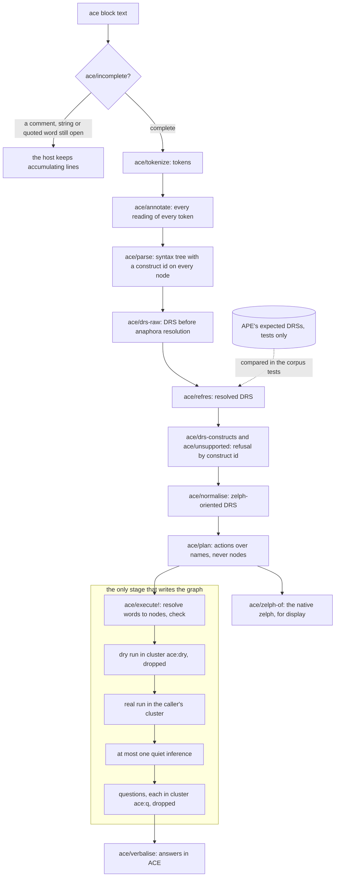
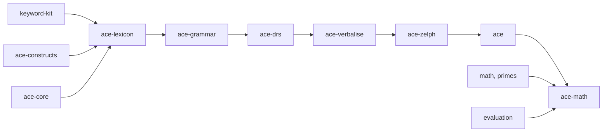

# Architecture

This document outlines the construction of the ACE front end: the sequential stages an `ace` block undergoes, the rationale behind the placement of the boundaries between them, the modular organization of the codebase, the reason the official ACE parser (APE) is employed solely during development and testing, the method of writing the grammar without reading APE's source code, and the strategy that ensures the front end remains cheap even when operating on a graph the size of Wikidata.

The design adheres to a single principle from start to finish. zelph already performs reasoning: the documented engine features include facts, rules, negation as failure, contradictions, questions, clusters and quiet runs. The proposed work is the mapping between ACE and zelph, implemented entirely as stdlib `.zph` modules (Janet code combined with zelph) built atop the public Janet API – just as `stdlib/sparql.zph` already layers SPARQL on that API without requiring the C++ core to know about SPARQL. The C++ core contains no ACE word, construct, message or module name (host rule H-1, see [below](#the-rule-the-host-lands-first)). All stages before the last one work on plain Janet data and create nothing in the graph; only the last stage writes, and it does so using engine features that have been validated and released alongside zelph 1.1.0 ([What zelph Already Provides](foundation.md)).

A user seeking to see the pipeline in action requires just one option: enabling `:show-zelph` prints the native zelph written by a block, before the answers.

!!! example "Specified session — the behaviour this specification requires, not yet implemented"

    ```
    zelph> .import ace
    zelph> %(ace/option :show-zelph true)
    true
    zelph> ace John is a man. Every man is a human.
    Is John a human?

    John ~ man
    (*{(X ~ man)} ~ conjunction) => (X ~ human)
    Answer: Yes. John is a human.
    zelph> ace Is Mary a human?

    Answer: It is not provable that Mary is a human.
    ```

The first block progresses through each stage outlined below: the trio of sentences undergo tokenization and parsing and are turned into a discourse representation structure (DRS); the classifier detects no element that zelph cannot use; the plan contains a single fact, a single rule, and a single question; the two central lines represent what `ace/zelph-of` renders from that plan; the fact and the rule are written, one quiet inference derives that John is a human, and the question, posed within a scratch cluster that is dropped afterwards, receives an answer in ACE. A sentence that solely asserts produces no output. The second block is a question on the keyword line; Mary possesses no facts, thus the answer corresponds to the third option among the three yes/no answers ([Yes/No Questions](answers.md#yesno-questions)). A rule featuring a single condition is written as a condition set with one member (decision [DEC-RECORD-SINGLE](decisions.md#dec-record-single)), and `ace/zelph-of` renders it as zelph itself lists such a rule (decision [DEC-ONE-CONDITION-PRINT](decisions.md#dec-one-condition-print)); zelph records the contradictions arising from a plain single condition precisely in the same way as those from a one-member condition set, meaning the form does not decide whether a contradiction is recorded. On a graph that does not include the rule, this printed form is the sole one able to construct the rule as the front end constructs it; entered directly in native form, `(X ~ man) => (X ~ human)` builds the plain rule, just as `((X ~ man)) => (X ~ human)` does, since parentheses function only to group, and zelph treats the plain and the set form as one rule; on a graph that already holds the rule in either form, each of the three spellings meets it ([DEC-RECORD-SINGLE](decisions.md#dec-record-single)).

Currently, the native lines operate within zelph. Inputted under `.lang ace`, the naming language that the front end uses to store its words, they build the identical fact and rule, the engine derives the conclusion, and a native query finds it:

```
zelph> .lang ace
ace> John ~ man
ace> (*{(X ~ man)} ~ conjunction) => (X ~ human)
(John ~ human) ⇐ {(John ~ man)}
ace> X ~ human
Answer: John ~ human
```

## The Pipeline

### Stages and Where They Live

A block goes through the following stages in the sequence indicated. The names, signatures, and effect classes appear in their entirety within [The Public API](api.md#the-public-api); the internal sequence within the handler is specified in [What a Block Does](block.md#what-a-block-does). Everything situated outside the box in the diagram reads only the lexicon and a limited set of names; nothing located there writes the graph or turns a word into a node. Messages are named by ids formatted as `[ace/<id>]` (`[ace/syntax]`, `[ace/unsupported]`, the warnings `[ace/w-…]`); their catalogue is detailed in [The ace Block](block.md#the-message-catalogue).



| Stage | What it produces | Effect | Module |
|---|---|---|---|
| `ace/incomplete?` | true as long as a comment, string, or quoted word remains unclosed, causing the host to continue accumulating input | pure | `ace` |
| `ace/tokenize` | tokens and multi-word names, prepped for processing | pure | `ace-lexicon` |
| `ace/annotate` | each reading of every token: lexicon readings, and for unrecognized words, the open-class readings permitted by their form, labelled as guessed; marks for readings that may signal warnings; the annotated string that the grammar matches; no warning is triggered | reads (the lexicon cache; non-creating name probes) | `ace-lexicon` |
| `ace/parse` | the syntax tree, with a construct id assigned to each node; the plain grammar, or the backtracking variant when a sentence includes a guessed reading; names processed separately first, merged multi-word names only if separation fails; reading warnings (`w-lemma`, `w-compound`, `w-guess-reading`, `w-ing`, `w-multiword`) included in the top node of the tree | pure | `ace-grammar` |
| `ace/drs-raw` | the DRS before anaphora resolution, annotated with markers indicating unresolved elements | pure | `ace-drs` |
| `ace/refres` | the resolved DRS along with its associated warnings; this is the DRS used by corpus tests for comparison with APE's output | pure | `ace-drs` |
| `ace/drs-constructs`, `ace/unsupported` | the construct ids present in the DRS, and those not currently supported; a non-empty list causes refusal of the block | pure | `ace-drs`, `ace-constructs` |
| `ace/normalise` | the DRS reformatted for zelph compatibility | pure | `ace-drs` |
| `ace/plan` | the plan: a tuple of actions whose terms are names, never nodes | pure | `ace-drs` |
| `ace/zelph-of` | the native zelph representation of a plan, with one statement per line ("show me the zelph") | pure | `ace-drs` |
| `ace/execute!`, resolution step | each content word resolved to a node via (word, role); identities among named constants decided by node; instance and subclass predicates established; rule extents approximated; checks requiring the graph performed; nothing is created | reads | `ace-zelph` |
| `ace/execute!`, writing steps | the dry run executed in the scratch cluster `ace:dry`, then dropped; the real run performed in the caller's cluster; at most one quiet inference; the contradictions encountered; each question processed in its own scratch cluster `ace:q`, then dropped | writes | `ace-zelph` |
| `ace/verbalise` | answer sentences expressed in ACE | reads | `ace-verbalise` |

"Pure" signifies complete absence of graph interaction; "reads" indicates only calls that do not generate new nodes, or nodes established within a scratch cluster that the same function both opens and drops, ensuring the `.stat` output reflects identical node counts before and following execution; "writes" functions conclude with `!` and change the graph within the active cluster.

In addition to the keyword, several entry points execute portions of the identical chain:

- `ace/analyse` runs every stage situated above the boundary and returns data: the resolved DRS, the construct ids, the status (accepted, refused, rejected), and the message the keyword would raise. It never triggers an exception, writes nothing, and resolves no word. It covers the smoke slice at milestone M1 and all of ACE from M2 onward (the milestones are detailed in [Work Plan and Milestones](plan.md#the-milestones)).
- `ace/execute-drs!` activates the sequence beginning with the classifier and proceeding downward on a DRS provided to it, enabling the mapping to be exercised on APE's own DRSs before the grammar covers them (decision [DEC-DRS-ENTRY](decisions.md#dec-drs-entry)).
- `ace/load!` and `ace/load-text!` (introduced at M2) first analyse an entire multi-paragraph document above the boundary and subsequently execute it as a single theory ([ACE Documents](block.md#ace-documents)).
- `(ace/senses w)` runs only the resolution of a single word and prints its Wikidata candidates; it writes nothing ([Choosing Another Sense](words.md#choosing-another-sense)).
- Starting at M9, the keyword `ace-retract` runs the same stages up to and including the resolution step, and then removes the facts named by its sentences, unless a derived fact rests on one of them or another statement nests one ([Taking a Statement Back](answers.md#taking-a-statement-back-ace-retract)).

### Why the Boundaries Lie Where They Do

Every boundary within the sequence is present due to delivering a particular benefit. The twelve motivations outlined beneath form the architecture's backbone; most of these also clarify a decision documented in [Design Decisions](decisions.md), and several represent the indirect routes that [Design Routes Taken and Not Taken](routes.md#routes-that-shape-the-architecture) weighs against the direct routes.

#### A lexical pre-pass, then a grammar without callbacks

`ace/annotate` attaches each reading of every token before the grammar runs and renders them into an annotated string, where the grammar performs exact matches on the reading tags. A lower-case word lacking a lexicon entry gets the readings permitted by its form, tagged as guessed (decision [DEC-UNKNOWN](decisions.md#dec-unknown): unknown words are interpreted based on their position). This buys four things ([Why a pre-pass](grammar.md#why-a-pre-pass) provides the full explanation):

- all errors originating from the lexicon within a block are gathered and presented together, before any syntax error being reported;
- the typical parsing process completes without invoking a Janet call for each individual token;
- the grammar remains independent of the lexicon's contents, ensuring that declaring a word later never necessitates recompiling the grammar;
- the annotated string serves as both a diagnostic tool ("how did the lexicon read this sentence?") and a stable interface for testing purposes.

The pre-pass does not serve as a workaround for a crash: a prior Janet crash had an independent root cause and has been resolved (trap T1 in [The Traps](#the-traps)).

#### One set of rule builders, four grammar variants

The grammar is expressed just once, using Janet functions that build parsing expression grammar (PEG) rules as data. From this single collection of builders come four variants:

| Variant | What it is | When it runs |
|---|---|---|
| plain | the PEG compiled from the builders; devoid of callbacks | each sentence that lacks a guessed reading |
| counting | the identical PEG, with each named rule counting into `(ace/state :work)` | `(ace/parse annotated {:count true})`, which `ace/analyse` forwards upon request for counting; the work metric used in the tests |
| diagnostic | the same PEG, with every terminal enclosed in `kit/expect` | following a failed match: the most distant failure and the labels expected at that point, for constructing the syntax error message |
| backtracking | an interpreter operating on the rule data generated by the builders, invoking compiled terminals for terminal nodes | each sentence featuring at least one guessed reading, also when the plain PEG would succeed |

The fourth variant exists since a PEG makes a definitive choice upon the first matching alternative, rendering it incapable of processing sentences where most words have multiple readings. It rejects valid sentences that possess precisely one parse (such as "a wombat grazes." with both words unrecognized) and silently misparses others; neither adjusting rule sequence nor applying bounded lookahead can fix this. The success of a plain PEG provides no insight into the reading of a guessed word, which is why the interpreter also runs when the PEG succeeds. The interpreter enumerates parses within a defined work budget (`[ace/too-ambiguous]` if exceeded), ranks them (favouring fewer marked readings, then rule order), and reports a second distinct parse of identical rank via `[ace/w-guess-ambiguous]` ([The backtracking variant](grammar.md#the-backtracking-variant)).

ACE's interpretation rules – determining how a sentence with multiple potential structures is read – are marked as cuts within the rule data. The PEG variants compile a cut into a plain sub-pattern; the interpreter never backtracks into one. Consequently, the interpreter keeps the interpretation rules' preferences and differs from PEG solely in the readings it may choose for guessed words; a test pins that the cuts leave no second structural parse on the corpus of known vocabulary. All three PEG variants recognize the same language. Strict mode (`{:guess false}`), which mirrors APE's behaviour without guessing and is the corpus tests' mode, eliminates guessed readings entirely and never reaches the interpreter, and a test pins that a sentence lacking guessed tokens also never triggers the interpreter. The three PEG variants are compiled just once upon import (a 30-rule prototype grammar compiled in 0.07 ms, measured on an earlier development tree); the interpreter walks the same data and needs no compilation.

Adding multi-word proper names does not introduce a fifth variant (decision [DEC-MULTIWORD](decisions.md#dec-multiword)): a sentence undergoes parsing using separate names first, and solely if that fails, every run of two or more capitalized words is combined into a single name for a second attempt. Strict mode never merges. Further specifics can be found in [Tokenizer, Grammar and Lexicon](grammar.md#the-multi-word-fallback).

#### Our own syntax tree, not APE's

Syntax trees do not serve as an oracle: APE's corpus stores trees in two distinct formats, and APE's internal test framework compares DRSs exclusively. Replicating APE's tree categories would also precisely violate the clean-room rule ([below](#the-clean-room)). Consequently, the tree employs its own node kinds, and each node carries the identifier of the construct row responsible for its creation (refer to [The Construct Table](#the-construct-table)).

#### The DRS is the pivot, and stays APE-shaped until normalization

The result produced by `ace/refres` takes the shape of APE's DRS notation, as specified in the public DRS report. Contrasting it against the corpus's expected DRS (loaded via `ace/ape->drs`: all 3779 corpus terms in 0.069 s, measured on an earlier development tree) makes the corpus an oracle for the parser, separate from the mapping to zelph. Conversely, `ace/execute-drs!` runs the mapping on APE's own DRSs before the grammar covers them (decision [DEC-ORDER](decisions.md#dec-order): DRS first, with a small smoke slice first). All zelph-specific elements (copula substitution, events, the helper rules for negated conditions, …) are handled within `ace/normalise` or afterwards ([Normalization](semantics.md#normalization)), ensuring no zelph-specific content enters the oracle comparison.

#### Refusal happens on the resolved DRS, by construct id

Each construct id identifies a specific type of ACE construct, such as `:modal/can` for "can" or `:or/in-head-or-statement` for a disjunction stated as a fact. The classifier `ace/drs-constructs` finds the ids from a resolved DRS, and the block is refused if any of these ids lacks support. The same classifier runs on the expected DRSs from the corpus, ensuring that the production refusal and the test expectation remain aligned. Any valid ACE not within the supported set is always reported as "Correct ACE, but zelph cannot use it", never flagged as a syntax error, and never turned into a silently wrong graph. Syntax-level ids never gate a refusal, since a resolved DRS does not include them: the sentences "A man who waits sleeps." and "A man waits. He sleeps." yield identical conditions.

As the work advances milestone by milestone, a construct that a later milestone will map is refused, including its identifier and the milestone that will bring it. A session at milestone M7, before modality:

!!! example "Specified session — the behaviour this specification requires, not yet implemented"

    ```
    zelph> ace Mary can swim.

    Error in line "ace Mary can swim.": Correct ACE, but zelph cannot use it [ace/unsupported]: sentence 1, line 1, column 10: modality ('can'), construct modal/can.
      Mary can <>swim.
      Statements about what is possible or necessary are planned for milestone M8.
    ```

The initial segment of the line presents the host's frame, `Error in line "ace <first line>":`, which names the block; the message proper begins with its class. The position corresponds to the token of the construct's evidence within the DRS: for a modal statement, the first simple condition located within it, here the verb `swim` at column 10, whereas the description names the word that triggers the construct, `can` ([Positions](constructs.md#positions)). As on every page of this specification, the wording of a message serves as an example, while its layout, its id, and its position are normative ([Messages](block.md#messages)). The whole block is refused and nothing is written. Whether an id is supported hinges solely on its row's milestone, the module it needs, and the current milestone constant, making the progression of a milestone a single modification in the mechanism. The complete inventory of ids and the rows that remain refused in v1 can be found at [Constructs and Refusals](constructs.md#construct-ids-by-milestone).

#### Plans hold names, never nodes, and are pure

A plan assigns to each word a name string and a role; it never holds a node. Above the boundary, the graph is read in only two ways, and neither results in the creation of a node:

- the lexicon cache: entries in the user lexicon are represented as facts on word nodes within the `ace-lex` language (decision [DEC-LEX-STORE](decisions.md#dec-lex-store)), and the cache reads only those nodes;
- the annotator's `zelph/lookup` probes. The near-miss check ("a guessed word one typing edit away from a lexicon form or an existing `ace` name is rejected", DEC-UNKNOWN) probes `ace` names, a fixed number per guessed word. The marks behind `[ace/w-compound]` and `[ace/w-multiword]` probe `ace` names and, on a graph where labels carry the importer's marker `wikidata:labels-v2`, also consider English labels.

In addition, the graph is read only for the error message's text: within a Wikidata graph, `[ace/reserved-word]` carries an `n:Q…` hint derived from the identical candidate lookup that `ace/senses` relies on. The probes decide whether a text is accepted (a near miss is rejected with `[ace/unknown-word]`) and assign applicable warnings, without affecting the DRS, the lemmas, the individual names, or the plan. Thus, acceptance may rely on the `ace` names a graph holds (a typo of a word generated by a prior block), yet never on a Wikidata label or identifier. No component of the DRS or the plan is contingent upon an `ace` name, an English label, or a Wikidata id:

- the lemma of a word that was guessed depends only on the text and the lexicon (DEC-UNKNOWN);
- each individual brought into existence by "There is a man." receives a name derived from a hash of its canonical description, `<Head>-<16 hex digits of FNV-1a-64>` (decision [DEC-INDIVIDUALS](decisions.md#dec-individuals); [Canonical Text and Names](semantics.md#canonical-text-and-names)), ensuring identical descriptions refer to the same individual across every run and re-entering a text adds nothing;
- a proper name is named by its canonical symbol (`Douglas-Adams` and `Douglas Adams` are both "Douglas Adams", DEC-MULTIWORD), while a quoted word is named by its literal content with whitespace normalized and otherwise preserved exactly (decision [DEC-QWORD](decisions.md#dec-qword)).

An accepted text yields identical DRS, identical individual names, and identical plan when evaluated on an empty graph versus on Wikidata, and the corpus oracle remains independent of any graph. `ace/zelph-of` renders a plan devoid of a graph for `:show-zelph` and for the test that re-enters the shown lines natively ([RT-3](tests.md#rt-3-native-equivalence-of-the-shown-zelph)); when operating on a Wikidata graph, it adds the resolved nodes for display only.

#### Resolution: the one place where a word becomes a node

The initial step of `ace/execute!` resolves each content word within the plan, and it creates nothing (decisions [DEC-WIKIDATA](decisions.md#dec-wikidata), [DEC-NEQ](decisions.md#dec-neq), [DEC-PATHS](decisions.md#dec-paths)):

- every content word is resolved through (word, role) using `ace/concept!`, in four steps: an explicit Wikidata identifier (`p:Q42`, `n:Q8441`, …), otherwise an existing `ace` node, otherwise a Wikidata label (on a Wikidata graph, for nouns, names, and relational nouns), otherwise "new"; the label step is cached per (word, role) and graph epoch, while the other steps involve hash lookups that execute each time ([The Four Steps](words.md#the-four-steps) provides full details);
- identities among named constants are decided by node: a false ground identity is `[ace/contradiction]`, a false identity condition makes a rule vacuous (`[ace/w-vacuous]`), and an asserted identity between an individual and a name is `[ace/unsupported]`;
- the instance and subclass predicates are fixed: a node the user named `ace:instance` or `ace:subclass` in language `ace` takes precedence; otherwise the graph's pin determines the outcome. The pin is a single internal fact in language `zelph`, `ace:profile ace:uses ace:wikidata` (instance P31, subclass P279) or `ace:profile ace:uses ace:core` (instance core `~`, no subclass predicate); an unpinned graph gets the profile the pin would have. No node is renamed and no name is assigned. A graph that differs from its pin gives `[ace/w-profile]` once per session and retains the pin. The pin, the sole function that builds class patterns, and the subclass closure in yes/no questions arrive at M1; wh-questions and relational nouns draw upon them from M3, rule conditions from M4 ([Classes: the Instance and Subclass Predicates](words.md#classes-the-instance-and-subclass-predicates));
- a rule's class extent is estimated via `zelph/degree`: if exceeding 100,000 facts on the class node, the rule receives `[ace/w-large-rule]` and is kept;
- the checks requiring graph access raise `[ace/unsupported]` here, before any writing: a ground arithmetic term lacking a value used as data (`:expr/as-data`, with `ace-math`), and from M4 three checks over the graph of which rules may derive what: `:naf/unstratified` (a negated condition that a rule with a negated condition could feed, across the block's and earlier blocks' ACE rules; decision [DEC-STRATA](decisions.md#dec-strata)), `:rule/endless-generation` through subclass facts ("Every human has a mother who is a woman." with woman a subclass of human), and `:rule/unsafe-hypothesis` for a conditional in a question (decision [DEC-QUNIV](decisions.md#dec-quniv)); [Context Checks](constructs.md#context-checks) lists every context id alongside the stage that finds it;
- the entries in the block's `word-senses` note are gathered; they are considered announced only upon successful block completion, and a rejected block appends the note to its error.

Resolution does not belong to `ace/plan`, as it depends on the graph while the plan must remain independent. It occurs before the dry run, since its judgments and warnings either reject or annotate a block before any writing takes place. A word labelled new is created by `ace/concept-node!` during the dry run and once more in the real run, never during the resolution step, ensuring both runs produce identical nodes and a rejected block results in no residual trace. Additionally, both runs write two things that are not plan actions and are written outside any rule build: on an unpinned graph, the pin is placed just before the first write that holds a class item, and the mark `I ace:individual nil` is added for every individual claimed by the block. A referent located within an opaque box (a that-clause or a modal statement, M8) is written within the mention scope, unclaimed, and carries no mark.

#### The engine is the validator: the dry run

There is no duplicate of zelph's refusal logic in Janet, which might otherwise stray from the engine (decision [DEC-ATOMIC](decisions.md#dec-atomic)). A private transaction cluster offers no alternative either: only the active cluster records new nodes, so a block successfully constructed in a private cluster would remain undetected by the user's `.cluster` and by the tests' individual case clusters, and a cluster cannot be merged from Janet. Thus, a single write pass occurs in the scratch cluster `ace:dry`, which is subsequently dropped, followed by the real pass in the caller's active cluster. If the engine refuses a write during the dry run (by asserting something the graph refutes, refuting something it asserts, or making an opacity declaration it does not accept), the block is rejected, and the drop has already undone every change made during the dry run. What a drop restores, and how a failed dry run is categorized, is specified in [All or Nothing: the Dry Run](block.md#all-or-nothing-the-dry-run).

Derived contradictions are reported and the block remains intact, in accordance with zelph's own policy ([Rules and Inference](../rules.md): a contradiction is reported, not enforced). Starting with M4, the `:atomic :consistent` option executes the block's inference during the dry run as well and rejects a block if its run met a new contradiction. The dry run needs three host items from M1, when the front end first writes the graph: P-drop-names (a drop removes names without scanning the name map), P-scratch-drop (a drop keeps the engine's fact stores armed) and P-restore-mark (a restored rule-pattern mark is assigned to no cluster). Beginning with the first construct that refutes (M4), it also needs P-refute (e) (a drop reclaims what a refutation within the cluster wrote). All these are built and included in zelph 1.1.0 ([Scratch clusters and the dry run](foundation.md#scratch-clusters-and-the-dry-run)), so the dry run incurs time proportional to the block, not to the graph.

The pattern functions within zelph at present. A stand-in for a block that first writes a fact and subsequently asserts something the graph refutes: the engine refuses the second write, the drop removes the first one, no trace remains, and the fact stores stay armed:

```
zelph> ¬(john waits nil)
zelph> .fact-stores
Fact-path stores: on
zelph> %(do (def prev (zelph/cluster)) (zelph/cluster "ace:dry") (def r (protect (do (zelph/fact "mary" "~" "woman") (zelph/fact "john" "waits" "nil")))) (zelph/cluster prev) (zelph/out (string/format "dry run: %j, dropped %d" r (zelph/cluster-drop "ace:dry"))))
dry run: (false "fact(): this fact is known to be wrong"), dropped 3
zelph> %(zelph/out (string/format "mary: %j" (zelph/lookup "mary")))
mary: nil
zelph> .fact-stores
Fact-path stores: on
```

The three nodes that were removed are `mary`, `woman`, and the fact situated between them; `john` and `waits` predated the cluster and are not recorded by it.

#### One theory per block

A block constitutes a single theory (decision [DEC-QTIME](decisions.md#dec-qtime)): all writes occur first, followed by at most one quiet inference (decision [DEC-RUN](decisions.md#dec-run)), then the questions in sentence order, each placed within its own scratch cluster `ace:q`, which is subsequently dropped. "Is John a man? John is a man." thus yields an answer of yes. A question never makes an assertion. Any contradictions encountered during the hypothetical run of a conditional question remain confined within `ace:q` and are not reported; upon encountering one, the answer is "It is not provable that …" ([Questions That Hold a Conditional](answers.md#questions-that-hold-a-conditional)).

#### Answers only, until explanations arrive at M9

The front end's own quiet inference brings the graph to a fixpoint, and the host skips its automatic run following a handler that ran after its most recent write (host item P-autorun-skip), ensuring that no derivation in zelph syntax reaches an ACE session. Before M9, no part of the derivation is displayed. Starting with M9, the `:echo` option (showing each derived sentence alongside the sentences it rests on) and the `:justify` option (displaying each answer with the sentences it relies upon) add explanations in ACE (decision [DEC-ECHO](decisions.md#dec-echo); [The Derivation Echo](answers.md#the-derivation-echo)). When `:echo` is active, the block's execution becomes `(zelph/run-delta :quiet :derived)`, and the echo is built from the `:derived` entries present in its result.

#### Errors are message records inside, strings at the boundary

Within the front end, a failure manifests as a message record, `{:ace/id id :args {…}}`, raised with `ace/fail` and caught by tests using `protect`. Each function accessible to a user through a `%` line that may raise a message formats the record using `ace/message` and raises the resulting string: the handlers (`ace/handler`, `ace/lexicon-handler`, from M9 `ace/retract-handler`), `ace/declare!`, `ace/load-ulex!`, `ace/execute!`, `ace/execute-drs!`, `ace/senses`, `ace/load!`, and `ace/load-text!`. `ace/analyse` returns the record as raw data. `ace/option` raises a plain Janet error string that specifies the valid keys or values: this indicates an API misuse, not a message from the catalogue. The phrasing resides exclusively in the catalogue `ace/messages` ([Where Wording Lives](block.md#where-wording-lives)); the layout and identifiers are governed by [Messages](block.md#messages), while the classes of errors are defined under [Effect Classes and Errors](api.md#effect-classes-and-errors).

The cause lies in how the host manages an error. When a keyword handler throws a string, it appears exactly as thrown, following the block's keyword and first line (host item P-error-envelope; ` …` indicates additional lines were present). A stand-in keyword `kk` whose handler raises a string displays that string:

```
zelph> %(zelph/register-keyword "kk" (fn [t] (error "the handler's own message, as it was raised")))
zelph> kk John waits.
Mary sleeps.
   
Error in line "kk John waits. …": the handler's own message, as it was raised
```

Any other value appears in its Janet representation, preceded by the host's generic prefix – this is not a message intended for user consumption; hence, whenever any other error value reaches a boundary of the front end, it is turned into the message `[ace/internal]`, preserving its Janet text:

```
zelph> %(zelph/register-keyword "kk" (fn [t] (error {:ace/id :syntax})))
zelph> kk John waits.
   
Error in line "kk John waits.": Janet error in handler for keyword 'kk': {:ace/id :syntax}
```

#### `ace/execute!` runs under `.lang zelph`

`ace/execute!` establishes `.lang zelph` via `zelph/lang` and restores the caller's language on every exit path, just as every other public function that might instantiate a node does (decision [DEC-CONTENT-NS](decisions.md#dec-content-ns)). Anything that zelph names implicitly (rule and query variables, characters within a string) is placed in `zelph`; every node explicitly named by the front end receives an explicit language: content within `ace`, internal vocabulary, the pin, the individual mark, and the maths stack all reside in `zelph`. The user's `.lang` never influences how the front end resolves anything. The rationale behind content being housed in its dedicated language `ace`, rather than in Wikidata's label language `en`, is detailed in [Naming Languages](words.md#naming-languages); the implications for native lines entered alongside `ace` blocks are covered in [Content Lives in Language ace](zelph-features.md#content-lives-in-language-ace).

## Modules and Partial Imports

### The Modules

Every file resides within `stdlib/` and is automatically detected by the build process and the embedded file system in the WebAssembly playground, requiring no build changes. Dependencies are specified through `.import` statement lines exclusively, never via `(zelph/import …)` called from Janet (trap T2 in [The Traps](#the-traps)). The dependency relationship follows a straight line: in the diagram, an arrow points from a module toward the one that imports it.



| File | Component in the pipeline | Graph modifications during import |
|---|---|---|
| `keyword-kit.zph` | general utilities for keyword languages, devoid of ACE-specific knowledge ([see below](#keyword-kit)) | no changes |
| `ace-constructs.zph` | the state table `ace/state`, the milestone constant, the construct table, the message catalogue | no changes |
| `ace-core.zph` | the shipped vocabulary, expressed solely as Janet data | no changes |
| `ace-lexicon.zph` | morphological analysis, the lexicon store and cache, guessing mechanisms, `ace/tokenize`, `ace/annotate`, the handler for the `ace-lexicon` keyword | no changes |
| `ace-grammar.zph` | the rule builders and the four grammar variants, `ace/parse` | no changes |
| `ace-drs.zph` | the DRS stages, the classifier, normalization, `ace/plan`, `ace/zelph-of`, `ace/analyse`, and the oracle functions used in corpus validation | no changes |
| `ace-verbalise.zph` | conversion of DRS (with bindings) and fact nodes into ACE text | no changes |
| `ace-zelph.zph` | all components responsible for graph writes: word resolution, plan execution, inference, questions, contradiction reports, `ace/load!` | no changes |
| `ace.zph` | the handlers, `ace/incomplete?`, `ace/option`, the keyword registrations (`ace`, `ace-lexicon`; added in M9: `ace-retract`), the import notification | no changes |
| `evaluation.zph` | a general arithmetic module (`exquo`, `difference`, `compare`) without any `ace/` name | its rules |
| `ace-math.zph` | numeric values, arithmetic expressions, the decision of formulas; the maths vocabulary provided as shipped data | the maths stack |

[Files](api.md#files) enumerates each module's public functions alongside their precise import lines; [When Each Part Arrives](api.md#when-each-part-arrives) specifies the milestone that delivers each one. Three directional rules govern the chain:

- The data module `ace-core.zph` contains no imports, and `ace-lexicon.zph` depends on it, meaning every importer of the lexicon, including those using `.import ace-drs`, gains access to the shipped vocabulary (decision [DEC-LEX-STORE](decisions.md#dec-lex-store)). An overlay loaded via `:replace` conceals the built-in entries; the corpus tests exploit this to load APE's small lexicon instead (decision [DEC-CORPUS](decisions.md#dec-corpus)). Neither the built-in vocabulary nor any part of `ace-math`'s vocabulary is written into the graph, so a `.load` operation, which replaces the graph, cannot remove the foundational vocabulary.
- `ace-math.zph` imports `ace`, shifts to `.lang zelph`, then incorporates `math`, `evaluation`, and `primes`, restores the caller's language setting, registers its own vocabulary, and positions its hook table at the end (decision [DEC-MATH-IMPORT](decisions.md#dec-math-import); the order is detailed in [Modules, the Hook and the Load Order](math.md#modules-the-hook-and-the-load-order)). Janet compiles a function at the moment it is defined, so modules compiled before `ace-math` cannot name its functions directly; they reach them solely through the hook table located in `(ace/state :math)`.
- `ace.zph` never imports `ace-math`: incorporating maths alters the entire session (thousands of nodes, hundreds of rules, an automatic run following each subsequent input line), which should be a visible user action, not an unintended consequence of a single sentence. Numbers and arithmetic are therefore refused with a message that names the import. A number lacks its own token within the DRS, so the marker stands at the condition that holds it, in this case the `be` in "is":

!!! example "Specified session — the behaviour this specification requires, not yet implemented"

    ```
    zelph> .import ace
    zelph> ace John's age is 30.

    Error in line "ace John's age is 30.": Correct ACE, but zelph cannot use it [ace/needs-math]: sentence 1, line 1, column 12: a number, construct data/integer.
      John's age <>is 30.
      Numbers and arithmetic need the math stack: .import ace-math
    ```

The file `keyword-kit.zph` carries no ACE knowledge, so its name and the `kit/` prefix remain correct when `sparql.zph` later adopts it, a distinct modification.

### What a Partial Import Does

The split into a linear sequence is maintained so that the parser, the DRS stages, and the corpus tests run on `.import ace-drs`: the functions and data from the first six modules, without any keyword, without maths, without a number substrate, without node (`.stat` remains unaltered), without any output beyond the host's import lines, and a lexicon containing the shipped vocabulary and no user-defined entries. `.import ace-zelph` adds `ace-verbalise` and `ace-zelph` under identical assurances. Only `.import ace` registers keywords and prints the import notice; only `.import ace-math` loads maths. The complete requirement, including its validation tests, is detailed in [What a Partial Import Does](api.md#what-a-partial-import-does).

!!! example "Specified session — the behaviour this specification requires, not yet implemented"

    ```
    zelph> .stat
    Network Statistics:
    ------------------------
    Nodes: 15
    RAM Usage: 0.0 GiB
    Languages: 0
    Rules: 0
    ------------------------
    zelph> .import ace-drs
    zelph> %((ace/analyse "John is a man. Every man is a human.") :status)
    :accepted
    zelph> %((ace/analyse "John waits or Mary sleeps.") :refused)
    (:or/in-head-or-statement)
    zelph> .stat
    Network Statistics:
    ------------------------
    Nodes: 15
    RAM Usage: 0.0 GiB
    Languages: 0
    Rules: 0
    ------------------------
    ```

The guarantee incurs no cost, as a module solely defining Janet functions adds no node, and registering a keyword likewise contributes nothing. What it avoids is substantial: executing the 3733 cases from the corpus's regression set, each within its own cluster, took 82 ms without maths and 93 s with maths loaded (measured on an earlier development tree, when maths contained fewer nodes and rules than today). The precedent remains valid: `sparql.zph` registers its keyword and writes nothing; the 15 nodes correspond to those of an empty graph.

```
zelph> .stat
Network Statistics:
------------------------
Nodes: 15
RAM Usage: 0.0 GiB
Languages: 0
Rules: 0
------------------------
zelph> .import sparql
SPARQL subset loaded. Type 'sparql', paste your query, finish with an empty line.
zelph> .stat
Network Statistics:
------------------------
Nodes: 15
RAM Usage: 0.0 GiB
Languages: 0
Rules: 0
------------------------
```

### Invariants of Every Module

Nine principles govern every `ace` module, each pinned by a corresponding test. They are specified, each with its associated cost of violation, under [Invariants](api.md#invariants); in short:

1. **One shared Janet environment**, with public identifiers `ace/<name>` and private ones `ace-<module>/<name>`, no bare top-level name and no top-level `var` (a redefined one splits silently from functions compiled against the initial version); mutable state exists solely within the table `ace/state`.
2. **Module state functions as a cache.** No element intended to persist across `.save` and `.load` operations resides exclusively there (provenance is recorded in node annotations, decision [DEC-PROV](decisions.md#dec-prov)); each cache storing graph-derived data is tied to a specific graph epoch (`zelph/epoch`).
3. **Graph writes** occur exclusively within functions whose name terminates in `!`, within `ace-zelph.zph`, and within the store functions of `ace-lexicon.zph`, and only on the main thread.
4. **No feature detection:** any binding required by the front end is first placed in C++.
5. **No temporary fix** for anything that a pending engine change would remove: the construct is refused by its identifier until the change is implemented.
6. **Explicit languages:** each node the front end names is named using an explicit language; every public function capable of generating a node runs under `.lang zelph`, with the setting and restoration applied on every exit path.
7. **Nothing along the `ace` path scales linearly with graph size** ([below](#nothing-is-linear-in-the-size-of-the-graph)); every `zelph/exists` call includes `:exact`, with a single named exception: the second probe in a yes/no question within `ace/ask`, invoked only after the exact probe fails.
8. **Within a rule-building thunk**, only node-building calls and reads such as `zelph/exists` are permitted; resolution, cluster switches, and queries are completed beforehand (trap T26).
9. **Each module endures a subsequent run within the same Janet environment**, just as after a replacing `.load` (decision [DEC-RELOAD](decisions.md#dec-reload)).

### How the Stages Are Probed

Each stage constitutes a public function operating on plain data, meaning that tests probe each one via `%` lines that output using `zelph/out` and `%j` (which encloses strings in quotes), all enclosed within `protect`: an error leaving a top-level `%` line would end the test case, hence every probe is isolated (rule TA-1 under [Rules for Every Test](tests.md#rules-for-every-test)).

```
%(zelph/out (string/format "ACE-AST %j" (protect (ace/parse (ace/annotate (ace/tokenize "John waits."))))))
```

## APE: a Development-Time Oracle

The Attempto Parsing Engine (APE) serves as the reference implementation of ACE, written in Prolog and published under the LGPL-3.0 license. The front end does not invoke it during execution, due to three independent reasons:

- **There is no run-time route.** A keyword handler executes outside the Janet event loop. Within a handler, `os/execute`, `os/spawn` followed by `os/proc-wait`, and any `ev/*` call that waits or relinquishes control terminate the handler abruptly with a message that names no cause, and `try` is unable to intercept it. Hence, a handler cannot start a process and read its answer. The WebAssembly playground lacks any processes entirely. APE is packaged nowhere and needs SWI-Prolog.
- **Licence.** A rule-by-rule port of APE's grammar, anaphora resolver, or equivalence check would constitute a derivative work of an LGPL-3.0 program, which acrion could not offer under its commercial licence alongside the AGPL. Consequently, the tokenizer, the grammar, the anaphora resolver, and the DRS matcher have been authored clean-room from the public ACE 6.7 documents ([below](#the-clean-room)). Operating APE unaltered alongside zelph would be permissible under its licence; the first reason rules that out.
- **ACE 6.7 is frozen.** Its grammar has remained unchanged since 2013, meaning an independent implementation does not chase a shifting objective.

During development, APE operates under SWI-Prolog 10 (decision [DEC-SWI](decisions.md#dec-swi)): executing `make install` within a cloned APE repository produces a working version without modifying the source code. The recognized flaws in this setup are inconsequential to this project's goals: the binary emits two error lines each time it launches, and XML DRS output functions correctly only when APE is executed directly from source. APE fulfils four purposes:

- **the test oracle:** at test time, the regression corpus comprising 3779 texts is retrieved, remains uncommitted, and solely the initial five columns are read (decision [DEC-CORPUS](decisions.md#dec-corpus); [APE's Regression Corpus](tests.md#apes-regression-corpus));
- **the pivot notation:** its DRS representation lies between the parser and the mapping (above);
- **a checklist for the user experience:** its error mechanism identifies scenarios that warrant a message, but never which wording;
- **a cross-check of new sentences,** executed in strict mode and in guessing mode. A sweep runs all 3779 corpus texts through a single SWI-Prolog process in both modes; it serves as the development baseline for the guessing gates ([Differential Testing Against APE](tests.md#differential-testing-against-ape)).

APE's guessing mode serves as a reference, not a model. It reads an unfamiliar word based solely on its location, preserves the surface form as the lemma, drops agreement, guesses lower-case proper names and free adverbs, and makes guessed nouns neuter. The front end intentionally diverges from this approach (DEC-UNKNOWN; the specific differences are detailed in [Deliberate Deviations from APE](grammar.md#deliberate-deviations-from-ape)). APE's verbalizer also fails to function as a round-trip oracle: it renders questions in a comment-like structure, removes `the` preceding names, and marks guessed words through a prefix followed by a space before the final punctuation. The front end's internal round-trip validation (answers re-entered as ACE) is tested against the front end itself ([RT-1: Answers Re-Enter](tests.md#rt-1-answers-re-enter)).

APE is never a build or test dependency, and no part of APE is included in commits.

## The Clean Room

The licensing reasoning presented earlier remains valid only when the grammar constitutes genuinely independent work. For each session that writes `ace-lexicon.zph`, `ace-grammar.zph`, `ace-core.zph`, or `ace-drs.zph`, the clean-room rules apply. These are detailed completely in [Clean Room](grammar.md#clean-room), listing the public documents and their locations, each closed APE file individually, and the scheme of rule names; to summarize:

- **What the code is written from.** The public ACE 6.7 documents (the syntax report featuring its numbered rules, the construction and interpretation rules, the lexicon specification, the DRS report); for what they fail to cover (comments, quoted words, contractions, paragraph breaks and similar), a behaviour catalogue crafted specifically for this work, the corpus texts, and APE's observed output, accessed solely via its public interface; and the zelph mapping ([From Sentences to the Graph](semantics.md)), which determines the fields present in the syntax tree. The header comments in `ace-lexicon.zph`, `ace-grammar.zph`, and `ace-core.zph` MUST name the documents as the specification and state that no APE source was used.
- **What stays closed.** APE's grammar, tokenizer, anaphora resolver, and sentence-failure sources, its lexicon files, and its utilities for DRS equivalence, well-formedness, and spell checking are never accessed during code development, nor is any earlier research script that translated portions of them. A location within APE's sources that research notes reference serves as evidence of a behaviour, never as a directive to read it. The corpus tests read APE's small lexicon at test time using the front end's own lexicon reader; no one accesses it to write code.
- **What is never copied, even from memory.** APE's nonterminal names, its feature sets, its rule order, its way of threading the DRS through the grammar, its tree categories, its message texts and repair suggestions, its guessing mechanism, and its lexicon files. The small lexicon is licensed under LGPL-3.0; the large Clex lexicon is GPL-3.0 and derived from COMLEX, and it is never distributed, never retrieved during the build process, and never included as a test dependency. The two-character failure marker `<>` is a convention, not a protected expression. Example sentences from the public documents are not copied into the tests in bulk, and no sentence from APE's corpus is copied into a test or a published page: both employ brief original sentences in a construct's form and refer to a corpus case only by its id (rule TA-4 under [Rules for Every Test](tests.md#rules-for-every-test)).
- **Own names.** The grammar's rule names are descriptive kebab-case keywords (`:vp-sg`, `:np-obj-coord`, `:there-is`), and each rule builder cites in a comment the syntax report's rule numbers and the section of the construction or interpretation rules it implements. Rules are not named after those numbers: they are specialized by feature, so a one-to-one naming would claim a correspondence that does not exist ([Rule Names](grammar.md#rule-names)). The syntax tree's node kinds and the construct ids are also our own.

## The Construct Table

### One Inventory of the Language

A single data table, `ace/constructs` within `ace-constructs.zph`, serves as the language's inventory. It contains entries organized across three levels: syntax ids (found in the syntax tree), DRS-level ids (found in the resolved DRS), and context ids (encountered during planning, or during resolution when the graph is required). Each entry specifies the milestone from which the construct is supported, or indicates that it lacks a route in v1 and provides the justification. The fields of each entry, the full set of ids, and the explanations for entries without a route are detailed in [Constructs and Refusals](constructs.md#the-construct-table).

| Rows own | Rule builders own |
|---|---|
| the inventory: which constructs are present, at what level, within which corpus family | the structure: which grammar rules are available, their order, their features (number, gap, question word, finiteness), coordination and gaps, the cuts that encode interpretation rules |
| metadata: the milestone, the module a construct depends on, the host items and decisions it relies upon, the corpus cases it mirrors, the native zelph form | where a construct is identified within a sentence |
| examples that must be accepted and negatives that must be rejected | – |
| the verbalizer template | – |
| refusal data: the summary visible to the user, the explanation for a row lacking a route, and the hint derived from the milestone | – |

The grammar is not produced automatically from the rows. ACE constructs interact (coordination, relative clauses, gaps), and only rule builders configured through features have been confirmed to work. The precedent for builders driven by a single table is the maths front end, which uses one operator table to power both its parser and its printer. In v1, there is no run-time extension API; `ace/construct` serves as a read accessor.

### How the Table Reaches the Rest

The connection is intentionally minimal. Each syntax-tree node created by a builder includes its row identifier in the `:c` field, expressed as a literal keyword within the builder, across all grammar variants. DRS-level ids are found by the classifier `ace/drs-constructs`, context ids by `ace/plan`, or, when the graph is required, by the resolution step ([above](#resolution-the-one-place-where-a-word-becomes-a-node)). The function `ace/supported?` examines solely a row's milestone, its import, and the fixed value `ace/milestone`, meaning that updating a milestone constitutes a single modification.

Refusal messages originate from the same rows, alongside the verbalizer's templates (preserved adjacent to the construct to ensure parser and printer remain synchronized), the tests (including examples, negative instances, corpus entries, and the gate per identifier), and the generated regions of the planned user page `ace.md`, which a test evaluates against the generator's output. Four invariants – each pinned by a test from the commit introducing a row – maintain alignment among the rows, the grammar, and the classifier. All of this is specified under [One Table for Code, Tests and Documentation](constructs.md#one-table-for-code-tests-and-documentation); the documentation plan, including the playground's ACE demo group, resides under [Documentation Plan](plan.md#documentation-plan).

## keyword-kit

`keyword-kit.zph` contains the generic utilities required by any keyword language: masking comments and strings, finding a region that remains open at the end of a text, turning byte offsets to line and column positions, highlighting the erroneous character using `<>`, and tracking the furthest point of failure in a PEG for generating syntax error messages. Each of these five functions is pure and fully defined across all inputs. The module does not incorporate any ACE-specific information (such as word lists, message content, or ACE delimiters), which justifies its independence: `sparql.zph`, or any later keyword language, may utilize it without inheriting ACE, and its `kit/` prefix remains correct in such cases. `sparql.zph` currently maintains its own auxiliary functions; integrating the kit there constitutes a distinct modification. The definitions of the functions and the region-spec format are specified under [keyword-kit](api.md#keyword-kit); the region lists used by `ace` and `ace-lexicon` blocks (comments, strings, and quoted words), shared by the block veto and the tokenizer, are documented under [Region lists](grammar.md#region-lists), along with corpus cases that confirm them (13, 488, 660, 3630, 3631, among others).

## Keyword UX Beyond the Block Contract

The `ace` keyword functions as a standard handler on zelph's keyword host ([Scripting with Janet](../janet.md#extending-the-repl-zelphregister-keyword)), the same system the `sparql` keyword already uses. The host determines the termination point of a block: upon encountering the first blank line, though the handler retains the ability to veto that end. The front end contributes minimally, and every enhancement serves a distinct purpose:

- **The veto** `ace/incomplete?` holds a block open solely when a comment, a string, or a quoted word remains unclosed, and the text has not yet concluded with the two blank lines that trigger a forced dispatch; thus, an unclosed delimiter is reported at its position as `[ace/unterminated]` rather than via the host's default message.
- **Each block corresponds to a single paragraph** (decision [DEC-BLOCK](decisions.md#dec-block)): sentence numbering, anaphoric references, and variables reset with every new block; proper names and content-addressed individuals consistently reference the same nodes across all blocks.
- **Positions are measured from the block's text.** The handler sees neither the keyword nor any whitespace following it, meaning column 1 on the keyword line refers to the first character immediately after `ace` and the spaces after it ([Positions on the First Line](block.md#positions-on-the-first-line)).
- **Documents spanning multiple paragraphs** pass through `ace/load!` and `ace/load-text!` (originating in M2, decision [DEC-LOAD](decisions.md#dec-load)), which read APE's text semantics and execute the entire document as a single theory.
- **The import notice** appears exactly once per Janet VM via `zelph/out` (a plain string literal would fail, as value echoing is disabled within imported scripts); it says how a block is structured, how it terminates, and confirms that native lines meet the front end's words under `.lang ace`.

The host's conduct regarding a block remains unaltered for `ace`, even in unexpected cases: inserting two paragraphs results in the second one becoming native input, executing `.quit` within a block ends the session, and using `ace` without `.import ace` constitutes a native fact. Each of these traps is documented and verified through a test. The full block contract – encompassing the host's protocol, the right to veto, the traps, the options, the session events, and the output – is clearly defined, with a recording of the protocol from today's zelph available at [The ace Block](block.md#where-a-block-ends).

## Host Traps and How They Were Closed

### The Rule: the Host Lands First

Every component the front end needs from the engine is a host item, denoted by `P-<name>` and documented alongside a recording of today's zelph for each, as detailed in [What zelph Already Provides](foundation.md#what-the-front-end-relies-on). These items were built before any ACE-specific code, each accompanied by its own tests, and are included in zelph 1.1.0. The complete test suite and the Jacobian performance guard (a test that counts the work of a large mathematical workload and must remain within its baselines) were executed following each of them (decisions [DEC-WORKMODE](decisions.md#dec-workmode), [DEC-HOSTFIX](decisions.md#dec-hostfix); [How the foundation was built](foundation.md#how-the-foundation-was-built)). The rules that directed that initial effort continue to govern every later host change:

- **No ACE knowledge in C++** (H-1): no engine test refers to ACE; no C++ string, list or table names an ACE word, construct, message or module.
- **A capability lands before the code that uses it** (H-3). Prior to its arrival, the front end refuses anything that depends on it by construct id: never a parallel mechanism, never a temporary workaround that the capability would discard. Every item required by the v1 front end has been delivered; the rule now applies to the remaining engine items listed on [What zelph Still Needs](prerequisites.md).
- **No feature detection** (H-4): `stdlib/` is shipped and embedded from the identical tree as the binary, so a binding invoked by the front end is invariably present.

### The Traps

Each line identifies an element the front end interacts with in the host, what closed it, and the action the front end performs. "Built" means the host item is present, has been validated on the current tree, and is included in zelph 1.1.0; "not needed" means the front end works without it; "intended" marks behaviour that remains unchanged.

| # | The trap | Closed by | What the front end does |
|---|---|---|---|
| T1 | a process crash occurred due to an error that left a top-level `%` line following a garbage collection, because a Janet root was missing | P-crash: an upstream Janet fix applied during every configure phase, pinned by a dedicated test entry; built | no action required; the tests continue to isolate each probe using `protect` |
| T2 | `(zelph/import …)` invoked by Janet, either at a `%` line or within a handler, could trigger a crash, contingent upon prior allocations | P-import-nested: Janet v1.42.1 (decision DEC-JANET), pinned in an isolated process; built | Only `.import` lines, never `(zelph/import …)`; `ace-math` is an explicit import, thus no lazy import is available |
| T3 | a handler's `zelph/fact` did not claim: "If John waits then Mary sleeps. John waits." never derived, contingent upon statement order and import route | P-claim; built | each handler write constitutes a claim; a yes/no question initially verifies its ground atom using `zelph/exists … :exact`, and solely upon failure, while the graph may hold facts involving multiple objects, does it check via the plain `zelph/exists`, which reads a broader fact in the same manner as a rule condition (T33; decision [DEC-YESNO-WIDER](decisions.md#dec-yesno-wider)) |
| T4 | refutations of rule patterns: refuting what a ground rule solely mentions was refused, a marking wrote just the index, a drop did not take back a refutation's weight, a derived marking un-claimed a claimed fact | P-refute in every one of its parts (decisions DEC-REFUTED, DEC-REFUTE-ROUTES); built | the negation constructs reach M4; the dry run relies on P-refute (e) from that point forward |
| T5 | no argument was taken by the runs, banners were output along with `Ready.`, and deductions and contradictions were displayed in zelph syntax | P-quiet-run (a): `:quiet` emits no output and returns the contradictions encountered during the run (each tagged with its record status `:new`, `:existing`, or `:none`) and, while negation records are kept, the defeated conclusions of negation as failure (`:naf-final`) as data (decision DEC-QUIET); `:derived` from P-derived; built | `ace/infer!` corresponds to `(zelph/run-delta :quiet)`, from M9 with `:derived` enabled while `:echo` is active; every contradiction appears in ACE as `[ace/contradiction-derived]`, and defeats are reported as `[ace/w-naf-final]` |
| T6 | a run within a block ended the `.deductions focus` input capture | P-quiet-run (b); built | – |
| T7 | a handler that imported was invoked on two occasions, and the lines that were imported ended up in its keyword buffer | P-import-in-handler; built | never imports from a handler |
| T8 | no binding read `.auto-run` | P-auto-run (`zelph/auto-run?`); built | the inference policy governing [The ace Block](block.md) |
| T9 | a run was not triggered after a block was dispatched at the end of the input | P-eof-autorun; built | moot: when a block requires inference, the front end performs it independently |
| T10 | a handler error printed an empty line context along with a Janet prefix; a non-string error value had its text removed; following a nested import, the keyword name became empty | P-error-envelope: `Error in line "ace <first line>[ …]": <message>` (decision DEC-ERRORS); built | every boundary (above) contains strings |
| T11 | `zelph/resolve` creates nodes; `zelph/name` fell back across various languages; no reading or setting of `.lang` occurred from Janet; a Janet cache of node ids was unable to detect that `.load` or `.new` had replaced the graph | P-lookup: `zelph/lookup`, strict `zelph/name`, `zelph/lang`, `zelph/epoch` (decision DEC-BINDINGS); built | `zelph/resolve` exclusively within `!` functions; content words passed via `ace/concept!` and `ace/concept-node!`; each cache of node ids keyed by `zelph/epoch` |
| T12 | no binding decomposed a fact node | P-parts (`zelph/parse`); built | verbalizes fact nodes via it |
| T13 | `zelph/rule` wrote one `=>` for each consequence, meaning that fresh variables were not shared across heads; `zelph/dedup-rule` accepted a thunk that returned no rule; a `=>` where the consequence predicate is a variable that no condition binds was not refused along every path | P-rule-api (decisions [DEC-UNBOUND-PRED](decisions.md#dec-unbound-pred), [DEC-FACT-RULE](decisions.md#dec-fact-rule)); built: `zelph/rule` writes one `=>`, and a thunk must return the `=>` fact. Each rule builder, a typed rule, and C `zelph_rule` refuse an unbound consequence predicate upon rule creation; a `=>` crafted via `zelph/fact` or C `zelph_fact` undergoes validation at the end of the outermost Janet evaluation (a `%` block, a keyword handler, a script), before a save and before any run, and is discarded and refused if it remains a rule in force at that point (a generator's inner rule and a held rule are exempt, having been mentioned by then) | one `=>` fact having all heads contained within `zelph/dedup-rule`, each `zelph/var` created inside the thunk, thus ensuring every rule meets the builder's check; never `zelph/rule`, which performs no deduplication and returns the condition set instead of the `=>` node |
| T14 | the Janet page was missing keyword shadowing, the quoted escape, the handler's variable scope, and the empty collection | P-docs; built | – |
| T15 | the guard that prevents duplicate witnesses from generative rules operated in a greedy manner | P-generative: a backtracking join; completed (the witness set continues to rely on the firing order) | generative heads from M4, counting starting from M7 |
| T16 | every subterm contained within a plain statement constitutes a claim: there existed no way to write a statement without asserting it | P-opaque using `zelph/mention` (decision DEC-MODAL); built. An expression written as `=>` via `zelph/mention` constitutes a mention (decision [DEC-MENTION-RULE](decisions.md#dec-mention-rule)): not in force (not included in the list, never fires) unless something claims it, and a rule over rules does not read it | modality and that-clauses from M8, expressed within the mention scope, a that-clause's rule as a mentioned `=>` contained in its opaque holder statement; a refused opacity declaration raises `[ace/unsupported]` naming `:sub/that-clause` |
| T17 | The existence of a fact that refers to a rule node turns the rule off (documented semantics, not a defect) | P-annotate: annotations attached to a node, which do not constitute facts (decision DEC-PROV); built | provenance within annotations using the key `ace:src` from M1; never a fact concerning a rule node |
| T18 | the proof tree and a run's derived facts were not Janet data | P-explain, P-derived (decision DEC-ECHO); built | no explanations or echo before M9 |
| T19 | the handler is unable to identify a forced dispatch upon reaching the end of input | not needed (DEC-BLOCK) | the forced dispatch following a veto is identified by the presence of a trailing blank line; upon reaching end of input, the host's message remains, as documented |
| T20 | `ace …` without `.import ace` is transformed into a native fact without any explicit indication | not needed | documented, tested |
| T21 | There is no node that is both anonymous and non-variable; the engine represents witnesses with `??` when printing | not needed | individuals are content-addressed names (DEC-INDIVIDUALS) |
| T22 | There is no Janet binding associated with `.cluster-merge` | not needed (DEC-ATOMIC) | the dry run |
| T23 | `.name` onto a name that another node holds in the same language causes the merging of the two nodes; a core spelling is refused | built as a general engine change (decision [DEC-MERGE-CONTENT](decisions.md#dec-merge-content)): the merging process adheres to content identity. Atoms are merged; two ground statements sharing identical subject and predicate are combined into a single statement that contains the union of their objects; a statement or set constant merged with an atom survives as that term under its own id (a definition), and the atom’s facts are rebuilt over it; all other merges of statements or set constants (different subject or predicate, one encompassing the other, a rule's variable inside, a core node involved, two set constants, a statement and a set constant, an atom holding a member absent from the set constant) are refused before any alteration. | the front end never calls `.name` (decisions [DEC-RELOAD](decisions.md#dec-reload), [DEC-NAME-MERGE](decisions.md#dec-name-merge)), nor does it treat a core spelling as a content word; a word is bound to a different node via the lexicon, not through `.name`, which performs a merge rather than a movement of a name ([Choosing Another Sense](words.md#choosing-another-sense)) |
| T24 | after a line or a block, the host's automatic run constitutes a full run; whenever maths is loaded, each subsequent input line incurs the cost | P-autorun-skip (decision DEC-RUN); built. A delta auto-run is not needed | no shared fixture used by the non-math tests imports math |
| T25 | the test binary initiates each engine in check mode: every run introduces a verification pass (approximately double the matching), a conclusion of negation as failure that a later fact defeats fails the run with `Negation check: …`, an unrecorded contradiction is announced twice | intended: the operational mode of the test binary | during a quiet run, those findings are returned as data, reported as `[ace/w-naf-final]`; tests spanning blocks that employ negation as failure declare `.semi-naive on` with the reason; work counts are taken under the condition `.semi-naive on` |
| T26 | Within a rule build, the operations `zelph/query`, `zelph/cluster`, `zelph/cluster-drop`, `zelph/import`, `zelph/load`, `zelph/save`, and any run functions are refused; `zelph/exists`, `zelph/resolve`, `zelph/var` are allowed; a failed thunk results in nothing | intended | resolution and each probe occur before the thunk; the cluster switch used during the dry run resides beyond its scope; the thunk performs only a build operation; a generator's inner rule appears as a `=>` fact within the outer thunk, never as a nested rule build |
| T27 | Each Janet function responsible for writing the graph operates exclusively on the main thread; a handler is entirely unable to invoke `ev/*` | intended | the front end operates in a single-threaded manner |
| T28 | a whole-file `.load` merged into a non-empty session: stale names, variable errors, obsolete cluster ids | P-load-replace: during a network-file load, the graph is substituted, along with every cluster, the delta record, the negation records, display registrations, and the import registry; the Janet environment, the keywords, `.lang`, and the settings remain unchanged; auto-run is disabled (decision DEC-RELOAD); built | caches keyed by `zelph/epoch`; the `.import ace` command executes once more following a load; the base vocabulary consists of Janet data and remains intact |
| T29 | a cluster drop scanned the whole name map for each node that had been removed (11.4 million entries within the small published Wikidata network) | P-drop-names; built | the cost of the drops of `ace:dry`, `ace:q`, `ace:probe`, and `ace:math` is scaled according to the number of nodes that were dropped |
| T30 | a cluster drop disarmed the engine's fact-path stores for the rest of the session, the state that makes the math stack operate roughly threefold more slowly, and reset every predicate index | P-scratch-drop; built ([Performance Architecture](../internals/performance.md#authoritative-bits-and-the-disarm-funnel) explains the stores) | only drops the scratch clusters it had opened, in the same handler call, with no data written outside between the switch back and the drop |
| T31 | each newly added fact caused the clearing of every predicate index and switched the `.pidx` sidecar off, resulting in every class question on Wikidata triggering a rebuild of the subclass index (approximately 1.1 million edges within the small network) | P-pidx-local; built | class patterns as decision DEC-PATHS says |
| T32 | rules a delta run could not seed: a path condition or a negated condition forced a full re-match, a newly introduced rule forced a full pass across all rules, a run within a dropped cluster left `run-delta` stale | P-closure-delta, P-naf-delta, P-delta-new-rules, P-drop-delta (decision DEC-DROP-DELTA); built | rules only from M4, once all of them have been implemented |
| T33 | a plain `zelph/exists` that discovers nothing walked the subject's adjacency: 10^5 statements and beyond hosted on a Wikidata hub like a major nation or urban centre | P-exact (`zelph/exists … :exact`, `zelph/degree`); built. The plain form now asks the rule-condition matcher, and solely when the graph could contain a fact involving multiple objects (for example, following a load, unless the file indicates its network held no such fact); in all other cases, a failure constitutes a hash probe | each probe regarding resolution and the associated checks incorporates `:exact`, because the front end is aware of the full object set it built; the single plain call responds to a yes/no question when the exact probe failed to find a match, thereby enabling a native fact `John sees Mary Bill` to return "yes" for the question "Does John see Mary?" ([below](#nothing-is-linear-in-the-size-of-the-graph)) |
| T34 | the host issued a re-printed version of unrecorded contradictions using zelph syntax following each subsequent input line | P-quiet-run (a), P-record-pin, P-autorun-skip; built | quiet runs; single-condition rules built as one-member condition sets ([DEC-RECORD-SINGLE](decisions.md#dec-record-single)), whose contradictions zelph records as it records those of a plain single condition, also when that rule meets a plain rule typed natively before; the user page says that native rules whose contradictions cannot be recorded (with records switched off, for a rule whose conditions are all negations, guards or paths unless a refutation it derives meets a claimed fact, or for an instance that cannot be named) still proceed to print during the host’s automatic run |
| T35 | a rule-pattern mark that had been restored came to rest within the cluster currently active at the moment of the drop | P-restore-mark; built | the dry run relies on it from M1: a dry run that claimed a mentioned statement results in no content within the caller's cluster |
| T36 | the English labels from the published Wikidata networks are unusable: the item that was processed most recently adopted a shared label, and no binding was provided that returned every carrier of a name | P-wd-labels, P-label-index (`zelph/lookup-all`) (decision DEC-WIKIDATA); built; the released networks await their regeneration | label resolution occurs exclusively on a graph marked with the marker `wikidata:labels-v2`; otherwise, `[ace/w-old-labels]` or `[ace/w-index-incomplete]` applies, and label resolution is disabled ([Words and Wikidata](words.md)) |
| T37 | no binding listed the rules in force | P-rule-list (`zelph/rules`, decision DEC-QUNIV); built | the hypothesis guard in conditional questions reads it, its sole reader in v1 |
| T38 | The numbers and characters relied upon `.lang` | P-number-lang (decision DEC-MATH-LANG); built | strings and numbers are built within `.lang zelph`; native lines established under any `.lang` align with them |
| T39 | no binding listed the derived facts that rest on a fact or the statements that nest it, or removed one fact from Janet | P-retract: `zelph/dependents`, `zelph/holders`, `zelph/prune-fact` (decision DEC-RETRACT); built | `ace-retract` from M9: it performs no removals as long as an atom possesses dependents or holders, and says which |
| T40 | no entry in `(zelph/strata)` said that a rule over predicates was in force | P-strata-transparent (decision DEC-STRATA); built | from M4 the dry run refuses an ACE rule featuring a negated condition within a component that cannot be ordered and also holds a rule that the front end did not write, or when a rule over predicates is in force, as `:naf/unstratified` |
| T41 | a set literal containing a variable matched no stored set constant | P-set-match (DEC-MODAL); built | from M8 a modal or that-clause box containing multiple conditions or a referent is matched within conditions and questions |

The refusals contained within a rule build (T26) explain why resolution, probes, and cluster switches occur before the thunk. The engine currently displays these. The last line builds a rule following the idiom the front end employs (a single `=>` fact, a condition set with one member, every variable created inside the thunk), and the automatic run triggered after this line derives from it:

```
zelph> john ~ man
zelph> %(protect (zelph/dedup-rule (fn [] (zelph/query (zelph/fact (zelph/var "X") "~" "man")))))
(false "zelph/query: refused while a rule is being built. Switch or drop a cluster, import a file, load or save a network, run the engine or query the graph before the rule is built or after it.")
zelph> %(protect (zelph/dedup-rule (fn [] (zelph/cluster "ace:q"))))
(false "zelph/cluster: refused while a rule is being built. Switch or drop a cluster, import a file, load or save a network, run the engine or query the graph before the rule is built or after it.")
zelph> %(zelph/dedup-rule (fn [] (let [x (zelph/var "X") c (zelph/collection (zelph/fact x "~" "man"))] (zelph/fact c "~" "conjunction") (zelph/fact c "=>" (zelph/fact x "~" "human")))))
<zelph/node (*{(X ~ man)} ~ conjunction) => (X ~ human)>
(john ~ human) ⇐ {(john ~ man)}
```

### Intended Behaviour That Is a Trap All the Same

| Behaviour | How the front end handles it |
|---|---|
| a query leaves only the nodes and names of the new words it introduces; upon completion, its pattern facts and variables disappear | each question executes within `ace:q`, which is dropped; `ace/execute!` operates under `.lang zelph` |
| a Janet symbol `'X` is one variable for the whole handler call until the next `zelph/query`; each `zelph/var` invocation generates a fresh variable; a head variable joined to nothing creates an anonymous witness | each rule variable is created once per naming scope within the rule thunk; from M4 a conclusion disconnected from its condition ("If a man waits then a dog barks.") is written that way deliberately and results in one witness per binding and run (decision [DEC-DISCONNECTED](decisions.md#dec-disconnected)) |
| `X1` is a constant natively, not a variable | variables adopt the native form: a single capital letter or a leading `_` (decision [DEC-VAR-LETTERS](decisions.md#dec-var-letters)) |
| `(zelph/cluster nil)` stops recording in the caller's cluster | reinstate using `(zelph/cluster prev)`, never via a literal nil |
| a redefined top-level `var` splits silently | no top-level `var` exists |
| core names (`~ => ! != -> in nil cons conjunction negation`) are a single node across all languages | never content words; `[ace/reserved-word]` |
| a generative rule whose consequence meets its own condition once more, and a collection literal fed back into its own binding, do not terminate | `:rule/endless-generation`; no collection literal in a rule head |
| cluster names beginning with `__` are refused | the scratch names `ace:dry`, `ace:q`, `ace:probe` and `ace:math` are accepted |

## The Performance Budget

### What Has Been Measured

The figures presented beneath were gathered throughout the investigation leading to this specification. Counts reflect the state they were taken on. **Each millisecond figure was recorded on a prior version of the development tree, preceding the host work, and has not undergone re-measurement**; the implementation re-takes each one on a machine that is currently idle. They serve as yardsticks, not baselines.

| Measurement | Value |
|---|---|
| `.import math` | 5661 nodes and 418 rules (the current tree); roughly 75-103 ms wall time on a prior tree with reduced node and rule counts |
| maths with primes; including a 23-rule prototype of the evaluation module, as `ace-math` imports them | 5854 nodes / 433 rules; 6135 / 456 (the current tree); the final module's count is taken at M5 |
| 100 later native facts: without maths / after `.import math` / with maths and `.auto-run` disabled | 7-8 / 1233-1267 / 76-77 ms, indicating approximately 12 ms of automatic run per later input line once maths is in place |
| `.import sparql` | 12-19 ms wall; 0 nodes and 0 rules (above) |
| a module containing only Janet definitions; registering a keyword | 0 nodes, 0 rules |
| a block of 20 facts and 1 rule, written once / dry run, drop and real run | 0.04-0.07 ms / 0.15-0.18 ms per block, without maths, on a small graph |
| prototype grammar, parse only, 200 / 2000 sentences | 0.80-0.85 ms / 5-11 ms |
| prototype pipeline (parse, DRS, graph writes), 200 sentences | 3.2-3.5 ms |
| plain versus counting grammar variant, 400 sentences | 0.22-0.28 ms versus 0.72-0.85 ms |
| compiling a 30-rule grammar | 0.07 ms |
| backtracking prototype, every content word guessed, sentences of 4-17 tokens | 142-3158 interpreter steps; the first parse after at most 1255 (steps, not time) |
| the PEG's recursion guard | 1024 levels, approximately 167 nested relative clauses, beyond which `[ace/too-deep]` |
| 3760 corpus blocks via a toy keyword | approximately 29 ms |
| 3733 corpus cases, each in its own cluster, dropped | 82 ms; with maths loaded 92,985 ms |
| reading all 3779 corpus DRS terms | 0.069 s |
| a word lookup in the graph versus one in a Janet table | 2.7 µs versus 0.044 µs |
| morphology in Janet | 38,935 forms in 40 ms |
| fingerprint of the lexicon | 0.39-0.56 ms per 2,000 entries, 4.9-5.4 ms per 20,000 |
| check mode in the test binary | one run's matching roughly doubles (103 to 204 matches with maths loaded) |
| English labels of Wikidata in memory | on a synthetic 300,000-item fixture: about 52 bytes per English name that an item keeps without holding the label, about 63 bytes per shared label plus 8 bytes per carrier for the label index; extrapolated to the full graph approximately 0.24 GB for the index; full-graph totals, still estimates: about 0.5 GB, or about 2-2.3 GB (about 1 % of the full graph) with fallback to multilingual (`mul`) labels; to be measured on the regenerated networks |
| building the label index when a network is loaded | one pass after both name sections are loaded (estimate on the full graph: one probe per English name entry, about 102 million, once per load) |

### The Budget

The budget serves a normative role. It is assessed using the release binary on a machine with no active load, strictly avoiding scenarios where a resource-intensive task is running; the procedure and associated measurement identifiers are detailed in [The Budget Table](plan.md#the-budget-table).

| Item | Budget |
|---|---|
| `.import ace` (no maths) | no more than 100 ms wall time; **0 rules and 0 nodes** (the foundational vocabulary is Janet data). Check: 100 later native facts remain within double the duration when `ace` is absent (no automatic-run cost per line) |
| `.import ace-drs`, `.import ace-zelph` | 0 nodes, 0 rules |
| analysis (`ace/tokenize` to `ace/plan`) of a block up to 20 sentences without guessed words | no more than 1 ms |
| analysis of a sentence containing guessed words | within the work budget of the backtracking variant, measured in steps, never timed |
| resolution of a block | proportional to the product of content words and the candidates of one label; no scanning occurs |
| write phase of a block up to 20 sentences (dry run, drop, real run), no maths | no more than 1 ms, across any graph size (the host items P-scratch-drop, P-pidx-local and P-drop-names are built); not yet measured with the front end |
| inference | at most one `(zelph/run-delta :quiet)` per block for the block's theory (from M9 with `:derived` while `:echo` is active); additional runs only within a scratch cluster: with `:atomic :consistent` one during the dry run (M4), one per conditional in a question within its `ace:q` (M4), and the mathematical decisions within `ace:math` (M5). A scratch run that produces any derived content triggers the next `run-delta` to be a full pass |
| questions | one scratch cluster per question, dropped in time proportional to the question |
| the second probe of a yes/no question (a plain `zelph/exists` following a missed exact probe, when facts with several objects might exist) | bounded by the subject's adjacency for the predicate, no scan; timed on the `-small` Wikidata network at M3 |
| corpus layer A (all 3733 cases of evaluation status 0) in a single session | no more than 3 s, slow tier; the fast representative case no more than 0.2 s |
| install tier | the breadth rule of the packaged test tier: no more than `1.25·F − N + 0.25·f` new slow cases for `f` new fast ones, where `F` is the number of fast cases and `N` the total cases at the milestone's start; recalculated at every milestone |
| memory | no session-specific state scaled by graph size: caches grow with the words and blocks of the session, keyed by (word, role) and graph epoch |
| guards | tally computational work, not wall time |

### Keeping the Import Light

1. `ace.zph` never brings in maths (DEC-MATH-IMPORT). ACE's term grammar is independent of the maths front end's syntax module, which in certain areas assigns different meanings: ACE's `/` corresponds precisely to the exact quotient `exquo`.
2. The three PEG variants are compiled just once upon import and remain unaffected by the lexicon, so modifications to the lexicon never trigger recompilation; the backtracking variant traverses identical rule data.
3. `.import ace` writes nothing: the foundational vocabulary consists of Janet data, the notice is static, the pin is written with the first class atom a block writes, and user words reach the graph solely upon declaration.
4. The lexicon cache is built by `ace/annotate` during the first analysis and reconstructed whenever its version stamp or the graph epoch is updated; a reconstruction requiring queries executes within the scratch cluster `ace:probe`.
5. Sub-modules produce no import side effects.
6. There is no shared fixture among the non-math tests that imports maths.

### Nothing Is Linear in the Size of the Graph

Wikidata contains more than 113 million items, each accompanied by statements; thus, following a Wikidata import, the front end adheres to a single principle: for each block, it performs work in direct relation to the block's size, plus the candidates associated with one label per content word, plus its output (answers, derived facts). It may apply these graph operations:

- hash lookups: `zelph/lookup`, `zelph/lookup-all`, `zelph/exists … :exact`, `zelph/degree`, `zelph/name … :strict`, `zelph/parse`, `zelph/epoch`;
- the adjacency (`zelph/sources`, `zelph/targets`) of nodes whose degree the block, the lexicon, or an explicit degree check bounds: nodes generated during the same handler call and the front end's helper nodes; the `ace-lex` vocabulary nodes that the lexicon cache reads; the members of a contradiction record, a set constant; a Wikidata candidate whose superclass `ace/senses` reads, solely when its `zelph/degree` does not exceed 100,000;
- from M4, the upward subclass traversal starting from the class of a rule head, the class verification used to determine which rules may derive what (a bounded walk, 25-113 classes on Wikidata), accessed via `zelph/closure` over the subclass predicate, which the predicate index serves;
- from M4, `(zelph/rules)` for the hypothesis guard of a conditional within a question, proportional to the rules in force, its sole invoker; and one `(zelph/strata)` per block that writes a rule while the theory holds a rule with a negated condition, proportional to the rules in force;
- queries inside a scratch cluster (`ace:q`, `ace:probe`, `ace:math`), dropped during the same handler call;
- the writes of its plan; one `run-delta` for the block, and the scratch runs the budget lists;
- from M1, for every ground atom of a yes/no question whose exact probe missed, one plain `zelph/exists` in `ace/ask`, and only while the graph could contain facts with several objects (the engine maintains this flag; a fact with several objects, a name merge involving a statement or a set constant, and a load set it, unless the loaded file records that its network held no such fact). This is the single named exception to the rule that every `zelph/exists` passes `:exact` (decision [DEC-YESNO-WIDER](decisions.md#dec-yesno-wider)). It reads a wider fact as a rule condition does, so a native `John sees Mary Bill` answers "Does John see Mary?" with yes (`ace questions: a native fact with several objects answers a single-member yes/no question`, M3). Its cost is bounded by the subject's adjacency for the predicate, so it scans nothing; it is timed on the `-small` Wikidata network at M3 (a row of [the budget](#the-budget));
- from M9, for the atoms of an `ace-retract` block, `zelph/dependents` (bounded by `.explain-budget`), `zelph/holders` (proportional to the degree of the atom's fact node), and `zelph/prune-fact`.

Never: `zelph/sources` or `zelph/targets` on a node with unbounded degree (a hub's adjacency, exceeding a million for "human"); a plain `zelph/exists` in any other location (T33); a query not within a scratch cluster; `zelph/import`, `zelph/load`, or `zelph/save`; iteration across a language's names.

How the path became local, operation by operation:

| Operation | Why it was linear | Made local by | Status |
|---|---|---|---|
| dropping `ace:dry`, `ace:q`, `ace:probe`, `ace:math` | the drop disarmed the fact stores and cleared every index (T30), and scanned the name map for each eliminated node (T29) | P-scratch-drop, P-drop-names | built |
| a class question following any write | each write cleared the subclass index and the sidecar (T31) | P-pidx-local; a block introducing a predicate clears only `~`'s index and its own | built |
| ground probes in questions and in resolution | a plain `zelph/exists` miss walked the subject's adjacency (T33) | P-exact (`:exact`); the plain form, kept for a yes/no question's missed atom, asks the condition matcher solely while a fact with several objects might exist | built |
| Wikidata label candidates | only one holder per name on the published networks; locating additional ones would require scanning | P-wd-labels, P-label-index (`zelph/lookup-all`, ranked, in proportion to the candidates); at most 16 spelling variants per word, one exact probe per candidate and page class | built |
| a cache of node ids after `.load` or `.new` | stale ids would need re-verification through scanning | `zelph/epoch` (P-lookup) | built |
| inference following a block | rules involving a path or a negated condition were re-matched in full; a fresh rule triggered a complete pass across all rules (T32); the host's automatic run constitutes a full run (T24) | P-closure-delta, P-naf-delta, P-delta-new-rules, P-drop-delta, P-autorun-skip | built. Remaining, documented: P-delta-new-rules does not apply while any rule in force includes a negated condition (a new rule can change the negation levels), so once an ACE rule with a "not provably" condition is present, or with `ace-math` imported (math's simplifier contains such a rule), every block adding a rule still costs one full pass |
| a universal over a widely populated Wikidata class | the output itself: one derived fact per instance (over a million for "human") | unavoidable, the rule specifies it: `[ace/w-large-rule]` from `zelph/degree` exceeding 100,000 facts on the class node, before the rule being asserted | M4 |
| a run inside a scratch cluster (`:atomic :consistent`, a conditional in a question, a maths decision) | a run that derives facts there marks the cluster, and its drop invalidates the delta record, thus the next `run-delta` becomes a full pass | not avoided: the price of a correct `run-delta` after the drop; documented | M4; maths M5 |
| the inference after an `ace-retract` block | `zelph/prune-fact` is a user-driven deletion, which cannot tell a derived fact from an asserted one and invalidates the delta record when it removes a fact or withdraws a claim | not avoided: one full pass per retraction that removed or un-claimed an atom, just as after every native removal command | M9 |
| pattern nodes of questions piling up in a persistent graph | permanent nodes per question | `ace:q`, dropped | M1 |
| loading a Wikidata network (not the `ace` path) | the label index is built after both name sections are loaded | accepted: once per load, for each Wikidata network | built |

The dry run's own rules must not widen the inference cost in any way either. A cluster drop determines, via a per-cluster flag, whether a run has derived anything in that cluster (decision DEC-DROP-DELTA). During a dry run of a standard block, no inference occurs, so the drop keeps the delta record's validity and erases the entries for the nodes it removes; the copy of a rule that `ace:dry` built and dropped leaves no trace that could cause the subsequent `run-delta` to become a full pass. Consequently, the dry run of a block containing a rule incurs no full pass cost, and the real run's newly created rule gets a classic pass of its own. User-driven removal commands (`.prune-facts`, `.prune-nodes`, `.remove`, `.cleanup`, and from M9 `zelph/prune-fact`) invalidate the record whenever they remove a fact or withdraw a claim, as they are unable to distinguish between derived and asserted facts ([Scripting with Janet](../janet.md#reasoning-incrementally) lists every condition applicable to a seeded run).

### How the Principle Is Enforced

1. **Prerequisite order.** Before every host item's arrival, no code specific to ACE is present, hence no milestone waits for one. Each host item was introduced alongside a test that counts the work it removes, and the Jacobian guard stayed green with its baselines untouched. A modification that potentially increases operational cost (a hook placed on a frequently traversed path) additionally requires a timed comparison executed on an idle machine.
2. **The source rule.** The test `ace work: the ace sources make no forbidden graph call` (originating in M1) inspects the `stdlib/ace*.zph` sources and triggers failure upon encountering a `zelph/import`, `zelph/load`, or `zelph/save` call (note: `.import` lines are not considered calls), a `zelph/exists` lacking `:exact` except for the one named exception, the second probe of a yes/no question within `ace/ask` (this occurs after the exact probe fails and operates only when the graph might contain facts with multiple objects, as previously noted), or a `zelph/sources` or `zelph/targets` invocation inside a function not listed in the allow-list. The allow-list names every function permitted to traverse an adjacency, each accompanied by the bound that keeps the walk local: the lexicon cache's functions in `ace-lexicon.zph` (vocabulary nodes); `ace/contradictions` (the members of a contradiction record, a set constant, and the subjects of `~ refuted` facts, which are bounded by the refutations and records the session made); `ace/senses` (a candidate whose `zelph/degree` has been validated against 100,000); and from M4, the function that walks the subclass closure upward from a rule head's class. A new caller is added to the list only when its bound is explicitly recorded alongside it. The test reads the source tree, making it slow-tier, and as part of the full suite, it binds every milestone.
3. **A work guard for the front end** that counts, never times (match counts under `.semi-naive on`). It operates without maths from M1, on an empty graph and on the Wikidata-style fixture used in the tests (no shared fixture from the non-maths tests includes maths); the tests and their setups are detailed under [Work on a Large Graph](tests.md#work-on-a-large-graph):
    - from M1, following a block with a dry run, a rejected block, and a question, `.fact-stores` reports `on` (`ace work: a block's dry run leaves the fact-path stores armed`) and the engine's counter for name-map scans remains unchanged (`ace work: a block scans no name map`); from M5, the first assertion is repeated after `.import ace-math`, during which `.prof` also reports no genuine walks (`ace math: a block keeps the fact-path stores armed after .import ace-math`);
    - from M1, `ace work: a class question after a write rebuilds no predicate index` (slow), on the fixture expanded with a generated class having more than 2^16 instances so that the index path is exercised: after a block that writes one fact, a class question rebuilds no predicate index that the block did not write to, as counted by the diagnostic line `Building adjacency index`;
    - from M4, `ace work: an unrelated write leaves an earlier class rule unmatched` (slow), with a class rule over that generated class in force: after a block that writes one fact, the subsequent `ace/infer!` performs work proportional to that fact, not to the rule's extent, as determined by reading the `.prof` counters before and after.
4. **The accepted linear costs are named.** A rule applied to a large class materializes its extent, and `[ace/w-large-rule]` states this before the rule being asserted. The full passes the table leaves in place (a new rule while a rule with a negated condition is in force, a scratch run that derived facts, a retraction) are documented on the user page.

## What This Builds On in zelph

- Each engine item upon which the front end depends, accompanied by a recording of today's zelph for every one: [What zelph Already Provides](foundation.md#what-the-front-end-relies-on).
- The system for keywords, its rule on shadowing, and its error envelope: [Scripting with Janet](../janet.md#extending-the-repl-zelphregister-keyword); the precedent of a language built upon it: [SPARQL Queries](../sparql.md#why-an-import-is-required).
- Quiet runs that deliver contradictions and defeats as data: [Running quietly](../janet.md#running-quietly); incremental inference and the prerequisites for it: [Reasoning incrementally](../janet.md#reasoning-incrementally); levels of negation treated as data: [Negation levels](../janet.md#negation-levels).
- Clusters used for scratch work, foundational to the dry run and to each question: [Scoped work: clusters](../janet.md#scoped-work-clusters) and [Node Clusters](../rules.md#node-clusters-transactional-workspaces).
- Lookups that do not create and exact probes: [Looking Names Up](../janet.md#looking-names-up-zelphlookup-and-zelphlang) and [Existence Check](../janet.md#existence-check-zelphexists); provenance that does not count as fact: [Node annotations](../janet.md#node-annotations); proofs represented as data: [Proofs as Data](../janet.md#proofs-as-data-zelphexplain).
- Negation as failure and its stratified evaluation: [Stratified Evaluation](../logic.md#stratified-evaluation); statements that are mentioned, not asserted: [Opaque Predicates](../logic.md#mentioning-a-statement-opaque-predicates).
- The fact stores that a cluster drop must not disarm: [Performance Architecture](../internals/performance.md#authoritative-bits-and-the-disarm-funnel).
- Labels shared across multiple Wikidata entities: [zelph and Wikidata](../wikidata.md#labels-that-several-entities-share).
- Intended engine tasks aimed at lifting certain refusals: [Where the logic goes next](../about.md#where-the-logic-goes-next) and [What zelph Still Needs](prerequisites.md).

The pages that fully define each component: [The ace Block](block.md), [Modules, API and Data Shapes](api.md), [Tokenizer, Grammar and Lexicon](grammar.md), [From Sentences to the Graph](semantics.md), [Questions, Answers and Explanations](answers.md), [Words and Wikidata](words.md), [Numbers and Formulas](math.md), [Constructs and Refusals](constructs.md), [Tests and Quality Gates](tests.md); the justifications for the selected approaches: [Design Decisions](decisions.md) and [Design Routes Taken and Not Taken](routes.md).
