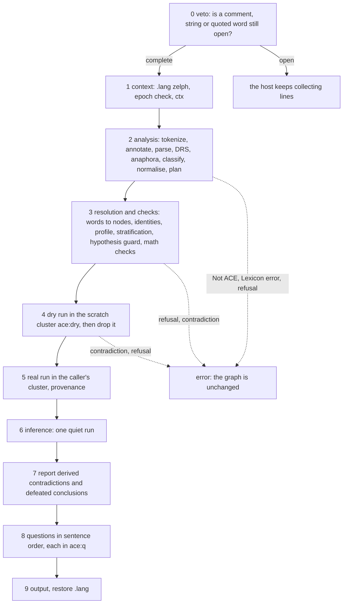

# The ace Block

Every action a user performs via the ACE front end goes through a single keyword: `ace`, followed by English sentences and concluded with a blank line. This page details the behaviour of such a block – where its boundaries lie, the sequence in which zelph analyses, checks, writes, reasons and answers, the rationale behind a block being written either completely or not at all, the output it produces, the method by which an error names the sentence and column, the interaction of blocks with `.load`, `.new`, and native zelph input, and how the second keyword, `ace-retract`, takes a statement back.

For a reviewer, the concise summary: a block constitutes a single paragraph within ACE and serves as a singular unit of processing. zelph begins by analysing the complete block in its entirety, without touching the graph. Subsequently, it writes the block once into a temporary scratch cluster, which it then discards again, enabling zelph's own engine to flag any inconsistencies with the graph before any alterations. Only after this validation does zelph proceed to write the block for real, perform reasoning once, and answer the block's questions in the sequence they appear in the text. Statements produce no output; answers, warnings, and errors are printed in ACE format, never in zelph syntax. The keyword functions as an ordinary handler, registered by the `stdlib/ace.zph` module via `zelph/register-keyword` – a system already employed by the `sparql` keyword – and all engine features this handler relies on (quiet runs that return what they met, scratch clusters that revert changes, lookups that create nothing, node annotations, the retraction bindings) are included in zelph 1.1.0; [What zelph Already Provides](foundation.md) details these. The block contract does not require any of the engine items still pending ([What zelph Still Needs](prerequisites.md)); three of these define a cost or constraint that this page identifies in its applicable context.

!!! example "Specified session — the behaviour this specification requires, not yet implemented"

    ```
    zelph> .import ace
    zelph> ace John is a man.   # a comment may follow a sentence
    Mary is a woman.
    Is John a man? Is Mary a man?

    Answer: Yes. John is a man.
    Answer: It is not provable that Mary is a man.
    zelph> ace Is John a woman?

    Answer: It is not provable that John is a woman.
    ```

The first block holds two statements and two questions; the blank line following the third line ends it. The statements produce no output. The questions receive answers after both statements have been written, in the sequence they stand. The block writes two facts, `John ~ man` and `Mary ~ woman`, with each content word named in the naming language `ace`; under `.lang ace`, the native query `X ~ man` answers `John ~ man` ([Naming Languages](api.md#naming-languages)).

How to read the sessions detailed on this page:

- They omit the notice that the initial `.import ace` within a Janet VM prints (its details are detailed under [Output](#output)), mirroring how the documentation omits module banners.
- The wording of a message serves as an illustration, yet its structure is binding: the class words, the identifier in brackets, the position, the marker, and the order of lines must be mirrored by the implementation (DEC-ERRORS, one of the items in [Design Decisions](decisions.md#dec-errors)). When a test pins a particular text, the page explicitly states it.
- An error appears as the final line within its session box, since piped input stops at the first error. When the example proceeds, the next box continues the same session at the terminal, where zelph continues reading after an error.
- M0 through M9 represent the milestones outlined in [Work Plan and Milestones](plan.md); a session requiring a later construct than M1 indicates the milestone from which it describes the behaviour. Identifiers like `:naf/unstratified` are construct ids ([Constructs and Refusals](constructs.md)), identifiers like `[ace/syntax]` are message ids ([Messages](#messages)), and identifiers like DEC-BLOCK denote design decisions.

## Where a Block Ends

A block commences on a line where the initial word is `ace`. All subsequent content on that line, along with every following line, constitutes block text, continuing until a blank line ends the block. The front end may instruct zelph to continue gathering lines in only one case: when a comment, a string, or a quoted word remains unclosed. A second consecutive blank line then forces the block to be expelled, and the front end reports the open delimiter alongside its position. This is the decision [DEC-BLOCK](decisions.md#dec-block): the first blank line ends a complete block.

!!! example "Specified session — the behaviour this specification requires, not yet implemented"

    ```
    zelph> ace John is a man. /* Mary is a woman.

    Bill is a man.


    Error in line "ace John is a man. /* Mary is a woman. …": Not ACE [ace/unterminated]: sentence 2, line 1, column 16: this comment is not closed.
      <>/* Mary is a woman. Bill is a man.
      A comment ends with */.
    ```

The comment initiating on the first line remains unclosed, thus the first blank line fails to terminate the block: the front end vetoes, and the line `Bill is a man.` gets incorporated into the comment. The second of two consecutive blank lines triggers the block's termination, and the tokenizer issues a report about the open comment at its opening delimiter, within the sentence immediately following the last end mark preceding it. No content is written: the whole block is rejected, including `John is a man.` The error line starts with the host's frame, `Error in line "ace <first line> …":`, which names the block via its keyword and first line ([How a Message Reaches the User](#how-a-message-reaches-the-user)).

### The Host's Block Protocol

The keyword host belongs to zelph, not to the front end; `ace` employs it as-is ([Extending the REPL](../janet.md#extending-the-repl-zelphregister-keyword) explains its use). What the host performs on the lines of a block:

| Situation | What the host does |
|---|---|
| a line where the initial token separated by whitespace is `ace`, provided that no native statement remains under collection | initiates a block; the remainder of the line, excluding any leading or trailing whitespace, becomes the initial text line; `ace` appearing alone on a line contributes no text line |
| each subsequent line, including `#…`, `%…`, `.cmd`, and additional `ace …` entries | is added verbatim, preserving all leading and trailing whitespace; the host does not remove any `#` comment from block content (though it does strip trailing comments from native statements) |
| a line that is empty or contains only whitespace | invokes the handler with the accumulated text, ensuring each line ends with `\n` |
| the handler returns `:incomplete` (a veto) | adds `\n` to represent the blank line and continues gathering input |
| a second consecutive blank line following a veto | triggers the block's dispatch regardless (a forced dispatch): the resulting text concludes with `"\n\n"`; another `:incomplete` raises `Keyword block for 'ace' is incomplete` |
| the termination of input | dispatches the block as if a blank line had been encountered; a block still vetoed by the handler results in the host error `Error in line "ace John /* open …": Keyword block for 'ace' is incomplete` |
| a line whose tokens match exactly `.quit` (permitted: leading spaces and a trailing `#` comment), whether in piped or typed input | terminates the session even within a block, after dispatching the block so far as if at the end of input; in a script provided via file argument or within a module, this line is treated as block text |
| the handler exits without issuing a veto | runs the host's auto-run if `.auto-run` is enabled, unless the handler itself executed the engine after its last write (see [When the Block Reasons](#when-the-block-reasons)) |
| the handler raised an error, in piped or script input | halts the session at the point of the error |
| the handler raised an error, in interactive REPL | the following lines are read as new input |

### What ace Adds: the Veto

The veto is `(ace/incomplete? text)`. It masks the regions of the region list `ace-lexicon/ace-regions` – `/* … */` comments, `#` comments extending to the line's end, `"…"` strings, and `` `…` `` quoted words; these lists are specified in [Region lists](grammar.md#region-lists) – using `kit/mask` from the generic helper module `keyword-kit` (newlines remain intact, ensuring each offset continues to correspond to the user's original text), and it yields true solely when at least one such region remains open upon reaching the end of the text **and** the text does not terminate with `"\n\n"`.

- A `#` comment is never left open at the end of a text, yet it must still constitute a region, as it conceals the delimiters within: without it, `John waits. # it's "odd` would initiate a string and leave the block open. The host hands `#` lines and any trailing `#` text to the handler exactly as received; masking them falls to the front end.
- A text terminating in `"\n\n"` represents the host's forced dispatch following a veto. It is never subject to another veto: to veto it would replace the front end's positioned `[ace/unterminated]` at the opening delimiter with the host's generic message.
- A block that becomes empty after masking (containing only comments) is considered complete, and the handler prints nothing. A simplistic veto strategy that awaited an end mark was discovered to consume the subsequent block (corpus cases 3500 and 3515, comment-only paragraphs).
- A line consisting solely of whitespace concludes a block just as an empty line does.
- A blank line following a sentence lacking `.`, `?` or `!` triggers block dispatch; the tokenizer responds with `[ace/no-terminator]` after the final sentence.
- Upon the input concluding within an open region, the host calls the handler, passing the text gathered up to that point. This text terminates with `"\n\n"` exclusively if the last line was blank; in all other cases, the veto remains in effect, and the host issues the report `Keyword block for 'ace' is incomplete` rather than the positioned `[ace/unterminated]`.
- `%` lines and `.` lines within a block are treated as ACE text, never executed: a `%` line yields `[ace/char]`, a `.stat` line concludes with `[ace/no-terminator]`, `[ace/unknown-word]`, or `[ace/syntax]`. The sole exception is the host's `.quit` rule listed in the table above; it is documented, not altered.
- Text comprising multiple paragraphs exists solely for `ace/analyse`, `ace/load!`, and `ace/load-text!` ([ACE Documents](#ace-documents)).

The keyword `ace-lexicon`, used to declare words in the lexicon format, uses the identical rule but maintains its own list of regions ([The ace-lexicon veto](grammar.md#the-ace-lexicon-veto)), while `ace-retract` uses `ace/incomplete?` directly.

The protocol may be observed today using a stand-in keyword. The handler below vetoes, just as `ace` would, provided that a `/*` lacks a corresponding `*/` and the text fails to conclude with `"\n\n"`, otherwise it outputs the text it received. The session shows a block containing a `#` comment that appears exactly as written, a block held open by an unclosed comment until two blank lines force it out (the text subsequently ends in `"\n\n"`), and a keyword appearing alone on its line, followed by a block terminated by a line consisting of three spaces:

```
zelph> %(zelph/register-keyword "kk" (fn [t] (if (and (string/find "/*" t) (not (string/find "*/" t)) (not (string/has-suffix? "\n\n" t))) :incomplete (do (zelph/out (string/format "HANDLER %j" t)) nil))))
zelph> kk John is a man.   # a comment
Mary is a woman.

HANDLER "John is a man.   # a comment\nMary is a woman.\n"
zelph> kk John /* a remark
that is never closed.

Mary is a woman.


HANDLER "John /* a remark\nthat is never closed.\n\nMary is a woman.\n\n"
zelph> kk
Is John a man?
   
HANDLER "Is John a man?\n"
```

When a paragraph is entered following the termination of a block – that is native zelph input – what happens to it is recorded with a second stand-in under [Traps](#traps).

### Positions on the First Line

The handler sees neither the keyword nor the leading whitespace that the host removed following it: `ace    John …` is received as `"John …"`. Thus, line 1 represents the first line of the block's text, regardless of whether it is the keyword line or the next one, and on the keyword line, column 1 corresponds to the first non-whitespace character after `ace`. The handler is unable to determine the user's visual column at that position; the user page explicitly states this next to the error format.

### One Block Is One Paragraph

A block corresponds to a single paragraph according to APE, the reference parser used by ACE: sentence numbering resets at the beginning of each block, and anaphoric references such as "he" or "the man" along with ACE variables, do not extend beyond the boundaries of one block into the next. However, the graph remains continuous across blocks: proper names and the individuals introduced by ACE sentences refer to identical nodes in every block, since individuals are named by a hash derived from their description ([DEC-INDIVIDUALS](decisions.md#dec-individuals); [Individuals and Other Generated Names](api.md#individuals-and-other-generated-names)). Corpus cases 3501 (rejected as a single paragraph) and 3502 (accepted as two separate paragraphs) pin this distinction.

### Traps

The host exhibits unexpected behaviour when operating within an ACE session. None of it is altered for `ace`; all aspects are clearly described on the user page and pinned by tests.

| Trap | What happens | How it is handled |
|---|---|---|
| pasting two paragraphs | the first blank line triggers the first paragraph's dispatch; the second paragraph becomes native input (`The man waits.` then counts as a native fact, and `X man Y` answers it) | documented, tested; multi-paragraph documents pass through `ace/load!` |
| an unclosed `/*`, `"` or `` ` `` | consumes the subsequent lines, any further `ace` lines, and the next block, continuing until two consecutive blank lines appear; then `[ace/unterminated]` appears at the opening delimiter | positioned error; documented |
| a comment containing two consecutive blank lines (matching the structure of corpus case 3505) | forces a dispatch within the comment; at the interactive REPL, the remainder of the comment and the following sentences become native input | documented; tests employ case 3505 with a single blank line |
| `.quit` entered or piped within a block | the block up to that point is dispatched and the session terminates | documented |
| `ace …` issued without `.import ace` | silently treated as a native fact: `ace John is a man.` constitutes a fact with subject `ace`, predicate `John`, and objects `is`, `a`, and `man.` (in zelph today, `ace P O` responds with three lines) | documented, tested |
| a native statement beginning with the atom `ace` | captured as a block once the keyword is registered; `"ace" ~ card` escapes it, and a node named `ace` then outputs in quotes | documented, tested |
| `ace` entered while a multi-line native statement remains incomplete | not recognized as a keyword | documented |
| native lines adjacent to `ace` blocks under the default `.lang zelph` | typing `John ~ man` generates a second `John` in language `zelph`, which prints identically to the one created by `ace`, and `X ~ man` does not access the front end’s facts | the import notice and user page clarify that native lines interact with the front end’s words under `.lang ace` ([DEC-CONTENT-NS](decisions.md#dec-content-ns)) |
| `.load` executed after `.import ace` | the load overwrites the graph and clears the import registry; it disables auto-run, so asserting blocks retain their consequences undeduced until a question or `.run`; arithmetic requires `.import ace-math` once more | [Session Events](#session-events) |

Today, the first trap may be observed using a stand-in keyword whose handler accepts its text without response, much like an asserting `ace` block that produces no output. The first paragraph is delivered to the handler and results in no native fact being established (`X is Y` yields nothing); the second paragraph ceases to be block text, and zelph reads it as a native statement featuring subject `The`, predicate `man`, and object `waits.`:

```
zelph> %(zelph/register-keyword "kk" (fn [t] nil))
zelph> kk John is a man.

zelph> The man waits.
zelph> X is Y
zelph> X man Y
Answer: The man waits.
```

The naming-language trap is recorded with the native statements that the front end's content corresponds to in [Naming Languages](words.md#naming-languages): a fact written under `.lang ace` fails to appear in a query typed under `.lang zelph`, given that `man` refers to a different node.

### ACE Documents

`.import` processes solely `.zph` and `.janet` files. A document comprising multiple paragraphs is loaded, starting from milestone M2, via `(ace/load! path)` or, when supplying a string, and in the WebAssembly build without file access, via `(ace/load-text! text)` ([DEC-LOAD](decisions.md#dec-load); [Loading ACE Documents](api.md#loading-ace-documents)). Both methods read the text according to APE's text semantics: paragraphs are split at blank or whitespace-only lines, excluding those within comments, anaphora and variables are reset at the beginning of each paragraph, and sentence numbering proceeds consecutively. The whole document undergoes analysis upfront and is rejected entirely upon encountering any error, specifying the line and column of the file – even if a later paragraph fails (corpus case 3598, where APE returns a partial DRS). A single dry run covers all paragraphs, the real run writes them one by one (each paragraph forming a distinct block for provenance), a single inference occurs next, and the questions are answered last, in the order they appear in the text.

A `.zph` script featuring an `ace` line preceding every paragraph and a blank line following it functions correctly starting from M1. Each paragraph thus becomes an individual block and an atomic unit; the first error stops the import process. Within an imported script, auto-run is paused, meaning that asserting blocks defer inference until the module's single postponed run, whereas blocks containing a question run their own. Omitting an `ace` line quietly converts its paragraph into native facts, which is precisely why `ace/load!` is provided.

## What a Block Does

The handler operates through ten distinct steps. During steps 0 through 3, the graph is read, yet no modifications are made; step 4 performs a write into a scratch cluster and subsequently drops it; only step 5 alters the user's graph. Consequently, any error occurring before step 5 ensures the graph remains unchanged exactly as it was.



### The Entry Points

| Function | Steps | Notes |
|---|---|---|
| `(ace/incomplete? text)` | 0 (the veto) | pure, total |
| `(ace/handler text)` | 0 to 9 | the handler associated with the `ace` keyword; yields `:incomplete` or nil; raises strings |
| `(ace/execute! plan ctx)` | 3 to 8 | sets `.lang zelph` itself upon direct invocation; delivers `{:answers :warnings :notes :built :contradictions :naf-final :resolved :plan}`; raises strings |
| `(ace/execute-drs! drs &opt ctx)` | classification, normalization, planning, followed by 3 to 8 | the DRS entry defined in [DEC-DRS-ENTRY](decisions.md#dec-drs-entry); a missing ctx is supplied with a default lacking `:ids`, `:as-written`, and `:quoted` |
| `(ace/retract-handler text)` | 0 to 3, then the removal of [Taking a Statement Back](#taking-a-statement-back-ace-retract) | the handler for the `ace-retract` keyword, from M9 |

`ace/execute!`'s result, in addition to the answer lines, includes warnings and notes, the nodes built per sentence (`:built`: the fact node for each `:fact`, the refuted fact node for each `:refute`, the `=>` node for each rule, denial, and helper rule), the entries from step 7, and `:resolved`, the resolution map from step 3: for each content term, keyed by its node name and role, the corresponding node, or `:new` if step 4 of word resolution produces it, along with the block's instance and subclass predicates. The shapes of the result, the plan, and `ctx` are defined in [The Result of ace/execute!](api.md#the-result-of-aceexecute), [Plan](api.md#plan), and [ctx](api.md#ctx).

### Steps 0 to 2: Veto, Context, Analysis

- **Step 0, veto.** `(ace/incomplete? text)` → yields `:incomplete` (never when a text concludes with `"\n\n"`). If the text becomes empty after masking → return nil, print nothing.
- **Step 1, context.** Assign `.lang zelph` via `zelph/lang`, ensuring whatever zelph names implicitly (rule and query variables, characters) lands in `zelph`, never in the user's language; the user's `.lang` is restored on every exit route. Fetch `(zelph/epoch)`; if it differs from `(ace/state :epoch)`, purge all caches of graph-derived data and store the new epoch (the epoch advances at `.new`, at every load that replaces the graph, and at every dump import). Build `ctx`, the read-only context of the block; the block counter `(ace/state :blocks)` increments.
- **Step 2, analysis – nothing is written.** `ace/tokenize` → `ace/annotate` (all unrecognized words within the block are raised simultaneously as `[ace/unknown-word]`) → `ace/parse` (for a sentence with a guessed reading, the backtracking variant, whose computational limit, upon depletion, triggers `[ace/too-ambiguous]`) → `ace/drs-raw` → `ace/refres` (anaphora resolution) → `ace/drs-constructs` (the classifier) → `ace/unsupported` (non-empty → `[ace/unsupported]`, or `[ace/needs-math]` if the sole impediment is a missing `.import ace-math`) → `ace/normalise` → `ace/plan`, which triggers context validations that do not require the graph. Endless generation is verified here using class keys compared via equality; graph-dependent validations proceed in step 3. `ace/execute!` assumes control with the plan.

The stages are specified in [Tokenizer, Grammar and Lexicon](grammar.md) and [The Stages](semantics.md#the-stages); refusal based on construct id is outlined in [Where a Construct Is Found](constructs.md#where-a-construct-is-found).

### Step 3: Resolution and Checks

Nothing is written in this step either. It is the sole location where a word transforms into a node; the contribution of the mapping is specified in [The Resolution Step](semantics.md#the-resolution-step).

- **Resolution.** Each content term is resolved via `ace/concept!` (explicit ID, node named in `ace`, Wikidata label, or marked as new; [The Four Steps](words.md#the-four-steps)); each individual term is named by its content address and retrieved from `ace`; the graph's pin, or the profile it will adopt, along with the user's bindings, gives the instance and subclass predicates. The plan is rewritten for both runs: the class atom of a relational noun is omitted if the relation resolved to a Wikidata property and kept otherwise, and each class pattern is expanded according to the profile. The `word-senses` note of the block is prepared.
- **Identities** ([DEC-NEQ](decisions.md#dec-neq)). An identity between named constants is decided by node identity, while a name not yet in the graph is judged by its canonical symbol. A false ground identity statement raises `[ace/contradiction]`, indicating what each side resolved to and suggesting a binding; a true one is dropped; an asserted identity between an individual and a name raises `[ace/unsupported]` (the front end never merges two existing nodes); a rule whose ground identity condition evaluates to false is dropped with `[ace/w-vacuous]`, and a true one loses the condition. Every undecided identity in a rule is replaced by its verdict here, ensuring no run sees it.
- **Large rules.** A rule whose class condition includes over 100,000 facts on the class node (`zelph/degree`) receives `[ace/w-large-rule]` and is preserved.
- **Stratification and endless generation** (from M4, [DEC-STRATA](decisions.md#dec-strata)). `:naf/unstratified` and `:rule/endless-generation` are assessed using the transitive may-derive graph formed by the block's resolved rules and the rules from prior blocks (the rule registry). A head `X <instance> C'` may derive a class pattern over C when C' equals C or when the upward closure of C' under the subclass predicate contains C (a bounded walk; without a subclass predicate, only C' = C). A hit raises `[ace/unsupported]` before the dry run. The engine's internal verdict on the rules in force – something this graph cannot observe – is verified in step 4. The rationale for refusing these forms is detailed in ["Not Provably" That Depends on Another "Not Provably"](constructs.md#not-provably-that-depends-on-another-not-provably).
- **Hypothesis guard** (from M4, [DEC-QUNIV](decisions.md#dec-quniv)), for every yes/no question that carries a conditional: `(zelph/rules)` enumerates the rules in force, each with its negated conditions and guards; the may-derive graph is constructed from these plus the block's resolved rules and entered at the question's assumed atoms. If a rule with a "not provably" (NAF) condition or a `!=` guard becomes reachable, the block raises `[ace/unsupported]` naming `:rule/unsafe-hypothesis`, before the dry run, leaving the graph unaltered: a fresh hypothetical witness is "not provably" everything, and such a rule would make the answer wrong. The plan cannot decide this, as the rules in force are part of the graph data.
- **Maths** (only with `ace-math`; [The Scratch Protocol](math.md#the-scratch-protocol)). Each asserted formula is evaluated within its own scratch cluster `ace:math`: false → `[ace/contradiction]`; unknown → `[ace/w-not-checkable]`; nothing is stored. A rule's ground formula condition is evaluated identically: true → the condition is dropped; false → the rule is not stored, `[ace/w-vacuous]`; unknown → the rule is not stored, `[ace/w-not-checkable]`. The ground arithmetic terms in write actions are computed within a single `ace:math` cluster, and the plan is rewritten with their values; a ground term lacking a value raises `[ace/unsupported]` (`:expr/as-data`, which has no route).

### Step 4: The Dry Run

`(def prev (zelph/cluster))`, `(zelph/cluster "ace:dry")`, after which the write actions are executed within `protect`. From M4, the **negation-level check** is enacted: when the block writes a rule and the theory holds a rule featuring a NAF condition, the handler calls `(zelph/strata)`, which sees the rules recently written in `ace:dry`. A component that holds a NAF rule authored by the front end (the block's own, an earlier block's, or a helper rule) and includes a row `:stratifiable false` raises `[ace/unsupported]` with the name `:naf/unstratified` if it also holds a rule not authored by the front end, or if any row carries `:transparent true` (indicating that a rule over predicates – such as a transitive meta-rule – is in force). Under `(ace/option :atomic :consistent)`, the block's inference also executes at this stage, and its entries are preserved. Subsequently, `(zelph/cluster prev)` and `(zelph/cluster-drop "ace:dry")`.

When a failure occurs, the error is raised following the drop, ensuring no data arrives at the caller's cluster; with `:consistent`, an entry that step 7 would have reported instead raises `[ace/contradiction-derived]`. Either way, the graph remains unchanged. [All or Nothing: the Dry Run](#all-or-nothing-the-dry-run) clarifies the soundness of this behaviour.

### Step 5: The Real Run

The write actions are executed once more, within the caller's active cluster – no shift to another cluster occurs, thus recording the block in both the user's `.cluster` and the tests' per-case clusters. A failure at this stage indicates a bug: `[ace/internal]` naming the sentences that have already been applied. The run records provenance and maintains the rule registry while gathering `:built`. Upon writing the initial rule containing a NAF condition from the session, the handler first invokes `(zelph/negation-records true)` – only once, and never disabled ([DEC-NAF-RECORDS](decisions.md#dec-naf-records)).

Both runs write identically. Alongside the plan's actions, they write two things that are not part of any plan actions, both situated outside any rule-building thunk: a pin fact (`ace:profile ace:uses ace:core` or `ace:profile ace:uses ace:wikidata`) on a graph that has not yet been pinned, immediately preceding the first write action that holds a class item, and the mark `I ace:individual nil` for each individual introduced by the block ([Bookkeeping Writes](semantics.md#bookkeeping-writes)). The copies from the dry run go with `ace:dry`.

**Provenance** ([DEC-PROV](decisions.md#dec-prov)) functions as a node annotation introduced starting with M1: every node that is constructed acquires, under the key `ace:src`, a sequence of values – each corresponding to a real run, ordered from earliest to latest – formatted as session token, block number, sentence number, and sentence text, with components separated by `|`. The session token is drawn once per Janet VM and kept in `(ace/state :session)`, ensuring that block numbers remain meaningful across a `.save` and `.load` within the same VM; a source from the current session appears as `(block B, sentence S)`, whereas one from a prior session displays as `(from a saved graph)`. The node associated with a helper rule inherits the source of the rule it supports. These annotations do not constitute graph facts: they do not introduce new nodes, never deactivate a rule (unlike a fact that references a rule node), and persist through `.save` and `.load` operations. The **rule registry** `(ace/state :rules)` maintains a mapping from the `=>` node of every rule, denial, and helper rule within a successful block to its payload, its sources, and, in the case of a helper, the source of the rule it assists; this registry is indexed by epoch and supplies context validation for subsequent blocks ([Provenance and the Rule Registry](semantics.md#provenance-and-the-rule-registry)).

### Step 6: Inference

`ace/infer!` executes if the block holds a question, or if it has written something and `(zelph/auto-run?)` evaluates to true ([When the Block Reasons](#when-the-block-reasons)).

### Step 7: Derived Contradictions and Defeated Conclusions

Each contradiction that the inference returned, whose key has not yet been included in `(ace/state :reported)`, is reported as `[ace/contradiction-derived]` and the key is inserted into that collection, regardless of the contradiction's record status; a maximum of 5 per rule and block, followed by a single line `… and N more like this`. The block remains. The "not provably" conclusions from the same run that have been defeated contribute one `[ace/w-naf-final]` entry for the block. Both behaviours are specified in [Contradictions and Defeated Conclusions](#contradictions-and-defeated-conclusions).

### Steps 8 and 9: Questions and Output

- **Step 8, questions** presented in sentence sequence, each placed within its own scratch cluster `ace:q` ([Questions in a Block](#questions-in-a-block)).
- **Step 9, output** delivered in the sequence defined by [Output](#output). The announcements associated with the `word-senses` note are considered completed (only at this point, thus a rejected block consumes none); `.lang` is restored; the handler returns nil. Warnings and the note gathered before a raised error are appended to the error ([Layout](#layout)).

## All or Nothing: the Dry Run

A block either changes the graph as a whole or leaves it entirely unchanged. The front end refrains from validating this through a second implementation of zelph's refusal logic, which would diverge from the engine's behaviour; instead, it lets the engine determine the outcome by writing the block once, with the possibility of reversing the writes ([DEC-ATOMIC](decisions.md#dec-atomic)). The session uses negation, a feature that ACE blocks support from milestone M4.

!!! example "Specified session — the behaviour this specification requires, not yet implemented"

    ```
    zelph> ace Mary is not a man.

    zelph> ace Bill is a man. Mary is a man.

    Error in line "ace Bill is a man. Mary is a man.": Contradiction [ace/contradiction]: sentence 2, line 1, column 16: zelph already holds the opposite of this sentence, from "Mary is not a man." (block 1, sentence 1).
      <>Mary is a man.
    ```

The second block does not succeed in its second sentence, as the graph refutes `Mary ~ man`. The initial sentence was correct, and during the dry run it was written; the drop operation removed it again. The session continues at the terminal, and the next block finds no `Bill ~ man`:

!!! example "Specified session — the behaviour this specification requires, not yet implemented"

    ```
    zelph> ace Is Bill a man? Is Mary a man?

    Answer: It is not provable that Bill is a man.
    Answer: No. It is false that Mary is a man.
    ```

At milestone M1, before ACE supports negation, the identical behaviour is achieved by employing a refutation typed natively within `.lang ace`, `¬(John ~ man)`, followed by the block `Bill is a man. John is a man.`.

The block is written twice: first in the scratch cluster `ace:dry`, which gets dropped, then within the caller's active cluster. A private transaction cluster preserved upon success offers no alternative: only the active cluster records new nodes, meaning a block built in a private cluster would remain unseen by the user's `.cluster` and by the tests' per-case clusters, and a cluster cannot be merged from Janet. Contradictions that the block's own inference derives are another issue: they are reported, and the block is kept, as zelph's own policy says – a contradiction is [reported, not enforced](../rules.md#examples).

### What a Dropped Cluster Restores

The dry run is sound since a dropped cluster reverts the modifications made during the dry run. Everything listed below applies in zelph 1.1.0. The name in parentheses following each property indicates the engine item responsible for its creation; [Scratch Clusters and the Dry Run](foundation.md#scratch-clusters-and-the-dry-run) describes each one alongside its associated tests.

- Every node generated during a cluster's active period is recorded by the cluster, and dropping it eliminates those nodes along with any external fact or rule referencing one of them; no external entity refers to the nodes created during a dry run, as the dry run writes nothing else.
- A statement that functioned solely as a rule's ground pattern and was asserted within the cluster loses its pattern mark; the cluster journals this change, and the drop reinstates the mark, in no cluster (P-restore-mark).
- A changed weight and a refuted-index entry for a node that predated the current state – also applicable to a refutation derived by a run within the cluster – are journaled and reversed by the drop (P-refute (e)); neural weights established via `zelph/set-weight` or the `nn-*` functions remain outside the journal.
- Names are purged in time proportional to the number of languages per node, and empty language sets are erased (P-drop-names); the drop maintains fact stores in an armed state and removes only what the cluster introduced, including membership it added to a prior collection (P-scratch-drop).
- The negation records that a quiet run inside the cluster reported as defeated return to the record set when the cluster is dropped, ensuring the real run in the caller's cluster reports the defeat again.
- The drop also removes a relation-type declaration `P ~ ->` contained within the cluster, applying to a predicate older than the cluster as well, unless a fact or statement located outside the cluster relies on it ([DEC-DECL-RESIDUE](decisions.md#dec-decl-residue)).
- The engine's internal vocabulary initially created during the dry run (`refuted`, `opaque`, `rule pattern`, `closure`, …) persists after the drop, along with any external references to it ([DEC-VOCAB](decisions.md#dec-vocab)).
- Dropping a cluster where a run derived facts invalidates the record that incremental runs rely on (a per-cluster flag indicates whether any derivation occurred there); a write-only drop preserves validity, and a rule constructed within the cluster leaves no trace in the record (P-drop-delta, [DEC-DROP-DELTA](decisions.md#dec-drop-delta)). User removal commands (`.prune-facts`, `.prune-nodes`, `.remove`, `.cleanup`, and `zelph/prune-fact`) are unable to distinguish derived from asserted facts and invalidate the record whenever a fact is removed.

During a dry run, the system requires P-drop-names, P-scratch-drop, and P-restore-mark from M1 at the moment the front end first writes the graph, along with P-refute (e) from the first construct that issues a refutation (M4). All these components are built. A replacement load cannot happen while within a block (the handler loads nothing); a load occurring between blocks forgets every cluster, including `ace:dry` ([DEC-RELOAD](decisions.md#dec-reload)).

### How a Failed Dry Run Is Classified

The action that failed and the corresponding sentence are recognized, enabling the message to identify the sentence:

| Janet error text for the failing write | Message |
|---|---|
| `fact(): this fact is known to be wrong` (asserting something the graph refutes) | `[ace/contradiction]` |
| `fact(): this fact is known to be true` (refuting something the graph asserts) | `[ace/contradiction]` |
| the refusal of an opacity declaration `P ~ opaque` when a fact of P holds a statement (M8; the engine's text is `fact(): a predicate cannot be declared opaque while one of its facts holds a statement -- <P>: <the fact>`) | `[ace/unsupported]` naming `:sub/that-clause` and P |
| any other case | `[ace/internal]` |

A false asserted formula and a ground identity that is false are part of the same class (decided in step 3): if the graph already contradicts an assertion, the block is rejected. A contradiction that arises from the block's own inference is reported and the block kept (step 7), unless `:atomic :consistent` is set.

### The Option :atomic :consistent

Starting at M4, `(ace/option :atomic :consistent)` runs the block's inference during the dry run and rejects any block whose execution encountered a contradiction whose key has not yet been included in the reported set (DEC-ATOMIC (d)). This approach incurs an additional run per block and necessitates a full pass at the subsequent inference, as the drop operation eliminates derived facts (DEC-DROP-DELTA). The default setting remains `:keep`. Attempting to configure `:consistent` before the milestone constant reaches M4 is refused with a Janet error.

### What "Unchanged" Means

The tests verify atomicity using a single oracle, [AT-1](tests.md#at-1-atomicity): following a block that is rejected, refused, or rejected as a contradiction, the caller's cluster contains 0 new nodes, `.stat` Rules remains unaltered, `(zelph/clusters)` lists no name starting with `ace:`, `(zelph/cluster)` reverts to its prior state (nil if no cluster was active), `(zelph/lang)` reflects the user's language, and no announcement of the block was counted.

The mechanism may be executed manually at this time. A native rule mentions `John ~ man` as its ground pattern; a refutation corresponds to the contradicting graph. Inside a scratch cluster named `ace:dry`, the first write claims the pattern (the first value shown corresponds to the claim during the dry run), the following write is refused by the engine, the caller's cluster is reactivated, and the scratch cluster is dropped. Subsequently, `John ~ man` reverts to being just a pattern of the rule, the rule does not fire (`X ~ woman` yields no answer), and no cluster remains:

```
zelph> (John ~ man) => (Mary ~ woman)
zelph> ¬(Bill ~ man)
zelph> %(do (def prev (zelph/cluster)) (zelph/cluster "ace:dry") (var inside nil) (def r (protect (zelph/fact "John" "~" "man") (set inside (zelph/exists "John" "~" "man" :exact)) (zelph/fact "Bill" "~" "man"))) (zelph/cluster prev) (def n (zelph/cluster-drop "ace:dry")) (zelph/out (string/format "inside the dry run, John ~ man claimed: %q; the run: %q; nodes dropped: %d" inside r n)))
inside the dry run, John ~ man claimed: true; the run: (false "fact(): this fact is known to be wrong"); nodes dropped: 0
zelph> %(zelph/out (string/format "afterwards, John ~ man claimed: %q; still the rule's pattern: %q; clusters: %q" (zelph/exists "John" "~" "man" :exact) (zelph/mentioned "John" "~" "man") (zelph/clusters)))
afterwards, John ~ man claimed: false; still the rule's pattern: true; clusters: @[]
zelph> X ~ woman
```

The drop removed 0 nodes, as the pattern `John ~ man` was already present; what was reversed was the revoked mark.

## Scratch Clusters

Each cluster switch begins by evaluating `(def prev (zelph/cluster))` and then reverts using `(zelph/cluster prev)`. When no cluster is currently active, `prev` holds the value nil, and reverting to nil is precisely correct; a literal `(zelph/cluster nil)` is never produced, as doing so would halt recording within the caller's cluster. This pattern matches the one described in [A question that leaves nothing behind](../janet.md#a-question-that-leaves-nothing-behind) for programs.

| Scratch cluster | Purpose | Dropped |
|---|---|---|
| `ace:dry` | performing the dry run for step 4 | during the same handler invocation, before anything else is written |
| `ace:q` | one per question, encompassing the conditional question's hypothetical verification | following the rendering of the question's answer |
| `ace:probe` | queries responsible for populating the lexicon cache | within the same function call |
| `ace:math` | asserted formulas, rule formulas, and value inquiries (using `ace-math`) | within the same function call |

- Within the handler call that initiated it, each scratch cluster is dropped. Names beginning with `__` are assigned to the host and refused; the `ace:` names are permitted. The file `stdlib/sparql.zph` uses its own scratch cluster named `sparql:query` in the same way.
- Scratch clusters are not layered within one another, except when the scratch cluster `zelph/dedup-rule` opens for itself, which is either merged into the active cluster or dropped by the host.
- Each `zelph/query` executes within a scratch cluster: a program's `zelph/query` keeps the pattern nodes and variables it receives, requiring the front end to maintain the cluster. After the block completes execution, the question's cluster is dropped, meaning the host does not count it as a write and thus bypasses its own auto-run.
- A successful block is never constructed within a private cluster, and retracting a prior block by dropping a cluster is never allowed: doing so would be unsound.

Open for M1: the action taken by a block when a cluster owned by the user already carries one of the four designated names (a user may input `.cluster ace:dry`, causing the drop to eliminate the user's nodes). The proposed behaviour mirrors that of `stdlib/sparql.zph`, which refuses to execute if a cluster with its scratch name is present; janet.md’s convention mandates a name not currently held by any cluster.

## Questions in a Block

A block constitutes a single theory: every statement is written, the block reasons just once, and the answers to the questions follow in the sequence they appear in the text ([DEC-QTIME](decisions.md#dec-qtime)). Consequently, a question perceives the whole block, including the sentences that come after it. A question does not make any assertion.

!!! example "Specified session — the behaviour this specification requires, not yet implemented"

    ```
    zelph> ace Is John a man? John is a man.

    Answer: Yes. John is a man.
    zelph> ace Is Bill a man?

    Answer: It is not provable that Bill is a man.
    zelph> .lang ace
    ace> X ~ man
    Answer: John ~ man
    ```

The initial question receives an answer of "yes" even though the corresponding fact appears after it within the block. The second question results in no residual trace: neither `Bill ~ man` nor a node named `Bill` exists afterwards, and the native query under `.lang ace` (the prompt then names the language) finds only John.

- Each question operates within its own scratch cluster `ace:q`. A term that resolved to step 4 of word resolution (a word absent from the graph) ends the evaluation: a yes/no question is deemed "not provable", a wh-question yields no results; the term is never created for comparison. An identity between named constants is the sole exception: resolution determines it via node identity or canonical symbol.
- Every ground atom within the question, including those nested, undergoes bottom-up verification before any pattern construction, initially using the exact probe `(zelph/exists s p o :exact)`, which costs O(1) and creates nothing. On a miss, the plain `(zelph/exists s p o)` takes effect ([DEC-YESNO-WIDER](decisions.md#dec-yesno-wider)): as long as the graph may store a fact with several objects – a flag that the engine activates upon writing such a fact, during a name merge involving a statement or a set constant, or during a load unless the saved file records that no fact has more than one object – it interprets a broader fact as a rule condition does, so a native fact `John sees Mary Bill` answers "Does John see Mary?" with yes; otherwise, the miss incurs an additional hash probe. An atom missed by both probes ends the evaluation. Starting with M8, an atom in an opaque argument position that is mentioned is constructed using `zelph/mention` and evaluation proceeds. Patterns are formed exclusively around `zelph/var`s. `zelph/exists` finds no engine bookkeeping (such as contradiction record's marking or pattern mark), while a user's refutation mark `(F) ~ refuted` provides a response ([DEC-BOOKKEEPING](decisions.md#dec-bookkeeping)), so a ground refuted item is validated via the exact probe of its marking. The data a question writes into an opaque argument within the scratch cluster is removed upon drop ([DEC-OPAQUE-QUERY](decisions.md#dec-opaque-query)). Both probes are illustrated in [Lookups That Create Nothing](foundation.md#lookups-that-create-nothing).
- The second probe constitutes the sole exception to the rule that the front end invokes `zelph/exists` solely with `:exact` (invariant 7 of [Invariants](api.md#invariants)): the source test `ace work: the ace sources make no forbidden graph call` permits precisely this call, during the yes/no check, following the exact probe's miss. Its cost is bounded by the subject's adjacency for the predicate, never requiring a full scan; M3 times it on the published `-small` network, as a row in [The Budget Table](plan.md#the-budget-table). The test `ace questions: a native fact with several objects answers a single-member yes/no question` (M3) pins the outcome.
- Yes/no answers are three-valued: `Yes. <S>`, `No. It is false that <S>`, `It is not provable that <S>`.
- A conditional embedded within a yes/no question (from M4; "Is it true that every dog is an animal?", mirroring corpus case 1974) is evaluated hypothetically within `ace:q`, following the guard of step 3’s exclusion of rules that would make the answer wrong: first, a counter-instance among the graph's own individuals is sought (a row → `No. It is false that …`); if none exists, the assumed atoms are asserted for fresh witnesses, `ace/infer!` runs once, and the conclusion is verified (`Yes. …`, otherwise `It is not provable that …`). Contradictions encountered during this hypothetical run are not reported – they remain confined to `ace:q` – and upon encountering one, the answer becomes `It is not provable that …`. Subsequently, the cluster is dropped ([Questions That Hold a Conditional](answers.md#questions-that-hold-a-conditional)).

The way every type of question maps to a query, how answers are rendered and sorted, and how `:justify` adds the sentences supporting an answer are specified in [Questions, Answers and Explanations](answers.md).

## When the Block Reasons

The front end executes zelph’s inference directly, quietly, and reports what the run met in ACE. This occurs precisely at the moment zelph would have initiated a run following a native input line, as well as each time a question needs the consequences ([DEC-RUN](decisions.md#dec-run), [DEC-QUIET](decisions.md#dec-quiet)). The session detailed under [Session Events](#session-events) shows both cases after a `.load`, which disables auto-run.

- `ace/infer!` serves as the sole inference invocation. It operates as `(zelph/run-delta :quiet)`; from M9, when `(ace/option :echo)` is active, it becomes `(zelph/run-delta :quiet :derived)`. A quiet run outputs nothing – no banner, no deduction lines, no contradiction line, no negation-check finding, no note on concealed deductions – and only raises for errors, returning a struct ([Running quietly](../janet.md#running-quietly)):
    - `:contradictions`, one entry for each unique contradiction encountered, ordered by first met: `{:rule <the => node> :conditions <the instantiated positive condition facts, sorted by node; empty for a rule whose conditions are all negations, guards or paths> :conclusion <core !, or the fact the consequence would assert or refute> :record <:new | :existing | :none> :bindings <variable → node>}`. `:new`: this run wrote the contradiction's record; `:existing`: a record already existed; `:none`: recording is unattainable. Contradictions already covered by an existing record are still included, ensuring no contradiction escapes the front end's view ([DEC-RECORD-SINGLE](decisions.md#dec-record-single)). An entry for a consequence the engine refused to build includes `:refused <reason>` in place of `:conclusion`. A derived refutation that meets a claimed fact lists that fact as `:conclusion` and omits it from `:conditions`. Conditions the engine will not evaluate (a negated `!=`, a path with both endpoints unbound, a net lacking layers) are not returned; the next run that prints reports such conditions.
    - `:naf-final`, the defeats logged during this run while negation records are kept: one `{:fact F :rule R}` per fact derived beneath a negated premise that later became true, with F being the outdated fact (it remains), and R the rule responsible for its derivation. Records are kept in check mode (`.semi-naive check`, the default for the test binary) and with `.negation-records on`, which the front end activates with its first NAF rule. It remains empty otherwise, and is always empty for `zelph/run-once`, which never re-tests records. A defeat already reported by a host run between blocks is absorbed by that run and never reaches the front end; a defeat reported by the dry run's quiet run is not absorbed, since the drop restores it.
    - `:derived` (M9, only when `:echo` is enabled): one entry per derived fact, in derivation order, `{:fact :rule :premises :absent :bindings}`, from which the derivation echo is built. `:derived` alone, without `:quiet`, is refused.
- The run executes if the block holds a question, or if the block wrote something and `(zelph/auto-run?)` is true – false during module import and after a `.load`. This mirrors the host: native input triggers a run only under `.auto-run`, and within an imported module auto-run is paused, with the module obligated to perform one delayed run.
- Following a handler that ran the engine after its own last write, the host skips its auto-run (P-autorun-skip: the handler's run count increased, the addition record is valid and empty, no predicate was removed since, and the rule count remains unchanged; at the end of input, only when the block was dispatched last). Thus, no derivation in zelph syntax reaches an ACE session.
- `run-delta` automatically reverts to a full pass whenever the graph is not known to be a fixpoint (no previous run, a bulk load, a removed rule, a new rule while a rule in force negates, a removal that took derived facts, semi-naive evaluation disabled); it then ensures correctness equivalent to a full run.
- The host’s own executions following later native lines persist in producing output using zelph syntax for items lacking a record: every contradiction under `.contradiction-records off`, those originating from rules whose conditions contain only guards, negations, or paths (unless the rule derives the refutation of a claimed fact, which then is the record), and those arising from instances that cannot be named. The front end itself does not print any of these; the user page documents this behaviour.

**Cost.** A rule that includes a path condition takes a classic pass solely upon the arrival of a fact belonging to the predicate it walks; a NAF rule is seeded by its positive conditions unless it negates a predicate that lost a fact since the prior execution, negates via a predicate variable, sits in a component that negates what it derives, or is newly introduced; a mention keeps the run incremental. A newly added rule performs a classic pass solely when no rule in force has a negated condition – hence, after the front end has written its initial NAF rule, each block that writes a rule incurs a full pass across all rules (the residual engine item [Z3-P1](prerequisites.md#z3-p1-after-the-first-negated-condition-every-new-rule-costs-a-full-pass)). With negation records enabled, every run following a statement that adds a fact to a negated predicate re-tests the records (approximately 1 s per million records, estimated from measurements). Dropping a scratch cluster in which a run derived facts (a mathematical request in `ace:math`, a hypothetical question in `ace:q`, or a dry run under `:atomic :consistent`) triggers a full pass for the subsequent run; a rule constructed within a dropped cluster incurs none. The closure of a class question preserves its predicate index across writes, and a block introducing a new predicate clears only the index associated with `~` and the newly added predicate. One `(zelph/strata)` per block that writes a rule while the theory holds a NAF rule consumes time proportional to the number of rules in force, not to the size of the graph.

Today, the outcome of the quiet run surfaces via native denials. Every contradiction encountered – whether recorded or not – is returned by the quiet run, and step 7 keeps its own set of reported keys since `:record` cannot replace that set: a record is indexed by the facts, meaning a second rule contradicting the same facts is treated as `:existing` upon first encounter; a loaded graph brings records the session never reported; and certain contradictions remain unrecorded (`:none`). The session begins by disabling auto-run, guaranteeing that only the two quiet runs perform reasoning. The two-condition denial and both one-condition denials – the plain one and the one written as a one-element condition set – are recorded during the first run (`:new`) and retrieved during the second (`:existing`), which continues to return all three. No output appears in zelph syntax:

```
zelph> .auto-run
Auto-run is now disabled.
zelph-> ((X ~ man), (X ~ woman)) => !
zelph-> (X ~ robot) => !
zelph-> (*{(X ~ android)} ~ conjunction) => !
zelph-> john ~ man
zelph-> john ~ woman
zelph-> john ~ robot
zelph-> john ~ android
zelph-> %(each e ((zelph/run :quiet) :contradictions) (zelph/out (string/format "%q %q" (e :record) (e :conditions))))
:new (<zelph/node john ~ woman> <zelph/node john ~ man>)
:new (<zelph/node john ~ android>)
:new (<zelph/node john ~ robot>)
zelph-> %(each e ((zelph/run :quiet) :contradictions) (zelph/out (string/format "%q %q" (e :record) (e :conditions))))
:existing (<zelph/node john ~ woman> <zelph/node john ~ man>)
:existing (<zelph/node john ~ android>)
:existing (<zelph/node john ~ robot>)
```

## Contradictions and Defeated Conclusions

A block can align with the graph on a sentence-by-sentence basis yet, via rules, result in a contradiction. zelph does not undo such a block; instead, it outputs the sentences that fail to cohere, in ACE, only once. The session needs "No man waits.", a rule containing negation, which is supported from M4.

!!! example "Specified session — the behaviour this specification requires, not yet implemented"

    ```
    zelph> ace John is a man. John waits.

    zelph> ace No man waits.

    Contradiction [ace/contradiction-derived]: these sentences do not hold together:
      "No man waits." (block 2, sentence 1)
      "John is a man." (block 1, sentence 1)
      "John waits." (block 1, sentence 2)
    zelph> ace Does John wait?

    Answer: Yes. John waits.
    ```

"No man waits." transforms into the rule `(*{(X ~ man)} ~ conjunction) => ((X waits nil) ~ refuted)`, which derives a refutation for every man ([Every Construct and Its Native Form](semantics.md#every-construct-and-its-native-form)). The second block writes the rule – a rule does not refute any fact simply by being written, hence the dry run passes – and its inference fires the rule for John. The derived refutation meets a fact the graph claims: the engine writes nothing, records the contradiction, and returns it from the quiet run ([DEC-REFUTED](decisions.md#dec-refuted)). The block remains intact, the report names the rule's sentence along with the sentences of the facts it matched, "John waits." continues to respond, and the third block, whose inference might encounter the same contradiction once more, reports nothing. If "John waits." had arrived within a block following "No man waits.", the rule would have already produced its refutation, and the dry run would have rejected that block with `[ace/contradiction]`.

### The Report of a Derived Contradiction

From M1, contradictions encountered by a block's inference originate in native rules (the M1 test uses native denials); from M4 they additionally come from rules written in ACE. The source is invariably the result of the block's quiet run, not the graph's contradiction records. The forms of mapping that trigger a contradiction – specifically, a derived refutation of a claimed fact, a positive conclusion whose fact is refuted, or a denial where all conditions are met – are detailed in [Contradiction Reports](semantics.md#contradiction-reports); the report’s definition is provided below.

1. **Key.** The rule node, the set of condition facts excluding guard facts (`!=`) and excluding facts that hold internal vocabulary as predicate or object (refutation markings `((F) ~ refuted)`, helper atoms), and the conclusion node or `!`; in the case of a refused consequence, the engine's rationale occupies the conclusion's place. The session set `(ace/state :reported)`, keyed by the epoch, holds the keys that have been reported so far: a key already present is bypassed, a novel one is incorporated and reported. Both arrangements of a single `!=` pair yield a single key. A contradiction already present in the graph (a loaded network) is reported at the first block whose execution encounters it, only once per session.
2. **Records and the reported set share the responsibility.** A contradiction record (including that of a rule with a single condition, whether the condition exists independently or within a one-element condition set) ensures that subsequent host executions remain silent regarding a contradiction, while `:reported` keeps the front end from emitting a contradiction report more than once, regardless of whether it has been recorded (`:none`: records off, or any contradiction type listed next). Rules whose conditions consist exclusively of negations, guards, or paths (except when the rule derives the refutation of a claimed fact, which then becomes the record), and contradictions whose instances lack a name, are ineligible for recording: the key set keeps the front end from reporting them repeatedly, and a later native line’s auto-run could generate their `!` line through zelph syntax (as documented).
3. **Grouping and cap.** Organized by rule; up to 5 per rule and block, ordered by their member lines, followed by a single line `… and N more like this` ([DEC-WIKIDATA](decisions.md#dec-wikidata), output size).
4. **Lines** for a single contradiction: begin with the rule's sentences, drawn from the rule registry (a helper rule: the sentence it serves); from M9 via the `ace:src` annotations of its `=>` node, which persist through a load, and for a rule generated by a generator, the generator's sentences (`zelph/explain` of the generated `=>` node names the generator); a rule with none of these (a native rule) gives the line `a rule not written in ace`. Then, each condition fact except guards and helper atoms (a refutation marking given by the refutation's sentences), and the conclusion fact (for a refuted conclusion, the refuted fact; for a derived refutation that met a claimed fact, that fact): its provenance sentences, or, in the absence of provenance, from M4, its ACE sentence from `ace/verbalise-node` followed by `(a fact of the loaded graph)`, before M4 the line `a fact of the loaded graph` alone; a fact the verbaliser cannot articulate is `a fact of the loaded graph that ace cannot express`. Before M9 "without provenance" also includes facts derived by an earlier inference (documented); from M9 the proof data tells them apart. Duplicates are combined, facts sorted by block and sentence, graph facts last. Never a line in zelph syntax.
5. **Refused consequences.** An entry marked `:refused` (a consequence the engine refused to build, such as the extension of a set constant) is reported identically. A refusal nested within a consequence is also such an entry, and the run continues; the refused consequence leaves no trace of its construction. A firing with several consequences keeps those written before the refused one ([DEC-FIRING](decisions.md#dec-firing)); the atomic firing is the remaining engine item [Y2-P1](prerequisites.md#y2-p1-a-rule-with-several-conclusions-is-applied-by-halves).

Under `:atomic :consistent` (from M4), an entry that this report would show rejects the block instead ([The Option :atomic :consistent](#the-option-atomic-consistent)). `(ace/contradictions)` reads the graph's contradiction records for users and tests: the subjects of `~ refuted` facts that are set constants (`(zelph/parse S)` is nil and S contains `in` members), retrieved via `(zelph/sources "~" "refuted")`, which creates nothing; its cost is the number of refutations and records, which the session, not the graph, creates ([Contradiction Records](api.md#contradiction-records)). Step 7 does not utilize it.

### Conclusions Under "Not Provably" That a Later Block Defeats

A final conclusion in zelph arises when something is deemed not provable; even if a later fact contradicts the premise, this is reported and the conclusion is never undone (DEC-STRATA, DEC-NAF-RECORDS). The term "not provably" appearing within a rule is supported from M4.

!!! example "Specified session — the behaviour this specification requires, not yet implemented"

    ```
    zelph> ace Every man who is not provably dead is alive. John is a man.

    zelph> ace John is dead.

    Warning [ace/w-naf-final]: a later fact defeats what these conclusions assumed to be not provable; zelph keeps them, because conclusions under "not provably" are final:
      "Every man who is not provably dead is alive." (block 1, sentence 1)
        John is alive.
    zelph> ace Is John alive? Is John dead?

    Answer: Yes. John is alive.
    Answer: Yes. John is dead.
    ```

The engine identifies these facts whenever negation records remain active. The front end switches the records on with its first rule containing a NAF condition (step 5) and never off, maintaining them permanently, ensuring the warning works at the REPL default, not merely within the test binary's check mode; thereafter, the session's native NAF rules are also recorded. The quiet run returns the findings as `:naf-final` along with `:contradictions`, thus reporting the same run's contradictions as well. The engine's behaviour is described in [Negation Records and Defeated Conclusions](foundation.md#negation-records-and-defeated-conclusions), while the way the mapping's helper rules meet it is explained in [Conclusions under "not provably" That a Later Block Defeats](semantics.md#conclusions-under-not-provably-that-a-later-block-defeats).

- **Lines.** Each block issues a single warning. For each rule, display its sentence from the rule registry (if absent → `a rule not written in ace`; if a helper rule → the sentence of the rule it supports), followed by the conclusions that no longer hold, indented and rendered via `ace/verbalise-node` (one it cannot convey → `a conclusion ace cannot express`), up to 5 per rule, then `… and N more like this`. The first line says that zelph keeps them since conclusions under "not provably" are final.
- **Cost.** Roughly 250 B per record with one bound variable, plus approximately 60 B per additional bound variable, and about 1 s per million records in every run that re-tests them, which, with auto-run enabled, occurs after every statement that adds a fact to a negated predicate (estimates based on measured data). Sessions lacking a NAF rule incur no cost.
- **Not reported.** A defeat encountered first by a host run between blocks (the auto-run triggered after a native line, `.run`, a `?` line prints it in zelph syntax and consumes the record), and the defeat of a conclusion within a loaded graph (a load operation discards the records). The user page documents both cases.
- **Tests.** Tests spanning blocks run with `.semi-naive on` and state why; one test pins the warning in check mode and another at the REPL default.

## Output

| What | Channel | Format |
|---|---|---|
| the `word-senses` note | `zelph/out`, first | [The word-senses Note](#the-word-senses-note) |
| warnings | `zelph/out`, following the note | [Layout](#layout) |
| show-zelph (option) | `zelph/out`, subsequent to the warnings | the `ace/zelph-of` lines of the block's write actions, exactly as written |
| derived contradictions | `zelph/out`, subsequent to show-zelph | [The Report of a Derived Contradiction](#the-report-of-a-derived-contradiction) |
| derivation echo (`:echo true`, M9) | `zelph/out`, following the derived contradictions | each derived sentence accompanied by the sentences it rests on |
| answers | `zelph/out`, one call per line | `Answer: <ACE text>`; with `:justify true` (M9) followed by the sentences supporting the answer |
| an empty wh-answer | `zelph/out` | `No answer.` |
| errors and refusals | the raised string | [Layout](#layout) |
| an accepted asserting sentence | – | nothing: no confirmation line is produced |
| derivations without `:echo` | – | nothing ([DEC-ECHO](decisions.md#dec-echo); before M9, derivations are not displayed) |
| the handler's return value | – | nil |
| the import notice `[ace/notice]` | `zelph/out`, once per Janet VM, sourced from `ace.zph` | a static text: how a block is written and concluded, that the front end keeps its words in the naming language `ace` and native lines meet them under `.lang ace`, and that after a Wikidata import words connect to items via their labels, announced per block when a label is shared; it reads nothing from the graph; it goes through `zelph/out` because the echo of a bare string value is suppressed inside imported scripts; transcripts may omit it |

- The answers to a single question are sorted according to their textual content (since parallel unification yields results in unordered fashion); the questions deliver answers in the sequence they appear. An answer line holds ACE text, consisting of one sentence or multiple sentences (a mathematical answer may add a normal form as well).
- No more than `(ace/option :max-answers)` answer lines per question (default is 100), after which a single line `… and N more answers.` appears ([Output Size](answers.md#output-size)). `No answer.` and this line are not considered ACE and are never re-entered.
- **Round trip** (the oracle [RT-1](tests.md#rt-1-answers-re-enter)): an answer line, after removing `Answer: ` and any initial `Yes. ` or `No. `, entered as an `ace` block is accepted and creates 0 nodes; a line that names an engine witness (rendered as an indefinite) is solely checked for acceptance. Answers to universal questions are excluded from this rule: their lines are either a rule or a negated universal, which re-enter exactly as they are.
- The `ace/zelph-of` lines re-enter natively under `.lang ace` ([RT-3](tests.md#rt-3-native-equivalence-of-the-shown-zelph)). The pin and individual marks are not displayed; they are present before any native re-entry of the block's lines.

The `:show-zelph` option outputs the native zelph that a block writes. Since the session holds a rule, it describes the behaviour from M4 on:

!!! example "Specified session — the behaviour this specification requires, not yet implemented"

    ```
    zelph> %(ace/option :show-zelph true)
    true
    zelph> ace John is a man. John waits. Every man who waits is patient.
    Is John patient?

    John ~ man
    John waits nil
    ((X ~ man), (X waits nil)) => (X is patient)
    Answer: Yes. John is patient.
    ```

The three lines just before the response form the native zelph the block writes, one statement per line; the question writes nothing and possesses no line. A rule featuring a single condition appears as zelph lists the rule the front end builds, a condition set consisting of a single element: `(*{(X ~ man)} ~ conjunction) => (X ~ human)` for "Every man is a human." On a graph missing the rule, only this precise structure enables the rule’s construction as the front end builds it; typed natively there, `(X ~ man) => (X ~ human)` builds the plain rule – the same rule, whose contradictions are recorded alike, but a different node, which `.list-rules` shows in the plain spelling – whereas on a graph that already holds the rule in either form, every spelling meets it ([DEC-RECORD-SINGLE](decisions.md#dec-record-single); [DEC-ONE-CONDITION-PRINT](decisions.md#dec-one-condition-print); [What ace/zelph-of Prints](semantics.md#what-acezelph-of-prints)). The same three lines typed natively under `.lang ace` derive the same conclusion in zelph at present:

```
zelph> .lang ace
ace> John ~ man
ace> John waits nil
ace> ((X ~ man), (X waits nil)) => (X is patient)
(John is patient) ⇐ {(John ~ man) (John waits nil)}
ace> John is X
Answer: John is patient
```

The derivation echo (`:echo`) and justified answers (`:justify`), both part of M9, print ACE exclusively; their formatting details are found in [The Derivation Echo](answers.md#the-derivation-echo) and [Why: Justified Answers](answers.md#why-justified-answers).

## Messages

Each message generated by the front end, whether printed or raised, includes a class, a stable identifier, and, when a sentence is involved, a specific position. The exact phrasing is determined by the front end and stored within a single table; tests verify the correctness of identifiers, classes, and positions ([DEC-ERRORS](decisions.md#dec-errors)). This section serves as the definitive guide for every page in this specification: the layout and identifiers are binding, the language used in each example is illustrative unless a test pins it, and the remaining pages display messages using this standardized layout.

### Classes

| Class key | Leading words (exact) | Raised or printed | Effect |
|---|---|---|---|
| `:not-ace` | `Not ACE` | raised | block rejected, graph unchanged |
| `:cannot-use` | `Correct ACE, but zelph cannot use it` | raised | block rejected, graph unchanged |
| `:contradiction` | `Contradiction` | raised (`contradiction`; `contradiction-derived` under `:atomic :consistent`) or printed (`contradiction-derived`) | rejected, or reported and kept |
| `:lexicon` | `Lexicon error` | raised | a word in a sentence: block rejected; an entry: the entries of the block or file all or nothing |
| `:internal` | `Internal error in ace` | raised | a bug; says what was applied |
| `:warning` | `Warning` | printed | none; `(ace/option :warnings false)` silences the class |
| `:note` | `Note` | printed | informational, never an error, never silenced |
| `:notice` | (no leading words) | printed | none |

### Layout

```
<Class words> [ace/<id>]: <position>: <description>
  <the failing sentence on one line, marker inserted>
  <hint lines>
  Also not ACE: sentences 4, 7.
  <each warning or note collected before the error, in its own layout, indented two spaces>
```

- Line 1 is always present; the position and its colon are omitted for messages lacking one.
- The sentence line appears when a sentence is involved: its tokens appear on a single line, with whitespace runs collapsed to a single space, and the marker inserted before the character that fails.
- Hint lines: indented by two spaces, containing complete sentences – a spelling suggestion, a declaration prepared for pasting, the missing import, or the milestone for which a construct is planned.
- `Also not ACE` enumerates additional failing sentences (from M2: a syntax error resumes at the next sentence end). A refusal includes additional refused IDs as `  Also not usable: sentence 3 (neg/complex-in-body).`
- A note or warning consisting of several lines keeps its own continuation lines, indented by two additional spaces when appended to an error.

Examples of the classes, each consisting of one message emitted by the front end when it raises or prints it (the host's frame, described below, is not shown here):

```
Not ACE [ace/syntax]: sentence 2, line 3, column 6: found 'like', expected 'is', 'does' or a verb in the third person singular.
  John <>like Mary.
  Did you mean 'likes'?
Lexicon error [ace/unknown-word]: sentence 1, line 1, column 6: "likse" is not a known word. Did you mean "likes"?
  John <>likse Mary.
  If "likse" is a new word, write v:likse.
Correct ACE, but zelph cannot use it [ace/unsupported]: sentence 1, line 1, column 10: modality ('can'), construct modal/can.
  John can <>fly.
  Modal statements, recorded without being asserted, are planned for milestone M8.
Correct ACE, but zelph cannot use it [ace/needs-math]: sentence 1, line 1, column 12: a number, construct data/integer.
  John's age <>is 30.
  Numbers and arithmetic need the math stack: .import ace-math
Contradiction [ace/contradiction]: sentence 1, line 1, column 1: zelph already holds the opposite of this sentence, from "Mary is not a man." (block 5, sentence 1).
  <>Mary is a man.
Contradiction [ace/contradiction-derived]: these sentences do not hold together:
  "No man waits." (block 2, sentence 1)
  "John is a man." (block 1, sentence 1)
  "John waits." (block 1, sentence 2)
Warning [ace/w-multiword]: sentence 1, line 1, column 1: "Possibly John" is read as one name.
Warning [ace/w-multiword]: sentence 3, line 1, column 37: "Douglas Adams" is read as one name.
```

The final line is part of the initial tutorial session (`ace Every man is mortal. John is a man. Douglas Adams is a man.`, with column 1 referring to the first character following the keyword); the content of that line is normative, since the test from that session pins it from M4.

A refusal names the construct through its identifier and specifies the moment of its arrival; a warning gathered before the refusal comes after it. The session shows the behaviour from M2, when the grammar processes all of ACE, to M8, when modality arrives:

!!! example "Specified session — the behaviour this specification requires, not yet implemented"

    ```
    zelph> ace Douglas Adams is a man. John can fly.

    Error in line "ace Douglas Adams is a man. John can fly.": Correct ACE, but zelph cannot use it [ace/unsupported]: sentence 2, line 1, column 34: modality ('can'), construct modal/can.
      John can <>fly.
      Modal statements, recorded without being asserted, are planned for milestone M8.
      Warning [ace/w-multiword]: sentence 1, line 1, column 1: "Douglas Adams" is read as one name.
    ```

The refusal message is assembled using the construct table: line 1 gives the row's summary, the triggering word, and `construct <namespace>/<name>`; the hint gives the milestone that brings the construct (derived from the row's `:since`, with what it needs in user terms) or, in the case of a construct without a route, the underlying cause. The first refused identifier, according to sentence order, is named. The position does not refer to the triggering word but to the token of the condition that serves as evidence for the construct: within the `can` box, this is the first simple condition, thus the marker stands before `fly`, at column 34, even though line 1 still names `can` ([Positions and the Marker](#positions-and-the-marker); [The Refusal Message](constructs.md#the-refusal-message)). If the sole barrier is the missing `.import ace-math`, the message becomes `[ace/needs-math]`, with the import serving as its hint. The messages raised by the grammar layer, with their arguments and positions, are listed in [Messages of This Layer](grammar.md#messages-of-this-layer).

### Positions and the Marker

The position indicates `sentence S, line L, column C`: S denotes the 1-based sentence number within the block; L refers to the 1-based line number in the handler's text (the keyword line is assigned line 1 when the block starts on it); C represents the 1-based column position measured in Unicode code points, with a tab counting as a single unit. On the keyword line, column 1 corresponds to the first non-whitespace character following the keyword ([Positions on the First Line](#positions-on-the-first-line)). Column counts reflect the user's input exclusively, never internal tokens. Lexicon errors in entries employ `line L, column C` for the block or file; `ace/load!` uses the file's line and column.

The token that a message refers to serves as its evidence. In the case of a refusal, it is the token associated with the condition by which the construct was identified. A complex condition – such as a modal statement, a negation, a that-clause, or a conditional – refers to the first simple condition within it, following the sequence in the text; thus, in "John can fly.", the marking occurs before `fly`, at column 10, and its description continues to reference `can`. A numerical value does not possess a token of its own and instead refers to the condition that holds it, so in "John's age is 30.", the marking appears before `is`, at column 12. A context identifier discovered by a check across the plans, when there is no evidence condition (`:naf/unstratified`, `:rule/unsafe`, `:rule/endless-generation`, …), refers to the first token of its sentence. The condition that acts as the evidence for each construct is specified in [Positions](constructs.md#positions).

The marker appears as `<>`, added just before the character that fails by `kit/marked`. Using a two-character marker is a customary practice, not a reserved phrase.

!!! example "Specified session — the behaviour this specification requires, not yet implemented"

    ```
    zelph> ace Mary likes Bill.

    zelph> ace John likse Mary.

    Error in line "ace John likse Mary.": Lexicon error [ace/unknown-word]: sentence 1, line 1, column 6: "likse" is not a known word. Did you mean "likes"?
      John <>likse Mary.
      If "likse" is a new word, write v:likse.
    ```

The first block establishes `likes` as a word that the graph holds. "likse" lies just one adjacent letter swap away, qualifying as a near miss, and thus gets rejected by guessing mode rather than being interpreted as a new verb ([Unknown words, words ACE lacks and near misses](grammar.md#unknown-words-words-ace-lacks-and-near-misses)); the hint names the prefix that demands a new word. During a second session, a comment line appears directly between the sentences:

!!! example "Specified session — the behaviour this specification requires, not yet implemented"

    ```
    zelph> ace Mary is a woman.
    # the next sentence has a mistake
    John like Mary.

    Error in line "ace Mary is a woman. …": Not ACE [ace/syntax]: sentence 2, line 3, column 6: found 'like', expected 'is', 'does' or a verb in the third person singular.
      John <>like Mary.
      Did you mean 'likes'?
    ```

The line containing the comment is counted as line 2, meaning the failing sentence is sentence 2 on line 3, and the host’s frame ends in ` …` due to the presence of additional lines within the block. In both sessions, no part of the failing block is written – not even `Mary is a woman.` – since the analysis rejects the whole block before step 3.

### The word-senses Note

On a graph that holds Wikidata, each block which binds words to Wikidata items outputs a single unified note before any other output. Its structure:

```
Note [ace/word-senses]: words read as Wikidata items (the lowest Q-number among the items with this label):
  "man" is Q8441 (7 other items carry the label; https://www.wikidata.org/wiki/Q8441)
  "Douglas Adams" is Q42 (3 other items carry the label; https://www.wikidata.org/wiki/Q42)
  "author" (relation) is P50 (https://www.wikidata.org/wiki/Property:P50)
  "Eugene" is a new individual (the label belongs to given-name items)
  "zorbler" is a new noun (no item carries the label)
  To choose another item, write n:Q… for a noun or p:Q… for a name, or declare the word, e.g. noun_sg(man, 'Q…', masc).
  (ace/senses "man") lists the candidates.
```

- **The header line**, always as shown.
- **One line for each (word, role)** first bound by word resolution to a label associated with multiple carriers, or created as an undeclared noun or name, within this block, following the order of the words’ initial appearance. A bound word appears as `"<word>" is <id> (<N> other items carry the label; <url>)`, for one `1 other item carries the label`. A relation names its role in parentheses without a count: `"<word>" (relation) is <P-id> (<url>)`. A word created as new is expressed as `"<word>" is a new individual (…)` when it is a name, and `"<word>" is a new noun (…)` when it is a noun, with the parentheses containing the reason word resolution recorded ("the label belongs to given-name items", "… family-name items", "no item carries the label").
- **Two hint lines**: `To choose another item, write n:Q… for a noun or p:Q… for a name, or declare the word, e.g. <declaration>.`, followed by `(ace/senses "<word>") lists the candidates.`, both naming the same word: the note's initial noun line, otherwise the note's initial name line.

A label assigned to just a single node does not generate a line ("human" → Q5), and similarly, a declared word created as new gets no line: `John`, declared within the shipped vocabulary, remains silent across all graphs, whereas `man`, declared without a Wikidata identifier, acquires its line once it becomes bound to a shared label. The note appears even when `(ace/option :warnings false)` is set; it is tallied solely when the block succeeds, and a rejected block appends it to its error. The selection of which words are announced and the rationale behind it, the method of counting N (after applying role and page filters, excluding the selected item), the reason a new word gets and the structure of the example declaration are all part of word resolution and are specified in [The word-senses Note](words.md#the-word-senses-note). The texts presented during the second tutorial session are normative, as their test pins them from M3.

### How a Message Reaches the User

Within the front end, a failure is raised as a **message record** `{:ace/id id :args {…}}` by `ace/fail`; for example, `{:args {:construct :modal/can :tok 2 :sid 1} :ace/id :unsupported}` for the statement "John can fly.", where the position corresponds to the token `fly` (index 2, starting at 0). Records are caught at three kinds of boundary:

1. the keyword handlers (`ace/handler`, `ace/lexicon-handler`, from M9 `ace/retract-handler`), which format the record using `ace/message` and raise the resulting **string**;
2. `ace/analyse`, which returns it as data;
3. each public function documented as callable from a `%` line – `ace/declare!`, `ace/load-ulex!`, `ace/execute!`, `ace/execute-drs!`, `ace/load!`, `ace/load-text!`, `ace/senses` – which formats the record and raises the string. Internal invocations employ private variants that raise the record, ensuring the handler still receives the record.

When any other error value reaches a boundary, it transforms into `[ace/internal]` along with its Janet text. No record ever arrives at the host. The pure and reading stages (`ace/tokenize`, `ace/parse`, `ace/refres`, `ace/plan`, …) raise records; callers and tests intercept them using `protect`. `ace/option` raises a plain string when encountering an invalid key or value – a misuse of the API, not a catalogue entry ([Message Records](api.md#message-records)).

The host frames a raised string: it names the block via its keyword and first line, keeps the message, and appends ` …` to the first line whenever a further non-blank line appears, regardless of whether the path is through a blank line or end-of-input: `Error in line "ace <first line>[ …]": <message>`. The sessions on this page illustrate this frame. In piped or script input, the first error stops the session, displaying `zelph: stopped at the error above; the input after it was not read.`; at the interactive REPL, subsequent lines are read as fresh input. The frame is documented and illustrated using a stand-in keyword in [Extending the REPL](../janet.md#extending-the-repl-zelphregister-keyword). Tests ensure no error leaves a top-level `%` line: each probe executes within `protect` and communicates results via `zelph/out`.

### Where Wording Lives

Only within `ace/messages` in `ace-constructs.zph`: `{<id> {:class <class key> :text <format string> :hint <format string or nil>} …}`, along with the syntax-error label phrases (`'is'`, `a noun`) stored in the private table `ace-constructs/labels` within that same file. Message content consists of string literals crafted by us, never derived from APE. Tests validate identifiers, classes, and positions using `doctest::Contains`; wording is pinned solely by a small set of specific tests (the refusal wording, the tutorial session content). The user page `ace.md`'s error catalogue is generated from `ace/messages`, with one anchor per identifier (`ace.md#ace-<id>`).

### The Message Catalogue

The catalogue expands exclusively within `ace/messages`. "From" denotes the milestone where the message initially receives an input that arrives at it.

| Id | Class | When | From |
|---|---|---|---|
| `syntax` | Not ACE | the parsing process fails (furthest failure, expected labels) | M1 |
| `illegal-word` | Not ACE | a word ACE forbids (`any`, `this`, `I` …) | M1 |
| `char` | Not ACE | a symbol beyond the tokenizer's rules (a `%` line within a block) | M1 |
| `unterminated` | Not ACE | `/*`, `"` or `` ` `` remains open by the block’s end | M1 |
| `no-terminator` | Not ACE | a sentence lacking a terminal punctuation mark | M1 |
| `capitalised-function-word` | Not ACE | a capitalized function word mid-sentence that cannot be redefined | M1 |
| `contraction` | Not ACE | `won't`, `mustn't`, … | M1 |
| `anaphor` | Not ACE | an anaphoric expression without a prior antecedent where ACE demands one | M2 |
| `variable-redefined` | Not ACE | a variable introduced twice | M2 |
| `reflexive` | Not ACE | a reflexive pronoun lacking its antecedent | M2 |
| `relative-pronoun` | Not ACE | `who` or `which` conflicting with the noun’s gender | M2 |
| `too-deep` | Not ACE | nesting exceeding the grammar’s limit | M2 |
| `too-ambiguous` | Not ACE | the backtracking variant’s computational budget is depleted | M1 (smoke shapes), M2 |
| `unsupported` | Correct ACE, but zelph cannot use it | a refused construct identifier (argument: the id), the context identifiers from the resolution step included (`:expr/as-data`, `:naf/unstratified`, `:rule/unsafe-hypothesis`, `:rule/endless-generation` via subclass facts); an identity zelph cannot assert; a refused opacity declaration; within an `ace-retract` block, a sentence that is not a fact statement | M1 |
| `needs-math` | Correct ACE, but zelph cannot use it | the sole barrier is the absent `.import ace-math` | M5 |
| `retract-dependents` | Correct ACE, but zelph cannot use it | an `ace-retract` atom on which derived facts depend or that is nested by another statement outside the block; lists the derived facts in ACE and names the holding sentences, notes when the list could be incomplete; no removal occurs | M9 |
| `contradiction` | Contradiction | a sentence refuted by the graph, a false ground formula or identity | M1 |
| `contradiction-derived` | Contradiction | a contradiction encountered during the block’s inference process | M1 |
| `unknown-word` | Lexicon error | strict mode: a word without an entry; guessing mode: a near-miss typo or a word ACE does not recognize (`very`, `also` …); an explicit Wikidata id the graph does not hold | M1 |
| `reserved-word` | Lexicon error | a core spelling used as a content word or in an entry | M1 |
| `function-word` | Lexicon error | an entry for a function word that cannot be redefined | M1 |
| `ulex-syntax` | Lexicon error | an entry that fails to be a term | M1 |
| `ulex-entry` | Lexicon error | an entry with an incorrect predicate, arity, or argument | M1 |
| `internal` | Internal error in ace | a flaw; no user-accessible input by design, its text is pinned via `ace/message` | M1 |
| `w-definite-new` | Warning | a definite noun phrase referencing nothing earlier introduces a fresh referent (anaphora halts at the block) | M2 |
| `w-deprecated` | Warning | a deprecated ACE construct | M2 |
| `w-not-checkable` | Warning | an asserted formula, or a rule's ground formula condition, whose outcome is indeterminate (the rule is not preserved) | M5 |
| `w-lexicon-conflict` | Warning | entries APE flags (duplicates, class overlaps) | M1 |
| `w-old-labels` | Warning | a Wikidata graph missing the marker `wikidata:labels-v2`: label resolution disabled (once per session) | M1 |
| `w-index-incomplete` | Warning | `zelph/lookup-all` returns `:incomplete` (partial load): label resolution disabled (once per session) | M1 |
| `w-profile` | Warning | the graph differs from its pin: pinned to `ace:core`, it now includes `P31` and `P279` in `wikidata` (once per session) | M1 |
| `w-large-rule` | Warning | a rule's class condition contains over 100,000 facts on the class node | M4 |
| `w-naf-final` | Warning | conclusions under "not provably" that a later fact defeats (one per block) | M4 |
| `w-guess-ambiguous` | Warning | two parses of equal rank in the backtracking variant (names the token, both readings, and the prefix selecting the alternative) | M1 (smoke shapes), M2 |
| `w-guess-reading` | Warning | the selected parse uses a marked reading (a guessed plural read as singular) | M2 |
| `w-ing` | Warning | a guessed `-ing` word after `is` has a known verb root: ACE lacks progressive tense, the word is interpreted as an adjective | M2 |
| `w-lemma` | Warning | only rule order determined the guessed word’s lemma | M1 (smoke shapes), M2 |
| `w-compound` | Warning | a guessed adjective + noun constitutes a known compound | M1 (smoke shapes), M2 |
| `w-multiword` | Warning | a sequence of capitalized words merged into one is not a recognized name (once per session per name) | M1 |
| `w-vacuous` | Warning | a rule’s ground identity or arithmetic condition evaluates to false; the rule is not stored | M5 |
| `word-senses` | Note | the note per block on Wikidata bindings and on new undeclared nouns and names within a Wikidata graph | M1 |
| `notice` | notice | the import notice, a static text printed once per Janet VM | M1 |

Discontinued and lacking input: `w-proper-name` (guessing is silent), `w-stdlib-name` (content resides within `ace`), and `math-lang`, withdrawn as the arithmetic modules now assign names to every node in `zelph` across any `.lang`.

## Options

`(ace/option key value)` sets an option, `(ace/option key)` retrieves its current setting; both return the stored value. The settings are stored within `(ace/state :options)` and persist across blocks and a second `.import ace`, including after a replacing load, yet do not endure `.new`. An invalid key or value raises a plain Janet error that specifies the valid keys or values. The API page details them alongside a session ([Options: ace/option](api.md#options-aceoption)); the impact of each on a block:

| Key | Default | Meaning |
|---|---|---|
| `:show-zelph` | false | print the `ace/zelph-of` lines associated with a block's write actions |
| `:warnings` | true | setting it to false silences the class Warning – however, the `word-senses` note, errors, and answers remain unaffected |
| `:guess` | true | interpret unrecognized words based on their position ([DEC-UNKNOWN](decisions.md#dec-unknown)); setting it to false enables APE's strict mode |
| `:atomic` | `:keep` | `:consistent` (originating in M4) rejects a block if its inference meets a new contradiction; before M4, setting it is refused with a Janet error |
| `:max-answers` | 100 | maximum number of answer lines per question, after which `… and N more answers.` appears |
| `:echo` | false | introduced in M9: print each derived sentence alongside the sentences it depends on; attempting to set it to true before M9 is refused |
| `:justify` | false | introduced in M9: append the supporting sentences to each yes/no and wh answer; setting it to true before M9 is refused |

The guessing mode associated with a single analysis is the `:guess` setting within the call's options, if provided; otherwise, it is the guessing mode defined by a lexicon overlay, if such an overlay is configured; otherwise, it defaults to `(ace/option :guess)`.

## Session Events

The front end maintains state within a single Janet table, `ace/state`, and stores caches of graph-derived data, keyed by `(zelph/epoch)`. What happens to it, and to the keyword, during the events of a session:

| Event | Behaviour |
|---|---|
| a second `.import ace`, same graph | `Skipping already imported …`; keywords, options, and caches remain unchanged |
| `.import ace` after a replacing `.load` | the load cleared the import registry, causing all modules to execute once more within the same Janet environment: `zelph/register-keyword` replaces the handlers; `ace/state`, along with its options, session token, and once-per-session warnings, remains intact, as it is created only when absent; no second notice appears; the graph-derived caches had already been removed by the epoch. `ace-math` re-imported executes `.import math` again, since the stack was tied to the prior graph |
| `.new` | the Janet VM is reconstructed: keywords and `ace/state` are lost, `.negation-records` is disabled once more, and a subsequent `.import ace` triggers module execution anew |
| `.load` of a network file (`.bin`, `.load-partial`, a manifest, or a dump whose `.bin` cache is accessed) | supplants the session's graph and takes away every cluster (none remains active afterwards), the input focus, the record of additions, the negation records and `(zelph/defeated)`, the running Janet block's `'X` variables, the display registrations (including the digit alphabet for maths), compiled-net handles, the import registry, and the session's node annotations (those from the file are incorporated). It keeps the Janet environment, the registered keywords, `.lang`, settings, and the `.negation-records` switch; it disables auto-run, even for a tiny file, so that a block infers only for a question until `.auto-run` is invoked; and it advances the epoch, ensuring that the next block discards all graph-derived caches. The built-in vocabulary, being Janet data, persists. The rule registry of the prior graph is eliminated (the loaded file brings its own node annotations, including the provenance), so context checks do not see the ACE rules from a loaded graph (documented; the engine's verdict in step 4 does recognize them, as rules the front end did not write); the pin and individual marks belong to the loaded graph. Arithmetic remains `[ace/needs-math]` until `.import ace-math` is executed again ([Loading a Network Replaces the Graph](foundation.md#loading-a-network-replaces-the-graph)) |
| a dump import (`.load <dump>.json`) | into an empty graph (`.import ace` maintains emptiness) the dump's `.bin` cache is loaded if present and written if absent; into a non-empty graph (after a statement, or a query that named a node) the dump is added, no cache is read or written, and the host reports this; either way the epoch advances, and the labels the dump provides reach word resolution starting with the next block |
| `.name` onto a name another node holds | zelph combines two nodes when their content allows it – two atoms; two ground statements sharing the same subject and predicate into a single node carrying both objects; a statement or set constant paired with an atom, where the statement or set constant survives under its own identifier and the atom’s facts are rebuilt over it – and refuses, before any modification, all other attempts to merge statements or set constants, any merge in which one node is part of the other, any merge of a core node with a statement or set constant, and the merge of a set constant with an atom that holds a member not present in the set ([DEC-MERGE-CONTENT](decisions.md#dec-merge-content), [DEC-NAME-MERGE](decisions.md#dec-name-merge)); a name is relocated via `.delname` first. The front end does not invoke `.name`: a word is bound to a node through the lexicon ([Choosing Another Sense](words.md#choosing-another-sense)) |
| `.lang` | changes only the native REPL's output and input, never what the front end resolves |
| `ace …` without `.import ace` | silently becomes a native fact (documented, see [Traps](#traps)) |
| a native statement starting with the atom `ace` | captured as a block; `"ace" ~ card` escapes it; after `.import ace` a node named `ace` prints quoted |
| entering the same block again | adds no new node and no new rule: individuals are content-addressed, and a re-entered rule is found by `zelph/dedup-rule` |
| `.quit` within a block (piped or typed) | ends the session after dispatching the block up to that point |

!!! example "Specified session — the behaviour this specification requires, not yet implemented"

    ```
    zelph> .import ace
    zelph> .lang ace
    ace> (X ~ man) => (X ~ human)
    ace> .save rules.bin
    …
    ace> .load rules.bin
    Auto-run has been disabled, as every .load disables it: inference after each input line can be slow on a loaded network. Use .auto-run to enable it again.
    …
    ace-> ace John is a man.

    ace-> X ~ human
    ace-> ace Is John a human?

    Answer: Yes. John is a human.
    ace-> .auto-run
    Auto-run is now enabled.
    ace> ace Bill is a man.

    ace> ace Is Bill a human?

    Answer: Yes. Bill is a human.
    ```

The keyword functions following the load, without requiring a new import: the Janet environment and the registered keywords remain intact. The load deactivated auto-run (the prompt reflects this with `->`), meaning the block "John is a man." writes its fact but runs no inference, and the native query finds no human; the question block triggers inference, as a question needs it. After `.auto-run`, an asserting block re-executes inference. A fresh `.import ace` post-load would run every module once more, retain the options, and omit the duplicate notice. The lines the host outputs during saving and loading are omitted (`…`); the auto-run message is the host's current output verbatim.

## Taking a Statement Back: ace-retract

zelph lacks truth maintenance: a derived fact does not retain the reason it holds. Withdrawing a statement that something rests on would therefore leave its consequences intact. From M9 the second keyword, `ace-retract`, retracts fact statements and refuses, with a list in ACE, any instance where something else rests on them ([DEC-RETRACT](decisions.md#dec-retract)). The sessions describe the behaviour starting at M9.

!!! example "Specified session — the behaviour this specification requires, not yet implemented"

    ```
    zelph> .import ace
    zelph> ace John is a man. Mary is a woman.

    zelph> ace-retract Mary is a woman.

    zelph> ace Is Mary a woman? Is John a man?

    Answer: It is not provable that Mary is a woman.
    Answer: Yes. John is a man.
    zelph> ace Sue waits in a park.

    zelph> ace-retract Sue waits.

    Error in line "ace-retract Sue waits.": Correct ACE, but zelph cannot use it [ace/retract-dependents]: sentence 1, line 1, column 1: another statement holds this sentence; nothing was taken back.
      <>Sue waits.
      "Sue waits." is held by statements that would lose it:
        "Sue waits in a park." (block 4, sentence 1)
    ```

The plain fact `Sue waits nil` is written by the sentence "Sue waits in a park.", which also writes an occurrence that nests it, where the park functions as the modifier ([Events and Modifiers](semantics.md#events-and-modifiers)). Reversing only "Sue waits." would result in the modifier being left unattached, so the action is refused. An `ace-retract` block is treated as a block just like any other (its handler runs the same first steps), which is why the sentence is quoted as block 4. In the terminal, the session continues; retracting the whole sentence first eliminates the occurrence and then the fact it nests:

!!! example "Specified session — the behaviour this specification requires, not yet implemented"

    ```
    zelph> ace-retract Sue waits in a park.

    zelph> ace Does Sue wait?

    Answer: It is not provable that Sue waits.
    ```

A fact that is derived refuses the retraction of the basis it rests on:

!!! example "Specified session — the behaviour this specification requires, not yet implemented"

    ```
    zelph> .import ace
    zelph> .lang ace
    ace> (X ~ man) => (X ~ human)
    ace> ace John is a man.

    ace> ace-retract John is a man.

    Error in line "ace-retract John is a man.": Correct ACE, but zelph cannot use it [ace/retract-dependents]: sentence 1, line 1, column 1: derived facts rest on this sentence, and zelph keeps no record of why a fact holds; nothing was taken back.
      <>John is a man.
      "John is a man." supports facts that would stay:
        John is a human.
    ```

No deletion occurs: the question "Is John a man?" continues to yield yes. Removing `John ~ man` would result in `John ~ human` remaining in place, as zelph keeps no record of the basis of a fact's validity.

### The Steps

`ace.zph` registers the block keyword `ace-retract` at M9; its associated handler is `(ace/retract-handler text)`. The block contract is that of the `ace` block ([Where a Block Ends](#where-a-block-ends)), and the text undergoes analysis, planning, and resolution just like an `ace` block does (steps 0-3, under `.lang zelph`), ensuring that a sentence refers to identical atoms in both keywords. Subsequently, `ace-zelph/retract!`:

1. Only retracts fact statements: a sentence that plans to anything other than fact actions (warnings aside; a rule, a negation, a question, a formula, …) raises `[ace/unsupported]`, identifying the construct, accompanied by the hint that `ace-retract` retracts fact statements exclusively.
2. Checks each atom within every fact action using `zelph/exists … :exact` and creates nothing; a term resolved to step 4 of word resolution cannot exist in the graph. An atom not held by the graph remains untouched silently: there is no need to retract it, since reintroducing a known fact contributes nothing.
3. For every atom f currently held by the graph, queries `(zelph/dependents f)` – the derived facts a rule in force produces in a single inference step, justified via f, identified through the `.explain` system and limited by `.explain-budget` – and `(zelph/holders f)`, the asserted (or refuted) statements that nest f, in time proportional to f's degree. Rule text, markings, opaque positions, and engine bookkeeping are not considered holders; membership in a set constant, an atom, or a collection that is removed is transferred to the statements that hold the container, while membership in a container that persists is listed without naming a sentence. A holder that is itself an atom within the same block is excluded. If any remaining answer is non-empty, the block raises `[ace/retract-dependents]` and performs no removal. A dependents list ending in `:truncated` (due to budget exhaustion) also leads to a refusal, with the message indicating the list might be incomplete.
4. Otherwise, withdraws each atom via `(zelph/prune-fact f)`, the same operation executed by `.prune-facts`, processing holders before the atoms they nest. `:removed`: the node vanishes, along with its provenance (a removal erases a node's annotations). `:unclaimed`: the atom stays as part of a rule or a mention (an argument of an opaque fact is treated as part of a rule), and the front end removes its own provenance via `(zelph/unannotate f "ace:src")`. nil (no asserted fact to remove: missing, a rule's pattern, a refuted fact, a mention): left unchanged. All other nodes stay: an individual retains its name and mark, the graph keeps its pin. A user removal invalidates the record of additions, causing the next inference to be a full pass.
5. Executes inference as a block does ([When the Block Reasons](#when-the-block-reasons)), treating a removal as a write (a "not provably" rule may now reach a conclusion previously blocked by the removed fact), and reports in the same way as step 7.

The three bindings take the fact node currently held by the front end from step 2. As they are currently defined, they refuse a pattern (`the fact holds a variable, which makes it a pattern; .prune-facts removes what a pattern matches`) and a node that is not a fact (`… is no fact`), return nil when a name resolves to nothing or a node that has been removed, operate exclusively on the main thread, are refused within a rule build, and are blocked when a partially loaded graph is present. `zelph/prune-fact` reads the rule parts on each invocation (time scaling with the rule text per atom), a metric that M9 evaluates across blocks of many atoms. The bindings are described in [Proofs, Provenance and Retraction as Data](foundation.md#proofs-provenance-and-retraction-as-data).

A statement that a rule's conclusion nests is claimed by the firing, yet zelph's explanation treats it as an input, hence `zelph/dependents` omits it (the remaining engine item [L3-P1](prerequisites.md#l3-p1-a-statement-nested-in-a-conclusion-is-explained-as-an-input)). The mapping writes each nested atom of a conclusion also as a conclusion in its own right, positioned at the top level, thereby preserving the soundness of step 3 until L3-P1 is implemented.

### What the Mapping Contributes

The atoms a sentence takes back (precisely the content an `ace` block would write for it, an individual found via its name and never created), the way holders are counted, the way the refusal lists dependents and holders (in atom sequence within the sentence, up to 5 dependents, a holder given by the sentence that wrote it), and the fate of reported contradictions following a removal (each key that holds a removed or unclaimed fact node is eliminated, as a re-asserted fact gets the same node ID) are specified in [Taking a Statement Back: What the Mapping Contributes](semantics.md#taking-a-statement-back-what-the-mapping-contributes). The rule registry remains unaffected: `ace-retract` removes facts, never rules. A fact that a rule also derives re-emerges at the subsequent inference, since `zelph/dependents` lists what rests on a fact, not what might have led to its derivation; the user page explains this, and with `:echo` the echo shows it.

Open for M9: how a sentence in which an atom holds a conditional is taken back (M8, "John believes that if a man waits then the man sleeps."). The subject-predicate-object form of `zelph/prune-fact` is unable to designate such a statement, since every statement establishes its own condition set; the two routes involve either forwarding the node from the sentence's provenance or refusing the sentence via its construct id.

Today, the three bindings are present. A native rule derives `john ~ human` from `john ~ man`, hence `zelph/dependents` lists it; an occurrence-like statement nests `bob waits nil`, thus `zelph/holders` lists it; `mary ~ woman` is subject to neither, and `zelph/prune-fact` removes it:

```
zelph> (X ~ man) => (X ~ human)
zelph> john ~ man
(john ~ human) ⇐ (john ~ man)
zelph> mary ~ woman
zelph> e1 occurrence (bob waits nil)
zelph> %(zelph/out (string/format "dependents of john ~ man: %q" (zelph/dependents "john" "~" "man")))
dependents of john ~ man: (<zelph/node john ~ human>)
zelph> %(zelph/out (string/format "holders of bob waits nil: %q" (zelph/holders "bob" "waits" "nil")))
holders of bob waits nil: (<zelph/node e1 occurrence (bob waits nil)>)
zelph> %(zelph/out (string/format "prune-fact of mary ~ woman: %q" (zelph/prune-fact "mary" "~" "woman")))
prune-fact of mary ~ woman: :removed
zelph> X ~ woman
```

## What This Builds on in zelph

The block contract adds no additional engine code; each capability listed is included in zelph 1.1.0 and is individually documented on its dedicated page. [What zelph Already Provides](foundation.md) lists them as a unified inventory, accompanied by the tests that pin them.

- **The keyword host** – block protocol, veto and forced dispatch, a handler's writes as claims, the error frame, the skipped auto-run following a handler that ran: [Extending the REPL](../janet.md#extending-the-repl-zelphregister-keyword), [The Keyword Host](foundation.md#the-keyword-host); the precedent of a language built entirely atop it within stdlib: [SPARQL Queries](../sparql.md).
- **Scratch clusters** and what a drop restores: [Scoped work: clusters](../janet.md#scoped-work-clusters), [Node Clusters: Transactional Workspaces](../rules.md#node-clusters-transactional-workspaces), and the question idiom [A question that leaves nothing behind](../janet.md#a-question-that-leaves-nothing-behind).
- **Quiet runs** returning contradictions, defeats and derived facts as data: [Running quietly](../janet.md#running-quietly); incremental runs and their fallback conditions: [Reasoning incrementally](../janet.md#reasoning-incrementally); `zelph/auto-run?` and the switches: [Running the engine](../janet.md#running-the-engine).
- **Negation levels** and the engine's judgment `(zelph/strata)`: [Negation levels](../janet.md#negation-levels), [Stratified Evaluation](../logic.md#stratified-evaluation).
- **Contradiction records**, reported but not enforced: [Contradiction Detection](../logic.md#contradiction-detection).
- **Lookups that create nothing** and the language switch: [Looking Names Up](../janet.md#looking-names-up-zelphlookup-and-zelphlang), [Existence Check](../janet.md#existence-check-zelphexists).
- **The epoch and replacing loads**: [Persistence](../janet.md#persistence).
- **Node annotations** for provenance: [Node annotations](../janet.md#node-annotations).
- **The retraction bindings** `zelph/prune-fact`, `zelph/holders` and `zelph/dependents`: [Graph construction](../janet.md#graph-construction-mutating) and [Querying](../janet.md#querying-read-only); proofs as data for `:justify`: [Proofs as Data](../janet.md#proofs-as-data-zelphexplain).

## Tests That Pin the Block

The tests are located in `src/test/test_ace.cpp` and are named `"ace <area>: <behaviour>"`. [Tests and Quality Gates](tests.md) owns them: each tied to its associated pin and the milestone whose gate initially demands it. Those that pin this page, grouped by area:

| Area | What the tests pin | Milestones | Listed in |
|---|---|---|---|
| `ace:`, `ace keyword:` | the import and re-imports, `.new`; the end of a block, the veto, comments, `%` and `.` lines within a block, the end of the input; atomicity (a rejected block, a refuted sentence, a failed dry run that restores a rule-pattern mark or a refutation); the caller's cluster, no scratch cluster left; re-entry, questions, sentence sequence, silence from asserting blocks, no zelph line in the output; derived contradictions, a refutation the block asserts; when the block performs inference; show-zelph; defeated "not provably" conclusions and the negation records | M0, M1, M2, M4 | [Keyword, Block and Execution](tests.md#keyword-block-and-execution) |
| `ace questions:` | three-valued yes/no answers; a question never asserts; each answer re-enters (RT-1); an empty wh-question; a hypothesis encountering a contradiction; a native fact with several objects answering a single-member yes/no question (the second probe) | M1, M3, M4 | [Questions](tests.md#questions) |
| `ace errors:` | the catalogue as data; class, identifier, and position of each message; the marker; columns; all unrecognized words simultaneously; warnings appended to an error, each in its own layout; the refusal and its milestone; the missing import; an error arriving at the host as text; further failing sentences | M0, M1, M2, M5 | [Errors](tests.md#errors) |
| `ace options:` | the defaults; warnings disabled; the limit on answers; at most five contradictions per rule and block; a fact lacking provenance; `:atomic :consistent`; `:echo` and `:justify` | M1, M3, M4, M9 | [Options and Output Size](tests.md#options-and-output-size) |
| `ace session:`, `ace provenance:` | a saved graph in a new session, a load following an import, inference after a load, a dump import, the epoch; provenance that adds no node and never changes the rule count | M1, M4 | [Re-Entry, Interop, Persistence, Provenance](tests.md#re-entry-interop-persistence-provenance) |
| `ace work:` | the fact stores remain armed after a dry run; a block scans no name map; the sources perform no prohibited graph call (one plain `zelph/exists` admitted: the second yes/no probe) | M1 | [Work on a Large Graph](tests.md#work-on-a-large-graph) |
| `ace retract:` | a statement withdrawn; refusals for a derived fact and for a holder; a holder sharing the same block; a statement named by a rule; only fact statements; a statement the graph does not hold | M9 | [Retraction](tests.md#retraction) |

Two of them attain their state in the way a user would and state why that state is legitimate: the failed dry run which reinstates a rule-pattern mark is achieved via a native rule and a native refutation, never through an injected failure, while the failed dry run that requires undoing a refutation index entry refutes, within `ace:dry`, a fact node that previously existed as a rule’s pattern. The `.quit` line in piped or typed input is documented yet not subjected to testing, since the test driver cannot reach the front end's `.quit` check.
