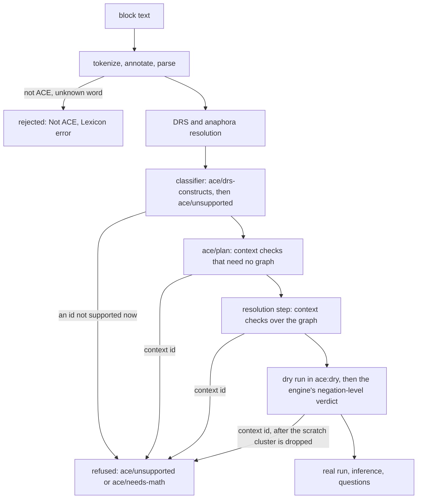

# Constructs and Refusals

ACE is a large language. Besides facts and questions it has relative clauses, plurals and counts, numbers and formulas, modal verbs, that-clauses, nested conditionals, two kinds of negation and commands. The front end does not map all of it in its first version, and it does not pretend to. Every construct the parser can read has a row in one table, `ace/constructs`, and the row says from which milestone zelph uses the construct, or why it has no route in v1. A block whose constructs are all supported is executed. A block that contains even one construct zelph cannot use is refused as a whole: nothing is written, and the message names the sentence, the construct and the reason. No block is ever accepted with a construct quietly dropped or misread, and once the grammar covers all of ACE (milestone M2), correct ACE is never reported as a syntax error.

Of the 83 construct ids that decide whether a block is accepted, 57 are supported by the end of v1, each mapped by the front end's modules onto engine features that zelph already has. 26 stay refused: 16 because zelph has no counterpart for them, 4 because v1 does not map their shape, and 6 because the engine cannot yet evaluate them soundly. This page lists every id with an example sentence and its milestone or its reason; shows what a refusal looks like; explains, with runs of today's zelph, why the refusals that touch the limits of the engine are honest; and specifies how the one table drives the classifier, the messages, the tests and the generated documentation. A machine-readable copy of the table is [`data/constructs.json`](data/constructs.json).

!!! example "Specified session — the behaviour this specification requires, not yet implemented"

    ```
    zelph> .import ace
    zelph> ace John is a man. John, buy a car! John's height is 1.83.

    Error in line "ace John is a man. John, buy a car! John's height is 1.83.": Correct ACE, but zelph cannot use it [ace/unsupported]: sentence 2, line 1, column 22: a command ('buy'), construct command/imperative.
      John, <>buy a car!
      An imperative has no truth value to store.
      Also not usable: sentence 3 (data/real).
    ```

    At the interactive prompt the session goes on (piped input stops at the first error). The first sentence alone would have been accepted, but the block is one theory and was refused as a whole, so John is unknown afterwards:

    ```
    zelph> ace Is John a man?

    Answer: It is not provable that John is a man.
    ```

The transcripts on this page follow the convention of the [Quick Start Guide](../quickstart.md#basic-usage): input after the prompt, the blank line that ends an `ace` block shown as an empty line, the import notice left out. The leading `Error in line "ace …":` is the host's frame around every error a keyword handler raises: it names the block by its first line, with ` …` when further lines follow; the message itself starts with its class. The wording of descriptions and hints is illustrative: the class, the id, the position, the marker `<>`, the construct id and the order of the lines are what the specification fixes ([Messages](block.md#messages), [The Refusal Message](#the-refusal-message)).

## Three Outcomes for a Block

An `ace` block ends in one of three ways, and the class of the message says which:

| Outcome | Message class | When | The graph |
|---|---|---|---|
| accepted | none (answers, warnings and notes are printed) | the text is ACE and zelph supports every construct it contains | written: the block's facts and rules, after a dry run |
| rejected | `Not ACE`, `Lexicon error` | the text is not ACE, or a word is unknown or misspelt | unchanged |
| refused | `Correct ACE, but zelph cannot use it` | the text is correct ACE, but a construct in it has no route in v1, is planned for a later milestone, or needs an import | unchanged |

A fourth class, `Contradiction`, rejects a block that the graph already contradicts, and reports a contradiction that the block's own inference meets; it is the subject of [Contradictions and Defeated Conclusions](block.md#contradictions-and-defeated-conclusions). The principles behind refusals:

- **One inventory.** Every construct the grammar can parse has a row in `ace/constructs`. The refusal reads nothing but these rows and the milestone: there is no second list of what is supported.
- **All or nothing.** A block is one theory: all its sentences are analysed, planned and checked before anything is written. A refusal comes before the dry run or from inside it, and the dry run's scratch cluster is dropped first, so a refused block leaves the graph exactly as it was ([All or Nothing: the Dry Run](block.md#all-or-nothing-the-dry-run)).
- **Refused by its id, never by accident.** A construct without a route is refused naming its construct id. It is never parsed into something else, never silently left out, and from milestone M2 on, when the grammar parses all of ACE 6.7, never a syntax error. The converse holds too: a text that is not ACE is never refused, because a refusal means that a DRS (the formal meaning of the text) was built, and building one for a text that is not ACE would be over-acceptance.
- **No interim workaround.** A construct whose engine support is missing stays refused by its id until the engine change has landed; the front end neither probes the engine for optional features nor emulates a missing one. The engine items the v1 constructs need were built before any ACE code and are part of zelph 1.1.0, so in v1 this rule concerns only the shapes that wait for planned engine work ([What zelph Still Needs](prerequisites.md#how-v1-lives-without-them)).
- **The message helps.** It names the sentence and the token, the construct, and either the milestone that brings the construct, the import it needs, or the reason it has no route, often with the formulation that works instead.

## The Construct Table

`ace/constructs` lives in `stdlib/ace-constructs.zph`, a data module without imports that is written first (M0), together with `ace/milestone`, the message catalogue `ace/messages` and their accessors. It is Janet data: one struct per construct.

| Field | Meaning |
|---|---|
| `:id` | keyword `<namespace>/<name>`, stable; it is the argument of refusal messages, the anchor of the construct in the user documentation (`ace.md#c-<namespace>-<name>`) and part of test names |
| `:family` | `:basic` or one of `:Q :C :R :N :F :D :M :S :A :L :P :U :V`: the corpus family whose DRS evidence the construct produces (never `:T`, which is a property of a text, not of a construct) |
| `:level` | `:drs` (found in the DRS by the classifier), `:context` (found while planning or executing, where the DRS alone cannot decide), `:syntax` (found in the parse tree) |
| `:since` | `:M0` … `:M9`, the milestone from which the construct is supported; nil means no route in v1 |
| `:import` | nil, or the module whose import the construct needs (`"ace-math"`) |
| `:needs` | the design decisions (DEC-…) and engine items (P-…) that `:since` rests on |
| `:summary` | a short user-facing name for refusal messages (data, own wording) |
| `:reason` | the message key of the hint for a row without a route |
| `:examples`, `:negatives` | own sentences that must be accepted once the row is supported, and sentences that must be rejected |
| `:corpus` | the APE corpus cases the row mirrors, by id |
| `:zelph` | the native zelph form, for the documentation |
| `:verbalise` | the verbaliser template that turns the construct back into ACE ([The Verbaliser](answers.md#the-verbaliser)) |

A row, printed as Janet prints it (keys in hash order):

```
{:needs (:DEC-NAMES) :level :drs :zelph "John \"is in\" Park-6f1c2a9e1d2b3c4f" :summary "noun phrase + is + preposition + noun phrase" :since :M3 :examples ("John is in a park.") :negatives () :id :copula/located :corpus (259) :family :V}
```

**Rows own the inventory, rule builders own the structure.** The rows say which constructs exist, at which level and in which family, carry the metadata, the examples and the verbaliser template, and hold the refusal data. The grammar is not generated from the rows: ACE's constructs interact (coordination, relative clauses, gaps), so the grammar is written as feature-parameterised rule builders. The only link is that every parse-tree node a builder makes carries the id of its row in the field `:c`, written as a literal keyword in the builder. The precedent for builders driven by one table is zelph's math front end, whose single operator table drives both its parser and its printer. There is no run-time extension API in v1; `(ace/construct id)` only reads a row.

**Three levels.** Syntax ids (`np/`, `vp/`, `rel/`, …) describe what was parsed; they never decide a refusal, because the resolved DRS no longer shows them ([Syntax Ids](#syntax-ids)). DRS-level ids are what the classifier finds in the meaning of the text; most refusals name one of them. Context ids name shapes that are well-formed ACE but that the front end can judge only while planning or against the graph, such as a rule that never binds its conclusion or a chain of "not provably" sentences; they are found later, but still before anything is written ([Context Checks](#context-checks)).

**Families.** The family letters come from the APE regression corpus, where every accepted text is filed by the kinds of DRS conditions it contains. One family per id is what lets the classifier reproduce the corpus counts exactly ([Family Counts](#family-counts)).

| Letter | Family | Accepted corpus texts |
|---|---|---|
| R | rules (`if … then`, `every`) | 839 |
| T | texts of several sentences (never an id) | 578 |
| N | classical negation (`not`, `no`) | 509 |
| P | plurals and cardinality | 482 |
| V | modifiers: adverbs and prepositional phrases | 379 |
| Q | questions | 317 |
| M | modality (`can`, `must`, `should`, `may`) | 221 |
| D | disjunction (`or`) | 191 |
| U | mass nouns and measurements | 125 |
| S | subordination (that-clauses) | 89 |
| A | arithmetic and formulas | 59 |
| C | commands | 32 |
| F | negation as failure (`not provably`) | 19 |
| L | lists and sets | 13 |
| basic | names, nouns, verbs, adjectives, of-phrases, the copula, `there is` | 423 texts with basic constructs only |

**The milestone switch.** `(ace/supported? id)` is true when the row's `:since` is not nil and not later than `ace/milestone`, a `(def ace/milestone :Mn)` in `ace-constructs.zph`, and when the row's `:import` module, if any, is imported and usable (for `"ace-math"`: its hook table is set for the current graph epoch). Advancing a milestone edits `ace/milestone` and nothing else in the mechanism, in the same change as the milestone's gate counts and its tests. The ids are stable across milestones: a construct planned for M7 is refused naming its id at M3 and accepted at M7, without a rename anywhere.

## Construct Ids by Milestone

The DRS-level and context ids are the ones that decide refusals: 83 of them, 76 at DRS level and 7 context ids. 57 are supported by the end of v1, 26 have no route in v1. The tables give each id with its family, an example sentence written for this specification and what its support rests on; "corpus N" names a case of the APE regression corpus, by its id, that holds the same construct. Decision ids (DEC-…) are explained on [Design Decisions](decisions.md); P-ids name engine items that were built for the front end before any ACE code, explained on [What zelph Already Provides](foundation.md). What each construct writes into the graph is on [Every Construct and Its Native Form](semantics.md#every-construct-and-its-native-form); arithmetic is on [Numbers and Formulas](math.md#typing-and-construct-ids).

### Supported from M1

The smoke slice: a name, an indefinite noun phrase after `is`, and the yes/no question.

| Id | Family | Example | Rests on |
|---|---|---|---|
| `:name/proper` | basic | John is a man. | — |
| `:object/count` | basic | John is a man. | — |
| `:copula/noun` | basic | John is a man. | — |
| `:question/yes-no` | Q | Is John a man? | [DEC-QTIME](decisions.md#dec-qtime), [DEC-RUN](decisions.md#dec-run) |

### Supported from M3

Facts and questions: individuals, verbs, adjectives, comparisons, of-phrases, places, wh-questions and strings.

| Id | Family | Example | Rests on |
|---|---|---|---|
| `:individual/top-level` | basic | There is a man. | [DEC-INDIVIDUALS](decisions.md#dec-individuals) |
| `:object/something` | basic | There is something. It waits. (corpus 266) | — |
| `:verb/intransitive` | basic | John waits. (corpus 22) | [DEC-SHAPES](decisions.md#dec-shapes) |
| `:verb/transitive` | basic | John likes Mary. | — |
| `:verb/ditransitive` | basic | John gives Mary a book. | — |
| `:adj/positive` | basic | John is rich. | DEC-SHAPES |
| `:adj/transitive` | basic | A woman is fond-of a cat. (corpus 173) | — |
| `:adj/comparison` | basic | John is taller than Mary. (corpus 1141) | — |
| `:of/relation` | basic | Bill is a father of John. | [DEC-OF](decisions.md#dec-of) |
| `:copula/located` | V | John is in a park. | [DEC-NAMES](decisions.md#dec-names) |
| `:question/wh` | Q | Who waits? (corpus 249) | — |
| `:data/string` | basic | `A text is "abcdef".` (corpus 1593) | [DEC-DATA](decisions.md#dec-data) |

`:copula/located` belongs to family V, because its evidence is a prepositional modifier, but it is supported long before the other V ids (M6).

### Supported from M4

Rules and both kinds of negation, disjunction in conditions and questions, and the conditional inside a yes/no question.

| Id | Family | Example | Rests on |
|---|---|---|---|
| `:rule/horn` | R | All dogs bark. (corpus 2052) | — |
| `:rule/generative-head` | R | Every man owns a dog. | [DEC-GENERATIVE](decisions.md#dec-generative) |
| `:rule/disconnected-head` (context) | R | If a man waits then a dog barks. | [DEC-DISCONNECTED](decisions.md#dec-disconnected) |
| `:rule/nested` | R | Every man sees every dog. (corpus 84) | [DEC-NESTED-IMP](decisions.md#dec-nested-imp) |
| `:rule/negated` | R | Not every man waits. | — |
| `:rule/in-question` | R | Is it true that every dog is an animal? (corpus 1974) | [DEC-QUNIV](decisions.md#dec-quniv), P-rule-list |
| `:neg/fact` | N | John does not wait. | P-refute, [DEC-REFUTE-ROUTES](decisions.md#dec-refute-routes) |
| `:neg/statement` | N | There is no man. (corpus 707) | — |
| `:neg/not-every` | N | Not every man waits. | — |
| `:neg/in-head` | N | No card is correct. (corpus 3413) | [DEC-REFUTED](decisions.md#dec-refuted), P-refute |
| `:neg/atom-in-body` | N | If John does not wait then Mary sleeps. | [DEC-NEG](decisions.md#dec-neg), P-refute |
| `:neg/atom-in-question` | N | Who does not wait? (corpus 1448) | — |
| `:naf/atom-in-body` | F | If a man is not provably married then the man is a bachelor. | — |
| `:naf/complex-in-body` | F | If a man does not provably own a car then the man walks. | DEC-NEG |
| `:naf/in-question` | F | Which clerk does not provably sleep? (corpus 2772) | — |
| `:or/in-body` | D | If a man waits or sleeps then the man is tired. | — |
| `:or/in-question` | D | Who eats or sleeps? (corpus 2621) | — |

P-refute is refutation as a statement and as a condition (`¬(F)`, `((F) ~ refuted)`); P-rule-list is `zelph/rules`, the list of the rules in force with their negated conditions, which the hypothetical check of a conditional question reads ([Questions That Hold a Conditional](answers.md#questions-that-hold-a-conditional)). `:rule/negated` and `:neg/not-every` always come together: "Not every man waits." is a negated rule, mapped as "some man does not wait".

`:rule/disconnected-head` is the one context id with a route. A conclusion that introduces something connected to nothing the condition binds ("If a man waits then a dog barks.") is the existential rule ∀x (man(x) ∧ waits(x) → ∃d (dog(d) ∧ barks(d))), and one dog satisfies it for every man. zelph evaluates a fresh variable as the restricted chase does ([Existential Quantification](../logic.md#existential-quantification)): a witness is made only when no node already makes the conclusion hold. The rule `ace` writes, `((X ~ man), (X waits nil)) => (Y ~ dog) (Y barks nil)`, therefore makes exactly one dog however many men wait, in each of the engine's evaluation modes (`.semi-naive on`, `off` and `check`) and over further runs. The row was first planned as a refusal, on a measurement of an older engine in which such a rule fired never or on every run; the current engine does neither ([DEC-DISCONNECTED](decisions.md#dec-disconnected)), and an M4 test pins one witness across bindings and runs. Two waiting men, one dog (zelph prints the witness, which has no name of its own, by its class):

```
zelph> ((X ~ man), (X waits nil)) => (Y ~ dog) (Y barks nil)
zelph> john ~ man
zelph> john waits nil
zelph+> bob ~ man
zelph> bob waits nil
zelph> X barks nil
Answer: dog barks nil
```

### Supported from M5

Arithmetic and identity. Three ids need `.import ace-math`, which imports zelph's arithmetic stack; without it they are refused with `[ace/needs-math]` ([A Missing Import](#a-missing-import)).

| Id | Family | Example | Import | Rests on |
|---|---|---|---|---|
| `:formula/compare` | A | 1 < 2. (corpus 2384) | `ace-math` | [DEC-MATH-MODULE](decisions.md#dec-math-module), [DEC-MATH-LANG](decisions.md#dec-math-lang) |
| `:formula/identity` | A | `John \= Mary.` | — | [DEC-NEQ](decisions.md#dec-neq) |
| `:expr/arith` | A | John's age is 29 + 1. | `ace-math` | DEC-MATH-MODULE |
| `:data/integer` | basic | John's age is 30. (corpus 1591) | `ace-math` | DEC-DATA, [DEC-MATH-IMPORT](decisions.md#dec-math-import) |
| `:copula/identity` | basic | Sun is the Sun. (corpus 3751) | — | DEC-NEQ |
| `:neg/formula` | N | It is false that 2 = 5 - 4. (corpus 2386) | — | DEC-NEQ, DEC-MATH-MODULE |
| `:naf/formula` | F | If a person's age is A and it is not provable that A > 18 then the person is a minor. | — | DEC-NEQ, DEC-MATH-MODULE |

`:neg/formula` and `:naf/formula` need no import of their own: the `formula/` ids inside them carry it. `:copula/identity` is basic, but supported only from M5, where identity between names is decided ("John is Bill." is read like "John = Bill.").

### Supported from M6

Events: an occurrence of a verb that a prepositional phrase or an adverb modifies, and the questions that ask about it.

| Id | Family | Example | Rests on |
|---|---|---|---|
| `:mod/pp` | V | A woman sleeps in a garden. (corpus 4) | [DEC-EVENTS](decisions.md#dec-events) |
| `:mod/adverb` | V | A man runs fast. (corpus 1524) | DEC-EVENTS |
| `:question/where-when-how` | Q | How is John? (corpus 2200) | DEC-EVENTS |

### Supported from M7

Plurals, cardinality, groups, mass nouns, lists and sets.

| Id | Family | Example | Rests on |
|---|---|---|---|
| `:object/plural-count` | P | 2 men wait. (corpus 1213) | [DEC-PLURALS](decisions.md#dec-plurals) |
| `:object/at-most` | P | At most 1 man waits. (corpus 1190) | DEC-PLURALS, DEC-NEQ |
| `:object/at-least` | P | At least 3 men wait. (corpus 422) | DEC-PLURALS |
| `:object/group` | P | John and Mary lift a table. | DEC-PLURALS |
| `:group/condition-list` | P | John sees exactly 2 men. (corpus 1294) | DEC-PLURALS |
| `:object/mass` | U | John drinks some water. | DEC-PLURALS |
| `:data/list` | L | `[1, 2] is contained by [3, 4].` (corpus 2390) | DEC-PLURALS |
| `:data/set` | L | `{ John } waits.` (corpus 2395) | DEC-PLURALS |
| `:question/how-many` | Q | How many men wait? (corpus 3746) | — |

### Supported from M8

Modality and subordination: what is possible, necessary, recommended or admissible, and what someone believes, knows or wants. These statements are written as mentions in the argument of an opaque predicate, never asserted.

| Id | Family | Example | Rests on |
|---|---|---|---|
| `:modal/can` | M | John can fly. (corpus 1454) | [DEC-MODAL](decisions.md#dec-modal), P-opaque, P-set-match |
| `:modal/must` | M | A man must wait. (corpus 1280) | DEC-MODAL, P-opaque, P-set-match |
| `:modal/should` | M | John should wait. (corpus 3010) | DEC-MODAL, P-opaque, P-set-match |
| `:modal/may` | M | John may wait. (corpus 3355) | DEC-MODAL, P-opaque, P-set-match |
| `:sub/that-clause` | S | John knows that Mary waits. (corpus 1360) | DEC-MODAL, P-opaque, P-set-match |

P-opaque makes a predicate opaque (`P ~ opaque`), so that what stands in its arguments is mentioned, not claimed ([Mentioning a Statement: Opaque Predicates](../logic.md#mentioning-a-statement-opaque-predicates)); P-set-match lets a condition with variables match a stored set of mentions by its members, which a modal box with several conditions needs ([Boxes as sets: set patterns](foundation.md#boxes-as-sets-set-patterns)).

M9 adds no construct id: it brings explanations, the derivation echo, justified answers and the `ace-retract` keyword ([Questions, Answers and Explanations](answers.md)).

## Without a Route in v1

26 ids have no milestone. They fall into three groups: 16 constructs zelph has no counterpart for, 4 rule and term shapes v1 does not map, and 6 shapes the engine cannot yet evaluate soundly. The third group is where a refusal is a statement about the engine, and the next section shows the evidence for it with runs of today's zelph. [Work Plan and Milestones](plan.md#constructs-that-stay-refused-in-v1) lists the same rows from the point of view of the milestones.

### Constructs zelph Has No Counterpart For

| Id | Family | Level | Example | Why there is no route |
|---|---|---|---|---|
| `:adj/comparative` | basic | drs | John is more important. (corpus 2172) | A comparative without a target names no second term, so there is nothing to relate the subject to. |
| `:adj/superlative` | basic | drs | John is most important. (corpus 2174) | A superlative ranks the subject within a class the sentence does not name; zelph has no order over adjectives to read it from. |
| `:copula/located-many` | V | drs | Mary is in a garden in an evening. (corpus 3464) | Several prepositional phrases on one `is` would need an occurrence of the copula itself, which has no fact of its own; the located copula maps one phrase to one phrase predicate. |
| `:question/unrestricted` | Q | context | Who is there? (corpus 1679) | zelph answers a question by matching patterns, and this wh-word is constrained by no condition, so every node would be an answer. |
| `:data/real` | basic | drs | 3.14 is a real. (corpus 2117) | zelph has integers only. |
| `:data/measured` | basic | drs | John's height is 180cm. (corpus 2622) | zelph has no units, and integers only. |
| `:object/measure` | U | drs | A cook has 3 kg of pears. (corpus 167) | Measured quantities need units, which zelph does not have. |
| `:mod/adverb-degree` | V | drs | A car runs more speedily. (corpus 1566) | A comparative or superlative adverb compares manners without naming what with; the manner of an occurrence carries no degree. |
| `:formula/non-numeric` | A | drs | `"abc" < "abd".` | zelph has no order on strings, lists or sets. |
| `:expr/concat` | A | drs | `"abc" is "ab" & "c".` (corpus 2873) | zelph cannot join strings yet; a rule set that joins character lists would open it. |
| `:or/in-head-or-statement` | D | drs | A woman sings or she dances. (corpus 188) | zelph stores facts and rules with one set of conclusions; a disjunction stated or concluded has no representation in either ([Disjunction](../logic.md#disjunction)). |
| `:naf/top-level` | F | drs | It is not provable that Mary sleeps. (corpus 1416) | "Not provable" describes what the graph lacks; it can be asked or used as a condition, not stated as a fact or concluded. |
| `:neg/complex-in-body` | N | drs | If a man does not own a car then the man walks. | A condition can test that one fact is refuted, not that no combination of facts holds. The hint offers "does not provably", which is usually what is meant. |
| `:neg/complex-in-question` | N | drs | Is there no laundry? (corpus 763) | A question can test that one fact is refuted, not that no combination of facts holds. The hint offers "not provably" (`:naf/in-question` is supported). |
| `:rule/in-wh-question` | R | drs | How does every man wait? (corpus 2087) | The hypothetical check answers yes or no; it cannot say which individuals answer a wh-question. |
| `:command/imperative` | C | drs | John, wait! (corpus 2016) | An imperative has no truth value to store. |

Classical negation and negation as failure are never mixed: a complex classical negation in a condition is not silently read as "not provably", it is refused with a hint that suggests it (DEC-NEG).

### Rule and Term Shapes v1 Does Not Map

These are correct ACE in a shape v1 does not map: a rule that would range over every node or never stop making individuals, a hypothetical check that would answer wrongly, and a term that would be stored as a request instead of a value.

| Id | Family | Level | Example | Why there is no route |
|---|---|---|---|---|
| `:rule/unsafe` | R | context | Everybody waits. | No positive condition binds a variable of the conclusion, so the rule would have to range over every node. |
| `:rule/endless-generation` | R | context | Every person has a mother who is a person. | Each new individual the rule makes satisfies its condition again, so the run would not end. |
| `:rule/unsafe-hypothesis` | R | context | If a man is not provably married then the man is a bachelor. Is it true that every man is a bachelor? | A fresh hypothetical witness is "not provably" everything, so a rule with "not provably" or `\=` that the hypothesis can reach would make the answer wrong. |
| `:expr/as-data` | A | context | John likes Mary + 1. (corpus 3527) | zelph stores a term by its value, and this term has no whole-number value; stored as a term it would be a request. Storing such terms as terms is left to a later round. |

`:rule/unsafe` follows Datalog's safety condition, extended to formulas: a comparison binds nothing, so `If X > 2 then X > 1.` is unsafe too, while a math-universal statement ("For every integer X …") is planned by the arithmetic module and never reaches this check. `:rule/endless-generation` is checked twice: on the plan, with classes compared by name, and in the resolution step through the graph's subclass hierarchy, so "Every human has a mother who is a woman." is refused on a graph where a woman is a subclass of human and accepted where she is not.

### Shapes zelph Cannot Yet Evaluate Soundly

| Id | Family | Level | Example | Why there is no route | What would open it |
|---|---|---|---|---|---|
| `:rule/in-body` | R | drs | If every dog sleeps then a cat runs. (corpus 782) | A universal inside a condition needs a helper rule that holds "not provably". zelph orders such a helper only on a graph without Wikidata's class properties and only where no conclusion feeds back, so the answer could depend on the order of the rules. | the planned narrowing of [DEC-STRATA](decisions.md#dec-strata), for the core profile only; not v1 |
| `:naf/nested-in-body` | F | drs | If a man is not provably a farmer who does not provably own a dog then the man is idle. | The helper rule of the outer "not provably" would hold another "not provably", with the same limits. | as `:rule/in-body` |
| `:naf/unstratified` | F | context | If a man is not provably married then the man is a bachelor. If a man is not provably a bachelor then the man is a husband. | A "not provably" condition tests what a rule with a "not provably" condition concludes, directly or through other rules; zelph cannot always put such rules in order, and then the answer depends on the order of the rules. | as `:rule/in-body` |
| `:sub/ground-conditional` | R | drs | John believes that if Mary waits then Bill sleeps. | A ground rule typed natively and the same rule mentioned are one node, and the mention takes the typed rule out of force. | the asserted-rule record, [K1-P1](prerequisites.md#k1-p1-a-mention-switches-a-typed-ground-rule-off) on What zelph Still Needs |
| `:sub/conditional-with-referents-in-body` | R | drs | If John believes that every man waits then John is happy. | A condition that holds a rule with variables matches only stored rules without variables, so it would fire on the wrong beliefs and never on this one. | quoting of rules, planned in zelph |
| `:sub/conditional-with-referents-in-head` | R | drs | Every woman believes that every man waits. | When the rule fires, a conclusion that mentions a rule with variables writes nothing, so the sentence would be accepted and silently lost. | a firing that writes a mention with variables of its own, planned with quoting |

The `:rule/in-body` row also carries a universal inside a negation, at the top level or in a conclusion ("Nobody sees everybody.", corpus 398; "No dog is faster than every cat.", corpus 1914), because the classifier reads the box of a negation as a condition: 44 accepted corpus texts in all, 13 of them with a conditional inside an if-box. The three `sub/` ids are reported beside the `:rule/horn` of the same conditional, which is why they do not change the family counts. A that-clause holding a conditional with variables at the top level ("John believes that if a man waits then the man sleeps.") is supported from M8: it is written as a mention, and a question over it answers "It is not provable that …", which is sound ([Modality and That-Clauses](semantics.md#modality-and-that-clauses)).

## Why the Hard Refusals Are Honest

The six ids of the last group are not limits of ACE or of the mapping. They are places where zelph, given the rules the mapping would write, can derive something the sentences do not say, or fail to derive something they do. The runs below are of today's zelph, with the native rules the front end would write, so a reader can check that the refusal protects the user from a wrong answer and not from an unfinished feature.

### "Not Provably" That Depends on Another "Not Provably"

!!! example "Specified session — the behaviour this specification requires, not yet implemented"

    ```
    zelph> .import ace
    zelph> ace If a man is not provably married then the man is a bachelor.
    If a man is not provably a bachelor then the man is a husband.
    John is a man.

    Error in line "ace If a man is not provably married then the man is a bachelor. …": Correct ACE, but zelph cannot use it [ace/unsupported]: sentence 2, line 2, column 1: "not provably" over what another "not provably" concludes, construct naf/unstratified.
      <>If a man is not provably a bachelor then the man is a husband.
      Sentence 1 concludes that a man is a bachelor, which this sentence tests; zelph cannot always put the two in order, and then the answer would depend on the order of the rules.
    ```

The message names sentence 2, whose "not provably" condition sentence 1 reaches; a context id is found over the plans and has no evidence condition, so the marker stands before the sentence's first token ([Positions](#positions)). The intended reading is clear: John is not provably married, so he is a bachelor; then he is provably a bachelor, so he is not a husband. zelph evaluates negation as failure in negation levels ([Stratified Evaluation](../logic.md#stratified-evaluation)): rules are grouped by what they depend on, and a rule with a negated condition runs only after everything that could produce the negated fact. Whether zelph can separate the two rules depends on how the class conditions are written. "Not provably a bachelor" is a class condition, which the front end writes as a positive helper rule and a negated condition on the helper's fact ([Helper Rules for "not provably"](semantics.md#helper-rules-for-not-provably)). In the runs below the rules are typed in the form `ace/zelph-of` prints ([DEC-ONE-CONDITION-PRINT](decisions.md#dec-one-condition-print)), zelph prints each rule with its conditions in an order of its own, and the helper is called `naf-bachelor` for readability; the front end names it `ace:naf-<16 hex digits>`.

On a graph without Wikidata, a class is written with `~`, and zelph keys a condition by its predicate together with its constant object, so it tells `X ~ bachelor` from `X ~ husband`. The two rules get separate levels, and the answer is right:

```
zelph> ((X ~ man), ¬(X is married)) => (X ~ bachelor)
zelph> ((X ~ man), (X ~ bachelor)) => (X naf-bachelor nil)
zelph> ((X ~ man), ¬(X naf-bachelor nil)) => (X ~ husband)
zelph> john ~ man
(john ~ bachelor) ⇐ {(¬(john is married)) (john ~ man)}
(john naf-bachelor nil) ⇐ {(john ~ man) (john ~ bachelor)}
zelph> john ~ X
Answer: john ~ bachelor
Answer: john ~ man
zelph> .strata
2 negation levels:
Level 1:
  (¬(X is married), (X ~ man)) => (X ~ bachelor)
Level 2:
  (¬(X naf-bachelor nil), (X ~ man)) => (X ~ husband)
```

On a Wikidata graph a class is written with `P31` and the subclass closure of `P279`, and the same three rules become these. Every class condition now reads `P31` with a variable object, which zelph keys as `P31` with any object: it can no longer tell the classes apart, puts the rules on one level, reports them as not stratifiable and evaluates them in turn. John becomes a husband, which the sentences exclude:

```
zelph> ((X P31 Y), ((Y P279 man) closure zero-or-more), ¬(X is married)) => (X P31 bachelor)
zelph> ((X P31 Y), ((Y P279 man) closure zero-or-more), (X P31 Z), ((Z P279 bachelor) closure zero-or-more)) => (X naf-bachelor nil)
zelph> ((X P31 Y), ((Y P279 man) closure zero-or-more), ¬(X naf-bachelor nil)) => (X P31 husband)
zelph> john P31 man
(john P31 husband) ⇐ {((:P279 man) closure zero-or-more) (john P31 man) (¬(john naf-bachelor nil))}
(john P31 bachelor) ⇐ {(john P31 man) (¬(john is married)) ((:P279 man) closure zero-or-more)}
(john naf-bachelor nil) ⇐ {((:P279 bachelor) closure zero-or-more) (john P31 bachelor) (john P31 man) ((:P279 man) closure zero-or-more)}
zelph> john P31 X
Answer: john P31 bachelor
Answer: john P31 husband
Answer: john P31 man
zelph> .strata
1 negation level:
Level 1:
  ((X P31 Y), ¬(X is married), (Y P279∗ man)) => (X P31 bachelor)
  ((Y P279∗ man), (X P31 Y), ¬(X naf-bachelor nil)) => (X P31 husband)
Not stratifiable, on level 1 -- these rules negate what they derive:
  ((X P31 Y), ¬(X is married), (Y P279∗ man)) => (X P31 bachelor)
  ((Y P279∗ man), (X P31 Y), ¬(X naf-bachelor nil)) => (X P31 husband)
  ((Z P279∗ bachelor), (X P31 Z), (X P31 Y), (Y P279∗ man)) => (X naf-bachelor nil)
```

A class hierarchy can feed a conclusion back even without Wikidata. Adding "Every husband is a man.", the one-condition rule `(*{(X ~ husband)} ~ conjunction) => (X ~ man)`, to the core form joins the rules into one component, and the result is wrong in every run:

```
zelph> ((X ~ man), ¬(X is married)) => (X ~ bachelor)
zelph> ((X ~ man), (X ~ bachelor)) => (X naf-bachelor nil)
zelph> ((X ~ man), ¬(X naf-bachelor nil)) => (X ~ husband)
zelph> (*{(X ~ husband)} ~ conjunction) => (X ~ man)
zelph> john ~ man
(john ~ bachelor) ⇐ {(¬(john is married)) (john ~ man)}
(john ~ husband) ⇐ {(¬(john naf-bachelor nil)) (john ~ man)}
(john naf-bachelor nil) ⇐ {(john ~ man) (john ~ bachelor)}
zelph> john ~ X
Answer: john ~ husband
Answer: john ~ man
Answer: john ~ bachelor
zelph> .strata
1 negation level:
Level 1:
  (¬(X is married), (X ~ man)) => (X ~ bachelor)
  (¬(X naf-bachelor nil), (X ~ man)) => (X ~ husband)
Not stratifiable, on level 1 -- these rules negate what they derive:
  ((X ~ man), (X ~ bachelor)) => (X naf-bachelor nil)
  (*{(X ~ husband)} ~ conjunction) => (X ~ man)
  (¬(X is married), (X ~ man)) => (X ~ bachelor)
  (¬(X naf-bachelor nil), (X ~ man)) => (X ~ husband)
```

Accepting such shapes by the graph's profile, by the kind of conclusion or by the engine's verdict alone would be arbitrary for the user or unsound. v1 therefore refuses every shape in which a "not provably" condition can read what a rule with a "not provably" condition concludes (DEC-STRATA), with three ids:

- `:rule/in-body` and `:naf/nested-in-body` at DRS level, for a universal inside a condition and a "not provably" inside a "not provably": their helper rules would hold a negated condition themselves.
- `:naf/unstratified` as a context id, decided twice before anything is written. First in the resolution step, over the transitive may-derive graph of the block's rules and the ACE rules of earlier blocks of the same graph epoch: rule R feeds rule R′ when a conclusion of R unifies with a condition of R′, helper rules included; a conclusion `X <instance> C′` feeds a class condition over C when C′ is C or the graph's subclass hierarchy leads up from C′ to C (a bounded walk; 25 to 113 classes were measured on Wikidata). The block is refused when a "not provably" pattern is reachable from the conclusion of a rule that has a "not provably" condition. Second, in the dry run, after the block's rules are written into the scratch cluster: when the block writes a rule and the theory holds a rule with a negated condition, `ace` reads the engine's own verdict with `(zelph/strata)` ([Negation levels](../janet.md#negation-levels)), and refuses when a component that the engine marks `:stratifiable false` holds a negation rule `ace` wrote together with a rule `ace` did not write, or while a rule over predicates is in force (a row marked `:transparent`). This second half catches what the front end's own graph cannot see: native rules typed beside ACE rules, and a transitivity rule, which makes the engine compare predicates only ([Rules over predicates](../logic.md#rules-over-predicates)).

The may-derive graph is finer than the engine's levels in one respect and coarser in another, and both are deliberate. It compares whole patterns, subjects included, so it does not refuse "If a man is not provably married then the man is a bachelor." on its own. It follows reach, not only cycles, so it refuses the chain above even on an empty graph, where the engine happens to order it, and it refuses a pair in which one conclusion reaches the other's negated condition without any cycle ("If a man is not provably liked by Sue then John likes the man. If a man is not provably liked by John then Bill likes the man."): the engine keys `likes` with any object, evaluates the two rules together and is wrong in two of four block orders, which a check by cycles alone would accept. Native rules are inspected only through the engine's verdict; the rules an ACE generator wrote and the ACE rules of a loaded graph count as rules `ace` did not write, which is sound and stricter than needed. Beside the math stack the ACE rules keep components of their own, so `.import ace-math` costs this check nothing. The checks in the order the handler runs them are on [Static Checks](semantics.md#static-checks).

The hint names what zelph cannot order: for `:naf/unstratified` the sentence whose "not provably" is reached, the sentence whose conclusion reaches it and the sentences on the way, or, from the engine's verdict, that the rule set holds rules not written in ACE, or a rule over predicates, that zelph evaluates together with it. It names no planned feature, and it does not claim that zelph evaluates the core-profile chain together, which on an empty graph it does not. A refusal on a Wikidata graph may come with an accepted block on an empty one, and a later subclass fact can change the verdict for a new block; the user documentation says both.

A narrowing of the refusal is planned, but not part of v1, and lifting it is a decision of its own ([DEC-STRATA](decisions.md#dec-strata)): a helper would leave out each context pattern that a "not provably" conclusion may derive, and a non-stratifiable component of rules `ace` wrote alone, with no rule over predicates in force, would be accepted when no negation rule in it can reach one of its negated patterns. In the core profile it would accept the chains, the universal in a condition, "not provably" inside "not provably" and the hierarchy feedback into a helper's context; on a Wikidata graph the chains with class conclusions stay refused even then, because the engine's levels do not separate class patterns there. Lifting `:rule/in-body` and `:naf/nested-in-body` would move the corpus texts 782, 783, 1011, 1012, 1212, 1231, 1966, 2990, 3317, 3360, 3363, 3734, 1418 and 3022 into the M4 gate. The engine work behind both directions is described in [Where the logic goes next](../about.md#where-the-logic-goes-next).

### A Rule Inside a That-Clause

!!! example "Specified session — the behaviour this specification requires, not yet implemented"

    ```
    zelph> .import ace
    zelph> ace If John believes that every man waits then John is happy.

    Error in line "ace If John believes that every man waits then John is happy.": Correct ACE, but zelph cannot use it [ace/unsupported]: sentence 1, line 1, column 29: a rule inside a that-clause in a condition ('man'), construct sub/conditional-with-referents-in-body.
      If John believes that every <>man waits then John is happy.
      This condition would match only a belief without variables, such as "John believes that if Bob is a man then Bob waits.", and never the belief it names.
    ```

From M8, `believes` is an opaque predicate: what John believes is written as a mention, not as a fact ([Mentioning a Statement: Opaque Predicates](../logic.md#mentioning-a-statement-opaque-predicates)). A rule whose condition holds a rule with variables, however, matches a stored rule by its parts, and its own variables bind the parts of the stored rule; a mentioned rule that has variables of its own is rule text that no condition matches ([Mentioning a Rule Is Not Asserting It](../logic.md#mentioning-a-rule-is-not-asserting-it)). The native form of the sentence above, with both rules built as the one-element condition set `ace` uses for every one-condition rule, shows the consequence: John's belief in the universal rule does not make him happy (the first question finds no one), his belief in one ground instance does.

```
zelph> believes ~ opaque
zelph> (*{(john believes ((*{(X ~ man)} ~ conjunction) => (X waits nil)))} ~ conjunction) => (john ~ happy)
zelph> john believes ((*{(X ~ man)} ~ conjunction) => (X waits nil))
zelph> S ~ happy
zelph> john believes ((*{(bob ~ man)} ~ conjunction) => (bob waits nil))
(john ~ happy) ⇐ {(john believes ((*{(bob ~ man)} ~ conjunction) => (bob waits nil)))}
zelph> S ~ happy
Answer: john ~ happy
```

The same belief in a conclusion ("Every woman believes that every man waits.") fails silently: when the rule fires for Mary, nothing is written, and a question for any belief finds none, so the block would be accepted and its meaning lost. (In the plain spelling of a one-condition rule, which `ace` never writes, the firing writes the belief with witnesses in place of the variables instead, which is no better.)

```
zelph> believes ~ opaque
zelph> (*{(X ~ woman)} ~ conjunction) => (X believes ((*{(Y ~ man)} ~ conjunction) => (Y waits nil)))
zelph> mary ~ woman
zelph> S believes O
```

A ground conditional in a that-clause ("John believes that if Mary waits then Bill sleeps.") has the opposite problem. zelph identifies a statement by its content, and whether a rule is in force is read off its surroundings: a rule that something mentions is not in force. A ground rule typed natively and the same rule mentioned in the plain spelling are therefore one node, the mention takes the typed rule out of force, and typing it again does not put it back. The front end writes its mentions with `zelph/mention` in the set form, which is a node of its own and not in force until something claims it ([DEC-MENTION-RULE](decisions.md#dec-mention-rule)), but the same rule can always arrive in the plain spelling, from a user or a loaded graph. The fix is a positive record that a rule was asserted, specified as [K1-P1](prerequisites.md#k1-p1-a-mention-switches-a-typed-ground-rule-off) on What zelph Still Needs. Until it lands, `:sub/ground-conditional` is refused, and the front end flattens a fully ground nested conditional instead of making it a rule generator.

## How Much of the Corpus Stays Refused

The APE regression corpus holds 2813 texts that APE accepts; 2682 of them use only words of APE's small lexicon, which the tests load (the other 131 need APE's large lexicon, which is never shipped). Counted in strict mode over these 2682, the accepted texts grow from 11 at M1 and M2 to 767 at M3, 1183 at M4, 1222 at M5, 1490 at M6, 1970 at M7 and 2201 at M8; with `ace-math` imported, 2265 at M8, about five in six. The numbers are provisional: they come from a research classifier with the decisions of this specification applied, and the production classifier replaces them at M0, when the gate rows are pinned. [Per-Milestone Counts](tests.md#per-milestone-counts) on Tests and Quality Gates has the table with the refused counts and the graph comparisons per milestone, and owns the gates.

The research classifier counted 481 texts still refused at M8 without `ace-math`, each holding a construct without a route or needing the import. The largest ids among them are `:or/in-head-or-statement` (171), `:rule/unsafe` (81), `:data/integer` (70, accepted with `ace-math`), `:command/imperative` (29), `:formula/compare` (29), `:expr/arith` (24), `:neg/complex-in-body` (15), `:data/real` (14) and `:naf/top-level` (10). Two corrections are already known. The research classifier counted the context ids `:rule/unsafe` and `:rule/disconnected-head` as refusals, while the corpus expectation holds DRS-level ids only ([The Corpus Expectation](#the-corpus-expectation)). And it counted `:rule/disconnected-head` in 68 of the 481 texts, but the construct has a route from M4 (DEC-DISCONNECTED), decided after those numbers were taken, so those of the 68 that hold no other refused id are accepted from M4. The M0 classifier absorbs both.

## Where a Construct Is Found

Every id is found before anything is written. DRS-level ids come from the classifier, before planning; context ids from planning, from the resolution step (where words become nodes, still without writing) and, for the negation levels, from the dry run, whose scratch cluster is dropped before the refusal is raised.



The pipeline itself is described on [Architecture](architecture.md#refusal-happens-on-the-resolved-drs-by-construct-id), the handler's steps on [What a Block Does](block.md#what-a-block-does).

### The Classifier

`(ace/drs-constructs drs)` returns a struct mapping each DRS-level id present to the sorted tuple of the sentence numbers of its evidence. It is total on every well-formed DRS, the front end's own and APE's, so the corpus tests run it on APE's expected DRSs. `(ace/unsupported ids)` returns the sorted tuple of those ids not supported now; a non-empty result refuses the block.

**Procedure.**

1. Walk the resolved DRS with a context: `:assert` (the top box), `:body` (an if-box, the box of a top-level negation, the box of a negation in a then-box, the box of a "not provably" in a condition, and everything nested in these that is not a then-box), `:head` (a then-box), `:question` (a question box and every box inside it). The two boxes of a top-level negated conditional ("Not every man waits.") are walked as `:body` and `:head`. The boxes of modal operators, that-clauses and commands are walked with `:assert`.
2. Complex conditions yield ids by the first table below, simple conditions by the second, data arguments by the third.
3. The ids of the fourth table are decided on a copy of the DRS after the two normalisations that remove plain event referents and substitute the copula (both total).
4. The result maps each id to the sorted sentence numbers of its evidence conditions.

**Complex conditions.** DRS notation as in the public DRS report: `=>` a conditional, `-` classical negation, `~` negation as failure, `v` disjunction.

| Condition | In a statement (`:assert`) | In a condition (`:body`) | In a conclusion (`:head`) | In a question (`:question`) |
|---|---|---|---|---|
| conditional | `:rule/horn` (with the refinements of the fourth table) | `:rule/in-body` | `:rule/nested` | `:rule/in-question` if the question box holds no wh-word, else `:rule/in-wh-question` |
| negation | `:neg/fact` if its box is one ground atom; `:neg/not-every` and `:rule/negated` if its only condition is one conditional; else `:neg/statement` | `:neg/atom-in-body` if its box is one atom, else `:neg/complex-in-body` | `:neg/in-head` | `:neg/atom-in-question` if one atom, else `:neg/complex-in-question` |
| not provable | `:naf/top-level` | `:naf/atom-in-body` if one atom; `:naf/nested-in-body` if it holds a "not provably" or a conditional at any depth; else `:naf/complex-in-body` | `:naf/top-level` | `:naf/in-question` |
| disjunction | `:or/in-head-or-statement` | `:or/in-body` | `:or/in-head-or-statement` | `:or/in-question` |
| question | `:question/wh` for `who`, `what`, `which`; `:question/where-when-how` for `where`, `when`, `how`; `:question/how-many` for `how many`, `how much`; `:question/yes-no` without a wh-word | — | — | — |
| `can`, `must`, `should`, `may` | `:modal/can` … `:modal/may` | the same | the same | the same |
| that-clause (labelled box) | `:sub/that-clause` | the same | the same | the same |
| command | `:command/imperative` | — | — | — |
| condition list (group) | `:group/condition-list` | the same | the same | the same |

"One atom" means: after the two normalisations of step 3, the box declares no referent of its own and holds exactly one simple condition that yields one atom; "one ground atom" at the top level is the same test, since outer referents are individuals there. A one-atom classical negation inside a "not provably" box is a positive pattern (the fact is refuted) and does not make the box `:naf/nested-in-body`; a complex one there is `:neg/complex-in-body` by its own row. A **negated formula**, a negation anywhere or a "not provably" in a condition or a question whose box holds formulas and only the type conditions of their variables, yields `:neg/formula` or `:naf/formula` and no other `neg/` or `naf/` id, so "It is false that 2 = 5 - 4." is not a denial ([Negated Formulas](math.md#negated-formulas)). At the top level and in a question any number of formulas qualifies, in a condition or a conclusion exactly one; a two-argument `be` that the copula normalisation leaves ("Zürich is not Köln.") counts as its `=` formula. A "not provably" box at the top level or in a conclusion stays `:naf/top-level`.

**Simple conditions.** The rows for one `object` condition are exclusive.

| Condition | Id |
|---|---|
| `object`, countable, quantity exactly 1, a word as lemma | `:object/count` |
| `object` of the domain, or lemma `something` / `somebody` | `:object/something` |
| `object` without a lemma (a group) | `:object/group` |
| `object`, countable, no unit, exactly k with k an integer above 1 | `:object/plural-count` |
| `object`, countable, no unit, "at most" or "less than" | `:object/at-most` |
| `object`, countable, no unit, "at least", "more than" or "exactly" | `:object/at-least` |
| `object`, mass, no unit | `:object/mass` |
| `object` with a unit | `:object/measure` |
| `predicate be` with two arguments | `:copula/noun` (`:copula/identity` or `:formula/compare` instead where the fourth table says so) |
| `predicate be` with one argument and exactly one prepositional modifier | `:copula/located` |
| `predicate be` with one argument and two or more prepositional modifiers | `:copula/located-many` |
| `predicate be` with one argument and no modifier (only a wh-word: "How is John?") | none |
| any other `predicate`, with one, two or three arguments | `:verb/intransitive`, `:verb/transitive`, `:verb/ditransitive` |
| `property`, comparative | `:adj/comparative` |
| `property`, superlative | `:adj/superlative` |
| `property` with a comparison target ("taller than", "as rich as") | `:adj/comparison` |
| `property`, positive, with an object | `:adj/transitive` |
| `property`, positive, without an object | `:adj/positive` |
| `relation of` | `:of/relation` |
| prepositional modifier on an event that is not a one-argument `be` (a two-argument copula included) | `:mod/pp` |
| adverb, positive / comparative or superlative | `:mod/adverb` / `:mod/adverb-degree` |
| `has_part` (group membership) | `:object/group` |
| `query` | decided at the question box |
| `formula` | `:formula/compare` or `:formula/identity` ([The ids](math.md#the-ids)) |

**Data arguments**, found recursively inside lists, sets and expressions:

| Argument | Id |
|---|---|
| a proper name | `:name/proper` |
| an integer / a real | `:data/integer` / `:data/real` |
| an integer or real with a unit | `:data/measured` |
| a string | `:data/string` |
| a list / a set | `:data/list` / `:data/set` |
| an `&` expression / any other expression | `:expr/concat` / `:expr/arith` |

**Ids decided on the normalised copy.**

| Id | Rule |
|---|---|
| `:individual/top-level` | the top box, or the condition box of a top-level negated conditional, declares a referent that is not an event referent |
| `:copula/identity` | a two-argument `be` remains in which neither side can be substituted and neither side is numeric ("John is Bill."). With a numeric side ("John is 5.") it is typed like the `=` formula and yields `:formula/compare` instead |
| `:rule/generative-head` | a then-box declares a referent that is not an event, or an event referent that carries modifiers |
| `:sub/ground-conditional` | a conditional inside a modal or that-clause box, at any depth, neither of whose boxes declares a referent ("John believes that if Mary waits then Bill sleeps.") |
| `:sub/conditional-with-referents-in-body` | a conditional with a referent of its own inside a modal or that-clause box that stands, at any depth, in an if-box |
| `:sub/conditional-with-referents-in-head` | the same inside a box that stands in a then-box |
| `:rule/unsafe` (context) | a referent of the rule used in a conclusion, in a one-atom negation of the condition, or in a comparison formula occurs in no positive condition atom; fresh referents of the conclusion are exempt; comparisons and type conditions of their variables bind nothing. "Everybody waits." and "Everything runs." are unsafe, because "somebody" and "something" map to no atom |
| `:rule/disconnected-head` (context) | a conclusion atom with a fresh variable is not connected, through conclusion atoms that share fresh variables, to a conclusion atom with a variable of the condition; ground conclusion atoms are fine |

The three `sub/` ids are reported beside the `:rule/horn` of the same conditional (those boxes are walked as statements), and both are family R. The last two rows define context ids: `ace/plan` finds them. `:rule/unsafe` refuses the block; `:rule/disconnected-head` names the shape of a supported rule from M4 on (above).

### Family Counts

`(ace/drs-families drs)` is the sorted string of the family letters of the ids found, plus `T` when a sentence number above 1 occurs. On the 2813 accepted texts of the corpus it MUST reproduce the corpus family counts exactly: R 839, T 578, N 509, P 482, V 379, Q 317, M 221, D 191, U 125, S 89, A 59, C 32, F 19, L 13, and 423 texts with basic constructs only. One family per id makes that possible, together with four rules: a conditional in an if-box or a question box is R evidence; classical negation in a question box is N evidence; a negated formula is N or F evidence through `:neg/formula` or `:naf/formula` (seven accepted texts with a formula have their only N evidence there, and further texts with a negated identity `be`, which M0's classifier counts and pins); and the cardinality ids apply to countable objects only, `:object/plural-count` to an integer count only ("1.83 kg of apples" is U). Without the R rows for a conditional in a condition, in a question and under "not every", and without the N rows for negation in a question, the counts come out as R 761, N 477 and F 62, with 136 texts filed differently. Context ids are not counted. The per-id counts are not pinned yet; the M0 classifier test pins them once every difference to the reference classification has been explained text by text.

### Context Checks

| Id | Found by | Reads the graph | What it checks |
|---|---|---|---|
| `:rule/unsafe` | `ace/plan` | no | safety (above) |
| `:rule/disconnected-head` | `ace/plan` | no | conclusion connectivity (above); supported from M4, so it names the shape and refuses nothing once rules are supported |
| `:question/unrestricted` | `ace/plan` | no | a wh-referent constrained by no condition |
| `:rule/endless-generation` | `ace/plan`, and the resolution step | the second time | a cycle through a rule that makes new individuals, in the may-derive graph of the block's rules and the ACE rules of earlier blocks; `ace/plan` compares classes by name, the resolution step through the graph's subclass hierarchy |
| `:expr/as-data` | `ace/plan`, and the resolution step | the second time | an arithmetic term without an integer value as an argument of a stored atom: `ace/plan` when the term holds a name or a variable, the resolution step when a ground term has no value |
| `:naf/unstratified` | the resolution step, and the dry run | yes | a "not provably" pattern reachable from the conclusion of a rule with a "not provably" condition; the engine's verdict ([above](#not-provably-that-depends-on-another-not-provably)) |
| `:rule/unsafe-hypothesis` | the resolution step | yes | in a yes/no question holding a conditional: a rule with a "not provably" or `\=` condition reachable from the hypothesis, over the rules in force (`zelph/rules`) and the block's own rules |

`ace/plan` reads only the DRS and the block's context, never the graph; whatever needs the graph waits for the resolution step, which runs before the dry run and creates nothing ([Step 3: Resolution and Checks](block.md#step-3-resolution-and-checks)). The may-derive graph (`ace-drs/may-derive`) is one function for endless generation, stratification and the hypothesis check; it takes the subclass test as an argument, so it stays pure: `ace/plan` passes equality of class names, the resolution step passes the walk up the subclass hierarchy (equality again when the graph has no subclass predicate). It is cached per graph epoch and extended per block; the walk is not cached, because subclass facts can arrive within an epoch.

## The Refusal Message

### Layout

A refusal is a message of the class `Correct ACE, but zelph cannot use it`, laid out like every `ace` message ([Layout](block.md#layout); the catalogue of all message ids is [The Message Catalogue](block.md#the-message-catalogue)):

```
<Class words> [ace/<id>]: <position>: <description>
  <the failing sentence on one line, marker inserted>
  <hint lines>
  Also not usable: sentence 3 (neg/complex-in-body).
  <each warning or note collected before the error, in its own layout, indented two spaces>
```

What the construct table contributes:

- A block is refused when `(ace/unsupported (keys (ace/drs-constructs drs)))` is not empty, or when `ace/plan`, the resolution step or the dry run's negation-level check (from M4) finds a context id that is not supported. The message names the **first refused id in sentence order**.
- `[ace/needs-math]` when the only obstacle is the `:import "ace-math"` of a row and `ace-math` is not imported; the hint is the import.
- Otherwise `[ace/unsupported]`. Line 1 gives the row's `:summary`, the word that triggers the construct in quotes (none for a context id) and `construct <namespace>/<name>`. The hint says "planned for milestone Mn", from `:since`, with `:needs` in the user's terms, or gives the no-route reason, `:reason`. Further refused ids follow as `Also not usable: sentence N (<id>).` lines.
- The sentence line repeats the failing sentence with whitespace runs collapsed and the marker `<>` before the failing character.
- Warnings and the `word-senses` note collected before the error follow it, each in its own layout, indented two spaces ([Layout](block.md#layout)).

Open for M5: the message of a block whose first refused id lacks only `ace-math` while a later sentence holds an id without a route — `[ace/needs-math]` with the other ids in `Also not usable` lines, or `[ace/unsupported]` with the import as hint. The specification fixes `[ace/needs-math]` only where the import is the block's only obstacle; M5 chooses and the missing-import test pins it.

Message texts, summaries and reasons are data in `ace-constructs.zph`, in our own wording, and the tests assert ids, classes and positions rather than wording; a few dedicated tests pin the wording ([Where Wording Lives](block.md#where-wording-lives)).

### Positions

The position reads `sentence S, line L, column C` as [Positions and the Marker](block.md#positions-and-the-marker) defines it; on the keyword line, column 1 is the first character after the keyword and its spaces. For a refusal it is the token of the evidence condition, as the DRS records it:

- for a simple condition its own token: the noun of an `object`, the verb or the form of `be` of a `predicate`, the adjective of a `property`, the `of`, genitive marker or possessive of a `relation`, the preposition or adverb of a modifier, the wh-word, the operator of a formula;
- for a data argument the condition that holds it, since a data argument has no token of its own: "John's age is 30." is marked at `is`, column 12, the `be` that holds the number;
- for a complex condition (a modal box, a negation, a "not provably", a conditional, a command, a that-clause) the first simple condition inside it in textual order, so "John can fly." is marked at `fly`, column 10, "John, buy a car!" at `buy` and "If John believes that every man waits …" at `man`. Line 1 still names the word that triggers the construct: "John can fly." is `modality ('can')`;
- when the DRS records no token (a group), the sentence's first token.

A context id is found over the plans, the graph or the engine's verdict, not in one condition, so it has no evidence condition: its position is the first token of the sentence the message names, and line 1 quotes no token. `:naf/unstratified` names the sentence whose "not provably" is reached and is marked before its `If` ([the session above](#not-provably-that-depends-on-another-not-provably)); `:rule/unsafe` and `:rule/endless-generation` are marked at the first token of the rule's sentence, so "Everybody waits." is marked at column 1.

### A Refusal Before the Milestone That Brings It

During the build, a construct planned for a later milestone is refused with that milestone. At M1, before individuals are supported:

!!! example "Specified session — the behaviour this specification requires, not yet implemented"

    ```
    zelph> .import ace
    zelph> ace There is a man.

    Error in line "ace There is a man.": Correct ACE, but zelph cannot use it [ace/unsupported]: sentence 1, line 1, column 12: an individual introduced by an indefinite noun phrase ('man'), construct individual/top-level.
      There is a <>man.
      Individuals named after their description are planned for milestone M3.
    ```

At M1 most other sentences are still syntax errors, because the smoke grammar parses only the M1 shapes; from M2 on, when the grammar parses all of ACE 6.7, every correct sentence reaches the classifier. "John is 3.", for example, is `[ace/syntax]` at M1, `[ace/unsupported]` planned for M5 from M2, and `[ace/needs-math]` from M5 on. At the end of v1 every row with a milestone is supported, so the "planned for milestone" hint no longer occurs; the remaining refusals name a reason or an import.

### A Missing Import

Numbers are refused until the user imports the arithmetic stack, which brings 6135 nodes and 456 rules into the session (measured on the current tree) and should therefore be a visible act ([DEC-MATH-IMPORT](decisions.md#dec-math-import)):

!!! example "Specified session — the behaviour this specification requires, not yet implemented"

    ```
    zelph> .import ace
    zelph> ace John's age is 30.

    Error in line "ace John's age is 30.": Correct ACE, but zelph cannot use it [ace/needs-math]: sentence 1, line 1, column 12: a number, construct data/integer.
      John's age <>is 30.
      Numbers and arithmetic need the math stack: .import ace-math
    ```

    At the interactive prompt the session goes on. The import leaves the prompt `zelph+>`, as `.import math` does. After it the same sentence is accepted (an accepted statement prints nothing), and arithmetic is available:

    ```
    zelph> .import ace-math
    zelph+> ace John's age is 30. What is 2 + 3?

    Answer: 2 + 3 = 5.
    ```

A replacing `.load` takes the math stack with the graph, so arithmetic is `[ace/needs-math]` again until `.import ace-math` runs once more ([Importing ace-math: language, reloads, the substrate](math.md#importing-ace-math-language-reloads-the-substrate)).

### Other Refusals by the Same Message

`[ace/unsupported]` also reports cases that are not a whole construct without a route:

| Case | Id named | Example |
|---|---|---|
| an identity between an individual and a name, asserted (`ace` never merges two existing nodes) | `copula/identity` | `Man-<16 hex digits> is John.` |
| an opaque declaration the engine refuses, because a fact of the predicate already holds a statement (mapped from the dry run's failure) | `sub/that-clause`, with the predicate | "John believes that Mary waits." after the native line `John believes (Mary waits nil)` typed under `.lang ace` |
| a sentence in an `ace-retract` block that is not a fact statement (M9) | the sentence's construct, with the hint that `ace-retract` takes back fact statements only | `ace-retract Every man is mortal.` |

Options that arrive with a milestone are not constructs: setting `(ace/option :atomic :consistent)` before M4, or `:echo` or `:justify` before M9, is refused with a plain Janet error naming the valid values.

## Syntax Ids

The parse tree carries a construct id on every node, from 93 rows at the `:syntax` level in the namespaces `sent/` (sentence forms), `np/` and `nbar/` (noun phrases), `vp/` and `ap/` (verb and adjective phrases), `pro/` (pronouns), `rel/` (relative clauses), `coord/` (coordination), `term/` (numbers, strings, expressions, lists and sets) and `lex/` (the leaves). `(ace/ast-constructs ast)` collects them, and `ace/analyse` reports them beside the DRS-level ids.

They never decide a refusal. A resolved DRS cannot show them — "A man who waits sleeps." and "A man waits. He sleeps." give the same conditions — so refusing by syntax would refuse one paraphrase and accept the other. Instead the grammar parses all of ACE 6.7 from M2 on ([DEC-ORDER](decisions.md#dec-order)), and the DRS-level ids decide. Fourteen syntax rows belong to the smoke grammar of M1; the rest are parsed from M2. The grammar specification groups the syntax ids by the milestone from which the DRS ids they produce are supported, so that table also says when a surface construct becomes usable ([Syntax Construct Ids by Milestone](grammar.md#syntax-construct-ids-by-milestone)); the machine-readable table below holds every syntax row with an example and the DRS ids it yields.

Invariant for the syntax rows: every `:c` value in a parse tree is the id of a `:syntax` row, and every `:syntax` row's `:examples` parse and produce its id.

## One Table for Code, Tests and Documentation

### Consumers

| Consumer | Reads | Specified on |
|---|---|---|
| grammar | its own row ids, as `:c` literals in the rule builders | [Tokenizer, Grammar and Lexicon](grammar.md) |
| refusal | `:since :import :needs :summary :reason` | this page |
| verbaliser | `:verbalise`, kept beside the construct so that parser and printer cannot drift apart | [The Verbaliser](answers.md#the-verbaliser) |
| tests | `:examples :negatives :corpus`, and the gate per id | [Tests and Quality Gates](tests.md) |
| documentation | all fields, rendered into the user page `ace.md` | [Generated Documentation](#generated-documentation) |
| diagnostics | `:summary` in refusal messages; expected labels in `ace/expected` | this page; [Syntax errors](grammar.md#syntax-errors) |

### Invariants Pinned by Tests

Each holds from the commit that adds the row:

1. Every `:c` value in a parse tree is the id of a `:syntax` row, and every `:syntax` row's `:examples` parse and produce its id.
2. Every id that `ace/drs-constructs`, `ace/plan` or the resolution step can return is a `:drs` or `:context` row, and each such row has at least one example that produces it — rows without a route included, since their refusal must be shown.
3. For `:drs` and `:context` rows: while supported, the examples are accepted and the negatives rejected; while not, every example is refused with the row's id (for a `:drs` row among the `:refused` ids of `ace/analyse`, for a `:context` row in the message of the `ace` block).
4. No row has family `T`; the families of the `:drs` rows reproduce the corpus family counts.

### The Corpus Expectation

The tests compute what each corpus case must give with the same functions the front end uses. For a case with APE's expected DRS e (its proper names normalised) and its text, `u` = `(ace/unsupported (keys (ace/drs-constructs e)))` and `r` = `(ace/analyse text)`:

- a runnable accepted case with `u` empty is `:accepted`, with a DRS equivalent to e;
- a runnable accepted case with `u` not empty is `:refused`, `(r :refused)` equals `u`, and the DRS is still equivalent to e — family letters are informational, ids decide;
- never a syntax error, never a silent graph; a case APE rejects is never `:accepted` or `:refused`.

`ace/analyse` writes nothing and resolves no word, and its `:status` and `:refused` come from the DRS-level ids alone: context ids need a plan, the graph or earlier blocks, so they are never part of a corpus expectation and are tested by hand-written tests (layer C). A text whose only obstacle is a context id ("Everybody waits.") is therefore `:accepted` by `ace/analyse` and refused by the `ace` block. Before grammar parity (M2) a sentence the smoke grammar does not parse is `[ace/syntax]`, which is why the corpus gate over accepted texts starts at M2. The table of every kind of corpus case and its expected result is [The Expectation of Every Corpus Case](tests.md#the-expectation-of-every-corpus-case).

Two items of the [Definition of Done](plan.md#definition-of-done) concern refusals: every accepted corpus case outside a milestone's scope is refused naming an unsupported id of its own classification, never a syntax error from M2 on and never a silent graph; and every id still refused inside the families a milestone maps has one refusal test that asserts the id, the class and the position.

### Test Names

The data-driven tests of the table and the classifier (a row per id, the classifier on one APE term per id, nothing supported at M0, examples accepted and refused, the same graph on every path, the generated regions) and the tests of the negation-level refusals (the hierarchy feedback, a text without a stable model, the engine's verdict beside a native rule and beside a rule over predicates, the math stack, no defeat inside one block) are listed with what each pins under [The Construct Table](tests.md#the-construct-table); the two message tests, a refusal naming the construct and the milestone that brings it and a refusal naming a missing import, under [Errors](tests.md#errors). The milestones add one test per id they leave refused, and one for the row that got a route:

| Test | What it pins | From |
|---|---|---|
| `ace rules: unsafe and endlessly generating rules are refused by id` | one test case per id | M4 |
| `ace rules: a conclusion unconnected to its condition makes one witness for every binding and run` | "If a man waits then a dog barks." with two waiting men gives one dog, in each evaluation mode and over further runs (`:rule/disconnected-head`) | M4 |
| `ace rules: a hypothesis that could reach a NAF rule is refused` | `:rule/unsafe-hypothesis`, nothing written | M4 |
| `ace negation: complex classical negation in a condition is refused with a hint` | `:neg/complex-in-body`, hint "does not provably" | M4 |
| `ace plurals: a measured quantity is refused` | `:object/measure` | M7 |
| `ace subordination: a that-clause holding a ground conditional is refused by id` | `:sub/ground-conditional` | M8 |
| `ace subordination: a that-clause holding a universal in a condition is refused by id` | `:sub/conditional-with-referents-in-body`, with the reason in a comment | M8 |
| `ace subordination: a that-clause holding a universal in a conclusion is refused by id` | `:sub/conditional-with-referents-in-head` | M8 |

### Generated Documentation

The user page of the front end, `mkdocs/docs/ace.md`, is written from M1 on and grows with every milestone ([DEC-DOCS-PLACE](decisions.md#dec-docs-place)). Three of its regions are generated from `ace/constructs` and `ace/messages`: the construct reference per milestone (one entry per id with its summary, an example, the native zelph form, the milestone and the import it needs; anchor `#c-<namespace>-<name>`, for example `ace.md#c-modal-can`), the constructs without a route with their reasons, and the message catalogue (anchor `#ace-<id>`, with class, text and hint). Each entry is a heading with an explicit anchor, so a refusal message, a test or another page can link to the construct.

- A region sits between the marker lines `<!-- ace:generated <region> -->` and `<!-- ace:generated end -->`.
- A private generator, `ace-constructs/markdown`, renders a region from the two tables. Its output is committed: the documentation is built in CI from the checkout with Python only, without building zelph.
- The test `ace constructs: the generated regions of ace.md equal the generator's output` regenerates every region and compares it with the page, so a row edited without regenerating the documentation fails the build. It reads the page from the source tree, so it runs in the slow tier. On a mismatch it names the first differing line and writes the expected text to a temporary file whose path it prints; regenerating is copying that text into the region.
- `mkdocs build --strict` validates anchors, so a link to a construct that no longer exists fails the documentation build.
- The constructs without a route appear among the limitations of `ace.md`, generated; the hand-written part beside them explains the hierarchy feedback with its example, the finality of "not provably" conclusions and the that-clause limits.

The pages of this specification category are the plan for that page ([The User Page](plan.md#the-user-page)); once `ace-constructs.zph` exists, the table in the code is the source and `ace.md` shows what it says.

### The Janet API

The table and the classifier are reachable from Janet, so a program can ask before it writes. At the end of v1, with `ace/milestone` at `:M9`:

!!! example "Specified session — the behaviour this specification requires, not yet implemented"

    ```
    zelph> .import ace
    zelph> %(ace/supported? :copula/located)
    true
    zelph> %(ace/supported? :command/imperative)
    false
    zelph> %(get (ace/construct :sub/that-clause) :since)
    :M8
    zelph> %(ace/unsupported [:rule/horn :data/real :command/imperative])
    (:command/imperative :data/real)
    zelph> %(ace/families-of [:rule/horn :neg/fact :command/imperative])
    "CNR"
    zelph> %(get (ace/analyse "John is a man. John, buy a car!") :status)
    :refused
    zelph> %(get (ace/analyse "John is a man. John, buy a car!") :refused)
    (:command/imperative)
    ```

| Function | Returns | Effect |
|---|---|---|
| `(ace/construct id)` | the row, or nil | pure, total |
| `(ace/supported? id)` | boolean | pure, total |
| `(ace/unsupported ids)` | sorted tuple of the ids not supported now | pure, total |
| `(ace/families-of ids)` | sorted letter string, `T` never included | pure, total |
| `(ace/supported-families)` | the letters all of whose DRS-level rows are supported (informational) | pure, total |
| `(ace/drs-constructs drs)` | struct id → sorted tuple of sentence numbers | pure, total |
| `(ace/drs-families drs)` | sorted letter string, `T` included when a sentence number above 1 occurs | pure, total |
| `(ace/ast-constructs ast)` | struct syntax id → tuple of sentence numbers | pure, total |
| `(ace/analyse text &opt opts)` | `{:status :accepted …}`, `{:status :refused :refused (id …) :message "…" …}` or `{:status :rejected …}`; never raises, writes nothing | reads, total |

`ace/analyse` returns the DRS also for a refused text, together with `:constructs` (the DRS-level and syntax ids found) and the message the keyword would raise. A DRS handed to `ace/execute-drs!` is classified the same way before it is planned, and `ace/load!` refuses a whole document when any of its paragraphs is refused. The signatures and contracts of the whole API are on [Modules, API and Data Shapes](api.md#ace-constructs).

### Retired and Renamed Ids

`:command` is `:command/imperative`; `:rule/ground-mentioned` is `:sub/ground-conditional`; `:object/cardinality` was split into `:object/at-most` and `:object/at-least`, whose counts sum to the old one. `:modal/complex-in-condition` and `:sub/complex-in-condition` no longer exist: a modal or that-clause box with several conditions or a referent in a condition or a question is matched by its members since P-set-match was built, so it is supported at M8. `:rule/disconnected-head` keeps its id; it moved from the rows without a route to M4.

## The Machine-Readable Table

[`data/constructs.json`](data/constructs.json) is the construct table of this specification as JSON: one object per row, the 83 DRS-level and context rows in the order of the specification's id list, then the 93 syntax rows. It is written from the specification, not generated by code of the front end (no such code exists yet); the M0 work writes `ace-constructs.zph` from the same specification and can check its rows against it.

| Field | Meaning |
|---|---|
| `id` | the construct id with its leading colon, as the Janet keyword (`":copula/located"`) |
| `level` | `"drs"`, `"context"` or `"syntax"` |
| `family` | `"basic"` or a family letter; for a syntax row, the family of the first DRS id it yields, `"basic"` when it yields none |
| `milestone` | the milestone from which the row is supported, or `null` for no route in v1; for a syntax row, the milestone from which it is parsed (`"M1"` for the smoke grammar, else `"M2"`) |
| `import` | `"ace-math"` or `null` |
| `example` | an example sentence written for this specification in the construct's shape, or `null` for the leaf rows and two rows the grammar specification gives no example for |
| `corpus` | ids of APE corpus cases that hold the construct (for a DRS-level or context row the case this page cites, for a syntax row the cases the grammar specification cites); the corpus texts themselves are not reproduced |
| `needs` | decision ids (DEC-…) and engine items (P-…) the milestone rests on |
| `refused_reason` | for a DRS-level or context row without a route, why; else `null` |
| `lifted_by` | for a refused row, the planned work that would open it, where one is known; else `null` |
| `source` | the section of these pages that defines how the row is found: `constructs.md#the-classifier`, `constructs.md#context-checks`, `math.md#the-ids` or `grammar.md#syntax-construct-ids-by-milestone` |
| `construct`, `smoke`, `usable_from`, `drs_ids` | syntax rows only: the construct as the grammar specification describes it, whether the smoke grammar parses it, the milestone from which its DRS ids are supported (`null` for commands), and the DRS ids it yields (`:rule/*` and the like stand for every id of the namespace) |

The reasons are the specification's; the message texts that will carry them are written in `ace-constructs.zph` at M0.

## What This Builds On in zelph

The refusals rest on engine features that are documented, built and part of zelph 1.1.0 ([What zelph Already Provides](foundation.md)):

- **Negation levels and the engine's verdict.** `.strata` and `(zelph/strata)` show how zelph orders rules with negated conditions, which components it cannot order, and which rules work over predicates ([Stratified Evaluation](../logic.md#stratified-evaluation), [Rules over predicates](../logic.md#rules-over-predicates), [Negation levels](../janet.md#negation-levels); [Quiet runs, the rules in force and negation levels](foundation.md#quiet-runs-the-rules-in-force-and-negation-levels)). The dry run reads this verdict instead of reimplementing it.
- **Negation as failure** as zelph defines it: one pattern under `¬`, a free variable quantified inside it ([Negation as Failure](../logic.md#negation-as-failure)), which is why a complex "not provably" needs a helper rule.
- **Mentions.** A rule written inside a statement is not asserted, and an opaque predicate mentions what stands in its arguments ([Mentioning a Rule Is Not Asserting It](../logic.md#mentioning-a-rule-is-not-asserting-it), [Mentioning a Statement: Opaque Predicates](../logic.md#mentioning-a-statement-opaque-predicates), [Statements about statements: opaque predicates](foundation.md#statements-about-statements-opaque-predicates)); a `=>` written with `zelph/mention` is not in force until something claims it. The limits of rules over mentioned rules are what the three `sub/` refusals protect against.
- **Generative rules** with their no-duplicate-witness guard, evaluated as the restricted chase ([Fresh Variables: Generative Rules](../logic.md#fresh-variables-generative-rules), [Existential Quantification](../logic.md#existential-quantification)), which `:rule/generative-head` and `:rule/disconnected-head` use and `:rule/endless-generation` keeps from looping.
- **Scratch clusters**, which let the dry run write a block, ask the engine and drop everything before a refusal ([Scoped work: clusters](../janet.md#scoped-work-clusters), [Scratch clusters and the dry run](foundation.md#scratch-clusters-and-the-dry-run)).
- **The planned engine work** that would lift refusals — finer negation levels, a rule in force because it was asserted, quoting of rules — is listed in [Where the logic goes next](../about.md#where-the-logic-goes-next); the parts the front end needs are specified on [What zelph Still Needs](prerequisites.md), and the full matrix of zelph features against ACE is on [zelph Features Through ACE](zelph-features.md).
