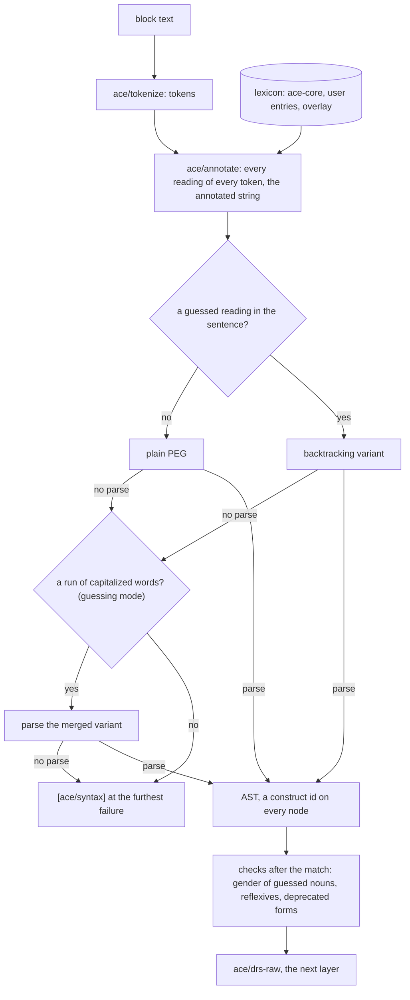

# Tokenizer, Grammar and Lexicon

This page specifies the first layer of zelph's ACE front end: the part that reads the text of an `ace` block and turns it into a tree of constructs. It splits the text into tokens, attaches to every word all the readings it can have, and parses each sentence with a grammar written from the public ACE 6.7 documents. A word comes from a lexicon: from the small vocabulary zelph ships, from the user's own declarations, or from a lexicon file. A word that no lexicon knows is not an error by default. It is read by its position in the sentence, as a person reads an unfamiliar noun, and a typo one keystroke away from a known word is caught before anything is written. Names of several words, such as "Douglas Adams", are read as one name where reading them separately gives no sentence.

Nothing in this layer reasons and almost nothing in it touches the graph: the result is a syntax tree, which the next layer turns into a discourse representation structure (DRS) and then into zelph statements ([From Sentences to the Graph](semantics.md)). The layer is written in Janet, as stdlib modules, on top of two things zelph already has: Janet's PEG engine, which `stdlib/math-syntax.zph` already uses to parse the `$( … )` term islands, and the keyword host, through which `stdlib/sparql.zph` already adds SPARQL to zelph without the C++ core knowing anything about SPARQL. The section [What this builds on in zelph](#what-this-builds-on-in-zelph) shows both at work in today's zelph.

A first impression: a word the lexicon does not know, read by its position, and the zelph statement the block writes (the option `:show-zelph` prints it).

!!! example "Specified session — the behaviour this specification requires, not yet implemented"

    ```
    zelph> .import ace
    zelph> %(ace/option :show-zelph true)
    true
    zelph> ace John is a blicket. Is John a blicket?

    John ~ blicket
    Answer: Yes. John is a blicket.
    ```

`John` is one of the example names zelph ships with their gender; `blicket` is in no lexicon. It stands after `a`, where only a noun or an adjective can stand, and it is followed by the end of the sentence, so it is read as a noun, without a message. On an empty graph the class atom is written with zelph's own `~`; after a Wikidata import it would be written with the instance property P31 ([Classes: the Instance and Subclass Predicates](words.md#classes-the-instance-and-subclass-predicates)).

How to read this page: sessions in a box marked "Specified session" show behaviour this specification requires; nothing of the ACE front end is implemented yet. Message lines in those sessions follow the [layout](block.md#layout) of [The ace Block](block.md): ids, classes, positions and the layout are normative, the wording is illustrative unless a test pins it ([Messages](block.md#messages)). The transcripts under [What this builds on in zelph](#what-this-builds-on-in-zelph) are recordings of today's zelph. Identifiers in code font are the names the implementation uses: construct ids such as `:np/proper` name a row of the [construct table](constructs.md#the-construct-table), message ids such as `[ace/syntax]` name a message, decision ids such as [DEC-UNKNOWN](decisions.md#dec-unknown) name an entry of [Design Decisions](decisions.md), and milestone ids M0 to M9 refer to [Work Plan and Milestones](plan.md#the-milestones). Corpus numbers such as 2622 are the ids of the test texts in APE's regression corpus, the reference test set of the Attempto Parsing Engine (APE), the reference implementation of ACE ([APE's Regression Corpus](tests.md#apes-regression-corpus)); the corpus marks 46 cases as "eval 1", on which APE's own answer is known to be wrong, and its regular cases as "eval 0". The page cites corpus cases by their number only: an example sentence beside a number is the project's own, written in the shape of that case. NP, VP and PP abbreviate noun phrase, verb phrase and prepositional phrase.

## What the Layer Delivers

Four stdlib modules hold the layer. Their signatures and effect classes are listed on [Modules, API and Data Shapes](api.md#the-public-api) (under [ace-lexicon](api.md#ace-lexicon) and [ace-grammar](api.md#ace-grammar)); this page specifies what they do.

| Module | What it implements |
|---|---|
| `ace-lexicon.zph` | `ace/tokenize`, `ace/annotate`, `ace/readings`, `ace/inflect`, `ace/predicate-name`, `ace/reserved?`, `ace/declare!`, `ace/load-ulex!`, `ace/lexicon-handler`; the region lists; the data of function words, illegal words and the words that are never guessed; guessing and lemma recovery; the lexicon store and its cache; the private helpers `ace-lexicon/read-ulex`, `ace-lexicon/add-shipped`, `ace-lexicon/lemma-candidates`, `ace-lexicon/lexical-error`, `ace-lexicon/canonical-name` and `ace-lexicon/declare-record!` (the variant of `ace/declare!` that raises a message record instead of a string) |
| `ace-grammar.zph` | `ace/parse`, `ace/expected`, `ace/ast-constructs`, `ace/last-work`; the rule builders, the three compiled PEG variants and the backtracking variant, the multi-word fallback, the private `ace-grammar/ast` |
| `ace-constructs.zph` | the syntax rows of the construct table `ace/constructs` and the label phrases of syntax errors (it also holds the rest of the table and the message catalogue, which other pages specify) |
| `ace-core.zph` | the shipped base vocabulary as Janet data: a data module without imports, imported by `ace-lexicon.zph`, never written to the graph |

The data flows in one direction:



`ace/tokenize`, `ace/parse` and `ace/predicate-name` are pure: they never access the graph. `ace/annotate`, `ace/readings`, `ace/inflect` and `ace/expected` read the lexicon cache; `ace/annotate` also makes non-creating `zelph/lookup` probes, for the near-miss check (a typo next to a known word) and for the marks behind two warnings (`:compound` and `:known`, below). These probes can change whether a text is accepted and which warnings it gets, never its DRS. The only functions of this layer that write the graph are `ace/declare!`, `ace/load-ulex!` without `:replace`, and `ace/lexicon-handler`, the handler of the `ace-lexicon` block ([DEC-LEX-STORE](decisions.md#dec-lex-store)).

The layer adds to the shared contracts of [Modules, API and Data Shapes](api.md): the token fields `:para` and `:guessed`; the `:count` option of `ace/parse` and `ace/analyse` and `(ace/last-work &opt kind)`; the `ace/load-ulex!` options `:source :replace :generate :guess`; the `ace/state` keys `:lexicon`, `:work` and `:fail`; `(ace/predicate-name kind lemma &opt opts)` with the options `{:subj-obj :as-written}`; `ace/inflect` returning nil for a slot without a form; and the meaning of `:unknown` in guessing mode. The reading fields beyond the shared ones and the fields of the AST nodes are specified here. The annotated record carries `:merged`, the merged variant of sentences with capitalized runs.

`ace/annotate` marks the readings that can lead to a warning (`:alternatives`, `:compound`, `:verb-stem`, `:marked`, `:known`), but it raises no warning itself: only the parse knows which reading a token takes. So `ace/parse` raises `[ace/w-lemma]`, `[ace/w-compound]`, `[ace/w-guess-reading]`, `[ace/w-ing]` and `[ace/w-multiword]` into the `:warnings` of the AST's `:text` node.

## Clean Room

ACE is defined by public documents; APE, its reference parser, is a Prolog program under the LGPL-3. zelph is offered under the AGPL-3.0-or-later and under a commercial licence from acrion, and the front end is offered the same way. A grammar translated from APE's grammar rule by rule would be an adaptation of an LGPL-3 program (EU Directive 2009/24/EC, Art. 4(1)(b)) and could not be offered under the commercial licence; an independent grammar written from the public rules is acrion's own work (CJEU C-406/10). So the grammar and the lexicon are written from public documents and from APE's observed behaviour, never from APE's source. APE is used during development as a test oracle only ([APE: a Development-Time Oracle](architecture.md#ape-a-development-time-oracle)). This section is normative; [The Clean Room](architecture.md#the-clean-room) on the architecture page places it in the design as a whole.

### What the Grammar and the Lexicon Are Written From

1. The public ACE 6.7 documents: the syntax report with its numbered rules (1a to 229, cited as "SR"), the construction rules ("CR"), the interpretation rules ("IR"), the ACE 6.7 Lexicon Specification (the entry predicates, the characters of word forms, aliases, the class intersections it forbids, the function words that cannot be declared) and the published DRS report. ACE 6.7 changed no DRS vocabulary, except `query(R, howm)`, which the 6.7 corpus uses (corpus 3741).
2. A behaviour catalogue written for this work, the corpus texts and APE's observed output, run through its public interface only, as an oracle for what is accepted and what the DRS is. Behaviour the public documents do not describe (comments, quoted words, word-class prefixes, contractions, paragraph breaks, `the` before an undeclared name) is taken from the corpus and from APE's output only.
3. The zelph mapping ([From Sentences to the Graph](semantics.md)), which decides which fields the AST has.

The header comments of `ace-lexicon.zph`, `ace-grammar.zph` and `ace-core.zph` MUST name the documents of item 1 with their URLs as the specification and state that no APE source was used:

- `https://attempto.ifi.uzh.ch/site/docs/ace/6.7/syntax_report.html`
- `https://attempto.ifi.uzh.ch/site/docs/ace/6.7/ace_constructionrules.html`
- `https://attempto.ifi.uzh.ch/site/docs/ace/6.7/ace_interpretationrules.html`
- `https://attempto.ifi.uzh.ch/site/docs/ace_lexicon.html`
- `https://attempto.ifi.uzh.ch/site/pubs/papers/drs_report_66.pdf`

Those comments go through the same prose filter as every other comment the project writes.

### What Stays Closed

- Never opened while code is written: APE's parser files `prolog/parser/grammar.fit`, `grammar_functionwords.fit`, `grammar_contentwords.fit`, `tokenizer.pl`, `refres.pl` and `sentence_failure.pl`; everything under `prolog/lexicon/`; and `prolog/utils/are_equivalent.pl`, `is_wellformed.pl` and `spellcheck.pl`. The same holds for the ports of APE's comparison and normalizing utilities that were made during the design research, and for the passages of the research notes that cite APE's code line by line. A citation of an APE file and line in the research is evidence for a behaviour, never a reading instruction. The corpus test session reads APE's small lexicon at test time through zelph's own ulex reader ([DEC-CORPUS](decisions.md#dec-corpus)); nobody opens it to write code. The prototypes written during the design (a committed-choice grammar, the backtracking interpreter, the near-miss and lemma prototypes) are the project's own and may be read.
- Never copied: APE's nonterminal names, its feature sets, its rule order and its scheme of threading the DRS through the grammar, its parse-tree categories, its message texts, its texts for illegal words and repairs, its guessing mechanism, and its lexicon files (the small lexicon is LGPL-3; Clex, the large one, is GPL-3 with the COMLEX terms).
- The two-character failure marker `<>` that error messages insert is a convention, not protected expression; the front end uses it ([DEC-ERRORS](decisions.md#dec-errors)).
- Example sentences of the public documents are not copied into tests in bulk (they are under default copyright), and no sentence of APE's corpus is copied into a test or a published page: both use own sentences in a construct's shape and cite a corpus case by its number only (TA-4 under [Rules for Every Test](tests.md#rules-for-every-test)). The corpus policy is on [Tests and Quality Gates](tests.md#apes-regression-corpus) (DEC-CORPUS).

### Rule Names

The names of PEG rules are the project's own descriptive kebab-case keywords (`:vp-sg`, `:vp-pl/np`, `:np-obj-coord`, `:there-is`). Each rule builder carries a comment citing the SR rule numbers and the CR or IR section it implements, for example `# SR 45a, 84c, 84d; CR "Verb Phrases"`: the numbers identify sections of a public specification and give traceability. Rules are not named after SR numbers (`:rule-45a`) and do not follow the SR's decomposition one to one: the SR is an abstract form of APE's own decomposition, while these rules are specialized by feature (see [Feature specialization](#feature-specialization)), so a one-to-one naming would claim a correspondence that does not exist. AST node kinds and construct ids are the project's own as well (the node kind `:nbar` and the `nbar/` ids are named after N′, "N-bar", the term of X-bar syntax for a noun together with its modifiers); APE's parse trees are no oracle (the corpus stores them in two formats, 667 of them are empty, and their labels are APE's nonterminals). Only DRSs are compared with APE.

## Regions, Paragraphs and Block Text

### Region Lists

Some parts of a text are not ACE sentences: comments, strings and quoted words. The block veto of the `ace` keyword ([What ace Adds: the Veto](block.md#what-ace-adds-the-veto)) and the tokenizer have to agree on where such a region starts and ends. Both read the same region lists, in the descriptor format of `keyword-kit` (the generic keyword helper module, [keyword-kit](architecture.md#keyword-kit)); the lists are specified here:

| List | Regions, in scan order (the region that starts first wins) | May stay open at the end of the text |
|---|---|---|
| `ace-lexicon/ace-regions` | `/*` … `*/` (not nested); `#` … end of line; `"` … `"` with `\` escaping the next character; `` ` `` … `` ` `` with `\` escaping the next character | `/*`, `"`, `` ` `` |
| `ace-lexicon/ulex-regions` | `/*` … `*/`; `%` … end of line; `'` … `'` with `''` and `\` as escapes | `/*`, `'` |

`#` is a region although it can never stay open: a `"` or `/*` inside a `#` comment must not open a region. Inside a string or a quoted word `#` is text (3630, of the shape `A label is "#".`, and 3631 are accepted); inside `/* */` it is comment (660 and 661 are accepted). A `#` comment starts anywhere on a line: 488, a sentence like `There is a woman B#.`, is rejected because its end mark lies inside the comment, and 14, a one-line text whose first `#` hides everything after it, has no sentence left. The host hands `#` lines and trailing `#` text of a block to the handler verbatim: zelph's stripping of end-of-line comments applies to native statements only.

### Paragraphs

`ace/analyse`, `ace/load!` and `ace/load-text!` read whole ACE documents with APE's text semantics ([DEC-LOAD](decisions.md#dec-load)), so the tokenizer reads several paragraphs:

- A paragraph break is a line that is empty or holds only spaces, tabs and CR, outside every region (3497, 3514; 3498 and 3503 have spaces on the line). A `#` comment line is not empty: 3504 holds a sentence that introduces the variable `X`, then a `#` comment line, then a second sentence that introduces `X` again; it is rejected, because both sentences stand in one paragraph and `X` is redefined. 3516 and 3517 are accepted. A blank line inside `/* */` is no break: 3505 holds the same two sentences with a `/* */` comment between them that contains three blank lines; it is rejected, because the comment hides the break, so both sentences form one paragraph and `X` is redefined, exactly as in 3501.
- A paragraph without tokens (comments only) contributes nothing (3500, 3515).
- Paragraphs are numbered among those that hold tokens. Every token of paragraph p ≥ 2 carries `:para p`; tokens of the first paragraph carry none, because a Janet struct holds no nil, so single-paragraph examples stay as they are.
- Sentence ids continue across paragraphs (3500, 3502).
- A sentence without an end mark when its paragraph or the text ends raises `[ace/no-terminator]` after its last token (881, a text like `A clerk who is busy waits`).
- Variables and anaphora reset at a paragraph change; the next layer reads `:para` from the `:sent` nodes.

**On the keyword path** ([DEC-BLOCK](decisions.md#dec-block)) the host ends a block at the first blank or whitespace-only line, unless the veto holds a region open, so the text a handler receives never holds a paragraph break outside a region and the handler needs no paragraph logic. A forced dispatch (the second blank line after a veto) gives a text that ends in `"\n\n"` with the region still open, and the tokenizer raises `[ace/unterminated]` at its opening delimiter. One block is one APE paragraph ([One Block Is One Paragraph](block.md#one-block-is-one-paragraph)), and sentence ids restart with every block.

Lines that start with `%` or `.` inside a block are ACE text and never executed (the one host exception, a `.quit` line in piped or typed input, is described under [The Host's Block Protocol](block.md#the-hosts-block-protocol)). `%` is an unknown character: `[ace/char]` from the tokenizer (DEV-UNKNOWN-CHAR, see [Deliberate Deviations from APE](#deliberate-deviations-from-ape)). A `.stat` line is not an unknown character: `.` is an end mark and `stat` a word. Depending on what follows, such a block ends in `[ace/no-terminator]` (when `stat` is the last word; a tokenizer error, raised before any parse), in strict mode in `[ace/unknown-word]` for `stat`, and otherwise in `[ace/syntax]`, at the latest at the lone `.`, which forms a sentence without words that no grammar rule accepts. It never ends in the command being executed.

### The ace-lexicon Veto

`ace/lexicon-handler` returns `:incomplete` exactly while `(kit/open-region text ace-lexicon/ulex-regions)` is non-nil **and** the text does not end in `"\n\n"`, the same rule as for `ace` blocks (DEC-BLOCK). A text that ends in `"\n\n"` is the host's forced dispatch after a veto and is never vetoed again; the reader then raises `[ace/ulex-syntax]` at the opening delimiter of the open quote or comment. A last entry without its final `.` is `[ace/ulex-syntax]` at the end of the text. The host calls a block handler at every blank line, never line by line, with all the block text collected so far, `%` lines included, so a vetoed block reaches the handler more than once; a module imported by the module that registered a keyword can itself be written in that keyword. The first property is shown under [What this builds on in zelph](#what-this-builds-on-in-zelph).

## The Tokenizer

`ace/tokenize` turns text into a tuple of tokens. It knows no lexicon and no graph: a token's kind is the same on every graph. The session prints the kind and the text of each token of one sentence:

!!! example "Specified session — the behaviour this specification requires, not yet implemented"

    ```
    zelph> .import ace
    zelph> %(map |[(get $ :k) (get $ :text)] (ace/tokenize "Mary's desk isn't 120cm wide."))
    @[(:word "Mary") (:gen "'s") (:word "desk") (:fw "is") (:fw "n't") (:num "120") (:word "cm") (:word "wide") (:punct ".")]
    ```

The genitive `'s` is a token of its own, the contraction `isn't` gives the two function words `is` and `not` (the second written `n't`), and `120cm` splits into a number and a word. Whether `cm` is a measurement noun and `desk` a noun is the lexicon's business, in the next step.

### Implementation

One Janet PEG over the raw text emits position-tagged captures of the form `(group (* (constant :kind) ($) (<- …)))`; one Janet pass then builds the token structs, splits sentences and paragraphs, computes `:line` and `:col` and raises the first lexical error. Columns count code points, that is bytes that are not UTF-8 continuation bytes, and a tab counts as one. The scan continues to the end of the text, so further lexical errors appear in the error's `Also not ACE` line.

### Rules

Each rule is APE's behaviour unless a deviation (DEV-…) is named.

| Item | Rule | Corpus |
|---|---|---|
| whitespace | space, tab, CR and LF separate tokens; blank lines: [Paragraphs](#paragraphs) | |
| letters | ASCII `a-z A-Z`; Latin-1 letters as UTF-8, that is `(* "\xC3" (+ (range "\x80\x96") (range "\x98\xB6") (range "\xB8\xBF")))` (U+00C0 to U+00FF without `×` and `÷`). Other scripts only inside strings and quoted words | 2810, 2819 accepted; 2821 rejected |
| word | starts with a letter, `_`, `$` or `°` (`\xC2\xB0`); continues with those, digits and `-`. `credit-card`, `fond-of`, `looks-at`, `Douglas-Adams` and `_` are one token each | 3681 `v:_` |
| digits then letters | split: `180cm` gives `180` and `cm` | 2622 |
| number | `[0-9]+(\.[0-9]+)?`; a `.` not followed by a digit ends the number (`3.` is a number and an end mark). `:value` is the canonical unsigned text: the integer part without leading zeros (at least one digit), the fraction without trailing zeros (at least one digit): `007` → `7`, `002.200` → `2.2`, `2.0` → `2.0`, `000.000` → `0.0` | 2117, 3524 |
| minus | [Minus and negative literals](#minus-and-negative-literals) | |
| operators | longest match over `\=` `=<` `>=` `--`, then the single characters `. ? ! , ( ) [ ] { } + - * / ^ & = < >`; `. ? ! ,` are `:punct`, the rest `:op`. `/=` is two tokens, which the grammar rejects | 2851 rejected |
| string | `"…"`, `\` escapes the next character, any UTF-8 inside (CR "Strings"); `:value` is the content with escapes resolved; unterminated: `[ace/unterminated]` at the opening `"` | 1593, 2873; 1986, 2881, 3218 rejected |
| quoted word | `` `…` `` with `\` escaping the next character gives one `:qword` token. Its `:value` is the content with escapes resolved, every run of spaces and tabs collapsed to one space and the ends trimmed, and verbatim otherwise: hyphens stay, so `` `Spider-Man` `` is the name "Spider-Man" ([DEC-QWORD](decisions.md#dec-qword)). Any UTF-8 is allowed inside (`` `Łódź` ``, `` `Washington, D.C.` ``, `` `AT&T` ``). Empty or whitespace-only content: `[ace/char]` with `:why :empty-name` at the opening backquote; a line break inside: `[ace/char]` with `:why :name-line-break` at the line break; unterminated: `[ace/unterminated]`. A quoted word is never a function word, a variable or a lexicon word (DEV-QWORD): `` `Q64` `` is the name "Q64", `Q64` a variable. The one exception is a `p:Q64` in the same block ([Readings of a token](#readings-of-a-token)) | 3625 |
| comments | `/* … */` (not nested) and `#` to the end of the line are skipped; an unterminated `/*` is `[ace/unterminated]` (DEV-UNTERMINATED-COMMENT) | 13, 78, 660, 3499; 3584 (eval 1) |
| variable | `[A-Z][0-9]*` gives a `:var` token: `X`, `X1`, `K54`, and also `Q42` and `P50`, because a bare Wikidata id is an ACE variable (no corpus text has one); `CARD`, `RC`, `Man1`, `Men-3` are not variables | 148, 305, 375, 489 rejected |
| prefixed word | `n: v: a: p: h: m: f:` and `noun: verb: pn: human: masc: fem:`, directly followed by a word, give one `:pword` token; `:pfx` is the short form (`noun` → `n`, `verb` → `v`, `pn` → `p`, `human` → `h`, `masc` → `m`, `fem` → `f`), `:norm` the word. `p:` marks a proper name, not a preposition. The word after the prefix is read by the word rule, so `p:Q42`, `n:Q8441`, `n:P50`, `v:P155` and `a:Q3142` are `:pword` tokens; a word of the form `[QP][0-9]+` there is a Wikidata id ([DEC-WIKIDATA](decisions.md#dec-wikidata) step 1). `adj: adv: neutr: undef: name: person: var:` are not prefixes. Any other `:` is `[ace/char]` | 12, 29, 97, 2067 |
| Saxon genitive | `'s` or `'` directly after a word gives a `:gen` token; `'` after any word, not only after a final `s` (2226, a sentence like `Mary'age is 30.`, is accepted as a genitive). `'` elsewhere is `[ace/char]` | 28, 41, 1850, 2226 |
| contractions | `isn't aren't doesn't don't can't shouldn't` give two tokens (`is` + `not`, …), each with its own `:text` and `:off`, `:norm` the full word; `cannot` gives `can` `not`; `won't`, `mustn't` and every other `n't` is `[ace/contraction]` naming it | 1380, 1806, 1809, 3020; 1408 (`must not` is not ACE) |
| slash pronouns | `he/she she/he him/her her/him his/her her/his himself/herself herself/himself` give one `:fw` token each, matched before the operator rule | SR 163c-164f; the gender table of the lexicon specification |
| function words | a word whose form (lower-cased at the start of a sentence) is in the function-word data gives `:fw`, `:norm` in lower case | |
| indefinite pronouns | `something someone somebody everything everyone everybody nothing nobody noone` are single `:fw` tokens; `no one` is two, which the grammar reads together | 174, 175, 415 |
| illegal words | the list under [Layers](#layers) gives `[ace/illegal-word]` naming the word | 2216, 2228, 2605 |
| capitalization | in mid-sentence, a capitalized word whose lower case is an unredefinable function word is `[ace/capitalised-function-word]`. Other capitalized words are content words: `May` or `Can` may be names | 2935, 2165 rejected |
| other characters | anything else, one code point, is `[ace/char]` naming it (DEV-UNKNOWN-CHAR) | 658, 2817, 2821 rejected; 3634, 3635 (eval 1) |
| sentences | split after `.` `?` `!`; `:sid` counts from 1 and continues across paragraphs; the first token carries `:init true`; a sentence without end mark raises `[ace/no-terminator]` after its last token | 881 |
| empty text | a text without tokens (empty, whitespace, comments only) gives `()`. The empty text is ACE (SR 1a admits the empty text): `ace/parse` returns the `:text` node with `:sents ()` and `:span (0 -1)`, and `ace/analyse` returns `:accepted` with the DRS `{:refs () :conds ()}` and no warning, as APE does. The keyword handler never parses one: a block that is empty after masking returns nil. Corpus 14 is accepted this way although the corpus file counts it among the rejections (DEV-EMPTY-TEXT) | 14 |

Multi-word names are not a matter of the tokenizer: capitalized words stay separate tokens, and the annotator prepares the merged reading ([Multi-word runs](#multi-word-runs)).

### Minus and Negative Literals

One rule covers every `-`:

1. Every `-` outside a word, a number, a string, a quoted word or a comment is the `:op` token `-`, except that two adjacent `-` with nothing between them form the single `:op` token `--`, which no grammar rule accepts.
2. The grammar reads a **negative literal** as the token `-` followed by a number token in operand position, wherever a term may start ([Terms and formulas](#terms-and-formulas)). Whitespace between `-` and the number is allowed. A `-` after a complete operand is the binary operator, because the operator loop consumes it first.
3. The literal's text is `-` followed by the number's canonical text, canonicalized again: `-0` → `0`, `-007` → `-7`, `-002.200` → `-2.2`.
4. Counts (determiners and generalized quantifiers) take an unsigned number only.

A prototype of exactly this rule gave APE's verdict on every accepted corpus text with a `-` before a digit, and on the double-minus case. Each text in the table is the project's own, in the shape of the cases in the first column; the APE column gives APE's verdict on those cases, with the DRS terms written for the text shown:

| Corpus | Text of the same shape | APE | Rule |
|---|---|---|---|
| 2630, 2629 | `A weight is - 2.5 kg.`, `A weight is - 4 kg.` | accepted, `real(-2.5,kg)`, `int(-4,kg)` | `-` in operand position, the number across a space |
| 3677 | `0- -2 = 2.` | accepted, `expr(-,int(0),int(-2))` | `0` an operand, `-` binary, `- 2` a literal |
| 3678 | `0--2 = 2.` | rejected | `--` |
| 2370, 2386, 2406, 2739 | `3*(4-6/11) >= 1/3.`, `It is false that 5 = 7 - 3.`, `A number is 2 + 6 - 3 + 8.`, `((2+3)-5) = 0.` | accepted, binary minus | `-` after an operand or `)` |
| 3773 | `B = 4*5^(-1).` | accepted, `int(-1)` | after `(`: a literal |
| 1668, 2396, 2852, 3524 | `A depth is -40.`, `There is a natural number Y. -2 < Y.`, `-0 = -2.`, `-006 likes -003.400.` | accepted: `int(-40)`; `int(-2)`; `int(0)`, `int(-2)`; `int(-6)`, `real(-3.4)` | a literal, canonical text |
| 3592 | `-0.25 = -.25.` | rejected | `- .`: a number cannot start with `.` |
| 1720, 1721, 1996, 3206, 3207 | `-2 women sleep.`, `At least -4 women sleep.`, `Mary owns -3 kg of pears.`, … | rejected | counts are unsigned |
| 2851 | `-0 /= -2.` | rejected | `/` `=` |

A unary minus before anything but a number (`-X`, `-(1)`) is not ACE (CR: "Negative integers and negative real numbers are prefixed by a minus sign"; the corpus has no other unary minus). What a literal means is specified on [Numbers and Formulas](math.md#surface-syntax). A word may hold `-` (`X-1` is one word); `3-5` is `3`, `-`, `5`.

### Token Fields

The fields of a token are listed under [Token](api.md#token) on the API page: `:i` (index), `:k` (kind: `:word :pword :qword :var :num :str :fw :punct :op :gen`), `:text`, `:norm` (the lookup form), `:sid`, `:para`, `:line`, `:col`, `:off` (byte offset), `:init`, `:pfx`, `:value` and `:guessed`. This page fixes their values as described above. A token of paragraph 2, printed with `%j`:

```
{:norm "man" :i 9 :col 13 :text "man" :off 61 :k :word :para 2 :sid 3 :line 5}
```

## The Annotator

`ace/annotate` attaches to every token all the readings it can have, before the grammar runs. A reading says which word class a token can belong to in a sentence (a singular noun, a transitive verb in the third person, …) and what its lemma is.

### Why a Pre-Pass

The grammar matches reading tags literally in a string the annotator renders. That arrangement buys four things: all lexical errors of a text are reported at once, with suggestions, before any parsing; the annotated string is a stable interface that tests can pin and a user can print ("how did the lexicon read this?"); changing the lexicon needs no recompilation of the grammar; and the plain grammar variant makes no Janet call during a match. It is a design choice, not a workaround: a fault of the Janet garbage collector that once looked related had its own cause and is fixed in the Janet that zelph embeds.

At its start `ace/annotate` brings the lexicon cache up to date ([Cache and freshness](#cache-and-freshness)); every lexicon reading after that is a read of the cache. Guessed readings and lemma recovery are functions of the text and the lexicon only. The **mode** is the `:guess` of `ace/annotate`'s options when given; else the overlay's `:guess` while an overlay loaded with that key is set ([Sources and overlays](#sources-and-overlays)); else `(ace/option :guess)`, true by default. True is **guessing mode**; false is **strict mode**, APE's behaviour without guessing (DEC-UNKNOWN).

### Readings of a Token

A reading is a struct with at least `:tag` and `:lemma`. The fields this layer defines:

| Field | Value |
|---|---|
| `:tag` | the reading tag ([Reading tags](#reading-tags)) |
| `:lemma` | the DRS lemma: the entry's logical symbol, a recovered lemma ([Lemma recovery](#lemma-recovery)) or the written form |
| `:gender` | `:undef :neutr :human :masc :fem`, or `:guess` for a guessed noun ([The gender of guessed nouns](#the-gender-of-guessed-nouns)) |
| `:prep` | the dependent preposition of a ditransitive reading (`""` for the double-object form); the preposition of a transitive adjective |
| `:source` | where the entry comes from ([Sources and overlays](#sources-and-overlays)); absent on prefixed, guessed and undeclared readings |
| `:pfx` | the prefix of a `:pword` |
| `:id` | a Wikidata id (`"Q42"`, `"P155"`): set for a `:pword` whose word has the form `[QP][0-9]+` and for a lexicon entry whose symbol has it. The annotated record's `:ids` collects them, and the handler puts them into the block context, where `ace/plan` turns their symbols into explicit-id terms. They are keyed by symbol for the whole block: an explicit id wins over a literal name of the same symbol, a quoted one included |
| `:guessed` | true on a guessed reading |
| `:marked` | true on a marked guessed reading (a guessed plural form read as a singular or mass noun); the backtracking variant ranks parses by it, and a parse that takes one warns `[ace/w-guess-reading]` |
| `:alternatives` | the other lemma candidates when rule order alone chose `:lemma`; drives `[ace/w-lemma]` |
| `:compound` | on a guessed adjective reading: the known compound it starts; drives `[ace/w-compound]` |
| `:verb-stem` | on the guessed adjective reading of an `-ing` form: the lemma of the known verb its stem gives; drives `[ace/w-ing]` |
| `:undeclared` | true on a proper-name reading made for lack of an entry (a capitalized word, a merged run) |
| `:known` | on the reading of a merged run: true when it is a known name; its absence drives `[ace/w-multiword]` |
| `:math` | `{:kind K :node "<name in the math stack>"}` on readings of the math vocabulary, which `ace-math` ships ([Numbers and Formulas](math.md)) |

Which token gets which readings:

| Token | Readings |
|---|---|
| `:word`, `:fw` | `(ace/readings (get tok :norm))`. A capitalized `:word` at the start of a sentence also gets the preposition readings of its lower case (456, a question like `In which city does Mary work?`). Function words usually have none; `can` has the noun readings of its mandatory entry ([Shipped vocabulary](#shipped-vocabulary-ace-core)); a sentence-initial `A` gets `{:tag "var" :lemma "A"}` |
| `:pword` | made per occurrence, nothing recorded. `:lemma` is the word verbatim: APE never lemmatizes a prefixed word (`v:gives` → `gives`, `n:books` → `books`, `a:happier` → `happier`). Gender `:neutr`. `n:` gives `n-sg n-pl n-mass`; `v:` gives every intransitive, transitive and ditransitive tag (a ditransitive reading takes any word with a preposition reading as its preposition, CC-4); `a:` gives every adjective, transitive-adjective and adverb tag (40 `a:reich-an` transitive, 3202 `more a:ffast` an adverb); `p:` gives `pn-sg` (2366, a text like `p:Tarmo owns a boat. He sails.`, is rejected: the name is neuter); `h: m: f:` give the noun tags and `pn-sg` with gender `:human`, `:masc` or `:fem`. A word of the form `[QP][0-9]+` adds `:id` (the word) to every reading of its prefix, `h: m: f:` included: `m:Q42` is Douglas Adams with masculine gender, so `he` finds him, while `p:Q42` is neuter like every `p:` name |
| `:qword` | exactly one reading: `pn-sg` with `:lemma` = `:value`; `:gender` from a `pn_sg` or `pndef_sg` entry whose form, else whose symbol, equals `:value`, else `:undef`; no `:id` (`` `Q42` `` is the literal name "Q42", unless the same block also writes `p:Q42`: the DRS gives both the same name, so the explicit id wins for both, DEC-QWORD); no warning |
| a capitalized `:word` without a reading whose text has the shape of an individual's name, `^[A-Z][^-]*(-[^-]+)*-[0-9a-f]{16}$` ([DEC-INDIVIDUALS](decisions.md#dec-individuals)) | `pn-sg` with `:lemma` = the text. Gender: `Somebody`, `Someone` → `:human`; `Something` → `:neutr`; otherwise the gender of the noun entry of the head (the text before `-<h>` with its first letter lower-cased: `Man-6f1c2a9e0b1d2c3e` → `man`; for a head of the form `[QP][0-9]+`, the noun entry with that symbol); without one, `:guess` in guessing mode (the head noun is guessed) and `:undef` in strict mode. The head may hold any word character, because a head noun can come from `n:` verbatim. Never part of a merged run. This is how answers that name an individual re-enter cleanly |
| another capitalized `:word` without a reading, not a variable | `pn-sg` and `pnt-sg`, both `:undef`, `:undeclared true`, `:lemma` = the text. `pnt-sg` makes `the` + an undeclared name a proper name with the article dropped ([DEC-THE-NAME](decisions.md#dec-the-name); 2923, a sentence like `Mary knows the Xyzzy.`, is accepted, as by APE). Singular only (`The Zorgs wait.` is rejected, as by APE). Silent: no warning. Capitalized words are never guessed |
| a lower-case `:word` without a reading | guessing mode: the guessed readings of [Guessed readings](#guessed-readings), unless [Unknown words](#unknown-words-words-ace-lacks-and-near-misses) refuses the word, in which case it gets none and its index goes to `:unknown`; strict mode: none, and its index goes to `:unknown` |
| `:var` | `var` |
| `:num :str :punct :op :gen` | none |

408 of the 680 content forms in the corpus belong to several word classes: the grammar's slot decides, never the annotator. A declared form is never guessed: the lexicon decides first.

### Reading Tags

The tags are the project's own names; the categories are those of the syntax report's lexical rules.

| Tag | Category | SR | The reading carries |
|---|---|---|---|
| `n-sg` `n-pl` `n-mass` | countable noun singular, plural; mass noun | 210-212 | lemma, gender |
| `mn-sg` `mn-pl` | measurement noun (`kg l cm mm m h sec t mol km g °C`) | 213-214 | lemma |
| `pn-sg` `pn-pl` `pnt-sg` `pnt-pl` | proper name; `pnt` requires `the` (2930 accepted, 2929 rejected) | 216-217 | lemma, gender |
| `iv-fin` `iv-inf` | intransitive verb, third person singular; infinitive, which is also the finite plural | 226-228 | lemma |
| `tv-fin` `tv-inf` `tv-pp` | transitive verb; past participle | 222-225 | lemma |
| `dv-fin` `dv-inf` `dv-pp` | ditransitive verb | 218-221 | lemma, `:prep` |
| `adj` `adj-comp` `adj-sup` | intransitive adjective | 203-205 | lemma |
| `adjt` `adjt-comp` `adjt-sup` | transitive adjective (`fond-of`) | 206-208 | lemma, `:prep` |
| `adv` `adv-comp` `adv-sup` | adverb | 200-202 | lemma |
| `prep` | preposition | 229 | lemma |
| `var` `str` | variable, string | 170 | |

Guessed readings use the same tags; what marks them is the reading's `:guessed`.

### The Annotated String

The annotator renders the tokens and their tags into one string, which the grammar matches. Tokens are joined by single spaces; `(get offsets i)` is the start of token `i` in the string.

| Token | Rendering | Example |
|---|---|---|
| function word without readings | `:norm` | `every` |
| function word with readings | `norm{,tag,…,}` | a sentence-initial `A` → `a{,var,}`; `can{,n-sg,}` |
| `:word`, `:pword` | `norm{,tag,…,}`; without readings `norm{}` | `bank{,n-sg,tv-inf,}` |
| `:qword` | `@i{,pn-sg,}` (i = the token index) | `@0{,pn-sg,}` |
| a merged run | `@i{,tag,…,}` (i = the index of the run's first token) | `@0{,pn-sg,pnt-sg,}` |
| `:str` | `@i{,str,}` | |
| `:var` | `text{,var,}` | `X1{,var,}` |
| `:num`, `:punct`, `:op`, `:gen` | `:text` | `3.14` `,` `--` `'s` |

A tag block follows its form without a space. Tags never contain `,`, so `,t,` matches a whole tag and nothing else; a tag occurs once per block even when several readings carry it. A user can print the string, which shows how the lexicon read a sentence:

!!! example "Specified session — the behaviour this specification requires, not yet implemented"

    ```
    zelph> .import ace
    zelph> %(get (ace/annotate (ace/tokenize "A wombat grazes.")) :str)
    "a{,var,} wombat{,n-sg,n-mass,iv-inf,tv-inf,dv-inf,adj,} grazes{,n-pl,n-sg,n-mass,iv-fin,tv-fin,dv-fin,iv-inf,tv-inf,dv-inf,adj,} ."
    ```

`A` at the start of a sentence is either the article (a function word) or the variable `A`. `wombat` and `grazes` are in no lexicon, so they carry every reading their form allows: `grazes` can be a plural noun, a verb in the third person or an infinitive. Its singular and mass-noun readings are marked (a form that looks like a plural is preferably read as one), which the string does not show.

The annotated record that `ace/annotate` returns is `{:tokens … :str s :offsets (n …) :unknown (i …) :ids (sym …) :merged {…}}`: every token gains `:readings`; `:unknown` lists the tokens that raise `[ace/unknown-word]` or `[ace/reserved-word]`; `:ids` lists the symbols that are explicit Wikidata ids in this text; `:merged` holds the merged variant of sentences with capitalized runs ([Multi-word runs](#multi-word-runs)). The record is total: `ace/annotate` never raises.

### Unknown Words, Words ACE Lacks and Near Misses

`ace/annotate` puts the index of a token into `:unknown` when the token is a lower-case word that gets no reading:

| Mode | A lower-case word without an entry goes to `:unknown` when | Reason key |
|---|---|---|
| strict | always | `:unknown` |
| guessing | its form is a core spelling (`nil cons conjunction negation`, [DEC-NAMES](decisions.md#dec-names)) | `:reserved` |
| guessing | it is on the never-guessed list of English function words ACE lacks ([Layers](#layers)) | `:not-ace` |
| guessing | it is a near miss of a known word (below) | `:near-miss` |

The caller (`ace/handler`, `ace/analyse`, the document loaders) calls the private `(ace-lexicon/lexical-error annotated)`, which returns nil or one record for the whole text. When a token of `:unknown` is a core spelling, the record is `[ace/reserved-word]` for the first one (on a Wikidata graph `ace/handler` adds the hint `n:Q…` from the candidate lookup behind `ace/senses`, without printing; `ace/analyse` gives no id). Otherwise it is `[ace/unknown-word]` for all of them at once. Both hold in either mode. Its arguments are `:mode`, `:words` (`({:tok i :why k :suggest (form …) :hint h} …)`) and, for the first word, `:expected`: the classes `ace/expected` reports at its offset, where the match fails (`a wombat waits.` → a noun or an adjective). The hint lines give a ready-to-paste `ace-lexicon` entry for the first expected class and the prefixed form (`n:wombat`). In guessing mode a near miss names the word it is close to and the prefix that insists on the new word: `n:` for an expected noun, `v:` for a verb, `a:` for an adjective or adverb, all three when nothing is expected. A never-guessed word gets the "ACE has no …" hint of its group and the entry that declares it as a content word (`adj_itr(even, even).`). A declared or prefixed form is never refused for these reasons. Nothing is guessed into the lexicon and nothing is written.

**Suggestions in strict mode** are every known form (content forms of the lexicon and function words) at Damerau-Levenshtein distance 1 (a transposition, an insertion, a deletion or a substitution), found by generating every distance-1 edit of the word over the alphabet of word characters and keeping the known ones. This is the project's own implementation from the definition. APE suggests content words only; going beyond it is allowed.

**Near misses in guessing mode** (DEC-UNKNOWN: a guessed word one edit away from a lexicon form or an `ace` name is rejected). A typo must write nothing, but most short English words are one plain edit away from some known word ("dog" from the mandatory form "do", "book" from the person noun "cook"), so "one edit" means the edit a typist makes. A lower-case word W is a near miss of a known word K ≠ W when one of these edits turns K into W:

| Edit | Condition | Pairs |
|---|---|---|
| transposition of two adjacent letters | W has at least 3 letters | `mna`/`man`, `wiats`/`waits`, `teh`/`the` |
| doubling a letter, or undoubling a doubled one | — | `hapy`/`happy`, `mann`/`man`, `waitss`/`waits` |
| replacing a letter by a neighbouring key on a QWERTY keyboard (left or right in the same row, the two keys above and the two below in the staggered layout) | — | `evety`/`every`, `cab`/`can` |
| inserting or deleting another letter | the shorter word has at least 5 letters | `wating`/`waiting`, `feather`/`father` |

Not near misses: `dog`/`do`, `dogs`/`does`, `book`/`cook`, `ring`/`king`, `life`/`wife`, `purse`/`nurse`, `van`/`man`, `son`/`sun`, `cow`/`how`, `bat`/`cat`. The known words K are the content forms of the entries `ace/readings` sees (declared and generated), the function words, and the lower-case `ace` names of the graph: `(zelph/lookup K "ace")` for every candidate K generated from W by the inverse edits, a constant number of hash probes per guessed word, never a scan. W is **exempt** when W is itself an `ace` name (a word the graph already holds, for example after one `n:cab`) or when W occurs with a prefix earlier in the same text. Capitalized words are names, not guesses, and never near misses: `Jonh` is a new name.

A typo next to a shipped person noun:

!!! example "Specified session — the behaviour this specification requires, not yet implemented"

    ```
    zelph> .import ace
    zelph> ace John is a mna.

    Error in line "ace John is a mna.": Lexicon error [ace/unknown-word]: sentence 1, line 1, column 11: "mna" is not a known word. Did you mean "man"?
      John is a <>mna.
      If "mna" is a new word, write n:mna (a noun) or a:mna (an adjective).
    ```

The block is rejected as a whole and the graph is unchanged. `John is a n:mna.` is accepted: the prefix insists on the new noun, and from then on `mna` is an `ace` name and exempt.

A word that English has but ACE deliberately lacks is never guessed either:

!!! example "Specified session — the behaviour this specification requires, not yet implemented"

    ```
    zelph> .import ace
    zelph> ace John is very rich.

    Error in line "ace John is very rich.": Lexicon error [ace/unknown-word]: sentence 1, line 1, column 9: ACE has no such word as "very"; leave it out.
      John is <>very rich.
      To use "very" as a content word, declare it, e.g. adj_itr(very, very).
    ```

APE's own guessing turns such words into content words and so accepts corpus texts that ACE rejects (724 with `very`, 732 with `almost`, 1590 with `else`, 1634 with `also`, 1936 with `been`); the front end rejects all five with this hint.

**Strict mode** guesses nothing, as APE does without guessing: every lower-case word without an entry is reported, all of them in one message. The shipped vocabulary has the person nouns and the example names, but no common verbs and no animals, so strict mode is mainly for texts whose words are declared (and it is the mode of the corpus tests):

!!! example "Specified session — the behaviour this specification requires, not yet implemented"

    ```
    zelph> .import ace
    zelph> %(ace/option :guess false)
    false
    zelph> ace John is a wombat. Mary is a blicket.

    Error in line "ace John is a wombat. Mary is a blicket.": Lexicon error [ace/unknown-word]: sentence 1, line 1, column 11: "wombat" is not a known word.
      John is a <>wombat.
      To declare a word: noun_sg(wombat, wombat, neutr). in an ace-lexicon block; to use it here only: n:wombat.
      Also not a known word: "blicket" (sentence 2, line 1, column 29).
    ```

In guessing mode, the default, the same block is accepted without a message.

### Guessed Readings

A lower-case `:word` without a lexicon entry that is not refused above gets the readings its form F allows, each with `:guessed true`, and the token itself gains `:guessed true` (DEC-UNKNOWN). Which analyses F has (as a plural, a third person singular, a participle, a comparative, a superlative) is decided by [Lemma recovery](#lemma-recovery).

| Class | Readings | Lemma |
|---|---|---|
| noun | F is an irregular plural (from the irregular table): `n-pl` only. F has a regular plural analysis: `n-pl`, plus `n-sg` and `n-mass` with `:marked true`. Otherwise `n-sg` and `n-mass`. Gender `:guess` | the recovered lemma for `n-pl`, F for the others |
| verb | `iv-fin tv-fin dv-fin` when F has a third-singular analysis; `iv-inf tv-inf dv-inf` always; `tv-pp dv-pp` when F has a participle analysis (a regular `-ed`, or an irregular participle of the table). Every ditransitive reading is the double-object frame only (`:prep ""`): a ditransitive with a dependent preposition would swallow a following prepositional phrase (corpus 34, 94, 117, 143 and 975 were misparsed so in a blind run of APE), so a guessed "V NP to NP" is a transitive verb with a modifier. A guessed ditransitive reading never takes, as its two objects, two adjacent words of one capitalized run, a check of the backtracking variant ([The backtracking variant](#the-backtracking-variant)) | recovered for fin and pp, F for inf |
| adjective | `adj`; `adj-comp` and `adj-sup` when F has a comparative or superlative analysis. When the last hyphen segment of F is a shipped preposition (`keen-on`), `adjt` (and `adjt-comp`, `adjt-sup`) with `:prep` = that segment replaces `adj` | recovered for comp and sup, F otherwise |
| adverb | `adv`, only when F ends in `-ly` | F |
| `-ing` form | an F ending in `ing` whose part before `ing` holds a vowel letter (`waiting`, `morning`; not `sing`, `bring`, `thing`): `adj`, `n-sg` and `n-mass` only, no verb reading. So `John is waiting.` is a copula with the adjective `waiting`, which warns `[ace/w-ing]` when the stem is a known verb (below) | F |

Never guessed: prepositions, measurement nouns and proper names (closed classes, or capitalized: a lower-case word is never a name, never a preposition and never a measurement noun), function words, core spellings, and the never-guessed list. A guessed word keeps agreement: `the cars waits .` has a parse only through the marked singular `cars`, and `Some mice is small.` has none at all (`mice` is an irregular plural, so `n-pl` only).

**Compound mark.** When the next token has a noun reading with lemma N and the hyphen-joined `F-N` is a lexicon form or an `ace` name, or the graph carries current Wikidata labels and the spaced `F N` is an `en` name (`zelph/lookup`), the adjective reading of F carries `:compound "F-N"`. The parse warns `[ace/w-compound]` when it reads F as that attributive adjective: `a credit card waits .` reads the adjective `credit` and the noun `card`.

**Progressive mark.** ACE has no progressive. For an `-ing` form F = S + `ing` the stem candidates are, in this order: S; S + `e` (`making`); S without its last letter when S ends in a doubled consonant (`running`); S with a final `y` replaced by `ie` (`dying`). When one of them is the lemma of a verb reading in the lexicon (any valency), the guessed adjective reading of F carries `:verb-stem` with the first such lemma. The parse warns `[ace/w-ing]` when it reads F as the predicative adjective of a copula (`:vp/copula-adj`: `is`, `are`, negated or inverted), naming the simple present as the alternative (`John waits.`, from `ace/inflect L :third`); an attributive `waiting` (`A waiting man sleeps.`) is silent. Unlike the compound mark, it reads the lexicon only, never the graph.

### Lemma Recovery

The lemma of a guessed form in the third person, a participle, a plural, a comparative or a superlative is recovered by **analysis by synthesis** over the forward rules of [Morphology](#morphology): a candidate lemma counts only if the rules generate the form from it. It is never recovered by stripping alone, and never from an `en` label or an `ace` name: the lemma feeds the DRS and the hashes that name individuals, which must not depend on the graph (DEC-UNKNOWN, [DEC-LEX-GEN](decisions.md#dec-lex-gen)). `(ace-lexicon/lemma-candidates form slot)` implements it.

1. **Candidates.** L is a candidate for F in slot S (`:pl :third :pp :comp :sup`) when the irregular table gives F for (L, S), or when the table has no form for (L, S) and the forward rule gives F. A form a lexicon entry declares for (L, S) counts like a table form, so `mans` is no plural of the declared `man` (whose plural is `men`), while it stays a third singular of a verb `man`. For a comparative or superlative, L must be eligible for synthetic comparison, so `computer` has no comparative analysis. Hyphenated forms analyse the head segment (`waits-for` → `wait-for`). Candidates are generated by undoing the rule endings (`s es ies d ed ied` and a doubled consonant, `r st er est ier iest`) and kept only when synthesis confirms them.
2. **Phonotactic filters**, true of English, applied in this order; each removes candidates only while at least one other candidate remains:

    | Id | A candidate loses when | Pair it decides |
    |---|---|---|
    | P1 | it has one letter | — |
    | P2 | it ends in `v`, `j`, `q` or `u` | `believ`/`believe`, `argu`/`argue` |
    | P3 | it ends in a doubled consonant other than `ff ll ss zz` and the candidate without its last letter exists | `stopp`/`stop` |
    | P4 | it ends in a single `f l s z` and the candidate with that letter doubled exists (the "floss" rule) | `smel`/`smell`, `pas`/`pass` |
    | P5 | it ends in a doubled consonant + `e` and the candidate without the `e` exists | `stoppe`, `adde`/`add` |
    | P6 | it comes from the consonant + `y` rule and has fewer than three letters | `ty`/`tie` |
    | P7 | it is a bare X whose X + `e` is a candidate, and X ends in a consonant + `l` (not `ll`, `rl`), `dg`, `rs`, `ps`, `rg`, `c`, or a vowel + `z` | `handl`, `judg`, `hors`, `collaps`, `charg`, `danc`, `replac`, `graz` |
    | P8 | it is X + `e` against a candidate X, and X + `e` ends neither in a vowel or `y` + `e`, nor in a vowel + one consonant other than `x` + `e`, nor in `nce rce nge rge lge dge rse lse nse pse rve lve the ste`, nor in a consonant other than `l` + `le` | `blorke`/`blork`, `boxe`/`box`, `passe`/`pass` |
    | P9 | it is X + `e` against a candidate X, its consonant before the `e` is one of `b d f g k l m n p r t` and follows two vowel letters, and it does not end in `eate iate uate uite oute uide` | `waite`/`wait`, `neede`/`need` |

3. **Choice** among the remaining candidates, independent of the graph: a candidate that is the lemma of a lexicon entry (of any class); else a candidate equal to the lower-cased text of an earlier token of the same text, or to the lemma of an earlier token's non-guessed reading (`a horse … two horses`); else the most specific rule: an irregular-table candidate, then the longest stripped suffix (the length of F minus the length of the common prefix of F and L), then the alphabetically first.
4. **Announcement.** When step 3 chose by rule order among two or more candidates, the reading keeps the others in `:alternatives`, and a parse that uses it warns `[ace/w-lemma]` once per form and session, with the declaration that settles it (`tv_pp(visited, visit).`).

On the corpus's own lemmas (the cases runnable with APE's small lexicon, regular forms only), a prototype of these rules recovered: plurals 171 of 187 unique forms right, 11 more right by rule order, 5 wrong (`cases`, `houses`, `cheeses`, `databases`, `mouses`); third singular 78 / 5 / 2 of 85 (`chases`, `uses`); participles 61 / 19 / 5 of 85 (`used`, `assumed`, `invited`, `approximated`, and one artefact). Every wrong lemma was chosen by rule order and carries `[ace/w-lemma]`; none is silent. A test pins these counts against the word list.

### The Gender of Guessed Nouns

A guessed noun reading has the gender `:guess` (DEC-UNKNOWN). Reading guessed nouns as neuter, as APE does, makes 400 of the 2682 runnable corpus cases fail on `who` and pronouns alone in a blind run.

1. `who` and `which` are both accepted after a `:guess` noun, and the first relative pronoun after a guessed noun of lemma L in a paragraph fixes L's gender for the whole paragraph (one block is one paragraph): `who` → `:human`, `which` → `:neutr`; `that` fixes nothing; a later relative pronoun that contradicts the fix is `[ace/relative-pronoun]`. The fix happens at parse time: `ace/parse` rewrites every guessed noun leaf of L in the paragraph, earlier ones included, to the fixed gender before it checks reflexives ([Checks after the match](#checks-after-the-match)), so the AST it returns carries the fixed gender and the next layer runs no gender pass of its own.
2. For personal and reflexive pronouns an unfixed `:guess` noun counts as `:neutr`: `it` resolves as in APE; `he` and `she` reach a guessed noun only after `who` made it human. Reflexives are checked in this layer; personal pronouns are resolved by the next layer ([The Gender of Guessed Nouns](semantics.md#the-gender-of-guessed-nouns)), which reads the leaf's gender: the fixed one, or `:guess` when no relative pronoun fixed it.
3. When `he`, `she`, `him`, `her`, `his`, `himself` or `herself` fails and a `:guess` noun of lemma L is accessible, the error (`[ace/anaphor]` from the next layer, `[ace/reflexive]` from this one) carries a hint: write `h:L` (or `m:`, `f:`), use `who` with it, or declare `noun_sg(L, L, human).`.

!!! example "Specified session — the behaviour this specification requires, not yet implemented"

    ```
    zelph> .import ace
    zelph> ace A blicket who waits sleeps. He is happy.

    zelph> ace A blicket waits. He sleeps.

    Error in line "ace A blicket waits. He sleeps.": Not ACE [ace/anaphor]: sentence 2, line 1, column 18: "He" refers to nothing in this block.
      A blicket waits. <>He sleeps.
      "blicket" was guessed and is read as a thing. If a blicket is a person, write h:blicket, use "who" with it, or declare noun_sg(blicket, blicket, human).
    ```

In the first block `who` makes `blicket` a person for the block, so `He` finds it; the block is accepted and prints nothing. In the second, nothing fixed the gender. `ace-core` ships about 300 person nouns with their gender, so the common ones are not guessed: `A customer waits. He sleeps.` is accepted without any declaration.

### Multi-Word Runs

A **run** is a maximal sequence of two or more adjacent `:word` tokens of one sentence that each begin with an upper-case letter. Excluded are variables (`:var` tokens, so `John F Kennedy` holds no run), quoted words, prefixed words, individual-name tokens, and words with a preposition reading of themselves or of their lower case (a sentence-initial `In` or `At`). In guessing mode, for every sentence with at least one run, `ace/annotate` also renders the **merged variant** of the sentence, in which every run is one item; strict mode never merges ([DEC-MULTIWORD](decisions.md#dec-multiword)).

- The run's lexicon lookup uses its hyphen-joined form (`Douglas Adams` → `Douglas-Adams`), so `pn_sg('Douglas-Adams', 'Douglas Adams', masc)` gives it its symbol and gender. Without an entry its readings are `pn-sg` and `pnt-sg`, `:undef`, `:undeclared true`, with `:lemma` = the words joined by single spaces (`named('Douglas Adams')`, the DRS APE gives for the quoted form).
- `:known` is true when the hyphen-joined form has an entry, or the canonical symbol ([Node Names](#node-names)) is an `ace` name, or the graph carries current Wikidata labels and the spaced form is an `en` name.
- The annotated record gains `:merged`, a struct from sentence id to `{:str s :offsets (n …) :runs ({:first i :last j :readings (…)} …)}`: `:str` holds that sentence alone, rendered as above with a run as `@i{…}`; `:offsets` maps every token index of the sentence to an offset in that string, the tokens of a run all to the run's item.

Word forms with spaces in a lexicon file stay rejected; the lexicon specification says to hyphenate. Names that hold lower-case words are written hyphenated or quoted (`Leonardo-da-Vinci`, `` `Leonardo da Vinci` ``). When the parse uses the merged variant is specified under [The multi-word fallback](#the-multi-word-fallback).

## Messages of This Layer

Ids, classes and the layout of messages are specified under [Messages](block.md#messages) on the block page, whose [catalogue](block.md#the-message-catalogue) lists every id with its class and the milestone that first reaches it; the wording lives only in the catalogue `ace/messages` ([Where Wording Lives](block.md#where-wording-lives)). The table below adds what this layer fixes: which function raises each id, its arguments and its position. A record carries `:sid` and `:tok` (the token index) when a token exists, else `:off` (the byte offset, for tokenizer errors); the formatter turns either into `sentence S, line L, column C`. A warning that is shown once per session carries `:once` (a key), and the printer keeps the keys it has shown in `(ace/state :warned)`.

| Id | Raised by | When | Arguments besides the position | Position |
|---|---|---|---|---|
| `char` | `ace/tokenize` | a character outside the tokenizer's rules; `:` outside a prefix; `'` outside a genitive; an empty or multi-line quoted word | `:char`; `:why` for quoted words | the character |
| `unterminated` | `ace/tokenize` | `/*`, `"` or `` ` `` still open at the end | `:kind` (`:comment :string :quoted`) | the opening delimiter |
| `no-terminator` | `ace/tokenize` | a sentence without end mark | — | after the sentence's last token |
| `contraction` | `ace/tokenize` | `won't`, `mustn't`, … | `:word` | the word |
| `illegal-word` | `ace/tokenize` | a word ACE forbids | `:word` (a hint per word) | the word |
| `capitalised-function-word` | `ace/tokenize` | a capitalized unredefinable function word in mid-sentence | `:word` | the word |
| `unknown-word` | the caller of `ace/annotate`, with the record `ace-lexicon/lexical-error` builds | strict mode; in guessing mode a near miss or a never-guessed word (an explicit Wikidata id that the graph does not hold raises the same id later, in [word resolution](words.md#the-four-steps)) | `:mode`, `:words`, `:expected` | the first such word |
| `reserved-word` | the caller of `ace/annotate` (as above); the ulex reader | a core spelling as a word of the text, or as an entry's form or symbol | `:word` or `:entry` | the word; `line L, column C` of the entry |
| `syntax` | `ace/parse` | [Syntax errors](#syntax-errors), [The backtracking variant](#the-backtracking-variant) | see there | the furthest failure |
| `too-deep` | `ace/parse` | nesting beyond the recursion guard | — | the sentence's first token |
| `too-ambiguous` | `ace/parse` | the backtracking variant's work budget is exhausted | `:guessed` (token indices) | the sentence's first token |
| `relative-pronoun`, `reflexive` | `ace/parse` | [Checks after the match](#checks-after-the-match) | `:guessed` lemma when the gender hint applies | the pronoun |
| `w-guess-ambiguous` | `ace/parse` | a second distinct parse of equal rank | `:tokens` (`({:tok i :taken {:tag :lemma} :other {:tag :lemma} :select s} …)`) | the first differing token |
| `w-guess-reading` | `ace/parse` | the parse taken uses a marked reading (a guessed plural read as a singular or mass noun) | `:tokens` (`({:tok i :taken {:tag :lemma} :other {:tag :lemma}} …)`, `:other` being the form's unmarked reading) | the first marked token |
| `w-ing` | `ace/parse` | a guessed `-ing` form with `:verb-stem`, read as the adjective of a copula | `:form`, `:verb` (the stem lemma), `:suggest` (its third singular) | the word |
| `w-lemma` | `ace/parse` | step 4 of lemma recovery, for a reading the parse uses | `:form :lemma :others :entry`; `:once` | the token |
| `w-compound` | `ace/parse` | the compound mark, the attributive reading used | `:compound`; `:once` | the adjective |
| `w-multiword` | `ace/parse` | a merged run without `:known` | `:name` (the canonical symbol); `:once` per name | the run's first token |
| `w-deprecated` | `ace/parse` | a deprecated construct | `:construct` | the construct's first token |
| `ulex-syntax`, `ulex-entry`, `function-word` | the ulex reader | [Declaring words](#declaring-words-the-ulex-reader-and-the-ace-lexicon-keyword) | `:entry` (its text) | `line L, column C` of the block or file |
| `w-lexicon-conflict` | the lexicon store | entries APE warns about | `:form`, `:classes`, `:sources` | — |

Two former ids are retired: `w-proper-name` (guessing is silent) and `w-stdlib-name` (content lives in its own naming language, DEC-NAMES). `anaphor`, `variable-redefined` and `w-definite-new` belong to the next layer's anaphora resolution ([Resolving Anaphora](semantics.md#resolving-anaphora)).

## The Grammar

The grammar is a parsing expression grammar (PEG), run by the PEG engine that Janet, zelph's embedded scripting language, has built in. A PEG reads a string from left to right and tries the alternatives of each rule in a fixed order; it is fast, needs no separate lexer generator, and is already how zelph parses the `$( … )` term islands of the math stack ([The math front end](../math/frontend.md#adding-an-operator)). The rules are not written as one fixed text: Janet functions, the rule builders, produce the grammar as Janet data, from which four variants are made.

### Architecture

**One set of rule builders, four variants.** The builders produce the grammar as Janet data, the way `build-grammar` in `stdlib/math-syntax.zph` generates its precedence levels. Three variants are compiled once at import with `peg/compile`; the fourth walks the same data:

| Variant | Wraps | Used by |
|---|---|---|
| plain | nothing | `ace/parse` for every sentence without a guessed reading |
| counting | every named rule as `(* (drop (cmt ($) bump)) rule)`, where `bump` ignores its argument (the position), adds 1 to the work count in `(ace/state :work)`, which a counted parse first sets to 0, and returns true | `(ace/parse annotated {:count true})`, which `ace/analyse` passes under `(ace/analyse text {:count true})` |
| diagnostic | every terminal as `(kit/expect patt label fail)` | after a failed plain match; `ace/expected` |
| backtracking | an interpreter over the rule data ([The backtracking variant](#the-backtracking-variant)) | `ace/parse` for every sentence with at least one guessed reading |

The builders take the variant as a parameter. The variants differ only in the counting wrapper, the diagnostic terminals, the order of the N′ choice (N′, read "N-bar", is a noun together with its adjectives, of-phrase and relative clause) and the cut marker, which the PEG variants compile to its plain sub-pattern. A prototype verified that the plain, counting and diagnostic variants come from one builder and that the counting variant returns the identical capture tree; on it, 400 sentences took 0.22-0.28 ms plain and 0.72-0.85 ms counting (a work count of 5520; measured before zelph 1.1.0 and not re-measured). This wrapper is the only definition of the counting variant, which the work-bound tests use.

With `(ace/parse annotated &opt {:count bool})`, plain by default, and `(ace/analyse text &opt {:count bool})`, the keyword path and every analysis without the key use the callback-free plain variant, and `(ace/last-work)` returns the work of the last analysis run with counting. Under counting, a sentence parsed by the backtracking variant adds its interpreter steps instead of rule entries, and `(ace/last-work :backtrack)` returns those steps alone (0 when no sentence had a guessed reading); a test of the work bound uses sentences of one kind.

**One match per sentence.** `(peg/match peg str (get offsets first))` with the sentence rule followed by `(+ " " -1)`; capture positions are absolute. The `:text` node is assembled in Janet. After a failing sentence the parse continues with the next one, which yields the `Also not ACE` list of the error message; the work count sums over the sentences. A sentence of the merged variant is matched in its own `:str` from offset 0.

**Captures.** Every builder emits `(group (* (constant <construct id>) ($) children… ($)))`, every leaf `(group (* (constant <lex id>) ($) (constant <tag>) <tag terminal>))`. The private `ace-grammar/ast` turns them into AST structs: `:c` is the captured construct id; `:n` is the node kind of that id's row ([Syntax Construct Ids by Milestone](#syntax-construct-ids-by-milestone)); `:span` comes from the two positions through `:offsets` (the first token is the smallest `i` whose offset is the start position, the last token the greatest `i` whose offset lies before the end position, so a node ending in a merged run spans the whole run); `:sid` comes from the tokens; a leaf's fields come from the token's reading with the matched tag. The plain variant contains no function captures and no `cmt`. The backtracking variant produces the same capture tree as `peg/match` would for the same parse, so one `ace-grammar/ast` serves all four.

**Terminals.** A function word `w` is `(* w (? tagblock) (+ (> 0 " ") -1))`, so `a` matches `a` and `a{,var,}` but neither `an` nor `apple{…}`. A tag `t` is `(* form "{" (any (if-not (+ ",t," "}") 1)) ",t," (thru "}"))`.

**Positive lookahead drops its captures.** Janet's `(> 0 patt)` keeps the captures of `patt`; a prototype printed every leaf of a lookahead twice. Every positive lookahead a builder emits is therefore `(> 0 (drop …))`; a negative lookahead (`not`) captures nothing.

**Coordinations and lists** are `any` loops; `ace-grammar/ast` builds the right-associative tree for coordination (the binding order of the interpretation rules) and the left-associative tree for arithmetic operators. Recursion is used only where the language nests (relative clauses, if-then, of-phrases, parentheses).

**Recursion guard.** Janet's PEG engine stops at 1024 levels of nesting (`JANET_RECURSION_GUARD`). On Janet 1.42.1, the version zelph 1.1.0 embeds, a one-rule grammar of nested parentheses matches 500 levels and raises the catchable error `peg/match recursed too deeply` at 1000 (the limit lies at 510, two levels of the engine per parenthesis). A prototype of the grammar, run on Janet 1.41.2, parsed 167 nested relative clauses and failed at 168; the M0 Janet unit checks that figure again on the embedded version. `ace/parse` turns that error into `[ace/too-deep]` at the sentence; the backtracking variant applies the same limit to its rule nesting.

### The AST

The envelope is shared ([Modules, API and Data Shapes](api.md)): every node has `:n` (its kind), `:c` (the construct id of the row whose builder made it), `:span` (first and last token index) and `:sid` (`:text` has no `:sid`); a leaf is `{:n :w :c <id> :tok i :tag t :lemma l …}` and carries `:tok` instead of `:span` and `:sid`. A field whose value would be nil, false or empty is absent, except `:adjs`, `:pre`, `:post` and `:sents`, which are always tuples (`:sents ()` for the empty text).

| `:n` | `:c` of its builders | Fields |
|---|---|---|
| `:text` | `:sent/text` | `:sents` (a tuple of `:sent`); `:warnings` (the records of the warnings `ace/parse` raises) |
| `:sent` | `:sent/statement :sent/yes-no :sent/wh :sent/command` | `:mood` (`:stmt :ques :cmd`); `:body` (a body node: `:clause :cond :topic :frame :formula :coord`); `:addressee` (an NP or NP `:coord`, commands); `:para` (≥ 2); `:backtracked` (parsed by the backtracking variant); `:merged` (parsed in the merged variant) |
| `:clause` | `:sent/clause` | `:subj` (NP, `:pro` or `:coord`; absent in a command and under `:gap :subj`); `:vp` (`:vp` or `:coord`); `:gap` (`:subj` subject relative clause, `:np` object or PP-object gap, `:pp`, `:adv`, `:aux` inverted question, `:aux+np`, `:aux+pp`, `:aux+adv`); `:wh` (the fronted wh constituent: NP, `:pp` or `:wh`) |
| `:cond` | `:sent/if-then` | `:if`, `:then` (body nodes) |
| `:topic` | `:sent/there-is :sent/for-every :sent/for-each-of :sent/not-for-every` | `:np`; `:body` (absent for there-is) |
| `:frame` | `:sent/it-is-false :sent/it-is-true :sent/not-provable :sent/it-is-modal` | `:op` (`:false :not-true :true :not-false :not-provable :possible :not-possible :necessary :not-necessary :recommended :not-recommended :admissible :not-admissible`); `:body` |
| `:formula` | `:sent/formula` | `:op` (`"=" "\\=" "<" ">" "=<" ">="`); `:l`, `:r` (terms) |
| `:coord` | `:coord/and :coord/or :coord/comma-and :coord/comma-or :coord/np :coord/that` | `:op` (`:and :or :comma-and :comma-or`); `:of` (`:body :vp :rel :np :ap :adv :that`); `:args` (two nodes; right-associative) |
| `:np` | the `np/` ids | `:det` (`:a :some :the :every :all :no :not-every :not-all :which :whose :howm :gen :poss :count :nothing-but`); `:count` (`{:op k :n Num}`, op `:eq :geq :greater :leq :less :exactly`, n the canonical numeral text); `:unit` (leaf); `:nbar`; `:name` (leaf); `:var` (leaf); `:owner` (the NP of a Saxon genitive); `:poss` (a `:pro` node); `:trunk` (`:thing :one :body`, indefinite pronouns); `:term`; `:wh` (`:who :what :which :whose :howm`); `:each-of` (NP); `:but` (the NP after `no N but`) |
| `:pro` | `:pro/personal :pro/reflexive :pro/possessive` | `:tok`; `:lemma` (the lower-case surface: `he`, `himself`, `his`, `he/she`); `:case` (`:nom :acc`); `:number` (`:sg :pl`); `:gender`; `:own` (a possessive with `own`) |
| `:nbar` | `:nbar/noun` | `:adjs` (a tuple of `:ap` or `:coord`); `:noun` (leaf); `:app` (an `:app` node); `:of` (an `:of` node); `:rel` (`:rel` or `:coord`) |
| `:app` | `:nbar/apposition` | `:var` (leaf) |
| `:of` | `:nbar/of` | `:np` |
| `:rel` | `:rel/subject :rel/object :rel/pp :rel/whose :rel/such-that :rel/of-which` | `:kind` (`:subj :obj :pp :whose`); `:pron` (`:who :which :that`); `:body` (a `:clause` with its gap); `:pp` (the fronted PP of `:rel/pp`); `:deprecated` (true for such-that and of-which) |
| `:vp` | `:vp/simple :vp/negated :vp/naf :vp/modal :vp/do` | `:aux` (`{:neg true :naf true :modal k :do true}`, keys absent when false; modal `:can :must :should :may`, `has to` → `:must`); `:pre`, `:post` (tuples of `:pp`, `:adv`); `:head` |
| `:verb` | `:vp/intransitive :vp/transitive :vp/ditransitive :vp/ditransitive-prep` | `:verb` (leaf); `:obj` (the direct object); `:io` (the indirect object); `:dprep` (the leaf of the dependent preposition) |
| `:copula` | `:vp/copula-np :vp/copula-adj :vp/copula-pp :vp/copula-wh` | `:np`, or `:ap` (`:ap` or `:coord`), or `:pp` (a tuple of `:pp`), or `:wh` |
| `:passive` | `:vp/passive :vp/passive-ditransitive` | `:verb` (the participle leaf); `:by` (NP); `:obj`, `:io`, `:dprep` (the object a ditransitive passive keeps) |
| `:that` | `:vp/that-clause` | `:verb` (leaf); `:body` |
| `:to` | `:vp/to-infinitive` | `:verb` (leaf); `:vp` |
| `:pp` | `:vp/pp` | `:prep` (leaf); `:np` |
| `:adv` | `:vp/adverb` | `:adv` (leaf); `:deg` (`:pos :comp :sup`) |
| `:wh` | `:sent/wh-adverb` | `:tok`; `:wh` (`:where :when :how`) |
| `:ap` | `:ap/positive :ap/transitive :ap/comparison :ap/comparative :ap/superlative` | `:adj` (leaf); `:deg` (`:pos :comp :sup :pos_as :comp_than`); `:obj` (the NP of a transitive adjective); `:cmp` (`{:np NP}`, plus `:of true` for `than of NP`, the object comparison) |
| `:term` | `:term/number :term/string :term/expression :term/list :term/set` | `:kind` (`:int :real :str :expr :list :set`); `:value` (the canonical numeral with its sign, or the string's content); `:unit` (leaf); `:op` (`"+" "-" "*" "/" "^" "&"`); `:args` (terms and NPs) |
| `:w` | `:lex/noun :lex/measure :lex/proper :lex/verb :lex/adj :lex/adv :lex/prep :lex/variable` | `:tok :tag :lemma`, plus when present `:gender :prep :pfx :id :guessed` and `:run` (`(i j)`, the token span of a merged run) |

The fronted or missing constituent of a gap is filled by `ace/drs-raw` in the next layer, never by the grammar. A leaf's `:gender` is the reading's, except that the gender fix replaces `:guess` by the fixed gender.

### Examples

The AST of `John is a man.`, printed with `%j` (the genders are those of the lexicon the example was printed with; `ace-core` decides the shipped ones):

```
{:c :sent/text :sents ({:c :sent/statement :mood :stmt :span (0 4) :body {:c :sent/clause :span (0 3) :n :clause :subj {:c :np/proper :span (0 0) :name {:c :lex/proper :gender :masc :lemma "John" :tok 0 :n :w :tag "pn-sg"} :n :np :sid 1} :vp {:c :vp/simple :pre () :post () :span (1 3) :head {:c :vp/copula-np :np {:c :np/indefinite :nbar {:c :nbar/noun :adjs () :noun {:c :lex/noun :gender :human :lemma "man" :tok 3 :n :w :tag "n-sg"} :span (3 3) :n :nbar :sid 1} :det :a :span (2 3) :n :np :sid 1} :span (1 3) :n :copula :sid 1} :n :vp :sid 1} :sid 1} :n :sent :sid 1}) :span (0 4) :n :text}
```

The `:sent` node of `Is John a man?`, with the gap of the inverted question:

```
{:c :sent/yes-no :mood :ques :span (0 4) :body {:c :sent/clause :span (0 3) :gap :aux :n :clause :subj {:c :np/proper :span (1 1) :name {:c :lex/proper :gender :masc :lemma "John" :tok 1 :n :w :tag "pn-sg"} :n :np :sid 1} :vp {:c :vp/simple :pre () :post () :span (0 3) :head {:c :vp/copula-np :np {:c :np/indefinite :nbar {:c :nbar/noun :adjs () :noun {:c :lex/noun :gender :human :lemma "man" :tok 3 :n :w :tag "n-sg"} :span (3 3) :n :nbar :sid 1} :det :a :span (2 3) :n :np :sid 1} :span (0 3) :n :copula :sid 1} :n :vp :sid 1} :sid 1} :n :sent :sid 1}
```

The term of `A weight is - 2.5 kg.`, and a pronoun:

```
{:c :term/number :unit {:c :lex/measure :lemma "kg" :tok 5 :n :w :tag "mn-sg"} :kind :real :span (3 5) :n :term :sid 1 :value "-2.5"}
{:c :pro/personal :gender :masc :case :nom :span (4 4) :n :pro :lemma "he" :tok 4 :sid 2 :number :sg}
```

### Feature Specialization

A grammar for ACE has to check agreement, verb forms and the like. Instead of carrying feature values through the parse, the builders generate one rule per value that decides well-formedness, and the rule names carry the value (`:vp-sg`, `:vp-pl`). Only features that decide well-formedness are specialized; a cross product of every feature dimension a full grammar threads (about 25) would be impossible.

| Feature | Values | Where |
|---|---|---|
| number | `sg`, `pl`, `mass` (verbs: mass agrees as singular) | agreement of determiner and noun and of subject and verb (721, 2057, 1201, 1715 rejected), for guessed readings too; `1` and `one` are singular, other counts plural, `0` is allowed (1722), reals are no counts (3188) |
| verb form | `fin`, `inf` | after auxiliaries, after `to`, in commands (3248 rejected) |
| gap | `none subj np pp adv aux aux+np aux+pp aux+adv` | SR 26b, 29, 31, 33, 91, 93; one gap per clause (1357 rejected) |
| wh | `plain`, `q` | interrogative NPs only inside question clauses, in situ too (252) |
| case | `nom`, `acc` | pronoun alternatives only (1653 rejected) |
| command | `cmd`, `plain` | `you` and `your` exist only inside a command's VP (2047, 2048 accepted; 3376-3378, 3393 rejected) |

Structural restrictions in the PEG: `there is` and `there are` take an existential NP only (477, 192, 1699 rejected); attributive adjectives and adverbs are coordinated with `and` only (637, 663: two attributive adjectives without `and`, as in `A small red car stops.`, are rejected, so N′ holds at most one adjective per conjunct, which also keeps the backtracking variant small); a passive needs `by` (1422, 1814); universal, negative and interrogative NPs are not coordinated (1106, 1122); adjective phrases are coordinated only without NP complements (1044); `each of` takes a plural non-universal NP (504); commands take an infinitive VP without modality, negation as failure (NAF, `does not provably`) or `be` (2043, 3219); bare NPs occur only after `nothing but` and in measurement NPs (CR), so a lower-case word is never an NP on its own.

### Committed Choice and the Cuts

A PEG's ordered choice retries the next alternative when one fails as a whole, but it never revisits an alternative that succeeded, nor gives back what a greedy repetition consumed. A wrong lookahead therefore yields a silently wrong structure, not just a rejection, so each item below gets a test that asserts the structure. The rows marked **cut** encode an interpretation rule: in the rule data they are wrapped as `(cut …)`, which the PEG variants compile to the plain sub-pattern and the backtracking variant never re-enters, so the preferences of the interpretation rules hold in every variant.

| Id | Choice point | Rule | Cut | Corpus |
|---|---|---|---|---|
| CC-1 | NP coordination against clause coordination | at object, complement and PP-object position, `and NP` joins the NP coordination only if `(not (* :s :vp-any))` follows that NP, `:vp-any` being the real VP rule (singular or plural), not a token class; the subject position needs no lookahead | yes | 1621, 1623, 2229 accepted with clause coordination; 3653 (eval 1) gets the clause reading APE missed |
| CC-2 | passive against copula + participle adjective | the passive alternative first: `be (adv-coord) V-pp by NP`, with `by` directly after the participle (SR 45a); otherwise copula + adjective phrase + modifiers, which succeeds only if the participle is also an adjective | yes | 2202, 2849: an adverb between the participle and `by`, as in `A letter is opened carefully by Mary.` → `property(B,opened,pos)` + `modifier_pp(C,by,…)` |
| CC-3 | ditransitive passive | `V-pp Prep NP by NP` (SR 84c), then `V-pp NP by NP` (84d), then `V-pp by NP` (45a) + trailing PPs | yes | 1603, of the shape `The parcel is sent by Sue to Bill.` = transitive passive + `modifier_pp(to)`; 1822, 1823 |
| CC-4 | dependent preposition | the preposition slot of a ditransitive reading (`give X to Y`) and of comparatives takes only tokens with a preposition reading, prefixed verbs included (DEV-DEPENDENT-PREP) | — (not a choice) | 3193, 1823, 3681 accepted; 3654, 3675 (eval 1) rejected |
| CC-5 | `A`/`a`: article or variable | the determiner NP first, `:var` second; the determiner alternative fails as a whole, so no lookahead is needed | — | `a{,var,} waits{,iv-fin,} .` → `:np/variable`; 260 |
| CC-6 | an optional premodifier whose first token can start the head | `(+ (* :adj-coord :noun) :noun)`, never `(* (? :adj-coord) :noun)`; the backtracking variant tries the noun alternative first | — | `a light waits.` (light is an adjective and a noun) → noun |
| CC-7 | ditransitive against transitive | the ditransitive alternatives before the transitive ones (IR "Overlap of Transitive and Ditransitive Verbs") | for a verb with a lexicon entry; a guessed verb's valency is enumerated | the IR example `John regards a woman as a friend.` |
| CC-8 | an adverb between two verbs | a relative clause's VP takes trailing adverbs greedily (IR: an adverb that can modify the preceding or the following verb modifies the preceding one) | yes | the IR example; 3338-3342 |
| CC-9 | sentence-initial `Is` | `Is it true/false that` → `Is/Are there` → inversion of the auxiliary | yes | 1974, 11, 17 |
| CC-10 | a relative clause after an of-phrase | the of-phrase's NP takes the relative clause (it attaches to the inner noun) | yes | 332, 1019 rejected (gender of the inner noun) |
| CC-11 | one gap per clause | a clause holding a gap admits no second one | yes | 1357 rejected |

Disjoint by position, with no lookahead: `more than N` (a determiner) and `more Adj than` (an adjective phrase); `that` as complementizer and as relative pronoun (never a determiner in ACE); `, and` in coordination and `,` in lists and after the addressee of a command; the binary `-` and the negative literal; `has to` + VP before `has` + NP (the content verb `have`).

### Terms and Formulas

Precedence `^` > `* /` > `+ - &`, all left-associative (SR 7.4; CR writes `(2 ^ 3) ^ 4`); `&` joins strings, variables, proper names and bracketed strings (CR "Strings"). Atoms: a number literal (with the minus rule above), a string, a variable NP, a proper-name NP, a parenthesized term, a list `[ … ]`, a set `{ … }` (no trailing comma, 2626). A formula is `Term op Term` with op one of `= \= < > =< >=`. The levels are generated from a table. ACE's term grammar does not embed the math stack's `$( … )` syntax, whose conventions differ: `$( 2^3^2 )` parses as `2^(3^2)` where ACE gives 64, and `$( -2^2 )` is −4 where ACE gives 4. Type checks (`&` on strings only, `<` on numbers only) and the meaning of terms are specified on [Numbers and Formulas](math.md#typing-and-construct-ids).

### Checks After the Match

`ace/parse` checks what needs lexicon features or the clause subject after every sentence of the text has matched, in the order of the table (the gender pass first, so that the reflexive check sees the fixed genders), and raises positioned errors:

| Check | Id | Corpus |
|---|---|---|
| `who` needs a head that can be human, `which` one that can be non-human (the gender hierarchy of the lexicon specification); after a `:guess` noun both are accepted and the first one fixes the lemma's gender for its paragraph: a pass over the paragraph's relative pronouns in textual order, then every guessed noun leaf of a fixed lemma in it gets the fixed gender | `[ace/relative-pronoun]` | 875, 879 rejected |
| a reflexive pronoun agrees with its clause subject; an unfixed `:guess` subject counts as `:neutr`, and a failure next to it carries the gender hint | `[ace/reflexive]` | 3329 rejected; 260 accepted |
| the deprecated `such that` and `the N of which/who` | `[ace/w-deprecated]` (a warning) | 64, 196 accepted (27 and 105 corpus texts) |

Reflexives are bound to the clause subject here, never by the anaphora resolution of the next layer, which relies on that. Possessive and personal anaphora (2577: `his` refers to the subject) are resolved there.

### Syntax Errors

- After a failed plain match of a sentence, the diagnostic variant runs on it. `kit/expect` records the furthest offset and the set of label keys there in the table `(ace/state :fail)`, because the compiled diagnostic variant closes over that table and the contracts allow no mutable state outside `ace/state` (a module evaluated a second time would otherwise split it silently). The backtracking variant records its own furthest failure in the same table.
- The record is `{:ace/id :syntax :args {:sid s :tok i :found text :expected (label …) :suggest form}}`; `:tok` is the token at the furthest offset (`:offsets` maps it back) and `:found` its text.
- Label keys: `:tag/<tag>` for a category, `:lit/<word>` for a literal, `:num`, `:str`, `:end`. Their phrases (`a noun`, `a plural noun`, `a transitive verb in the third person singular`, `'is'`) live in the private table `ace-constructs/labels` beside `ace/messages`, so all wording stays in one file; `ace/message` joins them in a stable order.
- `:suggest`: when the found token has a reading of the expected class in another slot, the form of the expected slot (`like` where `tv-fin` is expected → `likes`, via `ace/inflect`); when the found token or the one before it is an undeclared proper name one edit (by the strict suggestion rule) from a function word or a declared name, that word (`Evry man waits.` → `Every`).
- Hint lines: for a sentence with a capitalized sequence broken by a token of variable shape (`John F Kennedy waits.`), the hyphenated and the quoted spelling; for a sentence the merged variant could not parse either, the merged reading; for a sentence with guessed words, the guessed tokens and their readings.
- `(ace/expected text)` runs tokenize, annotate and the diagnostic variant (or, for a sentence with a guessed reading, the backtracking variant's record of its furthest failure) and returns `{:offset n :expected (label …)}`: `n` is the byte offset in `text` of the furthest failure (the token's `:off`, or the length of the text when everything matched), and the labels are keys. It never raises: a tokenizer error gives its own offset and `()`.

!!! example "Specified session — the behaviour this specification requires, not yet implemented"

    ```
    zelph> .import ace
    zelph> ace John like Mary.

    Error in line "ace John like Mary.": Not ACE [ace/syntax]: sentence 1, line 1, column 6: found 'like', expected 'is', 'does' or a verb in the third person singular.
      John <>like Mary.
      Did you mean 'likes'?
      "like" is not in the lexicon; it was read as a noun, an adjective or a verb in the infinitive.
    ```

The shipped vocabulary has no common verbs, so `like` is guessed. The sentence has no parse with any of its readings; the suggestion comes from the infinitive reading, whose third person singular fits the slot.

### The Backtracking Variant

**Why.** A committed-choice PEG commits as soon as a sub-rule succeeds; APE's grammar is written in Prolog and backtracks into every choice. With guessed words almost every content word has a noun, a verb and an adjective reading, so a noun phrase can end one word too late, leave no verb phrase behind, and no later failure undoes it. A prototype grammar, compiled once as a PEG and walked once by a backtracking interpreter, showed the difference (all content words guessed):

```
a wombat grazes .               PEG: nil (rejected)    backtrack: 1 parse   wombat/n-sg grazes/iv-fin
a wombat slowly grazes .        PEG: wombat/adj slowly/n-sg grazes/iv-fin    backtrack: 2 parses
what does a wombat eat ?        PEG: nil (rejected)    backtrack: 1 parse
a man who blorks a wombat grazes .   PEG: nil          backtrack: 1 parse
the cars waits .                PEG: cars/n-sg waits/iv-fin
```

Reversing CC-6 or adding a continuation lookahead fixes some sentences and breaks others; a correct lookahead would be a backtracking parser written as lookaheads (DEC-UNKNOWN).

**When it runs.** `ace/parse` sends a sentence to the backtracking variant when at least one of its tokens carries a guessed reading, also when the plain PEG would succeed, because success of the PEG proves nothing about the reading of a guessed word (`a wombat slowly grazes .`). Every other sentence takes the plain PEG; a test pins that it never reaches the interpreter. Strict mode has no guessed readings. The `:sent` node of a sentence the interpreter parsed carries `:backtracked true`.

**Rule data.** The builders produce Janet tuples; the PEG variants compile them, the interpreter walks them. It handles exactly what the builders emit: `*`, `+`, `any`, `some`, `?`, `>` (as `(> 0 (drop …))`), `not`, `drop`, `group`, `constant`, `$`, rule references (keywords), `(cut p)`, `(cut p :entry-only)`, and terminals, which it matches with compiled PEGs at a position (the terminal followed by `($)` gives the end). Two differences from the PEG variants' data, both irrelevant to the language accepted because the interpreter is complete:

- **N′ order.** In the backtracking variant N′ tries the noun alternative before adjective + noun (the reverse of CC-6): among parses of equal rank the noun reading of a guessed word comes first, and a `-ly` word is read as an adverb rather than as the head noun (`a wombat slowly grazes .` → `wombat/n-sg slowly/adv`).
- **Cuts** are kept; the PEG variants compile them away.

**Semantics.** A depth-first enumeration of all parses of the sentence rule followed by the sentence end, in the order of the rule data: `+` tries every alternative in order; `any`, `some` and `?` try the longest match first, then shorter ones; `(> 0 (drop p))` succeeds if and only if p has a parse there, `(not p)` if and only if it has none; `(cut p)` takes the first parse of p only and never re-enters p for another; `(cut p :entry-only)` is a cut when the token at its start position has no guessed reading and a plain choice otherwise (CC-7: a known verb keeps the preference of the interpretation rules, while a guessed verb's valency is a choice of reading and is enumerated). The cut rows are those of the table above. A parse's captures are the tree `peg/match` would build for it.

**Double-object check** (DEC-UNKNOWN). The double-object alternative of a VP whose verb leaf is a guessed ditransitive reading fails when the last token of its indirect object and the first token of its direct object are adjacent words of one run, like a cut and independent of the graph. Without it "There is a man who admires Douglas Adams." parses with `Douglas` and `Adams` as the two objects of a guessed `admires`, and the multi-word fallback never happens; `ace-core` ships no common verbs, so every guessed transitive verb before a multi-word name would split it. A verb with a lexicon entry keeps APE's parse.

**Ranking.** Each complete parse has a rank: the number of `:marked` readings its leaves use, lower first; among equal ranks, the order of enumeration. Two parses are **distinct** when they differ in the tag or the lemma of at least one guessed token, or in their structure outside guessed leaves; a difference between `n-sg` and `n-mass` of a form without a plural analysis is not distinct (an unmeasured mass noun maps to one individual, like a singular, [DEC-PLURALS](decisions.md#dec-plurals)). The interpreter stops as soon as it holds two distinct parses of rank 0, else when the enumeration ends.

- One best parse, or several that are not distinct: it is taken silently (apart from the warnings of the leaves it uses: `[ace/w-lemma]`, `[ace/w-compound]`, `[ace/w-ing]`, `[ace/w-guess-reading]`).
- A second distinct parse of the best rank: the first is taken, and `[ace/w-guess-ambiguous]` names each guessed token whose reading differs, the reading taken, the other one, and what selects the other: a prefix (`n:wombat`, `a:slowly`, `v:…`) when the class differs, the declaring entry (`tv_finsg(blorks, blork).`) when only the valency or the lemma differs.
- No parse: `[ace/syntax]` at the interpreter's furthest failure (it records, as `kit/expect` does, the furthest offset at which a terminal failed and the label keys there, in `(ace/state :fail)`), with a hint line naming the guessed tokens and their readings.

A parse taken with a rank above 0, because no parse with fewer marked readings exists, warns `[ace/w-guess-reading]`, naming each marked leaf, the reading taken and the unmarked reading of its form (`the cars waits .`: `cars` is read as a singular noun; the plural of `car` does not fit here).

!!! example "Specified session — the behaviour this specification requires, not yet implemented"

    ```
    zelph> .import ace
    zelph> ace A wombat slowly grazes. A museum is visited by John.

    Warning [ace/w-guess-ambiguous]: sentence 1, line 1, column 3: the guessed words of this sentence fit two readings equally well; zelph took the first.
      "wombat" is read as a noun; for the adjective, write a:wombat.
      "slowly" is read as an adverb; for the noun, write n:slowly.
    Warning [ace/w-lemma]: sentence 2, line 1, column 37: "visited" is read as a form of "visit"; "visite" fits as well. To settle it, declare tv_pp(visited, visit).
    ```

Both sentences are accepted. In the first, "a wombat (adjective) slowly (noun)" would also be a sentence; the noun reading of a guessed word comes first. In the second, both `visit` and `visite` give the participle `visited`; the longer stripped suffix decides, and the warning says how to settle it.

**Budget and depth.** A step is one call of the interpreter's match function. The budget is 50,000 steps per sentence (`ace-grammar/guess-budget`); when it is exhausted before the enumeration ends and before the early stop, the sentence raises `[ace/too-ambiguous]`, naming its guessed tokens and asking for prefixes or entries, whether or not a parse was found. The prototype needed 142 to 3158 steps for sentences of 4 to 17 tokens with every content word guessed, and found the first parse after at most 1255 steps (the measure is steps, never time). Rule-reference nesting deeper than 1024 raises `[ace/too-deep]`, as in the PEG.

**A test pins** that the cuts leave no second structural parse on the known-vocabulary corpus: the interpreter, forced on every sentence of the 2682 runnable corpus cases with APE's small lexicon loaded, finds exactly one parse, the plain PEG's. A sentence where it does not reveals either a missing cut, which is then added, or a real ambiguity, which goes on a reviewed list with a comment.

### The Multi-Word Fallback

Names of several capitalized words are common ("Douglas Adams", "New York"), but APE reads `Douglas Adams is a writer.` as two names and rejects it. The front end keeps APE's reading wherever it gives a parse, and merges only where it does not (DEC-MULTIWORD):

1. `ace/parse` first parses a sentence with separate names (APE's reading), with the plain PEG or the backtracking variant as above.
2. Only if that finds no parse, and the annotated record has a merged variant for the sentence (guessing mode only), it parses the merged variant, in which every run is one proper-name item. A merged leaf carries `:run (i j)`; the `:sent` node carries `:merged true`.
3. A merged run whose reading lacks `:known` warns `[ace/w-multiword]` once per canonical name and session. The name is in double quotes, never in backquotes, which would read as an ACE quoted word.
4. If both fail, the error is the separate variant's, with a hint line naming the merged reading. A `[ace/too-ambiguous]` of the separate variant is final.

So every text APE parses with its lexicon keeps APE's parse in strict mode, and in guessing mode wherever no guessed double-object frame meets a run: 688, of the shape `Sue shows Bill Mary.`, stays ditransitive with a declared `shows`, and with a guessed `shows` reads `shows(Sue, "Bill Mary")` with `[ace/w-multiword]`; "Is John Bill?" stays an identity question; "Douglas Adams is a writer." (rejected by APE) becomes one name, and so does the object of "There is a man who admires Douglas Adams." with a guessed `admires`. The rejections 1400 and 1402, sentences like `Necessarily Mary sleeps.` and `Possibly Mary sleeps.`, stay rejected in strict mode and are accepted in guessing mode, each with one name ("Possibly Mary") and a warning (DEV-MULTIWORD). All runs of a sentence merge together, so `John Smith gives Bill Mary.` reads the one name `Bill Mary`, which `[ace/w-multiword]` announces.

!!! example "Specified session — the behaviour this specification requires, not yet implemented"

    ```
    zelph> .import ace
    zelph> ace Douglas Adams is a writer. Is Douglas-Adams a writer?

    Warning [ace/w-multiword]: sentence 1, line 1, column 1: "Douglas Adams" is read as one name.
    Answer: Yes. Douglas Adams is a writer.
    zelph> ace `Spider-Man` is a writer. Is `Spider-Man` a writer?

    Answer: Yes. `Spider-Man` is a writer.
    zelph> .lang ace
    ace> X ~ writer
    Answer: "Douglas Adams" ~ writer
    Answer: Spider-Man ~ writer
    ```

The hyphenated `Douglas-Adams` is one token, needs no merging and reaches the same node, whose name is the canonical symbol "Douglas Adams" ([Node Names](#node-names)). In guessing mode an answer writes a capitalized run as it is, and the line re-enters through the same fallback ([Rendering a Node](answers.md#rendering-a-node)). A quoted word keeps its hyphen; unquoted, `Spider-Man` would be the node "Spider Man". The last two lines are zelph's own native answers under `.lang ace`, in the host's order: zelph quotes a name that holds a space, which is what makes the line re-enter natively. In strict mode, which never merges, `Douglas Adams is a writer.` is `[ace/syntax]` at `Adams`, the furthest failure, since no rule continues a proper-name subject with a second name; APE rejects it too (at `is`; positions are never compared with APE's). Answers in strict mode write the hyphenated form `Douglas-Adams`.

A single capital letter is a variable in ACE, so it ends a run:

!!! example "Specified session — the behaviour this specification requires, not yet implemented"

    ```
    zelph> .import ace
    zelph> ace John F Kennedy is a man.

    Error in line "ace John F Kennedy is a man.": Not ACE [ace/syntax]: sentence 1, line 1, column 6: found 'F', expected 'is', 'does' or a verb in the third person singular.
      John <>F Kennedy is a man.
      "F" is a variable here. Write the name with hyphens, John-F-Kennedy, or in backquotes, `John F Kennedy`.
    ```

## Syntax Construct Ids by Milestone

Every construct the parser can read has a row in the construct table `ace/constructs`, the single inventory of the language ([Constructs and Refusals](constructs.md#syntax-ids)). The 93 rows below are the syntax-level ones (`:level :syntax`): every AST node carries one of these ids in `:c`. Syntax ids never decide a refusal; refusal is decided by the DRS-level ids in the last column, which the next layer detects. `:since` is `:M1` for the 14 rows of the smoke grammar (marked †, [M1](plan.md#m1-smoke-slice-block-contract-words)) and `:M2` for everything else: all of ACE 6.7 is parsed at [M2](plan.md#m2-grammar-parity-strict-and-guessing) ([DEC-ORDER](decisions.md#dec-order)). `:family` is the corpus family of the DRS ids in the last column, `:basic` when there are none. The groups are ordered by the milestone from which the DRS ids they produce are supported, so the tables also say when a construct becomes usable. `n` is the number of accepted corpus texts using the construct (approximate counts by pattern and by tree). Every row gets `:examples` (the project's own sentences) and `:negatives` from its rule column.

**Usable from M1** (the smoke grammar; rows that are refused at M1 are parsed then anyway, so that the refusal path has real input)

| Id | Node | Construct | Corpus | n | Rule (IR/SR) and PEG technique | DRS ids |
|---|---|---|---|---|---|---|
| `:sent/text` † | `:text` | a text: sentences in sequence | 1, 47 | 2485 / 578 multi | one block = one paragraph; one match per sentence | — |
| `:sent/statement` † | `:sent` | declarative sentence | 1 | | | — |
| `:sent/clause` † | `:clause` | subject + VP | 22 | | `:vp-sg`/`:vp-pl` | — |
| `:sent/yes-no` † | `:sent` | yes/no question: `Is John a man?`, `Does a woman sleep?`, `Is there …?`, `Is it true that …?` | 17, 11, 1974 | 317 questions | no VP coordination in inverted questions; `does not John` rejected (1920); gap `:aux`, CC-9 | `:question/yes-no` |
| `:np/proper` † | `:np` | proper name: declared, an undeclared capitalized word, a quoted word, a `p:`/`h:`/`m:`/`f:` word, an individual's name, a merged run | 22, 3625, 3739 | 850 | the same entity everywhere (IR); `pn-*` tags | `:name/proper` |
| `:np/proper-the` † | `:np` | `the` + a `pnt` reading: a declared `pndef` name, an undeclared capitalized word, a merged run; the article is dropped from the DRS | 2926, 2930, 2923, 3751 | 10 | DEC-THE-NAME; `pn` names reject `the` (2928) | `:name/proper` |
| `:np/indefinite` † | `:np` | `a`/`an` N′ | 2 | 1673 | existential (IR); number variants | `:object/count`; at top level `:individual/top-level` (M3) |
| `:nbar/noun` † | `:nbar` | N′ with its head noun | 2 | | CC-6 | — |
| `:vp/simple` † | `:vp` | VP without auxiliary | 22 | | | — |
| `:vp/copula-np` † | `:copula` | `is a man`, `is Mary` | 23, 3751 | 708 | the order of CC-2: passive, PP, adjective phrase, NP | `:copula/noun`; between two constants `:copula/identity` (M5, [DEC-NEQ](decisions.md#dec-neq)); with a numeric side (`John is 5.`) `:formula/compare` (M5) |
| `:lex/noun` †, `:lex/proper` † | `:w` | leaves | | | tag terminals | — |
| `:sent/there-is` † | `:topic` | `there is/are NP` | 1, 793, 58 | 653 | existential NP only (477, 192, 1699 rejected) | `:object/count` + `:individual/top-level` (M3) |
| `:np/universal` † (subject only at M1) | `:np` | `every/each N′`, `all N′` (plural or mass) | 70, 2053 | 323 / 29 | universal, scope to the end of the conjunct (IR) | `:rule/horn :rule/generative-head :rule/nested` (M4) |

Of each † row the smoke grammar covers only: proper names (every kind of the `:np/proper` row), `the` + name and `a`/`an` + noun as NPs, copula + NP, `there is` + NP, `every` + noun as subject, the copula's inversion (`Is John a man?`) and sentences in sequence; guessed words in these shapes go through the backtracking variant, capitalized runs through the multi-word fallback. The rest of each row arrives with the other rows at M2; until then such a sentence is `[ace/syntax]`.

**Usable from M3** (facts and questions)

| Id | Node | Construct | Corpus | n | Rule and PEG technique | DRS ids |
|---|---|---|---|---|---|---|
| `:vp/intransitive` | `:verb` | `waits` | 22 | 1207 | | `:verb/intransitive` |
| `:vp/transitive` | `:verb` | `has a green color` | 26 | 1745 | | `:verb/transitive` |
| `:vp/ditransitive` | `:verb` | `V NP NP` | 175, 688 | 114 (both rows) | CC-7 | `:verb/ditransitive` |
| `:vp/ditransitive-prep` | `:verb` | `V NP to NP` | 35 | | CC-4, CC-7; never for a guessed verb | `:verb/ditransitive` |
| `:vp/do` | `:vp` | emphatic `does V` | SR 38 | — | a table of auxiliaries | as the verb |
| `:vp/copula-adj` | `:copula` | `is good` | 3 | 390 | the adjective on a fresh referent | `:adj/positive` |
| `:vp/copula-pp` | `:copula` | `is in the sentence` | 259 | 47 | | `:copula/located`; several PPs `:copula/located-many` (no route) |
| `:vp/passive` | `:passive` | `is written by a man` | 1423 | 76 | arguments swapped; CC-2 | as the verb |
| `:vp/passive-ditransitive` | `:passive` | `is given an apple by John`, `is given to John by Mary` | 1822, 1823 | | CC-3 | `:verb/ditransitive` |
| `:ap/positive` | `:ap` | attributive and predicative adjectives, attributive ones joined by `and` | 2, 97 | 480 | intransitive, no comparison target (637 rejected); CC-6 | `:adj/positive` |
| `:ap/transitive` | `:ap` | `fond-of a dog` | 173 | 13 | `adjt` tags | `:adj/transitive` |
| `:ap/comparison` | `:ap` | `taller than`, `as rich as`, `more interested-in a cat than a dog` | 36, 2169, 1563 | 27 / 4 / 11 | `than NP` subject comparison, `than of NP` object comparison | `:adj/comparison`; with a math reading and a numeric data side (`5 is greater than 3.`) `:formula/compare` (M5) |
| `:ap/comparative` | `:ap` | `more important` without a target | 2172 | 13 | | `:adj/comparative` (no route) |
| `:ap/superlative` | `:ap` | `most important` | | | | `:adj/superlative` (no route) |
| `:nbar/of` | `:of` | of-phrase | 23 | 461 | attaches to the preceding noun; CC-10 | `:of/relation` |
| `:np/genitive` | `:np` | Saxon genitive | 28, 41, 2226 | 140 | the owner is a determiner alternative; not recursive (1835) | `:of/relation` |
| `:pro/possessive` | `:pro` | `his`, `its own` | 475, 179 | 140 / 65 | | `:of/relation` |
| `:nbar/apposition` | `:app` | variable apposition | 31 | 229 | proper names and strings in apposition rejected (6, 59) | — |
| `:np/variable` | `:np` | bare variable NP | 1689 | 279 | CC-5 | — |
| `:np/term` | `:np` | a term as NP: `30`, `3.14`, `"abc"`, a list | 1591, 2117, 1593 | — | lexical tokens | the `:data/*` id of the term |
| `:np/definite` | `:np` | `the N′` | 23, 3507 | 584 | resolved, else new + warning (next layer) | — |
| `:np/indefinite-pronoun` | `:np` | `something`, `somebody`, `everything`, `no one`, … | 174, 175, 415 | 278 | `:trunk`; with `every`/`no` the rule and negation ids of M4 | `:object/something` |
| `:pro/personal` | `:pro` | `he`, `him`, `they`, `he/she` | 47 | 466 | case variants (1653 rejected) | — |
| `:pro/reflexive` | `:pro` | `himself` | 260 | 124 | bound to the clause subject | — |
| `:rel/subject` | `:rel` | subject relative clause | 34, 91 | 946 texts | attaches to the immediately preceding noun (IR); reuses `:vp-<num>`; `who`/`which` fix a guessed noun's gender | — |
| `:rel/object` | `:rel` | object relative clause | 197, 975 | (within the 946) | gap `np` | — |
| `:rel/whose` | `:rel` | `whose N` (relative) | 255 | 62 | | — |
| `:coord/and` | `:coord` | `and` between sentences, VPs and relative clauses; relative clauses after proper names | 25, 9, 1098, 2840 | 485 / 120 | `and` binds tightest (IR); the pronoun is repeated in coordinated relative clauses (IR); not after pronouns or bare variables (588, 902); one builder for four levels | — |
| `:sent/wh` | `:sent` | wh-question | 110, 79, 112 | 82 | object wh with inversion: gap `:aux+np` | `:question/wh`; `:question/unrestricted` (1679, of the shape `What is there?`, no route) |
| `:np/wh` | `:np` | `who`, `what`, also in situ | 110, 252 | 61 | wh `q` variants | `:question/wh` |
| `:np/which` | `:np` | `which N′` | 111, 314 | 73 | | `:question/wh` |
| `:np/whose` | `:np` | `whose N′` (question) | 314 | | | `:question/wh` |
| `:term/string` | `:term` | `"abc"` | 1593 | | | `:data/string` |
| `:lex/measure` `:lex/verb` `:lex/adj` `:lex/adv` `:lex/prep` `:lex/variable` | `:w` | leaves | | | tag terminals | — |

**Usable from M4** (rules and negation; `:np/universal`, listed with the smoke rows, maps here too)

| Id | Node | Construct | Corpus | n | Rule and PEG technique | DRS ids |
|---|---|---|---|---|---|---|
| `:np/negative` | `:np` | `no N′`, `there is no N′` | 72, 56 | 92 | `there are no N-pl` rejected (55, 75); a flat `no` only in `there is` | `:neg/statement` |
| `:np/not-every` | `:np` | `not every/each/all` | 581 | 17 | | `:neg/not-every`, `:rule/negated` |
| `:sent/if-then` | `:cond` | `if S then S` | 51 | 207 | the then-part reaches to the end of the coordination (IR) | `:rule/*` (`:rule/in-question` from M4, [DEC-QUNIV](decisions.md#dec-quniv); `:rule/in-wh-question` no route; `:rule/in-body` refused, [DEC-STRATA](decisions.md#dec-strata)) |
| `:sent/for-every` | `:topic` | `for every/each/all N′` | 76, 2053 | 81 | global scope (IR); `for a man` rejected (2492) | `:rule/horn` |
| `:sent/not-for-every` | `:topic` | `not for every N′` | 1002 | 11 | | `:neg/not-every` |
| `:vp/negated` | `:vp` | `does not`, `is not` | 19, 103 | 135 / 100 | negation scopes over the VP only; the auxiliary combinations of SR 152 as a data table | `:neg/*` (`:neg/atom-in-question`; `:neg/complex-in-question` refused, with the hint "not provably") |
| `:vp/naf` | `:vp` | `does not provably` | 2251 | 19 | | `:naf/*` |
| `:sent/not-provable` | `:frame` | `it is not provable that` | 1416 | | | `:naf/*` |
| `:sent/it-is-false` | `:frame` | `it is false / not true that` | 1539 | 102 | `that` repeated for a coordination inside (IR) | `:neg/*` |
| `:sent/it-is-true` | `:frame` | `it is true / not false that` | 1974 | 8 | | — |
| `:coord/that` | `:coord` | `that S and that S` inside a frame | SR 4 | | the `that` variant of coordination | — |
| `:coord/or` | `:coord` | `or` (sentence, VP, relative clause) | 145, 9 | 191 | `and` > `or` > `, and` > `, or`, right-associative (IR); the same builder | `:or/*` |
| `:coord/comma-and` | `:coord` | `, and` | 187 | 50 | | — |
| `:coord/comma-or` | `:coord` | `, or` | 219 | 8 | | `:or/*` |
| `:rel/such-that` | `:rel` | the deprecated `such that` | 64 | 27 | accepted with `[ace/w-deprecated]`, as by APE | as `and` |
| `:rel/of-which` | `:rel` | the deprecated `the N of which/who` | 196 | 105 | accepted with `[ace/w-deprecated]` | as `:rel/whose` |

**Usable from M5** (arithmetic)

| Id | Node | Construct | Corpus | n | Rule and PEG technique | DRS ids |
|---|---|---|---|---|---|---|
| `:sent/formula` | `:formula` | `T op T` | 2358, 3771 | 45 | `=` and `\=` on any type, the others on numbers | `:formula/compare :formula/identity`; negated (`it is false that`, `it is not provable that`) also `:neg/formula`, `:naf/formula`; `:formula/non-numeric` (no route) |
| `:term/number` | `:term` | integers, reals, negative literals, measured numbers | 2117, 1668, 2630, 2622, 2623 | 18 + 9 | the minus rule; `-.5` rejected (3592) | `:data/integer`; `:data/real`, `:data/measured` (no route) |
| `:term/expression` | `:term` | `+ - * / ^ &`, parentheses | 2370, 2873 | 13 | levels from a table | `:expr/arith`; `:expr/concat`, `:expr/as-data` (no route, [DEC-DATA](decisions.md#dec-data)) |

**Usable from M6** (events and modifiers)

| Id | Node | Construct | Corpus | n | Rule and PEG technique | DRS ids |
|---|---|---|---|---|---|---|
| `:vp/pp` | `:pp` | prepositional modifiers before or after the verb | 4, 256, 3291 | 301 | PPs modify the verb, never the noun (IR); `(any pp)` | `:mod/pp` |
| `:vp/adverb` | `:adv` | adverbs, joined by `and`; comparative and superlative | 92, 93, 1566 | 168 / 29 / 4 | not alone after a copula (1046); `than` after adverbs rejected (1565); CC-8 | `:mod/adverb`; `:mod/adverb-degree` (no route) |
| `:rel/pp` | `:rel` | relative clause with a fronted PP, stranded preposition | 162, 455 | 7+ | gap `pp` | `:mod/pp` |
| `:sent/wh-adverb` | `:wh` | `where`, `when`, `how`; PP questions | 21, 113, 456 | 24 / 21 / 42 | gaps `:aux+pp`, `:aux+adv`; a second wh adverb rejected (2829) | `:question/where-when-how` |
| `:vp/copula-wh` | `:copula` | `is where?`, `When is Easter?` | 2444 | | | `:question/where-when-how` |

**Usable from M7** (plurals, cardinality, mass, lists and sets)

| Id | Node | Construct | Corpus | n | Rule and PEG technique | DRS ids |
|---|---|---|---|---|---|---|
| `:np/some` | `:np` | `some N-pl`, `some N-mass` | 16, 10 | 176 | collective by default (IR "Plurals"); plural and mass N′ variants | `:object/plural-count :object/mass` |
| `:np/cardinal` | `:np` | cardinals, the number words `zero` to `twelve`, `dozen` | 49, 1958 | 315 / 10 | the `1`/`one` alternative first; unsigned | `:object/plural-count` |
| `:np/generalised` | `:np` | `at least`, `more than`, `at most`, `less than`, `exactly` | 422, 52, 1190, 1146, 1294 | 25 / 19 / 34 / 18 / 6 | maximality (next layer) | `:object/at-most` (at most, less than), `:object/at-least` (at least, more than, exactly) |
| `:np/measure` | `:np` | `2 kg of apples` | 167 | 58 | `mn-*` tags; reals allowed | `:object/measure` (no route, DEC-PLURALS) |
| `:coord/np` | `:coord` | NP coordination | 119, 97 | 147 | a plural group; no universal, negative or wh conjuncts; CC-1 | `:object/group` |
| `:np/each-of` | `:np` | `each of NP` | 42 | 27 | distributive (IR); a plural non-universal NP (504 rejected) | `:object/group :object/plural-count` |
| `:sent/for-each-of` | `:topic` | `for each of NP` | 465 | 11 | | `:object/group :object/plural-count` |
| `:np/how-many` | `:np` | `how many/much N′` | 3741 | 9 | | `:question/how-many` |
| `:np/nothing-but` | `:np` | `nothing but N′`, `no N but NP` | 2410 | 12 | only a plural or mass N′ or a proper name (2416 rejected) | `:rule/horn :object/mass` |
| `:term/list`, `:term/set` | `:term` | `[ … ]`, `{ … }` | 2361, 2364 | 7 / 10 | no trailing comma (2626) | `:data/list`, `:data/set` |

**Usable from M8** (modality and subordination)

| Id | Node | Construct | Corpus | n | Rule and PEG technique | DRS ids |
|---|---|---|---|---|---|---|
| `:vp/modal` | `:vp` | `can`, `must`, `should`, `may`, `has to`, with negation | 1279, 1280, 3010, 3355 | — | `must not` is not ACE (1408) | `:modal/*` |
| `:sent/it-is-modal` | `:frame` | `it is possible / necessary / recommended / admissible that` | 1246 | — | | `:modal/*` |
| `:vp/that-clause` | `:that` | `V that S` | 1360 | 56 | | `:sub/that-clause`; with a ground conditional inside `:sub/ground-conditional` (refused, [DEC-MODAL](decisions.md#dec-modal)) |
| `:vp/to-infinitive` | `:to` | `V to VP` | 3187 | 21 | | `:sub/that-clause` |

**No route**

| Id | Node | Construct | Corpus | n | Rule and PEG technique | DRS ids |
|---|---|---|---|---|---|---|
| `:sent/command` | `:sent` | `NP, VP!` | 2016, 2047 | 32 | an infinitive VP; `you` and `your` only here | `:command/imperative` |

The DRS-level ids, their milestones and what they wait for are listed on [Constructs and Refusals](constructs.md#construct-ids-by-milestone); what each writes into the graph is in [Every Construct and Its Native Form](semantics.md#every-construct-and-its-native-form). `ace/ast-constructs` returns `{id (sid …)}` over the `:c` of every node of the AST, leaves included.

## The Lexicon

The lexicon says which words exist and what they are. Users declare words in the format of the ACE 6.7 Lexicon Specification, which APE and existing ACE tools use: Prolog-style facts such as `noun_sg(man, man, human).` or `tv_finsg(likes, like).`, where the first argument is the word form, the second the logical symbol (the lemma the DRS uses) and a third the gender or a preposition. zelph reads such entries in `ace-lexicon` blocks and from files with its own reader. A small vocabulary ships with the front end; everything else is either declared, guessed by position, or, after a Wikidata import, reached through the graph's labels ([Resolving a Word](words.md#resolving-a-word)). There is no shipped large lexicon: guessing gives word classes, the graph gives meanings ([DEC-LEX-LARGE](decisions.md#dec-lex-large)). A lexicon generated from Wikidata's English lexemes stays a later option.

### Layers

1. **Function words.** A closed set, Janet data in `ace-lexicon.zph` (`ace-lexicon/function-words`), from the syntax report's lexical section and the construction rules: determiners and quantifiers, the number words `zero null one … twelve dozen`, coordinators, negation words, pronouns (slash pronouns included), query words, auxiliaries and modals, `that than of if then there such it`, `provably possible necessary recommended admissible true false`, and `you your` (commands). The **unredefinable** subset is exactly the list of the lexicon specification: `null zero one two three four five six seven eight nine ten eleven twelve dozen there and or not that than of if then such be provably more most are is the a an some no every all each which its his her their whose it he she they him them itself himself herself themselves someone somebody something nobody nothing everyone everybody everything what who how where when`. Declaring one of them is `[ace/function-word]`. Other function words (`can`, `has`, `own`, `true`) may also be content words, and the content entries that make them so are mandatory in `ace-core` ([Shipped vocabulary](#shipped-vocabulary-ace-core)), because a function word is never guessed.
2. **Illegal words**, each with its own hint: `any anybody anything` (use every, some or a), `this these` (use the), the first-person pronouns `I me my mine myself we us our ours ourselves`, and `yours yourself` (3403 is rejected). They raise `[ace/illegal-word]` (2216, 2228, 2605).
3. **Never-guessed words** (`ace-lexicon/never-guessed`): English function words that ACE lacks, the project's own list, each with the key of its hint (DEC-UNKNOWN; corpus gate A pins 724, 732, 1590, 1634 and 1936 as `[ace/unknown-word]` with this hint):
    - degree and focus words (hint: ACE has no such word; leave it out): `very also almost only even just too quite rather somewhat already yet ever`;
    - negation (use `does not`, `no`): `never nor none neither`;
    - determiners and quantifiers (use `every`, `some`, `no`, `the`, a count): `another both either few many several those enough`;
    - pronouns and pro-adverbs: `whom whoever whomever whatever whichever whenever wherever however anyone anywhere everywhere somewhere nowhere here oneself`;
    - connectives and subordinators (use `if … then`, `and`, a new sentence): `because although though unless whereas whether so thus therefore hence moreover furthermore nevertheless else`;
    - modals and tense forms (use `can`, `must`, `should`, `may`; ACE has only the present tense): `would could might shall ought was were been am had did`;
    - other: `why perhaps maybe yes`.

    A word on the list that has a lexicon entry is an ordinary content word (`adj_itr(even, even).` makes `Every even integer …` work), and so is a prefixed one (`a:even`).
4. **Content lexicon**: nouns, measurement nouns, proper names, verbs, adjectives, adverbs and prepositions, from the shipped vocabulary, the user's entries or an overlay.
5. **Morphology** in Janet ([Morphology](#morphology)), forwards for generation and backwards for lemma recovery.
6. **Bindings** of words to nodes belong to word resolution ([Resolving a Word](words.md#resolving-a-word); DEC-WIKIDATA). The second argument of an entry is the logical symbol, the DRS lemma, as in APE: `pn_sg('APE', 'Attempto_Parsing_Engine', neutr)` makes `APE` a surface form of the name `Attempto_Parsing_Engine`. A symbol that is a Wikidata id (`pn_sg('Berlin', 'Q821244', neutr)`, `noun_sg(man, 'Q8441', masc)`, `tv_finsg(follows, 'P155')`) is the binding route of [DEC-LEX-SYNTAX](decisions.md#dec-lex-syntax): aware of the role by the entry's class, aliases allowed, no node merged. The front end never calls zelph's `.name` to bind a word ([DEC-NAME-MERGE](decisions.md#dec-name-merge)): the lexicon is the binding route. Declared names and entries with an id symbol never go through Wikidata labels and are never announced; a declared noun without an id symbol (`man`, a person noun of `ace-core`) declares the word's grammar, not its meaning, so on a Wikidata graph it is announced when a label binds it, and not when a new node is created for it.

### The Store

Three stores give one view (DEC-LEX-STORE):

| Store | What | Where | Survives |
|---|---|---|---|
| shipped | `ace-core`'s vocabulary and `ace-math`'s math vocabulary | Janet data registered with `(ace-lexicon/add-shipped source data)` into `(ace/state :lexicon)`: `ace-core`'s by `ace-lexicon.zph` at its own import, the math vocabulary by `ace-math.zph` at its import; **never written to the graph** | `.load` (the Janet state survives, and the base vocabulary must not go with a replaced graph); `.new` rebuilds the Janet VM, and the next import that reaches `ace-lexicon` (`.import ace`, `.import ace-drs`) registers `ace-core`'s again |
| user | `ace-lexicon` blocks, `ace/declare!`, `ace/load-ulex!` without `:replace`; entries of a loaded graph or derived by rules | graph facts on word nodes in the naming language `ace-lex` | `.save` and `.load`, with the graph |
| overlay | `(ace/load-ulex! path {:replace true …})` | a Janet table in `(ace/state :lexicon)` | until it is replaced, or `.new` |

Keeping the base vocabulary out of the graph also keeps it out of every query. **User entries** are ordinary zelph facts, so they persist with the graph and rules can derive them. Word nodes and vocabulary nodes are resolved in the language `ace-lex`, so an entry whose symbol is `Q8441` names a word node in `ace-lex`, never the Wikidata item (one name map per language). Each feature is one fact, because zelph facts with several objects are sets. The class fact sits on the symbol `S`; a form fact `F <slot>-of S` is written for every declared form except the lemma in its own slot:

| ulex predicates | Class fact | Form facts |
|---|---|---|
| `noun_sg`, `noun_pl` | `S ace:noun ace:<gender>` | `F ace:singular-of S`, `F ace:plural-of S` |
| `noun_mass` | `S ace:mass-noun ace:<gender>` | `F ace:alias-of S` |
| `mn_sg`, `mn_pl` | `S ace:measure-noun ace:neutr` | `F ace:alias-of S`, `F ace:plural-of S` |
| `pn_sg`, `pn_pl`, `pndef_sg`, `pndef_pl` | `S ace:proper-name`, `ace:proper-name-pl`, `ace:proper-name-the`, `ace:proper-name-the-pl` with `ace:<gender>` | `F ace:alias-of S` |
| `iv_finsg`, `iv_infpl` | `S ace:verb ace:intransitive` | `F ace:third-of S`, `F ace:infinitive-of S` |
| `tv_finsg`, `tv_infpl`, `tv_pp` | `S ace:verb ace:transitive` | the above and `F ace:participle-of S` |
| `dv_finsg`, `dv_infpl`, `dv_pp` | `S ace:verb ace:ditransitive`; `S ace:object-prep ace:p-<prep>` (`ace:p-none` for `''`) | as for transitive verbs |
| `adj_itr`, `adj_itr_comp`, `adj_itr_sup` | `S ace:adjective ace:intransitive` | `F ace:alias-of S`, `F ace:comparative-of S`, `F ace:superlative-of S` |
| `adj_tr`, `adj_tr_comp`, `adj_tr_sup` | `S ace:adjective ace:transitive`; `S ace:adjective-prep ace:p-<prep>` | as for `adj_itr` |
| `adv`, `adv_comp`, `adv_sup` | `S ace:adverb ace:yes` | as for `adj_itr` |
| `prep` | `S ace:preposition ace:yes`, except for the shipped prepositions | `F ace:alias-of S` |

Prepositions appear as vocabulary nodes `ace:p-<prep>`, never as word nodes in these facts, so no core node (such as `in`) is ever subject or object of a lexicon fact. A `prep` entry for a shipped preposition is accepted and writes nothing. Writing costs about 1.5 µs per fact, and writing an existing entry again creates no node (measured on a prototype: 20,000 facts in 29-31 ms, the same again in 8.1-8.6 ms; the node count was re-checked on zelph 1.1.0). User entries appear in unrestricted `S P O` queries (`Answer: man ace:noun ace:human`); the shipped vocabulary never does.

**One view.** `ace/readings` answers from the overlay alone while one is set; otherwise from the shipped and the user stores together, where the user entries of a form and word class (noun, proper name, verb, adjective, adverb, preposition, measurement noun) replace the shipped entries of that form and class: `pn_sg('John', 'Q…', masc)` replaces the shipped `John` (DEC-WIKIDATA: declared names are the user's). An entry identical to an existing one adds nothing and warns nothing.

### Sources and Overlays

Every lexicon reading carries `:source`:

| `:source` | Entries |
|---|---|
| `"core"` | `ace-core`'s shipped vocabulary |
| `"math"` | `ace-math`'s shipped vocabulary |
| `"user"` | every graph entry: `ace-lexicon` blocks, `ace/declare!`, `ace/load-ulex!` without `:replace`, entries of a loaded graph or derived by rules |
| the `:source` of an overlay | entries loaded with `{:replace true}` |

`(ace/load-ulex! path {:source s :replace true :generate g :guess m})` loads the file into an **overlay**. An overlay is never written to the graph; while it is set, `ace/readings` answers from the overlay only, and the shipped and user entries and the shipped prepositions are invisible (the morphology tables stay in use for guessing). A later load with `:replace true` replaces the overlay; `.new` clears it with the rest of `ace/state`. `{:generate false}` loads entries strictly: only declared forms exist, with no generated plurals, participles or comparatives. `:guess`, when given, sets the mode while the overlay is set.

The corpus test session loads APE's small lexicon with `{:source "ape-small" :replace true :generate false :guess false}` (DEC-CORPUS; [The Corpus Lexicon and the Modes](tests.md#the-corpus-lexicon-and-the-modes)), so its lexical behaviour is APE's and the strict gates measure the grammar, not the generated forms or the guessing; gate A loads it with `:guess true`. In an overlay a core spelling as a form or a symbol is kept (an overlay is never written; the mapping refuses a core spelling as content).

### Cache and Freshness

`(ace/state :lexicon)` holds `@{:shipped @{source data} :forms @{form @[reading …]} :symbols @{key form} :entries … :epoch e :fingerprint (…) :version n :overlay nil-or-table :overlay-opts {…}}`. `:symbols` maps a (symbol, slot) pair to its first declared form and, for proper names, also the canonical symbol to the name's first form; it is the inverse lookup `ace/inflect` uses.

- `ace/declare!`, `ace/load-ulex!` and `ace/lexicon-handler` update the cache incrementally and bump `:version`; `ace-lexicon/add-shipped` registers shipped data and bumps it.
- Every analysis starts by comparing `(zelph/epoch)` with `:epoch`. A different epoch (after a `.load` or a dump import) means another graph, and the user part is rebuilt; `.new` takes the whole cache with the Janet VM. Caches of data derived from the graph are keyed by `zelph/epoch` (DEC-LEX-STORE, [DEC-RELOAD](decisions.md#dec-reload)). Within one epoch a **fingerprint** detects changes made outside the front end (a native fact, a rule that derives entries): the number of claimed facts for each pair of class predicate and class value of the store table, read with `zelph/sources` on vocabulary nodes found by `zelph/lookup` in `ace-lex`. A difference triggers a rebuild. The cost is 0.39-0.56 ms per 2,000 entries and 4.9-5.4 ms per 20,000 (measured on a prototype before zelph 1.1.0): proportional to the lexicon, never to the graph. Form facts written outside the front end without a class fact are seen only at the next rebuild (documented).
- A **rebuild** reads the class facts with `zelph/sources` (0.6 ms per 2,000 entries with names, on the same prototype) and the form facts with one query with variables per form predicate, then regenerates the forms. The queries run under `.lang zelph`, set and restored through `zelph/lang`, inside the scratch cluster `ace:probe`: `(def prev (zelph/cluster))`, `(zelph/cluster "ace:probe")`, the reads, `(zelph/cluster prev)`, `(zelph/cluster-drop "ace:probe")`. The pattern nodes of the queries are created there and dropped; the caller's cluster records nothing and stays active. On the current engine this was verified on an empty graph, with a user cluster active, and with 2,000 forms (6017 nodes before and after). Vocabulary nodes are found with `zelph/lookup`, never created, and the drop keeps the engine's fact-path stores armed.
- With an overlay set, no graph is read.

### Declaring Words: the ulex Reader and the ace-lexicon Keyword

**The reader** (`ace-lexicon/read-ulex`, behind `ace/lexicon-handler`, `ace/load-ulex!`, `ace-lexicon/add-shipped` and the corpus tests) reads Prolog facts `pred(arg, …).` separated by whitespace. Atoms are unquoted (`[a-z][A-Za-z0-9_]*`, Latin-1 letters allowed after the first character) or single-quoted with `''` and `\` as escapes; `''` is the empty atom; comments are `%` to the end of the line and `/* */` (`ace-lexicon/ulex-regions`). An entry becomes the tuple `(Pred Form Symbol Third?)` with `Pred` a keyword:

```
((:noun_sg "man" "man" "human") (:tv_finsg "lives-at" "live-at") (:dv_infpl "give" "give" "to") (:dv_infpl "give" "give" ""))
```

**Checks**, all before any write; the entries of one block or file are all-or-nothing:

| Check | Id |
|---|---|
| not a term, an unbalanced quote or parenthesis, a missing final `.` | `[ace/ulex-syntax]` (line, column) |
| one of the 27 predicates of the lexicon specification with its arity; ground atoms; a word form made of the tokenizer's word characters, not starting with a digit or `-`, and **without a space** (the lexicon specification says to use hyphens; DEC-MULTIWORD keeps spaced forms rejected although APE accepts them); a gender in `undef neutr human masc fem`; a preposition that is an atom or `''` | `[ace/ulex-entry]` (naming the entry) |
| the form is an unredefinable function word | `[ace/function-word]` |
| the form or the symbol is a core name (`in nil cons conjunction negation`), outside the accepted no-op for a shipped preposition and outside an overlay | `[ace/reserved-word]` |

The first error is raised with its position; the number of further erroneous entries is a hint line. Word forms may use Latin-1 letters (a superset of the lexicon specification, so every word the tokenizer reads can be declared). A symbol of the form `[QP][0-9]+` (quoted, `'Q8441'`) marks the entry's readings with `:id`; every class may carry one, and word resolution decides what an id means in a role (a noun entry with a `P` symbol is a relational noun bound to a property).

**Conflicts** are warnings (`[ace/w-lexicon-conflict]`), printed through `zelph/out` unless `(ace/option :warnings)` is false: one form and class with different symbols (the annotator then gives one reading per symbol, and a leaf takes the alphabetically first symbol); adverb and noun; adverb and intransitive verb; intransitive and transitive adjective; preposition and intransitive adjective; preposition and transitive verb; `pndef` and noun; the same proper name singular and plural. The lexicon specification calls these intersections not allowed; APE warns, so existing user lexicons of AceWiki and APE keep loading.

**The `ace-lexicon` keyword** is registered by `ace.zph`, not by any module that `ace-drs` imports; its handler `ace/lexicon-handler` lives in `ace-lexicon.zph`. Its veto is described under [The ace-lexicon veto](#the-ace-lexicon-veto). It formats a raised record with `ace/message` and raises the string.

!!! example "Specified session — the behaviour this specification requires, not yet implemented"

    ```
    zelph> .import ace
    zelph> ace-lexicon
    pn_sg('Douglas-Adams', 'Douglas Adams', masc).
    iv_finsg(zorps, zorp).

    zelph> ace Douglas Adams zorps. Does he zorp?

    Answer: Yes. Douglas Adams zorps.
    ```

The block declares a name and a verb; it prints nothing. "Douglas Adams" is a known name now, so the merged run gives no warning, and its gender makes `he` find it. Only the third person singular of `zorp` was declared; the infinitive `zorp` that the question uses is generated ([Missing forms and valency](#missing-forms-and-valency)).

An entry that fails a check rejects the whole block:

!!! example "Specified session — the behaviour this specification requires, not yet implemented"

    ```
    zelph> .import ace
    zelph> ace-lexicon
    noun_sg(gadget, gadget, neutr).
    noun_sg(every, every, neutr).

    Error in line "ace-lexicon noun_sg(gadget, gadget, neutr). …": Lexicon error [ace/function-word]: line 2, column 9: "every" is a function word of ACE and cannot be declared.
      noun_sg(<>every, every, neutr).
    ```

Nothing of the block was written: `gadget` is still unknown (and guessed by position where it occurs).

`(ace/load-ulex! path opts)` runs the same reader over a file and returns the number of entries; error positions are `line L, column C` of the file. Clex, APE's large lexicon, reads in 84 ms (97,527 entries, measured on an older tree); writing that many entries to the graph would take about 0.3 s (an estimate from the write cost above). APE's small lexicon has 2011 entries. `(ace/declare! entry &opt opts)` validates and writes one entry tuple, `opts` being `{:source s}`. There is no extension predicate: `ace-math`'s `math_word` entries are shipped Janet data that `ace-lexicon/add-shipped` reads, never the ulex reader, which accepts exactly the 27 predicates of the lexicon specification.

### Missing Forms and Valency

A lemma entry generates all forms of its slots ([Morphology](#morphology)); a declared form of a slot replaces the generated one for that lemma (`cactus` declares `cacti` and `cactuses`: both exist, nothing is generated). Every transitive verb therefore gets a passive (APE disables it without a `tv_pp` entry; Clex has `tv_pp` for 38 % of its transitive verbs). An overlay loaded with `:generate false` is strict in every respect (DEC-LEX-GEN). Valency is declared and strict in every mode: a verb declared only transitive does not parse intransitively. A guessed verb has no entry and gets every valency of [Guessed readings](#guessed-readings).

### Morphology

`ace/inflect` and the generation of forms implement the morphology. For every lemma the forms of its slots are generated into the cache (`form → readings`); exceptions override rules. The same rules, run backwards with the filters of [Lemma recovery](#lemma-recovery), recover the lemmas of guessed words (DEC-LEX-GEN). A Janet prototype inside zelph inflected all 38,935 inflected entries of Clex in 40 ms (measured on an older tree; the inputs were not kept).

| Slot | Rule (first match) on the head segment | Hit rate on Clex |
|---|---|---|
| noun plural | ends in `s x z ch sh` → +`es`; consonant + `y` → `ies`; else +`s` | 95.4 % |
| third singular | ends in `s x z ch sh`, or in `o` but not `oo` → +`es`; consonant + `y` → `ies`; else +`s` | 99.4-99.8 % |
| infinitive, finite plural | = lemma | 99.9-100 % |
| past participle | `e` → +`d`; consonant + `y` → `ied`; monosyllabic CVC → doubled consonant + `ed`; else +`ed` | 90.4 % (ditransitive verbs 69.7 %) |
| comparative, superlative | `e` → +`r`/+`st`; consonant + `y` → `ier`/`iest`; monosyllabic CVC → doubled consonant; else +`er`/+`est` | 94.6 % |

CVC: the last three letters are consonant, vowel, consonant, where the vowels are `a e i o u` and a `y` between consonants (`typ` is CVC, so `typed` analyses only as `type`); the last consonant is not `w x y`, and the word has one vowel group. The head of a hyphenated lemma: verbs and adjectives inflect the first segment when all later segments are particles or prepositions (`fill-in` → `fills-in`, `wait-for` → `waits-for`, `fond-of` → `fonder-of`), else the last (`crash-land` → `crash-lands`); the particles are the shipped prepositions plus `away back forth together aside apart ahead forward open like next close` (`ace-core/particles`). Nouns inflect the last segment unless a later segment is a linking word `in of de at to on for la du des` (`mother-in-law` → `mothers-in-law`). Synthetic comparison is generated only for monosyllables and for two-syllable adjectives and adverbs ending in `-y`; `more` and `most X` always work (that is grammar).

**Irregular table** (`ace-core/irregular`; the project's own, Clex's is never copied), per slot: plural nouns (about 100: `man men`, `child children`, `person people`, `mouse mice`, `leaf leaves`, `axis axes`, `datum data`, `criterion criteria`, `sheep sheep`, …), past participles (about 200 verbs: `see seen`, `give given`, `leave left`, `find found`, `have had`, …), the third singular `have has`, comparatives and superlatives (`good better best`, `bad worse worst`, `far further furthest`, `well better best`). **No simple past form is in the table**: ACE has no past tense, and `saw` or `found` must stay a possible noun or base verb. All of Clex has 1,351 exceptions per lemma and slot; the corpus needs 43 forms.

`(ace/inflect lemma slot)`, with the slots `:sg :pl :third :inf :pp :comp :sup`, returns the declared form (the first declared one when several forms share the symbol, so it is also the inverse lookup from symbol to form that answers use: `Acme_Corporation` → `Acme`); else the form of the irregular table; else the rule form; nil when the slot has no form (no synthetic comparative). It works for a lemma without an entry too (guessed words, and the nonce lemmas of gate N).

### Shipped Vocabulary: ace-core

`stdlib/ace-core.zph` has no `.import` line, calls no function of another module and only defines Janet data: `ace-core/ulex`, the entries of the table below except the irregular forms, as ulex text in a Janet long string; `ace-core/irregular`, the irregular table, per slot; `ace-core/particles`, the particles that are not prepositions. It contains no `ace-lexicon` block, since a block would write the graph. `ace-lexicon.zph` imports it and, at the end of its own import, registers the entries with `(ace-lexicon/add-shipped "core" {:ulex ace-core/ulex})`, which reads them with the ulex reader, so every shipped entry passes the checks above. `ace/inflect` and lemma recovery read `ace-core/irregular` and `ace-core/particles` directly, so an overlay does not hide them.

Every import that reaches `ace-lexicon` therefore has the shipped vocabulary: `.import ace-drs` (for the corpus and gates B and N), `.import ace-zelph`, `.import ace`. A further `.import ace-core` changes nothing within one graph. After a replacing load, which clears the import registry, `ace-core.zph` and `ace-lexicon.zph` run again, and `(ace-lexicon/add-shipped "core" …)` replaces its earlier registration instead of adding a second one (idempotent in the same Janet environment, DEC-RELOAD). The never-guessed list belongs to `ace-lexicon`, not to `ace-core`. `.import ace` writes no node. The shipped vocabulary is never Clex (GPL-3, with the redistribution restriction of COMLEX) and never APE's small lexicon (LGPL-3).

| Part | Contents |
|---|---|
| prepositions | the project's list of 51: `about above across after against along among around at before behind below beneath beside besides between beyond by despite down during except for from in inside into near off on onto out outside over past since through throughout till to toward towards under underneath until up upon via with within without` |
| measurement nouns | `kg l cm mm m h sec t mol km g °C`, singular and plural of the same form |
| irregular forms | the irregular table above |
| person nouns | about 300 frequent English nouns for people (kinship, occupations, roles), the project's own selection, each with gender: `masc` or `fem` where English marks it (`man`, `woman`, `king`, `queen`, `father`, `mother`, `brother`, `sister`, `son`, `daughter`, `husband`, `wife`, `boy`, `girl`, …), `human` otherwise (`person`, `customer`, `farmer`, `clerk`, `writer`, …), irregular plurals through the table. It includes every noun that an accepted corpus case uses as the antecedent of `who` or of `he she him her his himself herself`, which a test computes from the corpus and checks (DEC-UNKNOWN) |
| mandatory entries | the content homographs of function words, because function words are never guessed: `have` (transitive; `has`, `have`, participle `had`), `do` (transitive; `does`, `do`, `done`), `own` (transitive), `can` (a neuter noun; `can`, `cans`), `recommend` (transitive; its participle `recommended` is a function word), and the intransitive adjectives `true`, `false`, `possible`, `necessary`, `admissible`. One test each |
| comparative adjectives | `great`, `small`, `large` (`adj_itr`, synthetic comparison by the rules): the shipped readings that `ace-math` marks with its `:math` field; `ace-math`'s own vocabulary declares only what `ace-core` lacks (`prime`, `divisor`, `derivative`, …) |
| example names | the ACE example names of the public documents with gender — `John` (masc), `Mary` (fem), `Bill` (masc), `Sue` (fem), `Lisa` (fem) — plus the further first names that the documentation's examples use (at most 50, each with gender). Declared names never go through Wikidata labels and are never announced (DEC-WIKIDATA), so the canonical ACE texts keep their meaning on a Wikidata graph; needed at M1 |

- The math vocabulary (`great`, `small`, `prime`, `divisor`, `derivative`, …) is shipped Janet data of `ace-math.zph` in the same way, never `ace-lex` facts (DEC-LEX-STORE). At its import `ace-math` calls `(ace-lexicon/add-shipped "math" {:ulex ace-math/ulex :math-words ace-math/math-words})`: `ace-math/ulex` holds the ordinary entries of the words `ace-core` lacks (source `"math"`), `ace-math/math-words` the `math_word` entries `(:math_word Form Class {:kind K :node N})`, with Class `:noun` or `:adjective`, each of which adds the field `:math` to the shipped readings of Form in that class (`great`, `small` and `large` are `ace-core`'s adjectives and only gain the field). A user entry of the same form and class replaces the shipped reading, and its `:math` field with it; an overlay hides both ([Numbers and Formulas](math.md)).
- Corpus coverage: of the 2,813 accepted corpus cases, 2682 are runnable with APE's small lexicon and 131 need the large Clex, established by running APE at a pinned commit. What the tests expect for the 131 is under [The Gates and Their Modes](tests.md#the-gates-and-their-modes) (strict mode: `[ace/unknown-word]`; gate A records which of them become equivalent in their lemmas).

## Node Names

The DRS keeps APE's lemmas; zelph node names are derived from them only when the mapping writes the graph. `ace/predicate-name` derives them; the next layer calls it (the role in which each kind of name is resolved is listed under [Predicate Names](words.md#predicate-names) on the words page). The signature is `(ace/predicate-name kind lemma &opt opts)` with the options `{:subj-obj :subj|:obj :as-written bool}`; the preposition comes from the lemma, the degree from the kind.

| Kind | Name | Examples |
|---|---|---|
| `:verb` | with a verb entry: the entry's third singular (`ace/inflect lemma :third`); without one: the third singular by the rules of [Morphology](#morphology) (a guessed verb, whose lemma was recovered); with `{:as-written true}`, passed for a verb written with `v:`: the lemma as written. Trailing particle or preposition segments are joined with spaces | `like` → `likes`; `live-at` → `"lives at"`; `fill-in` → `"fills in"`; `crash-land` → `crash-lands`; the guessed `blork` → `blorks`; 3193, 3194 `v:gives` → `gives`; 1100 `v:look-back-at` → `"look back at"` |
| `:noun` | the singular lemma as written, hyphens kept | `man`, `credit-card` |
| `:name` | the name's **canonical symbol** (`ace-lexicon/canonical-name`): the logical symbol with every run of hyphens and spaces replaced by one space and the ends trimmed (DEC-MULTIWORD); individual names and `[QP][0-9]+` ids unchanged. A quoted word's symbol never passes through it: `ace/plan` keeps the symbols of quoted words verbatim (DEC-QWORD) | `Douglas-Adams`, `Douglas Adams` → `Douglas Adams`; `Mr-Miller` → `Mr Miller`; `APE` declared as `pn_sg('APE', 'Attempto_Parsing_Engine', neutr)` → `Attempto_Parsing_Engine`; `Man-6f1c2a9e0b1d2c3e` unchanged; quoted, `` `Spider-Man` `` stays `Spider-Man` (unquoted it is `Spider Man`) |
| `:adj` | the lemma (the object of `is`, [DEC-SHAPES](decisions.md#dec-shapes)) | `rich` |
| `:adj-tr` | `is ` + the lemma, hyphens as spaces | `fond-of` → `"is fond of"` |
| `:comp-than` | an intransitive lemma: `is ` + the comparative form + ` than`, or `is more ` + the lemma + ` than` when `ace/inflect` gives no synthetic form; a transitive lemma, or with `:subj-obj`: `is more ` + the lemma with hyphens as spaces + ` than`, and for `:obj` a space and the adjective's preposition (the lemma's last hyphen segment) | `"is taller than"`, `"is more important than"`; 2180 `"is more fond of than"`, 2181 `"is more fond of than of"`, `interested-in` → `"is more interested in than in"` |
| `:pos-as` | `is as ` + the lemma with hyphens as spaces + ` as`, and for `:obj` the preposition as above | `"is as rich as"`, `"is as fond of as of"` |
| `:located` | `is ` + the preposition, for every preposition (DEC-NAMES); the event modifiers of M6 too ([DEC-EVENTS](decisions.md#dec-events)) | `"is in"`, `"is at"` |
| `:relational` | the noun lemma ([DEC-OF](decisions.md#dec-of)) | `father` |
| `:adverb` | the lemma | `manually` |

**Prepositions** never become nodes of their own: a preposition reaches the graph only inside a phrase (`"is in"`, `"lives at"`, `"is fond of"`), so zelph's core node `in` is never a predicate. The two ternary readings of a comparison are different statements and never share a name; both names re-enter with no new node, and each answers only its own query.

A prefixed verb keeps its written form, because the DRS keeps APE's verbatim lemma and cannot say which slot the word filled. `v:likes` therefore meets the lexicon verb `like` on the node `likes`, and `v:like` after `does not` names `like`. A guessed verb is named like a declared one, so a later declaration (`iv_finsg(blorks, blork).`) keeps its node. `ace/plan` passes `{:as-written true}` for a verb lemma that the block wrote with `v:`, so such a lemma is named as written everywhere in its block.

## Collisions

- **Core names** (`in nil cons conjunction negation`; the symbols `~ => ! != ->` are not word-shaped) are the same node in every language, `ace-lex` included (shown under [What this builds on in zelph](#what-this-builds-on-in-zelph); see also [Languages & Names](../quickstart.md#languages-names)). `(ace/reserved? name)` is true for them. The lexicon refuses them as forms or symbols (`[ace/reserved-word]`); `prep(in, in)` is the accepted no-op for a shipped preposition; a core spelling as a word of a text is never guessed and raises `[ace/reserved-word]` (DEC-NAMES). zelph's `.name` refuses to give a core spelling to another node. Writing one as a content word would corrupt meaning: `X ~ negation` is the tag of negation as failure, and a fact with the predicate `in` turns its object into a collection.
- **Names of the standard library**: no list and no warning (DEC-NAMES). ACE content lives in the naming language `ace`, the stdlib's internal names in `zelph`, and a collision can only happen within one language.
- **Bindings and Wikidata labels**: [Words and Wikidata](words.md#collisions), which also shows the message a core spelling in a sentence raises.

## Deliberate Deviations from APE

Where the front end behaves differently from APE on purpose, the difference has a name; the corpus tests list each affected case with its name and mode in `known_divergences` ([Known Divergences](tests.md#known-divergences)).

| Name | The front end | APE | Corpus | `known_divergences` |
|---|---|---|---|---|
| DEV-UNTERMINATED-COMMENT | an unterminated `/*` is `[ace/unterminated]` | treats the rest of the text as comment | 3584 (eval 1) | none |
| DEV-UNKNOWN-CHAR | a character outside the tokenizer's rules is `[ace/char]` | drops `% @ ; \| ~` silently, without a warning; `&` stays a token and fails the parse in both | 3634, 3635 (eval 1); no accepted eval-0 text has such a character | none |
| DEV-DEPENDENT-PREP | the dependent-preposition slot of a ditransitive reading, `v:` verbs included, takes only words with a preposition reading (CC-4); a guessed word is never a preposition | accepts any word in that slot after a `v:` verb | rejects the eval-0 cases 3192, 3195 and 3196, texts like `A pear is v:handed zork Sue by Bill.`, `Bill v:hands a pear zork Sue.` and `Bill v:qqq a pear zzz Sue.`: strict mode `[ace/unknown-word]`, guessing mode `[ace/syntax]` (the word is guessed, but never as a preposition; APE's own guessing rejects them too). Of APE's wrong eval-1 readings, 3653 gets the clause coordination (CC-1) and 3654 and 3675 are rejected; 3651, of the shape `Bill v:blick a pear between Sue.`, keeps APE's ditransitive reading, because `between` is a preposition | 3192, 3195, 3196 (both modes) |
| DEV-EMPTY-TEXT | a text without tokens is accepted with the empty DRS (SR 1a) | the same, `drs([],[])` and no message; the corpus file nevertheless counts 14 among the rejections, because it cannot tell the empty DRS of an accepted empty text from a rejection | eval-0 case 14, the only eval-0 text without a token | 14 (accepted with the empty DRS; the rejection gate is the other 919) |
| DEV-QWORD | a quoted word is exactly one proper name, its symbol the content with whitespace normalized (DEC-QWORD) | a backquote only groups characters into one token, which is then read like any unquoted token. The four differences: (1) variables: `` `Q64` `` and `` `X` `` are variables in APE, names here; (2) function words: `` `every` `` is the determiner in APE; (3) a lower-case unknown word: `` `wombat` `` is an unknown-word error in APE (with guessing `named(wombat)`), a name here; (4) lexicon words: `` `likes` `` is the verb in APE, a name here | only 3625 has a quoted word, and both readings agree | none |
| DEV-MULTIWORD | in guessing mode a sentence that fails with separate names is parsed again with its capitalized runs merged into one name each; strict mode never merges | no merging: `Douglas Adams is a writer.` is rejected at `is`, with or without guessing | the rejections 1400 and 1402, of the shape `Possibly Mary sleeps.`, are accepted in guessing mode (with `[ace/w-multiword]`); strict mode rejects them like APE | 1400, 1402 (guessing mode only) |
| DEV-GUESS | guessing reads a word by its form and position, recovers the lemma, keeps agreement, guesses no lower-case names, guesses adverbs only for `-ly`, gives no dependent preposition, gives the gender `:guess`, and refuses near misses and never-guessed words | APE's guessing reads by position only, keeps the surface form as the lemma, drops agreement, guesses lower-case names and free adverbs, makes guessed nouns neuter, and shifts token ids by 2 per guessed word | the corpus holds no expectations for guessing mode; gate A's pinned list of accepted rejections starts from APE's 19 ([The Rejections Guessing Accepts](tests.md#the-rejections-guessing-accepts)) | none |
| DEV-INDIVIDUAL-GENDER | a token with the shape of an individual's name takes the gender of its head noun | an undeclared capitalized name, gender undef | none (the front end's own answers, entered again) | none |

`the` + an undeclared capitalized word is **not** a deviation: the front end follows APE (accepted, article dropped, singular only; 2923 is accepted; DEC-THE-NAME). DEV-EMPTY-TEXT moves 14 out of the rejection gates ([Corpus 14](tests.md#corpus-14)): through `ace/analyse` they cover the 919 others, on the keyword path 918 (the single-paragraph ones without 14, whose block returns nil before any parse), and 14 is an expected acceptance.

## What the Tests Pin

The test names, layers and gates are specified on [Tests and Quality Gates](tests.md#the-tests-by-name), among them the lists [Lexicon](tests.md#lexicon), [Unknown Words and Guessing](tests.md#unknown-words-and-guessing) and [Names](tests.md#names); every test has a comment beside it that says why it exists, and every probe runs inside `protect` and reports through `zelph/out`, so no error ever leaves a test line. The behaviours of this layer that tests pin:

- **Tokenizer**: hyphenated words; `180cm` (2622); `3.` against `3.14` (2117); canonical numerals (3524, 2852); the minus table case by case, 3678 naming `--`; strings with escapes and `[ace/unterminated]` at the quote (1986, 2881, 3218); quoted words: `` `Q64` `` a `:qword`, `Q64` and `Q42` a `:var`, whitespace normalized (`` ` Douglas   Adams ` `` → `Douglas Adams`) and hyphens kept (`` `Spider-Man` `` → `Spider-Man`), empty, whitespace-only and multi-line content refused with `[ace/char]`, 3625; the prefixed ids `p:Q42`, `n:Q8441`, `n:P50`, `v:P155`, `a:Q3142`, `m:Q42` as `:pword` tokens; `#` and `/* */` (13, 488, 660, 3499) and the unterminated `/*`; paragraphs (3501 against 3502, 3505, 3500 with sentence ids 1 and 2, the blank lines of 3498 and 3514, the `#` line of 3504, `:para` absent in paragraph 1); `[ace/no-terminator]` at the end (881) and before a break; Latin-1 letters (2810, 2819) and `[ace/char]` with a code-point column for `×` and for 2821; `%`, `@`, `;`, `|` and `~` giving `[ace/char]`; contractions accepted (1380, 1806, 3020) and refused (`won't`, `mustn't`); prefixes and the gender of `p:` (2366); a `.stat` line rejected, never executed; `[ace/capitalised-function-word]` (2935) while a declared `May` is accepted in mid-sentence; `CARD` and `Man1` (148, 305); genitives (28, 41, 2226); columns after tabs and multi-byte letters; empty and comment-only texts giving `()`, and 14 with `:sents ()` from `ace/parse` and `:accepted` with the empty DRS from `ace/analyse`; an individual's name `Man-6f1c2a9e0b1d2c3e` as one `:word`.
- **Annotator**: all readings of an ambiguous form (`bank`); `a{,var,}`; the preposition reading of a sentence-initial `In` (456); `:id` on `p:Q42` and on an entry with an id symbol, none on `` `Q42` ``; `m:Q42` masculine; a quoted word's single `pn-sg` reading and its gender from an exact name entry; an undeclared capitalized word read as `pn-sg` and `pnt-sg` without a warning (2923); an individual's name read as `pn-sg` with the gender of its head (`man`), for a head without an entry `:guess` in guessing mode and `:undef` in strict mode, while `Man-6f1c2a9` (seven hex digits) is an undeclared name; in strict mode all unknown words at once with a suggestion (`wiats` → `waits`) and the hint of the expected class (`a wombat waits.`), with `.stat` Nodes unchanged; the annotated string and its `:offsets`.
- **Guessing** (one test per item, guessing mode; test names begin with `ace guessing:`): the readings by form (`wombat`, `grazes`, `blorked`, `slowly`, `waiting`, `men` only `n-pl`, `cars` with a marked `n-sg`/`n-mass`, `keen-on` as `adjt`); never a lower-case name, preposition or measurement noun (`John waits blork a park.` rejected); a guessed "V NP prep NP" gives a modifier (34, 94, 117 with all content words guessed); agreement kept (`the cars waits .` only through the marked reading, with `[ace/w-guess-reading]` naming `cars`; `Some mice is small.` rejected); `[ace/w-ing]` for `John is waiting.` when `wait` is a declared verb, silence for an unknown stem (`John is blorking.`) and for the attributive `A waiting man sleeps.`; the never-guessed list (724, 732, 1590, 1634, 1936 rejected with the "ACE has no" hint; `adj_itr(even, even).` lifts it); near misses: each pair of the near-miss table rejected with its suggestion and nothing written, each "not a near miss" pair accepted, an `ace` name and an earlier `n:cab` exempt; a core spelling (`negation`) giving `[ace/reserved-word]`; the gender `:guess` (`A wombat who waits sleeps.` accepted, `who` and then `which` after the same guessed noun rejected, `A blicket waits. He sleeps.` rejected with the `h:blicket` hint, `A blicket who waits sleeps. He is happy.` accepted, `A customer waits. He sleeps.` accepted through the shipped person noun); a test per filter P1-P9 with its pair, the choice by an earlier token (`a horse … two horses`) and by a lexicon lemma, `[ace/w-lemma]` for `visited` with its declaration; the recovery counts on the corpus word list; `[ace/w-compound]` for `a credit card` when `credit-card` is declared, and silence without it.
- **Grammar**: one test per construct id as it is reached, asserting the AST projected onto the fields under test; one per choice point asserting the structure (CC-1: 1621, 2229; CC-2: 2202; CC-3: 1603; CC-4: 3193 accepted, 3654 rejected; CC-11: 1357); the syntax-error record (sentence, line, column, the `<>` marker, `Also not ACE`); `[ace/too-deep]` for 1000 nested parentheses, without a crash; the counting variant returning the plain variant's AST and a work count, while an `ace/analyse` call without `{:count true}` leaves `(ace/last-work)` as it was; `(ace/last-work :backtrack)` 0 for a text without guessed readings; `ace/expected`; `[ace/relative-pronoun]` (875, 879), `[ace/reflexive]` (3329), `[ace/w-deprecated]` (64); a positive lookahead adding no duplicate leaf.
- **Backtracking variant**: one test per sentence of the prototype's table (`a wombat grazes .`, `a wombat grazes slowly .`, `does a wombat eat Mary ?`, `what does a wombat eat ?`, `a man who blorks a wombat grazes .` accepted with the stated leaves; `a wombat slowly grazes .` read with `slowly` as the adverb, with `[ace/w-guess-ambiguous]` naming `wombat` and `slowly` with `a:wombat` and `n:slowly`; `John owns the cars .` read as the plural of `car`); the step counts of those sentences as a work bound (steps, never time); `[ace/too-ambiguous]` for nested relative clauses over guessed words that need more than twice the budget (the budget is a constant, never lowered for a test); a sentence without guessed tokens never reaching the interpreter; `(cut … :entry-only)` keeping CC-7 for a known verb and enumerating a guessed verb's valency; the forced interpreter on the known-vocabulary corpus finding exactly the PEG's parse (slow).
- **Multi-word fallback**: 688 giving APE's ditransitive DRS in strict mode with APE's lexicon, and with its verb guessed a transitive reading whose object is the merged name of the two names, with `[ace/w-multiword]`; `There is a man who admires Douglas Adams.` with a guessed `admires` reading one name; `Is John Bill?` the identity question; `Douglas Adams is a writer.` one name with `[ace/w-multiword]` once, none when `pn_sg('Douglas-Adams', 'Douglas Adams', masc)` is declared (and then `He` resolves); 1400 and 1402 accepted in guessing mode and rejected in strict mode; `John F Kennedy waits.` `[ace/syntax]` with the hyphen hint; `In Paris John waits.` holding no run; a run never holding an individual's name.
- **Lexicon** (test names begin with `ace lexicon:`): the morphology rows (dog/dogs, box/boxes, city/cities, credit-card, mother-in-law, fills-in, crash-lands, stopped, visited, `admit` needing an exception, big/bigger, happy/happier, fonder-of, `typed` → `type`); an exception overriding the rule (`men` parses, `mans` as a plural does not); `ace/inflect` giving nil for a comparative that takes `more`, and the first declared form for a symbol (`Acme_Corporation` → `Acme`); a ulex block all-or-nothing; `[ace/ulex-syntax]` and `[ace/ulex-entry]` naming the entry; a spaced word form rejected; an id symbol accepted; `every` giving `[ace/function-word]`; `nil` giving `[ace/reserved-word]`; `prep(in, in)` writing nothing; the conflict warnings; the `:replace` overlay hiding shipped and user entries and writing no node, and its `:guess` setting the mode; `:generate false` giving no generated form; a user entry replacing the shipped entry of its form and class; `.import ace` writing no node, and the shipped vocabulary surviving a `.load` (genders and names work after it); `.import ace-drs` alone already having `ace-core`'s entries (`(ace/readings "woman")` holds an `n-sg` reading with `:gender :fem`) and writing no node; a cache rebuild creating no node and keeping the caller's cluster; a native lexicon fact seen by the next analysis; a `.load` of another graph (a new `zelph/epoch`) rebuilding the user part; user entries persisting across `.save` and `.load`; the mandatory entries, one each (`John has a car.`, `John does not own a car.`, `A can is red.`, `A tool is recommended by John.`, `A statement is true.`); the shipped person nouns covering every corpus antecedent of `who` and of gendered pronouns.
- **Gate hooks** ([The Guessing Gates B, N and W](tests.md#the-guessing-gates-b-n-and-w)): gate N substitutes, per corpus case, a nonce lemma for every lemma of a noun of neuter or undefined gender, of an intransitive adjective, of an adverb (a nonce ending in `-ly`) and of a verb the case never uses with a dependent preposition, one consistent map per case. It leaves names, prepositions, function words, measurement nouns, person nouns, transitive adjectives and verbs with a dependent preposition untouched, because a guessed word has no such valency and no gender beyond `:guess`; a ditransitive verb used only in the double-object frame is substituted, except in a case whose double-object frame holds two adjacent names, where a guessed verb would read them as one name. It generates each surface with `ace/inflect` from the slot of the original leaf's tag. Nonce lemmas are lower-case ASCII, in no lexicon and no graph, no near miss of a known word, monosyllabic where a synthetic comparison is needed, and unique in the round trip: `ace-lexicon/lemma-candidates` of each generated form gives back exactly the nonce lemma with no choice by rule order (a test checks the list; `blick`, `zorp`, `dalk`, `glonk` and `dax` qualify, `tist` does not, since `tisted` also analyses as `tiste`). Gate W runs gate N's texts on an empty graph and on the Wikidata-style test fixture and compares DRSs and the names of created nodes; this layer's share is that nothing it computes into the DRS (readings, lemmas, canonical symbols, merged runs) reads the graph.
- **Names**: `John likes Mary.` and the native `John likes Mary` (under `.lang ace`) are one fact; `lives-at` → `"lives at"`; `v:gives` → `gives`; 1100 `v:look-back-at` → `"look back at"`; a guessed `blorks` → `blorks` and `does not blork` → `blorks`; `Douglas-Adams`, `Douglas Adams` and `` `Douglas Adams` `` are the node `Douglas Adams`; `` `Spider-Man` `` is the node `Spider-Man`, the unquoted `Spider-Man` the node `Spider Man`; the located copula → `"is in"`; the ternary names of 2180 and 2181.

## What This Builds On in zelph

Nothing on this page needs a change to zelph's engine. The layer uses four things that zelph has today, each documented on its own page; the transcripts below are recordings of the current build.

**Janet's PEG engine, with one rule builder and several variants.** zelph embeds Janet, and Janet has a PEG engine; `stdlib/math-syntax.zph` already builds its grammar from a table with a Janet function ([The math front end](../math/frontend.md#adding-an-operator)). The session below is a miniature of this layer's grammar: a rule builder for the smoke shape `PN is a N .` over the annotated string, compiled once plain and once with every terminal wrapped in the furthest-failure recorder that `kit/expect` specifies. The plain variant returns the capture tree with construct ids and positions, accepts a token with two tags (`bank`) and rejects `men`, which has only a plural reading; the diagnostic variant reports where the match failed and what it expected there: `a noun` at offset 19, and `'is'` at offset 14 where `likes` stands.

```
zelph> %(defn tag [t] ~(* (some (if-not (set "{ ") 1)) "{" (any (if-not (+ ,(string "," t ",") "}") 1)) ,(string "," t ",") (thru "}")))
<function tag>
zelph> %(defn word [w] ~(* ,w (? (* "{" (thru "}"))) (+ (> 0 " ") -1)))
<function word>
zelph> %(def label {"pn-sg" "a proper name" "n-sg" "a noun" "is" "'is'" "a" "'a' or 'an'" "." "'.'"})
{"." "'.'" "a" "'a' or 'an'" "is" "'is'" "n-sg" "a noun" "pn-sg" "a proper name"}
zelph> %(defn leaf [x id t] ~(group (* (constant ,id) ($) (constant ,t) ,(x (tag t) (label t)))))
<function leaf>
zelph> %(defn grammar [x] ~{:main (* :sentence (+ " " -1)) :sentence (group (* (constant :sent/statement) ($) :proper " " ,(x (word "is") (label "is")) " " :indefinite " " ,(x "." (label ".")) ($))) :proper (group (* (constant :np/proper) ($) ,(leaf x :lex/proper "pn-sg") ($))) :indefinite (group (* (constant :np/indefinite) ($) ,(x ~(+ ,(word "an") ,(word "a")) (label "a")) " " ,(leaf x :lex/noun "n-sg") ($)))})
<function grammar>
zelph> %(def plain (peg/compile (grammar (fn [p l] p)))) (type plain)
:core/peg
zelph> %(peg/match plain "John{,pn-sg,} is a man{,n-sg,} .")
@[@[:sent/statement 0 @[:np/proper 0 @[:lex/proper 0 "pn-sg"] 13] @[:np/indefinite 17 @[:lex/noun 19 "n-sg"] 30] 32]]
zelph> %(peg/match plain "Mary{,pn-sg,} is a bank{,n-sg,tv-inf,} .")
@[@[:sent/statement 0 @[:np/proper 0 @[:lex/proper 0 "pn-sg"] 13] @[:np/indefinite 17 @[:lex/noun 19 "n-sg"] 38] 40]]
zelph> %(nil? (peg/match plain "John{,pn-sg,} is a men{,n-pl,} ."))
true
zelph> %(def fail @{:off -1 :labels @[]})
@{:labels @[] :off -1}
zelph> %(defn note [off l] (if (> off (fail :off)) (do (put fail :off off) (put fail :labels @[l])) (when (= off (fail :off)) (array/push (fail :labels) l))) nil)
<function note>
zelph> %(defn expect [p l] ~(+ ,p (cmt (* ($) (constant ,l)) ,note)))
<function expect>
zelph> %(def diagnostic (peg/compile (grammar expect))) (type diagnostic)
:core/peg
zelph> %(peg/match diagnostic "John{,pn-sg,} is a men{,n-pl,} .") fail
@{:labels @["a noun"] :off 19}
zelph> %(put fail :off -1) (peg/match diagnostic "John{,pn-sg,} likes{,tv-fin,} Mary{,pn-sg,} .") fail
@{:labels @["'is'"] :off 14}
```

**Keyword blocks.** `(zelph/register-keyword keyword handler)` ([Extending the REPL](../janet.md#extending-the-repl-zelphregister-keyword)) is the mechanism behind `sparql` and behind the `ace` and `ace-lexicon` blocks. The session registers a stand-in for the `ace-lexicon` keyword whose handler only reports the text it receives, with a simplified veto (an odd number of `'` holds the block open; the real veto asks `kit/open-region` with the ulex region list). The handler is called at every blank line, never line by line, with all the block text collected so far: the `%` line (with a `#` in it) and the `.stat` line arrive as text and are not executed, and the blank line inside the open quote does not end the block (the handler, called there as well, vetoes and prints nothing). In the second block a quote stays open (`'Lisa,` lacks its closing quote): the first blank line is vetoed, the second forces the dispatch, and the text the handler receives ends in two line breaks. That ending is how the real handler knows it must not veto again; its reader then reports `[ace/ulex-syntax]` at the quote left open.

```
zelph> %(defn quote-open? [text] (odd? (length (string/find-all "'" text))))
<function quote-open?>
zelph> %(zelph/register-keyword "lexdemo" (fn [text] (if (and (quote-open? text) (not (string/has-suffix? "\n\n" text))) :incomplete (string/format "handler saw %j" text))))
zelph> lexdemo noun_sg(man, man, human).
% a Prolog comment line; # and .stat are text here as well
.stat
pn_sg('O''Neil

  ', 'x', masc).

handler saw "noun_sg(man, man, human).\n% a Prolog comment line; # and .stat are text here as well\n.stat\npn_sg('O''Neil\n\n  ', 'x', masc).\n"
zelph> lexdemo pn_sg('Sue', 'Sue', fem).
pn_sg('Lisa, 'Lisa', fem).

 
handler saw "pn_sg('Sue', 'Sue', fem).\npn_sg('Lisa, 'Lisa', fem).\n\n"
```

**Lexicon entries are ordinary facts, read without creating anything.** User entries are facts on word nodes in the naming language `ace-lex`. The session writes three of them with `zelph/fact`, the language set to `ace-lex` for the write and restored through `zelph/lang`, then reads them the way the cache rebuild does: vocabulary nodes found with `zelph/lookup` ([Looking Names Up](../janet.md#looking-names-up-zelphlookup-and-zelphlang)), class and form facts with `zelph/sources`, inside a scratch cluster ([Scoped work: clusters](../janet.md#scoped-work-clusters)). `man` exists only in `ace-lex`, an undeclared `wombat` is not found, the core spellings `in nil cons conjunction negation` are the same node in `ace-lex` as in `zelph`, and the cluster recorded no node: the reads created nothing.

```
zelph> %(defn entry [s p o] (def prev (zelph/lang "ace-lex")) (zelph/fact s p o) (zelph/lang prev) [s p o])
<function entry>
zelph> %(entry "man" "ace:noun" "ace:human")
("man" "ace:noun" "ace:human")
zelph> %(entry "men" "ace:plural-of" "man")
("men" "ace:plural-of" "man")
zelph> %(entry "John" "ace:proper-name" "ace:masc")
("John" "ace:proper-name" "ace:masc")
zelph> %(zelph/cluster "probe")
"probe"
zelph> %(zelph/sources (zelph/lookup "ace:noun" "ace-lex") (zelph/lookup "ace:human" "ace-lex"))
@[<zelph/node man>]
zelph> %(zelph/sources (zelph/lookup "ace:plural-of" "ace-lex") (zelph/lookup "man" "ace-lex"))
@[<zelph/node men>]
zelph> %(nil? (zelph/lookup "man" "zelph"))
true
zelph> %(nil? (zelph/lookup "wombat" "ace-lex"))
true
zelph> %(map |(= (zelph/lookup $ "ace-lex") (zelph/lookup $ "zelph")) ["in" "nil" "cons" "conjunction" "negation"])
@[true true true true true]
zelph> %(zelph/clusters)
@[("probe" 0)]
zelph> %(zelph/cluster nil) (zelph/cluster-drop "probe")
0
```

**Node names are ordinary zelph names.** The names `ace/predicate-name` derives are what a user would type under `.lang ace`. The session writes the native forms of the names above: `"Douglas Adams"` (the canonical symbol of `Douglas-Adams` and of the merged run), `"Spider Man"` (the unquoted `Spider-Man`) and `Spider-Man` (the quoted one) are three different nodes, and the phrase predicates `"lives at"` and `"is fond of"` are ordinary nodes beside `likes`. The answers come in zelph's own match order, which depends on the history of the session.

```
zelph> .lang ace
ace> "Douglas Adams" ~ writer
ace> "Spider Man" ~ writer
ace> Spider-Man ~ writer
ace> John likes Mary
ace> John "lives at" Berlin
ace> John "is fond of" Mary
ace> X ~ writer
Answer: Spider-Man ~ writer
Answer: "Douglas Adams" ~ writer
Answer: "Spider Man" ~ writer
ace> John X Y
Answer: John likes Mary
Answer: John "lives at" Berlin
Answer: John "is fond of" Mary
```
