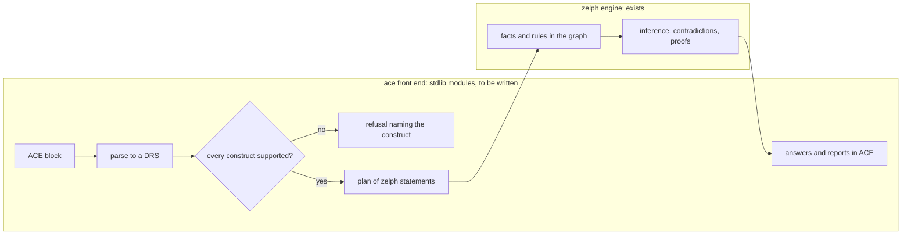

# Attempto Controlled English in zelph

Attempto Controlled English (ACE) constitutes a rigorously specified fragment of the English language. Each ACE sentence reads as ordinary English, yet it carries exactly one meaning, determined solely by the language's rules and capable of being represented in logical form. This section specifies a front end enabling users to interact with zelph using ACE: they state facts and rules as English sentences, pose questions in English, and receive the answers, any contradictions detected by zelph, and its explanations – all delivered as English sentences. `.import ace` loads the front end; the keyword `ace` starts a block of ACE text, and a blank line ends it.

No part of the front end has been implemented so far. These pages constitute its full specification, crafted with two audiences in mind: reviewers, who want to visualize how the front end functions from a user's perspective, assess its viability, learn what it costs, and see how its completion is checked; and the developers who will build it, who must have access to every name, data shape, message, and test. This page serves as the starting point for both groups.

The central point is introduced upfront. **zelph already does the reasoning**: logical rules embedded within the graph, support for negation, identification of contradictions, transitive class hierarchies across Wikidata, arithmetic operations, and proof trees that detail the derivation of a fact. **The work specified here is the mapping between ACE and zelph**, written as standard-library modules in `.zph` files (comprising Janet code and zelph statements) built atop existing, documented engine capabilities. This setup mirrors the arrangement zelph already uses for [SPARQL](../sparql.md#why-an-import-is-required): `stdlib/sparql.zph` registers the `sparql` keyword and translates each query into zelph's native primitives, while the C++ core remains unaware of SPARQL.

## Two Sessions

### Without Wikidata

The initial session serves as the opening example within the tutorial planned for the user page `ace.md`: a rule, two facts, and a question, all presented on a blank graph.

!!! example "Specified session — the behaviour this specification requires, not yet implemented"

    ```
    zelph> .import ace
    zelph> ace Every man is mortal. John is a man. Douglas Adams is a man.
    Who is mortal?

    Warning [ace/w-multiword]: sentence 3, line 1, column 37: "Douglas Adams" is read as one name.
    Answer: Douglas Adams is mortal.
    Answer: John is mortal.
    zelph> .lang ace
    ace> X ~ man
    Answer: "Douglas Adams" ~ man
    Answer: John ~ man
    ```

The block holds three statements and a single question; the blank line following the question marks the end of the block. The front end reads the whole block, writes its content into the graph, allows zelph to draw its conclusions, and subsequently provides a response to the question. "Every man is mortal." is transformed into a rule, the remaining two assertions are treated as facts, and the resulting answers are ACE sentences once more, ordered according to their textual content.

The warning refers to "Douglas Adams", two capitalised words that no entry in the lexicon declares. The front end initially interprets them as two separate names; this interpretation fails to comply with ACE rules here, thus it reads them as a single name and reports this adjustment, only once per session ([multi-word names](grammar.md#the-multi-word-fallback)). Column 37 is measured starting from the first character following the keyword.

The last two lines originate from native zelph. The front end assigns names to the words it writes using a self-defined naming language, `ace`, meaning that a native statement or query typed under `.lang ace` refers to the identical `John` and the identical `man`. zelph prints a name encompassing a space enclosed in quotation marks, as this is the method to re-enter such a line; the order of native responses is determined by zelph's own logic.

The session is pinned exactly as written by the test `ace tutorial: every man is mortal, without Wikidata` (native lines compared regardless of sequence; [Tutorial Pins](tests.md#tutorial-pins)) and is part of milestone M4, which brings rules ([M4 – Rules and Negation](plan.md#m4-rules-and-negation)).

### After a Wikidata Import

Following a Wikidata import, ACE's content words reach Wikidata's items via their English labels, with no explicit declaration required. The session below runs on a small Wikidata-style dump – a plain Wikidata JSON file that the front end's tests will also utilize (`src/test/data/wikidata/ace-fixture.json`), imported by zelph's standard importer; similar to the tests, the transcript loads a copy from a temporary directory ([Loading It in a Test and in the Documentation](tests.md#loading-it-in-a-test-and-in-the-documentation)). `.load` switches automatic inference off, resulting in the prompt `zelph->`; the importer's status updates are omitted.

!!! example "Specified session — the behaviour this specification requires, not yet implemented"

    ```
    zelph> .load /tmp/ace-fixture/ace-fixture.json
    …
    zelph-> .import ace
    zelph-> ace There is a man who admires Douglas Adams.
    Is Douglas Adams a human?
    What is an occupation of Douglas Adams?

    Note [ace/word-senses]: words read as Wikidata items (the lowest Q-number among the items with this label):
      "man" is Q8441 (7 other items carry the label; https://www.wikidata.org/wiki/Q8441)
      "Douglas Adams" is Q42 (3 other items carry the label; https://www.wikidata.org/wiki/Q42)
      "occupation" (relation) is P106 (https://www.wikidata.org/wiki/Property:P106)
      To choose another item, write n:Q… for a noun or p:Q… for a name, or declare the word, e.g. noun_sg(man, 'Q…', masc).
      (ace/senses "man") lists the candidates.
    Answer: Yes. Douglas Adams is a human.
    Answer: p:Q36180 is an occupation of Douglas Adams.
    ```

- The term "man" reaches the item Q8441, "Douglas Adams" the item Q42, and the relational noun "occupation" the property P106. When multiple items carry a label, the front end takes the one with the smallest Q-number, so the choice is the same every time; this selection is never made in silence: the [`word-senses` note](words.md#the-word-senses-note) documents the chosen item, the count of alternative carriers, and the item's page. "human" has a single carrier, Q5, thus requiring no dedicated line.
- "There is a man who admires Douglas Adams." adds a new individual, an instance of Q8441 that admires Q42. "admires" does not appear in any lexicon; the front end reads it as a verb based on its position in the sentence. Verbs are never bound to Wikidata via their labels, so the verb is assigned a node of the front end's own.
- "Is Douglas Adams a human?" is answered using Wikidata's own statement that Q42 is an instance (P31) of Q5; a class accessible via the subclass property P279 would also qualify.
- "What is an occupation of Douglas Adams?" is answered by consulting Q42’s occupation statement (P106). The value, Q36180, bears the English label "writer", which begins with a lower-case letter and cannot be written as a name, so the answer refers to the item using its prefixed identifier `p:Q36180`, which a later block can use as a name.

The session is pinned by the test `ace tutorial: words reach Wikidata items` (milestone M3); the fixture is structured such that every label has the number of carriers reported in the note. Wikidata represents certain concepts in ways that diverge from typical English intuition (for instance, an occupation functions as a property, not a class), and [Words and Wikidata](words.md#what-wikidata-models-differently) says how to ask in such scenarios and [how to select an alternative item](words.md#choosing-another-sense) for a word. Without a Wikidata import, identical sentences still function and generate nodes of their own.

The importer responsible for retaining the English label of each item is included in zelph 1.1.0. A network imported before this update, like the ones currently available, assigns each shared label to just a single item; the front end detects such a network via the marker inserted by the updated importer, disables label resolution, and communicates this status (`[ace/w-old-labels]`) rather than attempting to pick among labels it cannot see. The existing published networks are to be regenerated using the new importer, and the same run is to generate a more compact network made for the front end ([A Network for ace](words.md#a-network-for-ace)); until this transition completes, the tests and transcripts rely on the fixture.

## What a Block Writes in zelph

In zelph's own notation, the initial session's block writes a single rule and two facts while posing one query. The front end's function `ace/zelph-of` ("show me the zelph") displays these elements from the block's plan as the four lines listed below; enabling the `:show-zelph` option causes the block to output the three of them that write. Input manually beneath `.lang ace`, followed by the session's native query `X ~ man`, they execute within zelph at present. The block below captures the current zelph, not a specified session:

```
zelph> .lang ace
ace> (*{(X ~ man)} ~ conjunction) => (X is mortal)
ace> John ~ man
(John is mortal) ⇐ {(John ~ man)}
ace> "Douglas Adams" ~ man
("Douglas Adams" is mortal) ⇐ {("Douglas Adams" ~ man)}
ace> X is mortal
Answer: "Douglas Adams" is mortal
Answer: John is mortal
ace> X ~ man
Answer: "Douglas Adams" ~ man
Answer: John ~ man
```

zelph draws every conclusion immediately upon receiving the required fact, and answers the queries based on the graph. This functionality involves no new engine work: the front end’s responsibility is to produce these lines from the English text and to turn the answers back into English. The rule’s condition is expressed as a one-element condition set, `*{(X ~ man)} ~ conjunction`, instead of the plain `(X ~ man)`. zelph interprets both forms as the same rule: they yield the same outcome, and zelph maintains a record of every contradiction encountered in either form, preventing later runs from reporting it again. Every rule authored by the front end adheres to the set form, which assigns each rule a condition set ([DEC-RECORD-SINGLE](decisions.md#dec-record-single)), and `ace/zelph-of` prints it exactly as zelph lists the rule constructed by the front end; the line re-enters natively as the exact same rule ([DEC-ONE-CONDITION-PRINT](decisions.md#dec-one-condition-print)).

A handful more sentences and the zelph they transform into, on a graph lacking Wikidata:

| ACE | zelph | Construct id | From |
|---|---|---|---|
| John is a man. | `John ~ man` | `:copula/noun`, `:object/count` | M1 |
| Is John a man? | `# yes/no: John ~ man` (checked, nothing written) | `:question/yes-no` | M1 |
| John waits. | `John waits nil` | `:verb/intransitive` | M3 |
| John likes Mary. | `John likes Mary` | `:verb/transitive` | M3 |
| John is rich. | `John is rich` | `:adj/positive` | M3 |
| Who is mortal? | `X is mortal` (a query, asked in a scratch cluster) | `:question/wh` | M3 |
| Every man is mortal. | `(*{(X ~ man)} ~ conjunction) => (X is mortal)` | `:rule/horn` | M4 |
| No man waits. | `(*{(X ~ man)} ~ conjunction) => ((X waits nil) ~ refuted)` | `:neg/in-head` | M4 |

On a Wikidata graph, the symbol `~` within a class statement translates to Wikidata's instance property P31, while conditions and questions follow the subclass property P279 as well. The term `refuted` is part of zelph's own vocabulary: the last rule concludes, for each individual man, that the man's waiting is refuted. Upon establishing John as a man, any subsequent block asserting "John waits." is therefore rejected as a contradiction (`[ace/contradiction]`), and no portion of it is written. When the three sentences are contained within a single block, the block's internal inference derives the refutation of a fact that the block itself asserts; the block remains, and the front end outputs `[ace/contradiction-derived]`, using ACE to identify the sentences that fail to cohere ([Contradictions and Defeated Conclusions](block.md#contradictions-and-defeated-conclusions)). [Every Construct and Its Native Form](semantics.md#every-construct-and-its-native-form) includes every row of the mapping.

## What ACE Is

ACE originated from the efforts of the Attempto group at the University of Zurich. The present iteration, ACE 6.7, is established through publicly accessible documents:

- the [construction rules](https://attempto.ifi.uzh.ch/site/docs/ace/6.7/ace_constructionrules.html): which sentences qualify as ACE;
- the [interpretation rules](https://attempto.ifi.uzh.ch/site/docs/ace/6.7/ace_interpretationrules.html): the single reading an ACE sentence receives, where English might permit multiple;
- the [syntax report](https://attempto.ifi.uzh.ch/site/docs/ace/6.7/syntax_report.html): the grammar presented in full detail;
- the [DRS report](https://attempto.ifi.uzh.ch/site/pubs/papers/drs_report_66.pdf): the logical form underlying every construct;
- the [lexicon specification](https://attempto.ifi.uzh.ch/site/docs/ace_lexicon.html): the method by which content words are declared.

The interpretation rules are what makes ACE precise. "A man is mortal." means that there is a man who is mortal; "Every man is mortal." constitutes a rule about all men. A prepositional phrase like "with a code" belongs to the verb, while a relative clause connects to the noun immediately preceding it. When full English would be ambiguous, ACE allows only one reading, and a writer intending a different meaning must rephrase the sentence.

Each ACE text that is accepted possesses a single logical representation, specifically a Discourse Representation Structure (DRS): the referents the text introduces (John, a man, an event) along with the conditions on them, including implications tied to "every" and "if … then", negations, questions, and modal statements. The reference implementation responsible for converting ACE into DRSs is APE, the Attempto Parsing Engine, written in Prolog and licensed under the LGPL-3.0 license.

Two attributes render ACE particularly suitable for zelph. The rules and facts expressed in ACE are accessible and verifiable by individuals unfamiliar with logical notation, including non-experts, and this applies equally to zelph's answers and explanations, as they are returned in ACE. Following a Wikidata import, numerous common questions that typically require a SPARQL query can instead be asked in ACE, using a language already known to the user.

## What a User Gains

Each item appears as a session in [A Tour in Sessions](sessions.md), following the order in which the milestones bring it.

- **[Facts and questions in English](sessions.md#facts-and-questions).** Assertions concerning individuals and entities, featuring verbs, adjectives, and "of" relations; yes/no questions accompanied by three possible answers ("Yes. …", "No. It is false that …", "It is not provable that …"); questions beginning with who, what, or which are answered with declarative sentences.
- **[Rules as sentences](sessions.md#rules-and-negation).** Universal declarations ("Every …"), conditional structures ("If … then …"), rules involving multiple conclusions, nested conditionals; classical negation ("no", "does not") coexists with negation as failure ("is not provably"); contradictions reported in ACE, identifying the specific sentences that conflict.
- **[Numbers and formulas](sessions.md#numbers-and-formulas)**, following `.import ace-math`, evaluated via zelph's [mathematics stack](../math/index.md).
- **[Events and modifiers](sessions.md#events-and-modifiers)**: detailing location, time, and manner of occurrences.
- **[Plurals and quantities](sessions.md#plurals-counts-and-groups)**: handling collections, counts, "at most" and "at least", and uncountable nouns.
- **[Possibility and belief](sessions.md#possibility-and-belief)**: modal expressions like "can", "must", "should", "may", and that-clauses, recorded without being asserted.
- **[Why](sessions.md#why-and-taking-a-statement-back)**: answers justified from zelph's proofs, the logical derivation of a conclusion presented in ACE, and the use of `ace-retract` to take a statement back.
- **[Wikidata in English](sessions.md#words-that-reach-wikidata)**: once a Wikidata import is performed, content words reach Wikidata's items and properties; in absence of such an import, identical sentences operate on nodes of their own.
- **[Honest refusals](sessions.md#refusals)**: a sentence that is correct ACE but that zelph cannot yet use is refused by the name of its construct, and nothing is written. The front end never builds a graph that silently conveys a different meaning. Among the 83 constructs determining whether a block is accepted, 57 are supported by the end of the first version and 26 remain refused ([Constructs and Refusals](constructs.md#construct-ids-by-milestone)).
- **[Both notations side by side](zelph-features.md#native-zelph-on-ace-built-knowledge)**: the zelph a block writes can be shown, and native zelph rules fire on facts expressed in ACE, and the other way round, under `.lang ace`.

## How the Front End Is Built

zelph embeds the scripting language [Janet](../janet.md), and a module may register a block keyword via [`zelph/register-keyword`](../janet.md#extending-the-repl-zelphregister-keyword). The front end operates as one such module. All linguistic operations it performs are executed within Janet: a tokenizer, a grammar written as a parsing expression grammar (PEG), the construction of the DRS including anaphora resolution, the mapping to zelph statements, and the verbaliser responsible for transforming answers into sentences. All knowledge-related activities it undertakes occur within zelph, using the documented Janet API: writing facts and rules, conducting inference, issuing queries, and generating proofs.



The modules reside within `stdlib/` beside `sparql.zph`: `keyword-kit` (providing utilities for keyword languages in general, without any ACE awareness), `ace-constructs` (cataloguing each construct and every message), `ace-core` (the shipped vocabulary), `ace-lexicon`, `ace-grammar`, `ace-drs`, `ace-verbalise`, `ace-zelph` (all components interacting with the graph), and `ace`, which registers the keywords; `ace-math` introduces arithmetic alongside a general module `evaluation`. `.import ace` writes nothing to the graph and adds no rule. No ACE knowledge enters the C++ engine, and no engine test mentions ACE. [Architecture](architecture.md#the-pipeline) explains the pipeline and justifies the placement of its stages; [Modules, API and Data Shapes](api.md#the-modules) gives every module and function.

Three properties of this design carry the feasibility argument:

- **The analysis is pure.** All processing prior to the plan relies exclusively on the text and the lexicon: it writes nothing and does not convert any word into a node, enabling a case-by-case comparison with APE's output for the identical text.
- **A block is all or nothing.** The plan is initially run in a scratch cluster, which is then discarded (a [dry run](block.md#all-or-nothing-the-dry-run)); a block that is refused, or that states the opposite of what the graph contains, results in no change to the graph.
- **No step of the front end scans the graph.** Words are located via hash lookups and facts are verified through exact probes; if the exact probe for a yes/no question fails, a secondary probe – bounded by the subject's facts sharing that predicate – also reads a fact having multiple objects ([DEC-YESNO-WIDER](decisions.md#dec-yesno-wider)). Questions are processed in a scratch cluster that is subsequently removed. On a Wikidata network, a block costs work proportional to its own sentences, the items that carry its words' labels, and the inferences it generates, excluding a few documented exceptions where the subsequent inference run constitutes a full pass (one such case, Z3-P1, appears among the engine items listed below); [Nothing Is Linear in the Size of the Graph](architecture.md#nothing-is-linear-in-the-size-of-the-graph) lists the operations the front end may use.

Since the front end is Janet, it likewise operates within zelph's browser build, a setting where an external parser would fail to run; the work plan includes integrating an ACE demo into the [playground](../playground.md) ([Playground Plan](plan.md#playground-plan)).

## What zelph Already Provides, and What Remains

The front end requires general engine capabilities that zelph lacked, or did not have in the format the mapping needs. These were developed initially, before any ACE-specific code, each accompanied by its own tests and documentation hosted on the existing user pages, and they constitute part of zelph 1.1.0, which is released before the front end work begins:

- the keyword host: a block keyword whose handler asserts what it writes, can import files, reports errors by naming the block, and is followed by an inference run also at the end of the input;
- rules built from Janet as a single rule encompassing all its conclusions, refused when a conclusion's predicate is bound by no condition;
- an inference run that prints nothing and returns the contradictions it encountered, along with the negation-as-failure conclusions a later fact defeated, as data;
- scratch clusters that a question or a dry run may discard without slowing the remainder of the session down;
- refutation of facts and of rule patterns, with a single interpretation on each path;
- lookups that create nothing, exact fact probes, the degree of a node;
- a loaded network that replaces the session's graph, equipped with a counter that tells Janet caches so;
- Wikidata labels kept for each item, with an index from a label to all its carriers;
- proof trees, derived facts, node annotations, and the facts that rest on a given fact, as Janet data;
- numbers that represent the same node across every naming language;
- statements recorded without being asserted (opaque predicates), and patterns that match the members of a stored set.

Three questions concerning zelph itself that this effort prompted are settled in 1.1.0 as well: a rule authored using `zelph/fact` whose conclusion features a predicate that no condition binds is refused before it can fire ([DEC-FACT-RULE](decisions.md#dec-fact-rule)), a rule written as a mention is not in force ([DEC-MENTION-RULE](decisions.md#dec-mention-rule)), and name merges follow content identity ([DEC-MERGE-CONTENT](decisions.md#dec-merge-content)).

At the time this specification was composed, the work had grown zelph’s test suite from 1,474 to 2,016 test cases, and the performance guard – a test that measures the amount of work zelph performs for the [Jacobian counterexample](../math/tutorial-jacobian.md) – continued to stay within its predefined boundaries. [What zelph Already Provides](foundation.md#what-the-front-end-relies-on) correlates every requirement of the front end to the engine item that fulfils it and shows each item within a session on the current zelph.

Seven engine items are still outstanding. Each emerged during the construction of the preceding items, was deemed too extensive to resolve on the fly, and is instead defined through specifications that include sessions demonstrating current behaviour, the requirements a fix must satisfy, the associated tests, and the potential risks involved:

- K1-P1: a statement mentioning a typed rule that lacks variables takes the rule out of force, and re-typing the rule does not restore it;
- K1-P2: a rule responsible for deriving rules cannot put a derived rule lacking variables in force;
- L3-P1: a statement embedded within a rule's conclusion is derived, yet explained as an input;
- Z2-P1: the objects within a pattern are matched by one reading at the top level of a statement and by a different reading nested within;
- Z3-P1: following the initial rule containing a negated condition, each subsequent block that adds a rule costs a full inference pass;
- Z3-P2: upon a rule's firing, the members of a comma list that the rule holds by node are asserted;
- Y2-P1: a rule featuring multiple conclusions is applied by halves when any one of its conclusions is refused or contradicted.

The front end does not wait for them. In its first version, each is sidestepped through a refusal that identifies the construct requiring it, excluded by a rule the mapping adheres to, or stated as a known limitation ([How v1 Lives Without Them](prerequisites.md#how-v1-lives-without-them)). Implementing them constitutes a portion of the proposed work: [What zelph Still Needs](prerequisites.md#the-seven-items-at-a-glance).

## APE: a Test Oracle, Not a Component

APE stands out as the most apparent choice for parsing ACE, yet the front end intentionally refrains from employing it during execution:

- The keyword handler within zelph operates independently of Janet's event loop and is incapable of initiating or communicating with any other process; zelph's browser version contains no processes whatsoever; and APE is packaged nowhere, requiring SWI-Prolog, a dependency no zelph package may reasonably expect.
- Translating APE's Prolog grammar rule by rule into Janet would transform the outcome into an adaptation of an LGPL-3.0 program, thereby preventing acrion from continuing to offer that part of zelph under its commercial licence.

The tokenizer, the grammar, the anaphora resolution, and the DRS comparison are therefore written in a clean room environment, based exclusively on the publicly available ACE 6.7 documentation referenced above. APE's grammar, resolver, and lexicon sources remain closed while the front end is implemented independently; no component of APE's code, rule names, feature sets, or message wording is copied; the PEG employs its own set of rule names.

APE operates exclusively during development. The regression corpus used by APE functions as the test oracle: it is fetched from APE's public repository, at a pinned commit, into the build directory, accessed solely through the columns containing the texts and their results, and never committed. The DRS notation employed by APE serves as the shared format for comparing the front end's parser with APE. APE, executed manually, performs cross-checks on new sentences, and its error reporting acts as a checklist outlining the situations a good message must address, never as a source for phrasing. APE is never a build or test dependency for zelph, and APE's large Clex lexicon (GPL-3.0) is never shipped or fetched. [APE: a Development-Time Oracle](architecture.md#ape-a-development-time-oracle) details the rationale comprehensively, while [The Clean Room](architecture.md#the-clean-room) outlines the rules.

## How Completion Is Checked

Each milestone ends at a [gate](tests.md#the-gates-and-their-modes): a test that pins the milestone and specifies the corpus cases it must pass. APE's corpus holds 3,779 ACE texts, with 3,733 featuring a confirmed expected result: 2,813 are accepted, each accompanied by its DRS, 919 are rejected, and a single one includes only remarks. Starting with milestone M1, the front end must reject the texts that APE rejects; beginning with M2, its parser must give APE's DRS for each of the 2,682 accepted texts whose words appear in APE's small lexicon. Every accepted case falling outside the current milestone's scope must be refused naming one of its constructs, never with a syntax error and never with a silent graph. From M3 onward, each milestone adds the cases whose constructs it supports into its gate. A gate achieves success at 100 %; the sole deviations are individually pinned, each with the decision behind it, such as the rejected texts that the default mode, which interprets unfamiliar words based on their position, intentionally accepts.

Beside the corpus, each construct comes with hand-written tests that include the answers a user sees, and several oracles hold across all of them: each answer can be re-entered as ACE ([the round trip](tests.md#rt-1-answers-re-enter)); the zelph a block displays, input natively, represents the identical graph; a refused block leaves the graph unchanged. A milestone is considered complete only once, in addition to its gate, zelph's whole test suite and the performance guard have passed, and the user documentation for the milestone is present ([Definition of Done](plan.md#definition-of-done)).

The specification does not include any deadlines or expenses: the work is divided into milestones, and advancement is assessed through their respective quality gates. [Tests and Quality Gates](tests.md#how-completion-is-verified) lists the tests and the counts; [Work Plan and Milestones](plan.md#the-milestones-at-a-glance) outlines the milestones, their order, and the [estimates the plan relies upon](plan.md#risks-and-estimates).

## Licensing

zelph is available under the AGPL-3.0-or-later, and acrion innovations GmbH additionally provides it through a commercial licence ([About the Project](../about.md#licensing)). The front end resides within zelph's repository and standard library, and is licensed identically, which is why it is written in a clean room rather than being derived from APE. Contributions are licensed under the AGPL-3.0-or-later and grant acrion the right to distribute them under its commercial licence as well (`CONTRIBUTING.md`). No component from APE is committed: not its source code, not its lexicons, not its test corpus. Code written with the help of a language model carries a provenance record in the commit message, consistent with the rest of zelph ([Use of generative AI](../about.md#use-of-generative-ai)).

## Relation to the Current NLnet Project

zelph is presently backed by NLnet's NGI0 Commons Fund under the initiative *Auditable Reasoning over Linked Open Data* ([NLnet Project Status](../nlnet-status.md)): an import mechanism for RDF and JSON-LD, proofs exported as Linked Data, a library of constraint rules, and a proof explorer accessible via the browser. The ACE front end does not form part of this initiative. Instead, it represents an independent, new piece of work that relies on the current state of the engine, including the engine items listed above, and on none of the deliverables from that project. At points of intersection, the front end uses what the engine already offers: it explains answers from the proof tree returned by `zelph/explain` as Janet data, rather than drawing from the planned Linked Data export, and it expresses a negated group of conditions using a helper rule ([Helper Rules for "not provably"](semantics.md#helper-rules-for-not-provably)), not via the anticipated negation mechanism applied to a group of conditions ([subtask 3f](../nlnet-status.md#3-constraint-rule-library)).

## How to Read These Pages

### Two Kinds of Transcripts

**Specified sessions** exhibit the conduct mandated by this specification; none of it is executable at present. They consistently appear within a box labelled "Specified session — the behaviour this specification requires, not yet implemented", mirroring the sessions shown earlier. Each originates from examples and tests in the specification, with its lines adhering strictly to the specified message layouts, answer templates, and orderings. The wording of a message serves as an example unless a test explicitly pins it, as it does for the lines in the two tutorial sessions; the layout of a message, its class, its identifier, and its position are binding ([Messages](block.md#messages)).

**Real runs** consist of code blocks containing zelph prompts that reside outside such a box. These were captured using the current zelph and show engine capabilities that the front end builds on, or show what zelph currently does where it still falls short.

Both follow the transcript convention outlined in the [Quick Start Guide](../quickstart.md#basic-usage): content following a prompt is considered input, lines extending a block lack a prompt, the blank line marking the end of a block is explicitly displayed, and the `Importing file …` line along with the notice printed by `.import ace` are omitted. A line containing only `…` represents omitted lines. When a block triggers an error, it is displayed within zelph's frame as `Error in line "ace <first line of the block>": <message>`, and because piped input stops at the first error, a session demonstrating such an issue concludes with that error.

### Ids

The pages keep the specification's ids, as the implementation is structured according to them:

| Kind | Form | Example | Defined on |
|---|---|---|---|
| construct | `:namespace/name` | `:verb/transitive`, `:modal/can` | [Constructs and Refusals](constructs.md#construct-ids-by-milestone) |
| message | `[ace/<id>]` | `[ace/syntax]`, `[ace/w-multiword]` | [The ace Block](block.md#the-message-catalogue) |
| milestone | `M0` to `M9` | `M4` (rules and negation) | [Work Plan and Milestones](plan.md#the-milestones-at-a-glance) |
| design decision | `DEC-<NAME>` | `DEC-WIKIDATA` | [Design Decisions](decisions.md#index) |
| engine item, built | `P-<name>` | `P-quiet-run` | [What zelph Already Provides](foundation.md#what-the-front-end-relies-on) |
| engine item, remaining | `<package>-P<n>` | `K1-P1` | [What zelph Still Needs](prerequisites.md#the-seven-items-at-a-glance) |
| test | `ace <area>: <behaviour>` | `ace tutorial: words reach Wikidata items` | [Tests and Quality Gates](tests.md#the-tests-by-name) |

Each construct that the grammar can read is assigned an identifier, and alongside the message identifier, a refusal identifies it. Starting from M2, as the grammar parses all of ACE 6.7, up to M8, which brings modal statements, a sentence containing "can" is refused in this manner:

!!! example "Specified session — the behaviour this specification requires, not yet implemented"

    ```
    zelph> .import ace
    zelph> ace John can fly.

    Error in line "ace John can fly.": Correct ACE, but zelph cannot use it [ace/unsupported]: sentence 1, line 1, column 10: modality ('can'), construct modal/can.
      John can <>fly.
      Modal statements, recorded without being asserted, are planned for milestone M8.
    ```

The initial segment, `Error in line "…":`, serves as zelph's frame for any error triggered by a block keyword. The message class "Correct ACE, but zelph cannot use it" says that the sentence adheres to valid ACE syntax. The position and the marker `<>` are governed by a single rule across all constructs: they indicate the word at which the construct appears within the sentence's logical form. "can" does not possess an independent word there; instead, it qualifies a statement, hence the position corresponds to the first condition within it, the verb "fly", while the message text continues to reference "can" ([Positions](constructs.md#positions)). The hint names the milestone that will support the construct. No part of the block is written. Before M2, the identical sentence remains a syntax error, as the grammar of the first milestone reads only a limited set of sentence shapes.

## The Pages of This Section

1. **Overview** (this page): what the front end is, the central point, the map.
2. [A Tour in Sessions](sessions.md): each feature cluster presented as a specified session, featuring the zelph it writes and a real run of that zelph.
3. [Work Plan and Milestones](plan.md): the milestones M0 to M9, their gates, the definition of done, and the workflow sequence.
4. [What zelph Already Provides](foundation.md): the engine items developed for the front end, each accompanied by a real session.
5. [What zelph Still Needs](prerequisites.md): the seven outstanding engine items, detailing current behaviour and the requirements for a resolution.
6. [Architecture](architecture.md): the pipeline, the constituent modules, the reasons for APE's involvement, and the performance budget.
7. [The ace Block](block.md): the process of reading, running, and responding to a block, along with the catalogue of messages.
8. [Modules, API and Data Shapes](api.md): all exposed functions and data shapes, and how the front end names things within the graph.
9. [Tokenizer, Grammar and Lexicon](grammar.md): transforming text into a syntactic structure, unknown words, multi-word names, and the lexicon.
10. [From Sentences to the Graph](semantics.md): building DRS, anaphora, and the full mapping to zelph.
11. [Questions, Answers and Explanations](answers.md): how questions are evaluated and answers, derivations, and retractions are articulated.
12. [Words and Wikidata](words.md): the pathway from words to Wikidata items, selecting alternate items, and the specialized network file.
13. [Numbers and Formulas](math.md): ACE calculations using zelph's mathematics stack.
14. [Constructs and Refusals](constructs.md): the table listing every construct, its associated milestone or the justification for refusal.
15. [zelph Features Through ACE](zelph-features.md): each zelph capability and its path via ACE, or the explanation for its absence.
16. [Tests and Quality Gates](tests.md): the corpus, test layers, oracles, and gates.
17. [Design Decisions](decisions.md): each decision with its justification and the options that were examined.
18. [Design Routes Taken and Not Taken](routes.md): the advantages of the indirect routes, and the routes that were rejected.
