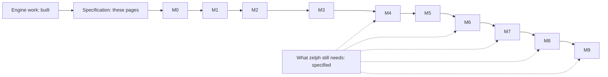

# Work Plan and Milestones

The Attempto Controlled English (ACE) front end is built in ten milestones, M0 through M9. Each milestone makes a group of ACE constructs work, from the first sentence `John is a man.` to rules, negation, numerical expressions, events, plural forms, modality, and ultimately explanations of why zelph believes what it answers. Each milestone concludes with a gate: a test case that pins exact counts against the regression corpus of APE, Attempto's reference parser. All corpus texts within the milestone's scope must succeed, excluding a short list of explicitly named and justified divergences, while the full zelph test suite and a performance guard that counts the work the engine does must remain green beside it. A milestone is considered complete when a clearly defined list of conditions is met (the [definition of done](#definition-of-done)), allowing anyone capable of building zelph and running its tests to verify advancement.

The plan hinges on a single truth: **zelph already handles the reasoning.** The proposed effort is the mapping between ACE and zelph, written as standard-library modules in `.zph` (Janet augmented with zelph), built atop existing and documented engine features – just as `stdlib/sparql.zph` puts [SPARQL](../sparql.md) through the public Janet API without requiring the C++ core to understand SPARQL. The front end needs were addressed through engine modifications that were built first, before any ACE-specific development commenced: these upgrades extended zelph’s test suite from 1474 to 2016 test cases and are part of zelph 1.1.0, which is released before the commencement of the proposed work. What remains missing in the engine is a short, bounded list, specified on its own page, [What zelph Still Needs](prerequisites.md); none of these gaps impedes a milestone, as the front end either refuses or circumvents each item in v1 ([below](#what-zelph-still-needs-and-where-it-fits)).

The effort is measured by milestones and gates, not through fixed calendar dates. This page omits any dates and financial figures: it says what each milestone adds, what it relies on, how its completion is verified, and the sequence in which tasks within it are carried out.

The initial milestone delivering a user-visible outcome takes exactly one sentence through every stage of the front end. That is the specified behaviour at the end of M1 (since no ACE code has been created yet, this and each subsequent ACE session on this page constitutes the requirement, not a recording):

!!! example "Specified session — the behaviour this specification requires, not yet implemented"

    ```
    zelph> .import ace
    zelph> ace John is a man. Is John a man?

    Answer: Yes. John is a man.
    ```

After M1, each construct individually expands this slice, with the gate checking that nothing already working breaks. The tour through the finished front end is detailed in [A Tour in Sessions](sessions.md); this page serves as the blueprint guiding toward that outcome.

## The Milestones at a Glance

ACE sentences are categorized through **construct ids**, for example `:verb/transitive` in the case of "John likes Mary." or `:naf/atom-in-body` when indicating a "not provably" condition within a rule. Each construct that the parser is capable of interpreting corresponds to a row in one table, and each row specifies the milestone from which it is supported. A block that contains a construct not yet supported is refused with a message that identifies both the construct and the milestone responsible for enabling it – never silently converted into an incorrect graph. Out of the 83 construct ids used to classify a parsed sentence or its context (76 at the DRS level, 7 as context ids across the plan), 57 are supported by the end of M9, while 26 remain refused in v1, each accompanied by its reason ([Constructs and Refusals](constructs.md#construct-ids-by-milestone) provides the full table).

| Milestone | Name | What a user gains | Construct ids supported from it | Gate |
|---|---|---|---|---|
| M0 | Foundations | nothing visible yet: the construct table, the DRS reader, printer, matcher and classifier, the corpus wiring | none | the corpus self-checks |
| M1 | Smoke slice, block contract, words | the `ace` block; `John is a man.`; yes/no questions with three answers; words reaching Wikidata items; unknown words read by their position | `:name/proper :object/count :copula/noun :question/yes-no` | the keyword rejection guard, the smoke shapes, word resolution on the Wikidata-style fixture |
| M2 | Grammar parity, strict and guessing | each ACE 6.7 sentence is parsed; what is not yet mapped is refused by construct id, never as a syntax error | none | gates S, A, B, N, W (DRSs), layer A′ |
| M3 | Facts and questions | individuals, verbs, adjectives, of-phrases, located copula, strings; who/what/which questions | `:individual/top-level :object/something :verb/intransitive :verb/transitive :verb/ditransitive :adj/positive :adj/transitive :adj/comparison :of/relation :copula/located :question/wh :data/string` | row M3; gate W (created names) |
| M4 | Rules and negation | every/if-then rules, nested conditionals, "no", "does not", "not provably", disjunction in conditions, contradiction reports | `:rule/horn :rule/generative-head :rule/disconnected-head :rule/nested :rule/negated :rule/in-question :neg/fact :neg/statement :neg/in-head :neg/atom-in-body :neg/not-every :neg/atom-in-question :naf/atom-in-body :naf/complex-in-body :naf/in-question :or/in-body :or/in-question` | row M4 |
| M5 | Arithmetic | numbers, formulas and comparisons via `.import ace-math`; identity of names | `:formula/compare :formula/identity :expr/arith :data/integer :copula/identity :neg/formula :naf/formula` | row M5 |
| M6 | Events and modifiers | "in a park", "fast"; where, when and how questions | `:mod/pp :mod/adverb :question/where-when-how` | row M6 |
| M7 | Plurals, cardinality, mass, lists and sets | "3 dogs", "at most 1 car", "some water", lists, sets, how-many questions | `:object/plural-count :object/at-most :object/at-least :object/group :group/condition-list :object/mass :data/list :data/set :question/how-many` | row M7 |
| M8 | Modality and subordination | "can", "must", "should", "may"; "John believes that …" | `:modal/can :modal/must :modal/should :modal/may :sub/that-clause` | row M8 (the last row) |
| M9 | Explanations, derivation echo, retraction, persistent provenance | why-answers quoting the user's own sentences, an echo of what was derived, the `ace-retract` block | none (no new construct; new options and a new keyword) | no new row |



The solid line represents the order of work. The dotted lines lead from the engine items zelph still needs to the milestones at which each component's impact first arrives at ACE users; none of these constitutes an entry condition for a milestone ([details](#what-zelph-still-needs-and-where-it-fits)).

## How the Order Was Chosen

The order of work is governed by four principles. Every one was chosen after considering its options; the decision ids name the entries on [Design Decisions](decisions.md).

### Engine Work First

Every general engine change the specification needs – defects, shortcomings and extensions of zelph itself – was constructed before the introduction of any ACE-specific code, applied simultaneously across **all** milestones in dependency waves ([DEC-WORKMODE](decisions.md#dec-workmode), [DEC-HOSTFIX](decisions.md#dec-hostfix)). Only after every prerequisite of a coherent specification exists and the specification is finalized does ACE-specific code (`stdlib/ace*.zph`, `stdlib/keyword-kit.zph`, `src/test/test_ace.cpp`, the corpus wiring) start. The C++ engine contains absolutely no ACE-related knowledge.

The reason is that a front end constructed atop a moving engine either waits at each milestone or generates temporary solutions that a subsequent engine correction discards. Constructing the engine side first removes both issues: there's no delay at any milestone due to an engine item, and the sole temporary measure the front end ever uses is a **refusal by construct id** – a sentence that would need a missing engine capability is refused with a message naming it, which remains truthful and incurs no cost when removed later.

What zelph still lacked after that work was sorted, item by item, into four categories: (1) low-hanging fruit and (2) clear bugs, both resolved immediately, as zelph is released before the commencement of the proposed front-end development; (3) a more comprehensive correction that is unambiguously feasible, resolved right away unless it cascaded into many rounds (a fix that cascades is reverted and treated as 4); (4) everything else, which remains unfixed but is specified with example sessions as a zelph prerequisite, with its implementation forming part of the proposed work ([How the Remaining Items Were Chosen](prerequisites.md#how-the-remaining-items-were-chosen)).

### DRS First, With One Sentence First

ACE assigns to each sentence a single interpretation, expressed as a Discourse Representation Structure (DRS). APE ships a regression corpus that contains the expected DRS for every text it accepts. The plan employs this DRS as the pivot between parsing and mapping ([DEC-ORDER](decisions.md#dec-order), option (b); [A1](routes.md#a1-the-drs-is-the-pivot-and-its-test-half-comes-first) on the routes page):

- **M0** builds the DRS reader, printer, matcher, and construct classifier, executing them across the 2813 expected DRSs in the corpus, prior to any grammar being established. The oracle undergoes validation before any component is evaluated against it.
- **M1** takes a single sentence, `John is a man.`, through every stage – tokens, annotated words, parse tree, DRS, plan, native zelph, graph, answer – without any expansion occurring beforehand. The initial verification of the entire pipeline emerges before the pipeline itself is broad.
- **M2** finalizes the grammar for all of ACE 6.7 and compares its DRS outputs with those of APE across every runnable corpus case. From this point forward, a sentence that the mapping does not cover yet is refused by its construct id, determined via the parsed DRS using the identical function employed by the tests.
- **From M3** the mapping expands incrementally, one construct id at a time.

The other option involved vertical slices: integrating grammar and mapping at each milestone, with later constructs refused through token scanning. A token scan is incapable of classifying by meaning – `and` serves both to link sentences and noun phrases, and a prepositional phrase following a verb functions as a modifier, whereas "is in a park" constitutes a located copula – thus, valid ACE outside the current coverage would trigger either a syntax error or an incorrect refusal. DRS-first buys exact refusals at every milestone, a parser and a mapper that fail independently, the full corpus as an oracle starting from the first grammar commit, and a public DRS API nearly at no cost. The cost is that modality, subordination, commands and plurals are parsed (at M2) long before they are mapped.

### One Construct at a Time

Starting with M3, every construct id is introduced in a single change, accompanied by its corresponding mapping row, its verbaliser template (which reverses the process by converting graph facts back into ACE answers), the examples associated with that row, and its associated tests. Within the same change, its refusal test is transformed into an acceptance test. Commits follow the same unit structure: one host item, one construct id, or one documentation part, each paired with its respective tests.

### Every Step Ends Green

Every step in the order of work ends with its tests passing green, and – in cases where C++, Janet, or the standard library have been modified – the complete test suite, the performance guard, and `ctest` must all pass green before the next step begins. Following any change to C++, Janet, or the standard library, the WebAssembly build and the four Node tests executed by CI are built and run as well.

## Before M0: The Engine Work

The order of work is one numbered sequence, S1 through S30. The initial segment has been completed:

| Step | What | State |
|---|---|---|
| S1 | Start of every session: read the working notes and the specification, check the working tree, stage at the start of each turn, open the provenance log upon the first code modification, assess the machine's load before any timing measurement | applies to every session |
| S2 | Wave 1: the Janet upgrade (v1.42.1), the keyword host, the quiet run, the rule list and negation-level marks, the removal path, the refutation items, the read-only bindings and proofs represented as data, language-independent numbers, set matching, the `ace` network tooling | built |
| S3 | Wave 2: incremental inference for closures, "not provably" and new rules, the skipped auto-run, refutations a dropped cluster takes back, derived facts as data, node annotations, opaque predicates | built, with three adversarial fix rounds |
| S4 | Wave 3: the retraction bindings and the residual documentation; subsequently three additional fix rounds identified by test writers, and a last round resolving three questions of zelph's own design (detailed below) | built |
| S5 | The as-built pass: the specification restated as the engine was built | done |
| S6 | The specification is finalized: each prerequisite for the ACE code is present, and no dependency remains open | the condition required for S9 |
| S7 | The specification presented as documentation pages: this section, `mkdocs/docs/ace-spec/` | in progress |
| S9-S11 | M0's graph-free work | after S6 |
| S13-S30 | M1 | after M0 |

S8 and S12 from a prior numbering were folded into the waves; their identifiers remain unassigned to ensure that references to S9-S30 remain accurate.

The last round settled three engine questions that had emerged in prior rounds. None served as an ACE prerequisite; two of them fix behaviour that the front end relies on, and the third concerns a command the front end never uses:

- **A rule written as a raw fact.** A `=>` constructed using `zelph/fact` (or C `zelph_fact`) whose consequence features a variable predicate that no condition binds is subject to verification at the end of the outermost Janet evaluation (a `%` block, a keyword handler, a script), before a save and before any run; if it persists as a rule in force at that point, it is removed and refused with a message naming the variable. A generator's inner rule and a held rule proceed without issue, since they are already mentioned ([DEC-FACT-RULE](decisions.md#dec-fact-rule)). Every rule builder, typed rules, and the C API's `zelph_rule` refuse such a rule upon its creation ([DEC-UNBOUND-PRED](decisions.md#dec-unbound-pred)); `ace` builds every rule via `zelph/dedup-rule`, so it meets the builder's check.
- **A rule written as a mention.** A `=>` written with `zelph/mention` (or `zelph_mention`) functions as a mention: it is not in force, does not fire, and is not read by a rule over rules until something claims it ([DEC-MENTION-RULE](decisions.md#dec-mention-rule)). `ace` writes the rules within that-clauses in this manner, embedded within opaque holder statements (M8).
- **Name merges are governed by content identity.** Atoms are merged; when two ground statements have identical subject and predicate, they are merged into one statement that includes all objects from both; a statement or set constant that merges with an atom survives as itself and acts as a definition, unless the atom is a core node or holds a member the set constant lacks; all other merging attempts involving statements or set constants are refused before any modification takes place ([DEC-MERGE-CONTENT](decisions.md#dec-merge-content)). `ace` never calls `.name`, and the lexicon serves as its binding route ([DEC-NAME-MERGE](decisions.md#dec-name-merge)).

At the time this specification was written, the engine work had expanded zelph’s test suite from 1474 to 2016 test cases (1884 of these in the fast tier) and `ctest` from 24 to 25 entries. Each counter in the performance guard remained within its ceiling ([below](#the-jacobian-performance-guard)). [What zelph Already Provides](foundation.md) describes every item, its function, and the reason the front end needs it.

### What Each Milestone Relies On

Each engine item listed beneath is built. The column indicates the earliest milestone at which the ACE code begins utilizing it; the host item ids (`P-…`) are detailed in [What zelph Already Provides](foundation.md).

| Milestone | Relies on in zelph | Host items |
|---|---|---|
| M0 | the Janet version featuring the nested-import correction; documented engine behaviour pinned by tests | the Janet unit, P-docs |
| M1 | a keyword handler where facts are claimed like typed ones; a block at the end of input followed by a run; imports located within a handler; errors that name the block; a quiet inference returning its contradictions and defeats as data; the host skipping its own run after a handler that ran; non-creating lookups, exact O(1) fact probes, degrees, the language setter, the graph epoch, fact decomposition, every carrier of a Wikidata label; a dry run within a scratch cluster that leaves no trace and maintains fast paths armed; node annotations for provenance | P-claim, P-eof-autorun, P-quiet-run (a) and (b), P-import-in-handler, P-error-envelope, P-auto-run, P-autorun-skip, P-lookup, P-exact, P-parts, `zelph/lookup-all`, P-scratch-drop, P-pidx-local, P-drop-delta, P-restore-mark, P-annotate; built via the merge before the waves: P-load-replace, P-drop-names, P-wd-labels, P-label-index |
| M2 | no additional features | – |
| M3 | no additional features | – |
| M4 | refutations operating consistently along every route, a derived refutation that meets a claimed fact reported as a contradiction; the rules in force represented as data; the engine’s negation levels with rules over predicates marked; negation records; rules over Wikidata classes and "not provably" rules that cost their delta, not their extent; the record of a one-condition rule, identical regardless of whether its condition is stated directly or as a one-element condition set | P-refute (p1), (d), (a), (b), (c-1), (p2), (p3), (c-2), (e), P-rule-list, `(zelph/strata)` with P-strata-transparent, `.negation-records`, P-closure-delta, P-naf-delta, P-delta-new-rules, P-record-pin |
| M5 | numbers, `zelph/number` and character lists naming one node under each `.lang` | P-number-lang |
| M6 | no additional features | – |
| M7 | no additional features: counting relies on the engine's no-duplicate-witness guard as currently implemented | – |
| M8 | statements written without being claimed, present in facts and rule heads; a `=>` written as a mention that stays out of force until claimed; matching a box with several conditions against a stored set | P-opaque, P-set-match; the mention rule from the final round |
| M9 | proof trees and derived facts as data; persistent annotations; what rests on a fact, what nests it, and the withdrawal of a single claimed fact | P-explain, P-derived, P-annotate, P-retract |

### What zelph Still Needs, and Where It Fits

Seven engine items fall under category 4: they are specified, not built, and constitute part of the proposed work. Their details appear with sessions in [What zelph Still Needs](prerequisites.md#the-seven-items-at-a-glance). The specification does not link any of them to a milestone: the front end does not wait for any of them, as each features a v1 handling – either a refusal by construct id, a constraint that the mapping keeps, or a cost that is documented. The table names the milestone at which each item's impact first arrives at ACE users, which is the point where implementing it first yields benefit.

| Item | What goes wrong today, in short | v1 handling in the front end | First reaches ACE users at |
|---|---|---|---|
| [K1-P1](prerequisites.md#k1-p1-a-mention-switches-a-typed-ground-rule-off) | mentioning a ground rule turns off the typed rule, and retyping it fails to reactivate it | `:sub/ground-conditional` remains refused | M8 (lifting the refusal needs it); after v1 |
| [K1-P2](prerequisites.md#k1-p2-a-rule-generator-cannot-put-a-ground-rule-in-force) | a rule generator is unable to put a fully ground rule in force | fully ground nested conditionals get flattened | M4 (a switch might remain a switch); after v1 |
| [L3-P1](prerequisites.md#l3-p1-a-statement-nested-in-a-conclusion-is-explained-as-an-input) | a statement nested within a conclusion is derived, yet zelph explains it as an input | the mapping writes each nested atom at the top level as well, ensuring explanations and retractions can access it | M6 (occurrences), M9 (why-answers, `ace-retract`) |
| [Z2-P1](prerequisites.md#z2-p1-one-reading-of-a-patterns-objects-at-every-level) | the objects of a pattern are interpreted differently at the top level versus inside a statement | not directly encountered: `ace` writes one object per fact; observed only via native facts containing multiple objects | M7, M8 (interoperation with native facts) |
| [Z3-P1](prerequisites.md#z3-p1-after-the-first-negated-condition-every-new-rule-costs-a-full-pass) | once the first rule includes a "not provably" condition, every block that adds a rule incurs a full inference pass | a cost, documented | M4 |
| [Z3-P2](prerequisites.md#z3-p2-a-firing-asserts-a-comma-list-it-was-only-handed) | a firing claims the members of a comma list its rule holds by node, which a typed statement does not do | a constraint on the mapping: no list sourced externally is inserted into a conclusion by node | M4 (every milestone that writes rules) |
| [Y2-P1](prerequisites.md#y2-p1-a-rule-with-several-conclusions-is-applied-by-halves) | a rule with several conclusions gets applied in parts when any one of them is refused | not avoided: the contradiction is reported and the partial outcome persists; `:atomic :consistent` ensures a block is all or nothing | M4 |

Every one of the seven constitutes zelph work within the proposed effort. K1-P1 and K1-P2 share a single fix, namely the positive record that a rule was asserted; the front end version v1 does not require this, hence it is positioned after v1 ([DEC-CAT4](decisions.md#dec-cat4)).

Open for the order of work: the specification does not determine the placement of the remaining five items within the sequence; none of them constitutes an entry condition for a milestone.

## The Milestones

Each section beneath begins with a session demonstrating the user benefit of the milestone, followed by the entry condition, what the milestone adds (each construct id paired with its native zelph form), what remains refused within its families, its tests, its documentation, what is accomplished beyond the [definition of done](#definition-of-done), and the order of work inside it. `<instance>` and `<subclass>` represent the pinned instance and subclass predicates: core `~` and none on a graph lacking Wikidata, `P31` and `P279` on a Wikidata graph, unless the user named a node `ace:instance` or `ace:subclass` in language `ace`. Native lines are written as typed under `.lang ace`, the naming language of `ace`'s content, in the sequence `ace/zelph-of` prints them, which matches the sentence's flow: a subject's class atom precedes its verb, a relation atom precedes the class atoms of the referents it introduces, an event's occurrence atom precedes its modifiers. Variable letters proceed in the order X, Y, Z, A, … based on first occurrence, conditions before conclusions; a class atom uses no self-assigned letter, except on a Wikidata graph, where a class condition's pattern includes its own variable and adopts the subsequent letter ([DEC-VAR-LETTERS](decisions.md#dec-var-letters)). The mapping itself, row by row, is detailed in [From Sentences to the Graph](semantics.md#every-construct-and-its-native-form); test names are part of [Tests and Quality Gates](tests.md#the-tests-by-name), which maintains the full list a gate requires – a test it names for a milestone belongs to that milestone even if this page does not repeat it. Session messages follow the format in [Messages](block.md#messages): the class words, the id, the position and the marker are binding, the phrasing is illustrative.

### M0 — Foundations

M0 lacks a session: it builds the construct table and the test oracle, and nothing a user can type changes.

**Entry.** The engine waves are built (S2-S5) and the specification is finalized (S6).

**Adds.** Absence of any supported construct, keyword, or grammar.

- `ace-constructs.zph`: `ace/state`, `ace/milestone` set to `:M0`, each row in the construct table (with `:since`, `:import`, `:needs`, `:summary`, and `:reason` filled, and `:examples` where an own sentence exists), each message identifier from the catalogue along with its class (including the class Note) and its corresponding text, and the accessor functions.
- The oracle half of `ace-drs.zph`: `ace/ape->drs` (reader), `ace/drs->ape` (printer), `ace/normalise-ape-names`, `ace/drs-wellformed?`, `ace/drs-equivalent?` (matcher), `ace/drs-constructs`, and `ace/drs-families` (classifier).
- The corpus wiring ([DEC-CORPUS](decisions.md#dec-corpus)): APE's repository retrieved via CMake's FetchContent at a pinned commit within the build tree, its SHA-256 checked, only columns 1-5 of the corpus file read, activated under the `ZELPH_ACE_CORPUS` option, operating in the slow tier. No content from APE is included in commits.
- The Wikidata-style test fixture: the file `src/test/data/wikidata/ace-fixture.json`, a small Wikidata dump imported using the real importer by both tests and the user page transcripts; tests generate its variations (lacking the label marker, partially loaded) from this source, and no `.bin` file is committed. It serves as test data for `ace`, committed alongside `test_ace.cpp`, and never read by an engine test ([The Wikidata-Style Fixture](words.md#the-wikidata-style-fixture)).

**Tests within `test_ace.cpp`.**

- Fast, on hand-written terms: "ace keyword: the sub-modules import without math, keyword or nodes"; layer O, the oracle validating itself: "ace oracle: the reader reads every condition shape of APE's notation", "ace oracle: the printer renames referents in order of occurrence", "ace oracle: old-style named objects are bound to named(N) everywhere", "ace oracle: equivalence is a homomorphism in both directions", "ace oracle: a disjunction matches with its boxes swapped", "ace oracle: token ids are never compared, sentence ids only unless ignored", "ace oracle: an exhausted search budget is reported, not a hang", "ace oracle: a referent declared twice or used outside its scope is not well-formed"; the construct table: "ace constructs: every DRS-level id has a row with family, level and milestone", "ace constructs: the classifier finds each id on its own APE term", "ace constructs: nothing is supported at M0, and unsupported ids come back sorted"; "ace errors: every catalogue id has a class and a text".
- Slow, on the retrieved corpus: "ace corpus: the fetched corpus is the pinned one" (count guards, the SHA-256, the pinned commit), "ace corpus: the DRS printer and reader round-trip every stored DRS" (3779), "ace corpus: every expected DRS is well-formed and equivalent to a renamed copy of itself" (2813), "ace corpus: the construct classifier reproduces the family counts".
- Fast, the fixture self-checks: "ace fixture: the import keeps every carrier's English label", "ace fixture: every carrier of a label is listed in rank order", "ace fixture: a partial load reports the label index incomplete".

**Docs.** No user page has been created yet. Each `janet.md` entry associated with every binding introduced by the waves was included alongside the bindings themselves.

**Done beyond the definition of done.** The baseline of the packaged test tier, taken on an idle machine (budget B5), the slow-case allowance read from the suite (budget B6), the per-id counts recomputed and turned into the gate rows (refer to [Gates](#gates)).

**Order inside.** S9-S11, [below](#order-of-work-in-m0-and-m1).

### M1 — Smoke Slice, Block Contract, Words

M1 delivers the `ace` block itself: a statement, a yes/no question accompanied by its three answers, words the lexicon fails to recognize, and the messages for what goes wrong.

!!! example "Specified session — the behaviour this specification requires, not yet implemented"

    ```
    zelph> .import ace
    zelph> ace John is a man. Is John a man? Is John a woman?

    Answer: Yes. John is a man.
    Answer: It is not provable that John is a woman.
    zelph> ace Bill is a blicket. Is Bill a blicket?

    Answer: Yes. Bill is a blicket.
    zelph> ace Mary is a mna.

    Error in line "ace Mary is a mna.": Lexicon error [ace/unknown-word]: sentence 1, line 1, column 11: "mna" is not a known word. Did you mean "man"?
      Mary is a <>mna.
      If "mna" is a new word, write n:mna.
    ```

"blicket" does not appear in the lexicon; guessing reads it as a noun based on its position. "mna" lies one edit away from the known word "man", thus it is treated as a typo, and the block is rejected using the prefix that enforces the new word; a rejected block writes nothing, and in a piped input stream, the session stops at the encountered error. The zelph the first block writes is the single fact `John ~ man`; the questions write nothing, and a word absent from the graph ("woman") ends the evaluation of its question as "not provable" without being created. The engine steps behind such a block are functional today; [What This Builds On](#what-this-builds-on-in-zelph) runs them natively.

**Entry.** M0 completed. Every binding M1 relies on is built, each featuring a `janet.md` entry and its corresponding tests: the quiet run returning the contradictions it met (each tagged with its record status `:new`, `:existing`, or `:none`) and, while negation records are kept, the defeated "not provably" conclusions; `(zelph/auto-run?)` and the skipped host run; `zelph/lookup`, strict `zelph/name`, `zelph/lang` (read and set), `zelph/epoch`; `zelph/exists … :exact` and `zelph/degree`; `zelph/parse`; `zelph/lookup-all`.

**Adds.**

| Id | Native form |
|---|---|
| `:name/proper` | the node corresponding to the name's canonical symbol (runs of hyphens and spaces are normalized to single spaces), resolved via `ace/concept!` |
| `:object/count` with `:copula/noun` | `John <instance> man`: `John ~ man` on a graph excluding Wikidata; on a Wikidata graph, the resolved nodes linked via `P31` |
| `:question/yes-no` | within the scratch cluster `ace:q`: each ground atom verified using the exact probe `(zelph/exists s p o :exact)` (O(1)), and in case of failure when the graph might contain facts with multiple objects, using the plain `(zelph/exists s p o)`, which reads a broader fact similarly to how a rule condition does, enabling a native `John sees Mary Bill` to respond "Does John see Mary?" with yes ([DEC-YESNO-WIDER](decisions.md#dec-yesno-wider)); a class atom `T <instance> C` expressed as `(T <instance> V), ((V <subclass> C) closure zero-or-more)` when a subclass predicate is present; three answers: `Yes.`, `No. It is false that …`, `It is not provable that …` |

In addition to the four ids, M1 brings:

- **The block contract** ([What a Block Does](block.md#what-a-block-does)): the veto mechanism and the block boundaries, analysis without touching the graph, the resolution step, a dry run executed within a scratch cluster that makes each block all or nothing, the real run, a single quiet inference, the questions presented in textual order, the messages and the resulting output.
- **The graph profile.** The pin, the class-pattern function, and the subclass closure for yes/no questions land here, since M1's two shapes are class atoms and M1 performs word resolution on a Wikidata graph; a pin made later would find M1's facts written with an incorrect predicate. The pin is a single internal fact, written just before the first class atom: `ace:profile ace:uses ace:wikidata` (instance P31, subclass P279) or `ace:profile ace:uses ace:core` (instance `~`, no subclass predicate). No node undergoes renaming. A node the user named `ace:instance` or `ace:subclass` in `ace` overrides the profile. A graph pinned to `ace:core` that later holds P31 and P279 gives `[ace/w-profile]` once and keeps its pin.
- **Word resolution** ([DEC-WIKIDATA](decisions.md#dec-wikidata), [DEC-CONTENT-NS](decisions.md#dec-content-ns)): content nodes in language `ace`; four steps for each role (an explicit id such as `n:Q8441`, an existing `ace` node, a Wikidata label selected from candidates with the lowest Q-number, a fresh node); the `word-senses` note signalling a binding to a label shared by multiple items; `(ace/senses w)`; a session cache keyed by word, role, and `zelph/epoch`; the warnings `[ace/w-old-labels]` and `[ace/w-index-incomplete]`. Further details: [The Four Steps](words.md#the-four-steps).
- **Guessing** ([DEC-UNKNOWN](decisions.md#dec-unknown)): a word lacking a lexicon entry is read by its position, using a backtracking grammar variant for sentences with a guessed reading (on the smoke shapes here, for every grammar row at M2); a guessed double-object frame never takes two consecutive words from a single capitalized sequence; strict mode with `(ace/option :guess false)` ([Guessed readings](grammar.md#guessed-readings)).
- **Names**: multi-word names as the fallback parse, written as they are in answers in guessing mode (`Douglas Adams is mortal.`), quoted words, `the` followed by an unregistered capitalized word, prefixed ids (`p:Q42`, `n:Q8441`, `n:P50`, `v:P155`, `a:Q3142`; a bare `Q42` stays an ACE variable).
- **Provenance**: starting from M1 onward, every fact and rule a block constructs includes the originating sentence (session, block, sentence number, and text) as an `ace:src` node annotation, written only during the real run ([DEC-PROV](decisions.md#dec-prov)); M9 adds the use of the records, but not their place.

**Smoke shapes.** The grammar of M1 performs at least these parses, as each one exercises one path of the block contract:

| Shape | Corpus case | Outcome at M1 |
|---|---|---|
| `PN is a N.` | 3739 | accepted; the DRS equivalent to APE's; on a blank graph a single fact `PN ~ man` in `ace`; on the fixture the class atom written with P31 and Q8441 ("man"), the name a new individual, both words included in the block's `word-senses` note |
| `Is PN a N?` | own sentence | a three-valued answer |
| `There is a N.` | 793, 58 | refused naming `individual/top-level`, hint "planned for milestone M3" |
| `PN is PN.` | 3751 (in an own sentence of its shape: `Moon is the Moon.`); own `John is Mary.` | refused naming `copula/identity`, hint "planned for milestone M5" |

All other elements, including numerical values, are `[ace/syntax]` at M1: `John is 7.` (reflecting the shape of corpus 1907) constitutes a syntax error at M1, refused by id (planned for M5) starting from M2, and `[ace/needs-math]` solely from M5 onward, when the missing import is the sole remaining barrier.

**Still refused.** All construct identifiers except the four.

**Tests** (layer C, fast unless otherwise noted; corpus ids in the comments; native lines under `.lang ace` unless the test pertains to a different language). M1 brings the most extensive set of tests, as it builds the whole block contract. [Tests and Quality Gates](tests.md#the-tests-by-name) lists every one, specifying the milestone that depends on it; briefly:

- *Block and keyword* ([the list](tests.md#keyword-block-and-execution)): the import registers the keyword, writes no node and prints its notice once; a second import, and one following `.load`, retains the keyword, the options and the caches; absent `.import ace`, a line starting with `ace` is treated as a native fact, and a quoted `"ace"` remains native thereafter; where a block ends (a blank line or a line of spaces, comments, strings an open delimiter holds, a sentence lacking an end marker, the end of an imported script along with its run, an open block at the end of input); Janet, command, and `.quit` lines within a block are ACE text, never executed; `.new` removes the keyword and a new import restores it.
- *Execution*: a rejected block, a sentence the graph refutes, and a failed dry run leave the graph unaltered, including rule-pattern marks; the facts within a block are recorded in the caller's cluster and no scratch cluster persists beyond a block; entering the same block twice contributes no new data; analysing text creates no node; a question examines the entire block, never asserts, leaves no node, and performs inference even when auto-run is disabled; yes/no answers are three-valued and answers follow sentence order; an asserting block infers only under auto-run and prints nothing; no zelph line appears in the output; a contradiction derived by the block is reported once and the block kept. The work tests ([the list](tests.md#work-on-a-large-graph)): the dry run leaves the fact-path stores armed, a block scans no name map, and, slow, a class question following a write does not rebuild the predicate index and the `ace` sources avoid any forbidden graph call (the second probe of the yes/no question is the one plain `zelph/exists` admitted by the rule).
- *Words* (on an empty graph and on the Wikidata-style fixture, [the list](tests.md#words-and-wikidata)): the four steps in order per role, "man" resolving to Q8441, the `word-senses` note appearing once per word, role, and session, declared names never resolved via labels, Wikimedia pages dropped, spelling variants tried, a `mul`-only label resolving, a bare `Q42` read as a variable, `(ace/senses "man")` writing nothing, resolution creating nothing, the two label warnings on the fixture's variants, the pin, the user's custom predicate names, `[ace/w-profile]`, re-resolution after `.load` or `.new`, class questions via P31 and the P279 closure, the rendering rule for answers, and `[ace/reserved-word]` for a core spelling used as a content word.
- *Interop and session* ([the list](tests.md#re-entry-interop-persistence-provenance)): an ACE fact responds to a native query and a native fact responds to an ACE question; native input meets `ace`'s content only under `.lang ace`; `.lang` never changes what `ace` resolves, and `ace` executes under `.lang zelph` while restoring the user's language; a saved graph loaded into a new session answers the same responses; a load after the import keeps the keyword and the base vocabulary; `.load` and `.new` advance the epoch and empty the caches; after a load, a writing block infers only when explicitly requested; a dump imported after `.import ace` reads its cache into the empty graph.
- *Guessing and names* ([guessing](tests.md#unknown-words-and-guessing), [names](tests.md#names)): a guessed noun is accepted; strict mode giving `[ace/unknown-word]`; a near-miss typo is rejected with a suggestion and the insisting prefix; an English function word ACE lacks; `Douglas Adams is a writer.` treated as one name, meeting the same node as `Douglas-Adams`; strict mode never merging; quoted words; `Moon is the Moon.` parsed with the article omitted and refused; "ace names: a guessed verb's two objects never split a capitalised run" and its counter-case with a declared ditransitive verb.
- *Messages* ([the list](tests.md#errors)): each message reachable at M1 carries its class, id, and position; the failing sentence is repeated with the marker; columns count the user's characters; all unknown words are reported simultaneously; warnings collected before an error follow it, indented, each in its own layout; a refusal names the construct and the milestone that brings it; an error reaches the host as text.
- *Output and round trip*: show-zelph prints native lines that re-enter without creating a new node (RT-3); every built fact and rule re-enters natively without creating a new node; a text and its printed and re-read DRS build the same graph (on the smoke shapes now, on everything from M2); every answer re-enters as accepted ACE ([RT-1](tests.md#rt-1-answers-re-enter)).
- *Lexicon, tokenizer, annotator* ([the list](tests.md#lexicon)): the morphology rows; a ulex block declares all its entries or none; a ulex entry's symbol names the node, not the surface word; the corpus lexicon replaces the shipped one; a core name cannot be declared.
- *The slice*: "ace mapping: John is a man passes every stage" (step S22). *Fuzz*: "ace fuzz: fixed nonsense is rejected cleanly".
- *Corpus, slow,* with APE's small lexicon loaded via the ulex reader ([the list](tests.md#corpus-test-cases)): the lexicon loads (2011 entries); the 918 single-paragraph rejections fed as blocks each leave the graph unchanged (the keyword guard); the 666 texts APE rejects without a parse tree and the 253 it rejects after parsing are rejected via `ace/analyse`; corpus case 14 is accepted with an empty DRS; "ace corpus: the corpus reaches the gate of the current milestone".
- *WebAssembly:* one ACE block in `src/wasm/node_smoke_test.mjs`.

**Docs.** The `mkdocs/docs/ace.md` user page is created, featuring its tutorial parts A1-A3 and its reference parts B1-B3, B5-B7, B9, B11-B15 up to the point where M1 extends its reach, along with the generated regions including their equality test; its navigation entry; the line `.import ace` within the standard-library list of the quick start guide ([Documentation Plan](#documentation-plan)).

**Done beyond the definition of done.** The slice transcript appears in `ace.md` as a real run. Budgets B1, B2 (smoke), B3, B5, B6, and B9.

**Order inside.** S13-S30, [below](#order-of-work-in-m0-and-m1).

### M2 — Grammar Parity, Strict and Guessing

Starting with M2, each sentence in ACE 6.7 is successfully parsed, and a sentence whose constructs are not yet mapped is refused naming its construct and the milestone that brings it:

!!! example "Specified session — the behaviour this specification requires, not yet implemented"

    ```
    zelph> .import ace
    zelph> ace John can fly.

    Error in line "ace John can fly.": Correct ACE, but zelph cannot use it [ace/unsupported]: sentence 1, line 1, column 10: modality ('can'), construct modal/can.
      John can <>fly.
      Modal statements, recorded without being asserted, are planned for milestone M8.
    ```

This is the session from M2 until M8, when modality is mapped. At M1, the identical sentence appears as `[ace/syntax]`, since the smoke grammar fails to parse it. The marker precedes "fly" rather than "can": a message directs attention to the first simple condition within the construct's evidence, specifically the statement inside the modal box, and its text names the word that triggered it ([Positions and the Marker](block.md#positions-and-the-marker)).

**Entry.** M1 completed. No engine work.

**Adds.** No mapping identifier. The complete tokenizer, annotator, and grammar for ACE 6.7 – each syntax-level construct ([Syntax Construct Ids by Milestone](grammar.md#syntax-construct-ids-by-milestone)) – across all its variants: plain, counting (`{:count true}`, used by `ace/analyse`), diagnostic, and the backtracking variant for sentences with a guessed reading, including its cuts, work budget, and ranking. `ace/drs-raw` for each parse-tree kind, anaphora resolution (`ace/refres`) fully implemented, `ace/analyse` incorporating APE's paragraph semantics (a multi-paragraph text rejected as a whole), `ace/expected`, `ace/last-work`, the corpus lexicon path. Guessing applied across the whole grammar: readings by form, the gender of a guessed noun fixed at parse time via the first `who` or `which` within a paragraph, the pronoun hint, `ace-core`'s person nouns, lemma recovery. The document loaders `ace/load!` and `ace/load-text!` ([DEC-LOAD](decisions.md#dec-load)).

**Still refused.** Each construct id that lacks support at M1 – henceforth refused by its id, never as `[ace/syntax]`.

**Tests.**

- Gate S, slow ([corpus test cases](tests.md#corpus-test-cases)): layer A, one test per family, "ace corpus: <family> texts give APE's DRS and the expected status", for the 15 families (basic, discourse, question, command, rule, negation, negation-as-failure, disjunction, modality, subordination, arithmetic, list and set, plural, mass and measurement, modifier; strict mode); the 131 words outside the corpus lexicon reported, not guessed; APE's 46 mistakes do not crash `ace`; the 919 rejections via `ace/analyse`, with corpus case 14 accepted.
- Layer A′, slow: the Core ACE and NP ACE paraphrases produce identical DRSs (2294 and 524, with 97, 595, 1990 and 3547 as known divergences).
- Gates A, B, N and the DRS half of W, slow (names and assertions on [Tests and Quality Gates](tests.md#the-gates-and-their-modes)).
- Slow properties: "ace corpus: parsing work stays linear in the token count" (budget B7, both modes); "ace corpus: every next token is among the expected ones"; "ace corpus: mutated texts are rejected, refused or accepted cleanly"; "ace fuzz: zelph's own stdlib and docs fed as ACE leave the graph unchanged"; "ace drs path: a text and its printed and re-read DRS build the same graph", now applied universally.
- Fast: one test per grammar row and committed-choice lookahead; the backtracking variant on sentences where most words are guessed; `[ace/w-guess-ambiguous]`, `[ace/too-ambiguous]`, `[ace/w-lemma]`, `[ace/w-compound]`, `[ace/w-guess-reading]`, `[ace/w-ing]`; `who`/`which` fixing a guessed noun's gender; the anaphora behaviours ("ace refres: a definite noun phrase takes the most recent matching antecedent", "… an unresolved pronoun rejects the block", "… a variable cannot be redefined in its paragraph", "… anaphora do not cross ace blocks"); the message ids now reachable (`anaphor`, `variable-redefined`, `reflexive`, `relative-pronoun`, `too-deep`, `w-definite-new`, `w-deprecated`); "ace errors: further failing sentences are listed"; "ace keyword: a blank line is a paragraph break, and variables do not cross it"; "ace keyword: an open comment keeps the block open across one blank line"; "ace load: a document is read with APE's paragraph semantics", "ace load: an error anywhere in a document changes nothing" and, in slow mode, "ace corpus: APE's example policy document loads paragraph by paragraph".
- `known_divergences` filled: 3192, 3195, 3196 (a deliberate deviation from APE for verbs accompanied by a dependent preposition), the four from layer A′, and the remaining deliberate deviations, each accompanied by its reason ([Deliberate Deviations from APE](grammar.md#deliberate-deviations-from-ape)).

**Docs.** Within `ace.md`: the lexicon part of A2; B6 (covering the ulex format, `ace-lexicon` blocks, morphology, user lexicons, and the reason the extensive Clex lexicon is never shipped); B12 (the DRS API: `ace/analyse`, `ace/ape->drs`, `ace/drs->ape`, `ace/drs-equivalent?`, `ace/zelph-of`, `ace/execute-drs!`, `ace/load!`, `ace/load-text!`); B14 completed; and the statement in B1 that all of ACE 6.7 parses, along with the definition of a refusal.

**Done beyond the definition of done.** Budgets B2 (full), B4, B7.

**Order inside.** Tokenizer completion → annotator (readings by form, lemma recovery, the gender of guessed nouns) → grammar rows arranged according to the grammar specification's sequence, each featuring its lookaheads and the family loops it turns green → the backtracking variant across every row → the parse-time gender fix → `ace/drs-raw` per parse-tree kind → `ace/refres` → paragraphs, `ace/analyse`, the document loader → `ace/expected`, `ace/last-work` → gates S and A′, followed by A, B, N, W → fuzz, lookahead, work bound → divergences → docs.

### M3 — Facts and Questions

M3 turns plain statements into facts and provides responses to inquiries about who, what, and which:

!!! example "Specified session — the behaviour this specification requires, not yet implemented"

    ```
    zelph> .import ace
    zelph> ace John likes Mary. Bill likes Mary. Mary is rich.
    Who likes Mary? Is Mary rich?

    Answer: Bill likes Mary.
    Answer: John likes Mary.
    Answer: Yes. Mary is rich.
    ```

The block writes `John likes Mary`, `Bill likes Mary`, and `Mary is rich`; the answers to a single question are sorted by their text, and the questions answer in the sequence of their sentence order.

**Entry.** M2 completed. No modifications to the engine.

**Adds.**

| Id | Native form |
|---|---|
| `:individual/top-level` | `Man-<16 hex> <instance> man`: the identical description names the same individual across all contexts ([DEC-INDIVIDUALS](decisions.md#dec-individuals)); each individual `ace` claims additionally carries the internal mark `Man-<h> ace:individual nil`, which M7's "at most" denials read |
| `:object/something` | `Something-<h>` or `Somebody-<h>`, without a class atom |
| `:verb/intransitive` | `John waits nil` |
| `:verb/transitive` | `John likes Mary` |
| `:verb/ditransitive` | `John gives <Book-<h> Mary>` (an ordered list) |
| `:adj/positive` | `John is rich` |
| `:adj/transitive` | `John "is fond of" Mary` |
| `:adj/comparison` | `John "is taller than" Bill`, `John "is as rich as" Bill` |
| `:of/relation` | `John father Bill` along with `Bill <instance> father`; when the relation resolves to a Wikidata property, no class atom is used: `Q… P50 Q42` ([DEC-OF](decisions.md#dec-of)) |
| `:copula/located` | `John "is in" Park-<h>` |
| `:question/wh` | a single query within `ace:q`, class atoms featuring the subclass closure; answers sorted, capped at `:max-answers` (default 100) followed by `… and N more answers.`; `No answer.` |
| `:data/string` | a character list built in language `zelph`; the empty string is `ace:empty-string` |

M3 introduces the second of the two tutorial transcripts that are pinned as tests, verbatim. It operates using a Wikidata-style fixture, based on a small dump imported via the real importer, and demonstrates how words connect to Wikidata items without requiring explicit declarations (the `.load` command disables automatic inference, thus triggering the `zelph->` prompt; the importer's output lines are omitted):

!!! example "Specified session — the behaviour this specification requires, not yet implemented"

    ```
    zelph> .load /tmp/ace-fixture/ace-fixture.json
    …
    zelph-> .import ace
    zelph-> ace There is a man who admires Douglas Adams.
    Is Douglas Adams a human?
    What is an occupation of Douglas Adams?

    Note [ace/word-senses]: words read as Wikidata items (the lowest Q-number among the items with this label):
      "man" is Q8441 (7 other items carry the label; https://www.wikidata.org/wiki/Q8441)
      "Douglas Adams" is Q42 (3 other items carry the label; https://www.wikidata.org/wiki/Q42)
      "occupation" (relation) is P106 (https://www.wikidata.org/wiki/Property:P106)
      To choose another item, write n:Q… for a noun or p:Q… for a name, or declare the word, e.g. noun_sg(man, 'Q…', masc).
      (ace/senses "man") lists the candidates.
    Answer: Yes. Douglas Adams is a human.
    Answer: p:Q36180 is an occupation of Douglas Adams.
    ```

The term "human" is associated with a single carrier within the fixture, thus it is bound without a line. The occupation appears as the prefixed identifier `p:Q36180`, since the item's English label "writer" does not constitute a name spelling. The manner in which the words are resolved remains the subject of [Words and Wikidata](words.md).

**Still refused within the families basic, T and Q.** `:adj/comparative`, `:adj/superlative`, `:copula/located-many`, `:data/real`, `:data/measured`, `:question/unrestricted` (no route); `:copula/identity` (M5); `:data/integer` (`[ace/unsupported]`, planned for M5; `[ace/needs-math]` exclusively from M5 onward); `:question/where-when-how` (M6); `:question/how-many` (M7).

**Tests.**

- Layer C per id: "ace facts: an intransitive verb is a fact with object nil"; "ace facts: an indefinite noun phrase names one individual, the same one on re-entry"; "ace facts: something adds no class"; "ace facts: a ditransitive verb keeps its objects in order"; "ace facts: an adjective is a fact with predicate is"; "ace facts: a comparison is one phrase predicate"; "ace facts: an of-phrase makes the possessor the subject"; "ace facts: a located copula says 'is in', never core in"; "ace facts: a string is a list of characters" (including the empty string); "ace questions: who, what and which answer with sorted sentences", with "ace questions: an empty wh-question prints No answer.", the `:max-answers` cap and the sorting part of "ace keyword: answers follow sentence order, sorted within one question"; "ace questions: an answer naming an individual re-enters without a warning"; "ace questions: a native fact with several objects answers a single-member yes/no question" (native `John sees Mary Bill` under `.lang ace`, then "Does John see Mary?" yields `Yes. John sees Mary.` via the second probe after the exact one missed; the probe is included in `ace/ask` since M1, and its test needs the transitive verbs M3 brings); "ace lexicon: an ACE fact and the same native fact are one fact"; "ace lexicon: non-ASCII words and strings pass through unchanged"; "ace interop: a native meta-rule fires on ACE-built facts"; "ace interop: internal vocabulary works under another .lang"; "ace session: an individual introduced after .load meets the saved one"; "ace facts: the same description twice is one individual, also inside one block" (a documented departure from APE); "ace re-entry: an individual carries the internal mark, a name does not"; one refusal test per still-refused id.
- On the Wikidata-style fixture: "Who is the author of `The Hitchhiker's Guide to the Galaxy`?" answers Q42 through P50 without a class atom; "Is Douglas Adams a writer?" cannot be proven (Wikidata uses P106 for occupations), and "ace words: an occupation is asked as a relation, not as a class" answers with the item writer, displayed as `p:Q36180`; a relational answer lists every rank's value; a relational noun's dual roles are resolved jointly; "a fact of the loaded graph" for an imported fact lacking provenance; the tutorial pin "ace tutorial: words reach Wikidata items".
- Layer B, slow, across the in-scope cases: "ace corpus: paraphrases build the same graph"; "ace corpus: a text and its Core ACE paraphrase build the same graph" and "… NP ACE …"; "ace corpus: a text and APE's DRS of it build the same graph".
- Slow: "ace corpus: verbalised DRSs read back to the same DRS" (the verbalizer's round trip over the in-scope cases covered by its templates); "ace fuzz: generated sentences behave like the examples they come from"; gate W's created-node names.
- The gate row M3.

**Docs.** In `ace.md`: A3 (classes and relational nouns within Wikidata), A4; the construct rows of M3; B5 (questions and answers); B7 (individuals and their content addresses, phrase predicates, the `ace:` vocabulary, core names); the initial rendition of B10 (zelph features via ACE); B13 (how Wikidata structures certain elements differently, like occupation (P106) and sex (P21) as properties, and the alternative approach to formulating inquiries).

**Done beyond the definition of done.** Budget B12, the second probe of the yes/no question timed on the published `-small` network.

**Order inside.** Process one identifier at a time, following this order: `:individual/top-level` and `:object/something` (required by most texts), the verbs, the adjectives, `:of/relation`, `:copula/located`, `:question/wh`, `:data/string`. For each identifier, perform a single change, including its mapping row, verbaliser template, row examples, and layer-C tests. Afterwards, the Wikidata tests, layer B, the round trip, the gate, `ace/milestone`.

### M4 — Rules and Negation

M4 brings rules, and along with them comes the first tutorial transcript, the alternate one pinned verbatim as a test, since "Every man is mortal." constitutes a rule:

!!! example "Specified session — the behaviour this specification requires, not yet implemented"

    ```
    zelph> .import ace
    zelph> ace Every man is mortal. John is a man. Douglas Adams is a man.
    Who is mortal?

    Warning [ace/w-multiword]: sentence 3, line 1, column 37: "Douglas Adams" is read as one name.
    Answer: Douglas Adams is mortal.
    Answer: John is mortal.
    zelph> .lang ace
    ace> X ~ man
    Answer: "Douglas Adams" ~ man
    Answer: John ~ man
    ```

After `.lang ace`, the native query reaches the nodes that the block wrote; zelph encloses a name containing a space in quotation marks, which is what makes the line re-enter natively, and the order of its answer lines follows the host's arrangement. The block writes a single rule and two facts. When entered natively under `.lang ace`, the identical zelph runs on today's engine – including derivations, answers, and every component:

```
zelph> .lang ace
ace> (*{(X ~ man)} ~ conjunction) => (X is mortal)
ace> John ~ man
(John is mortal) ⇐ {(John ~ man)}
ace> "Douglas Adams" ~ man
("Douglas Adams" is mortal) ⇐ {("Douglas Adams" ~ man)}
ace> X is mortal
Answer: "Douglas Adams" is mortal
Answer: John is mortal
ace> X ~ man
Answer: "Douglas Adams" ~ man
Answer: John ~ man
```

The rule takes the single-condition form that `ace` writes and `ace/zelph-of` prints: its condition set is tagged explicitly, exactly as zelph lists the rule; zelph records every contradiction it encounters, just as it does for the plain `(X ~ man)`, and thus reports each one only once ([DEC-RECORD-SINGLE](decisions.md#dec-record-single), [DEC-ONE-CONDITION-PRINT](decisions.md#dec-one-condition-print)). What `ace` contributes beyond this is the enclosing language: the block outputs no derivation lines in zelph syntax, provides replies in ACE, and refuses anything it fails to translate.

Negation comes in two kinds, and ACE maintains their distinction: "not" represents classical negation (a refutation), while "not provably" stands for negation as failure:

!!! example "Specified session — the behaviour this specification requires, not yet implemented"

    ```
    zelph> .import ace
    zelph> ace No man waits. Bill is a man. Does Bill wait?

    Answer: No. It is false that Bill waits.
    zelph> ace If a man is not provably married then the man is a bachelor.
    John is a man. Is John a bachelor?

    Answer: Yes. John is a bachelor.
    ```

"No man waits." serves as a rule whose conclusion is the refuted marking, `(*{(X ~ man)} ~ conjunction) => ((X waits nil) ~ refuted)`, thereby enabling the response "No" to the question "Does Bill wait?", rather than "not provable". If the block had additionally stated "Bill waits.", its own inference would have derived the refutation of that claimed fact and reported it as `[ace/contradiction-derived]`. The second block writes a rule conditioned on `¬(X is married)`; upon encountering the first such rule, `ace` switches zelph's negation records on, ensuring that a later fact defeating the conclusion is subsequently reported.

**Entry.** M3 completed. The constructs from M4 are the initial ones that refute, and the dry run requires refutations that a dropped cluster takes back (P-refute (e)) from them on. Every engine item M4 relies on is built, each accompanied by its tests, the full suite and the performance guard; the arithmetic, contradiction-record, negation-level, rule-pattern and cluster test files were executed explicitly following those.

**Adds.**

| Id | Native form |
|---|---|
| `:rule/horn` | `(*{(X <instance> dog)} ~ conjunction) => (X barks nil)` (corpus 2052): a single `=>` carrying every conclusion, internally constructed by `zelph/dedup-rule`; a rule with a single condition is assigned a tagged condition set containing exactly one element, the form zelph lists for it; zelph records every contradiction encountered by the rule, just as it does for the plain condition (DEC-RECORD-SINGLE); a class condition incorporating the subclass closure when a subclass predicate is present; `[ace/w-large-rule]` applied before a rule whose class encompasses over 100,000 instances |
| `:rule/generative-head` | fresh conclusion variables within the same `=>`: `(*{(X <instance> man)} ~ conjunction) => (X owns Y) (Y <instance> dog)` ("Every man owns a dog.") |
| `:rule/disconnected-head` | a conclusion whose fresh referent remains unbound by any condition, within the same `=>`: `((X <instance> man), (X waits nil)) => (Y <instance> dog) (Y barks nil)` ("If a man waits then a dog barks."); the engine makes one witness regardless of the number of bindings and runs, in every semi-naive mode, aligning with the sentence's reading: a single barking dog is sufficient ([DEC-DISCONNECTED](decisions.md#dec-disconnected)) |
| `:rule/nested` | flattened when the outer if-box declares a referent: `((X <instance> man), (Y <instance> dog)) => (X sees Y)` ("Every man sees every dog."); a rule generator active in only two scenarios: a switch, a ground outer box paired with an inner rule containing a variable ("If John waits then every man sleeps."), and an inner rule operating over a referent introduced by the outer then-box ("Every man owns a dog that every cat hates." where the fresh witness is shared between outer conclusions and the inner rule) ([DEC-NESTED-IMP](decisions.md#dec-nested-imp)) |
| `:rule/negated`, `:neg/not-every` | a named individual combined with a refuted or denied conclusion |
| `:rule/in-question` | a guarded hypothetical verification via `zelph/rules` ("Is it true that every dog is an animal?"); a block whose hypothesis can reach a rule with a "not provably" or `!=` condition is refused naming `:rule/unsafe-hypothesis` before anything is written ([Questions That Hold a Conditional](answers.md#questions-that-hold-a-conditional)) |
| `:neg/fact` | `¬(John waits nil)` |
| `:neg/statement` | a denial, `(*{(X <instance> man)} ~ conjunction) => !` ("There is no man.") |
| `:neg/in-head` | a derived `(F) ~ refuted`: "No man waits." translates to `(*{(X <instance> man)} ~ conjunction) => ((X waits nil) ~ refuted)`; encountering a claimed F results in a reported contradiction |
| `:neg/atom-in-body` | the condition `((X waits nil) ~ refuted)` |
| `:neg/atom-in-question` | the refuted marking probed within the question |
| `:naf/atom-in-body` | the condition `¬(X waits nil)` |
| `:naf/complex-in-body` | a helper rule `ace:naf-<16 hex>` with a positive body, followed by `¬` of its atom ([DEC-NEG](decisions.md#dec-neg); [Helper Rules for "not provably"](semantics.md#helper-rules-for-not-provably)) |
| `:naf/in-question` | `¬(…)` embedded within the question's query; over a class atom, when a subclass predicate exists, evaluated in Janet within `ace:q` (the class pattern holds where no row exists) |
| `:or/in-body` | one rule per disjunct |
| `:or/in-question` | one query per disjunct, with results merged |

In addition to the ids: `ace/verbalise-node` for the fact shapes, which contradiction reports employ to denote a fact lacking provenance ("(a fact of the loaded graph)"), and `[ace/w-naf-final]` for a "not provably" conclusion that a later fact defeats; the option `:atomic :consistent`; the demo group within the playground.

**Still refused within the families R, N, F and D.** `:neg/complex-in-body` (accompanied by the hint "does not provably"), `:neg/complex-in-question`, `:naf/top-level`, `:or/in-head-or-statement`, `:rule/unsafe`, `:rule/endless-generation`, `:rule/in-wh-question` (no route: the hypothetical check yields answers of yes or no exclusively), `:rule/unsafe-hypothesis` (no route: a fresh witness is "not provably" everything); `:rule/in-body`, `:naf/nested-in-body`, and `:naf/unstratified` ([DEC-STRATA](decisions.md#dec-strata): refused in v1; zelph's negation levels order these shapes solely in the core profile and only in contexts where no conclusion feeds back; the narrowing that would accept those cases is planned, not present in v1). `:naf/unstratified` is evaluated across the transitive may-derive graph formed by the block's and earlier blocks' rules – thus, a class hierarchy that feeds a "not provably" conclusion back into the condition tested by such a rule is detected – during the resolution step, before the dry run, and again during the dry run via the engine's own verdict, `(zelph/strata)`: a non-stratifiable component that contains a "not provably" rule `ace` wrote together with a rule `ace` did not write, or one formed while a rule over predicates is in force, refuses the block. `:rule/unsafe-hypothesis` and the latter part of `:rule/endless-generation` (via the graph's subclass closure) are also triggered in the resolution step. The rationale behind these refusals being truthful, along with illustrative cases: [Constructs and Refusals](constructs.md#not-provably-that-depends-on-another-not-provably).

**Tests.**

- Layer C per id: "ace rules: an every-sentence is one rule carrying all its conclusions"; "ace rules: a one-condition rule is recorded, so its contradiction is reported once"; "ace rules: a nested conditional with an outer referent is flattened"; "ace rules: a conditional under a ground if-box becomes a rule generator"; "ace rules: an inner rule over a then-box referent becomes a rule generator"; "ace rules: an existential conclusion creates one witness, also beside a non-matching fact"; "ace rules: a conclusion unconnected to its condition makes one witness for every binding and run" (two men waiting yield one dog, and a later block and run contribute nothing); "ace rules: unsafe and endlessly generating rules are refused by id" (one test per id); "ace rules: a question holding a conditional is checked hypothetically"; "ace rules: a hypothesis that could reach a NAF rule is refused"; "ace negation: a no-sentence is a denial"; "ace negation: a negated conclusion is a contradiction rule"; "ace negation: a negated condition matches refuted facts only"; "ace negation: not provably is negation as failure"; "ace negation: a complex not-provably condition is carried by a helper rule, visible and idempotent"; "ace negation: complex classical negation in a condition is refused with a hint"; "ace negation: universal negation answers No"; "ace constructs: the shapes negation levels would need are refused by id"; the `:naf/unstratified` tests (the hierarchy feedback, a theory lacking a stable model, the engine's verdict beside a native rule and beside a rule over predicates, a switch whose inner rule holds "not provably", an accepted text that derives no defeat of its own block); "ace negation: a NAF conclusion stays when a later block adds what it found absent" (it declares `.semi-naive on` and explains the reason); "ace keyword: a NAF conclusion that a later block defeats is reported"; "ace keyword: the first NAF rule switches the negation records on"; "ace keyword: a failed dry run leaves no refutation behind"; "ace disjunction: a disjunctive condition gives one rule per disjunct"; "ace options: atomic consistent rejects a block whose inference meets a new contradiction"; "ace provenance: a contradiction derived from earlier blocks quotes their sentences"; "ace re-entry: ground rule patterns stay unclaimed"; "ace re-entry: rule variables have the native variable shape"; "ace provenance: recording provenance adds no node and never changes the rule count"; "ace keyword: entering the same block twice adds nothing", extended to rules and generative heads; "ace questions: every answer re-enters as accepted ACE", extended (a line naming a witness is checked for acceptance only; answers to a universal question are exempt, since their sentence is a rule or a negated universal, which re-enters as such); "ace interop: an ACE rule fires on native facts"; "ace options: at most five contradictions per rule and block are reported"; the tutorial pin "ace tutorial: every man is mortal, without Wikidata".
- On the Wikidata-style fixture: a rule over a class responds via the subclass closure; a block that writes an unrelated fact makes the next run perform no work for an earlier class rule (a counter test). Slow: `[ace/w-large-rule]` preceding a rule over a class with over 100,000 instances, built natively for the test.
- Layers A and B and the round trip expand autonomously with the in-scope set; the gate row M4.
- WebAssembly: the demo group in `src/wasm/web/demos.js`; `node_demo_smoke_test.mjs` green.

**Docs.** In `ace.md`: A5 featuring a part on nested conditions; the construct rows from M4; B10 entries concerning rules, rule generators, denials, and negation as failure; B11 details on refused forms (including the hierarchy feedback with its example), "not provably" conclusions being final across blocks, the negation records `ace` activates and their associated costs, and the planned multi-level negation, referencing [stratified evaluation](../logic.md#stratified-evaluation) and [Where the logic goes next](../about.md#where-the-logic-goes-next); B13 discussing extensive rules over Wikidata.

**Order inside.** `:rule/horn` and the static checks (safety, and endless generation on the plan) → `:neg/*` → `:naf/*` with the helper rules, the records switch and the DEC-STRATA refusals → the resolution-step validations across the subclass closure and the dry run's negation-level check → `:or/*` → `:rule/generative-head` and `:rule/disconnected-head` → `:rule/nested` (its second generator case shares a new witness, so it follows the generative heads) → `:rule/in-question` with the hypothesis safeguard → `:atomic :consistent` → reports of derived-contradiction featuring quoted sentences and `ace/verbalise-node` → the demo group → gate.

### M5 — Arithmetic

M5 brings numbers, formulas, and comparisons behind an explicit import statement:

!!! example "Specified session — the behaviour this specification requires, not yet implemented"

    ```
    zelph> .import ace
    zelph> .import ace-math
    zelph+> ace What is 2 + 3? Is it true that 1 + 2 = 3? Is 5 greater than 3?

    Answer: 2 + 3 = 5.
    Answer: Yes. 1 + 2 = 3.
    Answer: Yes. 5 is greater than 3.
    ```

After the import, the prompt `zelph+>` is uniquely zelph's: much like `.import math`, the import ends with a run that hides the mathematical stack's derivations. The import is explicit, as maths alters the whole session – `.import ace-math`, which includes the maths stack and the evaluation module, added 6135 nodes and 456 rules at the time this specification was written (`.import math` alone contributed 5661 nodes and 418 rules), and each subsequent line pays an auto-run – thus it should be the user's visible act, not an unintended consequence of a single sentence ([DEC-MATH-IMPORT](decisions.md#dec-math-import)). Omitting it results in a number being refused, naming the import:

!!! example "Specified session — the behaviour this specification requires, not yet implemented"

    ```
    zelph> .import ace
    zelph> ace John's age is 30.

    Error in line "ace John's age is 30.": Correct ACE, but zelph cannot use it [ace/needs-math]: sentence 1, line 1, column 12: a number, construct data/integer.
      John's age <>is 30.
      Numbers and arithmetic need the math stack: .import ace-math
    ```

The marker stands before "is": the condition that holds the number is the `be` predicate, and a number possesses no token of its own within the DRS.

**Entry.** M4 done. Numbers are language-independent (P-number-lang, variant (i)): number literals, `zelph/number`, `zelph/int`, `&` literals and `zelph/list-chars` characters are resolved within the `zelph` language regardless of what `.lang` specifies, and all 17 modules of the arithmetic stack start with `.lang zelph`, ensuring that maths imported under any language names its nodes within `zelph`. The modification did not affect any counter of the performance guard. After a replacing load, the maths stack disappears, and `ace-math` is re-imported.

**Adds.** The general standard-library module `stdlib/evaluation.zph` ([DEC-MATH-MODULE](decisions.md#dec-math-module); [The Evaluation Module](math.md#the-evaluation-module)): `(A exquo B) = Q`, `(L difference R) = D`, `(L compare R) = lt | eq | gt`; `math.zph` does not import it; its tests are `src/test/test_evaluation.cpp` across the three digit substrates, and it is checked against the simplifier (no module request introduces a contradiction). The module `ace-math`, which brings in maths via `.lang zelph` and restores the user's language. The ids `:formula/compare`, `:formula/identity`, `:expr/arith`, `:data/integer` (formulas are decided or checked, never stored as `=` facts), `:neg/formula` and `:naf/formula` (a negated formula maps to the formula with its polarity flipped, never to a denial or helper rule) and `:copula/identity`: "John is Bill." is interpreted as "John = Bill." – named constants are identical precisely when they resolve to the same node ([DEC-NEQ](decisions.md#dec-neq)), determined post-resolution and before the dry run; corpus 3751, a name and the identical name following `the` ("Moon is the Moon." in its shape), is accepted. A referent whose type is numeric due to maths typing does not trigger a class condition from a relational noun: "If a person's age is A and A > 17 then …" lacks an `A ~ age` condition ([DEC-NUMERIC-REFERENT](decisions.md#dec-numeric-referent)).

**Still refused inside A.** `:expr/concat`, `:formula/non-numeric`, `:expr/as-data` (no route in v1: an arithmetic expression lacking an integer value used as data, such as "John likes 7 / 2."); unsafe formula conditions and non-integer values; `:data/real`, `:data/measured`.

**Tests.** The list of [Numbers and Formulas](math.md#tests): layer A applied to the mathematical segment of the corpus (one slow test case; corpus 3598 is rejected as a whole and does not qualify as a DRS-equivalence instance) alongside the own-sentence grammar oracles (fast, without maths import); layer C; the four module tests in `test_evaluation.cpp`. The slow ones are the 23 that the tier sets aside for such, along with the slow maths-language test. Included are: "ace math: arithmetic without ace-math is refused naming the import"; "ace errors: a refusal for a missing import names the import"; "ace math: math imported earlier under another language is the stack ace-math uses"; the negated formulas ("It is false that 2 = 7 - 4." does not constitute a denial; an unprovable comparison within a rule condition); "ace names: two named constants are identical iff they resolve to one node"; "ace names: an identity between an individual and a name is refused"; "ace names: a rule whose identity condition is false is vacuous"; `w-not-checkable`; "ace math: a block keeps the fact-path stores armed after .import ace-math"; "ace math: after a load arithmetic needs ace-math again"; the gate row M5. No shared test fixture imports maths.

**Docs.** Within `ace.md`: A6; B8 (`ace-math` versus the `$( )` term islands of the maths stack: `2^3^2` evaluates to 64 in ACE and 512 in the island, `-2^2`, `X-1`, exact `/` via `exquo`, free variables in existential contexts, integers exclusively). The page `mkdocs/docs/math/evaluation.md` featuring its navigation entry; the quick start line `.import ace-math`.

**Done beyond the definition of done.** Budgets B8, and B9 with maths loaded.

**Order inside.** The sequence of the maths specification's build steps, in their proper sequence ([Build Steps inside M5](math.md#build-steps-inside-m5)): initially, excluding maths, the typing, formula detection, negated formulas, and identity planning using `:copula/identity`, along with their associated tests; followed by `evaluation.zph`, including its tests and its dedicated page; then `ace-math.zph` and the remaining components → gate.

### M6 — Events and Modifiers

M6 lets a sentence indicate the location, timing, and manner of an event:

!!! example "Specified session — the behaviour this specification requires, not yet implemented"

    ```
    zelph> .import ace
    zelph> ace John waits in Berlin. Where does John wait? Does John wait?

    Answer: John waits in Berlin.
    Answer: Yes. John waits.
    ```

The plain fact `John waits nil` remains beside the occurrence, thus a question lacking the modifier is also answered.

**Entry.** M5 completed (an ordering only: no arithmetic required in M6). No engine work.

**Adds.** `:mod/pp`, `:mod/adverb`, `:question/where-when-how`: the plain fact consistently, along with `Ev ace:occurrence (John waits nil)`, `Ev "is in" Park-<h>`, `Ev ace:manner fast` for a modified sentence ([DEC-EVENTS](decisions.md#dec-events)), featuring `ace:event-<h>` individuals within the `zelph` language. A rule condition incorporating a modifier matches the occurrence through deep unification.

**Still refused within V.** `:mod/adverb-degree`, `:copula/located-many`.

**Tests.** "ace events: a modified sentence keeps its plain fact"; "ace events: two modified events stay two"; "ace events: where, when and how ask the event"; "ace rules: a condition with a modifier matches the occurrence by deep unification" (corpus 3489 becomes fully supported here); the gate row M6.

**Docs.** In `ace.md`: A7; the construct rows and the B10 rows of M6.

**Order inside.** Event individuals and `ace:occurrence` → `:mod/pp` → `:mod/adverb` → `:question/where-when-how` → rule conditions featuring modifiers → gate.

### M7 — Plurals, Cardinality, Mass, Lists and Sets

M7 lets a sentence count:

!!! example "Specified session — the behaviour this specification requires, not yet implemented"

    ```
    zelph> .import ace
    zelph> ace John owns 3 dogs. How many dogs does John own?

    Answer: John owns 3 dogs.
    ```

**Entry.** M6 completed. No modifications to the engine: the counting mechanism continues to depend on the no-duplicate-witness guard as currently implemented.

**Adds** ([DEC-PLURALS](decisions.md#dec-plurals), in full): `:object/plural-count`, `:object/at-most`, `:object/at-least`, `:object/group`, `:group/condition-list`, `:object/mass`, `:data/list`, `:data/set`, `:question/how-many`. Collective groups defined as set constants; distribution achieved through expansion; "at most" and "less than" expressed as denials over pairwise-distinct witnesses that are either named constants or distinguished via `\=`, skipping individuals by their mark with `¬(X ace:individual nil)`; the witnesses generated by the engine for generative conclusions bear no mark and are treated as distinct, reflecting a closed-world reading for witnesses detailed on the user page; "at least", "more than", "exactly", and plural indefinites appearing in conclusions; a mass noun lacking a measurement interpreted as a portion ("John drinks some water." → `Water-<h> <instance> water`) ([Plurals, Groups, Cardinality and Mass](semantics.md#plurals-groups-cardinality-and-mass)).

**Still refused.** `:object/measure` and `:data/measured` (quantities that are measured and their units: zelph lacks units and real numbers), `:data/real`.

**Tests.** One test per id (seeds 1213, 484, 33, 2736, 2395, 3741); "ace plurals: two indefinites of one noun are no counter-example to at most 1" ("John owns a red car. John owns a car. John owns at most 1 car." presents no contradiction) and its parallel case involving engine witnesses ("Every man owns a red car. Every man owns a blue car. John is a man. John owns at most 1 car.": one contradiction reported); "ace plurals: a mass noun is a portion"; "ace plurals: a measured quantity is refused"; "ace rules: a cardinality condition is a positive helper with `!=` over named constants, then `¬`"; the gate row M7.

**Docs.** Within `ace.md`: A8; the construct rows and the B10 rows associated with M7.

**Order inside.** Plural counts and groups → distribution → `:object/at-most` and `:object/at-least` → mass portions → lists and sets → `:question/how-many` → gate.

### M8 — Modality and Subordination

M8 records the capabilities or beliefs of an individual, without claiming their validity:

!!! example "Specified session — the behaviour this specification requires, not yet implemented"

    ```
    zelph> .import ace
    zelph> ace John can swim. John believes that Mary waits.
    Does John swim? Can John swim? Does Mary wait?

    Answer: It is not provable that John swims.
    Answer: Yes. John can swim.
    Answer: It is not provable that Mary waits.
    ```

The block writes `(John swims nil) ace:can nil` and `John believes (Mary waits nil)`, with `ace:can` and `believes` declared opaque; neither `John swims nil` nor `Mary waits nil` is claimed.

**Entry.** M7 done. Opaque predicates are built (P-opaque): `=>` serves as the built-in opaque predicate, `P ~ opaque` defines an additional one, each argument slot in an opaque fact constitutes a mention scope, a later claim revokes the mention, and `zelph/mention` writes a statement without claiming it; a `=>` written with `zelph/mention` is not in force until something claims it. Set matching is built (P-set-match): a box containing multiple conditions or a referent, written as a set constant of mentions, is matched by its members. The performance guard pins the count of revoked pattern marks within its workload exactly.

**Adds.** `:modal/can`, `:modal/must`, `:modal/should`, `:modal/may`, `:sub/that-clause`: the verb within a that-clause (`believes`) transforms into an opaque predicate; modal and subordinated statements are mentioned, never claimed, even within a rule's conclusion; conditions over them are matched through deep unification. A referent introduced by a modal or that-clause box is written within the mention scope, unclaimed and without the individual mark ([Modality and That-Clauses](semantics.md#modality-and-that-clauses), [DEC-MODAL](decisions.md#dec-modal)).

**Still refused.** `:command/imperative` (family C, 32 corpus cases): no route exists, as an imperative lacks a truth value. `:sub/ground-conditional`, a that-clause holding a ground conditional ("John believes that if Mary waits then Bill sleeps."): a natively typed ground rule and its mention remain a single node, thus lifting the refusal needs the asserted-rule record of K1-P1. A that-clause holding a conditional with referents is refused within an if-box (`:sub/conditional-with-referents-in-body`: such a condition would bind a stored rule's ground parts, which is unsound for ACE) and within a then-box (`:sub/conditional-with-referents-in-head`: a firing would write nothing or placeholder witnesses); at the top level it functions as a mention, and a question over it answers "not provable". `:expr/as-data` keeps no route in v1, also with opaque predicates ([A Rule Inside a That-Clause](constructs.md#a-rule-inside-a-that-clause)).

**Tests.** "ace modality: a possibility is mentioned, not asserted"; "ace subordination: a subordinated statement is mentioned, not asserted"; "ace rules: a condition over a that-clause matches by deep unification"; "ace modality: a modal statement under a rule's conclusion is mentioned, not claimed"; "ace subordination: a that-clause holding a universal is mentioned"; "ace subordination: a that-clause holding a ground conditional is refused by id"; "ace subordination: a that-clause holding a universal in a condition is refused by id"; "ace subordination: a that-clause holding a universal in a conclusion is refused by id"; "ace modality: a condition over a modal box with a referent matches the stored box"; "ace modality: a referent inside a modal box is unclaimed and carries no individual mark"; "ace re-entry: a rule over a that-clause conditional prints the written-out negation"; the gate row M8.

**Docs.** Within `ace.md`: A9; the construct rows and the B10 rows associated with M8; B11 states the 32 command cases and the that-clause limits.

**Order inside.** `:modal/*` → `:sub/that-clause` and its refusals → conditions over mentioned statements → gate.

### M9 — Explanations, Derivation Echo, Retraction, Persistent Provenance

M9 lets a user ask why: what a block derived, which of their own sentences an answer rests on, and how to take a statement back.

!!! example "Specified session — the behaviour this specification requires, not yet implemented"

    ```
    zelph> .import ace
    zelph> %(ace/option :echo true)
    true
    zelph> ace John is a man.

    zelph> ace Every man is a human. Every human is mortal.

    Derived: John is a human.
      "Every man is a human." (block 2, sentence 1)
      "John is a man." (block 1, sentence 1)
    Derived: John is mortal.
      "Every human is mortal." (block 2, sentence 2)
      "John is a human." (derived above)
    zelph> %(ace/option :justify true)
    true
    zelph> ace Is John mortal?

    Answer: Yes. John is mortal.
      "Every human is mortal." (block 2, sentence 2)
      "Every man is a human." (block 2, sentence 1)
      "John is a man." (block 1, sentence 1)
    ```

**Entry.** M8 completed. Proof trees and facts that are derived are available as data (P-explain, P-derived); annotations on nodes – node → key → list of strings, never seen by queries or rules, removed with every deletion, preserved during every merge, and written by `.save` – are present (P-annotate); and the retraction bindings (P-retract): `(zelph/dependents f)` lists the derived facts with a justification that uses f, bounded by `.explain-budget`; `(zelph/holders f)` lists the statements that contain f as a nested element; `(zelph/prune-fact f)` withdraws a single claimed fact, operating as `.prune-facts` does.

**Adds.** Does not include a construct identifier.

- `ace/verbalise-node` applied to each fact node and to derivations.
- The option `(ace/option :echo true)` (default false): every block outputs each inferred sentence alongside the sentences it rests on ([The Derivation Echo](answers.md#the-derivation-echo)). The option `(ace/option :justify true)` (default false): each yes/no or wh answer is followed by the sentences it rests on ([Why: Justified Answers](answers.md#why-justified-answers)). Prior to M9, enabling either setting triggers a Janet error.
- Provenance read from node annotations `ace` has written since M1 (DEC-PROV): what M9 adds is the utilization of the records – justified answers, the echo, the sources of `ace-retract` – not their place.
- The block keyword `ace-retract` ([DEC-RETRACT](decisions.md#dec-retract); [Taking a Statement Back](block.md#taking-a-statement-back-ace-retract)): its sentences are planned and resolved akin to an `ace` block's; a sentence that is not a fact statement becomes `[ace/unsupported]`; an atom not held by the graph is left alone silently; when a derived fact rests on an atom, or another statement nests it, the block is refused with `[ace/retract-dependents]` listing the elements depending on it, and no removal occurs; otherwise, each atom is retracted, with holders preceding the atoms they nest.

!!! example "Specified session — the behaviour this specification requires, not yet implemented"

    ```
    zelph> .import ace
    zelph> ace John is a man. Mary is a woman.

    zelph> ace-retract Mary is a woman.

    zelph> ace Is Mary a woman? Is John a man?

    Answer: It is not provable that Mary is a woman.
    Answer: Yes. John is a man.
    ```

zelph keeps no truth maintenance, thus `ace-retract` refuses to take back a statement upon which a derived fact still depends, and instead displays that fact rather than allowing it to remain unsupported.

**Tests.** "ace options: justify adds to each answer the sentences it rests on" and "ace options: echo prints each derived sentence with the sentences it rests on" (each also with the option false: only the answer line, no echo); "ace provenance: a block's sentences survive .save and .load as node annotations"; "ace provenance: a re-asserted fact does not inherit a stale quote"; "ace interop: a native or Wikidata fact verbalises as ACE"; the retraction tests ([the list](tests.md#retraction)): a statement is taken back (the next inference constitutes a full pass); a statement upon which a derived fact depends is refused; a statement that another statement holds is refused; a holder that the same block also takes back does not count; a statement that a rule also references retains the rule but loses its source; only fact statements are taken back; a statement that the graph does not hold remains untouched. `retract-dependents` joins "ace errors: every message carries its class, id and position".

**Docs.** In `ace.md`: A10; B2, B3, and B12 updated (`ace-retract`, the options `:echo` and `:justify`); B9 gains `retract-dependents` (generated); B11 no longer includes the "no explanations" entry.

**Order inside.** `ace/verbalise-node` → `:justify` → `:echo` → persistent provenance → `ace-retract`.

### Constructs That Stay Refused in v1

These 26 rows remain without a milestone and continue as refusals, each with a reason, across every milestone: `:adj/comparative`, `:adj/superlative`, `:copula/located-many`, `:data/real`, `:data/measured`, `:object/measure`, `:rule/unsafe`, `:rule/endless-generation`, `:rule/in-body`, `:rule/in-wh-question`, `:rule/unsafe-hypothesis`, `:sub/ground-conditional`, `:neg/complex-in-body`, `:neg/complex-in-question`, `:naf/top-level`, `:naf/nested-in-body`, `:naf/unstratified`, `:or/in-head-or-statement`, `:expr/concat`, `:expr/as-data`, `:formula/non-numeric`, `:mod/adverb-degree`, `:question/unrestricted`, `:command/imperative`, `:sub/conditional-with-referents-in-body`, `:sub/conditional-with-referents-in-head`. The reasons, briefly ([Without a Route in v1](constructs.md#without-a-route-in-v1) includes every row):

- **Negation levels** (DEC-STRATA): `:rule/in-body`, `:naf/nested-in-body` and `:naf/unstratified`. zelph's negation levels arrange these forms solely within the core profile and exclusively when no conclusion loops back, excluding the Wikidata form. The narrowing that would permit the orderable cases is planned, not included in v1, and requires the maintainer's decision.
- **Modality** (DEC-MODAL): `:sub/ground-conditional` remains pending the asserted-rule record (K1-P1, post v1); the two conditionals with referents inside a that-clause within an if-box or a then-box lack a sound mapping.
- **Data** ([DEC-DATA](decisions.md#dec-data), DEC-PLURALS): `:expr/as-data` has no route in v1; `:object/measure`, `:data/measured` and `:data/real` require units and real numbers, which zelph does not support.
- **Two kinds of negation** (DEC-NEG): complex classical negation within a condition or a question is refused, with guidance to say "does not provably" or "not provably" instead, as classical negation is never implicitly interpreted as negation as failure; "not provably" at the top level or within a conclusion has no applicable route.
- **No route in v1:** an imperative carries no truth value for storage; a newly introduced hypothetical witness is "not provably" all things, thus a hypothesis leading to a "not provably" rule would yield an incorrect answer; for the rest – a disjunction at the top level or in a conclusion, unsafe and endlessly generating rules, a conditional in a wh-question, comparatives lacking a reference point, superlatives, a copula with several located modifiers, string concatenation, non-numeric comparisons, degree adverbs, and unrestricted wh-questions – the specification gives no mapping in v1.

Three refusals of earlier drafts have been removed. A modal or that-clause box containing multiple conditions within a condition or a question is now supported at M8, as set matching was incorporated into the engine's implementation. Additionally, a conclusion with a fresh referent that no condition binds (`:rule/disconnected-head`) is supported at M4: the earlier refusal was based on a measurement of an older engine, whereas the present engine produces precisely one witness regardless of the number of bindings ([DEC-DISCONNECTED](decisions.md#dec-disconnected)).

### Nested Conditions: Where Each Form Is Pinned

"Nested conditions" signifies multiple distinct concepts within ACE. Each form has its own milestone and the test that pins it ([All Senses at a Glance](zelph-features.md#all-senses-at-a-glance) details every sense):

| Form | Milestone | Test that pins it |
|---|---|---|
| a conditional embedded within a then-box, with a ground outer box | M4 | "ace rules: a conditional under a ground if-box becomes a rule generator" |
| a conditional embedded within a then-box, referencing an outer referent | M4 | "ace rules: a nested conditional with an outer referent is flattened" |
| a conditional within a then-box over a referent introduced by the then-box | M4 | "ace rules: an inner rule over a then-box referent becomes a rule generator" |
| a single-atom classical negation within a condition | M4 | "ace negation: a negated condition matches refuted facts only" |
| complex negation as failure within a condition | M4 | "ace negation: a complex not-provably condition is carried by a helper rule, visible and idempotent" |
| a universal quantifier within a condition; "not provably" nested within "not provably"; chains of such rules | refused | "ace constructs: the shapes negation levels would need are refused by id" |
| a class hierarchy that feeds a "not provably" conclusion back into another's test | refused | `ace constructs: a hierarchy that feeds one "not provably" conclusion into another's test is refused naming naf/unstratified` |
| complex classical negation within a condition | refused | "ace negation: complex classical negation in a condition is refused with a hint" |
| a conditional situated within a question | M4 | "ace rules: a question holding a conditional is checked hypothetically" |
| a class atom over subclass data within a condition | M4 | the Wikidata rule test of M4 |
| a formula within a condition | M5 | the seed-rule test of [Numbers and Formulas](math.md) |
| an event within a condition (deep unification) | M6 | "ace rules: a condition with a modifier matches the occurrence by deep unification" |
| cardinality within a condition | M7 | "ace rules: a cardinality condition is a positive helper with `!=` over named constants, then `¬`" |
| a statement concerning a statement within a condition | M8 | "ace rules: a condition over a that-clause matches by deep unification" |
| a conditional embedded within a that-clause | M8 | "ace subordination: a that-clause holding a universal is mentioned"; refused for a ground one and for one involving referents in an if-box or a then-box (the three refusal tests of M8) |

## Order of Work in M0 and M1

The first two milestones are structured in sequence, as they build the pipeline that each subsequent milestone merely widens. Every step ends with its tests passing green before the commencement of the next.

**M0, the work without a graph** (after S6):

- **S9.** The corpus wiring: retrieving at the pinned commit, the option and its warning, the compile definition; the `test_ace.cpp` skeleton with its header, the extractor for columns 1-5 and the count guards. Following this, the Wikidata-style fixture file and the fixture self-checks, including those invoking `zelph/lookup-all`.
- **S10.** `ace-constructs.zph`: `ace/state`, `ace/milestone` at `:M0`, each row of the construct table, the message catalogue featuring its classes, the accessors, along with their tests.
- **S11.** `ace-drs.zph`, the oracle half, each piece with its fast tests prior to the subsequent one: reader (a PEG without captures, folded operators, nil upon failure) → printer → round trip across the 3779 terms → `ace/normalise-ape-names` → `ace/drs-wellformed?` → `ace/drs-equivalent?` → self-equivalence of the 2813 → `ace/drs-constructs` and `ace/drs-families` → the family counts. Before `ace-grammar.zph` becomes available, the file imports solely `ace-constructs`. Then the recomputation of the gate counts. **M0 is complete.**

**M1, lexicon and tokenizer:**

- **S13.** `keyword-kit.zph` along with its tests: masking, open regions, line and column in code points, the marker, the furthest failure. No ACE word appears within it at all.
- **S14.** `ace-core.zph`, a data module lacking any imports and never stored in the graph: prepositions, irregular forms, roughly 300 person nouns with gender, the mandatory entries and the ACE example names featuring gender (declared names always bypass Wikidata labels). Following this, `ace-lexicon.zph`, which imports the former: function and illegal words, the never-guessed list, morphology in both directions including its tests, the user-entry store represented as graph facts on word nodes in language `ace-lex` using caches keyed by `zelph/epoch`, the ulex reader (with Wikidata identifiers used as entry symbols), `ace/declare!`, `ace/load-ulex!`, `ace/lexicon-handler`, reserved names, `ace/predicate-name`.
- **S15.** `ace/tokenize` (prefixed ids, quoted words, capitalized sequences that might form multi-word names) and `ace/annotate` (lexicon readings, guessed readings by form, the gender associated with a guessed noun; it only marks readings, the warnings are the parser's responsibility), each accompanied by its respective tests.

**M1, the smoke slice – `John is a man.` through every stage:**

- **S16.** `ace-grammar.zph`: the rule builders, the four variants (the backtracking version with its cuts, budget, and ranking), the smoke shapes using `the` + name, quoted words, and the multi-word fallback, `ace/parse` (which raises the guessing warnings into the text node), `ace/ast-constructs`; `ace-drs.zph` now brings in `ace-grammar`.
- **S17.** `ace/drs-raw`, `ace/refres`, `ace/normalise` for the smoke shapes; `ace/analyse` (the rejection guard needs it at M1). Tests: the DRS from corpus case 3739 (`PN is a N.`) is equivalent to APE's; "ace lexicon: analysing a text creates no node".
- **S18.** `ace/plan` and `ace/zelph-of`. Test: the plan for `John is a man.` and its native line `John ~ man`, without accessing the graph.
- **S19.** `ace-zelph.zph`: `ace/concept!` (the four steps, no creation) and `ace/concept-node!` (creation during a run); the Wikidata profile table; the pin (reading it, the user's custom predicate names, writing the single fact) and the class-pattern function; `ace/execute!` (resolution, the dry run under `ace:dry`, the real run in the caller's cluster, provenance as `ace:src` node annotations, all within `.lang zelph`); `ace/infer!`; `ace/ask` for yes/no, with the exact probe and the wider fallback; `ace/contradictions`; `ace/execute-drs!`; `ace/senses`. The block's reports come from the quiet run's return result.
- **S20.** `ace-verbalise.zph`: the answers for the M1 shapes, the node rendering rule, the `word-senses` note.
- **S21.** `ace.zph`: the handler, the veto, `ace/option` (`:guess`, `:atomic :keep`, `:max-answers`, `:warnings`, `:show-zelph`; `:echo` and `:justify` exist with their default false, and setting either true is refused before M9, just as `:atomic :consistent` is before M4), both keyword registrations (`ace-retract` joins at M9), the import notice.
- **S22.** The slice is green: one test traces `John is a man. Is John a man?` across the tokens, the annotated string, the parse tree, the DRS, the plan, `ace/zelph-of`, the graph (`John ~ man` is present with its names in `ace`, and the caller's cluster has recorded it) and the answer `Answer: Yes. John is a man.` The transcript of that same block is stored in `ace.md`.

**M1, widening to encompass all of M1:**

- **S23.** The block protocol alongside the keyword traps.
- **S24.** Messages: each id reachable at M1, positions, the marker, hints, the `Also not ACE` line, the warnings that follow an error in their own layout, the `word-senses` note.
- **S25.** The refusal path traversing the smoke shapes.
- **S26.** Execution guarantees: the atomic nature of the dry run and restored pattern marks, contradictions raised and derived, cluster adherence, armed fact stores, re-entry capability, questions across the entire block, three-valued answers, the inference approach, absence of zelph syntax in the output, show-zelph and the round trip.
- **S27.** Words within the Wikidata-style fixture: four steps per role, the announcements, declared names, `ace/senses`, the profile, the pin and the user-defined predicate names, the old-label and incomplete-index warnings on the fixture's variants, the epoch, the rendering rule, the interplay with `.lang`.
- **S28.** Guessing on the smoke shapes (the backtracking variant, strict mode, the typo and function-word rejections) and names (the multi-word fallback, the canonical symbol, quoted words, `the` plus name).
- **S29.** `ace-lexicon` blocks and ulex files at the keyword level, including their messages and warnings; the corpus session using APE's small lexicon; the rejection guards.
- **S30.** The documentation for M1, the WebAssembly smoke scenario, the budgets. **M1 is complete.**

## Definition of Done

A milestone is considered completed once every item beneath satisfies the condition. M0 and M1 replace D1 and D2 with their respective gates ([Gates](#gates)).

| Item | In plain words | What exactly |
|---|---|---|
| D1 Gate | the milestone's gate test passes at 100 % | The gate test pins `ace/milestone` at Mn and the in-scope counts recomputed at M0; 100 % of the runnable in-scope corpus cases pass in every mode the gate specifies, excluding the `known_divergences`, each of which names a decision or a deliberate deviation from APE and is asserted to still diverge. The in-scope count increases only. |
| D2 Refusals by id | whatever is not yet supported is refused honestly | Every accepted corpus case outside the scope is refused naming an unsupported id from its own classification – never `[ace/syntax]` from M2 onward, never a silent graph. The 919 corpus rejections are never accepted in strict mode; in guessing mode, the accepted ones are gate A's pinned, classified list. The 46 cases APE itself misjudges: no crash, identical result twice, within the work bound. |
| D3 Named tests | each new construct comes with a test named for its intended behaviour | Each id added by the milestone has at least one test case named after its behaviour, accompanied by a comment explaining its purpose and which corpus ids it mirrors. Each id still refused within the milestone's families has one refusal test that asserts id, class, and position. |
| D4 Granular and honest | tests are placed where the behaviour resides and access it as a user would | Tests are extended where the behaviour is located (`test_ace.cpp` is organized in milestone order, engine tests are positioned adjacent to their neighbours); nothing is appended as a block at the end of a file. No test reaches a path by breaking an invariant; a path unreachable to any user is marked as such instead. Every probe runs inside `protect`. The test binary runs every engine in check mode; a test requiring another mode opts out using `.semi-naive on` and a comment saying why. |
| D5 Docs | the user page grows with the milestone, built with strict adherence | The milestone's section in `ace.md` exists; the generated regions are regenerated and their equality test passes; every transcript is a real run; `mkdocs build --strict` passes; no zero-width character appears in the documentation. |
| D6 Budgets | the measurements are collected and documented | The measurements from [Budgets](#budgets-and-how-they-are-measured) that apply are recorded in the working notes with commit and date, and the raw log is preserved. Each timing was taken on an idle machine; one that could not be captured is logged as pending, including what it is waiting for. |
| D7 Full suite and guard | no other part of zelph was broken, and the engine performs no extra work | `ctest` is green across all entries (25 at the time this specification was written), including the full test suite with its slow tier and the install-tier check; the [Jacobian performance guard](#the-jacobian-performance-guard) is green with baselines unchanged; after any C++, Janet, or standard-library change, also the WebAssembly build and the four Node tests CI runs; the tier line and the new slow and fast counts are recorded. |
| D8 House obligations | the provenance of generated code is recorded | The provenance log was appended in every reply that changed code; every new comment and narrative paragraph went through the prose filter and was read; every repair was recorded ([House Obligations](#house-obligations)). |
| D9 Milestone switch | the milestone is updated in a single location | `ace/milestone` is updated in `ace-constructs.zph` within the same change as the gate row and the milestone's layer-C tests. |
| D10 Working notes | the next session can proceed seamlessly | The working notes say which milestone has been reached, the current gate and budget numbers, the timings still pending, the state of the actions only the maintainer takes (the Wikidata networks), which reproducers are affected by a pending engine change, the choices within the code a reader might question, and the next step. Anything that no longer constrains a decision is moved to an archive. |
| D11 Commits | each commit represents a single, self-contained unit | Commits are created only upon the maintainer's request. A milestone typically spans multiple commits; each includes one complete unit with its corresponding tests: one host item, one construct id, one documentation part. |

## Gates

A gate functions as a test case that reads `ace/milestone`, selects its corresponding row, and pins its counts precisely. Progressing a milestone edits `ace/milestone` alongside the row's numbers and the layer-C tests associated with the new ids. The success percentage at a gate equals 100 % of the row, excluding the known divergences – each of which names a decision or a deliberate deviation from APE. [The Gates and Their Modes](tests.md#the-gates-and-their-modes) owns the gates: their modes, what each asserts, the corpus figures, the counts, and the test names. In short:

- **The oracle** serves as APE's regression corpus: 3779 ACE texts, each stored alongside the DRS APE computed and a verdict, fetched at test time from a pinned commit and never committed. 2682 of the texts APE accepts use solely words from its small lexicon and are runnable, while 919 are expected rejections ([APE's Regression Corpus](tests.md#apes-regression-corpus)).
- **Two modes.** Strict mode reflects APE's behaviour when no guessing is allowed; guessing is the default setting for the front end. Gate S (strict) acts as the keyword guard on rejections from M1 and the DRS of every runnable text from M2; gate A′ feeds APE's paraphrases; gates A, B, N and W measure guessing at M2, with W focusing on the created-node component at M3. Starting from M3, each milestone's row adds the graph oracles of layer B and the layer-C tests corresponding to the row's ids.
- **The size of each row** is currently known only through a research classifier, hence it remains provisional: 11 runnable texts accepted at M1 and M2, 767 at M3, 1183 at M4, and 2265 out of 2682 with `ace-math` at M8 – roughly five out of six; the remainder contain a construct lacking a route in v1 ([Per-Milestone Counts](tests.md#per-milestone-counts)). These figures were computed while `:rule/disconnected-head` was still a refusal (68 of the 481 cases refused at M8 involved it), so the cases it alone kept out shift into the rows beginning at M4.

**M0 recalculates the figures.** After `ace/drs-constructs` is present (S11), a single slow test execution classifies the 2813 normalized expected DRSs, and for every milestone Mn, counts the cases where all associated ids are supported by Mn (a row's `ace-math` import considered fulfilled starting from M5), regardless of whether they are runnable or not, refused or not, alongside Core ACE, NP ACE, and the paraphrase categories over the same selection. The supported set is derived directly from the rows, without altering `ace/milestone`. These figures serve as the gate rows, pinned once each difference from the reference classification is clarified individually.

## Budgets and How They Are Measured

Two kinds of metrics safeguard performance: counts of work, which are captured consistently across all machines, and timings, which are recorded exclusively on a machine with no concurrent activity. The underlying idea for both is that no component along the `ace` path scales linearly with the graph's size: for each block, `ace` performs work proportional to the block itself, in addition to the candidates associated with one label per content word, and its output. On a loaded Wikidata network, the cost of a block is determined by the block's characteristics, not by the graph's overall scale ([The Performance Budget](architecture.md#the-performance-budget)).

### The Jacobian Performance Guard

zelph's test suite contains a guard that runs the workload from the [Jacobian conjecture tutorial](../math/tutorial-jacobian.md) – the maths stack computing a counterexample, thousands of rules – and reads the engine's work counters via [`.prof`](../internals/measurement.md#counter-mode-and-prof). It counts work, not time, ensuring it remains unaffected by the underlying hardware:

| Counter | What it checks |
|---|---|
| genuine walks | exactly 0: the fact-path stores remain definitive; a solitary deletion along an incorrect path causes this to reach six figures |
| revoked rule-pattern marks | exactly 15: what the workload's statements claim in nested positions |
| reconstruction cache misses and full clears | no more than the baseline plus 10 % |
| deduce calls and facts generated | no more than the baseline plus 10 % |
| candidates scanned | no more than the baseline plus 10 % |

The guard is present due to a correctness fix that previously caused the entire maths stack's run time to triple without triggering any failures, and timed comparisons between two binaries were unable to detect this issue. Each engine change keeps the guard in a green state with its baselines unaltered. Relaxing the guard – by increasing a baseline, widening a tolerance, or removing a case – is never performed unless it buys a large functional gain, and even then only following explicit maintainer approval after examining the measured counters before and after the change. Before M0, the engine work ensured that every counter stayed within its designated ceiling.

The guard is unable to detect a greater expense per operation – such as a lock, a hash probe along a frequently traversed path. An engine modification that plausibly increases the cost of an operation therefore also undergoes a timed A/B run (budget B10).

### Timings

Additional tasks execute on the development machine, and builds and the prose filter load every core. Before any timing measurement, the load is assessed; if any intensive process is active, the measurement is skipped and marked as pending, indicating the dependency it is waiting on. Timing data relies on the release binary from the commit under record, collected across three separate runs, with the raw log preserved. Counts – such as nodes, rules, test cases, and work counters – are not considered timings and are consistently recorded. Every millisecond value derived from prior research remains a reference point, not a baseline, until the current implementing session re-measures it.

### The Budget Table

| Id | What | How | Budget | From |
|---|---|---|---|---|
| B1 | `.import ace` | wall time; `.stat` nodes and rules before and after | ≤ 100 ms wall; 0 rules and 0 nodes added | M1 |
| B2 | analysis of a 20-sentence block | `ace/analyse` in a loop of 100, mean; once with known words, once with guessed words | ≤ 1 ms per block with known words (tokens, parse, DRS); with guessed words: recorded | M1 (smoke), M2 (full) |
| B3 | one block end to end | the handler time of 10 facts and 1 question, auto-run on and off, on an empty graph and on the Wikidata-style fixture | recorded | M1 |
| B4 | corpus layer A | wall time of all layer-A test cases of gate S in one session | ≤ 3 s | M2 |
| B5 | the packaged test tier | `tools/check_install_tier.py` with a 180 s budget | ≤ 180 s, no case over 25 % of it, breadth ≥ 80 %; the baseline taken at M0 on an idle machine | every milestone |
| B6 | the slow-case allowance | new slow (s) and new fast (f) test cases since the start of the milestone | s ≤ 1.25·F − N + 0.25·f, F fast and N total cases at the start of the milestone | every milestone (counts) |
| B7 | parser work | `ace/last-work`: the corpus total and the largest per-token ratio, both modes | pinned constants beside the test, with commit and date | M2 |
| B8 | maths | `.import ace-math` wall time, nodes and rules; the auto-run per later statement | recorded against `.import math` (5661 nodes, 418 rules; `.import ace-math` 6135 nodes, 456 rules, both counted when this specification was written) | M5 |
| B9 | inference per block | `ace/infer!` (one quiet `run-delta`) without and with maths loaded | recorded | M1, M5 |
| B10 | engine A/B | for an engine change that plausibly makes an operation dearer: the guard's workload timed before and after, three runs each | recorded; a slowdown beyond the run-to-run spread is reported with both numbers | with each such change |
| B11 | label memory and the `ace` network | `.stat` memory and file size of the Wikidata networks regenerated with the label index; nodes, memory, file size and load time of the dedicated `-ace` network | recorded against the estimates (≈ 85 MB more on the small network; the `-ace` network ≤ 10 M nodes, ≤ 3 GiB, ≤ 1.2 GB on disk, ≤ 10 s to load – estimated at 6.8-7.8 M nodes, 1.8-2.5 GiB, 0.7-0.9 GB, 6-8 s) | once the networks are regenerated |
| B12 | the yes/no question's second probe | the plain `zelph/exists` that `ace/ask` takes after the exact probe missed, on the published `-small` network, for a subject with many facts of the asked predicate | bounded by the subject's adjacency for that predicate, never a scan of the graph; the time recorded | M3 |

Adjacent to the table, the normative budget inherent to the architecture remains valid: executing a write phase for a block comprising up to 20 sentences (dry run, drop, real run) without maths consumes no more than 1 ms across any graph scale; a single quiet inference per block is permitted for the block's theory, with further runs confined exclusively to scratch clusters; a single scratch cluster is allocated per question, dropped in a duration proportional to the question; no session-level state grows with the graph's size. A source rule enforces a segment of this constraint: a slow test reads the `stdlib/ace*.zph` sources and fails when encountering a `zelph/import`, `zelph/load`, or `zelph/save` invocation, a `zelph/exists` without `:exact`, or an adjacency walk within a function not listed on an allow-list that includes its bound written adjacent to it ([How the Principle Is Enforced](architecture.md#how-the-principle-is-enforced)). The rule permits precisely one plain `zelph/exists`: the second probe in a yes/no question within `ace/ask`, executed solely after the exact probe has failed ([DEC-YESNO-WIDER](decisions.md#dec-yesno-wider)). Its bound, written beside it, represents the subject's adjacency relative to the asked predicate, never a graph-wide scan; budget B12 times it at M3.

### The Install Tier

zelph's fast tier is executed by distributions following the packaging phase. The rule enforced by `tools/check_install_tier.py` mandates that no fewer than 80 % of all test cases remain fast. Given F fast cases and N total cases at the start of a milestone, up to s new slow cases may be introduced alongside f new fast ones, provided that (F + f) / (N + f + s) ≥ 0.8, which rearranges to s ≤ 1.25·F − N + 0.25·f. Both F and N are updated with every zelph change that introduces new tests, and thus they are read at the start of each milestone, starting with M0, from the two listings (`zelph_tests --list-test-cases` with and without `--test-suite-exclude=slow`), never inherited from prior milestones. At the time this specification was composed, the values stood at F = 1884 and N = 2016, permitting s ≤ 339 + 0.25·f. Any test case exceeding about 0.2 s in duration is classified as slow. The upcoming front end tests are estimated to include about 77 slow and 180 fast test cases, well within the allowed threshold ([The Install Tier](tests.md#the-install-tier)).

## House Obligations

The repository is accessible to all, governed by the AGPL-3.0-or-later, with a commercial licence offered by acrion as an alternative. Three house rules bind the proposed work, and they are significant to a reader since they make the work reviewable:

- **Tests accompany every modification.** Each alteration in behaviour is paired with corresponding tests within the identical commit. The tests are fine-grained, located close to the affected behaviour, each annotated with a rationale explaining its presence, and none reaches a code path by breaking an invariant (D3, D4).
- **Real transcripts.** Every zelph transcript included in the documentation is a real run of the release binary, pasted precisely as output, with `.timer off` keeping the timing line for each input excluded; it is re-run each time the output is modified. The ACE sessions featured on these specification pages are the sole exception, clearly indicated in their title.
- **Provenance of generated code.** Some code is authored using a large language model under the author's direction, and every line undergoes review before being committed to the repository. As with every zelph commit since release 1.0.0 (refer to [Use of generative AI](../about.md#use-of-generative-ai)), any commit modifying code carries a provenance record in its message body: the model used and the date, the author's instructions precisely as written, the nature of the change, and what was chosen, arranged or reworked.

Regarding the sessions dedicated to implementation, the specifics:

- **The provenance log** is a file located in `/tmp`, named according to the session and repository, and numbered by commit, which **is** the commit message: the initial line serves as the commit subject (a single line, in imperative mood, under about 70 characters), followed by a blank line, then the full log, enabling `git commit -F` to commit it directly. It is opened upon the first code modification and extended in every reply that alters code, before the response's conclusion; entries are never rewritten, only the subject line is updated. The model identifier is extracted from the session transcript, not stated from memory. A spent log is never extended again; the subsequent commit uses a fresh file. Work that involves no code (such as specifications, notes, or documentation alone) receives no entry.
- **Commits** occur solely upon the maintainer's request, using the log file as the message and without any modifications; no attribution trailers are included. The working tree is staged at the start of each turn, ensuring that each turn's changes remain visible independently. No pushes are performed, no pull requests are initiated, and no remote or publishing configurations are altered.
- **The prose filter.** English prose that leaves the machine undergoes local rewriting via a model and is then reviewed against the draft; each repair is documented. It applies to every own comment in `stdlib/keyword-kit.zph`, `stdlib/ace*.zph`, `stdlib/evaluation.zph`, `src/test/test_ace.cpp`, `src/test/test_evaluation.cpp`, and engine C++ (processed one comment at a time, with the file name specified), to the narrative paragraphs of `ace.md`, `janet.md`, `wikidata.md`, `math/evaluation.md`, `quickstart.md`, and `CONTRIBUTING.md`, and to commit subjects. It never applies to Janet docstrings, message texts, or construct summaries (as they are data), generated documentation regions, identifiers or string literals, ACE example sentences, transcripts, license headers, or commented-out code. ACE sentences within comments or documents remain enclosed in backticks, quotes, or fences, since the filter keeps only literal spans intact. Each invocation lists the terms its text depends on (referent, anaphor, paragraph, copula, Skolem, construct, DRS) and the proper nouns it contains (Attempto, APE, AceWiki, ACE View, Clex, RACE, SWI-Prolog, Janet, Wikidata). It never runs during a timing run.
- **Clean room.** The grammar, tokenizer, anaphora resolver, and DRS matcher are authored based solely on Attempto's publicly available documents. APE's grammar and lexicon sources are not read, its message wording and nonterminal names are never replicated, no content from APE is committed, and the large Clex lexicon is neither shipped nor fetched ([The Clean Room](architecture.md#the-clean-room)).

## Documentation Plan

The documentation for the front end consists of two parts. The pages within this section, located at `mkdocs/docs/ace-spec/` ([DEC-DOCS-PLACE](decisions.md#dec-docs-place)), serve as the specification, authored before any ACE code was written. The user page `mkdocs/docs/ace.md` documents what is built: it is created at M1 and grows with each milestone, and its transcripts are real runs.

### Places

| Place | What | When |
|---|---|---|
| `mkdocs/docs/ace.md` | the user page (outline as follows) | established in M1, grows with each milestone |
| `mkdocs/mkdocs.yml` | the navigation entry referencing `ace.md` | M1 |
| `mkdocs/docs/quickstart.md`, the standard-library list | `.import ace` (ACE 6.7 as a keyword language); at M5 `.import ace-math` (ACE enhanced with numbers and formulas) | M1, M5 |
| `mkdocs/docs/math/evaluation.md` and its corresponding navigation entry | the module `stdlib/evaluation.zph` | M5 |
| `src/wasm/web/demos.js` | an ACE demo group within the playground | M4 |
| `janet.md`, `wikidata.md`, `rules.md`, `logic.md`, `about.md`, and the pages associated with the host items | the engine features that the front end depends on | completed alongside the engine work, each in the same change as its respective feature |

### The User Page

`ace.md` features a tutorial track that arrives milestone by milestone, along with a reference part:

| Part | Content | Milestone |
|---|---|---|
| A1 First block | `.import ace`; a block accompanied by the blank line terminating it; `John is a man.`; a yes/no question and its three answers; the initial tutorial transcript ("Every man is mortal. …", followed by `.lang ace` and `X ~ man`) | M1 (the transcript once M4 renders "every" as a rule) |
| A2 Words | an unknown word read by its position; a spelling mistake and its corresponding message; strict mode activated; the lexicon and an `ace-lexicon` block | M1, M2 |
| A3 After a Wikidata import | words reaching corresponding items; the `word-senses` note; selecting an alternate sense; a self-defined name; `.lang ace`; class and relational questions; the second tutorial transcript | M1, M3 |
| A4 Individuals and questions | indefinite expressions, verbs, adjectives, of-phrases, who/what/which | M3 |
| A5 Rules and negation | every, if-then, no, does not, not provably, contradictions; nested conditions | M4 |
| A6 Numbers | `.import ace-math`, formulas, values | M5 |
| A7 Events | modifiers; where, when, how | M6 |
| A8 Plurals and quantities | groups, counts, at most and at least, mass nouns | M7 |
| A9 Possibility and belief | modal expressions, that-clauses | M8 |
| A10 Why, and taking a statement back | justified answers, the derivation echo, `ace-retract` | M9 |
| B1 What ACE is here | ACE 6.7; public Attempto documents with links; the clean-room statement; APE not invoked during execution; what "refused" means | M1 (M2: full ACE parsing achieved) |
| B2 The block | blank lines, comments, strings, the veto, the paste trap, `"ace"`, the forgotten import, `.new`, `.load`, a `.quit` instruction embedded within a block, re-entry; the `ace-retract` block | M1, M9 |
| B3 What a block does | analysis, resolution, dry run, real run, the inference policy and `.auto-run`, derived contradictions and their caps, the output, show-zelph; the echo and justified answers | M1, M9 |
| B4 Constructs (generated) | per id: summary, an example, the native zelph form, the milestone, the required import, the justification for refusal | M1, grows |
| B5 Questions and answers | answer forms, ordering, `:max-answers`, `No answer.`, the round trip | M1, M3 |
| B6 Lexicon | the ulex format, `ace-lexicon` blocks, `ace/load-ulex!`, entries whose symbol is a Wikidata identifier, morphology, spaced word forms; why Clex is never shipped | M1, M2 |
| B7 Naming in the graph | the languages `ace`, `zelph`, `en`, `wikidata`, `ace-lex` and the rationale; `.lang ace`; individuals and their content addresses; phrase predicates; the `ace:` vocabulary; core names | M1, M3 |
| B8 `ace-math` and `$( )` | the differences between ACE arithmetic and the maths stack's term islands | M5 |
| B9 Error catalogue (generated) | per message id: class, text, hint | M1, grows |
| B10 zelph and ACE | manually authored from the feature matrix ([zelph Features Through ACE](zelph-features.md)), each row linking to its constructs; native meta-rules triggered by ACE facts; the rows lacking a route and the explanation | M3, expanded per milestone |
| B11 Limitations | the refused rows with reasons; documented engine traps; "not provably" conclusions final across blocks and the negation records; the planned multi-level negation; the constraints on that-clauses | M1, each milestone |
| B12 Janet API | `ace/option`, `ace/senses`, `ace/declare!`, `ace/load-ulex!` (M1); the DRS API, `ace/load!`, `ace/load-text!` (M2); `:echo` and `:justify` (M9) | M1, M2, M9 |
| B13 Words and Wikidata | the roles and the four steps; the `word-senses` note and sense selection; declared names; why the lexicon and not `.name`; old networks and partial loads; which network to load; the profile and its pin; how Wikidata models things differently; large rules | M1, M3, M4 |
| B14 Guessing and strict mode | readings by position, the never-guessed list, the backtracking reading and its warnings, gender, lemmas, typos, `(ace/option :guess false)` | M1, M2 |
| B15 Names | multi-word names, quoted words, `the` + a name, native answers quoting a name with a space | M1 |

### Generated Regions and Transcripts

Three regions of `ace.md` are produced by processing the construct table and the message catalogue: the construct reference located in B4, the constructs lacking a route found in B11, and the message catalogue situated in B9. Every entry appears as a heading, each with its own anchor (`ace.md#c-modal-can`, `ace.md#ace-syntax`), and the strict documentation build halts if any anchor is invalid. A private generator creates these regions, the resulting output is committed (the documentation build in CI executes only Python), and a slow test, "ace constructs: the generated regions of ace.md equal the generator's output", regenerates each region and checks it against the file: editing a row without regenerating the docs causes the test to fail, identifying the first line that differs. Generated text is never processed by the prose filter. B10 stays hand-written, derived from the feature matrix in [zelph Features Through ACE](zelph-features.md).

Each transcript in `ace.md` is a real run of the release binary at the commit it documents, adhering to the [transcript convention outlined in the quick start guide](../quickstart.md#basic-usage): the `Importing file …` line, the `[ace/notice]` banner, timing lines, and command echoes are omitted. The two tutorial transcripts are pinned by tests that assert their output lines exactly ("ace tutorial: every man is mortal, without Wikidata" from M4, "ace tutorial: words reach Wikidata items" from M3), while the native answer lines are validated as a multiset, since their order is the host's. The Wikidata transcripts run on the Wikidata-style fixture, which is duplicated into a temporary directory and then loaded there (a `.load` operation on a dump into an empty graph writes a `.bin` cache beside it), and show the line that performs the load, enabling a reader with the source code to reproduce them. After the published Wikidata networks are rebuilt, a single transcript on the dedicated `-ace` network is added.

## Playground Plan

The browser [playground](../playground.md) runs zelph, which has been compiled into WebAssembly and includes the standard library, so the front end reaches it without additional effort ([DEC-PLAYGROUND](decisions.md#dec-playground), option (b)):

- **M1:** an ACE block located in `src/wasm/node_smoke_test.mjs`, executed by CI and the release workflow.
- **M4:** a manually authored ACE demo group in `src/wasm/web/demos.js` – consisting of declared words, an every-rule, facts, a yes/no question, a who-question, and a "No." generated through negation – which `node_demo_smoke_test.mjs` presses button by button, interpreting any engine error triggered by a button press as a failure.

The playground lacks a file system, meaning a document is brought into it using `ace/load-text!`, not via `ace/load!`.

## When the Implementing Session Stops and Asks

Each design decision is taken ([Design Decisions](decisions.md)); any selections within an implementation that the decisions and the owning page do not settle (such as a helper's name, the order of two steps, or a data structure) fall under the implementing session, which documents those that a code reader might question in its working notes. The limited aspects this specification leaves unresolved are labelled "Open" at the point they arise. The session stops and asks the maintainer only for:

- loosening the Jacobian performance guard, with the counters before and after;
- a change to the `.bin` format or to the importer that extends past the boundaries defined by the host specification;
- any action that would conflict with a prior decision, including the lifting of DEC-STRATA refusals;
- any publication event: a push, a release, a regeneration of the Wikidata networks.

Work continues without a scheduled interruption in the established sequence.

Two aspects of the plan hinge on steps only the maintainer performs ([Outside the Code](decisions.md#outside-the-code)). The Wikidata networks released to the public are rebuilt using the engine that preserves each item's English label, and the identical execution generates the specialized `-ace` network (animals, mammals, countries, cities, people), which `ace` processes initially ([A Network for ace](words.md#a-network-for-ace)); prior to this regeneration, the English labels in the published networks remain ineffective for `ace`, indicated by `[ace/w-old-labels]`, and every test and transcript relies on the Wikidata-style fixture. Following the regeneration, budget B11 and the transcript for the `-ace` network are produced. The act of publishing – including commits, pushes, and releases – remains exclusively the maintainer's responsibility in any case.

## Risks and Estimates

The plan indicates where it is based on estimates rather than on built and measured things:

- **The backtracking grammar variant** applied to sentences containing guessed words is available solely as a research prototype. Its operation is limited by a step budget (in the prototype, between 142 and 3158 interpreter steps for sentences of 4 to 17 tokens where every content word is guessed, with the first parse occurring no later than after 1255 steps), and gate B demands no silent structural modifications across the entire corpus. A case that fails to satisfy this condition indicates a flaw in the guessing rules, which is corrected in situ; no exception list exists.
- **The dedicated `-ace` Wikidata network** is specified and its supporting tools are developed, including a test, yet the network itself has not been generated; its dimensions and loading duration remain approximations (B11).
- **Some Wikidata evidence** used for word resolution is derived from today's Wikidata entries rather than from the dump utilized to construct the networks.
- **The planning numbers** assigned to the gates come from a research classifier and change when M0's production classifier recomputes them; after this recalculation, the in-scope count only rises.
- **The engine items zelph still needs** (category 4) are not built. The front end handles each in version 1, as detailed [above](#what-zelph-still-needs-and-where-it-fits), and two of them carry documented costs until completion: a full inference pass per rule-adding block following the initial "not provably" rule (Z3-P1), and a rule applying multiple conclusions in halves when one is refused (Y2-P1).
- **Timed comparisons of the later engine rounds** remain pending for certain workloads (merging a hub node, query-heavy scripts, a loaded network with facts involving two objects, the label index on a full network); the guard's work counters were measured after each round and have not changed ([How the foundation was built](foundation.md#how-the-foundation-was-built)).
- **Millisecond figures** from the research serve as yardsticks; each budget is measured again on the release binary corresponding to the commit that records it.

## What This Builds On in zelph

The front end registers its block keyword via [`zelph/register-keyword`](../janet.md#extending-the-repl-zelphregister-keyword), mirroring how `sparql.zph` registers `sparql`, and carries out a block using engine capabilities detailed across the existing pages: [running quietly](../janet.md#running-quietly), [reasoning incrementally](../janet.md#reasoning-incrementally), [negation levels](../janet.md#negation-levels), [scoped work in clusters](../janet.md#scoped-work-clusters), [node annotations](../janet.md#node-annotations), [proofs as data](../janet.md#proofs-as-data-zelphexplain), [opaque predicates](../logic.md#mentioning-a-statement-opaque-predicates), and [stratified evaluation](../logic.md#stratified-evaluation). [What zelph Already Provides](foundation.md) examines each of these in turn.

What the initial block of M1 does within the engine can be typed natively today. A block is initially written in a scratch cluster (the dry run), which is discarded; afterwards, it is stored permanently; one quiet inference returns what it met as data rather than printing it; and a question executes within a scratch cluster of its own, probing the fact without creating anything:

```
zelph> .lang ace
ace> %(def prev (zelph/cluster))
ace> %(zelph/cluster "ace:dry")
"ace:dry"
ace> John ~ man
ace> %(zelph/exists "John" "~" "man" :exact)
true
ace> %(zelph/cluster prev)
ace> %(zelph/cluster-drop "ace:dry")
3
ace> %(zelph/exists "John" "~" "man" :exact)
false
ace> John ~ man
ace> %(zelph/run-delta :quiet)
{:contradictions () :naf-final ()}
ace> %(zelph/cluster "ace:q")
"ace:q"
ace> %(zelph/exists "John" "~" "man" :exact)
true
ace> %(zelph/cluster prev)
ace> %(zelph/cluster-drop "ace:q")
0
```

The dry run produces no trace: once its three nodes are removed, the fact vanishes. The real run writes it; the quiet run returns empty lists of contradictions and defeats, and the question's cluster is discarded, leaving nothing within it. Restoring the caller's cluster using the value retrieved beforehand, rather than `nil`, is the standard pattern adhered to by every `ace` scratch cluster. What the front end adds to these steps is the language: the sentence, its parse, its DRS, the determination of which node corresponds to "John" and "man", and the ACE answer.

## What the Plan Does Not Contain

- **Dates and costs.** The effort is gauged through milestones and gates.
- **Items outside v1.** Revising a "not provably" conclusion that a later fact defeats (truth maintenance), negation levels contingent on the data, and the path-based version of negation levels are planned zelph enhancements, not included in v1 ([Where the logic goes next](../about.md#where-the-logic-goes-next)). The narrowing of DEC-STRATA that would allow orderable shapes is planned, not in v1. The asserted-rule record (K1-P1, K1-P2) is category 4 and part of the proposed work, but v1 does not need it.
- **zelph's own roadmap.** Engine work that no ACE construct relies on is excluded from this plan; the engine items the front end still needs are exactly the seven of category 4.
- **The relation to zelph's current NLnet project.** The [NLnet project status](../nlnet-status.md) page reports a distinct initiative ("Auditable Reasoning over Linked Open Data": RDF and JSON-LD import, proof export as Linked Data). The ACE front end constitutes a separate endeavour that builds on the engine, not on that project's deliverables.
