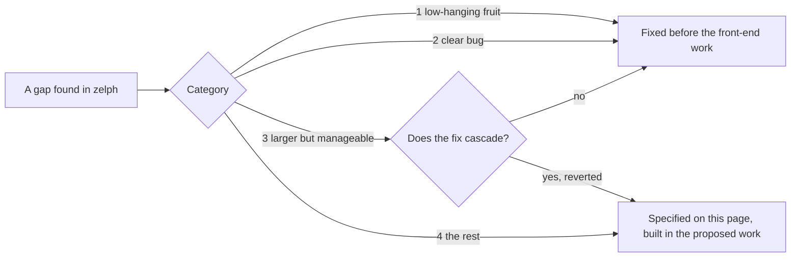

# What zelph Still Needs

The ACE front end consists of a set of standard-library modules that turn English sentences into zelph facts, rules, and questions; the actual reasoning process belongs to zelph. Almost every component these modules need from the engine has already been built for this purpose and is included in zelph 1.1.0 ([What zelph Already Provides](foundation.md)). This page specifies what still needs attention: seven engine items where today's zelph behaves in a way the front end must not depend on, and whose fix would reach too deep into the engine to be handled incidentally. Implementing these is included in the proposed work.

None among the seven holds the front end up. For each, the specification assigns to the first version of the front end (v1) a way to live without the fix: a sentence that would depend on the missing behaviour is refused under the name of its construct, the mapping from sentences to zelph is written so it avoids the flaw entirely, or a cost is accepted and documented. A fix subsequently lifts a refusal, removes a constraint on the mapping, removes a cost, or – in a single instance, Y2-P1 – ensures that an answer required by the specification is valid in every case rather than only in certain instances.

Each item below starts with an actual zelph session demonstrating the issue that occurs today. It then explains the significance of the item for zelph users and the front end, describes how v1 lives without it, and outlines the requirements a test can verify – what the fix must accomplish. It names the tests that will pin the fix and the risks that elevate it beyond a simple adjustment. The ids (K1-P1, Y2-P1, …) are the labels used to track these items in the specification and its decisions ([DEC-CAT4](decisions.md#dec-cat4)).

The most straightforward illustration of how the front end handles a capability that zelph does not possess is a refusal. A that-clause can contain a conditional. If the conditional includes variables, the front end stores it as a statement regarding a rule, which asserts nothing. If it contains none, today's zelph is unable to distinguish it from the same rule being asserted elsewhere (K1-P1), thus v1 refuses the sentence and provides the reason:

!!! example "Specified session — the behaviour this specification requires, not yet implemented"

    ```
    zelph> .import ace
    zelph> ace John believes that if a man waits then the man sleeps.

    zelph> ace John believes that if Mary waits then Bill sleeps.

    Error in line "ace John believes that if Mary waits then Bill sleeps.": Correct ACE, but zelph cannot use it [ace/unsupported]: sentence 1, line 1, column 28: a conditional without variables inside a that-clause ('waits'), construct sub/ground-conditional.
      John believes that if Mary <>waits then Bill sleeps.
      In zelph a rule without variables and the same rule mentioned in a statement can be one node, and the mention takes the rule out of force; this needs a change in zelph.
    ```

The first block is accepted and produces no output, just like any accepted statement. The subsequent block also conforms to valid ACE standards, yet it is refused before anything is written. The host names the block via its first line, and the message names the construct (`sub/ground-conditional`) and highlights the first simple condition within the conditional, enabling a user to discern which sentence is impacted and the reason for the refusal, while also allowing a test to anticipate the specific refusal. As is consistent throughout this specification, the wording of a message serves only as an example, whereas its layout and identifiers are normative ([Messages](block.md#messages)).

## How the Remaining Items Were Chosen

While the engine's functionalities for the front end were implemented, each gap that emerged – defects uncovered by the tests of the new features, deficiencies, absent functionalities – was categorized into one of four categories ([DEC-WORKMODE](decisions.md#dec-workmode)):

1. **Low-hanging fruit**: fixed immediately.
2. **Clear bugs**: fixed immediately, as zelph is released before the commencement of the proposed work on the front end.
3. **A more extensive fix that is clearly manageable**: executed without delay, provided it does not cascade. If a fix requires repeated iterations, it is reverted and treated as category 4.
4. **Everything else**: left unfixed, yet specified on this page with real sessions, as a prerequisite for the front end. Its implementation falls within the scope of the proposed work.

The amount of time a fix would require was not a criterion; what counted was whether it remains confined to the local scope.



The list of category-4 items is complete: K1-P1, K1-P2, L3-P1, Z2-P1, Z3-P1, Z3-P2 and Y2-P1. Among these, two are linked to a single root cause and a shared resolution. Regarding one item (L3-P1), an attempt at a fix was made and illustrates what "cascades" means: it correctly explained straightforward scenarios, disrupted pinned tests in three unrelated areas, and was subsequently undone. Additional insights regarding zelph that the front end does not depend on are recorded for zelph's own development; they are not prerequisites and are not listed here. Three architectural inquiries about the engine, which emerged toward the conclusion of this effort, have been resolved for zelph 1.1.0, hence they do not appear on this list: a rule authored using `zelph/fact` whose conclusion features a predicate that no condition binds is refused, provided it is still in force at the end of the outermost Janet evaluation that produced it, before a save or at the top of the next run ([DEC-FACT-RULE](decisions.md#dec-fact-rule)), a rule written with `zelph/mention` remains out of force until something claims it ([DEC-MENTION-RULE](decisions.md#dec-mention-rule)), and a name merge adheres to the content of the merged nodes ([DEC-MERGE-CONTENT](decisions.md#dec-merge-content)).

## The Seven Items at a Glance

| Id | What goes wrong today | Where the front end first meets it | v1 | What the fix brings |
|---|---|---|---|---|
| [K1-P1](#k1-p1-a-mention-switches-a-typed-ground-rule-off) | a statement that mentions a typed rule without variables and with a single condition removes that rule from force, and typing the rule again does not restore it | M8: a that-clause holding a conditional lacking variables | refused by id, `:sub/ground-conditional` | the refusal may be lifted |
| [K1-P2](#k1-p2-a-rule-generator-cannot-put-a-ground-rule-in-force) | a rule that derives another rule never puts a derived rule lacking variables in force, and a natively typed one takes a typed one-condition copy of that rule from force | M4: a nested conditional without variables ("If John waits then if Mary sleeps then Bill runs.") | flattened to one rule `(A, B) => C` | a switch can stay a switch |
| [Y2-P1](#y2-p1-a-rule-with-several-conclusions-is-applied-by-halves) | a rule having multiple conclusions, one of which is refused or contradicted, keeps the conclusions written before it, in an order determined by node IDs; beside a fresh variable every full run adds a witness | M4: "If … then A and B." | not avoided: the contradiction is reported, the partial result stays | all conclusions or none, in every order, and every run ends |
| [Z3-P1](#z3-p1-after-the-first-negated-condition-every-new-rule-costs-a-full-pass) | starting with the first rule containing a negated condition, every block that introduces a rule forces the next incremental run to perform a full pass over all rules | M4: the first "not provably" sentence | accepted: the answers are correct, though time is lost | incremental unless the new rule changes a negation level |
| [L3-P1](#l3-p1-a-statement-nested-in-a-conclusion-is-explained-as-an-input) | a statement nested in a rule's conclusion is derived, but `.explain` treats it as an input and `zelph/dependents` misses it | M6: events within conclusions; M9: justified answers and `ace-retract` | a constraint on the mapping: every nested atom is also written as a conclusion of its own | the constraint is removed |
| [Z3-P2](#z3-p2-a-firing-asserts-a-comma-list-it-was-only-handed) | a firing asserts the members of a comma list that its rule holds by node, which a typed statement does not do | every rule, from M4 | a constraint on the mapping: no comma list obtained from elsewhere is placed into a conclusion by node | the constraint is removed |
| [Z2-P1](#z2-p1-one-reading-of-a-patterns-objects-at-every-level) | a pattern's objects are matched injectively at the top level and via the subset reading within a statement; a join through a statement variable depends on the order of its conditions | only interoperation with native facts carrying multiple objects (M7, M8) | not reached: the front end writes one object per fact | one reading at each level, joins independent of condition order |

The decisions position K1-P1 and K1-P2 following v1 ([DEC-CAT4](decisions.md#dec-cat4)). They fix no order among the remaining five; the column titled "Where the front end first meets it" says from which milestone onward each would change what a user sees or what the mapping may do. For the order of the work as a whole, refer to [What zelph Still Needs, and Where It Fits](plan.md#what-zelph-still-needs-and-where-it-fits) in the work plan.

## How v1 Lives Without Them

Every engine capability utilized by the front end adheres to a single rule: it must be established before the front-end code that relies on it, and until its establishment, the front end refuses anything requiring it, identified by construct id, issuing a message belonging to the class "Correct ACE, but zelph cannot use it". The modules never contain a secondary method that circumvents the engine, nor do they feature a temporary fix that would become irrelevant upon an engine change. All capabilities listed originally have been implemented; the rule currently encompasses the seven items on this page and any additional findings from ongoing front-end work.

The responses vary across the seven items:

- **A refusal by id**: K1-P1. A that-clause holding a conditional lacking variables is refused as `:sub/ground-conditional` ([A Rule Inside a That-Clause](constructs.md#a-rule-inside-a-that-clause)).
- **A shape the mapping avoids**: K1-P2. A nested conditional devoid of variables is flattened into a single rule, which has the same meaning and needs no rule generator ([Nested Implications](semantics.md#nested-implications), [DEC-NESTED-IMP](decisions.md#dec-nested-imp)).
- **A constraint the mapping keeps**: L3-P1 and Z3-P2. Each atom nested within a conclusion is also written as a conclusion of its own; each comma list within a conclusion is one that the rule's own text writes ([From Sentences to the Graph](semantics.md)).
- **A cost that is accepted**: Z3-P1. Following the initial "not provably" sentence, a block introducing a rule incurs a full pass; the answers remain accurate.
- **A gap that stays visible**: Y2-P1. A firing involving a refused or contradicted conclusion keeps the conclusions written before it. The contradiction is always reported, and a user may enforce a block as all-or-nothing using the option `:atomic :consistent` ([The Option :atomic :consistent](block.md#the-option-atomic-consistent)), yet the partial result of a firing in a later run is not avoided.
- **Nothing to avoid**: Z2-P1. It arrives at the front end solely via native facts carrying multiple objects, which `ace` never writes.

## K1-P1 and K1-P2: A Record That a Rule Was Asserted

Both items share a single origin. zelph decides whether a `=>` statement qualifies as a rule *in force* by examining its surroundings: a `=>` fact that conforms to the structure of a rule is considered in force exactly when no other element in the graph mentions it (`Zelph::get_rules`, `is_mentioned`; refer to [Mentioning a Rule Is Not Asserting It](../logic.md#mentioning-a-rule-is-not-asserting-it)). Statements are hash-consed: identical text corresponds to a single node. Consequently, a typed rule devoid of variables (a *ground* rule) featuring one condition, alongside the identical ground rule embedded within another statement, constitutes a single node, and the graph is unable to track which of the two instances served as an assertion. The documentation already identifies the ground rule as the only form the test cannot distinguish. A rule containing variables remains unaffected: each statement defines its own variables, so a mention of such a rule results in a distinct node. Likewise, a ground rule whose conditions are expressed as a comma list, or the single-condition set that the front end constructs for its rules, is not impacted: such a condition list forms a node of its own within every statement that writes it, as [Mentioning a Rule Is Not Asserting It](../logic.md#mentioning-a-rule-is-not-asserting-it) documents for two statements that write the same comma list.

The required correction for both items is a **positive record indicating a rule was asserted**, written precisely at the instant the rule is asserted and read from that source. It is the planned work that [about.md lists as "A rule in force due to being asserted"](../about.md#where-the-logic-goes-next).

### K1-P1: A Mention Switches a Typed Ground Rule Off

#### What goes wrong today

A ground rule is typed and fires. A subsequent statement *talks about* the identical rule, and the rule ceases to be in force. The fact it derived remains, yet `.explain` can no longer indicate its origin, and typing the rule again has no effect:

```
zelph> (a p b) => (c q d)
zelph> a p b
zelph+> C q D
Answer: c q d
zelph> x notes ((a p b) => (c q d))
zelph> .list-rules
No rules found.
zelph> .explain (c q d)
c q d  [axiom]
zelph> (a p b) => (c q d)
zelph> .list-rules
No rules found.
```

The rule fires when `a p b` is encountered: the query `C q D` (with uppercase letters representing variables) yields the response `c q d`, and the `+` in the prompt marks a run that hid its derivations ([The mark in the prompt](../rules.md#the-mark-in-the-prompt)). After `x notes (…)` mentions the rule, `.list-rules` returns nothing, and `.explain` assigns the label `[axiom]` to the derived fact, as defined by `.help .explain` to mean "an input fact, or a derived one whose rule is gone". Typing the rule again produces no alteration.

In the alternative order, the typed rule never comes into force in any way:

```
zelph> x notes ((a p b) => (c q d))
zelph> (a p b) => (c q d)
zelph> a p b
zelph> .list-rules
No rules found.
zelph> C q D
```

The identical test functions in reverse as well. A rule that has not been asserted comes into force once its final mention is eliminated, since afterwards, nothing mentions it anymore:

```
zelph> x notes ((a p b) => (c q d))
zelph> .list-rules
No rules found.
zelph> .prune-facts x notes ((a p b) => (c q d))
Pruned 1 matching facts.
Consider running .cleanup.
zelph> .list-rules
Listing all rules:
------------------------
(a p b) => (c q d)
------------------------
```

That behaviour is documented (janet.md, [Reasoning incrementally](../janet.md#reasoning-incrementally)), and it shows the key idea: whether a rule is in force is determined by its context, so any alteration to the surroundings alters its status. A rule operating on rules reaches the same result without requiring any statement typed by hand. The rule below derives a statement regarding every rule it meets, and from that moment onward, the manually typed ground rule ceases to fire:

```
zelph> (a p b) => (c q d)
zelph> (G => H) => ((G => H) is seen)
(((a p b) => (c q d)) is seen) ⇐ ((a p b) => (c q d))
zelph> a p b
zelph> C q D
zelph> .list-rules
Listing all rules:
------------------------
(G => H) => ((G => H) is seen)
------------------------
```

A rule that includes variables remains unaffected, as its mention is a different node:

```
zelph> (X ~ man) => (X ~ mortal)
zelph> x notes ((X ~ man) => (X ~ mortal))
zelph> bob ~ man
(bob ~ mortal) ⇐ (bob ~ man)
zelph> S ~ mortal
Answer: bob ~ mortal
```

#### Why it matters

For zelph users, the effect is unannounced. No indicator signals that the rule went out of force, the derived fact continues to respond, and `.explain` calls it `[axiom]`. A knowledge base that tracks which individual suggested which ground rule (`x notes …`, `alice proposes …`) disables the very rules it documents.

For the front end, ACE employs reporting and modal constructs where the that-clause holds a conditional: "John believes that if Mary waits then Bill sleeps." alongside the identical conditional stated directly, "If Mary waits then Bill sleeps." The front end translates the initial instance into a mention, encoded via `zelph/mention` within the opaque statement `John believes …`, while the latter is mapped to a rule ([Modality and That-Clauses](semantics.md#modality-and-that-clauses)). When proper names appear on both sides, the conditional is considered ground. In the front end's own spelling, the two do not interfere: each rule with a single condition is constructed as a one-element condition set ([DEC-RECORD-SINGLE](decisions.md#dec-record-single)), a ground rule in that form expressed through `zelph/mention` becomes a distinct node per statement, and a `=>` written using `zelph/mention` remains not in force until something claims it ([DEC-MENTION-RULE](decisions.md#dec-mention-rule)), thus the mention neither switches the asserted rule off nor puts itself in force. The same conditional in plain notation, however, whether natively typed or held in a loaded graph, constitutes a single node shared between the asserted rule and the mention, and the mention removes the rule from force; likewise, the switch form of K1-P2 below fails for this same reason. Both need the record, hence v1 refuses a ground conditional inside a that-clause by construct id (`:sub/ground-conditional`, the opening session of this page; [DEC-MODAL](decisions.md#dec-modal)), and lifting this refusal needs this item.

#### What a fix must achieve

- The status of being in force belongs to the rule, recorded at the moment of assertion and retrieved from there. A rule becomes asserted through typing it, via `zelph/dedup-rule` and other rule builders, through the C ABI's `zelph_rule`, or by a firing that writes a rule; `.load` recovers the stored record. Mentioning a rule, or eliminating what mentions it, never changes whether it is in force.
- A `=>` produced by `zelph/fact` or the C ABI's `zelph_fact` is asserted when nothing mentions it at the moment zelph already examines that rule's conclusion for an unbound predicate ([DEC-FACT-RULE](decisions.md#dec-fact-rule)): at the end of the outermost Janet evaluation (a `%` block, a keyword handler, a script), before a save and before any run; for `zelph_fact`, before a save and before any run. A rule generator built from direct `zelph/fact` invocations thereby asserts its outer rule and not the inner one, which its outer statement mentions by then, as is the case today. A `=>` written with `zelph/mention` or `zelph_mention` is never asserted by that call ([DEC-MENTION-RULE](decisions.md#dec-mention-rule)).
- In the first two sessions described, `.list-rules` displays `(a p b) => (c q d)` after the mention, the rule fires, and `.explain (c q d)` shows the derivation originating from `a p b`. Typing a rule that a statement already mentions places it in force.
- A rule that is solely mentioned stays out of force, as is currently the case: `x notes ((a p b) => (c q d))` alone yields no derivation, and its ground components remain as patterns. In the third session, removing the mention leaves the rule out of force.
- A rule governing rules that mentions a typed ground rule (the fourth session) maintains that rule in force.
- Networks preserved before the existence of the record require no migration; older networks are irrelevant to this work ([DEC-WORKMODE](decisions.md#dec-workmode)). Loading such a network may derive the record once from today's test ("rule form, and nothing mentions it"), yet no requirement mandates this.
- The record survives `.save` and `.load`, a predicate slice (`.save-predicates`) and a name merge where the rule persists (a merge follows the content of the merged nodes, so a ground rule merged with an atom survives as the rule, whereas a rule with variables merges with no other node; [DEC-MERGE-CONTENT](decisions.md#dec-merge-content)), and `.cluster-drop` reverts it when it was written within the dropped cluster.

#### Tests that will pin it

- `test_explain.cpp`: the current cases involving a typed rule that is also mentioned transition from "not in force" to "in force"; each is rewritten under a fresh name accompanied by a comment (the rewrite rule appears in [Rules for Implementing These Items](#rules-for-implementing-these-items)).
- Additional, in `test_rule_patterns.cpp` adjacent to "rule patterns: a part asserted before the mention stays a claim": "a mention of a typed ground rule leaves it in force" (in both sequences), "typing a mentioned ground rule puts it in force", "a rule that is only mentioned stays out of force".
- Additional, in `test_reasoning.cpp` alongside the `.remove-rules` cases: eliminating the mentioning statement has no effect; `.remove-rules` targets only asserted rules.
- Additional guards, green both before and after the correction, in `test_rule_patterns.cpp` adjacent to "rule patterns: a mention built with zelph/fact claims its parts": a `=>` expression created using `zelph/fact` and mentioned by nothing at the end of the `%` block is in force, while the inner rule of a generator built from direct `zelph/fact` invocations is not. These fail if the record is written at the `zelph/fact` invocation rather than at the check point. The cases in `test_opaque.cpp` that pin a `=>` crafted with `zelph/mention` as out of force until it is claimed stay green.
- `test_clusters.cpp`, `test_predicate_slice.cpp`, `test_name_merge.cpp`: the record spanning a drop, a slice, and a merge.

### K1-P2: A Rule Generator Cannot Put a Ground Rule in Force

#### What goes wrong today

A rule can produce another rule: a rule generator, or a rule within a switch ([Rules That Derive Rules](../logic.md#rules-that-derive-rules)). If the inner rule holds no variable, it never comes into force. The instance that the firing would assert is precisely the node that the generator's own text holds, and the generator mentions it:

```
zelph> (X go Y) => ((t p b) => (j r s))
zelph> t go k
zelph> t p b
zelph> J r S
zelph> .list-rules
Listing all rules:
------------------------
(X go Y) => ((t p b) => (j r s))
------------------------
zelph> .explain ((t p b) => (j r s))
(t p b) => (j r s)  [rule mentioned; not in force]
```

`t go k` and `t p b` are both satisfied, but `J r S` yields no response; `.list-rules` displays solely the generator, while `.explain` labels the inner rule as `[rule mentioned; not in force]`. The generator additionally deactivates a previously typed ground rule, which is once more K1-P1, accessed through a rule rather than a statement:

```
zelph> (mary sleeps nil) => (bill runs nil)
zelph> (john waits nil) => ((mary sleeps nil) => (bill runs nil))
zelph> mary sleeps nil
zelph> john waits nil
zelph> B runs N
zelph> .list-rules
Listing all rules:
------------------------
(john waits nil) => ((mary sleeps nil) => (bill runs nil))
------------------------
```

`bill runs nil` is derived by neither rule, even though the typed rule alone would be sufficient to derive it. [Rules That Write Rules](../rule-generators.md#reference-what-is-substituted) documents this particular form as the one that cannot be distinguished.

#### Why it matters

For zelph users, a switch over a ground rule – "when the alarm is armed, an open door raises it" – stands as an obvious application of a rule generator, and it silently has no effect.

For the front end, a conditional with nesting where the outer if-clause establishes no referent functions as a switch: "If John waits then if Mary sleeps then Bill runs." v1 keeps a switch as a rule generator provided the inner rule includes a variable, and flattens every fully ground nested conditional into a single rule `(A, B) => C`, maintaining identical semantics ([Nested Implications](semantics.md#nested-implications), [DEC-NESTED-IMP](decisions.md#dec-nested-imp)):

!!! example "Specified session — the behaviour this specification requires, not yet implemented"

    ```
    zelph> .import ace
    zelph> ace If John waits then every man sleeps.
    If John waits then if Mary sleeps then Bill runs.
    John waits. Mary sleeps. Bob is a man.
    Does Bill run? Does Bob sleep?

    Answer: Yes. Bill runs.
    Answer: Yes. Bob sleeps.
    ```

    The zelph associated with this block (`ace/zelph-of`; a question writes nothing and appears as a comment):

    ```
    (*{(John waits nil)} ~ conjunction) => ((*{(X ~ man)} ~ conjunction) => (X sleeps nil))
    ((John waits nil), (Mary sleeps nil)) => (Bill runs nil)
    John waits nil
    Mary sleeps nil
    Bob ~ man
    # yes/no: Bill runs nil
    # yes/no: Bob sleeps nil
    ```

The initial sentence functions as a generator: upon John's wait, it writes the rule "every man sleeps", which subsequently governs Bob during the same run ([Nested Conditionals](sessions.md#nested-conditionals) provides further detail). The subsequent sentence would serve as a generator for a ground rule, which never fires, thus it is written as a single, flat rule. Flattening keeps the front end's own text separate from the first session of this item. It does not influence the second, which emerges solely between rules typed natively: a generator typed natively continues to take the same ground rule typed earlier from force, whereas if either of the two is built from Janet, as the front end builds both, that rule stays in force. With the record, a ground switch might persist as a switch, the shape whose rules appear solely while its condition remains valid, which is precisely what is required for defaults and queries posed under an assumption.

#### What a fix must achieve

- A firing that derives a ground rule puts that rule in force (it writes the record of K1-P1), even if the generator's own text holds the same node. During the first session `j r s` is derived once `t go k` and `t p b` hold, and `.list-rules` lists `(t p b) => (j r s)`.
- Before the generator fires, the inner rule is not in force, as is the case today.
- A generator never takes a typed rule from force: in the second session, `bill runs nil` is derived, and both rules appear in the list.
- Eliminating the generator (via `.remove`, pruning commands, or `.cluster-drop`) does not put a merely mentioned inner rule in force nor does it take an asserted one out of force.

Open for the implementing work on K1-P2: whether removing the fact that made a switch fire (`John waits nil` in the session above) also retracts the record of the rule that was put in force by that firing. Today, a derived fact remains even after its premise is removed, and the specification has not yet determined whether a derived rule adheres to this persistence or is withdrawn alongside its condition.

#### Tests that will pin it

- `test_derived_rules.cpp`, beside "derived rules: a transitivity generator chains the relation it names": "a generator puts a ground inner rule in force when it fires", "a ground inner rule is not in force before the generator fires", "a generator leaves a typed copy of its ground inner rule in force".
- `test_rule_patterns.cpp`: the ground parts of the inner rule persist as patterns until a firing claims them; the existing pins on generated rules stay green.
- `test_explain.cpp`: the label `[rule mentioned; not in force]` applied to the inner rule before the generator fires, and the derivation of `j r s` via the generated rule after the event.
- `test_reasoning.cpp`: every path that removes a generator leaves the in-force state unchanged.

### Risks and Size of the Record

- **Every place that asserts a rule.** The record must be written at each location where a rule is asserted, and never at a mention. Currently, approximately twelve locations reference "in force" today. Omitting a site leaves a rule out of force; including an extra one activates a mere proposal.
- **The firing that rebuilds a rule.** A firing that writes a rule may reconstruct it using renamed variables (`reasoning_deduce.cpp`, `existing_rule`, `build_rule`, `keep()` and its ground corner). An earlier effort to interpret rule-pattern marks rather than mentions in that context caused the test "derived rules: a derived rule may derive a rule in turn" to hang. An experiment outside the tree comes first. For K1-P2, the firing must write the record without building a node, and the semi-naive delta must offer the newly asserted ground rule to the next pass, even though no node was created.
- **Removals.** Today, a removal can bring a rule into force, and the incremental run includes specific cases for this (`test_script_run.cpp` "run-delta: a rule whose last mention was removed sees the older facts" and related tests). Under the record, such a removal has no effect, so these cases are intentionally rewritten.
- **Retraction.** A ground rule that a firing switched into force cannot be distinguished, afterwards, from the same rule typed, unless the record says which it was. The open point above determines whether this distinction is required.
- **Documentation.** Around ten places in the documentation are modified: logic.md's "nothing has to be remembered", the `.explain` labels, rule-generators.md, janet.md, capi.md, rust.md, and several `.help` texts.
- **Size (an estimate):** 300-450 engine lines, roughly 20 new and 10 rewritten test cases, approximately ten documentation places; three to five days for both items combined. The estimate was made while a migration of older files was still planned; without that migration, the effort is no greater than this.

## Y2-P1: A Rule With Several Conclusions Is Applied by Halves

### What goes wrong today

A rule can yield multiple outcomes simultaneously: "if X is a man and X is an adult, then X is a person and X is not a woman". zelph encodes this rule as a single `=>` fact, where the objects represent its consequences ([Several Consequences](../logic.md#several-consequences)), and upon firing for a specific binding, the rule writes each consequence sequentially. A consequence may be refused while it is written: `fact()` refuses it (a set constant cannot be extended, subject and object are identical, …), or the engine predicts a contradiction, since the consequence refutes a fact claimed as true. A refused consequence undoes what it built itself, yet the overall firing remains intact:

- each consequence written **before** the refused one remains, including its line of derivation;
- no consequence **after** it is ever pursued.

The sequence of consequences does not reflect the order in which the author wrote them. Instead, it reflects the sequence in which zelph holds them, which is determined by node ids; thus, an unrelated statement typed earlier may alter the order. The two sessions below type the identical rule and differ by just one line: `kim ~ man` typed first:

```
zelph> pat ~ man
zelph> pat ~ adult
zelph> pat ~ woman
zelph> (X ~ man, X ~ adult) => (X ~ person) ((X ~ woman) ~ refuted)
! ⇐ {(pat ~ man) (pat ~ adult)}
Found one or more contradictions!
zelph> S ~ person
```

```
zelph> kim ~ man
zelph> pat ~ man
zelph> pat ~ adult
zelph> pat ~ woman
zelph> (X ~ man, X ~ adult) => (X ~ person) ((X ~ woman) ~ refuted)
(pat ~ person) ⇐ {(pat ~ man) (pat ~ adult)}
! ⇐ {(pat ~ man) (pat ~ adult)}
Found one or more contradictions!
zelph> S ~ person
Answer: pat ~ person
```

The contradiction is reported in both sessions (`!` alongside its premises). The derivation lines show the order of the firing: in the first session, the refutation of `pat ~ woman` comes first, meets the claimed fact, and as a result, `pat ~ person` is never attempted; in the subsequent session, `pat ~ person` is written first and stays. Whether zelph determines Pat to be a person depends on Kim. A refusal from `fact()` operates identically. In this case, the consequence `(X q Y) says (X in {c d})` would extend the set constant `{c d}` ([Set constants](../concepts.md#set-constants)); the alternate consequence, `a ok b`, is derived and persists, whereas `a q b`, which the refused consequence encloses, is withdrawn:

```
zelph> a p b
zelph> b ~ known
zelph> (X p Y, Y ~ known) => (X ok Y) ((X q Y) says (X in {c d}))
(a ok b) ⇐ {(b ~ known) (a p b)}
! ⇐ {(b ~ known) (a p b)}
   └─ refused: a set constant cannot be extended -- {c d} IS its members. Write the collection literal @{...} for a container that membership can grow.
Found one or more contradictions!
zelph> S ok O
Answer: a ok b
zelph> S q O
```

**With a fresh variable, the run never reaches a stable state.** A variable that only the consequences name is considered fresh and existential: the rule makes a new node for it, serving as a witness, unless an existing node already makes *every* consequence a fact ([Fresh Variables](../logic.md#fresh-variables-generative-rules)). Whenever another consequence is always refused, that test fails perpetually, causing each firing to create a new witness and write the earlier consequence again. Under the default configuration, each run, and with auto-run each input line, including a query, introduces one more:

```
zelph> pat ~ man
zelph> pat ~ woman
zelph> pat ~ adult
zelph> (X ~ man, X ~ adult) => (X has M) ((X ~ woman) ~ refuted)
(pat has ??) ⇐ {(pat ~ man) (pat ~ adult)}
! ⇐ {(pat ~ man) (pat ~ adult)}
Found one or more contradictions!
zelph> S has O
Answer: pat has ??
(pat has ??) ⇐ {(pat ~ man) (pat ~ adult)}
zelph> S has O
Answer: pat has ??
Answer: pat has ??
(pat has ??) ⇐ {(pat ~ man) (pat ~ adult)}
zelph> S has O
Answer: pat has ??
Answer: pat has ??
Answer: pat has ??
(pat has ??) ⇐ {(pat ~ man) (pat ~ adult)}
```

With `.semi-naive off`, each pass derives a new fact, causing `.run` never to end; three single passes (`.run-once`) show the growth, each saying that additional iterations are required:

```
zelph> .auto-run
Auto-run is now disabled.
zelph-> .semi-naive off
Semi-naive evaluation: off
zelph-> a p b
zelph-> (X p Y) => (X ok Z) ((Z q Y) says (X in {c d}))
zelph-> .run-once
Starting reasoning with 24 worker threads.
--- Reasoning iteration 1 (single pass) ---
(a ok ??) ⇐ (a p b)
! ⇐ (a p b)
   └─ refused: a set constant cannot be extended -- {c d} IS its members. Write the collection literal @{...} for a container that membership can grow.
Reasoning complete. Total unification matches processed: 1. Total contradictions found: 1.
Found one or more contradictions!
Warning: Additional reasoning iterations are required, but have been suppressed.
Reasoning summary: 1 matches processed, 1 contradictions found.
Parallel unifications activated for 1 distinct fixed relations.
Reasoning complete in 0h0m0.000s – 1 matches processed, 1 contradictions found.
Ready.
zelph-> .run-once
Starting reasoning with 24 worker threads.
--- Reasoning iteration 1 (single pass) ---
(a ok ??) ⇐ (a p b)
Reasoning complete. Total unification matches processed: 1. Total contradictions found: 0 (1 already recorded in this network).
Warning: Additional reasoning iterations are required, but have been suppressed.
Reasoning summary: 1 matches processed, 0 contradictions found (1 already recorded in this network).
Parallel unifications activated for 1 distinct fixed relations.
Reasoning complete in 0h0m0.000s – 1 matches processed, 0 contradictions found (1 already recorded in this network).
Ready.
zelph-> .run-once
Starting reasoning with 24 worker threads.
--- Reasoning iteration 1 (single pass) ---
(a ok ??) ⇐ (a p b)
Reasoning complete. Total unification matches processed: 1. Total contradictions found: 0 (1 already recorded in this network).
Warning: Additional reasoning iterations are required, but have been suppressed.
Reasoning summary: 1 matches processed, 0 contradictions found (1 already recorded in this network).
Parallel unifications activated for 1 distinct fixed relations.
Reasoning complete in 0h0m0.000s – 1 matches processed, 0 contradictions found (1 already recorded in this network).
Ready.
zelph-> S ok O
Answer: a ok ??
Answer: a ok ??
Answer: a ok ??
```

Within `.semi-naive check`, the operational state used by zelph's test utilities to execute each case, the verification passes fail to achieve quiescence. A run of the final rule under this mode, stopped by a time limit after five seconds, completed more than a thousand verification passes; each reported two facts "missed by delta seeding": the new witness's `a ok ??`, and `?? q b`, the nested part of the refused consequence, which that consequence had previously withdrawn.

`zelph/run-delta`, invoked by the front end following each block that writes, does not fire the previous rule again on its own; instead, each full run does so: `.run`, the automatic run triggered after each input line, and each `.run-delta` that reverts to a full pass (refer to Z3-P1 below).

### Why it matters

ACE texts frequently express rules having multiple conclusions: "If a man owns a car then he drives it and he insures it." The front end maps each such sentence into a single zelph rule with several consequences, and a reader of the document anticipates the semantics of logic: the conclusions jointly hold, or the rule remains silent regarding this case. The specification mandates precisely this – "If … then A and B." where B being refused leads to neither ([DEC-FIRING](decisions.md#dec-firing)). The report adheres to [The Report of a Derived Contradiction](block.md#the-report-of-a-derived-contradiction):

!!! example "Specified session — the behaviour this specification requires, not yet implemented"

    ```
    zelph> .import ace
    zelph> ace Kim is a man. Pat is a man. Pat is an adult. Pat is a woman.
    If a man is an adult then the man is a person and the man is not a woman.
    Is Pat a person?

    Contradiction [ace/contradiction-derived]: these sentences do not hold together:
      "If a man is an adult then the man is a person and the man is not a woman." (block 1, sentence 5)
      "Pat is a man." (block 1, sentence 2)
      "Pat is an adult." (block 1, sentence 3)
      "Pat is a woman." (block 1, sentence 4)
    Answer: It is not provable that Pat is a person.
    ```

    This block generates the rule (`ace/zelph-of`), identical to the one used in the native sessions located above:

    ```
    ((X ~ man), (X ~ adult)) => (X ~ person) ((X ~ woman) ~ refuted)
    ```

Regardless of whether the first sentence is present, the contradiction remains reported, and Pat fails to be concluded as a person. On today's engine, the answer to the question would hinge on the stored order of the two consequences, just as observed in the native sessions above, and an unrelated sentence can change that order. A controlled language is proposed with the promise of predictable meaning; an answer that shifts due to an unrelated sentence concerning Kim cannot be explained to the text's author.

Existentials worsen the situation. ACE conclusions frequently bring in new referents ("then he has a mother", "then there is a garage that he rents"), and zelph represents these via fresh variables. Every such sentence whose other conclusion is refused or fact-contradicting causes the session to gain an additional witness with each full run – silently following the first report – and the answers to "What does Pat have?" increase in number. With `.semi-naive check` and with `.semi-naive off`, a user setting, such a run never ends.

For users of zelph, the same applies to every rule that features multiple consequences: a contradiction or a refusal leaves a partial result whose content depends on node numbering, and introducing a fresh variable next to it turns a reported mistake into a run that never ends.

### How v1 lives with it

No construct id singles these sentences out: the status of a conclusion as refused or contradicted is determined by the data, not by the sentence itself, meaning a refusal based on id would need to refuse every rule containing two conclusions. v1 lives with the half-applied firing (DEC-FIRING). A contradiction is always reported, and no test pins today's partially applied outcome as the intended result: the engine's tests leave the sibling of a refused consequence as unpinned, except for the specific case named below, which is rewritten with the fix. A user aiming to avoid any partial result from a block can set `(ace/option :atomic :consistent)` (from M4): if a block's internal inference meets a contradiction that was not previously reported, the entire block is then rejected, and no part of it is written ([The Option :atomic :consistent](block.md#the-option-atomic-consistent)). This applies solely to the block's own inference, not to subsequent full runs where a witness grows.

### What a fix must achieve

- **A firing constitutes a single unit.** It writes all of its consequences or none at all. If any consequence is refused – via `fact()`, at the top level or within nested structures, during the claim walk, or by a construction that constructs a rule – or if the engine forecasts a contradiction for it (a refutation of a claimed fact), then absolutely nothing from the firing remains: no other consequence, no nested component, no new witness, no revoked rule-pattern mark, no applied refutation, no member added to a rule's bucket term, and no rule that a construction consequence built.
- **The outcome is independent of the stored sequence of consequences.** Neither Pat session derives `pat ~ person`; `S ~ person` yields no response in either case.
- **The report remains unaltered.** A single `!` line listing the premises, and, in case of a refusal, the `└─ refused: …` reason for the refused consequence; "Found one or more contradictions!"; the contradiction record precisely where today’s engine writes it. No derivation line is emitted for a consequence that was withdrawn, no `:derived` entry appears in `(zelph/run :quiet :derived)`, no `deduction` line is present in `.run-export`, and a dropped firing does not contribute to the advancement of the run.
- **Each run concludes.** A firing that is always refused contributes nothing: the node count remains unchanged regardless of how many `.run` invocations occur, under `.semi-naive on`, `off` and `check`, and with `.parallel` enabled or disabled. `off` and `check` achieve their fixpoint, and check mode reports no "missed by delta seeding" for what a dropped firing produced.
- **All other aspects remain the same.** A firing with a single consequence operates as it does today, as do a firing with no refusal, the termination guard for fresh variables, and the derivation lines of a firing that finishes successfully. Where the lines of a firing are displayed only after all consequences have been written, rather than after each, that sequence is explicitly documented.

### Tests that will pin it

- `test_sets.cpp`, beside "sets: a consequence refused for a nested extension leaves nothing it built": "sets: a firing with a refused consequence writes none of its consequences", with SUBCASEs "a flat sibling" (the set-constant session: `S ok O` empty) and "a fresh witness in a sibling, under each evaluation mode" (`.semi-naive on`, `off`, `check`: the node count unchanged over two `.run`, bounded by `.run-once` first, so that a regression fails instead of hanging the suite).
- `test_contradiction_records.cpp`, beside "refuted marking: a derived statement whose claim is refused midway keeps nothing of it": "refuted marking: a firing that refutes a claimed fact derives none of its other consequences", with SUBCASEs "the refutation stored first" and "the refutation stored second" (the two Pat sessions; each checks the stored order on the rule's echo, so that the pair keeps covering both orders) and "a fresh witness beside the refutation" (the `X has M` session: `S has O` empty after three lines).
- `test_script_run.cpp`, beside "zelph/run: :quiet says why the engine refused to build a consequence": one contradiction entry with the refusal and no `:derived` entry for the sibling.
- `test_derivation_export.cpp`, beside "run-export: a refused deduction is marked as refused, a real contradiction is not": no `deduction` line for the sibling.
- `test_derived_rules.cpp`, "derived rules: a construction refuses to extend a set constant as a firing does": its SUBCASE "a value of the rule it builds beside a membership the generator writes" pins today's half-application (the built rule `(a q b) => (z has {c d})` is listed and fires although its sibling `a in {c d}` is refused). It is rewritten under a new name, with one rule listed and `a q b` answering nothing. The refused SUBCASEs of "sets: a firing keeps a set constant as written beside a membership of a variable" gain `S has O` and `S says O` empty.
- The Jacobian performance guard stays green with its baselines unchanged (its workload has no refused firing).

### Risks

- **Cost on the hot path.** Today a scratch cluster (which journals what a consequence generates and merges upon the consequence's success) opens solely for a consequence capable of constructing or modifying something before its own refusal: one that nests a part, writes a mention or a marking, or holds a fresh variable. A flat consequence incurs no cost. An atomic firing must take back a flat consequence written before a subsequent refusal, meaning either every firing involving multiple consequences opens a scratch – the maths stack contains numerous such rules, and each node that a scratch records acquires the cluster lock – or the firing predicts every refusal before writing anything, duplicating `fact()`'s refusal conditions in a secondary location that will diverge from the original. In either way, a timed comparison on the maths workloads becomes necessary.
- **Output order.** Printing the derivation lines once every consequence is written alters their placement relative to other firings' lines and to "refused" lines; documentation transcripts demonstrating rules with several consequences are replayed.
- **Lock scope and parallel runs.** Each consequence takes the network lock today; an atomic firing keeps its writes open across all consequences. Under `.parallel`, a worker's unification reads adjacency without that lock, allowing it to bind to a fact created by a refused firing and about to be discarded; an atomic firing would widen that window from a single consequence to the entire firing, necessitating that the fix addresses this expansion.
- **One journal across the firing.** The claim walk of an earlier consequence revokes pattern marks and applies refutations, which a later refusal must re-establish. A fresh witness is kept today when something external to its consequence's scratch holds it (an earlier consequence), which a scratch encompassing the entire firing reverses. A consequence that constructs a rule performs its construction using its own scratch within the firing's scratch. The bucket terms populated during this run, the semi-naive delta, the negation records, and the contradiction records all see the drop.
- **A change of meaning for contradictions.** Today a contradiction predicted for one consequence keeps the consequences written before it; afterwards, the whole firing is taken back, even where a user relied on "report the contradiction, keep the rest". logic.md must explicitly state this, and every documented example featuring a contradictory consequence adjacent to another must be re-run.

## Z3-P1: After the First Negated Condition, Every New Rule Costs a Full Pass

### What goes wrong today

zelph performs incremental reasoning: following a run, `.run-delta` (and `zelph/run-delta`, invoked by the front end after each block that writes) begins with the facts that have arrived since the prior run, and refrains from re-evaluating older rules against older facts ([Reasoning incrementally](../janet.md#reasoning-incrementally); [Reasoning that costs the change, not the graph](foundation.md#reasoning-that-costs-the-change-not-the-graph) lists what was built for this purpose). A newly added rule since the last run undergoes a single classic pass of its own, ensuring it sees the older facts, and the run stays incremental. This behaviour persists only as long as no rule in force includes a negated condition (negation as failure, `¬(…)`). Once the first such rule appears, any block that introduces a new rule makes the subsequent `.run-delta` execute a full pass across every rule, regardless of what the new rule reads or writes. In the session below, `.parallel` and `.auto-run` switch both settings off, and a Janet loop types 20 facts:

```
zelph> .parallel
Parallel processing is now disabled.
zelph> .auto-run
Auto-run is now disabled.
zelph-> .semi-naive on
Semi-naive evaluation: on
zelph-> .deductions off
Deduction printing mode: off
  No derivations are printed; a run says how many it hid and marks the prompt with '+' (e.g. "zelph+> ").
zelph-> %(for i 0 20 (zelph/fact (string "i" i) "~" "man"))
zelph-> (X ~ man) => (X ~ mortal)
zelph-> .run
Starting reasoning with 24 worker threads.
Reasoning complete. Total unification matches processed: 20. Total contradictions found: 0.
Note: 20 deductions were hidden.
Reasoning summary: 20 matches processed, 0 contradictions found.
Parallel unifications activated for 0 distinct fixed relations.
Reasoning complete in 0h0m0.000s – 20 matches processed, 0 contradictions found.
Ready.
zelph+-> (X ~ mortal) => (X ~ fallible)
zelph+-> .run-delta
Starting reasoning with 24 worker threads.
Reasoning complete. Total unification matches processed: 20. Total contradictions found: 0.
Note: 20 deductions were hidden.
Reasoning summary: 20 matches processed, 0 contradictions found.
Parallel unifications activated for 0 distinct fixed relations.
Reasoning complete in 0h0m0.000s – 20 matches processed, 0 contradictions found.
Ready.
zelph+-> ((X ~ man), ¬(X waits nil)) => (X ~ impatient)
zelph+-> .run-delta
Incremental run not applicable (no previous run, bulk load, changed rule set, or non-semi-naive strategy) - running a full pass.
Starting reasoning with 24 worker threads.
Reasoning complete. Total unification matches processed: 80. Total contradictions found: 0.
Note: 20 deductions were hidden.
Reasoning summary: 80 matches processed, 0 contradictions found.
Parallel unifications activated for 0 distinct fixed relations.
Reasoning complete in 0h0m0.001s – 80 matches processed, 0 contradictions found.
Ready.
zelph+-> (X ~ fallible) => (X ~ human)
zelph+-> .run-delta
Incremental run not applicable (no previous run, bulk load, changed rule set, or non-semi-naive strategy) - running a full pass.
Starting reasoning with 24 worker threads.
Reasoning complete. Total unification matches processed: 80. Total contradictions found: 0.
Note: 20 deductions were hidden.
Reasoning summary: 80 matches processed, 0 contradictions found.
Parallel unifications activated for 0 distinct fixed relations.
Reasoning complete in 0h0m0.000s – 80 matches processed, 0 contradictions found.
Ready.
zelph+-> bob ~ man
zelph+-> .run-delta
Starting reasoning with 24 worker threads.
Reasoning complete. Total unification matches processed: 4. Total contradictions found: 0.
Note: 4 deductions were hidden.
Reasoning summary: 4 matches processed, 0 contradictions found.
Parallel unifications activated for 0 distinct fixed relations.
Reasoning complete in 0h0m0.000s – 4 matches processed, 0 contradictions found.
Ready.
```

Before the negating rule, the new rule `(X ~ mortal) => (X ~ fallible)` costs its own 20 matches. Following it, the new rule `(X ~ fallible) => (X ~ human)`, which reads and modifies no data that the negation `¬(X waits nil)` reads, incurs 80: each rule is matched against every fact once more, and the run explicitly states this ("Incremental run not applicable … running a full pass."). A block that introduces solely a fact (`bob ~ man`) stays incremental (4 matches). The work of the full pass corresponds to the extent of the whole rule set: here, fourfold the work of the new rule, on a loaded network, the size of the network.

### Why it matters

ACE turns most sentences into rules ("Every man is mortal.", "If a man is not provably married then the man is a bachelor."), and the front end executes `(zelph/run-delta :quiet)` following each block that writes ([DEC-RUN](decisions.md#dec-run), [When the Block Reasons](block.md#when-the-block-reasons)). A condition containing "not provably", ACE's negation as failure, is written as a negated condition `¬(…)`, and upon encountering its first such rule, the front end switches the negation records on permanently ([DEC-NAF-RECORDS](decisions.md#dec-naf-records)):

!!! example "Specified session — the behaviour this specification requires, not yet implemented"

    ```
    zelph> .import ace
    zelph> ace If a man is not provably married then the man is a bachelor.
    John is a man.

    zelph> ace Every man is mortal.
    Is John mortal?

    Answer: Yes. John is mortal.
    ```

    The zelph associated with the two blocks (`ace/zelph-of`; the question functions as a comment):

    ```
    ((X ~ man), ¬(X is married)) => (X ~ bachelor)
    John ~ man
    (*{(X ~ man)} ~ conjunction) => (X is mortal)
    # yes/no: John is mortal
    ```

The outcome remains unchanged whether or not the fix is applied; what shifts is the duration required by the second block. "Every man is mortal." writes `X is mortal`, which the negated condition `¬(X is married)` never accesses, thus altering no level of negation. Currently, it continues to cause the block's inference to perform a full pass over every rule. On a Wikidata slice where the front end's rules are applied (instance and subclass hierarchies containing 10⁵ to 10⁷ facts), each later sentence that ought to incur the cost of matching its own rule instead incurs a full pass across the network: estimated at seconds to minutes per sentence, rather than milliseconds. On such a graph, the interactive use the front end was designed for would vanish. For zelph users, the same limitation applies to every session that incrementally builds a rule set on a large graph once a rule with a negated condition is in force; the fallback note states this, yet provides no workaround.

v1 accepts the cost: the responses are accurate, albeit at a reduced pace ([DEC-NEG](decisions.md#dec-neg)).

### What a fix must achieve

- Following a block that introduces rules, a `.run-delta` remains incremental if the new rules do not alter any negation level: specifically, when no newly added rule outputs a pattern that a rule currently in force reads via a negated condition (either directly or via dependent rules), and when no new rule's own negated condition reads a pattern still being generated by the current run. In the session illustrated, the block introducing `(X ~ fallible) => (X ~ human)` matches 20 instances, emits no fallback note, and derives `iN ~ human` for each `iN`; the block adding the negating rule itself only matches that rule's extent (its classic pass observes older facts), not all rules.
- A newly introduced rule that does change a level keeps today's behaviour: it triggers a note and a full pass, or a recomputation starting from the lowest modified level upward, ensuring that any conclusion drawn under a negation that no longer applies is handled identically to how a full run would process it. Even when `(X ~ mortal) => (X waits nil)` is added beside the negating rule, it still reports the defeat of `iN ~ impatient` under `.negation-records on`, which the front end maintains from its first "not provably" rule, as it does today (a defeated conclusion is reported, never withdrawn: DEC-NAF-RECORDS).
- The decision process consults the levels the engine already calculates (`(zelph/strata)`, indexed by pattern; see [Negation levels](../janet.md#negation-levels)) and costs no more than a single traversal of the rules in force per block, just as today's check does.
- A new rule whose predicate is a variable, a rule over predicates, a rule featuring a path condition, or a rule located within a non-stratifiable component is considered to change the levels.
- Check mode (`.semi-naive check`) finds no completeness violation across any of these runs.

### Tests that will pin it

- `test_script_run.cpp` "run-delta: a rule added since the last run sees the older facts": its SUBCASE "with a negating rule present it is a full pass" pins today's fallback for a new rule that changes no level and is rewritten under a new name; "with a negating rule present that the new rule leaves alone, it stays incremental" (no note, the new rule's matches only, its conclusions derived); new SUBCASEs "a new rule that writes what a negation reads is a full pass" (the note, and the defeat of the conclusion reported) and "a new negating rule is matched alone".
- The identical pair in "run-delta: a rule an import brings sees the older facts" (its SUBCASE "with a negating rule present it is a full pass" is rewritten likewise).
- `test_seminaive.cpp`, beside "semi-naive: a NAF rule a seeded run derives sees the facts older than itself": "semi-naive: a rule added beside a NAF rule that leaves its levels alone is seeded", with match counts (`.semi-naive on`), and a rule featuring a variable predicate and a rule with a path condition as the cases that keep the full pass.
- Later, in the front end's own tests: a text whose first sentence is a conditional with "not provably" and whose next ten sentences add rules runs each block incrementally (the number of matches per block).

### Risks

- **A wrong "no change" remains unannounced.** When a decision overlooks a shift in level, a conclusion drawn under a negation that has ceased to be valid persists, and no signal is issued beyond check mode. The conditions must be inferred directly from the stratification, not from a catalogue of forms, and each form that forces the fallback currently (eliminated rules, removals of facts observed in the prior run, mentions brought into force by a deletion, the remaining conditions of [Reasoning incrementally](../janet.md#reasoning-incrementally)) continues to do so.
- **Three mechanisms meet here.** In a seeded run, negating rules are seeded at their level boundaries and any rule that is newly introduced to the rule set undergoes a classic pass; every new rule receives a classic pass during the first iteration; the negation records re-test negations that were previously defeated. A newly introduced rule situated between two levels must take its pass at the right boundary, and any records it can defeat must be re-tested. Today, the full pass conceals every ordering question.
- **The levels are keyed by pattern**, and a new rule may divide or combine components: the comparison occurs between two level assignments, not via a flag per rule.
- **Numerous pinned cases.** Approximately twenty `run-delta:` and `semi-naive:` cases pin the delta machinery; several pin the fallback itself and are rewritten.
- **The improvement is measured, not counted.** The Jacobian guard executes without any `.run-delta` and observes nothing; the evidence comes from a timed run on a Wikidata slice using a rule set shaped like the front end's.

## L3-P1: A Statement Nested in a Conclusion Is Explained as an Input

### What goes wrong today

A rule can yield a statement concerning another statement: "if g u h holds, then g says that h w g". Upon the rule's firing, zelph writes the outer statement `g says (h w g)` and additionally writes the embedded statement `h w g` as data. The firing *claims* every statement that its conclusion contains – outside a rule it merely mentions, and outside the arguments of an opaque predicate like `believes` ([Mentioning a Statement](../logic.md#mentioning-a-statement-opaque-predicates)) – exactly as a typed statement claims the content it encloses. A query seeking `S w O` answers `h w g`.

The explanation machinery lacks awareness of this. `.explain` looks for rules whose conclusion *in its entirety* matches the fact, thereby designating the inner statement as an axiom, an input entered by a user. `zelph/dependents`, which a program consults before retracting a fact ("what rests on this?"), relies on identical machinery and lists only the outer statement in its output. A program that withdraws the premise and all listed dependencies leaves the inner statement intact, still marked as an input, yet devoid of any justification:

```
zelph> (X u Y) => (X says (Y w X))
zelph> g u h
(g says (h w g)) ⇐ (g u h)
zelph> S w O
Answer: h w g
zelph> .explain h w g
h w g  [axiom]
zelph> %(map string (zelph/dependents "g" "u" "h"))
@["g says (h w g)"]
zelph> %(zelph/prune-fact "g" "u" "h")
:removed
zelph> .prune-facts g says (h w g)
Pruned 1 matching facts.
Consider running .cleanup.
zelph> S says O
zelph> S w O
Answer: h w g
zelph> .explain h w g
h w g  [axiom]
```

The premise (`zelph/prune-fact`) and the one listed as dependent (`.prune-facts`, which refers to the outer statement without making any assertion) have been removed; `h w g` remains, still explained as an axiom.

### Why it matters

For users of zelph, the explanation of a derived graph is inaccurate in cases where rules write statements about statements: provenance records ("source S states that X"), qualified statements, and quotations. The `.explain` and `zelph/explain` commands treat a derived statement as an input, while `zelph/dependents` provides an incomplete response. This second answer is the dangerous one: a tool that removes content following a retraction relies on it.

For the front end, the issue functions more as a constraint than a failure. The mapping outputs each statement it contains at the top level as well: as an independent fact within a statement, and as a standalone conclusion within a rule. An event sentence (M6) writes the plain atom `John waits nil` beside the occurrence `ace:event-<h> ace:occurrence (John waits nil)` that encloses it ([Events and Modifiers](semantics.md#events-and-modifiers)). (Modal and reported sentences remain unaffected: they use opaque predicates, where arguments are mentions, not claims.) For an event appearing in a conclusion:

!!! example "Specified session — the behaviour this specification requires, not yet implemented"

    ```
    zelph> .import ace
    zelph> ace Every man waits in a park. John is a man.
    Does John wait?

    Answer: Yes. John waits.
    ```

    The rule from the first sentence (`ace/zelph-of`): the event and the park are fresh variables in the conclusion, `Y` and `Z`; the plain atom appears first, followed by the occurrence that nests it, its modifier, and the class of the park introduced by the modifier:

    ```
    (*{(X ~ man)} ~ conjunction) => (X waits nil) (Y ace:occurrence (X waits nil)) (Y "is in" Z) (Z ~ park)
    ```

Since `X waits nil` stands as a conclusion of its own, `zelph/explain` explains "John waits." through the rule and the assertion "John is a man."; the justified answers from M9 (`:justify`, [Why: Justified Answers](answers.md#why-justified-answers)) reference these two sentences, and an `ace-retract` of "John is a man." is refused while "John waits." remains dependent on it ([Taking a Statement Back](answers.md#taking-a-statement-back-ace-retract)). Should a mapping row depend exclusively on the nested claim, the answer would still be "Yes", yet its justification would present "John waits." as a fact within the loaded graph, and `ace-retract` would list the occurrence without including "John waits." among the facts anchored to the retracted sentence. Every future mapping row must maintain this property until the fix is implemented; once the fix arrives, this implicit rule in the mapping ceases to exist.

### What a fix must achieve

- In the session above, `.explain h w g` reveals the rule's derivation, `h w g ⇐ (g u h)`, and `(zelph/explain …)` yields `:derived` along with the rule and its premise; `(zelph/dependents "g" "u" "h")` displays `h w g` alongside `g says (h w g)`.
- What the firing does not claim retains its label: a statement located within a rule that the conclusion only mentions (`[rule pattern; not asserted]`), within an argument of an opaque predicate (`[mentioned; not asserted]`), the fact a refutation marking names, and a value that the rule's variables were bound to (the firing reads it; it does not claim it).
- A statement that only resembles a nested component of a rule's conclusion, yet was never produced by a firing where the conditions are satisfied, remains an axiom. It must not become `[asserted; no derivation found]`, the label assigned to a fact that a rule could have derived but whose derivation no longer holds.
- The same applies to a statement nested across multiple levels, and to a nested statement that contains a fresh variable of the rule: its witness must be the one produced by the firing, just as with a conclusion at the top level.
- The expense of `.explain` and `zelph/dependents` remains within the limit set by `.explain-budget` and does not increase significantly even for rule sets whose conclusions nest many terms (the maths stack).
- `[axiom]`'s documented meaning changes from "no consequence of a rule in force matches the fact" to "no consequence of a rule in force, nor a statement it nests, matches the fact"; `.help .explain` and the explanation pages state this.

### Tests that will pin it

- `test_explain.cpp`, beside "explain: a fact derived through a nested statement with a variable predicate is explained by its rule": "explain: a statement a firing nests in its consequence is explained by the firing's rule", with SUBCASEs "one level down", "two levels down", "not inside a mentioned rule or an opaque argument", "a typed statement's nested fact is an axiom", "a fact that only has the shape of a nested part stays an axiom".
- In "janet: zelph/dependents lists the derived facts that rest on a fact": SUBCASE "a statement the firing nests in the fact it derives is listed" (`(X ~ man) => (X says (X w here))` lists `bob says (bob w here)`, `bob w here` and `bob ~ mortal`).
- `test_derived_rules.cpp` "derived rules: a firing that writes a mention claims none of the parts it created", SUBCASE "a part the consequence also writes beside the mention", which pins `k r m  [axiom]` for exactly such a claimed part today: rewritten under a new name.
- The maths proofs that are pinned whole ("explain: a proof the size of the documentation's is searched whole" and the depth-limit cases, "explain: a depth limit does not hide a derivation the full search finds") stay unchanged, and with them the transcripts of the maths documentation.

### Risks

An attempt considered every statement that a conclusion nests (outside `=>`, opaque facts, and the fact a refutation marking names) an additional conclusion of the rule during backward search. It accurately explained the simple structures mentioned earlier, then broke pinned behaviour across three unrelated domains, and was ultimately fully reverted:

- **The maths proofs changed.** Numerous mathematical rules conclude statements involving nested equations and terms. When the nested components serve as conclusions, the user's equation `$( x ^ &2 - &1 ) ≡ ((x - &1) * (x + &1))` from the documentation's proof was tagged `[asserted; no derivation found]` rather than `[axiom]`: a rule's conclusion now matched it by structure, and the search found no valid instantiation. The depth-limited proof for another pinned case collapsed from a depth of 10 or higher down to depth 1. A remedy thus demands more than a mere structural match – for instance, that the outer conclusion of the same instantiation is present – and the transcripts of the maths documentation remain unchanged.
- **A nested pattern with a variable predicate matches nearly every case.** In `(X R Y, R is memrel, Y is box, X twin Z) => ((Z R m) noted yes)`, the embedded `(Z R m)` achieved unification with the proof's premises, causing their `[axiom]` labels to shift.
- **The claim policy of a firing is nuanced**, and `.explain` must replicate it precisely, or it will reference derivations that never happened. A value a binding provides is passed through unless the conclusion also writes it; a collection constructed by the firing is entered, whereas one named by the conclusion is not; a rule's internal collection becomes a term of the binding; a comma list the conclusion writes is entered (and, as of today, one it holds by node as well: Z3-P2); a part the conclusion writes beside a mention is claimed (`Zelph::claim_nested` and the claim policy in `reasoning_deduce.cpp`). This policy currently operates only in the forward direction.
- **Cost.** Each additional conclusion introduces another unification per searched fact and per rule. The maths stack contains hundreds of rules, and `.explain-budget` decides when the search reverts to its depth threshold, altering the displayed tree.

## Z3-P2: A Firing Asserts a Comma List It Was Only Handed

### What goes wrong today

A comma list `(a p b, j r s)` appearing within a statement functions as a logical conjunction of statements, and a statement that writes such a list asserts each of its members, just as it asserts the statements contained within its nested structure. A program may additionally pass an existing comma list to a statement by node, using a Janet variable unquoted with `,l` ([Referencing Janet Variables](../janet.md#referencing-janet-variables-in-zelph-unquote)). A typed statement subsequently asserts nothing regarding the list's members: the list was written by another source, and the statement merely refers to it. A rule that holds the identical list by node in its conclusion does assert the elements upon firing, since a firing event cannot distinguish between a list its rule wrote and one the rule was handed. In the session below, the comma list `l` is taken from the conclusion of a different rule (via `zelph/rules` and `zelph/parse`):

```
zelph> (a p b) => (c q d)
zelph> (z y w) => (m says (a p b, j r s))
zelph> %(def r (find |(string/find "m says" (string ($ :rule))) (zelph/rules)))
{:conditions (<zelph/node z y w>) :guards () :heads (<zelph/node m says ((j r s), (a p b))>) :negated () :neural () :paths () :rule <zelph/node (z y w) => (m says ((j r s), (a p b)))>}
zelph> %(def l (first (get (zelph/parse (first (get (zelph/parse (r :rule)) 2))) 2)))
<zelph/node {(j r s) (a p b)}>
zelph> x says ,l
zelph> S q O
zelph> (X go Y) => (k says ,l)
zelph> t go k
(k says ((j r s), (a p b))) ⇐ (t go k)
zelph+> S q O
Answer: c q d
zelph> S p O
Answer: a p b
```

The `x says ,l` typed input leaves `a p b` as a rule's pattern: `S q O` yields no answer. The firing of `(X go Y) => (k says ,l)` turns it into data, and `(a p b) => (c q d)` fires. Today, only one kind of list is excluded from a firing's claim: the rule's own condition set.

### Why it matters

For users of zelph, a rule constructed through a program acts in a manner distinct from the identical statement entered manually. It asserts facts that the program merely intended to reference, causing other rules to fire on them. This distinction remains concealed in the printed rule, which shows the list exactly as though it had been authored directly.

For the front end, there exists a constraint on the mapping, of identical type to that of L3-P1. The front end constructs each rule from text it generates internally, within `zelph/dedup-rule` ([Rules](semantics.md#rules)), meaning every comma list appearing in one of its conclusions represents a list that the rule writes, and the firing's reading corresponds to the intended one. A mapping row must never place a comma list acquired from another source (from a node ID cache, from parsing another rule) into a conclusion by node. Such a row would make every firing assert the list's members – an assertion that no sentence in the text ever made – resulting in those elements being exposed in the answers to questions and in `ace-retract`'s list of dependents.

### What a fix must achieve

- During the session mentioned, the firing of `(X go Y) => (k says ,l)` derives `k says l` and makes no assertion about `l`'s members: `S q O` and `S p O` provide no response, just as occurs after the typed `x says ,l`.
- A comma list that the rule's own text wrote is entered as today (the three SUBCASEs under "rule patterns: a derived statement claims the facts nested in it" stay green), and likewise for one constructed during the firing.
- This distinction endures across `.save`/`.load`, a name merge, a predicate slice, and a cluster drop, ensuring the same network delivers identical answers both before and following these operations.
- The forecast of a contradiction (`nests_refuted_fact`) and the claim continue to pose the same inquiry, so a list that the firing does not enter is not a contradiction either.

### Tests that will pin it

- `test_rule_patterns.cpp`, beside "rule patterns: a comma list a consequence names by node is not entered" (which covers a rule's condition set): SUBCASEs "a comma list another rule's conclusion writes" (the session above: `S q O` empty after the firing), "a comma list a statement wrote as data", and "after a save and a load".
- `test_contradiction_records.cpp`: the by-node twin of "refuted marking: a rule's condition set that a consequence names by node holding a refuted fact is no contradiction", for such a list.

### Risks

- **The graph does not indicate the author of a comma list.** A typed comma list keeps a counter id and its tag, regardless of the writer, yet a rule's text preserves no information about authorship. The typed statement acquires this knowledge from its parse; a firing, which runs long after the parse, lacks such a record. The record must be established at the time the rule is built and preserved throughout all transfers (`.save`, `.load`, merges, slices, cluster drops): a stored attribute of a rule's text, either representing a modification to the `.bin` format or a fact written and concealed by the engine. Older files need no migration, just as in K1-P1.
- **A structural guess is insufficient.** "Exactly one statement holds the list" separates the session above, but its response shifts when a separate statement later names the same list, and reverts when that statement is removed: the firing would flip between asserting and not asserting the members.
- **The claim policy is common** to the claim walk, the prediction, `consequence_writes`, and, once L3-P1 is built, the backward search of `.explain`; each must read the same record.

## Z2-P1: One Reading of a Pattern's Objects at Every Level

### What goes wrong today

A single zelph fact can encompass multiple objects: the statement `f maps 1 2` constitutes one fact featuring the objects 1 and 2, forming an unordered set ([Facts with Multiple Objects](../logic.md#facts-with-multiple-objects)). When a pattern includes several object variables, such as `F maps A B`, it is matched against this kind of fact in two distinct manners, contingent upon the position of the pattern:

- **At the top level of a condition or query**, the objects are matched *injectively*: two object variables are assigned two *distinct* objects from the fact. `F maps A B` over `f maps 1 2` results in A = 1, B = 2 and also A = 2, B = 1. This is the documented reading.
- **Inside another statement** (for instance, the subject of `(F maps A B) seen Z`) they are matched via the *subset reading*, which is not injective: each pattern object is matched by *some* object from the fact, and two object variables can be assigned the same one. This reading is complete – every possible assignment, in every evaluation order – thus the distinction becomes fully apparent.

A session that shows both readings in parallel; each answer prints the pattern with a single assignment of its variables:

```
zelph> f maps 1 2
zelph> (f maps 1 2) seen k
zelph> F maps A B
Answer: f maps 1 2
Answer: f maps 2 1
zelph> (F maps A B) seen Z
Answer: (f maps 1 1) seen k
Answer: (f maps 1 2) seen k
Answer: (f maps 2 1) seen k
Answer: (f maps 2 2) seen k
zelph> (F maps A B) => (F pair A B)
(f pair 1 2) ⇐ (f maps 1 2)
zelph> ((F maps A B) seen Z) => (F seen-pair A B)
(f seen-pair 1) ⇐ ((f maps 1 1) seen k)
(f seen-pair 1 2) ⇐ ((f maps 1 2) seen k)
(f seen-pair 2) ⇐ ((f maps 2 2) seen k)
zelph> h maps 1
zelph> (h maps 1) seen k
(h seen-pair 1) ⇐ ((h maps 1 1) seen k)
zelph> h maps A B
zelph> (h maps A B) seen Z
Answer: (h maps 1 1) seen k
```

1. The identical pattern answers two rows at the top level and four within `seen`. Among the four, `(f maps 1 1) seen k` and `(f maps 2 2) seen k` are statements no individual authored: the response outputs a statement that does not correspond to the actual fact stating it.
2. Both rules infer distinct conclusions from identical input data. The top-level rule derives `f pair 1 2`; the nested rule establishes `f seen-pair 1 2`, and additionally `f seen-pair 1` and `f seen-pair 2` – one-object facts (a set of objects `{1 1}` equals `{1}`) that lack support from any fact in the reading conducted at the top level.
3. A nested pattern featuring more object variables than the fact contains still produces a match: `(h maps A B) seen Z` answers `(h maps 1 1) seen k`, and the rule derives `h seen-pair 1`, whereas `h maps A B` over `h maps 1` produces no result.

The expense increases in a distinct manner too. Six objects paired with three object variables yield 6 · 5 · 4 = 120 assignments at the top level and 6³ = 216 inside a statement:

```
zelph> g maps 1 2 3 4 5 6
zelph> (g maps 1 2 3 4 5 6) seen k
zelph> %(length (zelph/query (zelph/fact "g" "maps" 'A 'B 'C)))
120
zelph> %(length (zelph/query (zelph/fact (zelph/fact "g" "maps" 'A 'B 'C) "seen" 'Z)))
216
```

The nested enumeration eliminates repeated results through a linear search, and the loop that resumes its alternatives performs this check once more, resulting in a cost that is quadratic in the number of outcomes: `(f maps A B C D) seen Z` over a ten-object fact was observed to produce 10⁴ rows, whereas an injective reading gives 5,040.

**A variable located in a statement position makes a join rely on the order of its conditions.** The subset reading lets a concrete statement be stated by a wider fact, yet a *variable* in a statement position only binds the fact that is explicitly stated. Thus, the same rule fires or remains inactive, contingent on which condition the planner selects initially:

```
zelph> ((X w V), (V bad k)) => (X ok6 y)
zelph> a p b c
zelph> (a p b c) bad k
zelph> n w (a p c)
zelph> X ok6 Y
zelph> V bad k, X w V
zelph> ((V bad k), (n w V)) => (n ok7 y)
(n ok7 y) ⇐ {((a p c) bad k) (n w (a p c))}
zelph> V bad k, n w V
Answer: n w (a p c), (a p c) bad k
zelph> n ok7 Y
Answer: n ok7 y
```

The first rule and the query yield no answer, even though they name the two conditions in reversed sequence: in both cases, the planner takes `V bad k` first, `V` becomes bound to `a p b c`, and `X w (a p b c)` fails to exist. When the subject is a constant, the planner begins with the alternate condition, `V` gets assigned `(a p c)`, and the subset reading finds `(a p c) bad k`. This represents a completeness defect in the forward pass, not merely an issue of reading: a rule's outcome must remain independent of the sequence in which its conditions are processed.

### Why it matters

For zelph users, a rule must express precisely what it derives, with its output designed to re-enter as data. In this context, a single pattern means two distinct things based on its depth, where the deeper reading prints statements and derives facts that the original data does not contain. Any individual crafting rules *about* statements – provenance (`(S) source X`), belief or quotation (`k says (S)`), Wikidata-style qualified statements, the rewriting rules of the maths stack – meets the nested reading as soon as one of those statements carries two objects. A user who tests a rule at the top level and subsequently wraps it within a statement ends up with a different rule.

The front end is not directly affected. It writes a single object for every fact, and the patterns it produces include one object per statement, with both readings aligning (a single object variable takes each object sequentially):

!!! example "Specified session — the behaviour this specification requires, not yet implemented"

    ```
    zelph> .import ace
    zelph> ace John sees each of Mary and Bill.
    Does John see Bill?

    Answer: Yes. John sees Bill.
    ```

    The zelph associated with this block (`ace/zelph-of`): a single fact for each member, never a fact involving two objects; the question functions as a comment.

    ```
    John sees Mary
    John sees Bill
    # yes/no: John sees Bill
    ```

A fact with several objects, natively expressed, already reaches ACE questions at the top level, where both interpretations align: a yes/no question initially verifies its atom using the exact probe `(zelph/exists s p o :exact)` and, upon failure, proceeds with the unqualified `zelph/exists`, which reads a broader fact akin to how a rule condition processes it, thus enabling a native `John sees Mary Bill` to respond "Does John see Mary?" with Yes ([DEC-YESNO-WIDER](decisions.md#dec-yesno-wider); [Facts With Several Objects](answers.md#facts-with-several-objects) on the answers page, and [on the features page](zelph-features.md#facts-with-several-objects)). This secondary check stands as the sole deviation from the rule that the front end calls `zelph/exists` exclusively with `:exact`; it is invoked solely after the exact probe missed, and its expense is limited to the subject's facts sharing that predicate, never requiring a full graph traversal. That is the single-object case, where both interpretations concur, and a fix introduces no alteration there.

The inconsistency reaches an ACE session only one level deep: a user types native facts involving multiple objects, embeds them within a statement that an ACE sentence references (a that-clause, M8), and then applies a native rule with two object variables to that nested statement, which yields results different from those produced by the identical rule operating at the top level. The order-dependent join matters when a rule generated by the front end uses a shared variable at a statement position across two conditions (M8). The front end documents interoperation with native rules as supported ([Native zelph on ACE-Built Knowledge](zelph-features.md#native-zelph-on-ace-built-knowledge)), meaning this matter pertains to the coherence of the engine underpinning the proposed work, rather than to the ACE grammar itself.

### What a fix must achieve

1. **One reading at every level.** The way a pattern's objects are matched remains uniform across the top level of a condition and within any statement, at any nesting depth: in queries, rule conditions, negated conditions, seeded (semi-naive) evaluation, `.explain`'s reconstruction, `zelph/dependents`, `zelph/exists`, and the C ABI's `zelph_exists`. The documented top-level reading is injective, so the consistent target is injective everywhere: over `(f maps 1 2) seen k`, `(F maps A B) seen Z` answers exactly the two rows `(f maps 1 2) seen k` and `(f maps 2 1) seen k`, the rows `F maps A B` produces when matched against `f maps 1 2`. The alternative consistent interpretation, applying the subset reading at the top level as well, would alter the documented semantics and disrupt the function-composition example in logic.md; it is not the intended target of this specification and would require a separate decision.
2. **No match with too few objects.** `(h maps A B) seen Z` over `(h maps 1) seen k` answers nothing, just as `h maps A B` over `h maps 1` does; a rule based on this derives no results.
3. **What stays.** A nested pattern containing a single object variable continues to capture every object from a broader fact (`(a p Y) bad k` over `(a p b c) bad k` answers b and c), regardless of evaluation order and whether anchoring is enabled or off. A concrete object set remains stated by a fact that includes more objects (`(a p c) bad k` is stated by `(a p b c) bad k`).
4. **Bounded enumeration.** k object variables across m objects enumerate m!/(m−k)! distinct assignments, with duplicates eliminated in linear time relative to their count (using a hashed set rather than a linear search), at the nested level and within the loop that resumes alternatives.
5. **Joins independent of order.** A rule or query whose conditions share a variable at a statement position produces and returns identical results regardless of condition order (both rules from the prior session derive), in both evaluation modes, and whether anchoring is active or off.
6. **No cost for the common case.** A fact with a single object and a pattern with a single object follow the existing fast path; the Jacobian guard's counters remain precisely at their baseline values.

Open for the implementing work on Z2-P1: the path toward point 5. Either the planner begins with the condition that binds the statement variable through matching (order-dependent, brittle), or a variable that a matcher binds at a statement location also ranges over the more specific statements that a wider fact states. Such nodes might not be present, thus the second path requires constructing or retrieving them and performing a canonical reading, incurring a cost at every join involving a nested condition. The decision rests with point 1, and either route must meet point 5.

### Tests that will pin it

Every case that is new appears red on today's tree and turns green once the fix is applied:

- `test_reasoning.cpp`, beside "multiple objects: a statement inside a pattern takes every object of a fact that carries more": "multiple objects: a nested pattern binds distinct objects of a wider fact, as the top level does" (the four-row query answers two rows; the `seen-pair` rule derives only `f seen-pair 1 2`, and the `pair` rule continues to derive `f pair 1 2`).
- Same place: "multiple objects: a nested pattern with more object variables than the fact has objects matches nothing" (the `h` case, query, and rule).
- Same place: "multiple objects: k object variables of a nested pattern over m objects give m!/(m−k)! rows" (`(g maps A B C) seen Z` over six objects yields 120, matching the top level).
- Adjacent to these, a case for point 5 (its name is the implementing session's): the two rules of the order-dependent join session produce identical results, and its query returns the same answers, in both evaluation modes and with anchoring enabled or disabled.
- `test_partial_anchor.cpp`, "unification: anchors on and off answer every nested pattern alike over facts with more objects": its reference matcher currently reads nested objects non-injectively; it is rewritten under a new name with an injective reference and keeps comparing every position and depth across both anchor modes and both parallelism modes.
- The cases that pin the single-variable subset reading ("multiple objects: a statement inside a pattern takes every object …", "… inside a set pattern …", "… a rule over a nested statement fires when the fact with more objects is written after it", the grounding cases) stay unchanged and green.
- `test_explain.cpp`, beside "explain: a wider fact derives a premise also where the narrow one exists": `.explain f seen-pair 1 2` names `(f maps 1 2) seen k`, and `f seen-pair 1` is no longer derived.
- `test_performance_guard.cpp` remains unchanged and green with its baselines, alongside a timed comparison on the Jacobian workload and on a loaded network with two-object facts.

### Risks

1. **The hot path.** Every nested template within the maths stack traverses the fast path for a graph fact possessing a single object. Presently, this path permits a nested pattern featuring two object variables to match a one-object fact when both variables are bound to the identical node (`(a p X Y)` over `(a p b)` results in X = Y = b). Aligning the levels means the path refuses such a match. A maths template depending on this collapse would fail, and the additional comparison overhead along the path – measured by the Jacobian guard – introduces a per-operation cost shift invisible to the counters, necessitating the full suite, the guard, and an independent timed comparison executed on an idle machine.
2. **Three matchers must agree.** Nested object matching resides in `unify_nodes` (within the greedy loop and the alternatives block), the top level operates via `extract_bindings`'s injective enumeration, and set patterns establish one-to-one pairings among members in `unify_members`; the forks conveying alternatives among these components are reactivated within `extract_bindings`. A fix maintains this fork protocol intact, or the order dependency previously eliminated by complete subset reading reemerges.
3. **Readers outside unification.** The premise resolution in `.explain`, `zelph/dependents`, `resolve_pattern`, `ground_condition_matches`, and `containing_fact` each read a statement's objects. Each must perform the identical reading, or the engine's answer cannot be explained.
4. **Pinned behaviour changes.** The nested level was deliberately maintained as non-injective when its reading was finalized as complete ([DEC-BACKLOG](decisions.md#dec-backlog)). No documentation transcript prints the rows that vanish, yet the differential test's reference and the decision record are rewritten.
5. **Set semantics.** A fact's objects constitute a set. Under the subset reading, a consequence with two identical objects reduces to a one-object fact (`f seen-pair 1`), which subsequently satisfies single-object patterns elsewhere. An injective reading eliminates this source; a rule set that has grown reliant on it changes its conclusions.

## Rules for Implementing These Items

The seven items are engine work, and the rules that dictated every engine modification made for the front end also apply to them ([How the foundation was built](foundation.md#how-the-foundation-was-built)): no ACE knowledge in C++, each item a single unit accompanied by its doctests next to a named neighbour, every new case first run red against the unchanged engine, a contradicted test intentionally rewritten under a new name, and the complete test suite along with the Jacobian guard executed after each adjustment. Each item represents general engine behaviour that remains valid even without `.import ace`, which is why every session on this page operates in native zelph. For these items the definition of done adds:

- **The suite in full.** `zelph_tests` alongside its slow tier and `ctest` complete successfully, while `test_performance_guard.cpp` remains green with its baselines unchanged ([The Jacobian Guard](tests.md#the-jacobian-guard)).
- **A timed comparison where the cost of an operation may change.** The guard counts work, not cost per operation, so a modification that likely increases an operation's expense (such as a lock or a hash probe on a hot path: unification, removal, name maps) is also timed on an idle machine. Loosening the guard is never undertaken without a large functional benefit, and never without explicit notice: it is put to the maintainer with the counter values both before and after.
- **The rewrites are named in advance.** Each item above names the pinned tests it conflicts with; they are rewritten within the same commit as the change.
- **Format changes are asked first.** Any alteration to the `.bin` format beyond what is specified here (K1-P1's record or Z3-P2's authorship record might require one) is put to the maintainer before implementation.
- **Documentation is part of the change.** Every documentation example constitutes a genuine run of the binary, copied exactly as produced; the pages and `.help` texts that an item references evolve alongside it, and their transcripts are replayed.

## Planned Engine Work That Is Not a Prerequisite

Certain refusals at the front end would be lifted through engine work that is planned but falls outside of v1 and is not included among the seven items listed above. The open directions of the engine are detailed in [About the Project](../about.md#where-the-logic-goes-next); this table merely indicates which refusal each such action would lift.

| Planned work | What it would open for ACE | Status |
|---|---|---|
| Quoting a rule: matching a mentioned rule up to a renaming of its variables (about.md, "Quoting a rule") | a condition involving a that-clause holding a conditional with variables ("If John believes that every man waits then John is happy."), refused as `:sub/conditional-with-referents-in-body`; a question on such a that-clause answers "not provable" until then | planned, not v1 |
| A consequence that mentions a rule with variables (about.md) | a that-clause holding a conditional with variables in its conclusion ("Every woman believes that every man waits."), refused as `:sub/conditional-with-referents-in-head` | planned, not v1 |
| A narrowing of the negation-level refusals ([DEC-STRATA](decisions.md#dec-strata)) | universal quantifiers and "not provably" within conditions, as well as sequences of "not provably" sentences, where zelph's negation levels order them in the core profile: `:rule/in-body`, `:naf/nested-in-body`, `:naf/unstratified` | planned, not v1; lifting these refusals requires a separate decision |
| Negation levels that compare objects alongside rules over predicates (about.md), and levels contingent on data | identical refusals in the Wikidata format and adjacent to native rules over predicates | not built, and not scheduled |
| A conclusion withdrawn by a subsequent fact: revision of conclusions drawn under "not provably" (about.md) | a conclusion that is defeated would be withdrawn rather than reported | not built, by decision: a defeated conclusion is reported (`[ace/w-naf-final]`), never withdrawn (DEC-NAF-RECORDS) |

The asserted-rule record of K1-P1 and K1-P2 also shows up in that list ("A rule in force due to being asserted"); it is the sole planned item serving as a prerequisite.

## What This Builds On in zelph

- [Mentioning a Rule Is Not Asserting It](../logic.md#mentioning-a-rule-is-not-asserting-it) and [Rules That Derive Rules](../logic.md#rules-that-derive-rules): the in-force test that K1-P1 and K1-P2 replace with a record; [Rules That Write Rules](../rule-generators.md) for comprehensive examination of generators.
- [Several Consequences](../logic.md#several-consequences) and [Fresh Variables](../logic.md#fresh-variables-generative-rules): the firing that Y2-P1 makes atomic.
- [Reasoning incrementally](../janet.md#reasoning-incrementally), [Negation levels](../janet.md#negation-levels) and [Stratified Evaluation](../logic.md#stratified-evaluation): the incremental run and the levels that Z3-P1 interprets.
- [Mentioning a Statement: Opaque Predicates](../logic.md#mentioning-a-statement-opaque-predicates), [Claimed or Merely Written Down](../janet.md#claimed-or-merely-written-down) and [Proofs as Data](../janet.md#proofs-as-data-zelphexplain): the claim policy and the explanations that L3-P1 and Z3-P2 align.
- [Facts with Multiple Objects](../logic.md#facts-with-multiple-objects): the dual interpretations that Z2-P1 unifies into one.
- Within this category: [What zelph Already Provides](foundation.md) for the engine items that are built, [From Sentences to the Graph](semantics.md) for the mapping constraints, [Constructs and Refusals](constructs.md) for the refusal of `:sub/ground-conditional`, [zelph Features Through ACE](zelph-features.md#engine-features-built-planned-or-still-needed) for each engine feature with its current status, [Tests and Quality Gates](tests.md) for how completion is checked, and [Design Decisions](decisions.md) for [DEC-CAT4](decisions.md#dec-cat4), [DEC-FIRING](decisions.md#dec-firing), [DEC-NESTED-IMP](decisions.md#dec-nested-imp), [DEC-MODAL](decisions.md#dec-modal) and [DEC-STRATA](decisions.md#dec-strata).
