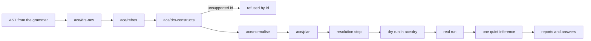

# From Sentences to the Graph

This page specifies what happens to an ACE text between the parser and the graph: how the parse
tree of a block becomes a Discourse Representation Structure (DRS), the formal meaning that
Attempto's public documents define for every ACE sentence; how pronouns and definite noun phrases
find what they refer to; how the block is checked against the list of constructs zelph can use; and
how the DRS is mapped, row by row, onto zelph facts, refutations, rules, denials and queries. It
also fixes the names `ace` gives the things a text introduces, and what the execution step records
besides the facts themselves: provenance, contradiction reports, and the conclusions under "not
provably" that a later block defeats.

The point a reviewer should take from it: every construct the front end supports maps onto a zelph
feature that exists, is documented and is released with zelph 1.1.0 — a rule with one `=>`, a
refutation `¬(…)`, a negated condition, a closure condition, a rule that writes a rule, an opaque
predicate for "John believes that …". The reasoning is zelph's; the proposed work is this mapping,
written in Janet as the stdlib modules `ace-drs.zph` (DRS, anaphora, classifier, normalization, plan)
and `ace-zelph.zph` (resolution and execution), in the same way `stdlib/sparql.zph` puts SPARQL on top
of the public Janet API. Where this page shows "the zelph a block writes", that text can be typed into
zelph today, and in most of the sections that show it a real run shows that it reasons as the sentence says. A
construct without such a feature is refused by name, never mapped approximately. The complete mapping,
one row per construct, is the table [Every Construct and Its Native Form](#every-construct-and-its-native-form);
M1 to M9 are the milestones of [Work Plan and Milestones](plan.md#the-milestones-at-a-glance), and a
row's milestone is the one that brings it.

With the option `:show-zelph` a block prints the native zelph its sentences become, before the
answers:

!!! example "Specified session — the behaviour this specification requires, not yet implemented"

    ```
    zelph> .import ace
    zelph> %(ace/option :show-zelph true)
    true
    zelph> ace John is a man. Mary is rich. John likes Mary.
    Every man is mortal. Who is mortal?

    John ~ man
    Mary is rich
    John likes Mary
    (*{(X ~ man)} ~ conjunction) => (X is mortal)
    Answer: John is mortal.
    zelph> .lang ace
    ace> X is mortal
    Answer: John is mortal
    ```

"John is a man." is the class fact `John ~ man`; an adjective after `is` is a fact with the
predicate `is`; a verb is a predicate of its own; "Every man is mortal." is one rule. The rule's
single condition is written as a one-element condition set, `*{(X ~ man)} ~ conjunction`, which is
how zelph prints such a rule (see [Rules](#rules)). Content
words live in the naming language `ace`, so a native line meets them under `.lang ace`. The same
rule, typed by hand into today's zelph under `.lang ace`, fires on the two men it is given, and typing
it a second time adds no second rule:

```
zelph> .lang ace
ace> (*{(X ~ man)} ~ conjunction) => (X is mortal)
ace> John ~ man
(John is mortal) ⇐ {(John ~ man)}
ace> "Douglas Adams" ~ man
("Douglas Adams" is mortal) ⇐ {("Douglas Adams" ~ man)}
ace> X is mortal
Answer: "Douglas Adams" is mortal
Answer: John is mortal
ace> (*{(X ~ man)} ~ conjunction) => (X is mortal)
ace> .list-rules
Listing all rules:
------------------------
(*{(X ~ man)} ~ conjunction) => (X is mortal)
------------------------
```

## The Stages

After the parser, a block passes through these stages. The stages from the DRS to the plan are pure:
they read the AST and the block's `ctx`, never the graph, so the same text gives the same plan on an
empty graph and on a Wikidata graph. This layer first reads the graph in the resolution step and
first writes it in the dry run.

| Stage | Function | Module | Effect | What it decides |
|---|---|---|---|---|
| DRS construction | `ace/drs-raw` | `ace-drs.zph` | pure | the DRS of the AST, with markers where an anaphor or an antecedent stands ([Building the DRS](#building-the-drs)) |
| anaphora | `ace/refres` | `ace-drs.zph` | pure | what each pronoun, definite noun phrase and variable refers to ([Resolving Anaphora](#resolving-anaphora)) |
| classification | `ace/drs-constructs` | `ace-drs.zph` | pure | the construct ids the block uses; an unsupported one refuses the block ([The Classifier](#the-classifier)) |
| normalization | `ace/normalise` | `ace-drs.zph` | pure | five passes that turn the APE-shaped DRS into the shape the mapping needs ([Normalization](#normalization)) |
| planning | `ace/plan` | `ace-drs.zph` | pure | the actions: facts, refutations, rules, denials, helper rules, questions, over names, never nodes ([The Plan](#the-plan)) |
| resolution | `ace-zelph/resolve-plan` and word resolution | `ace-zelph.zph` | reads | which node each name denotes, the class predicates of the graph, identities, the checks that need the graph ([The Resolution Step](#the-resolution-step)) |
| dry and real run, inference | `ace/execute!`, `ace/infer!` | `ace-zelph.zph` | writes | the writes, the bookkeeping, the reports ([Execution Details](#execution-details)) |



The block contract around these stages — the dry run, the cluster discipline, when inference runs,
the order of the output — is specified in [The ace Block](block.md#what-a-block-does); the data
shapes named here (DRS, marker, plan, term, ctx) under [Data Shapes](api.md#data-shapes); questions,
answers and the verbalizer, which share the plan, in [Questions, Answers and Explanations](answers.md);
formulas and arithmetic terms in [Numbers and Formulas](math.md).

**Private helpers of this layer.** Besides the public functions ([`ace-drs`](api.md#ace-drs),
[`ace-zelph`](api.md#ace-zelph)), the layer has these private helpers, each the only implementation
of its concern:

| Helper | Purpose |
|---|---|
| `ace-drs/build` | the construction state of one `ace/drs-raw` call |
| `ace-drs/unresolved-definite` | the single branch for a definite noun phrase that refers to nothing earlier |
| `ace-drs/substitutable` | which side of a copula may be substituted; shared by the classifier and `ace/norm-copula` |
| `ace-drs/atoms-of` | simple condition → atoms; shared by the classifier (safety) and `ace/plan` |
| `ace-drs/class-pattern` | the only builder of class atoms and `(:class …)` patterns |
| `ace-drs/groups` | the top box → groups of conditions connected by referents |
| `ace-drs/may-derive` | the may-derive graph shared by the endless-generation check, the negation-level check and the hypothesis guard; the subclass test is an argument, so the module stays pure |
| `ace-drs/canonical-text`, `ace-drs/fnv16` | the canonical rendering of a group and its 16-hex-digit hash |
| `ace-zelph/resolve-plan` | the resolution step's work that the mapping needs |
| `ace-zelph/report-contradictions` | contradiction and "not provably" reports from the quiet run's result |
| `ace-zelph/retract!` | the removal behind `ace-retract` (M9) |
| `ace-zelph/render` | a node → an ACE spelling that re-enters (reads the graph) |
| `ace-zelph/support-lines` | the sentences a derived fact or an answer rests on (M9) |
| `ace-verbalise/line` | one answer line from a question box and its bindings |

**Sources and clean room.** This layer is written from three public Attempto documents and from the
DRSs of the public ACE regression corpus, never from APE's Prolog sources:

| Document | What it gives this layer |
|---|---|
| ACE 6.7 Interpretation Rules (`ace_interpretationrules.html`) | the scope of quantifiers, if-then and subordination; anaphora (accessibility, recency, specificity, reflexivity); plurals; of-constructs |
| The DRS report (Fuchs, Kaljurand, Kuhn: *Discourse Representation Structures for ACE 6.6*, 2010, corrections 2011) | the DRS of every construct by example, and the slot order of every condition. ACE 6.7 adds `query(R, howm)` for "how many", which the 6.6 report does not list |
| The ACE syntax report | the order of constituents the verbalizer emits |

APE's anaphora resolver, its OWL/SWRL mapper, its DRS equivalence and well-formedness checkers and
its grammar files are never opened, and APE's message texts are never reused; the header comments of
`ace-drs.zph` and `ace-verbalise.zph` name the three documents with their URLs and state that no APE
source was used. Message texts live only in the message catalogue (`ace/messages`): this page fixes
what a message says, not its wording. The wording in the sessions below is illustrative; the layout,
the ids and the positions are normative ([Messages](block.md#messages)).

**The mapper writes domain structure** (DEC-MEANING). The plan writes the facts and rules a native
zelph user would write — `John likes Mary`, `(…) => (X is mortal)` — and every content word is
resolved to its node in the resolution step. The alternative, ACE vocabulary atoms that shipped zelph
rules map onto domain predicates, would let a word be re-bound later for texts already entered, but
every atom would exist twice, every answer would need one more rule step, and "not provably" over the
vocabulary layer would need a second negation level. One representation also means that ACE facts,
native facts and Wikidata facts are the same facts.

## Building the DRS

### What a DRS Is

A DRS is a box. Its **referents** are the things the text talks about — "a man", "a car", the event
of waiting — and its **conditions** say what holds of them: `object(R1, man)` says that R1 is a man,
`predicate(R2, wait, R1)` that R2 is an event of R1 waiting. A **complex condition** holds further
boxes: an implication `A ⇒ C` (from "every" and "if … then"), a negation, a "not provably", a
disjunction, a question, a modal box, the box of a that-clause. A referent declared in a box is
visible in that box and in the boxes nested in it. Every ACE sentence has exactly one DRS, and the
DRS report defines it construct by construct.

`ace` keeps the DRS in APE's shape until normalization, written as Janet data (see
[DRS Value Grammar](api.md#drs-value-grammar)): conditions are tuples in APE's slot order, `=>` is
`:imp`, `-` is `:neg`, `~` is `:naf`, `v` is `:or`, `L:D` is `(:label L D)`, a condition list
`[C1, …]` is `(:group …)`, `named(N)` is `(:named N)`, and referents are the symbols `R1`, `R2`, …:

```
"John is a man."
{:refs (R1 R2) :conds ((:object R1 "man" :countable :na :eq "1" (1 4))
                       (:predicate R2 "be" (:named "John") R1 (1 2)))}

"Every man waits."
{:refs () :conds ((:imp {:refs (R1) :conds ((:object R1 "man" :countable :na :eq "1" (1 2)))}
                        {:refs (R2) :conds ((:predicate R2 "wait" R1 (1 3)))}))}
```

The last element of each simple condition is its position `(sentence token)`. Keeping APE's shape
is what makes the corpus an oracle: the DRS that `ace/refres` returns is compared with the expected
DRS of the regression corpus, independently of everything zelph-specific, which happens only from
`ace/normalise` on ([Layer A: Text to DRS](tests.md#layer-a-text-to-drs)).

### State and Invariants

- `ace/drs-raw` is pure. Its state lives in a table created inside the call; nothing goes to
  `ace/state`. It reads only the AST (the leaf fields `:lemma :gender :tag :prep :tok :guessed
  :pfx`), never the lexicon or the graph.
- **Referents** are symbols `R<n>` from one counter per block, allocated in the order the walk below
  meets the introducing construct: a noun-phrase referent when the noun phrase is met, an event
  referent when its predicate condition is emitted, a property referent when a copula adjective
  phrase is met, a label referent when a `that` or `to` complement is met, a group referent after its
  members, an anaphor placeholder when the anaphor is met. A placeholder's number is used up although
  `ace/refres` replaces it; numbers are never reused, and gaps are allowed.
- **npid** counts noun-phrase occurrences (indefinite, quantified, definite, proper name, pronoun,
  variable, wh-word, group) in textual order across the block. It is the recency order of
  `ace/refres`.
- **Boxes** are built mutable (`@{:refs @[] :conds @[]}`) and frozen into `{:refs (…) :conds (…)}` at
  the end. A referent is declared exactly once, in the box the tables below name; anaphor
  placeholders are not declared (`ace/refres` declares or replaces them).
- A `(:group (…))` condition is a pseudo-box: conditions go into its list, while the referents
  introduced inside it are declared in the enclosing real box (DRS report §3.7).
- Sentence ids count from 1 per block.

### Scope: the Cursor

The *cursor* is the box that receives the next condition. The rules follow the interpretation
rules on the scope of local and global quantifiers, of if-then sentences and of subordinated
sentences, and the DRS report §7-9:

1. A clause is built in textual order: the subject noun phrase, then the verb phrase (auxiliary
   operators, then pre-verbal modifiers, objects and post-verbal prepositional phrases in textual
   order).
2. A construct that opens a scope (universal, `no`, `not every`, `nothing but`, `each of`, a
   maximality quantifier, verb-phrase negation, "not provably", a modal) appends its complex condition
   to the cursor and moves the cursor into the box it opens. Restrictor material (noun, adjectives,
   apposition, of-phrase, relative clauses) goes to the box where the noun phrase's referent is
   declared.
3. The clause's own predication — the predicate condition, the copula's property, the modifiers and
   the queries on the event — is emitted into the cursor as it stands after the clause's last noun
   phrase. "Mary reads every book in every library." (the shape of corpus 3533) puts `predicate`
   and `modifier_pp` into the innermost box; "Every dog is quiet in every house." (the shape of
   corpus 3489) does the same with the copula's `property`.
4. A local scope ends with its clause: in a coordination each conjunct starts again at the cursor of
   the coordination. A relative clause has its own cursor, starting at the box of its head.
5. Global quantifiers (`for every`, `there is`) and if-then open at the front and cover everything the
   AST puts into their `:body` or `:then` (the AST already encodes "the then-part reaches to the end of
   the coordination" and the repetition of `that`).

### Sentence-Level Nodes

The tables of this section are keyed by the AST of [Tokenizer, Grammar and Lexicon](grammar.md#the-ast):
the node kind `:n`, the construct id `:c` of the row that built it, and the fields read. That AST is
the only definition of these names.

| AST node (`:n`, `:c`, fields) | Condition appended to the cursor | Then built into |
|---|---|---|
| `:text` (`:sent/text`) | — (the top box B0) | each element of `:sents` into B0, in order |
| `:sent` `:mood :stmt` (`:sent/statement`) | — | `:body` into the cursor |
| `:sent` `:mood :ques` (`:sent/yes-no`, `:sent/wh`) | `(:question Q)`, appended to B0 | `:body` into Q |
| `:sent` `:mood :cmd` (`:sent/command`) | `(:command C)` | `:body` into C with `:addressee` as the subject (corpus 2016); construct `:command/imperative` |
| `:coord` `:of :body` or `:that`, `:op :and`/`:comma-and` (`:coord/and`, `:coord/comma-and`, `:coord/that`) | — | both `:args` into the same cursor, in order |
| `:coord` `:of :body` or `:that`, `:op :or`/`:comma-or` (`:coord/or`, `:coord/comma-or`, `:coord/that`) | `(:or D1 D2)` | the first of `:args` into D1, the second into D2 |
| `:cond` (`:sent/if-then`) | `(:imp A C)` | `:if` into A, `:then` into C |
| `:topic` `:sent/there-is`, `:np` with `:det` other than `:no` | — | `:np` introduced in the cursor |
| `:topic` `:sent/there-is`, `:np` with `:det :no` | `(:neg N)` | `:np` introduced in N (corpus 707, 1073) |
| `:topic` `:sent/for-every` | `(:imp A C)` | the restrictor of `:np` into A, `:body` into C (corpus 76, 85) |
| `:topic` `:sent/for-each-of` | `:np` (plural or group) introduced in the cursor, then `(:imp A C)` with `(:has_part G M (s :empty))` in A, M new | `:body` into C with M as the noun phrase's term (corpus 511, 2320) |
| `:topic` `:sent/not-for-every` | `(:neg X)` | the topic built into X as for `:sent/for-every` (corpus 1002, 2318) |
| `:frame` `:op :false`/`:not-true` (`:sent/it-is-false`) | `(:neg N)` | `:body` into N (corpus 1540) |
| `:frame` `:op :true`/`:not-false` (`:sent/it-is-true`) | — | `:body` into the cursor ("It is not false that a cat sleeps." has no operator, the shape of corpus 1608) |
| `:frame` `:op :not-provable` (`:sent/not-provable`) | `(:naf N)` | `:body` into N (corpus 1416) |
| `:frame` `:op :possible`/`:necessary`/`:recommended`/`:admissible` (`:sent/it-is-modal`) | `(:can N)` / `(:must N)` / `(:should N)` / `(:may N)` | `:body` into N (corpus 1246) |
| `:frame` `:op :not-possible`/`:not-necessary`/`:not-recommended`/`:not-admissible` (`:sent/it-is-modal`) | `(:neg {(:can N)})` and so on | `:body` into N (corpus 1358) |
| `:clause` (`:sent/clause`) | — | the cursor rules above: `:subj`, then `:vp`; a `:gap` is filled per the next table; a fronted `:wh` constituent is built before the clause |
| `:formula` (`:sent/formula`) | `(:formula L Op R p)`, Op = `:op` | `:l` and `:r` as `:np/term` below; a variable in a term is a variable anaphor |

The gaps of a `:clause` (the `:gap` values of the AST):

| `:gap` | Filled by |
|---|---|
| `:subj` | the head of the enclosing `:rel` is the clause's subject term |
| `:np` | the head of the enclosing `:rel/object` is the object (or the object of a prepositional phrase); in a question, the fronted `:wh` noun phrase |
| `:pp` | the fronted prepositional phrase (the `:pp` of `:rel/pp`, whose noun phrase is the head; or a fronted wh prepositional phrase) becomes a `modifier_pp` on the clause's event |
| `:adv` | the fronted `:wh` node (`:sent/wh-adverb`) adds `(:query E :where` / `:when` / `:how p)` to the clause's predication |
| `:aux` | nothing (an inverted yes/no question) |
| `:aux+np`, `:aux+pp`, `:aux+adv` | as `:np`, `:pp`, `:adv`, with the fronted `:wh` constituent (an inverted wh-question: "What does John see?") |

A fronted `:wh` noun phrase is introduced by its own row of the next table; a fronted `:pp` builds
its noun phrase first.

### Noun Phrases

"Introduce R" means: allocate R, declare it in the cursor, add the listed conditions there, and add
an intro marker. N is the `:lemma` of the `:noun` leaf of the `:nbar`. Each adjective of `:nbar :adjs`
(an `:ap`, or a `:coord` `:of :ap`) adds `(:property R Adj :pos p)`; an `:nbar :of` node adds
`(:relation R "of" T p)` after building its noun phrase; `:nbar :rel` follows the relative-clause
table below; an `:nbar :app` puts the lemma of its `:var` leaf as `:var` on the intro marker.

| Noun phrase (`:c`, fields) | Referent and conditions | Cursor | Marker |
|---|---|---|---|
| `:np/indefinite` (`:det :a`) | introduce R: `(:object R N :countable :na :eq "1" p)` | — | intro `:indef` |
| `:np/some` (`:det :some`), plural noun | introduce R: `(:object R N :countable :na :geq "2" p)` | — | intro `:indef` |
| `:np/some`, mass noun | introduce R: `(:object R N :mass :na :na :na p)` (corpus 648) | — | intro `:indef` |
| `:np/cardinal` (`:det :count`, `:count {:op :eq}`); `:np/generalised` with the `:count` op `:geq` or `:greater` | introduce R: QType = the `:count` op, QNum = its `:n` | — | intro `:indef` |
| `:np/generalised` with the `:count` op `:leq`, `:less` or `:exactly` | `(:group L)` appended; R introduced inside L with that QType | cursor → L until the end of the clause (DRS report §3.7); as a member of a noun-phrase coordination the group holds only the member's own conditions and its `has_part` (corpus 2468) | intro `:indef` |
| `:np/measure` (`:count`, `:unit`) | introduce R: `(:object R N Count "U" QType "n" p)`, U the lemma of the `:unit` leaf, Count from the noun's reading (corpus 167, 2854) | — | intro `:indef` |
| `:np/universal` (`:det :every`, `:all`; plural or mass with `:all`) | `(:imp A C)`; R declared in A, singular `:countable :na :eq "1"` for a plural `all` (corpus 2052), mass for a mass `all` | cursor → C | intro `:quant` |
| `:np/negative` (`:det :no`), outside `:sent/there-is` | `(:imp A C)`, `(:neg N)` in C; R in A | cursor → N (corpus 415; DRS report §9.1.1) | intro `:quant` |
| `:np/not-every` (`:det :not-every`/`:not-all`) | `(:neg X)`, `(:imp A C)` in X; R in A | cursor → C (corpus 1497) | intro `:quant` |
| `:np/nothing-but` without `:but` (`nothing but` N′) | `(:imp A C)`; A gets `(:object S "something" :dom :na :na :na p)` and the clause's predication with S as the noun phrase's term; C gets N′ introduced as D and `(:predicate E "be" S D p)` | cursor → A for the rest of the clause (corpus 2410) | intro `:quant` |
| `:np/nothing-but` with `:but` (`no` N′ `but` NP) | as without `:but`, with N′ in A and the `:but` noun phrase as the object of `be` in C (corpus 2843) | cursor → A | intro `:quant` |
| `:np/definite` (`:det :the`) | placeholder R; the noun phrase's own referents and conditions (adjectives, of-phrase, relative clauses, nested noun phrases) are built into a temporary box stored on the marker, not into the cursor | — | anaphor `:definite` |
| `:np/genitive` (`:det :gen`, `:owner`); `:det :poss` (`:poss`, a `:pro/possessive`; `:own` for `his own`); the relative `whose` N′ | the owner first (its own determiner, scope included); introduce R: object + `(:relation R "of" Owner p)`. A possessive noun phrase is never anaphoric: "John's code" twice gives two codes (corpus 244, 1245) | — | intro `:indef` |
| `:np/which` (`:det :which`) | introduce R: object + `(:query R :which p)` | — | intro `:wh` |
| `:np/whose` (`:det :whose`, interrogative) | introduce Rw: `(:query Rw :what p)`; introduce R: `(:relation R "of" Rw p)` + object (corpus 325, 1161) | — | intro `:wh`, intro `:indef` |
| `:np/how-many` (`:det :howm`) | introduce R: `(:query R :howm p)` + object (`:geq "2"` countable, mass for a mass noun; corpus 3741) | — | intro `:wh` |
| `:np/wh` (`:wh :who` / `:what`) | introduce R: `(:query R :who` / `:what p)` and nothing else (corpus 249, 1704) | — | intro `:wh` |
| `:np/indefinite-pronoun` without `:det :every`/`:no`: `something` (`:trunk :thing`), `somebody`/`someone` (`:trunk :body`/`:one`) | introduce R: `(:object R "something" :dom :na :na :na p)` / `(:object R "somebody" :countable :na :eq "1" p)` | — | intro `:indef` |
| `:np/indefinite-pronoun` with `:det :every`/`:no` (`everything`, `everybody`, `nothing`, `nobody`, `no one`) | as `:np/universal` / `:np/negative` with the object of the indefinite pronoun (corpus 778, 1312) | as `:np/universal` / `:np/negative` | intro `:quant` |
| `:np/proper`, `:np/proper-the` (a `:name` leaf) | the term `(:named L)`, L the leaf's `:lemma` (APE's form; `ace/plan` applies the canonical symbol); no condition | — | name |
| `:np/variable` (a `:var` leaf) | placeholder | — | anaphor `:variable` |
| `:pro` `:pro/personal` | placeholder; `:subj` = the subject term of its clause | — | anaphor `:pronoun` |
| `:pro` `:pro/reflexive`; `:pro/possessive` with `:own` | the subject term of its clause; agreement as in [The Gender of Guessed Nouns](#the-gender-of-guessed-nouns) and the grammar page | — | none |
| `:np/term` (`:term`, by `:kind`: `:int :real :str :expr :list :set`) | the data term `(:int "n")`, `(:real "n")`, `(:int "n" "U")`, `(:real "n" "U")` (n the `:value`, U the lemma of the `:unit` leaf), `(:string T)`, `(:list (…))`, `(:set (…))`, `(:expr Op A B)` (Op = `:op`, A and B from `:args`); numerals in canonical decimal text | — | none |
| `:coord` `:of :np` (`:coord/np`) | each noun phrase of `:args` by its own row, in order; then introduce G: `(:object G :na :countable :na :eq "k" (s :empty))` and `(:has_part G Mi (s :empty))` per member, k the number of conjuncts (corpus 2186, 340; "3 things and 4 things" gives `eq 2`, corpus 385) | — | intro `:group` (plural) |
| `:np/each-of` (`:each-of` NP) | the noun phrase introduced in the cursor; `(:imp A C)` with `(:has_part G M (s :empty))` in A, M new | cursor → C, M is the term (corpus 352) | intro `:quant` (M) |

### Relative Clauses

| `:rel` (`:c`, fields) | Built into | Note |
|---|---|---|
| `:rel/subject` (`:kind :subj`; "who waits") | the box where the head referent is declared (for `:np/definite`: the marker's temporary box), with its own cursor; the subject of `:body` is the head | a relative clause attaches to the immediately preceding noun |
| `:rel/object` (`:kind :obj`; "whom John sees") | the same box; the clause's own `:subj`; the object is the head | |
| `:rel/pp` (`:kind :pp`, a fronted `:pp`; "in which John waits") | the same box; the noun phrase of the `:pp` is the head | |
| `:rel/whose` (`:kind :whose`; the deprecated `:rel/of-which`) | the same box; a new possessed referent R with `(:relation R "of" Head p)` + object; the gap of `:body` is R | |
| `:coord` `:of :rel`, `:op :and`/`:comma-and` | the same box, `:args` in order | DRS report §5.3.2 |
| `:coord` `:of :rel`, `:op :or`/`:comma-or` | `(:or D1 D2)` in the head's box | DRS report §5.3.2 |
| any `:rel` whose head is `:np/proper` | the cursor (proper names are global) | DRS report §5.3.1; "Mary who is a teacher sleeps." |
| `:rel/such-that` (deprecated) | as `and` between relative clauses | |

### Verb Phrases

The auxiliary operators come from the `:aux` field of the `:vp` node (`:vp/negated`, `:vp/naf`,
`:vp/modal`, `:vp/do`), outermost first:

| `:aux` | Condition | Cursor |
|---|---|---|
| `{:neg true}` (`does not`, `is not`, `are not`) | `(:neg N)` | → N (DRS report §9.2) |
| `{:naf true}` (`does not provably`, `is not provably`) | `(:naf N)` | → N (corpus 2772; DRS report §9.4.1) |
| `{:modal k}`, k one of `:can :must :should :may` (`has to` is `:must`) | `(:can N)` / `(:must N)` / `(:should N)` / `(:may N)` | → N |
| `{:modal k :neg true}` (`cannot`, `can not`, `should not`, `does not have to`) | `(:neg {(k N)})`: `(:neg {(:can N)})`, `(:neg {(:should N)})`, `(:neg {(:must N)})` | → N (corpus 1381, 3018, 1384) |
| `{:do true}` (emphatic `does`) | none | — |

The heads (the `:head` of the `:vp`), the modifiers (its `:pre` and `:post`) and verb-phrase
coordination, by node kind; S is the subject term, E a new event referent declared in the final
cursor, p the position of the verb, V the `:lemma` of the `:verb` leaf:

| Node (`:n`, `:c`, fields) | Conditions in the final cursor |
|---|---|
| `:verb` `:vp/intransitive` | `(:predicate E V S p)` |
| `:verb` `:vp/transitive` | `:obj` built first; `(:predicate E V S O p)` |
| `:verb` `:vp/ditransitive`, `:vp/ditransitive-prep` | `:obj` and `:io` built in textual order; `(:predicate E V S DO IO p)`, DO = `:obj`, IO = `:io` (APE's order: subject, direct, indirect; DRS report §4.3); `:dprep` adds no condition |
| `:passive` `:vp/passive`, `:vp/passive-ditransitive` | the `:by` noun phrase built; the predicate with the agent as S and the passive subject in its active slot, a ditransitive passive's kept `:obj` or `:io` in its own slot (DRS report §4.2-4.3) |
| `:copula` `:vp/copula-np` (`:np`) | the noun phrase built; `(:predicate E "be" S O p)` |
| `:copula` `:vp/copula-adj` (`:ap`, or a `:coord` `:of :ap`) | a property referent P declared in the cursor (no marker: a predicative adjective is never an antecedent, corpus 3091); the `:obj` of an `:ap` and the noun phrase of its `:cmp` built first; `(:property P Adj Deg …)` per coordinated `:ap`, all on P, Adj the lemma of the `:adj` leaf, Deg = `:deg`; `(:predicate E "be" S P p)` |
| `:copula` `:vp/copula-pp` (`:pp`, a tuple) | the noun phrase of each `:pp` built; `(:predicate E "be" S p)` + `(:modifier_pp E Prep T p)` per `:pp` (DRS report §4.4.4; corpus 2827) |
| `:copula` `:vp/copula-wh` (`:wh`) | `(:predicate E "be" S p)` + `(:query E :where` / `:when` / `:how p)` (corpus 2200, 3520) |
| `:that` `:vp/that-clause` | a label referent L declared in the cursor; `(:predicate E V S L p)` + `(:label L D)`, `:body` built into D (DRS report §7.3) |
| `:to` `:vp/to-infinitive` | as `:that`, D holding the `:vp` with S as its subject (corpus 2237) |
| `:adv` (`:vp/adverb`) in `:pre` or `:post` | `(:modifier_adv E Adv Deg p)`, Adv the lemma of the `:adv` leaf, Deg = `:deg` |
| `:pp` (`:vp/pp`) in `:pre` or `:post` | the noun phrase of each `:pp` built (scope included) before the predication; `(:modifier_pp E Prep T p)`, Prep the lemma of the `:prep` leaf |
| `:coord` `:of :vp`, `:op :and`/`:comma-and` | each verb phrase of `:args` in the same cursor, each with its own E (DRS report §4.5.1) |
| `:coord` `:of :vp`, `:op :or`/`:comma-or` | `(:or D1 D2)`, one verb phrase each (DRS report §4.5.2) |

**Degrees of a property** (the `:deg` of an `:ap`): `:pos` (`:ap/positive`, `:ap/transitive`);
`:comp` and `:sup` without a target (`:ap/comparative`, `:ap/superlative`); `:comp_than` and
`:pos_as` (`:ap/comparison`), with the noun phrase of `:cmp` as the target T in the fourth slot for
an intransitive adjective. A transitive adjective (`:obj` present) with a target has the six-slot
form `(:property P Adj O Deg SubjObj T p)`, SubjObj `:obj` when `:cmp` carries `:of true` (the object
comparison: "than of Bill", "than in a dog"), else `:subj` (DRS report §4.4.2; corpus 1563, 1564,
2180, 2181).

### Positions

The `Tid` of a position is the 1-based number, within its sentence, of the token below. It only
points messages at a token and is never compared; `ace/drs-raw` never writes `nil` there.

| Condition | Token |
|---|---|
| `object` | the head noun (a pronoun's or an indefinite pronoun's own token) |
| `property` | the adjective |
| `relation` | `of`, the genitive marker, the possessive pronoun or `whose` |
| `predicate` | the main verb (for the copula: the form of `be`) |
| `modifier_pp`, `modifier_adv` | the preposition, the adverb |
| `query` | the wh-word |
| `formula` | the operator |
| `has_part`, the `object` of a group | `:empty` |

### Markers

Markers are our own design, not APE's. They are structs (so `(struct? c)` tells a marker from a
condition tuple) in the condition list of the box that is the cursor when the noun phrase is met.
Besides `:mk` and `:pos` they carry:

| `:mk` | Fields |
|---|---|
| `:intro` | `:ref R`, `:npid n`, `:kind` (`:indef :quant :wh :group`), `:head` (the noun lemma, or absent), `:gender` (`:undef :neutr :human :masc :fem :guess`), `:number` (`:sg :pl :mass`), `:var` ("X", absent if none) |
| `:name` | `:name "John"`, `:npid n`, `:gender` |
| `:anaphor` | `:kind` (`:definite :pronoun :variable`), `:ref R` (the placeholder), `:npid n`, `:refs` and `:conds` (the noun phrase's own material, for a definite only; empty otherwise), `:head`, `:gender`, `:number`, `:subj` (pronouns only), `:var`, `:text` (the noun phrase's surface text) |

`:guess` is the gender of a guessed noun that no relative pronoun fixed. The parse fixes it from the
first `who` or `which` and rewrites the leaves, so a fixed one arrives as `:human` or `:neutr` (DEC-UNKNOWN).
`:undef` is the gender of an unknown or quoted proper name. A marker looks like this:

```
{:number :sg :gender :masc :conds () :kind :pronoun :pos (2 1) :npid 3 :text "He" :mk :anaphor :ref R3}
```

## Resolving Anaphora

`(ace/refres drs)` returns `{:drs d :warnings (record …)}`. Its scope is one block: one block is one
APE paragraph, anaphora never reach into another block, and proper names are global graph nodes.
Afterwards no marker remains, and every referent used is declared once, in an accessible box.

!!! example "Specified session — the behaviour this specification requires, not yet implemented"

    ```
    zelph> .import ace
    zelph> %(ace/option :show-zelph true)
    true
    zelph> ace There is a man. The man waits. He sleeps. Who sleeps?

    Man-6f1c2a9e0b3d4c5a ~ man
    Man-6f1c2a9e0b3d4c5a waits nil
    Man-6f1c2a9e0b3d4c5a sleeps nil
    Answer: Man-6f1c2a9e0b3d4c5a sleeps.
    zelph> ace The man is happy.

    Warning [ace/w-definite-new]: sentence 1, line 1, column 5: "the man" refers to nothing earlier in this block, so it introduces a new man.
      Earlier blocks are not searched; an individual of an earlier block is reached by its name, e.g. Man-6f1c2a9e0b3d4c5a.
    Man-0b84d2e6c1f7a395 ~ man
    Man-0b84d2e6c1f7a395 is happy
    ```

"The man" and "He" find the man of the first sentence, so the block describes one individual, named
by a hash over everything the block says about him ([Canonical Text and Names](#canonical-text-and-names);
the 16 hex digits in the sessions of this page are illustrative). In the second block nothing earlier
is accessible, so the definite noun phrase introduces a new man and says so.

### Accessibility

The boxes are walked in textual order with a stack of levels.

| Construct | Rule |
|---|---|
| the top box | level 0 |
| `:neg :naf :can :must :should :may :question :command :label` | opens a level; its antecedents are dropped when it closes |
| `(:group …)` | not a level: its referents are declared in the enclosing box and stay accessible ("Mary owns at most 3 bikes. John washes them." resolves `them`, the shape of corpus 3273) |
| `(:imp A C)` | A opens a level; C is nested inside it and sees A; both are dropped when it closes. While A is resolved, C's conditions are visible to definite matching ("A painter signs every picture of himself.", the shape of corpus 133) |
| `(:or D1 D2)` | D2 is nested after D1 and sees it; both are dropped when it closes |
| proper names | accessible after their first occurrence everywhere in the block, also when that occurrence is inside a negation, a rule or a question ("John does not see Mary. Mary waits for him.") |
| numbers, expressions, lists, sets, strings | never antecedents |

### The Gender of Guessed Nouns

The parse fixes the gender of a guessed noun (DEC-UNKNOWN; [The Gender of Guessed Nouns](grammar.md#the-gender-of-guessed-nouns) on the grammar page):
the first `who` or `which` after a guessed noun of lemma L makes L `:human` or `:neutr` for the
block and rewrites every leaf of L; a contradicting relative pronoun is `[ace/relative-pronoun]`
there, and reflexives are checked there. A marker therefore carries the fixed gender, or `:guess`
where nothing fixed it. `ace/refres` adds two rules:

1. An unfixed `:guess` antecedent counts as `:neutr` for personal and possessive pronouns, as APE
   treats a guessed noun.
2. When a `he`, `she`, `him`, `her` or `his` fails to resolve and an accessible candidate is an
   unfixed guessed noun, `[ace/anaphor]` carries a hint: the noun was guessed and is read as neuter;
   a gender prefix (`h:writer`), a `who` clause or a lexicon entry makes it a person.

The shipped vocabulary `ace-core` holds about 300 person nouns with their gender, which keeps most
corpus texts out of this path: without them, 400 of the 2682 corpus cases runnable with APE's small
lexicon fail on `who` and on pronouns.

### Resolution

The candidates are the accessible antecedents with a smaller npid, most recent first.

| Anaphor | Rule | Failure |
|---|---|---|
| pronoun | the most recent candidate that agrees in gender and number and whose term is not the pronoun's `:subj` ("John has a card. Bob sees him and takes it."; possessive pronouns too, corpus 475). `they` may take a group. A resolved pronoun becomes the most recent mention of its antecedent. The first pronoun resolved to an `:undef` name fixes that name's gender for the block ("Leonino sleeps. Her fur is wet.") | raise `[ace/anaphor]` (with the hint of rule 2 above where it applies) |
| definite noun phrase | the most recent candidate whose head noun equals the anaphor's and that agrees in number, such that (a) every condition of the anaphor matches one of the candidate's own conditions, else (b) the conditions not matched in (a) match conditions accessible at the candidate's level (specificity: "There is a man. His dog barks. The man whose dog barks is irritated."). Recency picks among matches ("… John sees the ball", the ball being the red ball) | `ace-drs/unresolved-definite`: the marker's `:refs` and R are declared in the marker's box, its `:conds` added there, and the warning `[ace/w-definite-new]` says that earlier blocks are not searched and that an earlier individual is reached by its name ("John goes to the bank."; corpus 1801) |
| variable `X` | the candidate whose intro carries `:var "X"`, else the earlier bare `X` | a bare `X`: R declared in the marker's box with `(:object R "something" :dom :na :na :na p)`, and R becomes the antecedent of later `X`s ("X is heavy. John lifts X."); an apposition `X` while an `X` is accessible: raise `[ace/variable-redefined]` (corpus 3501 against 3502) |
| proper name | the same `(:named N)` everywhere | — |

**Agreement.** A pronoun `:masc` accepts `:masc :human :undef`; `:fem` accepts `:fem :human :undef`;
`:neutr` accepts `:neutr :undef`; `he/she` (`:human`) accepts `:human :masc :fem :undef`; an unfixed
`:guess` antecedent agrees as `:neutr` (a fixed one carries the gender the parse gave it); plural
pronouns accept `:pl` antecedents and groups. A singular definite matches a singular countable or a
mass antecedent, a plural definite a plural one.

**Matching is structural.** A condition of the anaphor matches an accessible condition when both are
equal after mapping the anaphor's R to the candidate and the anaphor's own nested referents (events,
the noun phrases of its relative clauses) injectively onto referents of the accessible conditions;
positions are ignored; `modifier_pp` and `has_part` match in any order. Consequences the corpus pins:
"A man is red. The red man sleeps." does not resolve, because the predicative property sits on its
own referent, so a second man is created (corpus 3091); `her` and `she` resolve to the teller by
recency (corpus 3165); "The man who sees John's mother" resolves through (b) (corpus 545).

### Post-Processing

1. Every resolved placeholder is substituted; a resolved anaphor's `:refs` and `:conds` are dropped.
2. Within each box, simple conditions equal to an earlier one apart from the position are dropped.
3. From a then-box, every simple condition equal (apart from the position) to one in its if-box is
   dropped.
4. A group that contains itself through a pronoun raises `[ace/anaphor]`.

Errors are records raised with `ace/fail` before any graph access; warnings are returned.

## The Classifier

`(ace/drs-constructs drs)` returns, for any well-formed DRS — ours or one read from APE's corpus —
the construct ids the DRS uses, each with the sentences that show it. A block is refused when one of
them is not supported at the current milestone: valid ACE outside the supported set is always
"Correct ACE, but zelph cannot use it", naming the construct, never a syntax error and never a
silent wrong graph. The construct table itself, with every id, its example and its milestone or the
reason it has no route, is on [Constructs and Refusals](constructs.md#the-construct-table), and so is
[the refusal message](constructs.md#the-refusal-message); this section defines how each DRS-level id
is detected.

!!! example "Specified session — the behaviour this specification requires, not yet implemented"

    ```
    zelph> .import ace
    zelph> ace If every cat sleeps then a bird sings.

    Error in line "ace If every cat sleeps then a bird sings.": Correct ACE, but zelph cannot use it [ace/unsupported]: sentence 1, line 1, column 10: a universal inside a condition ('cat'), construct rule/in-body.
      If every <>cat sleeps then a bird sings.
      zelph orders "not provably" over classes only in the core profile and only where no conclusion feeds back; on a Wikidata graph a class goes through the subclass hierarchy, and zelph then evaluates class sentences together, so the answer would depend on the order of the rules.
    ```

The `Error in line "…":` frame is the host's, which names the block by its keyword and first line
([How a Message Reaches the User](block.md#how-a-message-reaches-the-user)); piped input stops at
the first error. "Every cat sleeps" inside a condition (the shape of corpus 782) is a closed-world
test whose helper would hold a "not provably"; zelph cannot order such rules in every profile, so v1
refuses the shape by its id (DEC-STRATA, see [Helper Rules for "not provably"](#helper-rules-for-not-provably)).
The marker stands before "cat": the evidence is the conditional inside the condition, and its first
simple condition is the noun of "every cat" ([Ids Decided on the Normalized Copy](#ids-decided-on-the-normalized-copy-and-the-context-ids)
states the rule).

### Procedure

1. Walk the resolved DRS with a context: `:assert` (the top box), `:body` (an if-box; the box of a
   top-level `:neg`; the box of a `:neg` in a then-box; the box of a `:naf` in a body; everything
   nested in these that is not a then-box), `:head` (a then-box), `:question` (a question box and all
   boxes inside it). The A and C boxes of a top-level `(:neg {(:imp A C)})` are walked as `:body` and
   `:head`. The boxes of `:can :must :should :may :label :command` are walked with the context
   `:assert`.
2. Complex conditions yield ids by the first table below, simple conditions by the second, data
   arguments by the third.
3. The ids of [Ids Decided on the Normalized Copy](#ids-decided-on-the-normalized-copy-and-the-context-ids)
   are decided on a copy of the DRS after `ace/norm-events` and `ace/norm-copula`, both total.
4. The result maps each id to the sorted tuple of the sentence ids of its evidence conditions.

One id has one family, and every occurrence of an operator yields at least one id of that
operator's family. That is what makes `ace/drs-families` reproduce the family counts of the corpus
over the 2813 accepted texts: R 839, T 578, N 509, P 482, V 379, Q 317, M 221, D 191, U 125, S 89,
A 59, C 32, F 19, L 13, basic-only 423. A Python prototype of these rules reproduces every family
set of the corpus with zero mismatches; without the R rows for `:imp` in a body, in a question and
under `not every`, and without the N rows for negation in a question, the counts come out as R 761,
N 477, F 62, and 136 cases differ.

### Complex Conditions

| Condition | `:assert` | `:body` | `:head` | `:question` |
|---|---|---|---|---|
| `(:imp A C)` | `:rule/horn` (with the refinements of the normalized copy) | `:rule/in-body` | `:rule/nested` | `:rule/in-question` if the question box holds no `query`, else `:rule/in-wh-question` |
| `(:neg D)` | `:neg/fact` if D is one ground atom; `:neg/not-every` + `:rule/negated` if D's only condition is one `:imp`; else `:neg/statement` | `:neg/atom-in-body` if D is one atom, else `:neg/complex-in-body` | `:neg/in-head` | `:neg/atom-in-question` if one atom, else `:neg/complex-in-question` |
| `(:naf D)` | `:naf/top-level` | `:naf/atom-in-body` if D is one atom; `:naf/nested-in-body` if D holds a `:naf` or an `:imp` at any depth; else `:naf/complex-in-body` | `:naf/top-level` | `:naf/in-question` |
| `(:or D1 D2)` | `:or/in-head-or-statement` | `:or/in-body` | `:or/in-head-or-statement` | `:or/in-question` |
| `(:question D)` | `:question/wh` if D holds a `query` with `:who :what :which`; `:question/where-when-how` for `:where :when :how`; `:question/how-many` for `:howm`; `:question/yes-no` if D holds no `query` | — | — | — |
| `(:can D)` … `(:may D)` | `:modal/can` … `:modal/may` | the same | the same | the same |
| `(:label R D)` | `:sub/that-clause` | the same | the same | the same |
| `(:command D)` | `:command/imperative` | — | — | — |
| `(:group (…))` | `:group/condition-list` | the same | the same | the same |

"One atom" means: after the two normalizations of step 3 applied to D, D declares no referent of its
own and holds exactly one simple condition that yields one atom. "One ground atom" at the top level
is the same test, since outer referents are individuals there. A one-atom `:neg` inside a "not
provably" box is the positive pattern `(:refuted Atom)` and does not make the box
`:naf/nested-in-body`; a complex `:neg` inside it is `:neg/complex-in-body` by its own row (corpus
1418). A `:neg` box anywhere, or a `:naf` box in an if-box or a question box, that is a **negated
formula** (only formulas and the type conditions of their variables; a four-slot `be` left by pass 2
counts as its `=` formula, as in "Zürich is not Köln.") yields `:neg/formula` (family N) or
`:naf/formula` (family F) instead of the rows above, and no other `:neg/*` or `:naf/*` id, so "It is
false that 2 = 3 + 4." (the shape of corpus 2386) is no denial ([Negated Formulas](math.md#negated-formulas)).
A `:naf` box at the top level or in a then-box stays `:naf/top-level`.

### Simple Conditions

| Condition | Id |
|---|---|
| `object`, `:countable :na :eq "1"`, the lemma a word | `:object/count` |
| `object` `:dom`, or the lemma `something`/`somebody` | `:object/something` |
| `object` with the lemma `:na` | `:object/group` |
| `object` `:countable`, unit `:na`, QType `:eq`, QNum an integer > 1 | `:object/plural-count` |
| `object` `:countable`, unit `:na`, QType `:leq` or `:less` | `:object/at-most` |
| `object` `:countable`, unit `:na`, QType `:geq`, `:greater` or `:exactly` | `:object/at-least` |
| `object` `:mass`, unit `:na` | `:object/mass` |
| `object` with a unit other than `:na` | `:object/measure` |
| `predicate` `"be"`, four slots | `:copula/noun` (or `:copula/identity` or `:formula/compare` when the normalized copy says so) |
| `predicate` `"be"`, three slots, exactly one `modifier_pp` on its event | `:copula/located` |
| `predicate` `"be"`, three slots, two or more `modifier_pp` | `:copula/located-many` |
| `predicate` `"be"`, three slots, no `modifier_pp` (only a `query`, corpus 2200) | none |
| another `predicate`, three / four / five slots | `:verb/intransitive` / `:verb/transitive` / `:verb/ditransitive` |
| `property` with Deg `:comp` | `:adj/comparative` |
| `property` with Deg `:sup` | `:adj/superlative` |
| `property` with Deg `:comp_than` or `:pos_as` (four or six slots) | `:adj/comparison` |
| `property`, four slots, `:pos` | `:adj/transitive` |
| `property`, three slots, `:pos` | `:adj/positive` |
| `relation` | `:of/relation` |
| `modifier_pp` on an event that is not a three-slot `be` (a four-slot copula included, corpus 3489) | `:mod/pp` |
| `modifier_adv` `:pos` / `:comp`, `:sup` | `:mod/adverb` / `:mod/adverb-degree` |
| `has_part` | `:object/group` |
| `query` | decided at the question (previous table) |
| `formula` | `:formula/compare` or `:formula/identity` ([Numbers and Formulas](math.md)) |

The rows for one `object` condition are exclusive. `:object/at-most` and `:object/at-least` are both
family P, so the family counts do not depend on the split.

### Data Arguments

Data arguments are classified recursively, inside lists, sets and expressions too.

| Argument | Id |
|---|---|
| `(:named N)` | `:name/proper` |
| `(:int N)` / `(:real N)` | `:data/integer` / `:data/real` |
| `(:int N U)`, `(:real N U)` | `:data/measured` |
| `(:string T)` | `:data/string` |
| `(:list …)` / `(:set …)` | `:data/list` / `:data/set` |
| `(:expr "&" …)` / any other `(:expr …)` | `:expr/concat` / `:expr/arith` |

### Ids Decided on the Normalized Copy, and the Context Ids

| Id | Rule, on the copy after `ace/norm-events` and `ace/norm-copula` |
|---|---|
| `:individual/top-level` | the top box, or the A box of a top-level `(:neg {(:imp A C)})`, declares a referent that is not an event referent (the first slot of a `predicate`) |
| `:copula/identity` | a four-slot `be` remains with neither side substitutable and no numeric side. With a numeric side ("John is 5.") it is typed like the `=` formula with the same sides and yields `:formula/compare` instead |
| `:rule/generative-head` | a then-box declares a referent that is not an event, or an event referent that carries modifiers |
| `:rule/unsafe` | a referent of the rule used in a head atom, in a one-atom `:naf` or `:neg` of the body, or in a comparison formula of the body or a head, occurs in no positive body atom (by `ace-drs/atoms-of`); fresh head referents are exempt. Comparison formulas bind nothing, and type conditions bind nothing for the variables of comparison formulas, so a referent that occurs only in comparison formulas and type conditions is unbound: "If X > 2 then X > 1." and "For every integer X if X > 2 then John waits." are unsafe. "Everybody waits." and "Everything runs." are unsafe as well, because their body maps to no atom. Helper bodies are safe by construction |
| `:rule/disconnected-head` | a head atom that contains a fresh variable is not connected, through head atoms sharing fresh variables, to a head atom that contains a body variable ("If a man waits then a dog barks."). Ground head atoms are fine. Supported from M4 as a generative head ([DEC-DISCONNECTED](decisions.md#dec-disconnected); [Rules](#rules)) |
| `:sub/ground-conditional` | an `:imp` inside a modal or `:label` box, at any depth, neither of whose boxes declares a referent on the copy (plain events are gone after pass 1): "John believes that if Mary waits then Bill sleeps." It is reported besides the `:rule/horn` the same `:imp` yields (those boxes are walked as `:assert`); both are family R, so the family counts do not move |
| `:sub/conditional-with-referents-in-body` | an `:imp` one of whose boxes declares a referent on the copy, inside a modal or `:label` box that stands, at any depth, in the if-box of an `:imp`: "If John believes that every man waits then John is happy." Reported besides the `:rule/horn` of the same inner `:imp`; family R |
| `:sub/conditional-with-referents-in-head` | the same inside a modal or `:label` box that stands in a then-box: "Every woman believes that every man waits."; family R |

`:individual/top-level`, `:copula/identity` (and the `:formula/compare` of a numeric one),
`:rule/generative-head` and the three that-clause ids are DRS-level ids, found by
`ace/drs-constructs`. `:rule/unsafe` and `:rule/disconnected-head` are **context ids**: this table
defines their detection, and `ace/plan` finds them. `:rule/unsafe` refuses; `:rule/disconnected-head`
has a route from M4, the milestone that brings rules, so it never refuses a block: before M4 the
classifier already refuses such a sentence by its DRS-level rule ids (`:rule/horn`,
`:rule/generative-head`).

Context ids are not counted in families and are raised before anything is written. `ace/plan` raises
those that need no graph: `:rule/unsafe`, `:question/unrestricted`, `:rule/endless-generation` with
class keys compared by name, and `:expr/as-data` for a term that holds a name or a variable. The
resolution step raises those that need the graph: `:naf/unstratified` over the may-derive graph,
`:rule/endless-generation` through the graph's subclass closure, `:rule/unsafe-hypothesis`, and
`:expr/as-data` for a ground term without a value; `ace/plan` never reads the graph. The dry run
raises the engine's half of `:naf/unstratified`, from `(zelph/strata)` after the block's rules are
written ([Static Checks](#static-checks)).

**Positions.** The position of a refusal is the token that the evidence condition's `Pos` names; for
a complex condition, that of its first simple condition in textual order, so the universal inside a
condition above is marked at the noun of "every cat". The ids of the table above take it from the
normalized copy they are decided on. A context id is found over plans, which hold no evidence
condition, so its position is the first token of its sentence: the refusal of "If a man is not
provably a bachelor then …" as `:naf/unstratified` points at "If" ([Positions](constructs.md#positions)).

### Rows Whose Detection This Layer Defines

| Id | Family | Level | Evidence | Since | Waits for |
|---|---|---|---|---|---|
| `:rule/in-body` | R | DRS | an `(:imp …)` in a body, a universal inside a condition (corpus 782, 3317) | — | refused in v1 (DEC-STRATA); a narrowing that would accept it where the negation levels order it is planned, not v1 |
| `:naf/nested-in-body` | F | DRS | a `:naf` box in a body that holds a `:naf` or an `:imp` (corpus 1418, 3022; "If a man is not provably a farmer who does not provably own a dog then …") | — | as `:rule/in-body` |
| `:naf/unstratified` | F | context (resolution step; dry run) | [Static Checks](#static-checks) | — | no route in v1: data-dependent levels, the path variant and revision are not built; the planned narrowing would shrink it |
| `:rule/in-question` | R | DRS | an `(:imp …)` in a question box without `query` ("Is it true that every dog is an animal?", the shape of corpus 1974; 10 corpus cases) | M4 | `zelph/rules` (built; DEC-QUNIV) |
| `:rule/in-wh-question` | R | DRS | an `(:imp …)` in a question box with a `query` ("How does every man wait?", corpus 2087; 20 corpus cases) | — | no route: the hypothetical witness decides whether every A is C, not which individuals answer |
| `:rule/unsafe-hypothesis` | R | context (resolution step) | a rule with a "not provably" or `!=` condition is reachable from the hypothesis of a universal question | — | no route |
| `:rule/negated` | R | DRS | the `:imp` of a top-level `(:neg {(:imp A C)})` | M4 | with `:neg/not-every` |
| `:neg/atom-in-question` | N | DRS | a one-atom `:neg` in a question ("Who does not wait?", corpus 1448) | M4 | — |
| `:neg/complex-in-question` | N | DRS | another `:neg` in a question ("Is there no laundry?", corpus 763) | — | no route; the hint names "not provably" (`:naf/in-question` is supported) |
| `:question/unrestricted` | Q | context | a wh-referent constrained by no condition ("Who is there?", corpus 1679) | — | no route |
| `:sub/ground-conditional` | R | DRS (normalized copy) | a modal or label box holds an `:imp` neither of whose normalized boxes declares a referent | — | refused in v1 (DEC-MODAL); lifting it needs the asserted-rule record, [K1-P1](prerequisites.md#k1-p1-a-mention-switches-a-typed-ground-rule-off) |
| `:sub/conditional-with-referents-in-body`, `:sub/conditional-with-referents-in-head` | R | DRS (normalized copy) | see the previous table | — | refused in v1 (DEC-MODAL): unsound in an if-box, a silent acceptance in a then-box ([Modality and That-Clauses](#modality-and-that-clauses)) |
| `:object/at-most` | P | DRS | see Simple Conditions | M7 | — |
| `:object/at-least` | P | DRS | see Simple Conditions | M7 | — |
| `:naf/complex-in-body` | F | DRS | a complex `:naf` box in a body that holds no `:naf` and no `:imp` | M4 | — |
| `:command/imperative` | C | DRS | `(:command D)` | — | no route: an imperative has no truth value to store |

**The hint of the three negation-level rows** (its wording lives in `ace/messages`) names what zelph
cannot order. For `:rule/in-body` and `:naf/nested-in-body`: zelph orders "not provably" over
classes only in the core profile and only where no conclusion feeds back; on a Wikidata graph a
class goes through the subclass hierarchy, and zelph orders class sentences together. For
`:naf/unstratified`: the sentence whose "not provably" cannot be ordered, the sentence whose
conclusion reaches it and the sentences on the way (from the may-derive graph), or, from the
engine's verdict, that the rule set holds rules not written in ACE, or a rule over predicates, which
zelph evaluates together with it. In every case: zelph would then give a result that depends on the
order of the rules. No planned feature lifts these rows by itself; the narrowing described under
[Helper Rules for "not provably"](#helper-rules-for-not-provably) would need a separate decision.

## Normalization

`(ace/normalise drs)` applies five passes in this order. Each pass is a public pure function
`(ace/norm-<pass> drs)`, total on every well-formed DRS (shapes it does not handle pass through
unchanged), idempotent, and tested in its own group. No pass looks at the lexicon or the graph.

| # | Pass | Rule | Basis |
|---|---|---|---|
| 1 | `ace/norm-events` | an event referent that occurs only as the first slot of its own `predicate` is removed from its box's `:refs`, and the slot becomes `nil`: a **plain** predicate. Any other event referent stays: it carries a modifier or a query, and is an **occurrence** | DEC-EVENTS (D) |
| 2 | `ace/norm-copula` | each four-slot `(:predicate nil "be" X Y p)` is substituted per the next table and deleted; `object` conditions that now stand on a data value are deleted (no class atom on data, DEC-OF). A four-slot `be` whose event is an occurrence (corpus 3489) is substituted the same way and leaves `(:predicate E "be" X p)` (three slots), which carries the modifiers. `property` then stands on X directly, the attributive shape. A four-slot `be` with neither side substitutable stays: it is the identity of [Identity](#identity), or with a numeric side the `=` formula of [Numbers and Formulas](math.md) | DRS report §4.4 |
| 3 | `ace/norm-double-negation` | `(:neg {:refs () :conds ((:neg B))})` → the referents and conditions of B inlined into the enclosing box ("No man does not wait.") | — |
| 4 | `ace/norm-nested-imp` | the mode switch of [Nested Implications](#nested-implications) | DEC-NESTED-IMP |
| 5 | `ace/norm-or-body` | `(:imp {… (:or D1 D2) …} C)` → one `:imp` per disjunct, the other body conditions copied into each; the same for the box of a top-level `:neg` (one denial per disjunct). D2's references to D1's referents become plain variables of D2's rule without D1's conditions (APE's first-order reading scopes D1's referents over D2) | [Disjunction](../logic.md#disjunction) |

Grouping (`ace-drs/groups`), the helper rules for "not provably", class patterns and the math seeds
of `ace/math-plan` are not passes: `ace/plan` produces them.

**Plain and occurrence predicates.** After pass 1, `(:predicate nil V S … p)` is plain: its atom
alone carries it. A normalized DRS may therefore hold `nil` in the event slot, which the DRS value
grammar allows for normalized DRSs. An occurrence keeps its event referent for the modifiers of
[Events and Modifiers](#events-and-modifiers).

**Which side of a copula is substituted** (`ace-drs/substitutable`). For a four-slot `be` in box B
with the sides X and Y: Y is substitutable if it is a referent declared in B or in a box nested in B;
otherwise X is, under the same test; Y is tried first.

| Example | Result |
|---|---|
| "John is a man." | Y (man) is local: Y := `(:named "John")` → `(:object (:named "John") "man" …)` |
| "Every man is a human." | then-box: Y (human) is local, X is outer: Y := X |
| "A man is a farmer." | both local: Y := X |
| "John's age is 30." | X (age) is local, Y is data: X := `(:int "30")`; the `age` object is deleted, the relation stays |
| "John is rich." | Y (the property referent) is local: Y := John → `(:property (:named "John") "rich" :pos p)` |
| "John is Bill."; an outer referent on both sides | nothing substitutable and no numeric side: `:copula/identity`, mapped as the identity `John = Bill` (from M5) |
| "John is 5." | nothing substitutable, a numeric side: `:formula/compare`, planned as the formula "John = 5." |

## The Plan

`(ace/plan ndrs ctx)` turns the normalized DRS into a plan: a tuple of actions `(Kind Payload Src)`,
each carrying the source of its sentence. A row of this section is reached only when its construct
id is supported, so the plan never meets an unsupported shape except through a bug
(`[ace/internal]`). The action kinds:

| Kind | What it does | `ace/zelph-of` prints |
|---|---|---|
| `:fact` | a claim, `zelph/fact` | `John ~ man` |
| `:refute` | a refutation, `zelph/refute` | `¬(John waits nil)` |
| `:rule` | a rule, built in the rule idiom below | `(*{(X ~ man)} ~ conjunction) => (X ~ human)` |
| `:denial` | a rule with the consequence `!` | `((X ~ man), (X ~ woman)) => !` |
| `:helper-rule` | a rule that carries a "not provably" over several conditions | as `:rule` |
| `:check` | a ground formula or identity, decided before the dry run; nothing is stored | `# check: …` |
| `:infer` | the one inference of the block | — |
| `:ask-yn`, `:ask-wh`, `:ask-value` | questions ([From Question to Action](answers.md#from-question-to-action)) | `# yes/no: …`, the query line, `# value: …` |
| `:warn` | a warning collected for the output | — |

The order is fixed: `:warn` anywhere; `:check` first; then the write actions (`:fact :refute :rule
:denial :helper-rule`) in sentence order; then at most one `:infer`, emitted whenever the block
writes or asks; then the questions in sentence order. Each action's Src is `{:block B :sid S :span
(First Last) :text T}`, the text being the sentence's characters with every run of whitespace
replaced by one space.

Open for M4: the order of a helper rule and the rule it serves within the actions of one sentence.
It changes nothing in the graph, since every write of a block precedes its one inference, but it
fixes the order of the `ace/zelph-of` lines; the sessions on this page print the helper first.

**Plans hold names, never nodes.** `ace/plan` reads only the DRS and `ctx`, of which it uses the
snapshot of the rule registry `:rules`, the explicit ids `:ids`, the `v:` lemmas `:as-written` and
the quoted names `:quoted` of the block. `ctx` carries nothing of the graph's profile: a class item is
planned as the abstract `(:class T C V)` and expanded only in the resolution step, so the same text
gives the same plan with and without Wikidata (gate W, [The Guessing Gates](tests.md#the-guessing-gates-b-n-and-w), checks
exactly that).

### Terms, Roles and Individuals

**A content term carries a role.** Every content word reaches the graph through word resolution
([Resolving a Word](words.md#resolving-a-word)), which needs the word's role ([Roles](words.md#roles)). Below, `C(n, role)` or `C(n, role,
l)` writes a content term: n is the node name the word gets in the language `ace`, role is one of
`:noun :name :relation :verb :adjective`, and l is the label word that the Wikidata lookup tries
when it differs from n. The concrete term is `(:name n role)` or `(:name n role l)`; an explicit id is
`(:id n role)`.

| Position | Term |
|---|---|
| `(:named N)` | `C(canon(N), :name)` |
| the class of an `object` | `C(N, :noun)` |
| a relational noun as predicate | `C(N, :relation)` |
| a verb | `C(ace/predicate-name :verb V, :verb)` |
| an intransitive adjective (the object of `is`) | `C(A, :adjective)` |
| a transitive adjective (a predicate) | `C(ace/predicate-name :adj-tr A, :relation, A)`: the node is `"is fond of"`, while the Wikidata lookup tries the lemma's hyphen and space variants (`based-on` finds the property "based on") |
| an adverb (the object of `ace:manner`) | `C(Adv, :adjective)` |
| `is`, the located phrases `is <prep>`, the comparison phrases | `C(…, :verb)`: structural predicates never go through the Wikidata label lookup |

- **Canonical symbol.** `canon(N)` replaces every run of hyphens and spaces in a proper name by one
  space: `Douglas-Adams` and `Douglas Adams` both give "Douglas Adams" (DEC-MULTIWORD). It applies to
  unquoted names only. A name in `ctx :quoted` keeps its whitespace-normalized content verbatim
  (`` `Spider-Man` `` is the node "Spider-Man", DEC-QWORD), and so do a name with the individual shape
  `^[A-Z][^-]*(-[^-]+)*-[0-9a-f]{16}$` and an id-shaped symbol. The DRS keeps APE's form.
- **Explicit ids.** `ctx :ids` holds the symbols that are explicit Wikidata ids in this block: the word
  of a prefixed word matching `[QP][0-9]+` under any prefix (`p:Q42`, `n:Q8441`, `n:P50`, `v:P155`,
  `a:Q3142`, and the gendered `h:`, `m:`, `f:` forms such as `m:Q42`), and the id-shaped symbol of a
  lexicon reading used in the block (`noun_sg(man, 'Q8441', masc)`). A term whose word is in the set
  becomes `(:id w role)` and is resolved by the explicit-id step; `ace/predicate-name` is not applied
  to it (a verb `P155` stays `P155`). A quoted word `` `Q42` `` is the literal name "Q42", not an
  explicit id, unless the same block also writes `p:Q42`: then the explicit id wins for both, since
  the ctx keys are symbols for the whole block (documented).
- **Verbs written with `v:`.** A verb lemma in `ctx :as-written` is named as written
  (`{:as-written true}`); every other verb by its entry's or the morphology's third person singular.
- **Groups** (`ace-drs/groups`): the top box's conditions other than `:question` and `:command`,
  partitioned into components connected by referents; named and data arguments do not connect. Each
  group keeps its conditions in the textual order of the sentence, the order of their positions, not
  the order in which `ace/drs-raw` appended them: a relation atom comes before the class atom of a
  referent it introduces ("John owns a dog." is `John owns Dog-<h>`, then `Dog-<h> ~ dog`), and an
  occurrence gives its plain atom, then the occurrence atom, then its modifiers. Rule conditions and
  heads follow the same order.
- **Individuals** (DEC-INDIVIDUALS). A referent declared in the top box that is not an event becomes
  `(:skolem R Head Key)`: Head is the smallest lemma (in code-point order) among R's `object`
  conditions with a word lemma, else `"something"` or `"somebody"`; Key comes from
  [Canonical Text and Names](#canonical-text-and-names). The referents of the A box of a top-level
  `(:neg {(:imp A C)})` are named the same way, with that condition as their group. So are the
  referents of a modal or label box at the top level (M8), as members of the group that holds the
  box, whose Key therefore includes the box; they are written only inside the mention scope.
- **Events.** An occurrence event referent at the top level becomes `(:skolem E :event Key)`, the
  node `ace:event-<h>` in the language `zelph` (M6).
- **Variables.** The referents of rule boxes and of question boxes become `(:var Name)`, named in the
  native variable shape: one naming scope per top-level rule (a generator's inner rules included),
  per helper rule and per question; variables are named in order of first occurrence, conditions
  left to right and then heads: `X`, `Y`, `Z`, then `A` to `W`, then `_v27`, `_v28`, …
  ([DEC-VAR-LETTERS](decisions.md#dec-var-letters)). A `(:class T C V)` pattern takes a letter only
  where it has a variable of its own. In the core profile it is the atom `T ~ C`, which uses none, so
  "Every man owns a dog." is `(*{(X ~ man)} ~ conjunction) => (X owns Y) (Y ~ dog)`. On a graph with a
  subclass predicate its expansion `T <instance> V, ((V <subclass> C) closure zero-or-more)` names V
  at its place in the order, and the later variables follow it: `(X P31 Y), ((Y P279 man) closure
  zero-or-more)`, and the dog is Z. The plan, which does not know the profile, carries the names of
  the core profile and names each V outside the letters (`_c1`, `_c2`, …); the expansion in the
  resolution step names the variables of every scope in which a V survives again, in the same order,
  so a `_c` name never reaches the graph or a printed line ([Variables](api.md#variables)). One
  `zelph/var` per name and scope: a second `zelph/var` call of the same name would be a second
  variable, and the conditions would not join.

### Atoms of Simple Conditions

This table is the heart of the mapping (`ace-drs/atoms-of`). `P(kind lemma [opts])` is
`ace/predicate-name`, T(x) is the term of x, and `CP(T, N)` is what `ace-drs/class-pattern` builds for
the subject T and the class `C(N, :noun)` in the current context: the atom `(:atom T (:vocab :instance)
C(N, :noun))` in statements and heads, the pattern `(:class T C(N, :noun) V)` in conditions and
questions ([Class Patterns and the Graph Profile](#class-patterns-and-the-graph-profile)).
`(:vocab :instance)` is the instance predicate: core `~` without Wikidata, `P31` on a Wikidata graph.

| Condition (normalized) | Atom(s) | Id | Since |
|---|---|---|---|
| `(:object X N :countable :na :eq "1" p)`, X not data | `CP(T(X), N)` → `John ~ man` | `:object/count` | M1 |
| `(:object X "something"/"somebody" …)` | none (like TPTP's `$true`) | `:object/something` | M3 |
| an `object` on a data value | none | — | — |
| `(:property X A :pos p)` | `T(X) C("is", :verb) C(A, :adjective)` → `Mary is rich` (DEC-SHAPES (a)) | `:adj/positive` | M3 |
| `(:property X A :pos Y p)` | `T(X) C(P(:adj-tr A), :relation, A) T(Y)` → `John "is fond of" Mary` | `:adj/transitive` | M3 |
| `(:property X A :comp_than Y p)` / `:pos_as` | `T(X) C(P(:comp-than A), :verb) T(Y)` / `C(P(:pos-as A), :verb)` → `"is taller than"`, `"is as rich as"` | `:adj/comparison` | M3 |
| `(:property X A Y Deg SubjObj Z p)` | `T(X) C(P(:comp-than A {:subj-obj SubjObj}), :verb) <T(Y) T(Z)>` for `:comp_than`, `P(:pos-as A {:subj-obj SubjObj})` for `:pos_as`, with the list `<Mary Bill>`: `"is more fond of than"` (`:subj`), `"is more fond of than of"` (`:obj`) | `:adj/comparison` | M3 |
| `(:relation R1 "of" R2 p)` + `(:object R1 N …)` | `T(R2) C(N, :relation) T(R1)` and, unless R1 is data or a numeric referent, `(:unless-property C(N, :relation) CP(T(R1), N))` (DEC-OF): `John father Bill` + `Bill ~ father`, `John age 30`; a referent that the math typing makes numeric gets no class pattern ([Typing](math.md#typing); [DEC-NUMERIC-REFERENT](decisions.md#dec-numeric-referent)), so "If a person's age is A and A > 17 then …" has the relation condition `age` and no class condition on the age value; for `something`/`somebody` the lemma is the predicate and no class pattern follows ("Nothing of John waits.", corpus 1316) | `:of/relation` | M3 |
| `(:predicate nil V S p)` | `T(S) C(P(:verb V), :verb) (:vocab :nil)` → `John waits nil` (DEC-SHAPES (a)) | `:verb/intransitive` | M3 |
| `(:predicate nil V S O p)` | `T(S) C(P(:verb V), :verb) T(O)` → `John likes Mary` | `:verb/transitive` | M3 |
| `(:predicate nil V S DO IO p)` | `T(S) C(P(:verb V), :verb) (:list (T(DO) T(IO)))` → `John gives <Book-<h> Mary>` (ordered, because the objects of one fact are a set) | `:verb/ditransitive` | M3 |
| `(:predicate E "be" X p)` + exactly one `(:modifier_pp E Prep Y p)`, nothing else on E | `T(X) C(P(:located Prep), :verb) T(Y)` → `John "is in" Park-<h>`; E is consumed, no individual | `:copula/located` | M3 |
| an occurrence `(:predicate E V …)` with modifiers | the plain atom A, plus `T(E) (:vocab :occurrence) A`, plus per `modifier_pp` `T(E) C(P(:located Prep), :verb) T(Y)` and per `modifier_adv` `T(E) (:vocab :manner) C(Adv, :adjective)` (DEC-EVENTS (D)) | `:mod/pp`, `:mod/adverb` | M6 |
| an occurrence three-slot `be` left by pass 2 (corpus 3489) | each atom of the substituted side as A, with the occurrence and modifier atoms as above | `:mod/pp` | M6 |
| `has_part`, groups, counts, mass | [Plurals, Groups, Cardinality and Mass](#plurals-groups-cardinality-and-mass) | P and U ids | M7 |
| `formula`, `expr` | [Numbers and Formulas](math.md#math-terms-in-plans) (`:check`, `:ask-value`, `ace/math-plan`) | A ids | M5 |

**Why these shapes** (DEC-SHAPES (a)). An intransitive verb is `John waits nil`, an adjective
`John is rich`. The alternatives were zelph's self-facts (`:waits John`), under which "No man sees
himself." and the intransitive "A man sees." would become the same fact, and adjectives as classes
(`John ~ rich`), which would mix adjectives into `~`, and on Wikidata into P31. The chosen pair
collides with nothing, keeps `~` for class membership, and its adjective form is what a user types
natively. A reflexive transitive fact prints as a self-fact in every option (`:sees John`); the
verbalizer reads it as two-place.

**The class atom of a relational noun on Wikidata** (DEC-OF). `(:unless-property Rel X)` stands
where X, the class atom or `(:class …)` pattern of R1, would stand. The resolution step drops it when
Rel, the relational noun in its `:relation` role, resolved to a Wikidata property, and replaces it by
X otherwise. Wikidata states `Q… P50 Q42`, not that Q42 is an instance of "author", so the class item
would make "Who is the author of …?" answer nothing; without Wikidata nothing changes. Dropping it
never makes a rule unsafe: the relation atom binds R1 as well. A plain `of` predicate is never used:
after `.import math` an `of` fact prints as a function term.

**The names of three-place comparisons.** The binary name of the same kind is built from the
transitive lemma with hyphens as spaces (`fond-of` → `"is more fond of than"`, `"is as fond of as"`);
for SubjObj `:obj`, a space and the adjective's preposition (the lemma's last hyphen segment) follow
(`"is more fond of than of"`; `interested-in` → `"is more interested in than in"`). The two readings
are different statements — "Sue is more fond-of Tom than Ann." (the shape of corpus 2180) compares
Sue's and Ann's fondness of Tom, "Sue is more fond-of Tom than of Ann." (the shape of corpus 2181)
Sue's fondness of Tom and of Ann — so they never share a name. Both names re-enter natively without a new node, and
each answers only its own query.

!!! example "Specified session — the behaviour this specification requires, not yet implemented"

    ```
    zelph> .import ace
    zelph> %(ace/option :show-zelph true)
    true
    zelph> ace John waits. John likes Mary. John gives a book to Mary.
    Mary is rich. John is fond-of Mary. John is taller than Bill.
    John's father is Bill. John is in a park. Who likes Mary?

    John waits nil
    John likes Mary
    John gives <Book-3b9e1f0c7a2d5e48 Mary>
    Book-3b9e1f0c7a2d5e48 ~ book
    Mary is rich
    John "is fond of" Mary
    John "is taller than" Bill
    John father Bill
    Bill ~ father
    John "is in" Park-91c4e07b2f6a3d15
    Park-91c4e07b2f6a3d15 ~ park
    Answer: John likes Mary.
    ```

A preposition reaches the graph only inside a phrase (`"is in"`), so core `in`, which zelph uses for
set membership, never becomes a content predicate (DEC-NAMES). A possessive makes the possessor the
subject: "John's father is Bill." is `John father Bill`, the triple a native or Wikidata user would
write.

### Top-Level Conditions

| Condition (normalized, at the top level) | Actions | Id |
|---|---|---|
| a group's simple conditions | one `(:fact Atom Src)` per atom, Src of the condition's sentence | basic ids |
| `(:neg D)`, D one ground atom | `(:refute Atom Src)`: a refutation claims its marking and nothing of its fact; a fact it creates is written as a mention (a ground rule pattern can be refuted too) | `:neg/fact` |
| `(:neg D)`, otherwise | `(:denial {:if Pats})`, D's referents as variables, individuals and names as constants; after pass 5 one denial per disjunct (corpus 3165, sentence 4) | `:neg/statement` |
| `(:neg {(:imp A C)})` | A's referents named as individuals, A's atoms as facts; then C as if it stood under `:neg` at the top level: one ground atom → `:refute`, else a `:denial` with A's individuals as constants (¬∀(A→C) ≡ ∃(A ∧ ¬C)) | `:neg/not-every`, `:rule/negated` |
| `(:imp A C)` | [Rules](#rules); an `:imp` holding a formula goes to the math hook first, which may turn it into a `:check` or an `:ask-value` | R ids |
| `(:question D)` | [From Question to Action](answers.md#from-question-to-action) | Q ids |
| a four-slot `be` left by pass 2 | [Identity](#identity); with a numeric side the math hook, as the `=` formula | `:copula/identity`, `:formula/compare` (M5) |
| `has_part`, `(:group …)`, plural objects | [Plurals, Groups, Cardinality and Mass](#plurals-groups-cardinality-and-mass) | P and U ids (M7) |
| `(:can D)` … `(:may D)`, `(:label L D)` | [Modality and That-Clauses](#modality-and-that-clauses) | M and S ids (M8) |
| `(:naf …)`, `(:or …)`, `(:command …)` | none: refused, no route | — |

!!! example "Specified session — the behaviour this specification requires, not yet implemented"

    ```
    zelph> .import ace
    zelph> %(ace/option :show-zelph true)
    true
    zelph> ace Bill does not sing. There is no woman. Not every man waits.
    Does Bill sing?

    ¬(Bill sings nil)
    (*{(X ~ woman)} ~ conjunction) => !
    Man-2c7f0a4e9b13d685 ~ man
    ¬(Man-2c7f0a4e9b13d685 waits nil)
    Answer: No. It is false that Bill sings.
    ```

"Bill does not sing." is a refutation: the fact is denied, not merely absent, and asserting it later
is refused as a contradiction. "There is no woman." is a denial, a rule whose consequence is `!`.
"Not every man waits." says that some man does not wait, so it names that man and refutes his
waiting.

### Rules

"Every …" and "If … then …" become rules; a "no" or "not" in the conclusion becomes a derived
refutation; "not provably" in the condition becomes a negated condition, through a helper rule when it
covers more than one condition:

!!! example "Specified session — the behaviour this specification requires, not yet implemented"

    ```
    zelph> .import ace
    zelph> %(ace/option :show-zelph true)
    true
    zelph> ace Every man is a human. No man is a woman. John is a man.
    If a man does not provably own a car then the man walks.
    Is John a human? Is John a woman? Does John walk?

    (*{(X ~ man)} ~ conjunction) => (X ~ human)
    (*{(X ~ man)} ~ conjunction) => ((X ~ woman) ~ refuted)
    John ~ man
    ((X ~ man), (X owns Y), (Y ~ car)) => (X ace:naf-5b8e2d71c4a09f36 nil)
    ((X ~ man), ¬(X ace:naf-5b8e2d71c4a09f36 nil)) => (X walks nil)
    Answer: Yes. John is a human.
    Answer: No. It is false that John is a woman.
    Answer: Yes. John walks.
    ```

"No man is a woman." derives the refutation of `John ~ woman`, so the question is answered "No", not
"It is not provable". The "not provably" sentence becomes two rules, because zelph's `¬` takes one
pattern and "owns a car" is two; the helper rule is visible in `.list-rules`
([Helper Rules](#helper-rules-for-not-provably)).

The rule of "No man waits.", which has the shape of "No man is a woman.", typed by hand into today's
zelph: a derived refutation that meets a claimed fact is a reported contradiction, and the claimed
fact keeps answering, while for a man who was not said to wait the refutation is derived and answers.
(In an ACE session the content names live in `ace` and `refuted` in `zelph`; typed under the default
`.lang zelph` both resolve in one language, which changes no shape.)

```
zelph> (*{(X ~ man)} ~ conjunction) => ((X waits nil) ~ refuted)
zelph> John waits nil
zelph> John ~ man
! ⇐ {(John ~ man)}
Found one or more contradictions!
zelph> X waits nil
Answer: John waits nil
zelph> Bill ~ man
((Bill waits nil) ~ refuted) ⇐ {(Bill ~ man)}
zelph> (X waits nil) ~ refuted
Answer: (Bill waits nil) ~ refuted
```

`(:imp A C)` at the top level, after passes 4 and 5, becomes one `(:rule {:if Pats :then Heads} Src)`,
Src being the sentence of the implication's first condition.

**The rule idiom.** One `=>` fact carries all heads as its objects, built inside `zelph/dedup-rule`,
with every `zelph/var` created inside the thunk; `zelph/conjunction` joins two or more conditions;
**a rule with exactly one condition gets a one-element tagged condition set**,
`(def c (zelph/collection cond))`, `(zelph/fact c "~" "conjunction")`, `(zelph/fact c "=>" head …)`
(DEC-RECORD-SINGLE). The reason: `zelph/conjunction` refuses arity 1, and the one-element set gives
every rule `ace` builds a condition set, in the form zelph lists for it. Records do not depend on it:
since 2026-10-15 the engine records a contradiction of a rule with a plain single condition as it
records one of a rule whose single condition stands in a one-element condition set, the condition
counting as the only member, so a denial, a conclusion that meets a refuted fact and a refused
consequence are recorded once in either form. Such a rule lists and prints as `(*{(X ~ man)} ~ conjunction) => …`, which
re-enters as the same rule ([DEC-ONE-CONDITION-PRINT](decisions.md#dec-one-condition-print)); `((X ~ man)) => …` or `(X ~ man) => …` typed natively on a graph that lacks the rule builds the
plain rule instead (the parentheses only group), which `.list-rules` shows as `(X ~ man) => …`;
`ace/zelph-of` prints what `.list-rules` shows for the rule `ace` builds, so it never prints those forms. This
holds for every rule `ace` writes: rules, denials, helper rules and the inner rules of a generator.
On a graph that already holds a one-condition rule in force, in either form, each of these spellings, and the
idiom too, meets that rule and adds nothing: a rule typed natively in the plain form before stays
plain, and its contradictions are recorded as those of the set form are
([DEC-RECORD-SINGLE](decisions.md#dec-record-single)).
The thunk returns the `=>` node. `ace` never uses `zelph/rule`, because it does no deduplication and
returns the condition set rather than the `=>` node, and it never writes a fact that names a rule
node, which would take the rule out of force. A head whose predicate is a variable is bound by a
condition: the rule builders refuse a consequence whose predicate no condition binds when the rule
is written (DEC-UNBOUND-PRED), and `ace` builds every rule through them.

**Two negations, never mixed** (DEC-NEG (a)). ACE `not` is classical negation, and `not provably` is
negation as failure (the AceRules convention). Classical negation reaches zelph as a refutation
`¬(F)` (asserted), as the condition `((F) ~ refuted)` (which matches refuted facts only), as the
derived head `((F) ~ refuted)`, or as a denial `(…) => !`. Negation as failure reaches it as `¬(…)` in a
condition. A complex classical negation in a condition is refused with the hint "does not provably",
never read as negation as failure.

Body patterns, from A (context `:body`):

| In A | Pattern | Id |
|---|---|---|
| a simple condition | its atoms, with class items as `(:class …)` patterns | basic ids |
| `(:neg D)`, D one atom | `(:refuted Atom)`: matches refuted facts only; `refuted` is named in `zelph` | `:neg/atom-in-body` |
| `(:naf D)`, D one atom | `(:naf Atom)` → `¬(…)`; over a class item, whose `(:class …)` pattern may expand to two patterns, always a positive helper ([Helper Rules](#helper-rules-for-not-provably)) | `:naf/atom-in-body` |
| `(:naf D)`, complex, holding no `:naf` and no `:imp` | `(:naf HelperAtom)` + a helper rule with a positive body | `:naf/complex-in-body` |
| `(:naf D)`, D holding a `:naf` or an `:imp` | none: refused | `:naf/nested-in-body` |
| `(:imp B C2)` | none: refused | `:rule/in-body` |
| `formula` | `ace/math-plan` (seed rules and conditions; [Formulas in Rules](math.md#formulas-in-rules)) | A ids |
| `(:neg D)`, complex | none: refused, hint "does not provably" | `:neg/complex-in-body` |

Heads, from C (context `:head`):

| In C | Head or extra action | Id |
|---|---|---|
| a simple condition | its atoms, class atoms plain (`T <instance> C`); C's surviving referents become fresh `(:var …)` in the same `=>` fact (a generative rule) | `:rule/horn`, `:rule/generative-head` |
| `(:neg D)`, D one atom whose variables all occur in A | the head atom `((F) ~ refuted)`, that is `(:atom F (:vocab :tilde) (:vocab :refuted))`. `(:vocab :tilde)` is core `~`, which every marking and tag uses whatever the profile; only class atoms and `(:class …)` patterns use the instance predicate. A derived marking that meets a claimed F is a reported contradiction whose record is the condition set plus F; nothing is written, and F keeps answering (DEC-REFUTED (ii); the quiet run names F as the entry's `:conclusion`). Only a claimed marking refutes, so the rule's own pattern refutes nothing until the rule fires | `:neg/in-head` |
| `(:neg D)`, otherwise | a separate `(:denial {:if Pats(A) ∪ Pats(D)})`, D's referents as variables | `:neg/in-head` |
| `(:imp B C2)` | [Nested Implications](#nested-implications) | `:rule/nested` |
| `(:naf …)`, `(:or …)` | refused | `:naf/top-level`, `:or/in-head-or-statement` |

A then-box with atoms and negations gives one `:rule` for the atoms and the one-atom markings, plus
one `:denial` per complex negation; a then-box with only complex negations gives only denials.
"Everybody waits." is `:rule/unsafe`. A plural `all` needs nothing extra (its DRS is already
singular, corpus 2052). `nothing but` becomes a rule after pass 2: "John likes nothing but meat."
gives `(*{(John likes X)} ~ conjunction) => (X ~ meat)` (corpus 2410).

**Generative heads** (DEC-GENERATIVE). A then-box that introduces a referent ("Every man owns a dog.")
gives fresh head variables in the same `=>` fact. zelph's no-duplicate-witness guard, a backtracking
join over facts, makes a witness only when no assignment of the fresh variables already makes every
head a fact, so a named fact present before the run satisfies the head. Limits, documented and pinned
by tests: the witness set depends on which rule fires first and is unique only up to homomorphism; a
witness made before a named fact arrives is kept; under `.parallel` two runs on one input may derive
different witnesses. A witness is an unnamed node, and answers render it as an indefinite.
`:rule/endless-generation` keeps self-feeding rules out ([Static Checks](#static-checks);
[Fresh Variables: Generative Rules](../logic.md#fresh-variables-generative-rules)).

!!! example "Specified session — the behaviour this specification requires, not yet implemented"

    ```
    zelph> .import ace
    zelph> %(ace/option :show-zelph true)
    true
    zelph> ace Every man owns a dog. Bill is a man. Who owns a dog?

    (*{(X ~ man)} ~ conjunction) => (X owns Y) (Y ~ dog)
    Bill ~ man
    Answer: Bill owns a dog.
    zelph> ace If a man waits then a dog barks. John is a man. John waits.

    ((X ~ man), (X waits nil)) => (Y ~ dog) (Y barks nil)
    John ~ man
    John waits nil
    ```

The answer names the witness by its class, "a dog"; it re-enters as accepted ACE, but not with zero
new nodes, which is why the round-trip test checks such lines for acceptance only
([RT-1](tests.md#rt-1-answers-re-enter)).

**A head that the condition does not reach** (`:rule/disconnected-head`,
[DEC-DISCONNECTED](decisions.md#dec-disconnected)): in "If a
man waits then a dog barks." the dog is connected to nothing the condition binds. The sentence says
∀x (man(x) ∧ waits(x) → ∃d (dog(d) ∧ barks(d))), and one barking dog satisfies it for every waiting
man. The no-duplicate-witness guard gives exactly that: the first binding makes one witness, and every
later binding, in the same run or a later one and in every semi-naive mode, finds the head already
satisfied by it. Such a rule is therefore an ordinary generative rule from M4, and a test pins one
witness across several bindings and several runs. An older measurement, which said such a head never
fires or fires on every run, was taken on an earlier engine and no longer reproduces.
The rule in today's zelph: John and Bill wait, and the query finds one barking dog; Tom waits in a
later run, and it is still the one dog. The `+` in the prompt marks a run that hid its derivations,
and the REPL shows the unnamed witness by its class, `dog`:

```
zelph> ((X ~ man), (X waits nil)) => (Y ~ dog) (Y barks nil)
zelph> John ~ man
zelph> John waits nil
zelph+> Bill ~ man
zelph> Bill waits nil
zelph> X barks nil
Answer: dog barks nil
zelph> Tom ~ man
zelph> Tom waits nil
zelph> X barks nil
Answer: dog barks nil
```

### Nested Implications

A conditional inside the then-part of another becomes either a flat rule or a **rule generator**, a
rule whose consequence is a rule (DEC-NESTED-IMP (c); [Rules That Derive Rules](../logic.md#rules-that-derive-rules)).
`(ace/norm-nested-imp drs mode)` takes `mode` from `:switch :generator :flatten`; `ace/normalise`
passes `ace-drs/nested-imp-mode`, `(def ace-drs/nested-imp-mode :switch)`, and the tests call every
mode directly.

A **switch** is `(:imp A {… (:imp B C) …})` whose normalized A declares no referent (only ground
atoms; plain events are removed by pass 1) and whose inner rule keeps a variable. Two shapes become a
generator in the default mode: a switch, and an inner rule that uses a referent the outer then-box
introduces ("Every man owns a dog that every cat hates."), which has no flat equivalent. Every other
nested conditional is flattened.

| Shape | `:switch` (default) | `:generator` (tests) | `:flatten` |
|---|---|---|---|
| `(:imp A {(:imp B C)})`, a switch ("If John waits then every man sleeps.") | the head `(:imp {:if Pats(B) :then Heads(C)})`: `(*{(John waits nil)} ~ conjunction) => ((*{(X ~ man)} ~ conjunction) => (X sleeps nil))`; applied recursively, so a chain of switches is a generator of generators | as `:switch` | `(:imp A∪B C)` |
| `(:imp A {(:imp B C)})`, A declares a referent and the inner rule uses none of the then-box's referents ("Every man sees every dog.", corpus 84; 88 accepted corpus cases, all with an outer referent) | `(:imp A∪B C)`: B's referents and conditions merged into A → `((X ~ man), (Y ~ dog)) => (X sees Y)` | the generator `(A) => ((B) => C)`, one generated rule per outer binding | as `:switch` |
| `(:imp A {(:imp B C)})`, the inner rule fully ground ("If John waits then if Mary sleeps then Bill runs.") | flattened in every mode: a ground generator never fires (typed natively, it also takes an identical ground rule typed earlier out of force, the two being one hash-consed node; built from Janet, as `ace` would build it, it leaves that rule in force) | flattened | flattened |
| a then-box with other conditions beside an inner implication that uses none of the then-box's referents | under a switch: one `=>` fact whose heads are the atoms of the rest and the inner rule (a mixed head); otherwise split into `(:imp A {rest})` and `(:imp A∪B C)` | mixed head | split |
| an inner implication that uses then-box referents ("Every man owns a dog that every cat hates."; the relative clause puts the inner `:imp` into the then-box that declares the dog) | a generator in every mode: `(*{(X ~ man)} ~ conjunction) => (X owns Y) (Y ~ dog) ((*{(Z ~ cat)} ~ conjunction) => (Z hates Y))`; no flat rule is equivalent, because Y is a fresh witness of the outer rule that the inner rule must share | generator | generator |
| an inner implication whose consequence is a denial | under a switch: the head `(:imp {:if … :then ((:vocab :false))})`, one generated denial; otherwise `(A∪B, C) => !` | generator | flattened |

The generator and every rule it writes claim none of their ground parts: a condition or consequence
that becomes ground through substitution stays a rule pattern until something asserts it. The ground
outer condition of a switch (`John waits nil`) is a rule pattern; a later "John waits." claims it.
The generator's inner rule shares the outer rule's naming scope, and the static checks run on the
inner rule with the outer variables counted as bound. Provenance names the generator's sentence; a
generated rule has none of its own. A fully ground switch cannot be kept as a generator in v1: a
generator cannot put a fully ground rule in force, which needs the asserted-rule record ([K1-P2](prerequisites.md#k1-p2-a-rule-generator-cannot-put-a-ground-rule-in-force)),
so such a conditional is flattened.

!!! example "Specified session — the behaviour this specification requires, not yet implemented"

    ```
    zelph> .import ace
    zelph> %(ace/option :show-zelph true)
    true
    zelph> ace If John waits then every man sleeps. Bill is a man. John waits.
    Does Bill sleep?

    (*{(John waits nil)} ~ conjunction) => ((*{(X ~ man)} ~ conjunction) => (X sleeps nil))
    Bill ~ man
    John waits nil
    Answer: Yes. Bill sleeps.
    ```

The same generator in today's zelph: before John waits, nothing sleeps; the claim of `John waits nil`
puts the inner rule in force, which then fires for Bill.

```
zelph> (*{(John waits nil)} ~ conjunction) => ((*{(X ~ man)} ~ conjunction) => (X sleeps nil))
zelph> Bill ~ man
zelph> X sleeps nil
zelph> John waits nil
((*{(X ~ man)} ~ conjunction) => (X sleeps nil)) ⇐ {(John waits nil)}
(Bill sleeps nil) ⇐ {(Bill ~ man)}
zelph> X sleeps nil
Answer: Bill sleeps nil
```

### Helper Rules for "not provably"

The session under [Rules](#rules) shows the result for "If a man does not provably own a car then
the man walks.": a helper rule derives `X ace:naf-<h> nil` for every man who owns a car, and the main
rule negates that helper atom. The reason: zelph's `¬(…)` takes one pattern; `¬(A is y, A is z)` is
refused ([Negation as Failure](../logic.md#negation-as-failure)). A "not provably" box of several
conditions therefore becomes a Lloyd-Topor helper rule (DEC-NEG (a), DEC-STRATA (a)). For `(:naf D)` in a rule
body B, with D complex and holding no `:naf` and no `:imp`, or D one class item (whose `(:class …)`
pattern may expand to two patterns):

1. **Free referents.** The rule variables used in D and declared outside it, in canonical order —
   `F1 … Fk`. Individuals and names inside D are constants, not free.
2. **Name.** `ace:naf-<h>`, h being `ace-drs/fnv16` of the canonical text of D with `Fi` labelled
   `$i`; the node is `(:vocab "ace:naf-<h>")` in the language `zelph`.
3. **Helper atom.** k = 0 → `nil H nil`; k = 1 → `F1 H nil`; k = 2 → `F1 H F2`; k ≥ 3 → `F1 H <F2 … Fk>`.
   Never `H H …`: a rule head whose subject is its own predicate node is never derived.
4. **Helper rule.** `(:helper-rule {:if Ctx ∪ Pats(D) :then (HelperAtom) :helper "ace:naf-<h>"} Src)`.
   Ctx holds the positive patterns of B outside D whose variables are all free referents of D (a
   `(:class …)` pattern counts as one pattern over its subject), plus the patterns of B that bind an
   `Fi` not bound inside D (safety). Ctx bounds the helper's extent by the rule's own body: "If a
   writer is not provably a human then …" derives helper facts for writers, not for every human.
5. **Main rule.** B gets `(:naf HelperAtom)` in place of `(:naf D)`.

In v1 the context patterns of step 4 stay in the helper. Helpers are visible in `.list-rules` and
deduplicate on re-entry, because their names are content hashes.

**Values before negation.** When D holds a formula one of whose sides is neither a variable nor a
number literal, that side's value is bound before step 1, outside D. A ground side is valued in the
check step ([Values Before Negation](math.md#values-before-negation)). A side T whose variables are all free referents of D
gets, in the main rule B, a guarded value binding with its seeds, and the bound value V replaces T in
D: V is one more free referent, step 4's safety clause carries the binding into Ctx, and the helper's
formula condition compares bound values only. The reason: a conclusion under "not provably" is
final, and a value that needs the simplifier's fallback (itself a "not provably" rule) can arrive
after the negation over it was decided. In the measurements behind this rule, the plain negated formula
is right in every order only while no rule over predicates is in force, and wrong as soon as a
transitive meta-rule is; the bound shape is right in both. A side over a referent that D declares
itself cannot be bound outside D without changing what is negated, and valuing it inside the helper
would be a positive helper fed by a "not provably" rule: such a box is refused as `:naf/unstratified`.

**Negation levels, why the helper body is positive, and what stays refused.** zelph orders rules
with a negated condition into levels over the strongly connected components of a dependency graph
([Stratified Evaluation](../logic.md#stratified-evaluation)). The graph is keyed by **pattern**: a
top-level pattern by (predicate, constant object); a variable or structured object, a nested
statement and a path condition by (predicate, any); and every key by its predicate alone while a rule
over predicates (a transitive, symmetric or reflexive meta-rule) is in force. A component whose rules
negate what they derive stays on one level and alternates: a positive saturation of all positive
rules, then one pass over the level's negating rules in collection order, repeated while the pass
derives something. In that pass a negating rule sees what the negating rules before it derived, but
none of their positive consequences. So a "not provably" rule whose test another such rule of the
component feeds — directly, through a helper or through a universal — is right only in some orders,
and the collection order is no order a test could fix; a component in which no negating rule feeds a
negated pattern of the component, itself included, is right in every order. In the core profile
`X ~ C` and `X is A` are keyed by class and property, so the shapes get separate levels and are right
in every one-run order (9 of 9 runs per mode for each shape). In the Wikidata form a class pattern
reads (P31, any), so every class-headed negating rule whose helper reads a class shares one component
with every class rule, and the results are wrong in many orders (the core "chain" shape in the
Wikidata form was right in 0 of 96 block runs); beside a rule over predicates the core profile
collapses as well. A class hierarchy that feeds a "not provably" conclusion back into what such a
rule tests ("… Every husband is a man." beside the bachelor and husband rules) is wrong in every run.
A conclusion under "not provably" is final across runs; zelph does not revise it.

Hence `:rule/in-body`, `:naf/nested-in-body` and `:naf/unstratified` are refused by id in v1
(DEC-STRATA (a)), and a helper body MUST be positive, except for the mark conditions
`¬(W ace:individual nil)` of the counting patterns, whose predicate no rule derives. A positive helper
whose input a "not provably" rule derives is caught by the transitive check of `:naf/unstratified`.
The engine's `.strata` alone is no criterion: it calls a sound theory "Not stratifiable" where it is
stratifiable, and beside a meta-rule its keys compare predicates, so the check uses its verdict only
for the cases `ace`'s own graph cannot see ([Static Checks](#static-checks)).

**Cost on Wikidata** (DEC-NEG). A rule with a negated condition takes a classic pass over its positive
conditions at every negation level of every run, and a rule with a closure condition used to be
matched in full on every run. In zelph 1.1.0 a seeded run seeds a "not provably" rule by its positive
leaves and gives a path rule a classic pass only when a fact of the predicate it walks arrived, so an
unrelated block costs neither. The remaining cost: once `ace` has written its first "not provably"
rule, every block that writes a rule makes the next run a full pass over every rule
([Z3-P1](prerequisites.md#z3-p1-after-the-first-negated-condition-every-new-rule-costs-a-full-pass)).

**The planned narrowing — not v1.** The narrowing would accept a non-stratifiable component that
holds no rule `ace` did not write, while no rule over predicates is in force, when no negating rule
of the component may reach a negated pattern of a negating rule of the component, itself included;
together with leaving out of a helper each context pattern that the head of a negating rule may
derive, and judging a generator's inner rule as if it shared the component of every negating rule it
touches. It is sound by the argument above, and the evidence matches: every theory the engine calls
stratifiable was right in every run (0 wrong of 3,912 runs), every non-stratifiable shape without a
feed was right (0 wrong of 3,614), every one with a feed was wrong in some or all orders. In the core
profile it would accept the chains, the universal in a condition, "not provably" inside "not provably"
and hierarchy feedback into a helper's context; in the Wikidata form class-conclusion chains stay
refused even under it. If `:rule/in-body` and `:naf/nested-in-body` were lifted, they would use these
helper bodies, built by the steps above with the inner construct translated inside the helper (and a
universal inside a top-level or then-box negation, corpus 398 and 1914, would need a mapping of its
own):

- `(:imp B2 C2)` in a body (a universal inside a condition, closed-world): if C2 maps to one atom G, a
  helper h1 with the body `Ctx ∪ Pats(B2) ∪ ((:naf G))`; otherwise a helper h2 = `Ctx ∪ Pats(B2) ∪
  Pats(C2) => h2(free referents of C2's box, B2's included)` and h1 with the body `Ctx ∪ Pats(B2) ∪
  ((:naf h2-atom))`. The outer body gets `(:naf h1-atom)`. "If every cat sleeps then a bird sings."
  (the shape of corpus 782) would be the helper `((X ~ cat), ¬(X sleeps nil)) => (nil ace:naf-<h> nil)`
  and a main rule whose one condition is `¬(nil ace:naf-<h> nil)` (k = 0).
- A "not provably" box holding a `:naf` or an `:imp`: its helper body holds the inner helper's `¬`.

Lifting these refusals is a separate decision; data-dependent levels, the path variant and the
revision of a conclusion that a later fact defeats are not built.

The helper and its main rule in today's zelph, typed with the facts before the rules, as a block
writes everything before its one inference, and with negation records on, as `ace` switches them on
with its first "not provably" rule. John owns a car, so only Bill walks; when Bill later gets a car,
zelph keeps "Bill walks" and warns, because the conclusion is final
([Conclusions under "not provably" That a Later Block Defeats](#conclusions-under-not-provably-that-a-later-block-defeats)):

```
zelph> .negation-records on
Negation records: on
zelph> John ~ man
zelph> Bill ~ man
zelph> John owns Car-3c5e7a9b1d2f4e60
zelph> Car-3c5e7a9b1d2f4e60 ~ car
zelph> ((X ~ man), (X owns Y), (Y ~ car)) => (X ace:naf-5b8e2d71c4a09f36 nil)
(John ace:naf-5b8e2d71c4a09f36 nil) ⇐ {(John owns Car-3c5e7a9b1d2f4e60) (John ~ man) (Car-3c5e7a9b1d2f4e60 ~ car)}
zelph> ((X ~ man), ¬(X ace:naf-5b8e2d71c4a09f36 nil)) => (X walks nil)
(Bill walks nil) ⇐ {(¬(Bill ace:naf-5b8e2d71c4a09f36 nil)) (Bill ~ man)}
zelph> X walks nil
Answer: Bill walks nil
zelph> Bill owns Car-8d0b2f4a6c1e3a57
zelph> Car-8d0b2f4a6c1e3a57 ~ car
(Bill ace:naf-5b8e2d71c4a09f36 nil) ⇐ {(Bill owns Car-8d0b2f4a6c1e3a57) (Bill ~ man) (Car-8d0b2f4a6c1e3a57 ~ car)}
Warning: 1 fact(s) no longer justified -- a negated premise they were derived under now holds, and nothing else derives them; they stay:
  Bill walks nil  (by (¬(X ace:naf-5b8e2d71c4a09f36 nil), (X ~ man)) => (X walks nil))
zelph> X walks nil
Answer: Bill walks nil
```

### Static Checks

These checks raise before anything is written.

| Check | Id (a refusal) | Raised by |
|---|---|---|
| safety | `:rule/unsafe` | `ace/plan` |
| endless generation: a cycle in the may-derive graph through a generative rule. "Every person has a mother who is a person." would not terminate otherwise | `:rule/endless-generation` (context) | both: `ace/plan` with class keys compared by name (C′ = C), for a cycle within the patterns; the resolution step with the graph's subclass closure, for a cycle only subclass facts close ("Every human has a mother who is a woman." where woman is a subclass of human) |
| negation levels, in two halves (below) | `:naf/unstratified` (context) | (1) the resolution step; (2) the dry run |
| a wh-referent with no condition | `:question/unrestricted` (context) | `ace/plan` |
| a hypothetical check that a "not provably" or `!=` rule could reach | `:rule/unsafe-hypothesis` (context) | the resolution step ([Questions That Hold a Conditional](answers.md#questions-that-hold-a-conditional)) |
| an arithmetic term without an integer value used as data | `:expr/as-data` (context) | `ace/plan` for a term that holds a name or a variable; the resolution step for a ground term without a value |

A ground conditional inside a modal or label box is no context check: the classifier finds it on the
normalized copy as `:sub/ground-conditional`. Head connectivity is no check either: a head the
condition does not reach is an ordinary generative head from M4 ([Rules](#rules)).

**`:naf/unstratified`, half (1): the may-derive graph** of `ace`'s rules. A negated pattern of a rule
(helper atoms included) is reachable in the may-derive graph from the head of a rule that has a
negated condition — directly, or through any chain of positive rules, helper rules included. This
catches the chain ("If a man is not provably married then the man is a bachelor. If a man is not
provably a bachelor then the man is a husband."), a positive helper fed by a "not provably" rule ("If a
man is not provably married then the man is a farmer. If a man is not provably a farmer who owns a dog
then the man is free.", wrong in one run order), and a "not provably" box whose formula compares a
compound term over a referent the box declares. A named case is the **hierarchy feedback**: a class
hierarchy that leads a "not provably" conclusion back into what such a rule tests — the chain plus
"Every husband is a man." derived `john ~ husband` in all 2,880 block runs measured, wrongly — and
"Every bachelor is a man." beside a rule whose helper reads `man` in its context (right in every run,
but the cycle the engine cannot order passes through the helper; refused in v1). Through the upward
subclass walk, the same holds for a `P279` fact on a Wikidata graph.

**`:naf/unstratified`, half (2): the engine's verdict.** After the dry run has written the block's
rules, when the block writes a rule and the theory holds a rule with a negated condition, `ace` calls
`(zelph/strata)`. A component with a `:stratifiable false` row that holds a negating rule `ace` wrote
(the block's, the registry's, helpers) is refused when it also holds a rule `ace` did not write, or
when a rule over predicates is in force (a row with `:transparent`). This catches what `ace`'s graph
cannot see: native rules beside the example English rules (a 14-rule component), the chain beside a
transitive meta-rule (which derived `john husband`), and a theory that only check mode reports as a
paradox. Beside the math stack the ACE-shaped rules keep stratifiable components of their own: after
`.import math` (418 rules in force on the current tree; `.import ace-math` adds the evaluation module,
456 rules in all), `.strata` lists the main rule of "If a man is not provably married then the man is a
bachelor." as stratifiable, outside the math stack's non-stratifiable component, so this half costs
nothing for ACE with `ace-math`.

!!! example "Specified session — the behaviour this specification requires, not yet implemented"

    ```
    zelph> .import ace
    zelph> ace If a man is not provably married then the man is a bachelor.
    If a man is not provably a bachelor then the man is a husband.

    Error in line "ace If a man is not provably married then the man is a bachelor. …": Correct ACE, but zelph cannot use it [ace/unsupported]: sentence 2, line 2, column 1: "not provably" over what another "not provably" concludes, construct naf/unstratified.
      <>If a man is not provably a bachelor then the man is a husband.
      Sentence 1 concludes that a man is a bachelor, which this sentence tests, and zelph evaluates both together, so the answer would depend on the order of the rules.
    ```

Nothing is written: the refusal comes from the resolution step, before the dry run. The first
sentence alone is accepted. The host abbreviates a block of several lines by its first line and ` …`;
a context id has no evidence condition, so the marker stands before the first token of the sentence
and line 1 names no token (see Positions under
[Ids Decided on the Normalized Copy](#ids-decided-on-the-normalized-copy-and-the-context-ids)).

**The may-derive graph** (`ace-drs/may-derive`). Rule R → rule R′ when a head atom of R may derive a
body atom of R′: they unify (predicates and constants compatible, variables free), helper rules
included. It works at the level of patterns, not predicates: the head `(X ~ bachelor)` unifies
neither with `(X is married)` nor, where "married" is read as a class, with `(X ~ married)`, so the
single rule "If a man is not provably married then the man is a bachelor." is accepted. In the core
profile `.strata` gives it one level; in the Wikidata form with the class reading the engine calls the
rule and its helper non-stratifiable, yet they are right in every run, which is why the engine's
verdict never refuses alone. The graph is finer than the engine's keys (subjects and nested statements
count), so a narrowing to its cycles alone would be unsound: in the pair "If a man is not provably
liked by Sue then John likes the man. If a man is not provably liked by John then Bill likes the man."
the subjects differ and the graph has no cycle, but the engine keys `likes` with any object, puts
both rules in one component, and was wrong in 2 of 4 block orders; v1's global reach check refuses it
(the first rule's head `john likes X` reaches the second rule's negated `john likes X`).

A `(:class T C V)` pattern is keyed by its class C (the asked class, the constant end of the closure),
never by the witness class V. A head atom `X <instance> C′` may derive it when C′ is C, or when the
graph's upward closure of C′ over the subclass predicate contains C (DEC-STRATA): a bounded walk up
from C′ (25 to 113 classes measured on Wikidata), which only the resolution step can make, because it
needs the resolved class nodes and the profile. `ace-drs/may-derive` therefore takes the subclass test
as an argument and stays pure: `ace/plan` passes equality of class names (for its graph-independent
endless-generation check), and the resolution step passes the walk (negation levels, endless
generation through subclass facts, the hypothesis guard); without a subclass predicate the walk is
equality too. So a block can be refused on a Wikidata graph and accepted on an empty one, and a later
subclass fact can change the verdict; the user page documents both. The rules counted are the
block's rules and the ACE rules of earlier blocks of this epoch (the registry, `ctx :rules` in
`ace/plan`); native rules are not inspected by this graph, and a non-stratifiable component that
holds one is refused by half (2). Rules an ACE generator wrote and the ACE rules of a loaded session
are not in the registry, so half (2) counts them as foreign: sound, and stricter than needed. The
hypothesis guard builds the same graph over every rule in force. The pattern-level graph is cached per
`zelph/epoch` and extended per block; the walk is not cached, since subclass facts can arrive within
an epoch.

### Data Values

| DRS data | Term | Id, since |
|---|---|---|
| `(:named N)` | `C(canon(N), :name)` | `:name/proper`, M1 |
| `(:string T)` | `(:chars T)`, a character list built in `zelph`; the empty string is `(:vocab :empty-string)` → `ace:empty-string` | `:data/string`, M3 |
| `(:int N)` | `(:num N)`; negatives per [Numbers and Formulas](math.md#surface-syntax) | `:data/integer`, M5 with `ace-math` |
| `(:real N)` | none | `:data/real`, no route: zelph has integers only |
| `(:int N U)`, `(:real N U)` | none | `:data/measured`, no route: zelph has no units |
| `(:list …)`, `(:set …)` | `(:list …)` → `zelph/list`, `(:set …)` → `zelph/set` | `:data/list`, `:data/set`, M7 |
| `(:expr …)` | [Arithmetic Terms Inside Atoms](math.md#arithmetic-terms-inside-atoms) | `:expr/*`, M5 |

A sentence whose only content is a class on a data value ("A text is "abcdef".", corpus 1593) asserts
nothing: pass 2 writes no class atom on data (DEC-DATA (b)).

### Class Patterns and the Graph Profile

ACE 6.7 has no closure construct, and Wikidata states classes with P31 and P279, not with core `~`.
`ace` therefore has two vocabulary entries, the **instance predicate** `(:vocab :instance)` and the
**subclass predicate** `(:vocab :subclass)` (DEC-PATHS (b)); [Classes: the Instance and Subclass Predicates](words.md#classes-the-instance-and-subclass-predicates)
explains the Wikidata side.

**The profile is pinned per graph** by one fact in internal vocabulary (language `zelph`):
`ace:profile ace:uses ace:wikidata` (instance P31, subclass P279: the nodes of those names in
`wikidata`) or `ace:profile ace:uses ace:core` (instance core `~`, no subclass predicate). No node is
renamed and no name is set: an `ace` name on core `~` would make every `~` fact display as
`ace:instance` under `.lang ace`.

- Without a pin, the profile the pin will take is `ace:wikidata` on a Wikidata graph (both
  `(zelph/lookup "P31" "wikidata")` and `"P279"` find a node), else `ace:core`.
- A user binding wins over the profile for its predicate: a node the user named `ace:instance` or
  `ace:subclass` in the language `ace` (`.name <node> ace ace:subclass`), looked up at the start of
  each block. Under `ace:core` that is the only way to a subclass predicate. A second `.name` onto
  the same name merges the two nodes (both are atoms, and atoms merge:
  [DEC-MERGE-CONTENT](decisions.md#dec-merge-content)), so a binding is moved with
  `.delname ace:subclass ace` first. `ace` itself never calls `.name`.
- The pin is written in both runs on an unpinned graph, right before the first write action that
  holds a class item (a statement, or a rule with one in a head or a condition), outside any rule
  thunk; the dry run's copy goes with `ace:dry`. A question writes nothing.
- The profile is never part of `ctx` or of a plan. The resolution step reads it at the start of every
  block that has a class item (the pin fact probed with `zelph/exists … :exact`, the two user
  bindings with `zelph/lookup`), or, before the pin, the profile the pin will take. When a later block
  finds a graph pinned to `ace:core` holding P31 and P279 in `wikidata` (Wikidata imported
  afterwards), it warns `[ace/w-profile]` once per session and keeps the pin.

**One function builds every class item**, `ace-drs/class-pattern`, in `ace/plan`:

- statements, rule heads, and the atom inside a `(:refuted …)` item or condition (the refuted check
  behind a `No.` answer included): the atom `(:atom T (:vocab :instance) C)`;
- question patterns and rule conditions (helper bodies included): the pattern `(:class T C V)`, V a
  fresh variable of the rule's or question's naming scope, which takes a letter only when the
  expansion gives the pattern a variable of its own (the variables under
  [Terms, Roles and Individuals](#terms-roles-and-individuals)),
  one `zelph/var` per name.
- **Expansion** in the resolution step, for both runs and the questions: with a subclass predicate,
  `(:class T C V)` becomes `(:atom T (:vocab :instance) V)` plus `(:path (:atom V (:vocab :subclass) C)
  "zero-or-more")`; zero steps include V = C, so direct members still match, and V is named at its
  place in the order of first occurrence. Without one it becomes `(:atom T (:vocab :instance) C)`, and
  V is unused and takes no letter.
- A class item of a yes/no question ("Is Douglas Adams a human?") is always a pattern, so the action
  takes `:pattern` (a path is not checked with `zelph/exists`, and the plan does not know whether
  there will be one). A `:pattern` that the expansion leaves without a variable becomes `:atoms` in
  the resolution step, so its atoms are probed and never built: first with `(zelph/exists s p o
  :exact)`, which is O(1), and on a miss, while the graph may hold facts with several objects, with the
  plain `(zelph/exists s p o)`, which reads a wider fact as a rule condition does
  ([DEC-YESNO-WIDER](decisions.md#dec-yesno-wider); [Yes/No Questions](answers.md#yesno-questions),
  [Facts With Several Objects](answers.md#facts-with-several-objects)).
  This second probe in `ace/ask` is the one named exception to the rule that `ace` never calls
  `zelph/exists` without `:exact` ([Invariants](api.md#invariants)): its cost is bounded by the
  subject's facts of the predicate, with no scan, and M3 times it on the `-small` network.
- A one-atom "not provably" over a class item in a rule condition goes through a positive helper in
  every profile, because `¬(…)` holds one pattern and the expansion may give two; its id stays
  `:naf/atom-in-body`. In a question the item is `(:naf (:class T C V))`, evaluated in Janet, since a
  question writes no rule ([Class Questions and the Subclass Closure](answers.md#class-questions-and-the-subclass-closure)).
- Answers name the asked class ("Yes. Douglas Adams is a human."), never the witness class V.
- Milestones: the pin, `ace-drs/class-pattern` and the subclass closure in yes/no questions from M1
  (the smoke slice writes class atoms and asks yes/no questions); wh-questions and relational nouns
  use them from M3, rule conditions from M4. No construct id: the profile changes a mapping, not the
  language.

Wikidata models some memberships with other properties (occupation P106, sex P21): "Is Douglas Adams a
writer?" answers "It is not provable …", and the user page says how to ask instead ("What is an
occupation of Douglas-Adams?" answers with the item writer through `Q42 P106 Q36180`); see
[What Wikidata Models Differently](words.md#what-wikidata-models-differently).

**Large classes.** In the resolution step, for every rule and helper the block writes, each
`(:class …)` pattern in its conditions whose class resolves to an existing node C with
`(zelph/degree C)` above 100,000 gives `[ace/w-large-rule]` naming the sentence and the class: the
rule derives one fact per instance. Only the asked class's own degree is read (O(1)); subclasses are
not counted. The rule is still asserted.

"Every human is mortal." on a Wikidata graph, typed in today's zelph with readable names for the
items: the condition follows the subclass chain with a closure condition of zero or more steps, so
both the direct member and the writer are mortal ([Transitive Path Conditions](../logic.md#transitive-path-conditions)):

```
zelph> Douglas P31 writer
zelph> writer P279 person
zelph> person P279 human
zelph> Ann P31 human
zelph> ((X P31 Y), ((Y P279 human) closure zero-or-more)) => (X is mortal)
(Douglas is mortal) ⇐ {((writer P279 human) closure zero-or-more) (Douglas P31 writer)}
(Ann is mortal) ⇐ {((:P279 human) closure zero-or-more) (Ann P31 human)}
zelph> X is mortal
Answer: Douglas is mortal
Answer: Ann is mortal
```

### Events and Modifiers

A verb with a prepositional phrase or an adverb keeps its plain fact, and additionally gets an
**occurrence**: a named event that holds the plain fact and carries the modifiers (DEC-EVENTS (D)).
The event individual is `ace:event-<h>` in the language `zelph` (no ACE noun refers to an event, and
the colon keeps it out of ACE's tokens); the modifier predicates are the same `is <prep>` phrases as
the located copula, and an adverb is the object of `ace:manner`.

!!! example "Specified session — the behaviour this specification requires, not yet implemented"

    ```
    zelph> .import ace
    zelph> %(ace/option :show-zelph true)
    true
    zelph> ace John waits in a park. Does John wait?

    John waits nil
    ace:event-5e0d6c1b9a874f23 ace:occurrence (John waits nil)
    ace:event-5e0d6c1b9a874f23 "is in" Park-91c4e07b2f6a3d15
    Park-91c4e07b2f6a3d15 ~ park
    Answer: Yes. John waits.
    ```

Why this shape: the plain fact means that a rule or question without a modifier, a native user and
a Wikidata query all see "John waits"; the occurrence means that "John waits in a park. John waits
fast in a bank." stays two events, so "Does John wait fast in a park?" has no answer. Putting the
modifiers on the nested fact itself would merge the two events, because zelph hash-conses facts. The
alternative of a neo-Davidsonian event node for every verb was rejected: two or three conditions per
verb, and ACE facts invisible to native and Wikidata triples. A condition with a modifier matches the
occurrence by deep unification: "If a man waits in a park then the man is a visitor." gives the body
`(X ~ man), (X waits nil), (Y ace:occurrence (X waits nil)), (Y "is in" Z), (Z ~ park)`.
Where, when and how questions read the event ([Where, When, How](answers.md#where-when-how)).

Since an occurrence nests its plain fact, every mapping row writes the nested atom also at the top
level; `.explain` and `zelph/dependents` see a nested part as derived only from there
([L3-P1](prerequisites.md#l3-p1-a-statement-nested-in-a-conclusion-is-explained-as-an-input)), so every
future mapping row must keep that property.

The rule above in today's zelph ([Deep Unification](../logic.md#deep-unification)):

```
zelph> ((X ~ man), (X waits nil), (Y ace:occurrence (X waits nil)), (Y "is in" Z), (Z ~ park)) => (X ~ visitor)
zelph> John ~ man
zelph> John waits nil
zelph> ace:event-5e0d6c1b9a874f23 ace:occurrence (John waits nil)
zelph> ace:event-5e0d6c1b9a874f23 "is in" Park-91c4e07b2f6a3d15
zelph> Park-91c4e07b2f6a3d15 ~ park
(John ~ visitor) ⇐ {(ace:event-5e0d6c1b9a874f23 ace:occurrence (John waits nil)) (ace:event-5e0d6c1b9a874f23 "is in" Park-91c4e07b2f6a3d15) (John ~ man) (John waits nil) (Park-91c4e07b2f6a3d15 ~ park)}
zelph> X ~ visitor
Answer: John ~ visitor
```

### Plurals, Groups, Cardinality and Mass

All of this arrives at M7 (DEC-PLURALS (a)).

| DRS | Where | Plan |
|---|---|---|
| a group G of named members (`(:object G :na :countable :na :eq "k")` + `has_part`) | anywhere | the set constant `(:set (members…))`: "John and Mary lift a table." → `{John Mary} lifts Table-<h>` (collective; identity by members, re-enters with no new node) |
| `(:object G N :countable :na :eq "k")`, k ≥ 2 (`:object/plural-count`) | top level | k individuals, member i named by the group's canonical text, G's index and i; each `Mi <instance> N`; G is the set constant `{M1 … Mk}` |
| `:object/at-least` (`:geq k`, `:greater k`, `:exactly k`; "some" with a plural noun is `:geq 2`) | top level | as plural-count with k members (k+1 for `:greater`); `:exactly` adds the "at most k" denial below |
| plural-count or at-least | then-box | a generative head: the set constant of k fresh witnesses, built with `zelph/set` inside the thunk, plus one class atom per witness: `(*{(X ~ man)} ~ conjunction) => (X owns {Y Z}) (Y ~ car) (Z ~ car)`; one run makes two distinct witnesses, a second run none; `:exactly` adds the denial below |
| `:object/at-most` (`:leq n`, `:less n+1`), n ≥ 1, in a `(:group …)` | top level, then-box | a denial over n+1 copies of the counted description with pairwise `!=` guards, each witness restricted to unmarked nodes: `((John owns X), (X ~ car), ¬(X ace:individual nil), (John owns Y), (Y ~ car), ¬(Y ace:individual nil), (X != Y)) => !`; in a then-box the rule's body is added |
| at-most with n = 0 ("less than 1") | anywhere | the plain description, no mark condition (no distinctness is involved): a denial (top level, then-box) or a helper (if-box), like `no` |
| at-most | if-box | a helper over the n+1 restricted witnesses with `!=` (positive apart from the mark conditions), then `¬` (closed-world, as every "not provably") |
| at-least | if-box | k restricted witnesses with pairwise `!=` in the body |
| `:object/mass` (no unit) | top level | one individual, a portion: "John drinks some water." → `Water-<h> <instance> water` |
| `:object/mass` | rule boxes, questions | the class item, as for a countable noun |
| `(:imp {(:has_part G M)} C)` over a group of constants ("each of", "for each of") | top level | expansion: C once per member with M := the member, each copy planned as top-level conditions ("For each of Ann and Bob a cat watches him/her." gives one cat per member, the shape of corpus 511); never a multi-object fact |
| `(:has_part G M)` | if-box, question | `(:atom M (:vocab :in) G)` → `M in G` (core `in`, only over set-constant terms) |
| `:object/measure`, `:data/measured` | anywhere | refused: zelph has no units and no reals |

**Named constants and the individual mark.** Unique names hold for named constants only — resolved
proper names, Wikidata items, strings, numbers — and an individual is not one (DEC-NEQ (b)). A
pattern cannot see names, so every individual `ace` creates carries the internal mark
`I ace:individual nil` (`(:vocab :individual)` in `zelph`), written with it from M3, and every counting
pattern skips marked witnesses with `¬(W ace:individual nil)`. Wikidata items, names, strings and
numbers need no mark, so the facts of a loaded graph count as they are; a mark on every named
constant would have to be written on millions of items. The mark is written with its individual,
before any inference reads it, and its predicate is internal vocabulary that no rule derives, so these
negated conditions never meet an unmarked individual and never make a rule unstratified.

Consequences, documented on the user page: "John owns a red car. John owns a car. John owns at most 1
car." is no contradiction, because the two cars may be one; individuals, the members of one "2 cars"
included, never count toward "at least" or "at most". A user who wants closed-world counting over
every node writes the `\=` explicitly ("If John owns a car X and owns a car Y and X \= Y then …"),
which is a plain `!=` guard. **Witnesses count as distinct**, also documented: an engine witness (the
fresh node of a generative head) is made by the run, not by `ace`, and carries no mark, because a mark
in the head would change the no-duplicate-witness guard; so it counts like a named constant. "Every
man owns a red car. Every man owns a blue car. John is a man. John owns at most 1 car." is a
contradiction: the two heads make two witnesses, which the denial counts as two cars although they
might be one; a witness kept from an earlier block and a named car that arrived later count as two
cars as well. A counting condition in a rule body is a negated condition; such a rule is seeded by its
positive leaves like every "not provably" rule.

**How many** (`:question/how-many`): the count of distinct nodes X with `S P X, X <instance> C`,
united with `S P G, X in G, X <instance> C` (collective objects), closed-world over individuals and
witnesses (a witness made before a named fact counts both); the answer line gives the number.

**Cost.** "At most n" costs n+1 witnesses and n(n+1)/2 guards per subject: "at most 5" over 20 men with
5 cars each is 781,300 matches per run.

!!! example "Specified session — the behaviour this specification requires, not yet implemented"

    ```
    zelph> .import ace
    zelph> %(ace/option :show-zelph true)
    true
    zelph> ace John owns a red car. John owns a car. John owns at most 1 car.

    John owns Car-4f2a9c6e1b8d0375
    Car-4f2a9c6e1b8d0375 is red
    Car-4f2a9c6e1b8d0375 ~ car
    John owns Car-e0b37d5a2c9f6148
    Car-e0b37d5a2c9f6148 ~ car
    ((John owns X), (X ~ car), ¬(X ace:individual nil), (John owns Y), (Y ~ car), ¬(Y ace:individual nil), (X != Y)) => !
    zelph> ace John owns Fido. Fido is a car. John owns Rex. Rex is a car.

    John owns Fido
    Fido ~ car
    John owns Rex
    Rex ~ car
    Contradiction [ace/contradiction-derived]: these sentences do not hold together:
      "John owns at most 1 car." (block 1, sentence 3)
      "John owns Fido." (block 2, sentence 1)
      "Fido is a car." (block 2, sentence 2)
      "John owns Rex." (block 2, sentence 3)
      "Rex is a car." (block 2, sentence 4)
    ```

The same denial in today's zelph: two marked individuals are skipped, two named cars are not
([Inequality Constraints](../logic.md#inequality-constraints)):

```
zelph> ((John owns X), (X ~ car), ¬(X ace:individual nil), (John owns Y), (Y ~ car), ¬(Y ace:individual nil), (X != Y)) => !
zelph> Car-1a2b3c4d5e6f7081 ace:individual nil
zelph> John owns Car-1a2b3c4d5e6f7081
zelph> Car-1a2b3c4d5e6f7081 ~ car
zelph> Car-90a1b2c3d4e5f607 ace:individual nil
zelph> John owns Car-90a1b2c3d4e5f607
zelph> Car-90a1b2c3d4e5f607 ~ car
zelph> John owns Fido
zelph> Fido ~ car
zelph> John owns Rex
zelph> Rex ~ car
! ⇐ {(John owns Fido) (Rex ~ car) (¬(Fido ace:individual nil)) (¬(Rex ace:individual nil)) (Fido != Rex) (Fido ~ car) (John owns Rex)}
Found one or more contradictions!
```

### Identity

`:copula/identity` (a four-slot `be` with neither side substitutable and no numeric side, "John is
Bill."; with a numeric side it is `:formula/compare`) is read like the formula "John = Bill." (APE gives
both an identity DRS) and is planned with `:formula/identity` from M5 ([Identity](math.md#identity));
corpus 3751 "Sun is the Sun." is accepted. The verdicts are decided in the resolution step, after
resolution and before the dry run; `ace/plan` stays pure (DEC-NEQ (b)).

- Two **named constants** are identical iff they resolve to one node; names not yet in the graph are
  compared by their canonical symbol.
- A side that is an **individual or a witness** — a node whose `ace` name has the individual shape, an
  `ace:event-…` node, an unnamed node — is identical only when both sides are one node. Otherwise a
  statement is refused with `[ace/unsupported]` naming `:copula/identity` (`ace` never merges two
  existing nodes; the hint says to state what is known about the name instead); a question answers
  "It is not provable that …"; a ground condition makes the rule vacuous (`[ace/w-vacuous]`: the two
  nodes can never become one).
- `=` with a referent side substitutes; `\=` over rule or query variables is a `(:ne A B)` guard,
  closed-world over every node (documented); an identity in a then-box becomes a denial; a false
  ground statement is `[ace/contradiction]` naming what each side resolved to and suggesting a binding
  (aliases are not imported: "Mark-Twain is Samuel-Clemens."); a false condition makes the rule
  vacuous (`[ace/w-vacuous]`). An asserted `\=` between two different nodes stores nothing.

### Modality and That-Clauses

"John believes that Mary waits." says something about John and nothing about Mary: the statement
`John believes (Mary waits nil)` must not make `Mary waits nil` a fact. zelph has exactly this as a
feature: `=>` is the built-in opaque predicate, and `P ~ opaque` makes any predicate behave the same
way; every argument position of an opaque fact is a mention scope, where whatever a writer newly
creates is marked as a pattern, and a later claim revokes the mark
([Mentioning a Statement: Opaque Predicates](../logic.md#mentioning-a-statement-opaque-predicates)).
`ace` builds every statement in an opaque position with `zelph/mention` (a separate `zelph/fact` call
would claim it), then the opaque fact with `zelph/fact` (DEC-MODAL (d)). In the plan such a statement
is the term `(:stmt Atom)`, and a declaration is the atom `(:atom P (:vocab :tilde) (:vocab :opaque))`.
The plan holds the declaration with every use of P, since a pure plan cannot know whether P is
declared already; `ace/zelph-of` therefore prints it each time, and the execution writes it once per
graph epoch (the memo in the table below).

| DRS | Plan |
|---|---|
| `(:can D)` (`can`, "it is possible that"), `(:must D)` (`must`, `has to`, "it is necessary that"), `(:should D)` ("it is recommended that"), `(:may D)` ("it is admissible that") | the opaque fact `(M) ace:can nil` (`ace:must`, `ace:should`, `ace:may`; in `zelph`, declared `~ opaque` once per graph epoch, at first use: a replacing load takes the declarations with the graph, so the memo is keyed by `(zelph/epoch)`, and declaring at first use keeps the graph empty after `.import ace` for a dump's cache). M is D's one atom as a mention, `(:stmt Atom)`, or, when D declares referents or holds several conditions, the set constant of D's atoms as mentions, `(:set ((:stmt A1) …))`. D's own referents are `(:skolem Ref Head Key)` terms named like individuals, as members of the group that holds the box, so their Key includes the box; they are written only inside the mention scope, unclaimed, and carry no individual mark: "A customer can enter a card." → `{(Customer-<h> enters Card-<h>) (Card-<h> ~ card)} ace:can nil`, with `Customer-<h> ~ customer` and the customer's mark claimed |
| `(:neg {(:can D)})` ("cannot", "it is not possible that") | `¬((M) ace:can nil)` |
| `(:predicate E V S L)` + `(:label L D)` (a that-clause), a to-infinitive | `S C(P(:verb V), :verb) M`, with the verb's node declared `~ opaque` at its first that-clause use; M as above: "John believes that Mary waits." → `John believes (Mary waits nil)` |
| inside an opaque box: a one-atom `:neg` | the mentioned marking `((F) ~ refuted)`, which refutes nothing: a refutation or a refuted fact inside an opaque argument, also one a firing writes, is a mention and contradicts nothing |
| inside an opaque box at the top level: an `:imp` with variables | rule text in the opaque position, built with `zelph/mention` as a condition set (the one-element set for a single condition too, as for the rules `ace` asserts): a mention of a rule. The mentioned `=>` carries the rule-pattern mark, so it is not in force — not listed, never fired — until something claims it, and a rule over rules does not read it ([DEC-MENTION-RULE](decisions.md#dec-mention-rule)). No pattern answers a question about it until rules can be quoted HiLog-style ("Quoting a rule" under [Where the logic goes next](../about.md#where-the-logic-goes-next)); a question over it is built with `zelph/mention`, writes a new collection and answers "not provable", which is sound |
| inside an opaque box: a fully ground `:imp` | refused in v1, `:sub/ground-conditional`. `ace`'s own set-form ground rule written through `zelph/mention` is a node of its own, but a natively typed plain ground rule and its mention are one node, and the mention takes the typed rule out of force; typing it again does not help. Lifting the refusal needs the asserted-rule record ([K1-P1](prerequisites.md#k1-p1-a-mention-switches-a-typed-ground-rule-off)) |
| an opaque box holding an `:imp` with variables **in an if-box** | refused, `:sub/conditional-with-referents-in-body`: a rule condition that holds a rule with variables binds the stored rule's ground parts, so "If John believes that every man waits then John is happy." would conclude from "John believes that if Bob is a man then Bob waits." and never from "John believes that every man waits." |
| an opaque box holding an `:imp` with variables **in a then-box** | refused, `:sub/conditional-with-referents-in-head`: a firing writes nothing for a mentioned rule whose conditions are a set, and `??` witnesses for a plain single condition; a refusal by id is required where the alternative is a silent acceptance |
| in an if-box (no conditional with referents inside) | an ordinary body pattern, matched by deep unification ("If John believes that Mary sleeps then John waits."); a box with several conditions or a referent is a set constant of mentions, matched by its members: the pattern side built with `zelph/set` inside the rule's thunk, the data side a set constant of ground mentions with the same number of members |
| in a then-box | the head writes the opaque fact; the firing writes mentions in opaque positions ("Every man can swim.") |
| in a question | built with `zelph/mention` in `ace:q`, the outer fact checked with `zelph/exists :exact`; a wh pattern matches inside by deep unification ("Who can swim?"); a box with several conditions or a referent as in an if-box (the question's box built with `zelph/set` as a recorded value in `ace:q`) |

The declaration `P ~ opaque` is refused by the engine while a fact of P already holds a statement in
an argument position (`fact(): a predicate cannot be declared opaque while one of its facts holds a
statement -- <P>: <the fact>`); the dry run then fails, and the block is refused with
`[ace/unsupported]` naming `:sub/that-clause` and the predicate. No factivity axiom is installed:
ACE's DRS makes `know` non-factive. A rule over a that-clause conditional, a shape v1 refuses, would
render the conditional's inner "not provably" as `((A) ~ negation)` (see
[What ace/zelph-of Prints](#what-acezelph-of-prints)). An internal mark answers
no query and matches no condition, so a wh-question whose variable could bind a statement node needs
no filter.

!!! example "Specified session — the behaviour this specification requires, not yet implemented"

    ```
    zelph> .import ace
    zelph> %(ace/option :show-zelph true)
    true
    zelph> ace John believes that Mary waits. A customer can enter a card.
    Does Mary wait? Is there a customer? Is there a card?

    believes ~ opaque
    John believes (Mary waits nil)
    Customer-7a1d4e9c3b6f0258 ~ customer
    ace:can ~ opaque
    {(Customer-7a1d4e9c3b6f0258 enters Card-c5e83b0f7d2a1964) (Card-c5e83b0f7d2a1964 ~ card)} ace:can nil
    Answer: It is not provable that Mary waits.
    Answer: Yes. Customer-7a1d4e9c3b6f0258 is a customer.
    Answer: It is not provable that there is a card.
    ```

The sentence does not say that there is a card, so its card exists only as a mention inside the
`ace:can` fact. A later "There is a card." introduces a top-level card, which is another node: the
Key of the card in the modal box includes the box.

A that-clause and a rule over it in today's zelph: the mentioned `Mary sleeps nil` answers nothing,
and the condition matches the stored statement by deep unification:

```
zelph> believes ~ opaque
zelph> John ~ man
zelph> John believes (Mary sleeps nil)
zelph> X sleeps nil
zelph> ((X ~ man), (X believes (Mary sleeps nil))) => (X waits nil)
(John waits nil) ⇐ {(John believes (Mary sleeps nil)) (John ~ man)}
zelph> X waits nil
Answer: John waits nil
```

### What ace/zelph-of Prints

`(ace/zelph-of plan &opt res)` renders the write actions as native zelph text, one statement per line:

- rules, denials and helper rules as `(Body) => Heads`; conjunctions as `((A), (B))`; a one-condition
  body as the printed form of the one-element condition set, `(*{(A)} ~ conjunction) => …`, which
  re-enters as the same rule; `(:naf A)` as `¬(A)`; `(:refuted A)` as `((A) ~ refuted)`; a generator's
  head as a parenthesized inner rule;
- a `(:class T C V)` pattern as `T ~ C` without a resolution map, and by the profile in it with one:
  `(T <instance> V), ((V <subclass> C) closure zero-or-more)` when there is a subclass predicate — the
  explicit closure form, because the `∗` sugar after a quoted predicate does not parse;
- a character list as `<…>` the way zelph prints it (characters reversed; a single capital letter or
  a character that is no name quoted: `<n h o "J">`); `(:unless-property Rel X)` as X; plan names as
  written; `(:vocab :instance)` as `~`, the instance predicate of the core profile.

Without Wikidata, the lines that name only content, core names and rule variables re-enter natively
under `.lang ace` with no new node, while a line that holds internal vocabulary (`refuted`, `ace:…`) or
the math stack is display only, because those names live in `zelph`. On a Wikidata graph, with a
resolution map, every line is followed by a display line `# nodes: …` naming the resolved nodes
(`Q42 P31 Q5`), and no re-entry contract holds. The bookkeeping writes (the individual marks, the pin)
are not rendered. Inside a rule held as an argument of an outer rule (a that-clause conditional
standing in a rule), `(:naf A)` renders as `((A) ~ negation)`, never as `¬(A)`: the parser refuses
`¬`, `≈` and path operators inside a held rule and recommends exactly that written-out form, which is
the node `¬(A)` builds. In v1 every construct that would put a held rule with variables into another
rule is refused by id, so this rule binds the renderer for later layers.

## Every Construct and Its Native Form

The complete mapping, one row per DRS-level and context id of the construct table (83 ids: 76
DRS-level and 7 context ids; the syntax ids never gate a refusal and have no row here), in the core
profile (without Wikidata). Of the 83, 57 have a route by M9 and 26 are refused without a route in v1. `<h>` stands for the 16 hex digits
of a content address. On a Wikidata graph, `~` in a statement or head is `P31`, and a class condition
is `(X P31 Y), ((Y P279 C) closure zero-or-more)`. The reasons of the refused rows, and the examples
the tests use, are on [Constructs and Refusals](constructs.md#the-construct-table).

| Construct | Example | Native form | Since |
|---|---|---|---|
| `name/proper` | John | the node of the canonical symbol, `John`, `"Douglas Adams"` | M1 |
| `object/count` | John is a man. | `John ~ man` | M1 |
| `copula/noun` | John is a man. | substituted by pass 2; no atom of its own | M1 |
| `question/yes-no` | Is John a man? | exact probes (on a miss the plain probe, for facts with several objects), or a query in the scratch cluster `ace:q` | M1 |
| `individual/top-level` | There is a man. | `Man-<h> ~ man`, plus the mark `Man-<h> ace:individual nil` | M3 |
| `object/something` | Something waits. | `Something-<h> waits nil`, no class atom | M3 |
| `verb/intransitive` | John waits. | `John waits nil` | M3 |
| `verb/transitive` | John likes Mary. | `John likes Mary` | M3 |
| `verb/ditransitive` | John gives a book to Mary. | `John gives <Book-<h> Mary>` | M3 |
| `adj/positive` | Mary is rich. | `Mary is rich` | M3 |
| `adj/transitive` | John is fond-of Mary. | `John "is fond of" Mary` | M3 |
| `adj/comparison` | John is taller than Bill. | `John "is taller than" Bill`; `"is as rich as"`; three-place `John "is more fond of than" <Mary Bill>` | M3 |
| `adj/comparative`, `adj/superlative` | John is taller. | refused, no route | — |
| `of/relation` | John's father is Bill. | `John father Bill` + `Bill ~ father`; no class atom when the relation is a Wikidata property: `Q… P50 Q42` | M3 |
| `copula/located` | John is in a park. | `John "is in" Park-<h>` | M3 |
| `copula/located-many` | John is in a park in a city. | refused, no route | — |
| `copula/identity` | John is Bill. | an identity verdict in the resolution step; nothing stored | M5 |
| `question/wh` | Who waits? | one query in `ace:q` | M3 |
| `question/unrestricted` | Who is there? | refused, no route | — |
| `data/string` | John's code is "abc". | `John code <c b a>`; the empty string `ace:empty-string` | M3 |
| `data/integer` | John's age is 30. | `John age 30` (a number node, with `ace-math`) | M5 |
| `data/real`, `data/measured` | John's height is 1.8. | refused, no route | — |
| `rule/horn` | Every man is a human. | `(*{(X ~ man)} ~ conjunction) => (X ~ human)` | M4 |
| `rule/generative-head` | Every man owns a dog. | `(*{(X ~ man)} ~ conjunction) => (X owns Y) (Y ~ dog)` | M4 |
| `rule/nested` | Every man sees every dog. If John waits then every man sleeps. | flattened `((X ~ man), (Y ~ dog)) => (X sees Y)`; the generator `(*{(John waits nil)} ~ conjunction) => ((*{(X ~ man)} ~ conjunction) => (X sleeps nil))` | M4 |
| `rule/negated`, `neg/not-every` | Not every man waits. | `Man-<h> ~ man`, `¬(Man-<h> waits nil)` | M4 |
| `rule/in-body` | If every cat sleeps then a bird sings. | refused (DEC-STRATA) | — |
| `rule/in-question` | Is it true that every dog is an animal? | a guarded hypothetical check in `ace:q` | M4 |
| `rule/in-wh-question` | How does every man wait? | refused, no route | — |
| `rule/unsafe-hypothesis` | (context) | refused, no route | — |
| `rule/unsafe` | Everybody waits. | refused, no route | — |
| `rule/disconnected-head` | If a man waits then a dog barks. | `((X ~ man), (X waits nil)) => (Y ~ dog) (Y barks nil)`: one witness for every binding | M4 |
| `rule/endless-generation` | Every person has a mother who is a person. | refused, no route | — |
| `neg/fact` | John does not wait. | `¬(John waits nil)` | M4 |
| `neg/statement` | There is no woman. | `(*{(X ~ woman)} ~ conjunction) => !` | M4 |
| `neg/in-head` | No man waits. | `(*{(X ~ man)} ~ conjunction) => ((X waits nil) ~ refuted)` | M4 |
| `neg/atom-in-body` | If John does not wait then Mary sleeps. | `(*{((John waits nil) ~ refuted)} ~ conjunction) => (Mary sleeps nil)` | M4 |
| `neg/complex-in-body` | If John does not own a car then John walks. | refused, hint "does not provably" | — |
| `neg/atom-in-question` | Who does not wait? | `((X waits nil) ~ refuted)` in the query | M4 |
| `neg/complex-in-question` | Is there no laundry? | refused, hint "not provably" | — |
| `neg/formula` | It is false that 2 = 3 + 4. | the formula's mapping with its polarity flipped; never a denial | M5 |
| `naf/atom-in-body` | If a man is not provably married then the man is a bachelor. | `((X ~ man), ¬(X is married)) => (X ~ bachelor)` | M4 |
| `naf/complex-in-body` | If a man does not provably own a car then the man walks. | the helper `((X ~ man), (X owns Y), (Y ~ car)) => (X ace:naf-<h> nil)` and `((X ~ man), ¬(X ace:naf-<h> nil)) => (X walks nil)` | M4 |
| `naf/nested-in-body` | If a man is not provably a farmer who does not provably own a dog then … | refused (DEC-STRATA) | — |
| `naf/unstratified` | the bachelor and husband rules | refused (DEC-STRATA) | — |
| `naf/in-question` | Which man does not provably wait? | `¬(X waits nil)` in the query | M4 |
| `naf/top-level` | It is not provable that Mary sleeps. | refused, no route | — |
| `naf/formula` | If a person's age is A and it is not provable that A > 18 then the person is a minor. | the formula's mapping with its polarity flipped; never a helper rule | M5 |
| `or/in-body` | If John waits or Mary sleeps then Bill runs. | one rule per disjunct | M4 |
| `or/in-question` | Who waits or sleeps? | one query per disjunct, the answers united | M4 |
| `or/in-head-or-statement` | John waits or Mary sleeps. | refused, no route | — |
| `formula/compare`, `formula/identity`, `expr/arith` | 1 + 2 = 3. | decided or checked, never stored as `=` facts ([Deciding a Formula](math.md#deciding-a-formula)) | M5 |
| `formula/non-numeric`, `expr/concat`, `expr/as-data` | John likes 7 / 2. | refused, no route | — |
| `mod/pp` | John waits in a park. | `John waits nil`, `ace:event-<h> ace:occurrence (John waits nil)`, `ace:event-<h> "is in" Park-<h>` | M6 |
| `mod/adverb` | John waits patiently. | `John waits nil`, `ace:event-<h> ace:occurrence (John waits nil)`, `ace:event-<h> ace:manner patiently` | M6 |
| `mod/adverb-degree` | John waits more patiently. | refused, no route | — |
| `question/where-when-how` | Where does John wait? | a query over the occurrence | M6 |
| `object/plural-count` | John owns 2 cars. | `John owns {Car-<h1> Car-<h2>}`, `Car-<h1> ~ car`, `Car-<h2> ~ car` | M7 |
| `object/at-most` | John owns at most 1 car. | the denial over two unmarked witnesses with `!=` | M7 |
| `object/at-least` | John owns at least 2 cars. | as plural-count; `exactly` adds the "at most" denial | M7 |
| `object/group` | John and Mary lift a table. | `{John Mary} lifts Table-<h>` | M7 |
| `group/condition-list` | (the condition list of a counted noun phrase) | as `object/at-most` | M7 |
| `object/mass` | John drinks some water. | `John drinks Water-<h>`, `Water-<h> ~ water` | M7 |
| `object/measure` | John drinks 2 liters of water. | refused, no route | — |
| `data/list`, `data/set` | (a list or set term) | `zelph/list`, `zelph/set` | M7 |
| `question/how-many` | How many cars does John own? | a count over a query | M7 |
| `modal/can`, `modal/must`, `modal/should`, `modal/may` | John can swim. | `ace:can ~ opaque`, `(John swims nil) ace:can nil` | M8 |
| `sub/that-clause` | John believes that Mary waits. | `believes ~ opaque`, `John believes (Mary waits nil)` | M8 |
| `sub/ground-conditional` | John believes that if Mary waits then Bill sleeps. | refused in v1 (K1-P1) | — |
| `sub/conditional-with-referents-in-body`, `-in-head` | If John believes that every man waits then John is happy. | refused in v1 | — |
| `command/imperative` | John, wait! | refused, no route | — |

## Canonical Text and Names

Individuals, events, helpers, hypothetical witnesses and the referents of modal boxes are named by a
hash over a canonical rendering of what the text says about them (DEC-INDIVIDUALS (b)). The text
depends on the DRS and on `ctx :quoted` only — lemmas are independent of the graph (DEC-UNKNOWN) —
never on the graph or the block number.

!!! example "Specified session — the behaviour this specification requires, not yet implemented"

    ```
    zelph> .import ace
    zelph> %(ace/option :show-zelph true)
    true
    zelph> ace John owns a dog.

    John owns Dog-1e7b5c3a9d2f6048
    Dog-1e7b5c3a9d2f6048 ~ dog
    zelph> ace John owns a dog. The dog barks.

    John owns Dog-a4c2e8f1b7d03956
    Dog-a4c2e8f1b7d03956 ~ dog
    Dog-a4c2e8f1b7d03956 barks nil
    zelph> ace John owns a dog. Who owns a dog?

    John owns Dog-1e7b5c3a9d2f6048
    Dog-1e7b5c3a9d2f6048 ~ dog
    Answer: John owns Dog-1e7b5c3a9d2f6048.
    Answer: John owns Dog-a4c2e8f1b7d03956.
    ```

The third block says again what the first said and meets the same dog: re-entering a text adds
nothing, as for every zelph statement. The second block describes a dog that barks, a different
description, hence a different dog.

1. **Input**: a list of conditions (a group, a `(:neg {(:imp …)})` condition, a helper box) and an
   optional tuple of distinguished referents labelled `$1 … $k`.
2. **Render** every condition in APE's functor notation without the position, lemmas and data as
   `ace/drs->ape` prints them, proper names by the symbol the plan gives them (the canonical symbol, or
   the verbatim content of a quoted name, so `` `Spider-Man` `` and `Spider-Man` give different texts,
   as they give different nodes), complex conditions recursively, each referent as its current label
   (initially `_`, distinguished ones `$i`).
3. **Refine labels**: a referent's new label is its old label plus the sorted list of the rendered
   conditions it occurs in (its own occurrence marked `*`). Repeat until the number of distinct labels
   stops growing (at most once per referent).
4. **Order** the referents by label (code-point order); ties keep the textual order of first
   occurrence. Tied referents are automorphic in practice, so either order renders the same text; a
   tie that is not (a failure of colour refinement) can give a paraphrase a different name, which is
   documented.
5. **Rename** the referents `V1, V2, …` in that order, render every condition, sort the strings and
   join them with `;`. That string is the canonical text.
6. **Hash**: `ace-drs/fnv16 s` is the 16 lower-case hex digits of FNV-1a-64 over the UTF-8 bytes of s
   (offset 14695981039346656037, prime 1099511628211, `int/u64` arithmetic, `%016x`; the published
   test values `fnv('')=14695981039346656037`, `fnv('a')=12638187200555641996`,
   `fnv('foobar')=9625390261332436968` hold in zelph's Janet, and `fnv('a')` is `af63dc4c8601ec8c` in
   hex). Sixteen digits, because eight would merge two descriptions silently at the volumes `ace` is
   for (1.2 % at 10,000 individuals of one head noun); with sixteen, two different groups of one head
   collide with a probability of about 2.7 × 10⁻⁸ at 1,000,000 individuals.
7. **Individuals.** Individual R of a group: Key = `fnv16 (text ++ "#" ++ index of R in the order)`;
   member i of a plural referent R: `fnv16 (text ++ "#" ++ index ++ "#" ++ i)`. `ace/individual-name`
   returns Head with its first letter capitalized, `-`, Key: `Man-6f1c2a9e0b3d4c5a`; Head is
   `Something` or `Somebody` for a `:dom` referent, and `Something` for a lemma whose capitalized form
   does not begin with `A-Z`, so every individual name has the individual shape; the event of Head
   `:event` is `ace:event-<Key>`. There is no `-k` suffix: the same canonical group is the same
   individual everywhere, inside one block too. A referent declared in a modal or label box of the
   group is ordered and named the same way: step 2 renders the box with the condition that holds it,
   so its Key includes the box and differs from the Key of a top-level individual of the same
   description.
8. **Helpers and hypotheses.** A helper's h is `fnv16` of the canonical text of the helper box with its
   free referents distinguished. A hypothetical witness of a universal question is
   `ace:hyp-<fnv16 (text of A ++ "#" ++ index)>`, created only inside the question's scratch cluster.

The annotator reads a capitalized word of the individual shape as a known proper name, without a
warning, so answers that name an individual re-enter cleanly; individual names skip the canonical
symbol and the Wikidata label lookup.

**Consequences, documented.** "There is a man." typed in two blocks, or twice in one block, is one man
(APE says two). "John owns a dog." and "John owns a dog. The dog barks." name two different dogs,
because the groups differ. Re-entering a block adds nothing. Un-saying an earlier block by dropping a
cluster is never offered, because it would be unsound. The reasons for content addresses rather than
counters (`Man-1`, `Man-2`): on a large persistent graph to which ACE documents are applied again and
again, counter names would add a fresh set of individuals on every run, while content addresses make
re-entry idempotent like every zelph statement, keep plans pure, and need no probe of the graph.

## Execution Details

The steps of a block are specified in [What a Block Does](block.md#what-a-block-does); this section fixes what the mapping
needs from them and what they record. A successful block is written in the caller's active cluster
after the dry run; there is no per-block transaction cluster.

### The Resolution Step

After planning and before the dry run, word resolution turns every content term into a node or a
name still to be created; it creates nothing ([The Four Steps](words.md#the-four-steps)). On top of that,
`ace-zelph/resolve-plan` does, in this order:

1. `(:unless-property Rel X)`: dropped when the relation role of Rel resolved to a Wikidata property
   (a node with a `wikidata` name `P…`), replaced by X otherwise; the two roles of a relational noun
   are resolved together.
2. The profile: the pinned instance and subclass predicates, or, on an unpinned graph, the profile
   the pin will take; then every `(:class T C V)` is expanded, and a yes/no `:pattern` left without a
   variable becomes `:atoms`.
3. The identity verdicts, which rewrite the plan (a decided condition dropped, a vacuous rule dropped
   with `[ace/w-vacuous]`, a refusal raised).
4. The large-class warning.
5. The negation levels and endless generation through subclass facts (M4): the may-derive graph of the
   block's resolved rules and the registry's rules, with the upward subclass walk as the class test; a
   hit refuses the block with `:naf/unstratified` or `:rule/endless-generation`. The engine's half of
   `:naf/unstratified`, `(zelph/strata)` over the rules in force, follows in the dry run, after the
   block's rules are written and before its inference.
6. The hypothesis guard of universal questions (M4), which may refuse the block with
   `:rule/unsafe-hypothesis` ([Questions That Hold a Conditional](answers.md#questions-that-hold-a-conditional)).
7. Whether the pin is to be written (an unpinned graph and a write action that holds a class item).

Both runs and the questions use the resolved plan. The context ids raised here are the
graph-dependent ones: `:naf/unstratified` and `:rule/endless-generation` (item 5),
`:rule/unsafe-hypothesis` (item 6), and `:expr/as-data` for a ground term without a value, found by
the math checks of the same step.

### Built Nodes

`ace/execute!`'s `:built` lists per sentence the node of every `:fact` (the fact node), `:refute` (the
refuted fact node), `:rule`, `:denial` and `:helper-rule` (the `=>` node).

### Bookkeeping Writes

- **The individual mark** (written from M3, read from M7): `ace/term-node!` writes `I ace:individual
  nil` (`(:vocab :individual)` in `zelph`) with every node it builds for a `(:skolem R Head Key)` term
  whose Head is a lemma, created or found, plural members and portions included, in both runs, outside
  any rule thunk. It is hash-consed, so an existing mark adds nothing; the dry run's copy of a new one
  goes with `ace:dry`. Occurrence events, hypothetical witnesses and the referents of an opaque box
  carry none: `ace/term-node!` builds the latter inside the mention scope, and they are no claimed
  individuals.
- **The pin**: written in both runs on an unpinned graph, right before the first write action that
  holds a class item.

Neither is a plan action, and neither is rendered by `ace/zelph-of`; both exist before any native
re-entry of the block's lines.

### Provenance and the Rule Registry

- **Provenance** (DEC-PROV (c)). Each built node maps to its sources, appended per real run, oldest
  first (a fact stated twice keeps both); a helper rule's node gets the source of the rule it serves.
  From M1 on, each source is a node annotation on the built node under the key `ace:src`, with the
  value `"<session>|<block>|<sid>|<text>"`, written in the real run only
  ([Node annotations](../janet.md#node-annotations)). `<session>` is the token `(ace/state :session)`,
  drawn once per Janet VM, so a `.save` and `.load` within one VM keep the block numbers meaningful. A
  source of the current session prints `(block B, sentence S)`, one of another session `(from a saved
  graph)`. A removal erases the annotations with the node. Annotations add no node and are never seen
  by queries or rules; a graph fact that names a rule node is never written, because it would take the
  rule out of force. The test "ace provenance: recording provenance adds no node and never changes the
  rule count" pins it. How answers and reports print a source is specified under
  [Provenance: Where a Sentence Came From](answers.md#provenance-where-a-sentence-came-from).
- **Rule registry.** `(ace/state :rules)` maps each `=>` node of a `:rule`, `:denial` and `:helper-rule`
  of a successful block to `{:payload … :srcs (…) :serves Src}` (`:serves` for a helper rule: the
  source of the rule it serves). `ctx :rules` is its snapshot. Both are keyed by `zelph/epoch`. The
  registry is the session's index of the rules `ace` wrote — the payloads feed the may-derive graph,
  the sources the reports of this session — and not the provenance record: that is the annotation,
  which alone survives a `.save` and `.load`.

### Contradiction Reports

A rule the mapping writes meets a contradiction in one of three shapes: a derived refutation head
(`((F) ~ refuted)`, from "No man waits.") whose F is a claimed fact, a positive head whose fact is
refuted (from "Every man is mortal." beside "John is not mortal."), or a denial (`… => !`, from "There
is no woman.") whose conditions all hold. None writes anything or takes anything back; the block
names the sentences that do not hold together, once per session. The entries come from the result of
the block's quiet run (`ace/infer!`, [The Result of ace/execute!](api.md#the-result-of-aceexecute)),
never from the graph's records, and from M1 on they also come from native rules. How the report is
built — its key, the cap per rule, its lines and their order, `:atomic :consistent` — is specified with
step 7 of the block under [The Report of a Derived Contradiction](block.md#the-report-of-a-derived-contradiction).

!!! example "Specified session — the behaviour this specification requires, not yet implemented"

    ```
    zelph> .import ace
    zelph> ace No man waits. John is a man. John waits.

    Contradiction [ace/contradiction-derived]: these sentences do not hold together:
      "No man waits." (block 1, sentence 1)
      "John is a man." (block 1, sentence 2)
      "John waits." (block 1, sentence 3)
    zelph> ace Does John wait?

    Answer: Yes. John waits.
    ```

The contradiction arises from the block's own inference: the rule of "No man waits." derives the
refutation of `John waits nil`, which the same block claims. The block is kept and nothing is
retracted: a derived refutation that meets a claimed fact writes nothing, and the claimed fact keeps
answering. Had "John waits." come in a later block, after the refutation was derived, the dry run would
have rejected that block with `[ace/contradiction]`, since zelph refuses to assert a refuted fact.

What the mapping contributes to the report:

- **The key** leaves out the condition facts that hold this layer's internal vocabulary as predicate
  or object — the markings `((F) ~ refuted)` and the helper atoms `ace:naf-<h>` — and the `!=` guards of
  the counting patterns, so a key names what the user stated, and both orderings of one `!=` pair give
  one key.
- **The rule's line** comes from the rule registry ([Provenance and the Rule Registry](#provenance-and-the-rule-registry)):
  for a helper rule the sentence it serves; for a rule a generator wrote the generator's sentence,
  since `zelph/explain` of the generated `=>` node names the generator; from M9 the `ace:src`
  annotations of the `=>` node, which survive a load.
- **The fact lines** name a marking among the conditions by the sentences of F's refutation, and the
  conclusion of a derived marking that met a claimed F by F itself.

The real run of the rule "No man waits." above ([Rules](#rules)) shows the engine side of this report:
the `!` line names the condition set, and the claimed fact keeps answering.

### Conclusions under "not provably" That a Later Block Defeats

A conclusion drawn under "not provably" is final across runs (DEC-STRATA, DEC-NAF-RECORDS): a later
fact that defeats it is reported, never withdrawn. The engine finds such facts whenever it keeps
negation records: in check mode (`.semi-naive check`, the default of the test binary), where a run
that prints fails with "Negation check: …", and with `.negation-records on`, where it prints
`Warning: N fact(s) no longer justified … they stay:`. `ace` switches the records on with its first
rule that has a "not provably" condition (from M4) and never off; the quiet run of `ace/infer!`
returns the findings as `:naf-final` entries `{:fact F :rule R}` (F the stale fact, which stays; R the
`=>` node that derived it), and the block turns them into one `[ace/w-naf-final]` warning. Its layout,
the cost of the records and what it does not report are specified under
[Conclusions Under "Not Provably" That a Later Block Defeats](block.md#conclusions-under-not-provably-that-a-later-block-defeats).

!!! example "Specified session — the behaviour this specification requires, not yet implemented"

    ```
    zelph> .import ace
    zelph> ace If a man does not provably own a car then the man walks.
    Bill is a man. Does Bill walk?

    Answer: Yes. Bill walks.
    zelph> ace Bill owns a car.

    Warning [ace/w-naf-final]: a later fact defeats what these conclusions assumed to be not provable; zelph keeps them, because conclusions under "not provably" are final:
      "If a man does not provably own a car then the man walks." (block 1, sentence 1)
        Bill walks.
    zelph> ace Does Bill walk?

    Answer: Yes. Bill walks.
    ```

The warning names the rule by its sentence from the registry: here the main rule of the helper pair
derived "Bill walks", and its sentence is the one quoted. The real run under
[Helper Rules](#helper-rules-for-not-provably) shows the engine's warning over the finding this report is built
from.

### Taking a Statement Back: What the Mapping Contributes

The block keyword `ace-retract` (M9, DEC-RETRACT) takes fact statements back; its handler and its
messages are specified in [Taking a Statement Back: ace-retract](block.md#taking-a-statement-back-ace-retract),
and the engine bindings `zelph/dependents`, `zelph/holders` and `zelph/prune-fact` under
[Proofs, Provenance and Retraction as Data](foundation.md#proofs-provenance-and-retraction-as-data). The mapping
contributes:

- **The atoms of a sentence** are the atoms of its `:fact` actions after the resolution step, exactly
  what an `ace` block would write: "John is a man." takes back `John <instance> man` with the block's
  instance predicate; "John waits." `John waits nil`; a relational noun its relation atom and, unless
  the relation resolved to a Wikidata property, its class atom; "There is a woman who sings." the
  atoms of that group, `Woman-<h> <instance> woman` and `Woman-<h> sings nil`, because the same
  canonical group names the same individual ([Canonical Text and Names](#canonical-text-and-names)). A `(:skolem …)` term is looked up by its name in `ace` and never created:
  an absent individual means that its atoms are absent, and an absent atom is left alone silently.
  Nothing is written before the removal — no pin, no mark, no dry run — since nothing is removed before
  every check has passed.
- **Holders.** A statement that claims an atom by nesting it (`zelph/holders`: rule text, markings and
  opaque positions are no holders; an M6 occurrence `E ace:occurrence (John waits nil)` holds "John
  waits.") refuses the retraction as a dependent does: removing the atom would take the holder with it
  and leave the modifiers dangling. A holder that the same block takes back as well does not count,
  and the block removes it before the atom it nests, so "John waits in a park." is taken back whole,
  while "John waits." alone is refused.
- **Nested atoms in conclusions.** A statement that a rule's conclusion nests is claimed by the
  firing, but zelph's explanation calls it an input, so `zelph/dependents` would not list what rests on
  it ([L3-P1](prerequisites.md#l3-p1-a-statement-nested-in-a-conclusion-is-explained-as-an-input)). Every
  mapping row writes such an atom also at the top level ([Events and Modifiers](#events-and-modifiers)),
  which keeps the dependents check sound until L3-P1 lands.
- **The refusal's listing** (`[ace/retract-dependents]`): one group of hint lines per atom that has
  dependents or holders, in sentence order — the sentence quoted, then its dependents as
  `ace/verbalise-node` sentences (a derived marking as `It is false that …`, one it cannot express as
  `a fact ace cannot express`), sorted by their text, at most 5, then `… and N more like this`; then
  its holders by the sentences that wrote them, a holder without provenance by its `ace/verbalise-node`
  sentence or as `a statement ace cannot express`. When `zelph/dependents` ended with `:truncated`, the
  group's last line says that the list may be incomplete (the search ran out of `.explain-budget`).
- **What `zelph/prune-fact` answers.** `:removed`: the node is gone, and its annotations with it.
  `:unclaimed`: the claim is withdrawn and the node stays as a rule's pattern or a mention, keeping its
  annotations, so `ace` removes its own provenance for it with `(zelph/unannotate f "ace:src")`. nil:
  the graph holds no claim of the atom (only a pattern, a mention or a refuted fact), which is left
  alone like an absent atom.
- **After the removal.** Every key of `(ace/state :reported)` whose conditions or conclusion hold a
  removed or unclaimed fact node is dropped: a re-asserted fact gets the same node id again, so without
  this a contradiction that a later block rebuilds with it would never be reported. The rule registry
  is untouched: `ace-retract` removes facts, never rules. The marks and the individuals stay. A fact
  that a rule also derives comes back at the inference that follows, because `zelph/dependents` lists
  what rests on a fact, not what it could be derived from; the user page documents it, and with
  `:echo` the derivation echo shows it.
- **A sentence whose atom holds a conditional** (M8, "John believes that if a man waits then the man
  sleeps."): the `s p o` form of `zelph/prune-fact` cannot name such a statement, because each
  statement builds its own condition set, so `ace` either passes the node from its provenance or
  refuses the sentence by id.

Open for M9: whether `ace-retract` takes back a sentence whose atom holds a conditional through the
node its provenance names, or refuses it by construct id; the specification leaves the choice to the
milestone that builds `ace-retract`.

## Decisions Behind This Layer

Each is recorded with its question, the alternatives and the milestone on [Design Decisions](decisions.md).

| Decision | Taken | Why, in one line |
|---|---|---|
| [DEC-MEANING](decisions.md#dec-meaning) | (a) the mapper writes domain structure | one representation, the fastest answers, ACE facts are native and Wikidata facts |
| [DEC-SHAPES](decisions.md#dec-shapes) | (a) `John waits nil`, `John is rich` | the only pair of shapes without a collision; `~` stays class membership |
| [DEC-EVENTS](decisions.md#dec-events) | (D) the plain fact always, an occurrence only for a modified verb | modifiers keep their event apart, and the plain fact stays visible to everyone |
| [DEC-OF](decisions.md#dec-of) | (a) `R2 N R1` + `R1 ~ N`; no class atom on a Wikidata property | the triple a native or Wikidata user writes |
| [DEC-INDIVIDUALS](decisions.md#dec-individuals) | (b) content-addressed names, 16 hex digits, no `-k` | idempotent re-entry, pure plans, no probes |
| [DEC-PATHS](decisions.md#dec-paths) | (b) an instance and a subclass predicate, pinned per graph | ACE rules and questions follow Wikidata's class hierarchy without changing what statements write |
| [DEC-NEG](decisions.md#dec-neg) | (a) classical negation as refutation, "not provably" as `¬`, never mixed; helpers for complex "not provably" | `¬` takes one pattern, and the two negations mean different things |
| [DEC-STRATA](decisions.md#dec-strata) | (a) refuse `:rule/in-body`, `:naf/nested-in-body`, `:naf/unstratified`; the dry run also takes the engine's verdict | zelph orders these shapes only in the core profile and without feedback; a wrong answer is worse than a refusal |
| [DEC-NAF-RECORDS](decisions.md#dec-naf-records) | a defeated "not provably" conclusion is reported, never withdrawn; records on from the first such rule | the warning must work at the REPL default; sessions without such a rule pay nothing |
| [DEC-REFUTED](decisions.md#dec-refuted) | (ii) a derived refutation of a claimed fact is a reported contradiction | nothing disappears silently |
| [DEC-RECORD-SINGLE](decisions.md#dec-record-single) | one-condition rules as one-element condition sets | every rule `ace` builds has a condition set, in the form zelph lists; since 2026-10-15 records no longer depend on it |
| [DEC-ONE-CONDITION-PRINT](decisions.md#dec-one-condition-print) | `ace/zelph-of` prints a one-condition rule as `(*{(X ~ man)} ~ conjunction) => …` | exactly what `.list-rules` shows for the rule `ace` builds, and the form [RT-3](tests.md#rt-3-native-equivalence-of-the-shown-zelph) enters natively; every spelling re-enters as the same rule and records alike |
| [DEC-VAR-LETTERS](decisions.md#dec-var-letters) | letters in order of first occurrence; a class pattern takes one only where it has a variable of its own | a printed rule reads as a user would type it, in either profile |
| [DEC-NUMERIC-REFERENT](decisions.md#dec-numeric-referent) | a referent the math typing makes numeric gets no class pattern from a relational noun | a number is no instance of the noun |
| [DEC-YESNO-WIDER](decisions.md#dec-yesno-wider) | a yes/no atom is probed exactly, then plainly on a miss | a native fact with several objects answers as a rule condition reads it |
| [DEC-GENERATIVE](decisions.md#dec-generative) | moot: the no-duplicate-witness guard works | generative heads from M4 |
| [DEC-DISCONNECTED](decisions.md#dec-disconnected) | a head the condition does not reach is a generative head from M4 | one witness serves every binding, in every semi-naive mode and across runs |
| [DEC-UNBOUND-PRED](decisions.md#dec-unbound-pred) | a consequence predicate no condition binds is refused when the rule is written | no rule writes a relation type nobody named; `ace` meets the check through the rule builders |
| [DEC-NESTED-IMP](decisions.md#dec-nested-imp) | (c) a generator for a switch or a then-box referent, flattened otherwise | a ground generator never fires; a then-box referent has no flat form |
| [DEC-NEQ](decisions.md#dec-neq) | (b) unique names for named constants only, by node identity | individuals and witnesses may denote the same thing |
| [DEC-PLURALS](decisions.md#dec-plurals) | (a) in full: set constants, expansion, denials over unmarked witnesses, portions | counting stays sound for individuals, and Wikidata items need no mark |
| [DEC-MODAL](decisions.md#dec-modal) | (d) opaque predicates; conditionals with referents in a that-clause refused in rules | mentioned statements stay unclaimed; a refusal by id instead of a silent wrong answer |
| [DEC-MENTION-RULE](decisions.md#dec-mention-rule) | a `=>` written with `zelph/mention` is not in force until something claims it | a that-clause conditional is stored, never applied |
| [DEC-DATA](decisions.md#dec-data) | (b) integers with `ace-math`, strings as character lists, reals refused | zelph has integers only |
| [DEC-PROV](decisions.md#dec-prov) | (c) provenance in node annotations from M1 on | survives `.save`/`.load`, adds no node, never turns a rule off |
| [DEC-RETRACT](decisions.md#dec-retract) | (c) `ace-retract`, refused while something depends on the fact | nothing is removed that a derived fact rests on |

## What This Builds On in zelph

Every native form on this page is an existing, documented zelph feature, released with zelph 1.1.0:

- rules with one `=>` and several consequences, condition sets: [Basic Rules and Conjunction](../logic.md#basic-rules-and-conjunction), [Several Consequences](../logic.md#several-consequences);
- refutations, refuted markings, derived refutations, negation as failure:
  [Negation as Failure](../logic.md#negation-as-failure), [Contradiction Detection](../logic.md#contradiction-detection);
- negation levels and their verdict as data: [Stratified Evaluation](../logic.md#stratified-evaluation),
  [Negation levels](../janet.md#negation-levels);
- fresh variables in heads: [Fresh Variables: Generative Rules](../logic.md#fresh-variables-generative-rules);
- rule generators: [Rules That Derive Rules](../logic.md#rules-that-derive-rules) and
  [Rules That Write Rules](../rule-generators.md);
- mentions and opaque predicates: [Mentioning a Rule Is Not Asserting It](../logic.md#mentioning-a-rule-is-not-asserting-it),
  [Mentioning a Statement: Opaque Predicates](../logic.md#mentioning-a-statement-opaque-predicates);
- nested statements in conditions: [Deep Unification](../logic.md#deep-unification);
- `!=` guards: [Inequality Constraints](../logic.md#inequality-constraints);
- closure conditions over a subclass predicate: [Transitive Path Conditions](../logic.md#transitive-path-conditions);
- set constants and lists: [Braces: Set Constants and Collections](../concepts.md#braces-set-constants-and-collections),
  [Angle Brackets: Lists](../concepts.md#angle-brackets-lists);
- quiet runs returning contradictions and defeats as data: [Running quietly](../janet.md#running-quietly);
- node annotations for provenance: [Node annotations](../janet.md#node-annotations);
- scratch clusters for the dry run and questions: [Node Clusters: Transactional Workspaces](../rules.md#node-clusters-transactional-workspaces).

What the front end relies on beyond these is listed on [What zelph Already Provides](foundation.md#what-the-front-end-relies-on);
the bounded remainder, three items of which constrain this mapping (L3-P1, Z3-P2, K1-P1), on
[What zelph Still Needs](prerequisites.md#the-seven-items-at-a-glance). Two constraints hold for every
mapping row until those items land: every nested atom is also written at the top level
([L3-P1](prerequisites.md#l3-p1-a-statement-nested-in-a-conclusion-is-explained-as-an-input)), and a row
never places a comma list it obtained elsewhere — from a cache of node ids or from another rule — into
a conclusion by node, because a firing would then assert what no sentence said
([Z3-P2](prerequisites.md#z3-p2-a-firing-asserts-a-comma-list-it-was-only-handed)). A rule that
concludes several things is applied by halves when one of its conclusions is refused
([Y2-P1](prerequisites.md#y2-p1-a-rule-with-several-conclusions-is-applied-by-halves)), which "If … then
A and B." with B refused would show. The front end does not wait for these items: v1 lives with each
by a refusal or a mapping constraint ([How v1 Lives Without Them](prerequisites.md#how-v1-lives-without-them)).

## Order of Work in This Layer

The definition of done and the gates are on [Work Plan and Milestones](plan.md#definition-of-done) and
[Tests and Quality Gates](tests.md#the-gates-and-their-modes); the tests are named there
([The Tests by Name](tests.md#the-tests-by-name)). Tests are granular, one behaviour each, with a comment saying
why; tests that reach "not provably" finality across blocks declare `.semi-naive on` with the reason,
since the test binary runs check mode.

| Milestone | Work of this layer | Tests that pin it (selection) |
|---|---|---|
| M0 | `ace/drs-constructs` and `ace/drs-families` on APE's DRSs, every row of the classifier | the family counts; one test per id on its smallest corpus case; the four DRS-level ids of the normalized copy (`:sub/ground-conditional` on a hand-written APE DRS of "John believes that if Mary waits then Bill sleeps.", which no corpus case has) |
| M1 | `ace/drs-raw` for the smoke grammar; `ace/refres` for names; passes 1-2; the plan for `:name/proper :object/count :copula/noun :question/yes-no`; roles and explicit ids; the instance predicate, `(:class …)` and its expansion, the pin, the subclass closure in yes/no questions; `:ask-yn`; answer lines; `ace-zelph/render`; contradiction reports for native rules; provenance as `ace:src` annotations | "John is a man." → `John ~ man` (core) and `… P31 …` on the Wikidata-style fixture; the plan of "Is John a man?" is the same on an empty graph and on the fixture; a class question follows the subclass predicate; a question leaves `.stat` unchanged; the pin is written once, renames no node, and a later Wikidata import warns `w-profile`; a bare `Q42` never occurs in an answer; a contradiction that native denials derive from the block is reported once and the block kept |
| M2 | `ace/drs-raw` and `ace/refres` complete, with the agreement of unfixed guessed nouns | layer A over all families; one test per row of the construction and resolution tables on its corpus id (3533, 1608, 244, 3091, 3165, 3501/3502, 1128, 545); "who and which fix a guessed noun's gender for the block" |
| M3 | individuals and their mark, the atoms of M3, `:unless-property`, wh-questions, describe, strings, `:max-answers`; class patterns of wh-questions and relational nouns | re-entering a block adds nothing; two identical groups in one block are one individual; "an individual carries the internal mark, a name does not"; `"is in"` never touches core `in`; the two three-place comparison readings give two predicates; "Who is the author of …?" answers on the fixture; "an occupation is asked as a relation, not as a class"; 101 rows print 100 lines and `… and 1 more answer.`; `ace questions: a native fact with several objects answers a single-member yes/no question` (`John sees Mary Bill` answers "Does John see Mary?" with Yes) |
| M4 | rules, nested implications, helpers, static checks, passes 3-5, the one-element condition set, denials, derived negation, generative heads, the switch, the hypothesis guard, the negation-level check of the dry run, the records switch, contradiction and `w-naf-final` reports with `ace/verbalise-node`; closure in conditions | "No man waits." + "John is a man." + "John waits." reports three sentences; a contradiction is reported once across later blocks; 7 contradictions of one rule print 5 and `… and 2 more like this`; switch, flatten and generator modes; "Every man owns a dog that every cat hates." is a generator in every mode; helpers deduplicate on re-entry; `refuted` works under `.lang en`; the refusals of `rule/in-body` and `naf/unstratified` (the chain, the farmer and free pair, the hierarchy feedback, a native rule or a rule over predicates beside a "not provably" rule); "If a man is not provably married then the man is a bachelor." alone is accepted; a defeated conclusion is reported in check mode and at the REPL default; a one-atom "not provably" over a class is a helper on an empty graph and on the fixture alike; a generative head is satisfied by a named fact present before the run; `ace rules: unsafe and endlessly generating rules are refused by id`; `ace rules: a conclusion unconnected to its condition makes one witness for every binding and run` ("If a man waits then a dog barks." makes one dog for several waiting men, across runs and in every semi-naive mode) |
| M5 | identity; values before negation in helper boxes | "John is Bill." is a contradiction; "John is 5." is `:formula/compare`; "Is the man John?" is not provable for an individual; "Man-… is John." is refused; a "not provably" box over a compound term answers right in every order, beside a transitive meta-rule too; the same over a referent the box declares is refused naming `naf/unstratified` |
| M6 | occurrence events, where, when, how | "Does John wait fast in a park?" has no answer after two different events |
| M7 | plurals, groups, counts, mass, the counting patterns over the individual mark | two indefinites of one noun are no counter-example to "at most 1"; witnesses of generative heads count as distinct; two named cars and "at most 1" are a contradiction; "2 girls lift a table." re-enters with no new node; "Every man owns 2 cars." makes two witnesses once; how-many counts set members |
| M8 | modality and that-clauses over opaque predicates and set matching | a mentioned statement answers no query; a that-clause condition fires by deep unification; the three that-clause refusals; a condition over a modal box with a referent matches the stored box; a hand-written plan of a rule over a that-clause conditional (the sentence itself is refused) renders its "not provably" as `((A) ~ negation)` and re-enters; a referent of a modal box is unclaimed, carries no mark and is another node than the top-level individual of the same description; a that-clause conditional is not listed by `.list-rules` and never fires |
| M9 | the `ace:src` annotations read as sources; `ace/verbalise-node` for every fact shape; justified answers, then the derivation echo; `ace-retract` | both options off by default print nothing; a source saved in another session prints `(from a saved graph)`; `ace-retract` takes a fact back, refuses one a derived fact rests on, refuses a statement another statement holds while "John waits in a park." is taken back whole; a contradiction rebuilt after a retraction is reported again |
