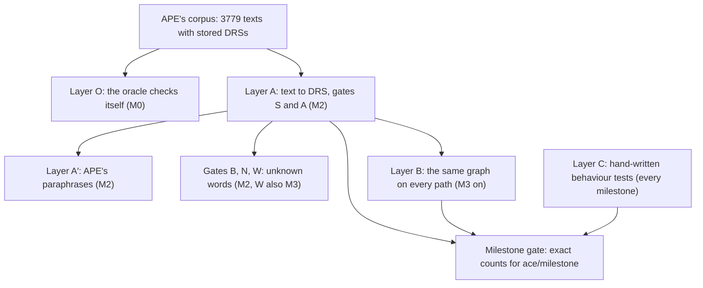

# Tests and Quality Gates

The ACE front end is finished when its tests say so. This page specifies every test of `.import ace`:
the rules each test follows; the external oracle, APE's regression corpus of 3779 ACE texts, each
stored together with the DRS (discourse representation structure, the formal reading of a text) that
APE, the reference parser of the Attempto project, computed for it; the functions that compare
zelph's analysis with APE's; the layers of tests built on them; the oracles that check what reaches
the graph; the name of every hand-written test; the Wikidata-style fixture the word tests run on; and
the gate every milestone must pass, with exact counts.

For a reviewer the point is that completion is measured, not asserted. Each milestone has a gate: a
test case that reads the current milestone and pins numbers, how many corpus texts are accepted with
exactly APE's DRS, how many are refused by a named construct, how many are rejected, and 100 % of the
cases in scope must pass. Nothing of APE enters zelph's repository: the corpus is fetched into the
build tree when the tests are configured, checked against a SHA-256 hash and read only in its first
five columns. APE itself runs during development to judge sentences the corpus lacks, but it is never
a build or test dependency. The tests are ordinary doctest cases in `src/test/test_ace.cpp`, part of
zelph's existing suite (`zelph_tests`, 2016 test cases at the time of writing), and they run under the
same `ctest` gate as everything else, the Jacobian performance guard included.

The tests need nothing from zelph that is not there today. They read the graph through clusters,
exact existence probes, name lookups and quiet runs, all of which are documented engine features of
zelph 1.1.0; the real runs further down this page show the oracles' mechanics on the current build.
The wording of the messages in the specified sessions is illustrative; their layout, classes and ids
are normative, and the tests assert those ([Messages](block.md#messages)).

This is what one corpus case checks, in the shape of corpus cases 58 and 793. The corpus stores APE's
DRS of the text; the expectation is computed from that DRS with the same classifier the front end
uses for its refusals, and the analysis of the text must match it, status, refused construct and DRS
alike. At milestone M2 the sentence parses, but individuals at the top level arrive only at M3, so
the expected outcome is a refusal naming `:individual/top-level`:

!!! example "Specified session — the behaviour this specification requires, not yet implemented"

    ```
    zelph> .import ace-drs
    zelph> %(ace/unsupported (keys (ace/drs-constructs (ace/ape->drs "drs([A],[object(A,man,countable,na,eq,1)-1/4])"))))
    (:individual/top-level)
    zelph> %(get (ace/analyse "There is a man.") :status)
    :refused
    zelph> %(get (ace/analyse "There is a man.") :refused)
    (:individual/top-level)
    zelph> %(ace/drs-equivalent? (ace/ape->drs "drs([A],[object(A,man,countable,na,eq,1)-1/4])") (get (ace/analyse "There is a man.") :drs))
    true
    ```

The corpus loop does this for every case, in the session's mode, and maps the verdict onto the
expectation table of [The Expectation of Every Corpus Case](#the-expectation-of-every-corpus-case).
From M3 on, the same case is `:accepted`, and the gate's numbers move with it.

In short, the tests establish:

- **Parity with APE on the corpus.** From M2, the 2682 corpus texts that APE's small lexicon covers
  give APE's DRS in strict mode; the 919 texts APE rejects are rejected; the 131 texts that need APE's
  large lexicon are reported as unknown words; the 46 texts whose stored output is wrong do not crash
  the front end. APE's stored paraphrases give the same DRSs as their originals.
- **Guessing that never changes a structure silently.** Unknown words are read by their position;
  four gates check that this never alters the reading of a sentence without saying so.
- **The same graph by every path.** From M3, a text, its DRS printed and read back, APE's DRS of it,
  its paraphrases and the native zelph it is shown as all build the same graph.
- **Behaviour, one test per behaviour.** About 180 fast hand-written tests (an estimate), each named
  after what it pins and carrying a comment that says why it exists.
- **Round trips.** Every answer re-enters as accepted ACE; the native zelph a block shows re-enters
  with no new node.
- **Atomicity.** A rejected or refused block changes nothing.
- **Work, counted and never timed.** Parsing stays linear in the token count, a block scans no name
  map, and the Jacobian guard of the engine stays green with its baselines unchanged.



## How Completion Is Verified

### The Definition of Done

A milestone is done when the items D1 to D11 of the [Definition of Done](plan.md#definition-of-done)
hold; M0 and M1 replace D1 and D2 by gates of their own. Six of the items are decided by tests this
page specifies:

- **D1 Gate:** the gate test case of the milestone passes at 100 % of its row in every mode it names,
  minus `known_divergences`, each of which is asserted to still diverge
  ([The Gates and Their Modes](#the-gates-and-their-modes), [Known Divergences](#known-divergences)).
- **D2 Refusals by id:** every corpus case meets [its expectation](#the-expectation-of-every-corpus-case):
  an accepted case outside the milestone's scope is refused naming an unsupported id of its own,
  never `[ace/syntax]` from M2 on and never a silent graph.
- **D3 Named tests:** every construct id the milestone adds has a test case named after its behaviour
  ([Naming](#naming)), and every id still refused inside the milestone's families has a refusal test
  asserting id, class and position.
- **D4 Granular and honest:** the [rules for every test](#rules-for-every-test) hold, user routes only
  (TA-3) and check mode with a commented opt-out (TA-8) among them.
- **D5 Docs:** the generated regions of the user page `ace.md` equal the generator's output (the test
  of [The Construct Table](#the-construct-table)).
- **D7 Full suite and the guard:** `ctest --test-dir build-release --output-on-failure` is green with
  every entry ([Fetching It: CMake](#fetching-it-cmake)), and [the Jacobian guard](#the-jacobian-guard)
  is green with its baselines unchanged.

### The Gates and Their Modes

The corpus harness runs two modes. **Strict** is APE's behaviour without guessing: an unknown word is
an error. **Guessing** is the default of the front end: an unknown word is read by its position
([Unknown words, words ACE lacks and near misses](grammar.md#unknown-words-words-ace-lacks-and-near-misses)).
APE's small lexicon (2011 entries) is loaded as the corpus overlay with
`{:source "ape-small" :replace true :generate false :guess false}`, decision
[DEC-CORPUS](decisions.md#dec-corpus). A gate is a set of assertions over a selection of cases in one mode:

| Gate | Mode | Asserts | From |
|---|---|---|---|
| S, keyword guard | strict | the 918 single-paragraph texts among the corpus rejections, fed as `ace` blocks, are each rejected with an error (never accepted, never refused: a refusal means a DRS was built, which is over-acceptance) and leave the cluster at 0 nodes; corpus 14 raises nothing; 3505, the one multi-paragraph rejection, cannot be fed as one block | M1 |
| S, analysis | strict | through `ace/analyse`: the 919 rejections (666 without a parse tree, 253 with one) are rejected; corpus 14 is accepted with the empty DRS (from M1); the 2682 runnable accepted cases give APE's DRS and the expected status; the 131 big-Clex cases give `[ace/unknown-word]`; the 46 eval-1 cases do not crash; the known divergences hold (from M2) | M1, M2 |
| A′ | strict | 2294 Core ACE and 524 NP ACE paraphrases give their case's DRS with sentence ids ignored; 97, 595, 1990 and 3547 are known divergences | M2 |
| A | guessing, with the overlay | the 2682 give the DRSs of strict mode; the rejections guessing accepts are a pinned, classified list; the 131 big-Clex cases are counted, and the equivalent count is a floor that may only rise | M2 |
| B | guessing, blind | only the closed word classes and the shipped vocabulary `ace-core`, no overlay: each of the 2682 is structure-equivalent, rejected with a hint, or announced; zero silent structure changes | M2 |
| N | guessing, nonce | every content word a guessed word could stand for is replaced by a nonce word; the expected DRS is APE's under the lemma map, an exact oracle | M2 |
| W | guessing, nonce | gate N's texts on an empty graph and on the Wikidata-style fixture: identical DRSs (M2) and the same created nodes (M3) | M2, M3 |
| rows | strict and guessing | the per-milestone row below; layer B over the row's accepted cases; the layer-C tests of the row's construct ids | M3 on |

A multi-paragraph corpus text is rejected as a whole when any paragraph is rejected, where APE
returns a partial DRS (corpus 3598). Corpus 3751, an identity between a name and the same name after
`the` (in an own sentence: "Moon is the Moon."), is refused for `:copula/identity` until M5 and
accepted from M5 ([DEC-NEQ](decisions.md#dec-neq)).

The gate test case reads `ace/milestone` through a probe, selects its row and pins the counts
exactly; advancing a milestone edits `ace/milestone` and the row's numbers together with the layer-C
tests of the new construct ids. The pass rate at a gate is 100 % of the row minus `known_divergences`.

| Gate | Requires |
|---|---|
| M0 | layer O; the four M0 corpus test cases; the keyword, error and construct-table tests marked M0; every engine test of the host work (built, green in `zelph_tests`); the fixture file with its self-checks marked M0 |
| M1 | strict: the 919 rejections through `ace/analyse` (666 + 253), case 14 accepted, the keyword-path sweep over 918; APE's small lexicon loads (2011 entries); every test marked M1, the generated-docs test and the class-question index test among them; the smoke cases |
| M2 | gate S: layer A over the 2682, the 919 rejections and case 14, the 131 lexicon gaps (3598 included), eval 1, A′ 2294 / 524, lookahead, mutation, work bound, the forced backtracking parser and the person-noun coverage; gate A: the 2682 as in gate S, the pinned rejections, the big-Clex floor; gates B and N; gate W's DRS part; the tests marked M2 |
| M3 onwards | the milestone's row below; layer B over the row's accepted cases (strict); gate W's node part; the layer-C tests of the row's ids |

### Per-Milestone Counts

The numbers below are provisional: strict mode, runnable accepted cases, computed by a research
classifier with the decisions applied. At M0 the production classifier replaces them, and construct
ids that the research classifier does not know move cases between rows from M4 on. "Refused by id"
counts cases whose DRS holds a construct not supported yet; layer B compares graphs on the cases each
relation can reach.

| Row | accepted | refused by id | layer B: text vs APE DRS | text vs Core ACE | text vs NP ACE | paraphrase classes / cases | accepted with `ace-math` |
|---|---|---|---|---|---|---|---|
| M1, M2 | 11 | 2671 | 7 | 7 | 7 | 0 / 0 | 11 |
| M3 | 767 | 1915 | 648 | 646 | 244 | 96 / 250 | 767 |
| M4 | 1183 | 1499 | 1036 | 1020 | 377 | 143 / 355 | 1183 |
| M5 | 1222 | 1460 | 1067 | 1045 | 381 | 144 / 357 | 1272 |
| M6 | 1490 | 1192 | 1263 | 1235 | 381 | 168 / 407 | 1540 |
| M7 | 1970 | 712 | 1712 | 1575 | 440 | 217 / 515 | 2029 |
| M8 | 2201 | 481 | 1901 | 1745 | 448 | 239 / 568 | 2265 |

The research classifier counted 481 runnable cases still refused at M8 without `ace-math`, each
holding a construct without a route in v1 or needing `ace-math`. Its largest groups:
`:or/in-head-or-statement` 171, `:rule/unsafe` 81, `:data/integer` 70, `:rule/disconnected-head` 68,
`:command/imperative` 29, `:formula/compare` 29, `:expr/arith` 24, `:neg/complex-in-body` 15,
`:data/real` 14, `:naf/top-level` 10. M0's recomputation changes two of these groups.
`:rule/disconnected-head`, a conclusion that introduces something its condition does not bind, has a
route from M4 ([DEC-DISCONNECTED](decisions.md#dec-disconnected)): on the current engine such a rule
makes exactly one witness for any number of bindings, in every semi-naive mode, so its cases leave the
refused column from M4 on wherever they hold no other unsupported id. And the research classifier
counted the plan-level context ids `:rule/unsafe` and `:rule/disconnected-head` as refusals, while
layer A, whose expectation holds DRS-level ids only, counts a case refused for nothing else as
accepted, and layer B counts a case whose block is refused for a context id without comparing (from
M4 a disconnected conclusion is no longer among them). [Constructs and
Refusals](constructs.md#construct-ids-by-milestone) lists every id with its milestone: 83 ids decide
refusals (76 at DRS level, 7 context ids), 57 of them are supported by M9 and 26 have no route in v1.
The M1 accepted cases are 15, 155, 687,
891, 963, 2096, 2104, 3515, 3516, 3517 and 3739; how many of them the smoke grammar of M1 parses is
pinned at M1 and may only rise.

**M0 recomputes the rows.** Once `ace/drs-constructs` exists, one slow test run classifies the 2813
normalised expected DRSs and counts, for each milestone Mn, the cases all of whose ids have `:since`
≤ Mn (with a row's `:import` treated as satisfied from M5), runnable or not, refused or not, plus Core
ACE, NP ACE and paraphrase classes on the same selection. The supported set is computed from the
construct rows, never by redefining `ace/milestone`. The per-id counts are pinned only after every
difference to the reference classification has been explained case by case.

An older, family-level table of planning numbers stays as a reference and is not edited: a case is in
scope there when every family letter of its expected DRS is mapped by the milestone. It is neither an
upper nor a lower bound of a gate, because refusals inside a mapped family remove cases, ids supported
before the rest of their family add cases (`:copula/located` is family V but arrives at M3), and the
question family is split over four milestones.

| Gate | Families mapped | In scope | Runnable | Big Clex | Refused by id | Core ACE | NP ACE | Paraphrase classes / cases |
|---|---|---|---|---|---|---|---|---|
| M0 | — | self-checks: 3779 terms read and printed back, 2813 expected DRSs self-equivalent, the family counts | | | | | | |
| M1 | 4 ids | rejection guard and smoke shapes | | | | | | |
| M2 | M1's ids | layer A: DRS equivalence on every runnable accepted case | 2682 of 2813 | 131 | all but M1's ids | 2395 | 539 | — |
| M3 | basic, T, Q | 860 | 841 | 19 | 1953 | 802 | 251 | 120 / 303 |
| M4 | + R, N, F, D | 1580 | 1546 | 34 | 1233 | 1457 | 461 | 201 / 483 |
| M5 | + A | 1629 | 1593 | 36 | 1184 | 1501 | 461 | 203 / 487 |
| M6 | + V | 1923 | 1849 | 74 | 890 | 1779 | 461 | 239 / 566 |
| M7 | + P, U, L | 2483 | 2395 | 88 | 330 | 2194 | 527 | 294 / 687 |
| M8 | + M, S | 2781 | 2653 | 128 | 32 (C) | 2395 | 539 | 322 / 754 |

### Budgets: Counts Always, Timings Only on an Idle Machine

The budgets and how each is measured are on [The Budget Table](plan.md#the-budget-table).
The rule for taking them binds the tests as well: counts (nodes, rules, test cases, work counters) are
taken whenever they are due; timings only on an idle machine, with the release binary of the commit
being recorded, three runs each, and the raw log kept; when anything heavy runs, the timing is
recorded as pending. Figures from earlier prototypes are yardsticks, never baselines, until they are
measured again.

Four budgets are read off this page's tests: the corpus layer A of gate S in one session (B4, at most
3 s, from M2), the packaged tier (B5, measured with
`python3 tools/check_install_tier.py --run build-release/bin/zelph_tests --budget 180`, see
[The Install Tier](#the-install-tier)), the slow-case allowance (B6, same section) and the parser work
(B7, [W-1](#w-1-bounded-work)). The engine A/B run (B10) belongs to [the Jacobian guard](#the-jacobian-guard).

## Rules for Every Test

These rules bind every test of the front end, hand-written or corpus-driven.

| Rule | Requirement | Why |
|---|---|---|
| TA-1 probe isolation | No Janet error may leave a top-level `%` line inside a loop of `test_ace.cpp`. Every probe runs inside `protect` and reports one `zelph/out` line; rejections are asserted on the keyword path (`interactive.process("")` throws `std::runtime_error`) or as data a probe prints. A `CHECK_THROWS…` on a `%(…)` line is allowed only in a test case that checks that one error, never in a loop. A probe may call `(zelph/import …)`. | An error at a `%` line throws out of `Interactive::process` and ends the test case, so one bad case would hide every later case of a sweep. The two crash classes that once made `protect` insufficient (a garbage-collector crash, and the import of a file that collects garbage from Janet) are fixed in zelph 1.1.0, so per-case isolation is the reason that remains. |
| TA-2 no math in shared fixtures | No fixture of a non-math test imports `math` or `ace-math`. A corpus slice with `ace-math` turns auto-run off first (TA-10). | `.import math` adds 5661 nodes and 418 rules (`.import ace-math`, math plus the evaluation module, 6135 and 456), and every later input line then pays an auto-run (about 12 ms per line in an earlier measurement; a 3733-case sweep went from 82 ms to 93 s). In check mode each run does about twice the matching (TA-8). |
| TA-3 user routes only | A test reaches a state the way a user does: ACE blocks, native statements, `.lang`, `.cluster`, `.save`/`.load`/`.load-partial`, the importer on the fixture dump, the public Janet API (`ace/ape->drs` is a public entry). Nothing is deleted, renamed or patched to provoke a code path. The one removal is the fixture's variant without the label marker, made with the user command `.remove`, and the test that uses it says why its state is legitimate. `[ace/internal]` has no reachable input and gets no test; the message format test uses the other ids. | A state built by force gets its accidental behaviour pinned as the desired one. |
| TA-4 granularity | One behaviour per test case, named after it, with a comment saying why it exists and which corpus ids it mirrors (`// acetexts 1454`). Corpus sentences in committed tests are short own sentences in the construct's shape, never bulk copies. ACE sentences inside comments stay in backticks. Comments go through the house prose filter (`rewrite-prose --prefix '//' --terms-from src/test/test_ace.cpp`, with `--term` for referent, anaphor, copula, construct, DRS, paragraph). | House rules; the backticks keep the prose filter from paraphrasing a sentence the test depends on. |
| TA-5 tiers | A case above about 0.2 s gets `* doctest::test_suite("slow")`; `"ace: the import registers the keyword"` stays unmarked, because every test file keeps one unmarked case. New slow cases s are allowed for new fast cases f iff s ≤ 1.25·F − N + 0.25·f, with F fast and N total cases at the start of the milestone, re-read each time from `zelph_tests --list-test-cases` with and without `--test-suite-exclude=slow`. The fast selection stays inside the 180 s budget and no case takes more than 25 % of it, timed on an idle machine. SUBCASE only where the setup is cheap. | `tools/check_install_tier.py` requires breadth = fast / all ≥ 0.80, and (F + f) / (N + f + s) ≥ 0.8 is the inequality above. doctest re-enters a test case once per leaf SUBCASE. |
| TA-6 assertions | Ids, classes and positions with `doctest::Contains` (`"[ace/syntax]"`, `"sentence 2, line 3, column 6"`); wording only in the few tests that pin it. Answers through `collect_answers`, `answers_contain`, `any_event_contains` of `test_helpers.hpp`. | Wording lives only in `ace/messages`. |
| TA-7 imports per layer | Oracle and layer A: `.import ace-drs` (no keyword, no node; its lexicon is the shipped vocabulary) plus the corpus overlay, which hides that vocabulary. Gates B and N: `.import ace-drs` without an overlay. Plan, `ace/zelph-of`, `ace/execute-drs!`: `.import ace-zelph`. Keyword, graph and answers: `.import ace`. Wikidata tests: the fixture first, then the module. Arithmetic: `.import ace-math` (slow). | The partial imports of [Modules, API and Data Shapes](api.md#what-a-partial-import-does). |
| TA-8 check mode | Every engine the test binary builds starts in `.semi-naive check`, also an `Interactive` a test constructs by itself; `run_both_modes`, `run_parallel_mode` and `run_single_core_mode` send `.semi-naive check` as well. A test that needs another mode opts out with `interactive.process(".semi-naive on")` right after the engine is built and a comment saying why: the tests in which a later block defeats a "not provably" conclusion, and tests whose work counters must not double. The one test that pins `[ace/w-naf-final]` stays in check mode. | See below. |
| TA-9 Wikidata data | Unit tests use the Wikidata-style fixture, `src/test/data/wikidata/ace-fixture.json`, compiled into the test binary and imported by each test through the real importer. The published Wikidata networks are never a test input or a dependency. | They are far too large for the suite, and their English labels are unusable for `ace` until the networks are regenerated with the current engine, which keeps every carrier's label. |
| TA-10 engine switches | `.auto-run` is a toggle without argument (`.auto-run off` is an error); `.load` and `.load-partial` turn auto-run off and say so. A test that needs a state toggles and checks the line printed (`Auto-run is now disabled.` / `enabled.`) or, from M1, `(zelph/auto-run?)`. `.timer off` keeps the timing line of each input out of transcripts, not the duration line a `.load` prints. | The toggle has no argument form. |

**Loop discipline.** Every corpus loop starts each case with `INFO("acetexts ", id, ": ", text)`,
then `INFO` for expected and actual; it uses non-fatal `CHECK`s, never `REQUIRE` inside a loop; count
guards come first, and every selection ends with `CHECK(checked == <exact>)`, because a glob that
silently matches nothing reads exactly like a glob over scripts that all pass. `ZELPH_ACE_CASE=<id>`
in the environment restricts every corpus loop to one case; the exact guards then become
`CHECK(checked <= 1)` plus `MESSAGE("restricted to acetexts ", id)`. Rerunning one case:
`ZELPH_ACE_CASE=1190 build-release/bin/zelph_tests -tc="ace corpus*"`. In the REPL, with a text of
the case's shape:

```
printf '.import ace-drs\n%%(ace/load-ulex! "<corpus dir>/prolog/lexicon/clex_lexicon.pl" {:source "ape-small" :replace true :generate false :guess false})\n%%(pp (ace/analyse "At most 2 dogs bark."))\n' | build-release/bin/zelph
```

**Graph counts.** `Nodes` comes from `node_count(collector, interactive)` of `test_helpers.hpp`, which
clears the collector and reads `.stat`; `Rules` from a file-local reader of the same shape; cluster
sizes from `(zelph/clusters)`; names per language from the `Name-of-Node Entries by language` block of
`.stat`; work counters through `interactive.graph()` (`name_map_scans()`). There is no Janet count API.

### What the Test Binary's Check Mode Changes

The test binary sets check mode as its default before the first test runs, so no test leaves the net
through the way it constructs its engine. For `ace` tests this changes three things. (a) Each
inference run does about twice the matching: after the delta fixpoint comes a classic pass over every
rule; a test that runs no inference pays nothing. (b) A fact that defeats an earlier "not provably"
conclusion fails a printing run with `Negation check: …`, while the quiet run that `ace` uses returns
the finding as data and raises only for errors; `ace` reports it as `[ace/w-naf-final]` (DEC-QUIET,
DEC-STRATA). (c) A contradiction that no record covers is met twice per run; the test of derived
contradictions therefore asserts one report per contradiction, not one per meeting.

Point (b) is the one a test author meets. The same defeat comes back as data from a quiet run and as
an error from a printing one:

```
zelph> .semi-naive check
Semi-naive evaluation: check
zelph> .auto-run
Auto-run is now disabled.
zelph-> .lang ace
ace-> (X ~ man, ¬(X ~ dead)) => (X ~ alive)
ace-> John ~ man
ace-> %(zelph/run-delta :quiet)
{:contradictions () :naf-final ()}
ace-> John ~ dead
ace-> %(zelph/run-delta :quiet)
{:contradictions () :naf-final ({:fact <zelph/node John ~ alive> :rule <zelph/node (¬(X ~ dead), (X ~ man)) => (X ~ alive)>})}
ace-> .auto-run
Auto-run is now enabled.
ace> Bill ~ man
(Bill ~ alive) ⇐ {(¬(Bill ~ dead)) (Bill ~ man)}
ace> Bill ~ dead
Negation check: 1 fact(s) no longer justified -- a negated premise they were derived under now holds:
  Bill ~ alive  (by (¬(X ~ dead), (X ~ man)) => (X ~ alive))
Error in line "Bill ~ dead": Negation check: 1 fact(s) derived under a negated premise that has come to hold, and nothing else derives them (listed above). Facts only accumulate, so they stay. This happens when a fact arrives after a negation was tested against its absence: a statement made later, or a rule set that negates what it derives itself.
```

With auto-run off, the quiet run after `John ~ dead` returns the defeated conclusion `John ~ alive`
with its rule under `:naf-final` and raises nothing. Once auto-run is on again, the same situation for
Bill makes the run that follows `Bill ~ dead` print the negation check and fail; in piped input the
session stops at that error. The fact `John ~ alive` stays, as the engine keeps every fact it derived
([Stratified Evaluation](../logic.md#stratified-evaluation)).

### Engine Switches

`.auto-run` has no argument form. A test toggles it and reads the state back:

```
zelph> %(zelph/auto-run?)
true
zelph> .auto-run
Auto-run is now disabled.
zelph-> %(zelph/auto-run?)
false
zelph-> .auto-run
Auto-run is now enabled.
zelph> .auto-run off
Error in line ".auto-run off": Usage: .auto-run  (a toggle; it takes no argument)
```

`(zelph/auto-run?)` reports the state without changing it; `.auto-run off` is refused with a usage
line and, in piped input, ends the session.

## APE's Regression Corpus

The Attempto project maintains APE together with a regression corpus, the file `tests/acetexts.pl`:
3779 facts of the form `text_drs_eval(…)`, each holding an ACE text, the DRS APE computed for it and
a verdict. It is the most complete public record of what ACE 6.7 means, and the front end's parity
with it is the backbone of the gates (decision [DEC-CORPUS](decisions.md#dec-corpus)).

| Figure | Count |
|---|---|
| facts in `acetexts.pl` | 3779, ids 1 to 3779, unique |
| eval 0 (APE's stored output is right) | 3733: 2813 accepted, 920 stored as rejections |
| eval 1 (APE's stored output is wrong) | 46, compared for robustness only |
| stored rejections | 920 = 667 without a parse tree + 253 with one; one of them, corpus 14, is a text of comments only and an expected acceptance, so the rejection gates cover 919 = 666 + 253 |
| accepted eval-0 cases APE's small lexicon covers | 2629, + 53 once the word-class prefixes written in the text are honoured = **2682 runnable** |
| accepted eval-0 cases that need APE's big lexicon (Clex) | 131, expected as `[ace/unknown-word]` in strict mode; Clex is never shipped or fetched |
| Core ACE paraphrases usable | 2395 (2172 marked `----` + 223 marked `SAME`) |
| NP ACE paraphrases usable | 539 (466 + 73) |
| paraphrase classes | 322 classes over 754 cases |
| texts with a blank line (paragraphs) | 15 |

These numbers were confirmed by execution: the current APE with its compiled-in small lexicon gives a
DRS equivalent to the stored one, sentence and token ids compared, for exactly the 2682; it rejects
130 of the 131 and returns a partial DRS for the last (3598, below); and it rejects every stored
rejection.

### Facts and Invariants

`acetexts.pl` has no licence header of its own and sits in an LGPL-3.0 repository; its column 7
holds IP addresses and host names (personal data); APE's big lexicon Clex is GPL-3.0 and derived from
COMLEX, whose distributor forbids redistribution; zelph is AGPL-3.0-or-later plus a commercial
licence, and its contributors grant acrion the right to relicense, which the Attempto authors did not.
Therefore:

- Nothing from APE is committed. Columns 6-8 (time, author, comment) are never parsed, stored,
  printed or copied: the extractor stops after column 5, and column 5 (the parse tree) is read only
  as "is it `[]`".
- Nothing from the big Clex enters the repository or a test dependency.
- The oracle functions below are written from this specification, never from APE's sources: the files
  of APE that the clean-room rules close (its grammar, tokenizer, anaphora resolver, lexicon and its
  DRS comparison and well-formedness utilities) stay closed while writing them
  ([The Clean Room](architecture.md#the-clean-room)). A `file:line` citation of APE in the specification is evidence for
  behaviour, never a reading instruction.
- The pinned commit `5f4d5354a45fb772763bf1a9543f508f15b28982` is recorded beside every use.

### Fetching It: CMake

The corpus is fetched into the build tree by `FetchContent` in `src/test/CMakeLists.txt`. The
declaration goes after `FetchContent_MakeAvailable(unordered_dense)`; the compile definition after
`target_link_libraries(zelph_tests …)` and the embedding of the older networks, next to
`ZELPH_PAPER_SCRIPT_DIR`, which is the precedent: an absolute path read only by slow cases, which
packages exclude.

```cmake
option(ZELPH_ACE_CORPUS "Fetch APE's regression corpus for the ACE tests (build tree only, never installed)" ON)
if (ZELPH_ACE_CORPUS)
    # APE is LGPL-3.0 and its corpus carries personal data in columns 6-8. It is
    # fetched into the build tree, read at test time (columns 1-5 only) and never
    # installed or committed.
    FetchContent_Declare(ape_corpus
        GIT_REPOSITORY https://github.com/Attempto/APE.git
        GIT_TAG 5f4d5354a45fb772763bf1a9543f508f15b28982)
    FetchContent_MakeAvailable(ape_corpus)   # APE has no CMakeLists.txt: populate only
    file(SHA256 "${ape_corpus_SOURCE_DIR}/tests/acetexts.pl" ZELPH_ACE_CORPUS_SHA256)
    if (NOT ZELPH_ACE_CORPUS_SHA256 STREQUAL "075d5e5bfc490cf92ba528b452e39e6cd9699e48a85472a50f9e60b096901e2b")
        message(FATAL_ERROR "tests/acetexts.pl in ${ape_corpus_SOURCE_DIR} is not the pinned corpus.")
    endif ()
else ()
    # A check that silently does not run reads exactly like a check that passed.
    message(WARNING "Not running the ACE corpus tests: ZELPH_ACE_CORPUS is OFF.")
endif ()

# ... after target_link_libraries(zelph_tests ...) and the older_networks block:
if (ZELPH_ACE_CORPUS)
    target_compile_definitions(zelph_tests PRIVATE ZELPH_APE_CORPUS_DIR="${ape_corpus_SOURCE_DIR}")
endif ()
```

- **Offline there is no silent skip.** With the option ON, a configure without network fails in
  `FetchContent`, exactly as the doctest fetch does. Without network, either configure with
  `-DZELPH_ACE_CORPUS=OFF` (which prints the warning) or point `FetchContent` at an existing clone at
  the pinned commit with `-DFETCHCONTENT_SOURCE_DIR_APE_CORPUS=<path>`; the SHA-256 check rejects any
  other `acetexts.pl`.
- Corpus test cases compile only `#ifdef ZELPH_APE_CORPUS_DIR`, and all of them are `slow`.
- The nonsense test over zelph's own text, the generated-docs test and the source rule of the work
  tests read the source tree through
  `target_compile_definitions(zelph_tests PRIVATE ZELPH_ACE_SOURCE_DIR="${CMAKE_SOURCE_DIR}")`, beside
  `ZELPH_PAPER_SCRIPT_DIR` for the same reason (slow only).
- The fixture dump is compiled into the test binary the way the older networks' `.bin` files are,
  because the fixture tests are fast and run where a package installs the binary without the source
  tree: `embed_files.cmake` gets an optional argument `PATTERN` (default `*.bin`, so the existing call
  stays as it is), and a second `add_custom_command` beside the existing one runs it with
  `-DINPUT_DIR=…/data/wikidata -DPATTERN=*.json -DFUNCTION=wikidata_dumps`, its output added with
  `target_sources`. The entry is named by the file's stem, `ace-fixture`.
- `test_ace.cpp` goes into `add_executable(zelph_tests …)`; stdlib files need no CMake edit (they are
  globbed and mirrored).
- The CMake comments are own comments and go through the prose filter with `--prefix '#'`.

**ctest.** The full gate is `ctest --test-dir build-release --output-on-failure`, 25 entries at the
time of writing: `zelph_tests` without a filter, `install_tier` and its four fixtures, the
`arch_baseline_*` checks, `exit_status_of_the_binary`, `timer_of_the_binary`,
`continuation_prompt_on_a_terminal`, `citation_names_the_project_version`,
`janet_programs_survive_garbage_collection`, `wikidata_subset_holds_what_its_criteria_keep` (the
selection criteria of the dedicated `ace` network), the two paper-timing checks and
`version_banner_names_the_linked_mimalloc`. The `ace` tests add no entry: they are doctest cases
inside `zelph_tests`.

### Extraction

`acetexts.pl` is valid UTF-8 with `:- encoding(utf8).` at line 30, and exactly 3779 lines start with
`text_drs_eval(`, one fact per line. The text column is always one single-quoted atom whose only
escapes are `\'` (226 times), `\\` (12) and `\n` (108); any other escape is an extraction error, never
a silent pass. The extractor, written in C++ inside the test, yields
`AceCase{int id; int eval; std::string text; std::string drs_raw; bool tree_empty;}` by a balanced
scan (quotes, brackets, parentheses) over columns 1-5, loaded once per process.

### The Corpus Lexicon and the Modes

The corpus session is `.import ace-drs` (the keyword-path sweep: `.import ace`) plus

```
(ace/load-ulex! "<ZELPH_APE_CORPUS_DIR>/prolog/lexicon/clex_lexicon.pl" {:source "ape-small" :replace true :generate false :guess false})
```

loaded before any per-case cluster. APE's small lexicon (LGPL, 2011 entries) replaces the front end's
own vocabulary as an overlay that writes no node; `:generate false` loads it without generated word
forms, so its lexical behaviour is APE's and the gates measure the grammar, not the form generator;
`:guess false` puts the session into strict mode. The file stays closed for humans: the reader is
written from the public lexicon specification and debugged through its own error messages.

Every corpus row names its mode:

| Mode | Session | Used by |
|---|---|---|
| strict | the overlay with `:guess false`: an unknown word is `[ace/unknown-word]`, nothing is guessed, no capitalised run is merged into one name (DEC-UNKNOWN, DEC-MULTIWORD) | layers O, A, A′, B; gate S; the rejection sweeps |
| guess | the same overlay loaded with `:guess true` (the default mode with APE's vocabulary) | gate A |
| blind | no overlay: `.import ace-drs` alone (it brings `ace-core`), guessing; only the closed classes and `ace-core` are known | gate B |
| nonce | blind, with every content lemma whose features a guessed word can have replaced by a nonce word | gate N |
| fixture | nonce, on the Wikidata-style fixture against an empty graph | gate W |

Layer-C tests run in the default mode (guessing) unless their row says strict.

### What Else the Fetched Tree Provides

| File | Use |
|---|---|
| `tests/testruns/drace_test_results.txt`, `dracenp_test_results.txt` | layer A′. Records start at `^\d{6} \[(----|SAME|FAIL|ZERO)\] `; continuation lines belong to the record; a final `true.` line is dropped (otherwise 3778 looks like a failure). `SAME`: the paraphrase is the text; `----`: the rest starts with `text + " --> "`, the paraphrase follows. Core ACE: 2172 + 223 = 2395 usable, 418 `FAIL`, 920 `ZERO`; NP ACE: 466 + 73 = 539 usable, 2271 `FAIL`, 920 `ZERO`. These stored paraphrases are the A′ source; the current APE's paraphrases differ in order and prefixes and are no better. |
| `examples/the_lol_policy.ace.txt` | the document-loading shape: 125 lines, 38 blank or whitespace-only, a multi-line `/** … */` header |
| `tests/test_apeexe.sh` | not run; its two ideas are mirrored in own words: a lexicon entry whose second argument names the symbol, and Unicode preservation |
| `tests/testruns/test_drs_to_tptp_out.txt` | unused: a deterministic function of the DRS APE parsed, so layer A already checks the same information; it reads classical first-order logic where zelph is a Horn model with negation as failure; 655 accepted cases have no translation, and its 920 `DRS is empty` records are the corpus rejections |

### Paragraphs and Multi-Paragraph Texts

Fifteen texts contain a blank or whitespace-only line: 3497, 3498, 3500, 3502, 3503, 3505, 3507, 3510,
3511, 3514-3518 and 3598. `ace/analyse` implements APE's text semantics on them, with one difference:
a text with a rejected paragraph is **rejected as a whole**, where APE returns the DRS of the
paragraphs before the failing one together with the error. In the corpus only 3598 shows it
(a one-sentence formula paragraph and then two paragraphs whose word `radius` needs the big Clex); in strict mode it is
rejected with `[ace/unknown-word]` like the other 130 big-Clex cases. The block path splits at the same
lines, one block per paragraph, and stops at the first failing paragraph. 3505 (`/*`, three blank
lines, `*/`, a rejection) cannot be fed as blocks, because two blank lines force a block out and the
rest becomes native input; block sweeps exclude it by an id list with a count guard of 1, and the
text path and a keyword test with one blank line cover it.

### Corpus 14

Corpus 14 is a text of comments only. The corpus stores `drs([],[])` and an empty tree for it, the
shape of a rejection, but APE gives no message for it, and the front end accepts a text without
sentences. Expected in every mode: accepted with the empty DRS, nothing refused, nothing written. The
harness therefore classifies an eval-0 case as a **rejection** iff its stored DRS is empty and its id
is not 14: **919 rejections, 666 without a tree and 253 with one**, plus case 14. The keyword-path
sweep feeds the 918 of them that are single paragraphs. Each must be rejected and leave the sweep's
cluster empty, as here for the shape of corpus 263 (`there is` before a definite noun phrase), in an
own sentence:

!!! example "Specified session — the behaviour this specification requires, not yet implemented"

    ```
    zelph> .import ace
    zelph> .cluster fz
    Active cluster: fz
    zelph> ace There is a horse. There is the cat.

    Error in line "ace There is a horse. There is the cat.": Not ACE [ace/syntax]: sentence 2, line 1, column 28: …
      There is <>the cat.
    ```

Piped input stops at the error, so the session ends there; the test catches the error and goes on.
It asserts the class and the id, never the wording, and then reads `(zelph/clusters)`: `fz` holds 0
nodes, because the analysis rejected the block before anything was resolved or written. A refusal
here, `Correct ACE, but zelph cannot use it`, would fail the test as well: it means a DRS was built
for a text APE rejects.

## The Oracle Functions

Six functions in the module `ace-drs` (milestone M0) let the tests compare the front end with APE.
They are public Janet functions ([ace-drs](api.md#ace-drs)), pure, and never raise.

### Reader and Printer

`(ace/ape->drs text)` reads APE's Prolog notation into the front end's DRS value; it returns nil on a
syntax error and never raises. Shapes it reads: `Cond-S`, `Cond-S/T`, `Cond-S/''`; the prefix
operators `-drs(…)` and `~drs(…)` (`op(400,fx)`); the infix operators `=>` and `v` (`op(500,xfx)`;
`v` is also an atom); `Label:drs(…)` (89 cases); a bare condition list `[[C1,C2]]` as a condition (57);
`formula/3`, `expr/3`, `int/1`, `int/2`, `real/1`, `real/2`, `string/1`, `list/1`, `set/1`;
non-ASCII unquoted atoms (2835 `õlu`); and the solo atoms `?` and `!` (3623). Numbers become canonical
decimal text. The reader is built with `<-`, `group`, `constant` and operator folding after the match,
never with PEG function captures (DEC-DRS-ENTRY), and with the fold form, because an alternation that
re-parses its primary on failure is exponential in the nesting depth. All 3779 terms read in about
0.1 s in an earlier measurement.

`(ace/drs->ape d)` prints canonical notation with the referents renamed A, B, … in order of first
occurrence. `drs->ape ∘ ape->drs` is the identity on all 3779 terms up to referent names.

### Proper-Name Normaliser

APE's own harness normalises only the stored DRS, because older corpus entries write proper names as
`object(R, Name, named, …)` conditions where APE now writes `named(Name)` arguments.
`(ace/normalise-ape-names drs)` reproduces that step for the expected side only:

1. Walk the **top-level** condition list in order. A condition `object(R, Name, named, _, _, _)-_`
   whose `R` is an unbound referent, or already `named(Name)`, is removed, and `R := (:named Name)` is
   substituted everywhere in the DRS, nested boxes included. If `R` is already bound to a different
   name, the condition stays.
2. Remove the now-bound referents from the top-level domain.

538 accepted cases use the old form, all 709 such conditions at the top level; 318 use `named(…)`
arguments directly; after normalisation no accepted case holds an `object(…, named, …)` and none
collapses to `drs([],[])`. Example: corpus 22 "John waits." becomes
`drs([A],[predicate(A,wait,named('John'))-1])`. Of the 538, the 499 that the small lexicon covers
equal the current APE's output after this normalisation and none without it.

### Well-Formedness

`(ace/drs-wellformed? drs)` returns true or a reason string. No referent is declared twice (globally);
every used referent is declared in an accessible box (the consequent of an implication sees its
antecedent, the second box of a disjunction sees the first, a question box is pushed onto the outer
box); every declared referent is used in its box; condition shapes and slot types follow the DRS
value grammar of [Modules, API and Data Shapes](api.md#drs-value-grammar).

### Matcher

`(ace/drs-equivalent? a b &opt opts)` decides whether two DRSs mean the same, and returns true, false
or `:budget`. It is written from this definition alone:

1. `a ⊑ b`: treat b's referents as distinct constants and find **one** substitution of a's referents
   under which every condition of a matches some condition of b (a homomorphism; several conditions
   may map onto one). Two groups match recursively; the same unary operator (`:neg :naf :can :must
   :should :may :question :command`) with matching boxes; the same binary operator (`:imp`, `:or`)
   with matching boxes pairwise, `:or` also swapped; `(:label L D)` against `(:label L' D')` when the
   labels unify and the boxes match; simple conditions unify argument by argument. Domains are
   ignored. The substitution is shared across nested boxes.
2. Equivalent ⇔ `a ⊑ b` and `b ⊑ a`.
3. Positions: the sentence id must be equal; the token id is never compared, because zelph's tokens
   are coarser than APE's (`n:wombat` is one token where APE counts three, `John's` two where APE
   counts three) and APE's guessing shifts its ids by two per guessed word. `{:ignore-sid true}`
   ignores the sentence id too (for paraphrases).
4. Search: the most constrained condition first; a budget of 10^6 steps per comparison whose
   exhaustion returns `:budget`, never a hang.

A homomorphism, because for positive existential conjunctions homomorphic equivalence is logical
equivalence: "There is a man. There is a man." is equivalent to "There is a man." with sentence ids
ignored. It is also what produced APE's own paraphrase verdicts. Pinned on own pairs, for example
(upper case for a's referents, lower case for b's constants): `[p(X),q(Y),r(X,Y)]` ⊑
`[p(u),q(v),r(u,v)]`, but not ⊑ `[p(u),q(v),r(v,v)]`. Rule 3 in a session:

!!! example "Specified session — the behaviour this specification requires, not yet implemented"

    ```
    zelph> .import ace-drs
    zelph> %(ace/drs-equivalent? (ace/ape->drs "drs([A],[object(A,man,countable,na,eq,1)-1/2])") (ace/ape->drs "drs([B],[object(B,man,countable,na,eq,1)-1/4])"))
    true
    zelph> %(ace/drs-equivalent? (ace/ape->drs "drs([A],[object(A,man,countable,na,eq,1)-1/2])") (ace/ape->drs "drs([B],[object(B,man,countable,na,eq,1)-2/2])"))
    false
    zelph> %(ace/drs-equivalent? (ace/ape->drs "drs([A],[object(A,man,countable,na,eq,1)-1/2])") (ace/ape->drs "drs([B],[object(B,man,countable,na,eq,1)-2/2])") {:ignore-sid true})
    true
    ```

### Classifier Contract

`ace/drs-constructs` and `ace/drs-families` classify a DRS by construct id and by corpus family; the
detection rules belong to [From Sentences to the Graph](semantics.md#the-classifier) and
[Numbers and Formulas](math.md#typing-and-construct-ids). This page pins their totals on the 2813 accepted eval-0 cases. The
family counts are exact: **R 839, T 578, N 509, P 482, V 379, Q 317, M 221, D 191, U 125, S 89, A 59,
C 32, F 19, L 13; basic-only 423.** One family per construct id reproduces them only with four rules:
an implication inside an if-box is R evidence (`:rule/in-body`, not `:naf/complex-in-body`); an
implication inside a question box is R evidence (`:rule/in-question`); classical negation inside a
question is N evidence (`:neg/atom-in-question`, `:neg/complex-in-question`); and the cardinality ids
apply to countable objects only, `:object/plural-count` to an integer quantity only (3204, a decimal
quantity of a measured mass noun, is U). A literal reading of the older evidence columns gave F 31; the twelve extra cases are
782, 783, 1011, 1012, 1212, 1231, 1966, 2990, 3317, 3360, 3363 and 3734.

Per-id counts are not pinned yet. Two research prototypes give reference counts that differ for many
ids because their detection rules differ (`rule/horn` 759 against 588, `copula/noun` 708 against 517,
`neg/fact` 65 against 152); the one that follows the specified detection rules (F 19) is the
reference. The M0 classifier test pins the production classifier's per-id counts after every
difference to that reference has been explained case by case. `:command` is `:command/imperative`;
`:object/cardinality` is split into `:object/at-most` and `:object/at-least`, whose case counts sum
to the old 264.

### Work Measure

Work is the number of rule attempts of one analysis, counted by the **counting variant** of the
grammar; the plain, counting and diagnostic variants and the backtracking variant for guessed words
are generated from the same rule builders ([The backtracking variant](grammar.md#the-backtracking-variant)). Every named
rule adds 1 to `(ace/state :work)` when it is entered, and failed attempts count too, because the
side effect survives backtracking. It runs only on request: `(ace/analyse text {:count true})` parses
with the counting variant instead of the plain one, and `(ace/last-work)` returns the count of that
analysis, the steps of the backtracking variant included; `(ace/last-work :backtrack)` returns those
steps alone (0 for a text without guessed readings). The plain grammar stays free of Janet calls.
Because the variants come from the same builders, the slow work test also asserts that the counting
variant gives the same `ace/analyse` result as the plain one on every corpus case.

## The Expectation of Every Corpus Case

For a corpus case with text `text` and stored DRS `drs_raw`, three values are computed in the session
of the test: `e` = `(ace/normalise-ape-names (ace/ape->drs drs_raw))`, the expected DRS; `u` =
`(ace/unsupported (keys (ace/drs-constructs e)))`, the construct ids of `e` that the current milestone
does not support, as a sorted tuple; and `r` = `(ace/analyse text)`. `ace/analyse` returns the DRS
also for a refused text, so the DRS is compared for every accepted runnable case, refused or not. At
M1 only the rejections and case 14 are gated; layer A over the accepted cases starts at M2, because
before grammar parity a sentence the smoke grammar does not parse is `[ace/syntax]`.

| Corpus case | Mode | From | Expected `r` | Failure text |
|---|---|---|---|---|
| eval 0, a rejection (919 = 666 without tree + 253 with tree) | strict | M1 | `:status :rejected` (any rejection id); `:accepted` and `:refused` both count as over-acceptance: a DRS was built | "accepted a text APE rejects" |
| the same | guess | M2 | `:rejected`, except the pinned list below, which is accepted as listed; the twelve other cases APE's guessing accepts are rejected with the id the list names | "guessing accepted a rejection that is not pinned" |
| eval 0, case 14 (comments only) | every | M1 | `:accepted`, DRS `drs([],[])`, nothing refused, nothing written | "a text without sentences is not empty ACE" |
| eval 0, accepted, needs the big Clex (131; 3598 rejected as a whole) | strict | M2 | `:rejected` with `[ace/unknown-word]` | "lexicon gap not reported as unknown word" |
| the same | guess | M2 | recorded, not gated case by case: each case counts as equivalent, equivalent up to lemmas, or other; the equivalent count is pinned at M2 as a floor that may only rise (lemma recovery on real words; APE's guessing keeps surface lemmas and gets 78) | "lemma recovery fell below its floor" |
| eval 0, accepted, runnable, `u` empty | strict | M2 | `:accepted`; `(ace/drs-equivalent? e (r :drs))` true | "different DRS", with both printed |
| eval 0, accepted, runnable, `u` not empty (whatever its families) | strict | M2 | `:refused`, `(r :refused)` = `u`, DRS equivalent; family letters are informational, ids decide | "refused for a construct the case does not use"; "valid ACE reported as invalid" when `:rejected` |
| eval 0, accepted, runnable (2682) | guess | M2 | exactly the result of strict mode (status, DRS, `:refused`): no runnable case has an unknown word, so none reaches guessing, and the separate parse of a capitalised run always succeeds where APE's does; for a case of `known_divergences` its guess-mode outcome | "guessing changed a covered text" |
| a context id (raised by `ace/plan`, such as `:rule/unsafe`, or, because it needs the graph and earlier blocks, by the resolution step: `:expr/as-data`, `:naf/unstratified`, `:rule/unsafe-hypothesis`, `:rule/endless-generation`) | — | — | never part of a corpus expectation: `u` and `(r :refused)` hold DRS-level ids only; layer C only | — |
| listed in `known_divergences` | as listed | M2 | the outcome the entry names for the mode; the loop asserts that the case still diverges, so a fix removes the entry | "divergence no longer diverges" |
| eval 1 (46: APE's stored output is wrong) | strict and guess | M2 | robustness only: no `[ace/internal]`, within the work bound, the same result twice; never compared | — |

`(r :refused)` equal to `u` is stricter than the refusal contract ("naming one of those ids"): both
sides come from the same classifier on equivalent DRSs, so anything else is a defect.

Some cases that once looked like divergences are ordinary members of the 2682 (shown here, as
everywhere on this page, by own sentences of the case's shape): 2923, "Sue meets the Qwerty." (`the`
followed by an undeclared capitalised word is a proper name, [DEC-THE-NAME](decisions.md#dec-the-name));
3751, "Moon is the Moon." (accepted in the DRS from M2, its `:copula/identity` refused until M5,
[DEC-NEQ](decisions.md#dec-neq)); 688, "Sue gives Tom Ann." with a declared ditransitive `gives` (the
separate parse succeeds, so the capitalised run is never merged,
[DEC-MULTIWORD](decisions.md#dec-multiword)). Strict mode never merges a capitalised run, so the
rejections 1400 and 1402, a sentence adverb ACE lacks before a name ("Certainly Mary sleeps."), stay
rejected in strict mode; in guessing mode they are accepted as one name each and are on the pinned
list.

### Known Divergences

`known_divergences`, a `std::map<int, Divergence>` beside the family loops with
`Divergence{const char* decision; const char* strict; const char* guess;}`, holds the eval-0 cases
where zelph deliberately differs from APE, each naming its decision and its outcome per mode. "Not
yet implemented" is never a divergence: that is a refusal by construct id.

| Id | Shape (own sentence) | Decision | strict | guess |
|---|---|---|---|---|
| 3192 | "A book is v:given toooo Sue by Tom." | DEV-DEPENDENT-PREP: the dependent-preposition slot of a `v:` verb takes only known prepositions | `:rejected` `[ace/unknown-word]` | `:rejected` `[ace/syntax]` (prepositions are never guessed) |
| 3195 | "Tom v:gives a book toooo Sue." | the same | the same | the same |
| 3196 | "Tom v:qqq a book www Sue." | the same | the same | the same |

APE itself rejects these three when it guesses. The deviations on eval-1 cases (an unterminated `/*`
in 3584; `%` in 3634 and 3635, which APE drops silently) are not listed, since eval-1 cases are never
compared; layer-C rejection tests pin them. Layer A′ has four known divergences of its own (below).

### The Rejections Guessing Accepts

In guessing mode with the corpus overlay, APE accepts 19 of the corpus rejections. Each gets the
outcome the front end's guessing rules give it; where the reading rules of the grammar decide a case
differently from a first guess, the grammar's rules win and the entry follows them, with the deciding
rule recorded in the comment beside it. Each row shows the case's shape in an own sentence, with the
unknown word of that sentence; the test reads the case's text from the fetched corpus.

| Id | Shape (own sentence) | Unknown word | Expected in guessing mode | Rule ([DEC-UNKNOWN](decisions.md#dec-unknown) unless named) |
|---|---|---|---|---|
| 724 | "A woman very is tired." | `very` | `[ace/unknown-word]`, "ACE has no …" hint | an English function word ACE lacks is never guessed |
| 732 | "A dog barks almost." | `almost` | the same | the same |
| 1590 | "Everything that somebody buys is sold by somebody else." | `else` | the same | the same (`else` is also one edit from the overlay's `ease`) |
| 1634 | "There is a woman who sings. The woman who also dances." | `also` | the same | the same |
| 1936 | "Sue is not been by Tom." | `been` | the same | `been` is a form of the copula, a function word ACE lacks, never the participle of a guessed verb |
| 1395 | "Sue belives that Tom owns a car." | `belives` | `[ace/unknown-word]` with the suggestion and the prefix to insist (`v:belives`) | one edit from a lexicon form: a typo writes nothing |
| 1016 | "Sue blahblah." | `blahblah` | `[ace/syntax]` | a guessed form gets the readings its form allows: without `-s` there is no finite singular verb reading, and agreement is kept |
| 1862 | "Something that linkedTo something that linkedTo something linkedTo it." | `linkedTo` | `[ace/syntax]` | the same |
| 1949 | "A q1 q2 q3 q4." | `q1` … `q4` | `[ace/syntax]` | adverbs only for `-ly`; stacked attributive adjectives need `and`; no finite singular reading for `q4` |
| 2109 | "Every woman buys a car blahblah." | `blahblah` | `[ace/syntax]` | adverbs only for `-ly` |
| 3219 | "Mary, can glorp!" | `glorp` | `[ace/syntax]` | APE's parse reads the unknown verb as a lower-case proper name, which the front end never guesses; with the verb known, APE rejects the text too |
| 3232 | "Mary wants to can glorp." | `glorp` | `[ace/syntax]` | the same |
| 898 | "A woman Z gives her own son W a unknownword." | `unknownword` | accepted, `unknownword` a guessed noun | **by design**: an unknown content word in a noun slot |
| 1338 | "Everybody who owns a house that he/she works-in is a home-worker." | `home-worker` | accepted | by design |
| 1341 | "If somebody owns a house and he/she works-in the house then he/she is a home-worker." | `home-worker` | accepted | by design |
| 1342 | "If somebody owns a house and works-in the house then he/she is a home-worker." | `home-worker` | accepted | by design |
| 2193 | "A dog slooowly barks." | `slooowly` | accepted, a guessed `-ly` adverb | by design (two edits from `slowly`, so no typo) |
| 3582 | `A c-comment is "x/*remark*/y".` | `c-comment` | accepted | by design |
| 3239 | "Mary wants to glorps." | `glorps` | accepted, `glorps` a guessed infinitive | by design: every guessed word has infinitive readings with the form as its lemma, so `to glorps` is a to-infinitive of an unknown verb `glorps` |

Beyond APE's 19, guessing mode merges a capitalised run into one name where the separate parse fails,
so two more rejections are accepted:

| Id | Shape (own sentence) | Expected in guessing mode | Rule |
|---|---|---|---|
| 1400 | "Certainly Mary sleeps." | accepted, one name "Certainly Mary", `[ace/w-multiword]` | DEV-MULTIWORD ([DEC-MULTIWORD](decisions.md#dec-multiword)) |
| 1402 | "Perhaps Tom sleeps." | accepted, one name "Perhaps Tom", `[ace/w-multiword]` | DEV-MULTIWORD |

The pinned list `guess_accepted` (`std::map<int, GuessAcceptance>`,
`GuessAcceptance{const char* klass; const char* reason;}`) starts with the nine accepted ids above:
898, 1338, 1341, 1342, 2193, 3239 and 3582 by design, 1400 and 1402 for DEV-MULTIWORD. The
guessing-mode rejection loop asserts that the set of accepted rejections equals the keys of
`guess_accepted`, and, for the twelve other ids of APE's list, the rejection id the table names
(`guess_rejected`, `std::map<int, const char*>`). A rejection that becomes accepted later fails the
loop with its text. It is either a defect of a rule above (a typo or a function word that slipped
through: the rule is fixed, never the list) or an unknown content word in a content slot, which joins
the list with class "by design" and the word that was guessed.

## Layers

The tests are organised in layers, from the oracle checking itself to hand-written behaviour tests.

### Layer O: The Oracle Checks Itself

Layer O runs at M0, before any parser test. Fast, on hand-written APE terms: the reader shapes, the
printer's canonical form, the normaliser's two steps, each well-formedness reason, each matcher rule
with its example pair, the classifier on one term per construct id. Slow, on the corpus: the count
guards, every expected DRS well-formed and equivalent to a renamed copy of itself (2813, none
`:budget`), the reader/printer round trip on all 3779 terms, the family counts.

| Name | Pins | From |
|---|---|---|
| `ace oracle: the reader reads every condition shape of APE's notation` | one hand-written term per shape through `ace/ape->drs`: `Cond-S`, `Cond-S/T`, `Cond-S/''`, `-drs(…)`, `~drs(…)`, `=>`, `v` as operator and as atom, `Label:drs(…)`, a bare condition list `[[C1,C2]]`, `formula/3`, `expr/3`, the data terms `int/1`, `int/2`, `real/1`, `real/2`, `string/1`, `list/1`, `set/1`, a non-ASCII unquoted atom (2835 `õlu`) and the solo atoms `?` and `!` (3623); numbers come back as canonical decimal text; a syntax error returns nil and raises nothing. Every corpus expectation starts with this reader, so a misread shape would show up as a wrong verdict of an unrelated case | M0 |
| `ace oracle: the printer renames referents in order of occurrence` | `(ace/drs->ape d)` prints canonical notation with the referents renamed A, B, … in order of first occurrence, so two terms that differ only in referent names print alike; on the reader test's terms `drs->ape ∘ ape->drs` is the identity up to referent names (the round trip over all 3779 terms is a corpus test) | M0 |
| `ace oracle: old-style named objects are bound to named(N) everywhere` | the normaliser's steps on own terms: the shape of 22 "John waits." gives `drs([A],[predicate(A,wait,named('John'))-1])`; the substitution reaches nested boxes; the bound referent leaves the top-level domain; a condition whose referent is already bound to a different name stays | M0 |
| `ace oracle: a referent declared twice or used outside its scope is not well-formed` | `ace/drs-wellformed?` returns a reason string for each reason on its own term (declared twice; used outside every accessible box; declared and never used in its box; a condition shape or slot type outside the slot table) and true for one term per accessibility rule (the consequent sees the antecedent, a disjunction's second box the first, a question box the outer box) | M0 |
| `ace oracle: equivalence is a homomorphism in both directions` | the matcher's rules 1-2 on own pairs: `[p(X),q(Y),r(X,Y)]` ⊑ `[p(u),q(v),r(u,v)]` but not ⊑ `[p(u),q(v),r(v,v)]`; several referents may map onto one, so "There is a man. There is a man." and "There is a man." are equivalent under `{:ignore-sid true}`; groups, unary operators and labelled boxes match recursively, with one substitution shared across nested boxes; domains are ignored; a pair with `a ⊑ b` but not `b ⊑ a` is not equivalent. The matcher is written from its definition alone, so these pairs are its reference, not APE | M0 |
| `ace oracle: a disjunction matches with its boxes swapped` | `v(D1,D2)` is equivalent to `v(D2,D1)`; `=>(A,C)` is not equivalent to `=>(C,A)`: only a disjunction is also tried swapped | M0 |
| `ace oracle: token ids are never compared, sentence ids only unless ignored` | two terms that differ only in token ids are equivalent; two that differ in sentence ids are not, and are equivalent under `{:ignore-sid true}` | M0 |
| `ace oracle: an exhausted search budget is reported, not a hang` | a pair whose search needs more than 10^6 steps (many interchangeable conditions and no homomorphism) returns `:budget`, which a corpus loop reports as the verdict `budget` | M0 |

The classifier's fast tests belong to the construct-table area, and the four slow M0 test cases are
listed with the corpus test cases below.

### Layer A: Text to DRS

Layer A checks `ace/analyse` against the corpus without touching the graph (gates S and A). One
`Interactive` per test case, `.import ace-drs`, the corpus overlay in the test case's mode, auto-run
off, one protected probe per case: `%(ace-test/compare <text> <drs_raw> {:ignore-sid false})` prints
`ACE-CMP <verdict>\t<detail>`, with the verdict one of `equal`, `different`, `status`, `refusal`,
`rejected`, `budget`, `internal-error`. The C++ loop maps the verdicts onto the expectation table.

**Gate S** (strict) has one test case per family, basic and the 14 family letters; a case with several
families is checked in each of their test cases, so a failure names every family involved, and the
list of test cases never changes when a milestone advances. **Gate A** (guessing) has three test
cases: one over the 2682 runnable cases (the strict result again), one over the 919 rejections (the
pinned list), one over the 131 big-Clex cases (the recorded counts and their floor).

`ace-math` is not imported here, so `:data/integer`, `:formula/compare` and `:expr/arith` are refused
(`[ace/unsupported]` before M5, `[ace/needs-math]` from M5). The math slice, 98 accepted cases holding
a `formula`, `expr` or integer-data id, 95 of them runnable, runs again in strict mode with
`.import ace-math` and auto-run off in the test case `"ace math corpus: formula and term cases agree
with APE"` of [Numbers and Formulas](math.md#tests). That test keeps its own id lists for the rejections
and the eval-1 cases and asserts the eval-1 ones for robustness only, never through
`known_divergences`; 3598 is a big-Clex case there too, rejected as a whole with `[ace/unknown-word]`
and never compared as a DRS.

### Layer A′: APE's Paraphrases as Further Inputs

At M2, in strict mode: for every runnable case with a stored Core ACE paraphrase (2297 of 2395) or NP
ACE paraphrase (525 of 539), `ace/analyse` of the paraphrase gives a DRS equivalent to the case's
expected DRS under `{:ignore-sid true}`, with the same status and `:refused` as the case. **2294 Core
ACE and 524 NP ACE cases are gated.** Four are known divergences, listed in
`known_divergences_aprime`, because the small lexicon lacks a word of the stored paraphrase and APE
itself rejects it: 97 (`trusted`, written `a:trusted` in the text), 595 (`located`, written
`a:located`), 1990 (`genetic`, written `a:genetic`), all Core ACE, and NP ACE 3547 (the passive needs
the participle `asked`). Expected for them: the paraphrase is `:rejected` with `[ace/unknown-word]`.

### Layer B: Graph Oracles Without an Expected Graph

From M3, in strict mode, with auto-run off (no inference runs, since the front end infers only for a
question or under auto-run) and `run_parallel_mode`. The inputs are the accepted cases holding no
question id and no `:command/imperative`: a question asserts nothing, so a graph comparison says
nothing about it; answers are layer C's. A case whose block is refused for a context id builds
nothing on either path and is counted, not compared. Every comparison uses G-1 and G-2 (below).

| Relation | Paths compared |
|---|---|
| paraphrase classes | every member against the first member (322 classes, 754 cases overall) |
| text against `core_ace`, text against `np_ace` | the text against its paraphrase |
| text against APE's DRS (path p4) | `ace/analyse` and `ace/execute-drs!` of the text against `ace/execute-drs!` of the normalised expected DRS: one production mapping, so every representational difference that does not reach the graph is tolerated (DEC-DRS-ENTRY) |

This relies on properties specified elsewhere: individuals are content-addressed, `<Head>-<16 hex>`
([DEC-INDIVIDUALS](decisions.md#dec-individuals)), so G-1 can compare node counts; provenance creates
no graph node ([DEC-PROV](decisions.md#dec-prov));
helper rules are content-addressed (`ace:naf-<16 hex>`); the profile pin and the individual marks are
bookkeeping of the ACE paths that G-1 counts. Path p4 runs through `ace/execute-drs!`, so both sides
of a layer-B comparison write them alike. (Gate B, below, is a different thing: the blind corpus run.)

### The Guessing Gates B, N and W

These gates run at M2 (gate W's node part from M3) and check that reading unknown words by their
position never changes a structure without saying so ([Guessed readings](grammar.md#guessed-readings),
[DEC-UNKNOWN](decisions.md#dec-unknown)).

**Gate B, blind.** The 2813 accepted eval-0 cases (2682 + 131) with no overlay: only the closed word
classes and `ace-core` are known. Every case must end in one of:

- **structure-equivalent** to the expected DRS: `ace/drs-equivalent?` after replacing the lemma of
  every `object`, `predicate`, `property` and `modifier_adv` condition by one constant on both sides,
  and treating a guessed noun's `countable … eq 1` and `mass … na na na` as equal (a mass noun without
  a measurement is one portion, DEC-PLURALS, so both readings map alike);
- **rejected with a hint**: `[ace/anaphor]` with the guessed-noun hint, `[ace/syntax]` with the
  guessed-token hint line, `[ace/unknown-word]` for a never-guessed word, `[ace/too-ambiguous]`;
- **announced**: accepted with `[ace/w-guess-ambiguous]` or `[ace/w-compound]`.

**Silent structure changes: zero.** A case that cannot meet this is a defect of the guessing rules,
fixed there; there is no list of exceptions. The test prints its four counts per group (2682, 131)
and, beside them, APE's blind baseline on the same input without `ace-core` (620 equivalent, 1315
structure-equivalent, 441 rejected, 400 of them on gender, and 306 silent misparses). The 919
rejections run blind as well; their acceptances are printed, not gated (APE accepts 199).

**Gate N, nonce words.** For each of the 2682 runnable cases: parse the text in strict mode (gate S's
parse); for every content leaf whose features a guessed word can have (a noun of neuter or undefined
gender, an intransitive adjective, an adverb, a verb other than the copula that is not used with a
dependent preposition), map its lemma to a nonce lemma, one consistent map per case, and replace the
token by `(ace/inflect nonce tag)` for the leaf's tag; an adverb's nonce word ends in `-ly`. Untouched
are names, prefixed words, prepositions, measurement nouns, function words, `something` and `somebody`,
the person nouns (gender human, masculine or feminine in the overlay), transitive adjectives and verbs
with a dependent preposition, because a guessed word has no such valency and no gender beyond
`:guess`; untouched is also the verb of a case whose double-object frame holds two adjacent names (the
shape of 688, "Sue gives Tom Ann."), because a guessed double-object frame never splits a capitalised
run (DEC-UNKNOWN), so a guessed verb would read the two names as one. The new text is analysed blind. The
expected DRS is `e` with the lemma map applied: an exact oracle for position-based reading, lemma
recovery and number, independent of `ace-core` and of any graph.

Nonce lemmas come from a fixed generator: lower-case ASCII, in no lexicon and no graph, no core
spelling, no near miss of a known word (so no typo rejection), monosyllabic where a synthetic
comparison is needed, and round-trip unique: `ace-lexicon/lemma-candidates` of every form
`ace/inflect` generates gives back exactly the nonce lemma with no rule-order choice (so no
`[ace/w-lemma]`; `tist` fails, because `tisted` also analyses as `tiste`). A fast test pins these
properties for the generator's first 200 words. The outcomes: (i) the status of gate S's strict
parse, `:accepted` or `:refused` with the same ids (at M2 most cases are refused by id, and their DRS
is compared as in layer A), with exactly the mapped DRS; (ii) rejected `[ace/anaphor]` with the guessed-noun hint, allowed only for a text that contains
`he she him her his himself herself` outside strings (a guessed noun reads as neuter until `who` fixes
its gender); (iii) accepted with `[ace/w-guess-ambiguous]`, counted; (iv) `[ace/too-ambiguous]`,
counted, its count pinned at M2 as a ceiling that may only fall. Anything else fails, a silent DRS
difference first of all. The count of (i) is pinned at M2 as a floor.

The text "A dog barks." becomes, under the map dog → dalk and bark → glonk, "A dalk glonks.",
and its expected DRS is APE's with the same map applied:

!!! example "Specified session — the behaviour this specification requires, not yet implemented"

    ```
    zelph> .import ace-drs
    zelph> %(ace/drs-equivalent? (ace/ape->drs "drs([A,B],[object(A,dalk,countable,na,eq,1)-1/2,predicate(B,glonk,A)-1/3])") (get (ace/analyse "A dalk glonks.") :drs))
    true
    ```

`dalk` is read as a noun by its position after the article, `glonks` as a verb in the third person
singular, and its lemma `glonk` is recovered by the morphology, not taken from the surface.

**Gate W, Wikidata parity.** Gate N's texts on an empty graph and on the Wikidata-style fixture (its
current variant): the DRSs are identical (M2), because nothing before execution reads the graph:
lemmas never come from labels or `ace` names. From M3, each case that is accepted and supported is
also executed in its own cluster, dropped afterwards, through `ace/execute-drs!` on both graphs: the
`(word, role)` pairs resolved by step 4 of word resolution (to be created, named by their symbol in
`ace`) are the same on both graphs, except those that step 3 bound on the fixture, which create
nothing and appear in the block's `word-senses` note ([The word-senses Note](words.md#the-word-senses-note)). The comparison
reads the resolution record of the execute result (`:resolved`).

### Layer C: Hand-Written, With the Answers a User Sees

Layer C is one test case per behaviour, with `run_both_modes`, `.import ace` (never math, TA-2), the
helper `run_ace`, and `answers_contain`; the names are listed under
[The Tests by Name](#the-tests-by-name). Each milestone seeds its tests with the shortest corpus cases
the small lexicon covers; the test writes its own sentence in that shape and cites the id. The table
gives the ids and, for each, an own sentence of its shape.

| Milestone | Construct ids | Seeds: corpus id and an own sentence of its shape |
|---|---|---|
| M1 | name/proper, object/count, copula/noun, question/yes-no | 2104 "Sue is a nurse. Sue is a nurse.", 155 "Is there a horse?" |
| M3 | verb/\*, adj/positive, adj/transitive, adj/comparison, of/relation, copula/located, question/wh, data/string, object/something, individual/top-level | 22 "Sue sings.", 1141 "Sue is older than Tom.", 259 "A small mistake is in the letter.", 249 "Who sings?", 1593 'A word is "xyz".', 266 "There is something. It sings.", 1 "there is a horse." (lower-case initial); discourse 274, 808, 3507; 2923 "Sue meets the Qwerty." |
| M4 | the rule, negation and "not provably" ids [supported from M4](constructs.md#supported-from-m4), `rule/disconnected-head` among them, or/in-body, or/in-question | 2052 "All cats sleep.", 71 "Each woman is happy.", 707 "There is no dog.", 2981 "Y is not Y.", 72 "No woman is sad.", 342 "If Sue sings then Sue dances.", 174 (generative and unsafe: refused, `ace rules: unsafe and endlessly generating rules are refused by id`), 1416 "It is not provable that Sue sings." (refused, `:naf/top-level`); a conclusion connected to nothing its condition binds, "If a man waits then a dog barks.": one dog for any number of waiting men, and no second one in a later run, in every semi-naive mode (`ace rules: a conclusion unconnected to its condition makes one witness for every binding and run`, [DEC-DISCONNECTED](decisions.md#dec-disconnected)); the three forms of a nested conditional ([DEC-NESTED-IMP](decisions.md#dec-nested-imp)): "If John waits then every man sleeps." (switch), "Every man owns a dog that every cat hates." (generator over a then-box referent), "Every man sees every dog." (flattened) |
| M5 | formula/\*, expr/arith, data/integer, copula/identity | 2384 "3 < 4.", 3633 "Y=Y.", 1591 "Sue's age is 25." (the arithmetic tests own these); 3751 "Moon is the Moon." |
| M6 | mod/pp, mod/adverb, question/where-when-how | 1524 "A horse runs fast.", 901 "A woman sings softly.", 2200 "How is Sue?" |
| M7 | the P, U and L families, question/how-many | 1213 "3 dogs bark.", 484 "There are 2 cats.", 33 "some water is cold.", 2395 "{ Sue } sings."; 2736 "2 kg of pears fall." (refused, `:object/measure`) |
| M8 | modal/\*, sub/that-clause | 1454 "Sue can swim.", 1360 "Sue believes that Tom sings.", 3187 "Sue wants to dance." |
| M9 | no construct id | the derivation echo and justified answers (`:echo`, `:justify`), `ace-retract`, and the use of the provenance that every block writes from M1 on (DEC-PROV) |
| no route | command/imperative, or/in-head-or-statement | 2016 "Sue, sing!", 188 "A woman sings or she dances." (refused by id at every milestone) |

Reasoning seeds: APE's 289 sentences that translate to OWL or SWRL (206 axioms, 43 SWRL rules, 34
refused) mark the Horn fragment; layer-C tests write own premises in those shapes and assert the
entailments, not the parse.

## Oracles Defined Once

Every other part of the specification refers to these oracles by name and none restates them.

### RT-1: Answers Re-Enter

Every answer the front end prints is itself accepted ACE, so a user can paste it back. For every
`Answer:` line L a layer-C test receives:

1. Strip `Answer: `, then a leading `Yes. ` or `No. `; call the rest S. `No answer.` and the final
   `… and N more answers.` line are not ACE and are skipped. The sentences that
   `(ace/option :justify true)` adds after an answer (M9) are not part of L; the justify test checks
   them.
2. If S starts with `It is not provable that`: re-enter **the question that produced L**, after the
   same premises, in a fresh cluster; the answer line must equal L.
3. Otherwise S must be accepted: entered as an `ace` block in a fresh cluster after the original
   block, it raises nothing (a refusal or rejection raises), and from M2 `(ace/analyse S)` is
   `:accepted`. It also leaves the cluster at **0 nodes** with Rules unchanged, except for the lines
   whose re-entry may legitimately write something new, for which only acceptance is checked: a line
   that names a witness (an engine-made node rendered as an indefinite, "John owns a car."), whose
   re-entry may create a new individual; a how-many line; a line that names a node through a name in
   another language (a node named only under `.lang zelph`, which re-enters as an `ace` node of that
   name); and a `Yes.` line whose atom the graph holds only inside a native fact with more objects
   ([DEC-YESNO-WIDER](decisions.md#dec-yesno-wider); the test `ace questions: a native fact with
   several objects answers a single-member yes/no question`), whose re-entry writes the narrower
   fact. A refused or rejected S fails, since a refused block also creates 0 nodes and the node count
   alone would pass vacuously. A `word-senses` note printed by the re-entry is allowed.
4. Exception by milestone: when S uses a construct supported only later (a `No. It is false that …`
   answer at M1-M3, reachable through a native refutation, needs `:neg/fact` of M4), S must be refused
   with `[ace/unsupported]`, and every refused id must have a non-nil `:since`. An answer that needs a
   construct without a route is a verbaliser defect.
5. The answers to a universal question ("Is it true that every woman is a human?", M4,
   [DEC-QUNIV](decisions.md#dec-quniv)) are exempt: their `Yes.` and `No.` lines are a rule or a
   negated universal, which re-enter as such and not as a statement the graph already holds
   ([Questions That Hold a Conditional](answers.md#questions-that-hold-a-conditional)).

!!! example "Specified session — the behaviour this specification requires, not yet implemented"

    ```
    zelph> .import ace
    zelph> ace John is a man. Is John a man? Is Bill a man?

    Answer: Yes. John is a man.
    Answer: It is not provable that Bill is a man.
    zelph> .cluster rt
    Active cluster: rt
    zelph> ace John is a man.

    zelph> ace Is Bill a man?

    Answer: It is not provable that Bill is a man.
    zelph> .cluster
    Active cluster: rt
      rt: 0 node(s)
    ```

The first answer re-entered as a statement adds nothing; the second is checked by asking its question
again, which gives the same line.

### RT-2: The Verbaliser Reads Back

For the DRS d of an accepted text: `V = (ace/verbalise d)`. `{:refused id}` is allowed and counted
(`MESSAGE`; APE's own verbaliser round-trips 2395 of 2813, 85 %). Otherwise `(ace/analyse V)` has the
same status and `:refused` as the text and a DRS equivalent to d under `{:ignore-sid true}`, and for
an accepted text without questions the graphs of the text and of V satisfy G-1 and G-2. A text that
re-parses to something else is a failure, never tolerated. APE's verbaliser is no referee here: it
renders questions as `# ...`, drops `the` before names, puts a space before the final punctuation
after a guessed word, and drops the backquotes of a multi-word name.

### RT-3: Native Equivalence of the Shown zelph

With `(ace/option :show-zelph true)` a block prints the `ace/zelph-of` lines of its write actions, the
native zelph it writes. Without Wikidata, entered natively **under `.lang ace`** in a fresh cluster
after the block, the lines that name only content (`ace`), core names and rule variables leave the
cluster at 0 nodes, and G-2 holds afterwards; under `.lang zelph` the same lines create new nodes,
because content lives in the naming language `ace` (DEC-CONTENT-NS). Lines naming internal vocabulary
(named in `zelph`: helper rules and atoms `ace:naf-…`, refutation markings `((F) ~ refuted)`, events
`ace:occurrence`, `ace:event-…`, `ace:manner`, `ace:empty-string`, …) or the math stack, which pass
natively in neither language, and lines with string data are checked by G-2 only. On a Wikidata graph
`ace/zelph-of` adds the resolved nodes as display only, and RT-3 does not apply (DEC-WIKIDATA).
Rendered rule variables match `^([A-Z]|_[A-Za-z0-9]+)$`; natively `X1` is a constant
([DEC-VAR-LETTERS](decisions.md#dec-var-letters)). A one-condition rule is printed as zelph lists the
rule the front end builds, a one-element condition set: `(*{(X ~ man)} ~ conjunction) => (X ~ human)`
([What ace/zelph-of Prints](semantics.md#what-acezelph-of-prints),
[DEC-ONE-CONDITION-PRINT](decisions.md#dec-one-condition-print),
[DEC-RECORD-SINGLE](decisions.md#dec-record-single)). That is the form RT-3 enters natively and, on
a graph that lacks the rule, the form that builds exactly the rule the front end builds; written
without the condition set, the line is the same rule, and its contradictions are recorded alike.

### G-1 and G-2: The Same Graph

Two paths P and Q of one input build "the same graph" iff G-1 and G-2 hold.

**G-1, exact.** In fresh clusters `g1` and `g2`: build P in `g1`, then Q in `g2`, and `g2` holds 0
nodes; drop both; build Q in `g1`, then P in `g2`, and `g2` holds 0 nodes; drop both. This is mutual
inclusion by hash-consing: zelph stores every fact once, so a path that writes nothing new adds no
node. Both sides are built and dropped, because a drop also removes class nodes first created in the
cluster. Content-addressed individuals (DEC-INDIVIDUALS) make the second build allocate nothing.

The mechanism works on today's engine. The same fact and rule, typed natively and built from Janet
the way the front end builds them (the one condition as a one-element condition set, inside
`zelph/dedup-rule`; [The Rule Idiom](api.md#the-rule-idiom)), in both orders:

```
zelph> .lang ace
ace> .cluster g1
Active cluster: g1
ace> John ~ man
John ~ man
ace> (*{(X ~ man)} ~ conjunction) => (X ~ human)
(*{(X ~ man)} ~ conjunction) => (X ~ human)
(John ~ human) ⇐ {(John ~ man)}
ace> .cluster g2
Active cluster: g2
ace> %(zelph/fact "John" "~" "man")
<zelph/node John ~ man>
ace> %(zelph/dedup-rule (fn [] (let [x (zelph/var "X") c (zelph/collection (zelph/fact x "~" "man"))] (zelph/fact c "~" "conjunction") (zelph/fact c "=>" (zelph/fact x "~" "human")))))
<zelph/node (*{(X ~ man)} ~ conjunction) => (X ~ human)>
ace> %(zelph/clusters)
@[("g1" 12) ("g2" 0)]
ace> .cluster-drop g1
Dropped cluster g1: removed 12 node(s).
ace> .cluster-drop g2
Dropped cluster g2: removed 0 node(s).
Active cluster: default
ace> .cluster g1
Active cluster: g1
ace> %(zelph/fact "John" "~" "man")
<zelph/node John ~ man>
ace> %(zelph/dedup-rule (fn [] (let [x (zelph/var "X") c (zelph/collection (zelph/fact x "~" "man"))] (zelph/fact c "~" "conjunction") (zelph/fact c "=>" (zelph/fact x "~" "human")))))
<zelph/node (*{(X ~ man)} ~ conjunction) => (X ~ human)>
(John ~ human) ⇐ {(John ~ man)}
ace> .cluster g2
Active cluster: g2
ace> John ~ man
John ~ man
ace> (*{(A ~ man)} ~ conjunction) => (A ~ human)
(*{(X ~ man)} ~ conjunction) => (X ~ human)
ace> %(zelph/clusters)
@[("g1" 12) ("g2" 0)]
```

`(zelph/clusters)` reports `g2` at 0 nodes after each second build. The rule typed with other variable
names, `(*{(A ~ man)} ~ conjunction) => (A ~ human)`, is the same rule: the echo shows the existing
`(*{(X ~ man)} ~ conjunction) => (X ~ human)`, and nothing is added
([Scoped work: clusters](../janet.md#scoped-work-clusters)).

The bookkeeping writes of a block belong to the ACE paths only; they are no plan actions and no
native path writes them ([Bookkeeping Writes](semantics.md#bookkeeping-writes)):

- the **pin**, one fact in `zelph`, `ace:profile ace:uses ace:core` (`ace:wikidata` on a Wikidata
  graph), written by a build whose plan holds a class item on a graph without a pin (from M1);
- the **individual mark** `I ace:individual nil` in `zelph`, written with every individual (from
  M3); occurrence events (M6) and the referents of an opaque box (M8), which are no claimed
  individuals, carry none.

So when an ACE path is built second after a native one, `g2` holds exactly the bookkeeping the native
path did not write: the pin fact plus each of `ace:profile`, `ace:uses` and `ace:core` (or
`ace:wikidata`) that `zelph/lookup` did not find in `zelph` before the build, when the base graph has
no pin and the plan holds a class item; and one mark fact per distinct marked individual of the plan's
write actions, plus the node `ace:individual` when `(zelph/lookup "ace:individual" "zelph")` found
none before the build. The glue `ace-test/marks` computes that number from the plan and from lookups
made before the build, which create nothing. The count is exact because every build G-1 makes is
dropped, so each build starts from the same base graph. Every other second build adds 0 nodes: a
native path at every milestone, an ACE path after another ACE path (which wrote the same bookkeeping),
and a block without a class item and without individuals.

**G-2, claims.** Node counts cannot see whether a fact is claimed: a ground rule pattern that becomes
asserted adds no node. A rule writes its conditions down as fact nodes, but nobody has claimed them
([Claimed or Merely Written Down](../janet.md#claimed-or-merely-written-down)); asserting such a
condition later changes what the graph says without adding a node:

```
zelph> .lang ace
ace> (*{(John waits nil)} ~ conjunction) => (Mary sleeps nil)
ace> %(zelph/exists "John" "waits" "nil" :exact)
false
ace> %(zelph/mentioned "John" "waits" "nil" :exact)
true
ace> .cluster rt
Active cluster: rt
ace> John waits nil
ace+> %(zelph/clusters)
@[("rt" 0)]
ace> %(zelph/exists "John" "waits" "nil" :exact)
true
ace> %(zelph/exists "Mary" "sleeps" "nil" :exact)
true
```

Before the assertion the pattern `John waits nil` is present but not claimed; after it, `rt` still
holds 0 nodes, yet the pattern is claimed and the rule has fired (the `+` in the prompt marks the
deduction the default output mode held back, see
[Deduction Output Modes](../rules.md#deduction-output-modes)). So, after building **one** path alone,
for the plans of both paths (the ACE side's plan when one path is native; a plan is the `:plan` of the
execute result): every ground atom that a `:fact` action asserts must exist; every ground atom in the
`:if` or `:then` of a `:rule`, `:denial` or `:helper-rule` action (generator heads included) that no
`:fact` action of the input asserts must not exist. Only flat atoms whose terms are `(:name …)`,
`(:id …)`, `(:skolem …)` (named by `ace/individual-name`), `(:vocab :instance)`, `(:vocab :subclass)`
or `(:vocab :nil)` are checked; an atom with `(:vocab :individual)` (the counting restriction of M7)
is never compared, and the pin and the marks are no plan actions. Each term is resolved with
`zelph/lookup` in its language (content in `ace`, Wikidata ids in `wikidata`). `(:vocab :instance)`
and `(:vocab :subclass)` are read as the resolution step reads them: a node the user named
`ace:instance` or `ace:subclass` in `ace`; else the pin fact, probed with `zelph/exists … :exact` over
its nodes in `zelph` (`ace:wikidata`: P31 and P279; `ace:core`: core `~` and no subclass predicate);
while no pin exists (a native path built alone), the profile the pin would take: `ace:wikidata` on a
Wikidata graph, otherwise `ace:core`. `(:vocab :nil)` is core `nil`. A term that does not resolve
means the atom does not exist; otherwise `(zelph/exists s p o :exact)` decides, which creates nothing
and is O(1) on a miss. A `.load` leaves no stale names behind, because a replacing load clears the
session's names.

### The Paths

| Path | Input built by | Available from |
|---|---|---|
| p1 | the `ace` keyword block | M1 |
| p2 | the printed form (`(string n)`) of every node of `:built` (from `ace/execute-drs!` on the text's DRS), entered natively under `.lang ace`; the pin and the individual marks are no plan actions and are not among them. A line that RT-3 exempts (internal vocabulary: helper rules, refutation markings, events; string data) is not entered and is checked by G-2 only; for a block with such lines G-1 is taken in the order p1 first only, since p2 alone lacks those atoms | M1 on the smoke shapes |
| p3 | `(ace/execute-drs! (ace/ape->drs (ace/drs->ape d)))`, d the text's DRS | M1 on the smoke shapes |
| p4 | APE's expected DRS through the reader and `ace/execute-drs!` (corpus) | M1 (layer B gates from M3) |
| p5 | the verbaliser's text of d, as an `ace` block (RT-2) | when `ace/verbalise` covers the construct |
| p6 | the construct row's `:zelph` field, entered natively under `.lang ace`: the native twin the docs show | M1 |

A test compares p1 against each of p2, p3, p5 and p6 for every example of the construct table, and p1
against p4 in corpus layer B.

### AT-1: Atomicity

After a block that is rejected, refused or rejected as a contradiction: the caller's cluster holds 0
new nodes, `.stat` Rules is unchanged, `(zelph/clusters)` lists no name starting with `ace:`,
`(zelph/cluster)` is what it was before (nil when none was active), `(zelph/lang)` is the user's
language, and no word announcement of the block was counted (announcements count only when a block
succeeds, [DEC-WIKIDATA](decisions.md#dec-wikidata); [What "Unchanged" Means](block.md#what-unchanged-means)).
A block whose second sentence the graph refutes, after a refutation the user typed:

!!! example "Specified session — the behaviour this specification requires, not yet implemented"

    ```
    zelph> .import ace
    zelph> .lang ace
    ace> ¬(John ~ man)
    ace> ace Bill is a man. John is a man.

    Error in line "ace Bill is a man. John is a man.": Contradiction [ace/contradiction]: sentence 2, line 1, column 16: zelph already holds the opposite of this sentence, …
      <>John is a man.
    ```

The session ends at the error, as piped input does. The test catches the error and asserts what the
session cannot show: `(zelph/exists "Bill" "~" "man" :exact)` is false, `(zelph/clusters)` is `@[]`,
`(zelph/cluster)` is nil and `(zelph/lang)` is still `"ace"`. The front end first writes the whole
block in a scratch cluster, the dry run, and only when every sentence went in does it write the block
for real ([All or Nothing: the Dry Run](block.md#all-or-nothing-the-dry-run),
[DEC-ATOMIC](decisions.md#dec-atomic)). The engine
side of that check exists today: a refuted statement cannot be asserted, and dropping the scratch
cluster removes what the sentences before it wrote.

```
zelph> .lang ace
ace> ¬(John ~ man)
ace> %(zelph/cluster "dry")
"dry"
ace> %(zelph/fact "Bill" "~" "man")
<zelph/node Bill ~ man>
ace> %(protect (zelph/fact "John" "~" "man"))
(false "fact(): this fact is known to be wrong")
ace> %(zelph/cluster nil)
ace> %(zelph/cluster-drop "dry")
2
ace> %(zelph/clusters)
@[]
ace> %(nil? (zelph/lookup "Bill"))
true
ace> %(nil? (zelph/cluster))
true
ace> %(zelph/lang)
"ace"
```

The assertion of `John ~ man` fails with `fact(): this fact is known to be wrong`; the drop removes the
two nodes that `Bill ~ man` created (the node `Bill` and the fact), and afterwards no cluster is
active, none is left, `Bill` is unknown and the language is the user's.

### W-1: Bounded Work

Per case: `(ace/last-work)` after `(ace/analyse text {:count true})` is at most `a·tokens + b`; the
corpus total is at most the baseline plus a tenth and above a floor far below the baseline (house
practice from the engine's performance guard: count work, not wall clock; the floor proves the work
happened). `a`, `b` and the baseline are taken at M2 in strict mode and written beside the constants
with commit and date. Corpus 3658 (eval 1; APE needed 28 s to find a missing determiner) and 200
nested relative clauses (the PEG recursion guard is 1024 levels) stay under the per-case bound. In
guessing mode the backtracking variant is bounded per sentence by its work budget, and gate N prints
its total of `(ace/last-work :backtrack)`, pinned at M2 with the same ceiling rule.

## The Tests by Name

### Naming

Every test case is named `"ace <area>: <behaviour>"`. The areas: `keyword`, `errors`, `lexicon`,
`tokenizer`, `grammar`, `refres`, `normalise`, `mapping`, `facts`, `rules`, `negation`, `disjunction`,
`events`, `plurals`, `modality`, `subordination`, `identity`, `questions`, `constructs`, `oracle`,
`re-entry`, `drs path`, `interop`, `session`, `load`, `provenance`, `explain`, `fuzz`, `words`,
`guessing`, `names`, `options`, `fixture`, `work`, `retract`, `math syntax`, `math`,
`math vocabulary`, `math corpus`, `corpus`. Behaviour tests of a single construct are named by the
part of the specification that owns the behaviour ([Tokenizer, Grammar and Lexicon](grammar.md),
[From Sentences to the Graph](semantics.md), [Numbers and Formulas](math.md)), inside these areas;
the cross-cutting ones are fixed below. The fast-tier representative is
`"ace: the import registers the keyword"`. The column "From" names the milestone whose gate requires
the test.

### Keyword, Block and Execution

The block contract itself is specified on [The ace Block](block.md#what-a-block-does); these tests pin it.

| Name | Pins | From |
|---|---|---|
| `ace: the import registers the keyword` | the block "John is a man." raises nothing; natively under `.lang ace`, `X ~ man` gives an `Answer:` line naming John and man | M1 |
| `ace keyword: the sub-modules import without math, keyword or nodes` | after `.import ace-drs` (M0), `.import ace-zelph` and `.import ace-core` (M1): `.stat` Nodes unchanged; `ace ~ card` is a native fact (`X ~ card` answers it), so without `.import ace` a line starting with `ace` is native | M0 |
| `ace keyword: the import writes no node` | `.import ace` leaves `.stat` Nodes unchanged and no name in `ace-lex`: the shipped vocabulary is Janet data (DEC-LEX-STORE) | M1 |
| `ace keyword: the import prints its notice once` | `[ace/notice]` on the first `.import ace`, not on the second, and not on an import after a load either (once per Janet VM) | M1 |
| `ace keyword: a second import keeps the keyword, the options and the caches` | within one graph: `Skipping already imported`; `(ace/option :show-zelph)` still true | M1 |
| `ace keyword: importing ace again after a load keeps the options and the keyword works` | `.import ace`, `(ace/option :show-zelph true)`, a block, `.save`, `.load` of the saved file (it clears the import registry), `.import ace` again: the host prints `Importing file …` (the module runs a second time in the same Janet environment), no second `[ace/notice]`, `(ace/option :show-zelph)` still true, the session token unchanged, a block works and answers. The comment says why: a replacing load clears the import registry, so every `ace` module must survive a second run (DEC-RELOAD) | M1 |
| `ace keyword: .new removes the keyword and a new import restores it` | after `.new`, `ace There is a man.` is native; after `.import ace` a block again; from M9 the same for `ace-retract` | M1 |
| `ace keyword: a quoted "ace" is a native node, an unquoted one opens a block` | `"ace" ~ card` native; `ace ~ card` captured | M1 |
| `ace keyword: a blank line or a line of spaces ends the block` | the shapes of 3497 and 3498: two blocks | M1 |
| `ace keyword: a block of comments only is complete` | 3500, 3515: the next block is not swallowed | M1 |
| `ace keyword: a # comment never holds a block open` | a `#` line holding `"` and `/*`, then a blank line: the block is dispatched (`#` is masked, DEC-BLOCK) | M1 |
| `ace keyword: two blank lines force out a block an open comment or string holds` | `[ace/unterminated]` at the opening delimiter (the shape of 3218) | M1 |
| `ace keyword: a blank line after a sentence without end mark dispatches it` | `[ace/no-terminator]` at the end of the last sentence (the shape of 881) | M1 |
| `ace keyword: a .quit line inside a block of a script is ACE text` | an imported script whose `ace` block holds a `.quit` line: the block is rejected (`[ace/char]` or `[ace/syntax]`) and the session goes on. In piped or typed input the binary's front end ends the input at such a line after force-dispatching the block; that is documented in the user page and not reachable through `Interactive` (DEC-BLOCK) | M1 |
| `ace keyword: an open comment keeps the block open across one blank line` | 3505 with one blank line: one block, `[ace/variable-redefined]` | M2 |
| `ace keyword: a blank line is a paragraph break, and variables do not cross it` | 3501 rejected, 3502 accepted as two blocks | M2 |
| `ace keyword: Janet and command lines inside a block are ACE text, never executed` | `%(zelph/fact "x" "y" "z")` and `.stat` lines give `[ace/char]` or `[ace/syntax]`; the fact does not exist | M1 |
| `ace keyword: a block at the end of an imported script is dispatched and followed by a run` | an imported script without a trailing blank line (the precedent is a test of the `sparql` keyword); with auto-run on and a native rule, the rule's conclusion exists afterwards | M1 |
| `ace keyword: an open block at end of input reports the host's incomplete-block error` | `finish_input()` gives `Keyword block for 'ace' is incomplete` | M1 |
| `ace keyword: a rejected block leaves the graph unchanged` | AT-1 for 263 (`there is` with a definite noun phrase), an unknown word (strict), a near-miss typo (guessing), a refused construct; sentence 1 valid, sentence 2 not | M1 |
| `ace keyword: a sentence the graph refutes rejects the whole block and changes nothing` | native `¬(John ~ man)` under `.lang ace`; the block "Bill is a man. John is a man." gives `[ace/contradiction]` at sentence 2; AT-1; `Bill ~ man` absent (the dry run, DEC-ATOMIC) | M1 |
| `ace keyword: a failed dry run restores what it changed, rule-pattern marks included` | native rule `(John ~ man) => (Mary ~ woman)` and native `¬(Bill ~ man)` under `.lang ace`; the block "John is a man. Bill is a man." gives `[ace/contradiction]` at sentence 2; afterwards `John ~ man` does not exist, is still a mentioned pattern, and the caller's cluster records 0 nodes. The comment says why the state is legitimate: sentence 1 revokes a rule pattern's mark inside the scratch cluster `ace:dry`, and sentence 2 fails on a refutation the user typed | M1 |
| `ace keyword: a block's facts are recorded in the caller's cluster` | `.cluster probe`; `probe` holds more than 0 nodes; `(zelph/cluster)` still `"probe"`; after `.cluster-drop probe` the fact is gone | M1 |
| `ace keyword: no scratch cluster outlives a block` | after blocks with questions, a rejection and a contradiction: no `ace:` cluster; `(zelph/cluster)` nil when none was active | M1 |
| `ace keyword: entering the same block twice adds nothing` | `.stat` Nodes and Rules equal after the second entry; from M3 "There is a man." twice adds nothing (content-addressed individuals); from M4 with a rule; generative heads once | M1 |
| `ace keyword: questions leave no nodes behind` | a question block after a fixpoint: the caller's cluster gains 0 nodes | M1 |
| `ace keyword: a question sees the whole block, also later sentences` | "Is John a man? John is a man." gives `Yes.` (DEC-QTIME) | M1 |
| `ace keyword: answers follow sentence order, sorted within one question` | two yes/no questions answer in order (M1); wh-answers sorted (M3) | M1 |
| `ace keyword: an asserting block prints nothing` | no confirmation, no banner, no deduction line, no `⇐` line under a native rule (DEC-QUIET, DEC-ECHO), at every milestone with the default options; the derivation echo of `(ace/option :echo true)` (M9) prints ACE sentences only | M1 |
| `ace keyword: no zelph line reaches the output of a block` | with auto-run on, native rules whose contradictions no record covers (`.contradiction-records off`; a rule whose conditions are all negations) fire inside the block's run: the output holds `ace` messages and answers only; the host's auto-run after the handler is skipped and prints nothing | M1 |
| `ace keyword: a contradiction derived by the block is reported once and the block kept` | a native denial with two conditions (recorded) and one whose only condition is a path condition (unrecorded, since it matches no fact; met twice per run in check mode) under `.lang ace`, then "John is a man. John is a woman.": one `[ace/contradiction-derived]` per contradiction, the facts kept; the same block through `ace/execute-drs!` in a fresh session returns the two entries with `:record` `:new` and `:none` (DEC-QUIET); a later block "Is John a woman?", whose inference meets both again, reports nothing (the recorded one comes back `:existing`, and both keys are in `(ace/state :reported)`) | M1 |
| `ace keyword: a refutation the block asserts is not reported as a derived contradiction` | auto-run on: "Sue does not sleep." raises and prints nothing, `(ace/contradictions)` is empty, and "Does Sue sleep?" gives `No. It is false that Sue sleeps.`; the same for the block "No woman sleeps. Sue is a woman. Sue does not sleep.", whose run derives the marking the block asserted (a conclusion that nests a refuted fact neither aborts the run nor re-asserts it). The comment says why: a refuted fact is a subject of `(F ~ refuted)` like a contradiction record, but only a set constant is a record, and the block's reports come from its quiet run's contradictions, among which the user's own refutation is not (DEC-QUIET, DEC-REFUTED) | M4 |
| `ace keyword: a question runs inference even with auto-run off` | native rule `(X ~ man) => (X ~ human)` under `.lang ace`, auto-run off; "John is a man. Is John a human?" gives `Yes.` (DEC-RUN) | M1 |
| `ace keyword: an asserting block infers only under auto-run` | auto-run off: after "John is a man.", native `X ~ human` gives no answer | M1 |
| `ace keyword: show-zelph prints native lines that re-enter with no new node` | RT-3 | M1 |
| `ace keyword: a NAF conclusion that a later block defeats is reported` | check mode (no opt-out): "Every man who is not provably dead is alive. John is a man." then "John is dead." gives `[ace/w-naf-final]` naming "John is alive"; the block raises nothing and is kept: the quiet run returns the finding as `:naf-final` data instead of raising (DEC-QUIET, DEC-STRATA); a contradiction met in the same run is reported as well. SUBCASE `"at the REPL default"` (`.semi-naive on`, with the comment why: the negation records the front end switched on with its first rule with a "not provably" condition detect it outside check mode, and no warning line of zelph reaches the output; DEC-NAF-RECORDS). The other cross-block NAF tests run with `.semi-naive on` and say why | M4 |
| `ace keyword: the first NAF rule switches the negation records on` | `(zelph/negation-records)` is false after `.import ace` and after blocks without such a rule (M1-M3 content pays nothing), true after the first block that writes a rule with a "not provably" condition, still true after a `.load` (the switch stays, the records go), and the front end never switches it off. The comment names the cost (about 250 B per record, about 1 s per million records per re-testing run) and why it is paid only from the first such rule (DEC-NAF-RECORDS) | M4 |
| `ace keyword: a failed dry run leaves no refutation behind` | native rule `(John waits nil) => (Mary ~ woman)` and native `¬(Bill ~ man)` under `.lang ace`; the block "John does not wait. Bill is a man." gives `[ace/contradiction]` at sentence 2; afterwards "Does John wait?" is not provable (not `No.`), and the same after `.save` and `.load` into a new `Interactive`. The comment says why the state is legitimate: sentence 1 refutes, inside `ace:dry`, a fact node that existed before as the rule's pattern, and the drop must undo its refuted-index entry (DEC-ATOMIC) | M4 |

### Errors

Messages, their classes and their layout are specified on [The ace Block](block.md#messages).

| Name | Pins | From |
|---|---|---|
| `ace errors: every catalogue id has a class and a text` | the keys of `ace/messages` are exactly the message ids of the catalogue, each with a class (`:note` and `:notice` included) and a non-empty `:text`. At M0 no input reaches a message yet, so the catalogue is checked as data; from M1 the next test checks what reaches the user | M0 |
| `ace errors: every message carries its class, id and position` | one input per id reachable at the milestone: the leading words (`Not ACE`, `Correct ACE, but zelph cannot use it`, `Contradiction`, `Lexicon error`, `Warning`, `Note`), `[ace/<id>]`, `sentence S, line L, column C`; the block-level `word-senses` note has no position. `w-proper-name` and `w-stdlib-name` are retired and have no input; `retract-dependents` joins at M9 | M1 |
| `ace errors: the failing sentence is repeated with the marker before the failing character` | `John <>like Mary.` | M1 |
| `ace errors: columns count the user's characters` | `ü` and a tab count one each; on the keyword line, column 1 is the first non-whitespace character after `ace` | M1 |
| `ace errors: all unknown words are reported at once` | strict mode: two unknown words, one message, both positions, a spelling hint | M1 |
| `ace errors: warnings collected before an error follow it in their own layout` | a warning of sentence 1, an error in sentence 2: after the error's own lines the warning follows in its own layout (`Warning [ace/w-…]: sentence 1, …`), indented two spaces, its continuation lines two spaces more ([Layout](block.md#layout)); the `word-senses` note of the rejected block follows the same way, and its announcements are not counted | M1 |
| `ace errors: a refusal names the construct and the milestone that brings it` | data-driven: the first row (in id order) whose `:since` is later than `ace/milestone` and whose example the grammar parses: its message holds the row's `:summary`, `construct <id>` and `planned for milestone <since>`; the first no-route row's example holds its `:reason` hint. At M1: "There is a man." gives `construct individual/top-level`, M3 ("John waits." is `[ace/syntax]` at M1). Wording pinned here | M1 |
| `ace errors: a refusal for a missing import names the import` | "John's age is 30." without `ace-math` gives `[ace/needs-math]` at column 12, the marker before `is` (the `be` condition that holds the number is the evidence; a data argument has no token of its own), with the hint `.import ace-math` (before M5 the same text is `[ace/unsupported]`, planned for M5) | M5 |
| `ace math: math imported earlier under another language is the stack ace-math uses` (slow: it imports math) | `.lang en`, `.import math`, `.lang zelph`, `.import ace-math` (the import succeeds), then the block "1 + 2 = 3." is accepted and checked, and the user's language is restored. The comment says why: the arithmetic modules name every node in `zelph` under any `.lang`, so the refusal once planned here (`[ace/math-lang]`, withdrawn) has no case left (DEC-MATH-IMPORT) | M5 |
| `ace errors: an error reaches the host as text` | `CHECK_THROWS_WITH_AS(…, doctest::Contains("[ace/"), std::runtime_error)` | M1 |
| `ace errors: further failing sentences are listed` | `Also not ACE: sentences 4, 7.` | M2 |

### Lexicon

The lexicon's behaviour is specified on [Tokenizer, Grammar and Lexicon](grammar.md#the-lexicon); these names are
fixed here.

| Name | Pins | From |
|---|---|---|
| `ace lexicon: analysing a text creates no node` | `.stat` unchanged after `ace/analyse` on texts with unknown words, in both modes | M1 |
| `ace lexicon: a ulex block declares all its entries or none` | one malformed entry gives `[ace/ulex-entry]`, and none of the block's words is known | M1 |
| `ace lexicon: a ulex entry's symbol names the node, not the surface word` | own words, mirroring APE's executable test: `pn_sg('Acme', 'Acme_Corporation', neutr).` then "Acme is a company." gives a node named `Acme_Corporation` in `ace` (natively under `.lang ace`, `X ~ company` answers it); "Is Acme a company?" gives `Yes. Acme is a company.`: answers name a symbol by its first declared surface form, so the line re-enters with 0 nodes (RT-1) | M1 |
| `ace lexicon: an entry whose symbol is a Wikidata id binds the word to the item` | fixture: `pn_sg('Berlin', 'Q821244', neutr).` then "Berlin is a town." adds no node but the pin's (`Q821244 P31 Q3957` exists); `noun_sg(man, 'Q8441', masc).` and a second form with the same symbol reach one node (aliases); from M3 `tv_finsg(follows, 'P155').` and "Rex follows Fido." write a `P155` fact; nothing is announced for an entry with an id symbol, which never reaches step 3 (DEC-LEX-SYNTAX, DEC-WIKIDATA) | M1 |
| `ace lexicon: a spaced word form is refused, the hyphenated form with a spaced symbol is not` | `pn_sg('Douglas Adams', 'Douglas Adams', masc).` gives `[ace/ulex-entry]`; `pn_sg('Douglas-Adams', 'Douglas Adams', masc).` is accepted | M1 |
| `ace lexicon: user entries are graph facts that .save keeps` | declare a noun, `.save`; a new `Interactive` `.load`s and imports `ace`: the word is known (DEC-LEX-STORE) | M1 |
| `ace lexicon: non-ASCII words and strings pass through unchanged` | own words, mirroring APE's Unicode run: a proper name with `ë` and `A text is "naïve café".` keep their bytes in answers and node names | M3 |
| `ace lexicon: the corpus lexicon replaces the shipped one` | `ace/load-ulex!` of an own small ulex file with `:replace true`: a shipped word becomes unknown | M1 |
| `ace lexicon: the guess key of a ulex load sets the mode` | `:guess false`: an unknown word is `[ace/unknown-word]`; `:guess true`: it is guessed | M1 |
| `ace lexicon: a core name cannot be declared` | `in`, `nil` give `[ace/reserved-word]` | M1 |
| `ace lexicon: a lemma entry generates the forms it does not declare` | `noun_sg(blicket, blicket, neutr).` then "Some blickets wait." parses with the lemma `blicket`; a declared plural overrides (DEC-LEX-GEN) | M2 |
| `ace lexicon: an ACE fact and the same native fact are one fact` | "John likes Mary." then the row's native twin under `.lang ace` in `.cluster rt`: 0 nodes | M3 |

### The Construct Table

These tests are data-driven from the construct table of [Constructs and Refusals](constructs.md#one-table-for-code-tests-and-documentation).

| Name | Pins | From |
|---|---|---|
| `ace constructs: every DRS-level id has a row with family, level and milestone` | the DRS-level and context ids of the table, `T` never a family | M0 |
| `ace constructs: the classifier finds each id on its own APE term` | one hand-written term per id through `ace/ape->drs` | M0 |
| `ace constructs: nothing is supported at M0, and unsupported ids come back sorted` | with `ace/milestone` `:M0`, `(ace/supported? id)` is false for every row of `ace/constructs`, and `(ace/unsupported ids)` returns every id it is given as a sorted tuple, whatever the order of `ids` (all ids in reverse order give the sorted tuple). `(r :refused)` is compared with `u` as a tuple, so its order must not depend on the classifier's walk | M0 |
| `ace constructs: every supported row's examples are accepted and its negatives rejected` | as `ace` blocks (an example raises nothing, a negative raises `Not ACE`) and through `ace/analyse` | M1 |
| `ace constructs: every unsupported row's examples are refused naming the row` | `(r :refused)` contains the row id | M2 |
| `ace constructs: every supported row's examples build the same graph on every path` | p1 against p2, p3 and p6 with G-1 and G-2 (M1); p5 joins when the verbaliser covers the row | M1 |
| `ace constructs: the generated regions of ace.md equal the generator's output` (slow: it reads the source tree) | every generated region of the user page, regenerated from `ace/constructs` and `ace/messages`, equals the text between its marker lines in `mkdocs/docs/ace.md`; a mismatch names the first differing line and prints the path of a temporary file holding the expected text | M1 |
| `ace constructs: the shapes negation levels would need are refused by id` | `:rule/in-body`, `:naf/nested-in-body`, and `:naf/unstratified` decided over the transitive may-derive graph of this block's and earlier blocks' rules (a positive helper fed by a "not provably" rule of an earlier block included; DEC-STRATA). The comment says that the engine's negation levels order the three shapes in the core profile while the Wikidata form does not, and that lifting the refusal is the planned narrowing, a decision of its own | M4 |
| `ace constructs: a hierarchy that feeds one "not provably" conclusion into another's test is refused naming naf/unstratified` | "If a man is not provably married then the man is a bachelor. If a man is not provably a bachelor then the man is a husband. Every husband is a man." gives `[ace/unsupported]` `naf/unstratified`, with the hint naming the sentences on the way; AT-1; in every sentence order, on an empty graph and on the fixture. The comment says why the row is named: with "Every husband is a man." the engine puts both rules on one negation level, and a person is derived to be a husband in every one of 14,416 experimental runs; leaving the helper contexts out does not help | M4 |
| `ace constructs: a universal that leads back to a helper's context is refused in v1` | "If a man is not provably a husband then the man is a bachelor. Every bachelor is a man." is refused naming `naf/unstratified` (the head reaches the helper's context `X ~ man` through the universal). The comment says that the engine's model is right in every run (0 wrong of 2,656), that the cycle the engine cannot order passes only through the helper's context, and that the planned narrowing (context omission, DEC-STRATA) would accept it: this test changes deliberately if the refusal is lifted | M4 |
| `ace constructs: a text without a stable model is refused naming naf/unstratified` | "If a person is not provably a married man then the person is a bachelor. Every bachelor is a man." is refused; AT-1. The comment: the engine derives that a married person is a bachelor and the helper fact together | M4 |
| `ace constructs: two "not provably" sentences zelph keys by one predicate are refused` | "If a man is not provably liked by Sue then John likes the man. If a man is not provably liked by John then Bill likes the man." is refused. The comment: the front end's dependency graph has no cycle here (the subjects differ), but the engine keys `likes` with any object and evaluates both together, wrong in 2 of 4 block orders; the global reach of the may-derive graph is what refuses it, which is why v1 keeps it | M4 |
| `ace constructs: "not provably" beside a rule not written in ace is refused when zelph evaluates them together` | native `((X ~ bachelor)) => (X ~ man)` typed under `.lang ace`, then the block "If a man is not provably a husband then the man is a bachelor." is refused naming `naf/unstratified` with the hint "rules not written in ACE"; nothing reaches the caller's cluster (the dry run drops `ace:dry` first). The comment: the front end's graph does not see native rules; `(zelph/strata)` after the dry-run writes shows one non-stratifiable component that holds the native rule (DEC-STRATA) | M4 |
| `ace constructs: "not provably" beside a rule over predicates is refused` | native `(R is transitive, A R B, B R C) => (A R C)` and `~ is transitive` under `.lang ace`, then "If a person is not provably a married man then the person is a bachelor." is refused naming `naf/unstratified`. The comment: a transitive meta-rule makes every negation key a predicate key and stands in no component, so an ACE-only component would become a paradox only check mode reports; the row carries `:transparent` | M4 |
| `ace constructs: a "not provably" sentence beside the math stack keeps its own negation level` | after `.import ace-math`, "If a man is not provably married then the man is a bachelor. John is a man." is accepted, `John is a bachelor.`; `(zelph/strata)` shows the ACE rules in stratifiable components of their own, beside the rules `ace-math` brings (456 at the time of writing). The comment: the engine-verdict clause costs nothing for ACE with `ace-math` | M5 |
| `ace constructs: an accepted "not provably" text derives no defeat of its own block` | a property over the accepted "not provably" texts of the rows above and of the M4 tests of [From Sentences to the Graph](semantics.md#helper-rules-for-not-provably), in every sentence order, check mode: the block's quiet run returns an empty `:naf-final`. The comment: a finding inside one block would be an ordering error, which `:naf/unstratified` exists to exclude, and would make `[ace/w-naf-final]` name a "later block" that does not exist | M4 |

### Re-Entry, Interop, Persistence, Provenance

| Name | Pins | From |
|---|---|---|
| `ace re-entry: every built fact and rule re-enters natively with no new node` | p2 with G-1, under `.lang ace`; the lines RT-3 exempts (helper rules, refutation markings, events, string data) by G-2 only | M1 (smoke shapes); M2 (all) |
| `ace re-entry: ground rule patterns stay unclaimed` | G-2 on "If John waits then Mary sleeps." | M4 |
| `ace re-entry: rule variables have the native variable shape` | the RT-3 regular expression; a rule whose if-box has 27 referents, entered through `ace/ape->drs` and `ace/execute-drs!`: the printed form of its rule node names the variables as the naming rules say, `_v27` for the 27th | M4 |
| `ace re-entry: one variable per referent and rule, so the conditions join` | "Every man who waits is patient." with native `Tom ~ man`, `Tom waits nil`, `Bob ~ man`, `Ann waits nil` under `.lang ace`: only Tom is patient (one `zelph/var` per name and naming scope) | M4 |
| `ace re-entry: an individual carries the internal mark, a name does not` | "There is a man. John is a man.": `(Man-<h> ace:individual nil)` exists (an `:exact` probe, `ace:individual` in `zelph`), `John ace:individual nil` does not; entering the block again adds nothing (the mark is hash-consed). The "at most" denials of M7 rely on the mark (DEC-PLURALS), and G-1 counts it | M3 |
| `ace plurals: two indefinites of one noun are no counter-example to at most 1` | auto-run on: "John owns a red car. John owns a car. John owns at most 1 car." raises and reports nothing: both cars are marked individuals, which the denial skips, so they may be one car (DEC-NEQ, DEC-PLURALS) | M7 |
| `ace plurals: witnesses of generative heads count as distinct for at most` | auto-run on: "Every man owns a red car. Every man owns a blue car. John is a man. John owns at most 1 car." gives one `[ace/contradiction-derived]`, the block kept: the two witnesses the engine made carry no mark and count as two cars. The comment says why: a mark in a generative head would change the guard against duplicate witnesses, so witnesses are read closed-world, which the user page documents with this example (DEC-PLURALS) | M7 |
| `ace modality: a referent inside a modal box is unclaimed and carries no individual mark` | "A customer can enter a card.": `Customer-<h> ~ customer` and `Customer-<h> ace:individual nil` exist (`:exact` probes), the native query `X ace:individual nil` under `.lang zelph` answers the customer alone, "Is there a customer?" gives `Yes.` and "Is there a card?" gives `It is not provable …`; after a later block "There is a card." the query also answers a card node, which is not the card inside the `ace:can` fact (the box's referent has a key that includes the box). The comment says why: the sentence does not say that there is a card, so its card is written only as a mention inside the opaque fact and is no claimed individual | M8 |
| `ace re-entry: a nested conditional re-enters as the same rules in each of its forms` | the switch "If John waits then every man sleeps.", the generator over a then-box referent "Every man owns a dog that every cat hates." and the flattened "Every man sees every dog." (DEC-NESTED-IMP): each block entered twice adds no node and no rule; p1 against p2 with G-1 and G-2 (generator heads included); what each derives is pinned by the mapping tests | M4 |
| `ace re-entry: a one-condition rule re-enters as the same rule` | "Every man is mortal." builds a one-element condition set (DEC-RECORD-SINGLE); its printed form typed natively under `.lang ace` adds no rule; with `John ~ man` and a native refutation `¬(John is mortal)` the contradiction is recorded, so a second run reports it as already recorded | M4 |
| `ace re-entry: a rule over a that-clause conditional prints the written-out negation` | a hand-written plan whose rule's condition holds a that-clause conditional with a `(:naf A)` inside (the sentence itself is refused by `:sub/conditional-with-referents-in-body`, so the plan is the shape a lifted refusal would produce), rendered by `ace/zelph-of`: `((A) ~ negation)` inside the held rule, never `¬(A)`; the line parses natively. The comment: zelph's parser refuses `¬`, `≈` and paths inside a held rule and recommends this spelling | M8 |
| `ace drs path: a text and its printed and re-read DRS build the same graph` | p3 | M1 (smoke shapes); M2 (all) |
| `ace interop: a native fact answers an ACE question` | native `John ~ man` under `.lang ace`; "Is John a man?" gives `Yes. John is a man.` | M1 |
| `ace interop: an ACE fact answers a native query` | "John is a man.", then `.lang ace` and `X ~ man`: an `Answer:` line naming John and man | M1 |
| `ace interop: native input meets ace's content under .lang ace only` | after "John is a man.": under `.lang ace` `X ~ man` answers; under the default `.lang zelph` it gives no answer, because a typed `man` there is another node (documented in the user page, DEC-CONTENT-NS) | M1 |
| `ace interop: .lang never changes what ace resolves` | the same block under `.lang zelph`, `.lang en` and `.lang wikidata` creates the same `ace` nodes; no new `en` or `wikidata` name | M1 |
| `ace interop: ace executes under .lang zelph and restores the user's language` | under `.lang en`: a block with a question (query variables) and, from M4, a rule (rule variables) adds names only in `ace` and `zelph`; `(zelph/lang)` is `en` afterwards, also after a rejected block | M1 |
| `ace interop: internal vocabulary works under another .lang` | under `.lang en`, a block that needs internal vocabulary (from M3 a string, `ace:empty-string`; from M6 `ace:occurrence`) answers its own question | M3 |
| `ace interop: a native rule fires on ACE facts` | see the auto-run tests of the keyword area | M1 |
| `ace interop: an ACE rule fires on native facts` | "Every man is a human." and native `John ~ man` under `.lang ace` | M4 |
| `ace interop: a native meta-rule fires on ACE-built facts` | native `(R is symmetric, X R Y) => (Y R X)` and the `is symmetric` fact for the verb's predicate under `.lang ace`; "John marries Mary. Who marries John?" gives `Mary marries John.` | M3 |
| `ace session: a saved graph loaded into a new session answers the same` | session 1 asserts and `.save`s; a new `Interactive` `.load`s, then `.import ace`, asks, and gets the same answers; the import adds 0 nodes; `.load` turns auto-run off, and questions still infer | M1 |
| `ace session: loading a graph after the import keeps the keyword and the base vocabulary` | `.import ace`, then `.load` of a saved graph (which replaces the session's graph): the keyword still works, "Mary is a woman." resolves `woman` from `ace-core` (Janet data), from M3 "There is a woman. She waits." resolves `she` | M1 |
| `ace session: after a load a writing block infers only when asked` | a native rule `(X ~ man) => (X ~ human)` saved with the graph; after `.load` (which switches auto-run off, also for a tiny file) the block "John is a man." runs no inference (`X ~ human` gives no answer), while "John is a man. Is John a human?" answers `Yes.`; after `.auto-run` the writing block infers again (DEC-RUN) | M1 |
| `ace session: a dump imported after .import ace reads its cache into the empty graph` | a copy of the fixture with its `.bin` cache beside it: `.import ace` then `.load` of the copy prints `Cache loaded successfully.` (`.import ace` writes no node); in a second session, a block before the `.load` makes the graph non-empty, and the dump is added without reading or writing the cache (the host says so) and still resolves "man" to Q8441. The comment: the cache is read only into an empty graph (DEC-RELOAD) | M1 |
| `ace session: .load and .new advance the epoch and empty the caches` | `(zelph/epoch)` rises on each; a word resolved before resolves against the new graph afterwards; a lexicon entry declared only in the loaded graph is known, one declared only before the `.load` is not (and never resolves to an unrelated node); a word announced before the `.load` is announced again | M1 |
| `ace math: after a load arithmetic needs ace-math again` | `.import ace-math`, then `.load` of an unrelated saved graph (`Rules: 0`): "John's age is 30." gives `[ace/needs-math]` although `(ace/state :math)` survived (its epoch is the old one), and after a second `.import ace-math` (which runs `.import math` again, the registry being cleared) the sentence is accepted and numbers print as numbers again (the digit alphabet is registered again) (DEC-MATH-IMPORT, DEC-RELOAD) | M5 |
| `ace session: an individual introduced after .load meets the saved one` | "There is a man." after `.load` of a session that said it adds 0 nodes (DEC-INDIVIDUALS) | M3 |
| `ace provenance: recording provenance adds no node and never changes the rule count` | `.stat` Nodes and the `.list-rules` count before and after a block equal what the block built, for a block of facts (M1) and from M4 for a rule block: provenance lives in node annotations, and a fact naming a rule node would turn the rule off ([DEC-PROV](decisions.md#dec-prov)) | M1 |
| `ace provenance: a block's sentences survive .save and .load as node annotations` | from M1 (DEC-PROV): `(zelph/annotations n "ace:src")` of a fact the block built holds one value, the session token, the block number, the sentence id and the user's sentence joined by vertical bars, also after `.save` and `.load` into a new `Interactive`; a later block that states the same fact appends a second value; the annotations add no node. From M9, with `(ace/option :justify true)`, an answer after the load quotes the sentence as one from a saved graph ([Provenance and the Rule Registry](semantics.md#provenance-and-the-rule-registry)) | M1 |

### Questions

Per-construct question tests belong to [Questions, Answers and Explanations](answers.md#tests); these are
the cross-cutting ones.

| Name | Pins | From |
|---|---|---|
| `ace questions: yes/no answers are three-valued` | `Yes. …`; `No. It is false that …` after a native refutation; `It is not provable that …` | M1 |
| `ace questions: a question never asserts` | after "Is John a man?" the atom does not exist (`:exact` probe) | M1 |
| `ace questions: every answer re-enters as accepted ACE` | RT-1 over every answer of the milestone's layer-C tests | M1 |
| `ace questions: an empty wh-question prints No answer.` | | M3 |
| `ace questions: a native fact with several objects answers a single-member yes/no question` | native `John sees Mary Bill` under `.lang ace`; "Does John see Mary?" gives `Yes. John sees Mary.`: the exact probe `(zelph/exists s p o :exact)` misses, and because the graph may hold facts with several objects, `ace/ask` takes its second probe, the plain `zelph/exists`, which reads the wider fact as a rule condition does; "Does John see Ann?" is not provable. The comment says why: the wh-question "Who does John see?" over the same fact finds Mary and Bill, and the yes/no question must agree with it ([DEC-YESNO-WIDER](decisions.md#dec-yesno-wider); [Facts With Several Objects](answers.md#facts-with-several-objects)) | M3 |
| `ace questions: a hypothesis that meets a contradiction is not provable and reports nothing` | the block "Every woman is a human. No woman is a human. Is it true that every woman is a human?" (consistent while there is no woman) gives `It is not provable that …`, not `Yes.`: the woman the hypothetical run assumes becomes a human and is refuted as one; no `[ace/contradiction-derived]` line, and `(ace/state :reported)` gains no key. The comment says why: an assumption that contradicts the graph proves nothing, and the contradictions of the hypothetical run go with its scratch cluster `ace:q` (DEC-QUNIV) | M4 |

### Loading a Document

`(ace/load! path)` and `(ace/load-text! text)` in `ace-zelph` analyse a whole text with APE's
paragraph semantics, check it and dry-run it as a whole, run it paragraph by paragraph (provenance per
paragraph), infer once and answer the questions last; any rejected paragraph rejects the whole
document (DEC-LOAD).

| Name | Pins | From |
|---|---|---|
| `ace load: a document is read with APE's paragraph semantics` | an own file through `ace/load!`: paragraph 1 "There is a horse Y.", paragraph 2 "There is a cat Y. The horse sleeps.": accepted (variables reset, cf. 3502), `[ace/w-definite-new]` for "The horse" (cf. 3507); a comment-only paragraph (cf. 3500) | M2 |
| `ace load: an error anywhere in a document changes nothing` | an error in the last paragraph: AT-1 for the whole document | M2 |
| `ace corpus: APE's example policy document loads paragraph by paragraph` (slow) | strict mode, corpus overlay, `examples/the_lol_policy.ace.txt`: every paragraph through `ace/load-text!` on its own is accepted, refused by id or rejected with `[ace/unknown-word]`, never `[ace/internal]`, and positions are lines of the file; the whole file through `ace/load!` gives the outcome of its first failing paragraph and writes nothing when a paragraph is rejected | M2 |

### Rejection Classes and Deviations

Layer-C tests in own sentences of these shapes; the ids are the expected ones, and the grammar and
mapping specifications own the exact assignment. The last column names the corpus case the shape
mirrors and gives an own sentence of it.

| Shape | Mode | Expected | Corpus id, own sentence |
|---|---|---|---|
| unknown lower-case word | strict | `[ace/unknown-word]` with the expected classes and the prefix forms | 1016, "Sue blahblah." |
| the same | guess | `[ace/syntax]` with the guessed-token hint (no finite singular reading) | 1016 |
| near-miss typo | guess | `[ace/unknown-word]` with the suggestion and the prefix to insist; nothing written | the shape of 1395 |
| English function word ACE lacks | guess | `[ace/unknown-word]` with "ACE has no …" | the shapes of 724, 732, 1634 |
| illegal word | both | `[ace/illegal-word]` | 2216, "Mary does not know anybody." |
| variable redefined in one paragraph | both | `[ace/variable-redefined]` | 3501 |
| `there is` + definite noun phrase | both | `[ace/syntax]` | 263, 477, "There is the horse." |
| definite noun phrase without antecedent | both | accepted, `[ace/w-definite-new]` | 3507, "Sue sees a horse." and, after a blank line, "The horse sleeps." |
| pronoun without antecedent | both | `[ace/anaphor]` | 798, "A woman shows him a book." |
| bare plural | both | `[ace/syntax]` | 2018, "dogs bark." |
| unterminated string | both | `[ace/unterminated]` at the quote | 3218, `Mary writes "`; 1986, `A cat " sleeps.` |
| missing end mark | both | `[ace/no-terminator]` | 881, "A dog that is hungry barks" |
| command without addressee | both | `[ace/syntax]` | 2035, "Sell a house!" |
| unknown character (a deviation: APE drops `% @ ; | ~` silently) | both | `[ace/char]` | 3634 (eval 1), "There is a %dog." |
| unterminated comment (a deviation: APE treats the rest as a comment) | both | `[ace/unterminated]` | 3584 (eval 1) |
| dependent preposition that is no preposition (a deviation) | strict / guess | `[ace/unknown-word]` / `[ace/syntax]` | 3192, 3195, 3196 (eval 0, `known_divergences`) |

### Properties

These tests check properties over many inputs instead of single expected outputs.

| Name | Pins | From | Tier |
|---|---|---|---|
| `ace fuzz: fixed nonsense is rejected cleanly` | `""`, `"."`, `"..."`, 10,000 × `"a "`, 200 nested relative clauses, an unbalanced `"`, `/* /* */ */`, the bytes 0x01-0xFF except `\n`, in both modes: `:rejected` with line and column inside the input, never `[ace/internal]`, the same result twice, AT-1 on the keyword path | M1 | fast |
| `ace fuzz: zelph's own stdlib and docs fed as ACE leave the graph unchanged` | default mode: every paragraph of `stdlib/*.zph` and `mkdocs/docs/*.md` as blocks, each in its own cluster that is dropped afterwards: accepted, refused or rejected; never `[ace/internal]`; `%`, `.` and `#` lines never executed; AT-1 for the rejected ones. Reads the source tree | M2 | slow |
| `ace corpus: mutated texts are rejected, refused or accepted cleanly` | both modes, seeded (`constexpr std::uint32_t kAceFuzzSeed`, `std::mt19937`, the seed in `INFO`): delete, duplicate or swap a token, drop the end mark, flip the initial capital, splice two texts, insert `/* x */`, a blank line, a `%(zelph/fact "x" "y" "z")` line, a `.stat` line, a `#` line. `:accepted` with a well-formed DRS, `:refused` naming ids its DRS holds, or `:rejected` with a position inside the text (in guessing mode `[ace/too-ambiguous]` included); never `[ace/internal]`; the same result twice; AT-1 and no fact `x y z` on the keyword path | M2 | slow |
| `ace corpus: every next token is among the expected ones` | strict: for every runnable accepted text and every token boundary k, `(ace/expected (string/slice text 0 off_k))` contains token k as a literal or one of its classes; the probe prints the first failing k. This guards against committed choice in the PEG hiding continuations | M2 | slow |
| `ace corpus: parsing work stays linear in the token count` | W-1, strict; the counting variant agrees with the plain one | M2 | slow |
| `ace corpus: verbalised DRSs read back to the same DRS` | RT-2 over the accepted in-scope cases | when the verbaliser covers DRSs | slow |
| `ace fuzz: generated sentences behave like the examples they come from` | seeded substitution over the construct rows' `:examples` (content words by words of the same reading tag, noun phrases by noun phrases of other rows' examples, bounded depth; DEC-GENERATOR); oracles without expected output: status computed on the generated DRS as for a corpus case, a well-formed DRS, RT-2, G-1 and G-2 between p1 and p3, W-1 | M3 | slow |

### Corpus Test Cases

All of these are `slow` and compile only `#ifdef ZELPH_APE_CORPUS_DIR`.

| Name | Mode | Asserts | From |
|---|---|---|---|
| `ace corpus: the fetched corpus is the pinned one` | — | 3779 facts; eval 0 = 3733, eval 1 = 46; ids 1..3779 unique; accepted 2813; stored rejections 920 = 667 + 253, that is 919 rejections plus case 14; escapes 226/12/108; 15 paragraph texts, 3505 the only rejected one; Core ACE 2395 (2172 + 223), NP ACE 539 | M0 |
| `ace corpus: every expected DRS is well-formed and equivalent to a renamed copy of itself` | — | 2813, no `:budget` | M0 |
| `ace corpus: the DRS printer and reader round-trip every stored DRS` | — | 3779 | M0 |
| `ace corpus: the construct classifier reproduces the family counts` | — | the family counts; the per-id counts once reconciled | M0 |
| `ace corpus: APE's small lexicon loads through the ulex reader` | strict | 2011 entries, `{:source "ape-small" :replace true :generate false :guess false}` | M1 |
| `ace corpus: texts APE rejects without a parse tree are rejected` | strict | 666, through `ace/analyse` | M1 |
| `ace corpus: texts APE rejects after parsing are rejected` | strict | 253, through `ace/analyse` | M1 |
| `ace corpus: a text without sentences is accepted with an empty DRS` | strict and guess | case 14 | M1 |
| `ace corpus: a block APE rejects leaves the graph unchanged` | strict | the 918 single-paragraph rejections through `run_ace` in cluster `fz`: a rejection each (a refusal means a DRS was built: over-acceptance), `fz` at 0 nodes | M1 |
| `ace corpus: <family> texts give APE's DRS and the expected status` | strict (gate S) | 15 test cases, `<family>` one of basic, discourse, question, command, rule, negation, negation-as-failure, disjunction, modality, subordination, arithmetic, list and set, plural, mass and measurement, modifier; the expectation table | M2 |
| `ace corpus: words outside the corpus lexicon are reported, not guessed` | strict | 131 (3598 rejected as a whole) | M2 |
| `ace corpus: APE's mistakes do not crash ace` | strict and guess | eval 1 (46) | M2 |
| `ace corpus: Core ACE paraphrases give the same DRS` / `… NP ACE …` | strict | layer A′: 2294 / 524, four known divergences | M2 |
| `ace corpus: guessing changes nothing APE's small lexicon covers` | guess (gate A) | the 2682 give their strict-mode result | M2 |
| `ace corpus: the rejections guessing accepts are the pinned ones` | guess (gate A) | the 919 rejections: accepted exactly the ids of `guess_accepted`; the ids of `guess_rejected` with their rejection id | M2 |
| `ace corpus: guessing recovers the lemmas of words outside the corpus lexicon` | guess (gate A) | the 131 big-Clex cases counted; the equivalent count at or above its floor | M2 |
| `ace corpus: a blind reading changes no structure silently` | blind (gate B) | gate B | M2 |
| `ace corpus: nonce words give the original DRS under the lemma map` | nonce (gate N) | gate N | M2 |
| `ace corpus: nonce texts read the same with and without Wikidata` | fixture (gate W) | identical DRSs (M2); the same step-4 words apart from the step-3 bindings (M3) | M2 |
| `ace corpus: the backtracking parser finds exactly the PEG's parse on the known vocabulary` | strict | the backtracking interpreter, forced on every sentence of the 2682, finds exactly one parse, the plain PEG's (glue `ace-test/forced`): ACE's interpretation rules are cuts in the rule data, and this pins that they leave no second structural parse. A sentence where it does not names a missing cut, which is added, or a real ambiguity, which goes on a reviewed list with a comment | M2 |
| `ace corpus: ace-core's person nouns cover every antecedent of who and of a gendered pronoun` | strict, then blind | every noun that an accepted eval-0 case of the 2682 uses as the antecedent of `who` or of `he she him her his himself herself`, computed from the case's strict parse (the overlay hides `ace-core`), has a gendered `ace-core` reading in a blind session (`(ace/readings w)`; DEC-UNKNOWN). APE's blind run without such nouns rejects 400 cases on gender | M2 |
| `ace corpus: paraphrases build the same graph` | strict | layer B, paraphrase classes | M3 |
| `ace corpus: a text and its Core ACE paraphrase build the same graph` / `… NP ACE …` | strict | layer B | M3 |
| `ace corpus: a text and APE's DRS of it build the same graph` | strict | layer B, p4 | M3 |
| `ace corpus: the corpus reaches the gate of the current milestone` | strict | the gate row of `ace/milestone` | M1 |

**Tier count.** 41 slow test cases in this table, 13 slow cases among the other areas (the
math-language test of the errors area, the generated-docs test, the policy document, the six slow
property tests, the large-rule warning and the three slow work tests), and a reserve of 23 for the
slow cases of the arithmetic part (its math corpus test case, its layer-C cases that import
`ace-math`, and four module tests of `stdlib/evaluation.zph`): 77 slow cases against about 180 fast
ones. With the counts at the time of writing the allowance is 339 + 0.25 · 180 = 384
([The Install Tier](#the-install-tier)).

### Words and Wikidata

On the fixture unless a row says otherwise. Word resolution and its four steps are specified on
[Words and Wikidata](words.md#resolving-a-word) ([DEC-WIKIDATA](decisions.md#dec-wikidata)); these tests pin it. The instance and subclass
predicates (DEC-PATHS) are pinned from M1, at the first class atom a block writes, as one fact in
`zelph`: `ace:profile ace:uses ace:wikidata` on the fixture (P31, P279) or
`ace:profile ace:uses ace:core` on the empty graph (core `~`, no subclass predicate); no node is
renamed. M1's statements write their class atoms with the pinned instance predicate, and its yes/no
questions already follow the subclass closure; wh-questions and relational nouns use the same class
patterns from M3, rule conditions from M4. Rows that read resolution alone call `(ace/concept! term)`
with a plan term, for example `(ace/concept! '(:name "man" :noun))`, which creates nothing and returns
the resolution record; the rows compare its `:node` and `:step`.

| Name | Pins | From |
|---|---|---|
| `ace words: a noun reaches the item with the lowest Q-number among its label's carriers` | `(ace/concept! '(:name "man" :noun))` has `:step 3` and `:node` Q8441's node, not Q709369's or Q29719014's | M1 |
| `ace words: resolving a word creates nothing` | `.stat` Nodes unchanged after `ace/concept!` of known, unknown and Wikidata words | M1 |
| `ace words: an explicit id is taken as written` | `p:Q42`, `n:Q8441`, `n:P50`, `v:P155`, `a:Q3142` reach those nodes (step 1) and are not announced; from M3 a bare `Q42` stays an ACE variable: after "Q42 is a man." item Q42 gains no fact | M1 |
| `ace words: a word with an ace name reaches that node, never a core node` | after "John is a blicket." (step 4 creates `blicket` in `ace`), `blicket` resolves to it by step 2 in later blocks | M1 |
| `ace words: a core spelling is refused and names the item to use` | "John is a negation." gives `[ace/reserved-word]` with the hint `n:Q190558`; on the empty graph without the hint | M1 |
| `ace words: a name declared in the lexicon never reaches a Wikidata label` | "John is a man.": `John` (declared in `ace-core`) is a new node named `John` in `ace`, not Q65946 or Q4925477, and is not announced; with `pn_sg('Berlin', 'Berlin', neutr).` "Berlin" is an own node, with `pn_sg('Berlin', 'Q821244', neutr).` it is Q821244 | M1 |
| `ace words: a Wikimedia page is never a candidate` | `(ace/senses "John" :name)` and `(ace/senses "Douglas Adams" :name)` list no Q257022 or Q5301194 | M1 |
| `ace words: a name whose most connected carrier is a given-name item stays a new individual` | precondition: `ace-core` declares no `Eugene`; "Eugene is a man." gives a new node `Eugene` in `ace`, announced as a new individual, although the city Q90000011 has the lower id | M1 |
| `ace words: hyphen and space spellings of a word are one candidate set` | `New-York` reaches Q1384 (the union of "New-York" and "New York", lowest id), not Q19128023; "John is a car-park." reaches Q108607906 through "car park" | M1 |
| `ace words: a name is also looked up with a leading The` | "The Hague is a city." reaches Q36600 ("Hague" alone is a disambiguation page) | M1 |
| `ace words: verbs and intransitive adjectives never take a Wikidata label` | `(ace/concept! '(:name "follows" :verb))` and `(ace/concept! '(:name "red" :adjective))` resolve by step 4 (`:step 4`, no `:node`); from M3 "Rex follows Fido." writes no `P155` fact and "Rex is red." does not touch Q3142 | M1 |
| `ace words: a relational noun reaches the property as a relation and the item as a noun` | "Douglas Adams is an author." gives `Q42 P31 Q482980`; "Who is the author of `` `The Hitchhiker's Guide to the Galaxy` ``?" gives an answer naming Douglas Adams: on a property no class atom is added (DEC-OF) | M3 |
| `ace words: an occupation is asked as a relation, not as a class` | "What is an occupation of Douglas-Adams?" gives one answer, the item writer, printed `p:Q36180`: its `en` label "writer" is lower case and so no name spelling; through `Q42 P106 Q36180`; the line re-enters (RT-1); the docs example of DEC-PATHS. "Is a writer an occupation of Douglas-Adams?" is not pinned: it asks for an instance of writer and is not provable by design | M3 |
| `ace words: a relational noun without a property is one node in both roles, whatever came first` | `brother` in the relation role and the noun role is Q10861465 in two fresh sessions, one starting with "Bill is a brother of John.", the other with "Bill is a brother." | M3 |
| `ace words: a relational answer lists the value of every rank` | "What is a capital of Germany?" gives two answers, Berlin and Bonn: Q183 has `P36 Q64` at rank preferred and `P36 Q586` at rank normal, and the importer reads every item-valued claim whatever its rank (documented in the user page) | M3 |
| `ace words: every binding of a shared label and every new noun or name is announced once` | the block "Douglas Adams is a man. Zaphod is a man. Mary is a zorbler." prints one `word-senses` note with four word lines, in the order of the words' first occurrence: `Douglas Adams` is Q42, `man` is Q8441 with `https://www.wikidata.org/wiki/Q8441`, `Zaphod` a new individual, `zorbler` a new noun ("no item carries the label"); `Mary`, declared in `ace-core`, has no line; the hint names the first noun line, `noun_sg(man, 'Q…', masc)` and `(ace/senses "man")`; a second block with the same words prints no note; a new `Interactive` announces again | M1 |
| `ace words: a declared word is announced only when step 3 binds it` | `noun_sg(blicket, blicket, neutr).` then "John is a blicket." prints no note: step 4 creates `blicket`, but the entry declared it, and `John`, declared in `ace-core`, never reaches step 3 (DEC-WIKIDATA); in the same session "John is a man." announces `man`, a step-3 binding, although `ace-core` declares the noun: an entry without an id symbol declared its grammar, not its meaning. An entry with an id symbol is never announced | M1 |
| `ace words: a label only one node carries is bound without a line` | "John is a car-park." binds Q108607906 and prints no note; "Is Douglas Adams a human?" binds `human` to Q5 without a "human" line, while "Douglas Adams" gets its line. The comment says why: a label nobody else carries is no ambiguity (DEC-WIKIDATA) | M1 |
| `ace words: the count of other carriers is singular for one` | a label with two item carriers after the page filter prints `(1 other item carries the label; …)` | M1 |
| `ace words: a rejected block uses up no announcement` | a block with `man` and a typo is rejected; the next block "John is a man." announces `man` | M1 |
| `ace words: without Wikidata nothing is announced` | empty graph: "John is a man. Rex is a dog." prints nothing | M1 |
| `ace words: ace/senses lists the candidates and writes nothing` | `(ace/senses "Berlin")` prints at most 20 rows (id, label, one superclass) and returns all 23 candidates in rank order, Q64 first; `.stat` unchanged | M1 |
| `ace words: a Wikidata graph without the label marker resolves no word by its label` | the no-marker variant (the test first checks that `.node wikidata:labels-v2` under `.lang zelph` finds nothing): `[ace/w-old-labels]` once per session; `man` resolves by step 4; "Is p:Q42 a n:Q5?" gives `Yes. p:Q42 is a n:Q5.` (ids rendered prefixed: with step 3 off, no label re-enters). The comment says why the state is legitimate: the front end tells current labels from old ones by the marker alone, and every network imported before the current importer, the published ones among them, presents exactly this: P31 and P279 in `wikidata`, no marker | M1 |
| `ace words: a partially loaded network resolves no word by its label` | the partial variant: "John is a man." gives `[ace/w-index-incomplete]` once per session; `man` resolves by step 4 (no question in this test: inference over a partial graph is not the point) | M1 |
| `ace words: the instance and subclass predicates are pinned at the first class atom` | fixture: the question "Is John a man?" alone writes no pin; after "John is a man." the fact `ace:profile ace:uses ace:wikidata` exists in `zelph` (`:exact` probe) and the statement is `John P31 Q8441`; empty graph: `ace:profile ace:uses ace:core` and `John ~ man`. A second class block writes no second pin fact; P31, P279 and core `~` gain no name (`(zelph/lookup "ace:instance" "ace")` and `(zelph/lookup "ace:subclass" "ace")` are nil; DEC-PATHS) | M1 |
| `ace words: a node the user named ace:subclass is the subclass predicate from the next block on` | empty graph, pinned to `ace:core` by "Rex is a dog."; "Is Rex an animal?" is not provable; native under `.lang ace` `dog sub animal`, then `.name sub ace ace:subclass`; the next block "Is Rex an animal?" gives `Yes.`: the user binding wins over the profile and is looked up at the start of each block. SUBCASE `"a binding is moved with .delname first"`: `cat sup mammal`, `.delname ace:subclass ace`, `.name sup ace ace:subclass`; then only `sup` answers as the subclass predicate, while a second `.name` without the `.delname` would merge the two predicates (DEC-PATHS; atoms merge, [DEC-MERGE-CONTENT](decisions.md#dec-merge-content)) | M1 |
| `ace words: a class question follows the subclass predicate` | "Rex is a dog. Is Rex an animal?" gives `Yes.` (Q144 → Q110551885 → Q729); "Is Rex a mammal?" is not provable (`mammal` is Q7377, the lowest id, which `dog` does not reach, as on today's Wikidata); "Is Douglas Adams a writer?" gives `It is not provable that Douglas Adams is a writer.` (Wikidata states occupations with P106; the way to ask is the occupation test, M3); from M3 "What is an animal?" answers with Rex through the same closure | M1 |
| `ace words: a rule condition follows the subclass predicate` | fixture: "Rex is a dog. Every animal is happy. Is Rex happy?" gives `Yes.`: the rule's class condition is `(X P31 Y), ((Y P279 Q729) closure zero-or-more)`, which reaches Q729 from Q144 ([Class Patterns and the Graph Profile](semantics.md#class-patterns-and-the-graph-profile)) | M4 |
| `ace words: a graph that changes its profile keeps the pin and warns once` | empty graph: "John is a man." pins `ace:core`; native lines under `.lang wikidata` (`Q1 P279 Q2`, `Q3 P31 Q1`) make the graph look like Wikidata; the next block warns `[ace/w-profile]` once and "Is John a man?" still answers `Yes.` | M1 |
| `ace words: a rule over a class with more than 100,000 instances warns before it is asserted` (slow) | empty graph: 100,001 instances of `man` made from Janet under `.lang ace`; "Every man is a human." gives `[ace/w-large-rule]`, the rule asserted | M4 |
| `ace words: answers name Wikidata items in a spelling that re-enters` | `Douglas Adams` as a capitalised run written as it is (guessing mode; strict mode hyphenates), `` `Washington, D.C.` `` backquoted, an item whose label does not re-enter as `p:Q…` or `n:Q…`; never two capitalised names side by side; RT-1 on each (the run re-enters through the multi-word fallback) | M3 |
| `ace words: show-zelph on a Wikidata graph shows the resolved nodes as display only` | the lines name the plan's names and the resolved ids; RT-3 is not applied | M1 |
| `ace words: a junk label never decides a lemma` | the DRS of "John likes Mary." has the lemma `like` on the fixture (which carries the label "lik") and on the empty graph | M2 |
| `ace words: the fixture can be loaded after the import` | `.import ace` first, then the fixture: `man` reaches Q8441 and is announced (the epoch-keyed caches were rebuilt: the dump import advances `zelph/epoch`) | M1 |

### Unknown Words and Guessing

Default mode unless a row says strict.

| Name | Pins | From |
|---|---|---|
| `ace guessing: an unknown word is read by its position` | "John is a blicket." (M1); "A blicket zorps a dax." gives `object(_,blicket,…)`, `predicate(_,zorp,…)` with the lemma recovered, `object(_,dax,…)` (M2) | M1 |
| `ace guessing: strict mode reports every unknown word instead` | `(ace/option :guess false)`: each unknown word gives `[ace/unknown-word]` with suggestions and the prefix forms | M1 |
| `ace guessing: a near-miss of a known word is rejected with the suggestion and the prefix to insist` | "John is a mna." gives `[ace/unknown-word]` naming `man` and `n:mna`, nothing written; "John is a n:mna." is accepted | M1 |
| `ace guessing: English words that ACE lacks are never guessed` | `very`, `almost`, `also`, `else`, `been` give `[ace/unknown-word]` with "ACE has no …" (the shapes of 724, 732, 1634, 1590, 1936) | M1 |
| `ace guessing: closed classes are never guessed` | "John waits blork a park." gives `[ace/syntax]` (no guessed preposition); `2 blorks of water` gives `[ace/syntax]` (no guessed measurement noun) | M2 |
| `ace guessing: a guessed verb takes no dependent preposition` | the shapes of 34, 94, 117 with guessed verbs give a `modifier_pp`, never a third argument | M2 |
| `ace guessing: a plural-analysable form prefers the plural` | "Some blickets wait." is a plural, lemma `blicket`, no warning; "A blickets waits." is the marked singular `blickets` with `[ace/w-guess-reading]` | M2 |
| `ace guessing: an irregular plural is only a plural` | a form of the shipped irregular table without a lexicon entry (for example `oxen`) reads only as a plural | M2 |
| `ace guessing: the lemma comes from the morphology, never from the graph` | `zorps` gives `zorp`; an earlier token of the same text decides between candidates ("a zorke … two zorkes"); `[ace/w-lemma]` when only rule order decided; the same lemmas on the empty graph and on the fixture | M2 |
| `ace guessing: who and which fix a guessed noun's gender for the block` | "A blicket who waits sleeps. He is happy." accepted; "A blicket which waits sleeps. It is happy." accepted; "A blicket waits. It sleeps." accepted; "A blicket waits. He sleeps." gives `[ace/anaphor]` with the hint (`h:blicket`, `who`, a ulex entry) | M2 |
| `ace guessing: ace-core's person nouns carry their gender` | "A customer waits. He sleeps." accepted with no lexicon declared | M2 |
| `ace guessing: two parses of equal rank are announced with the prefix that selects the other` | a sentence with two distinct parses of equal rank (two guessed verbs whose valency differs) gives `[ace/w-guess-ambiguous]` naming the token, both readings and the prefix; the first parse in rule order is taken | M2 |
| `ace guessing: a sentence beyond the work budget is too ambiguous` | nested relative clauses over guessed words, deep enough to need more than twice the budget (the depth and the steps measured at M2 written beside the test), give `[ace/too-ambiguous]`, nothing written | M2 |
| `ace guessing: a sentence without guessed words never reaches the backtracking parser` | `(ace/last-work :backtrack)` is 0 after `(ace/analyse "John is a man." {:count true})` | M2 |
| `ace guessing: a guessed adjective before a known compound is announced` | with `noun_sg('credit-card', 'credit-card', neutr).` declared, "A credit card waits." gives `[ace/w-compound]` | M2 |
| `ace guessing: -ing forms are adjectives or nouns` | "John is zorping." gives the adjective `zorping`, no warning (`zorp` is no known verb stem); after `iv_finsg(blorks, blork). iv_infpl(blork, blork).` "John is blorking." gives the adjective `blorking` with `[ace/w-ing]` (ACE has no progressive) | M2 |
| `ace guessing: adverbs are guessed only for -ly forms` | the shape of 2109 rejected; the shape of 2193 accepted | M2 |

### Names

Multi-word names, quoted words, `the` with a name, and identity.

| Name | Pins | From |
|---|---|---|
| `ace names: a run of capitalised words is one name only where the separate parse fails` | "Douglas Adams is a man." is accepted with one name; "Is John Bill?" is refused for `:copula/identity` (M1-M4), not rejected; the shape of 688 keeps APE's DRS (M2) | M1 |
| `ace names: strict mode never merges` | `(ace/option :guess false)`: "Douglas Adams is a man." gives `[ace/syntax]` | M1 |
| `ace names: a guessed verb's two objects never split a capitalised run` | "There is a man who admires Douglas Adams." (guessed `admires`) gives one name "Douglas Adams", and the note names "Douglas Adams" only, not "Douglas" and "Adams"; with a guessed `gives`, "Sue gives Tom Ann." gives `gives(Sue, "Tom Ann")` with `[ace/w-multiword]`. Counter-case: with a declared ditransitive verb (APE's lexicon, strict mode) the shape of 688 keeps APE's parse. The comment: without the rule the split parse succeeds with the two words as the double-object frame's objects and the merge never happens, and `ace-core` ships no common verbs (DEC-UNKNOWN) | M1 |
| `ace names: a capitalised run is written as it is in answers` | "Douglas Adams is a man. Is Douglas Adams a man?" gives `Answer: Yes. Douglas Adams is a man.` (guessing mode; the yes/no template and the wh rule spell a name alike; the wh form is pinned by the tutorial test from M4); in strict mode with a lexicon entry the name prints hyphenated; both lines re-enter (RT-1) | M1 |
| `ace names: a merged run that is no known name is announced once per session` | "Possibly John is a man." gives `[ace/w-multiword]`, once | M1 |
| `ace names: runs stop at variables, quoted words, prepositions and individual names` | "John F Kennedy is a man." gives `[ace/syntax]` with the hyphen hint | M1 |
| `ace names: hyphen and space spellings of a name are one node` | empty graph: "Douglas-Adams is a man. Is Douglas Adams a man?" gives `Yes.`; one node `Douglas Adams` in `ace`; the DRS keeps `named('Douglas-Adams')`; on the fixture both spellings reach Q42 | M1 |
| `ace names: a merged run finds the lexicon entry of its hyphenated form` | `pn_sg('Douglas-Adams', 'Douglas Adams', masc).`: "Douglas Adams waits. He sleeps." resolves `he` | M2 |
| `ace names: a quoted word is one proper name with its content as the symbol` | `` `Q42` `` is a node named "Q42" in `ace`, not the item (fixture), unless the same block also writes `p:Q42`: in the block "`` `Q42` `` is a man. p:Q42 is a human." both are the item, since the DRS gives both the name `Q42` (`Q42 P31 Q8441` exists, no `ace` node "Q42" is made; DEC-QWORD); `` `likes` `` is a name; `` ` Douglas  Adams ` `` has the symbol "Douglas Adams" (whitespace normalised); `` `Spider-Man` `` is the node "Spider-Man", not "Spider Man" (the canonical hyphen/space form is for unquoted names only): after "`` `Spider-Man` `` is a man.", "Is `` `Spider-Man` `` a man?" answers `Yes.` with the name backquoted, which re-enters (RT-1); an empty, whitespace-only or multi-line quoted word is `Not ACE` | M1 |
| `ace names: a quoted label reaches the item that carries it` | fixture: "`` `Washington, D.C.` `` is a city." reaches Q61, the label's only carrier, and the `word-senses` note has no line for it (a label one node carries is no ambiguity, DEC-WIKIDATA) | M1 |
| `ace names: the + an undeclared capitalised word is a proper name` | "The Qwerty is a man." gives `named('Qwerty')`, the article dropped; the shape of 2923, "Sue meets the Qwerty." (M3) | M1 |
| `ace names: two named constants are identical iff they resolve to one node` | "John is Bill." gives `[ace/contradiction]` naming what each side resolved to; "Douglas-Adams is Douglas Adams." is accepted (one canonical symbol); the shape of 3751, "Moon is the Moon.", is accepted (DEC-NEQ) | M5 |
| `ace names: a copula with a numeric side is a comparison, never an identity` | without `ace-math`: `(ace/analyse "John is 5.")` holds `:formula/compare` among its `:constructs` and no `:copula/identity`, while "John is Bill." holds `:copula/identity` and no `:formula/compare`. The comment says why: a copula with neither side substitutable is typed like the `=` formula with the same sides, so a numeric side makes it a comparison, not an identity | M5 |
| `ace names: an identity between an individual and a name is refused` | "There is a man. Is the man John?" gives `It is not provable …` (an individual is no name, DEC-NEQ); after "There is a man.", "`<the man's individual name>` is John." gives `[ace/unsupported]` (the front end never merges two nodes) | M5 |
| `ace names: a rule whose identity condition is false is vacuous` | "If John is Bill then Mary is a woman." gives `[ace/w-vacuous]`, nothing stored | M5 |

### Options and Output Size

| Name | Pins | From |
|---|---|---|
| `ace options: the defaults` | `(ace/option :guess)` true, `:atomic` `:keep`, `:max-answers` 100, `:warnings` true, `:show-zelph` false, `:echo` false, `:justify` false; before `ace/milestone` reaches M9, setting `:echo` or `:justify` true raises a Janet error, and before M4 `:atomic :consistent` does | M1 |
| `ace options: warnings off silences warnings, never the word-sense note` | `(ace/option :warnings false)`: no `[ace/w-…]` line, the `word-senses` note still printed (fixture) | M1 |
| `ace options: max-answers caps the answers and says how many are left` | 105 instances of `man` made natively under `.lang ace`; "Who is a man?" gives 100 answers and `… and 5 more answers.`; with `(ace/option :max-answers 3)` 3 and `… and 102 more answers.` | M3 |
| `ace options: at most five contradictions per rule and block are reported` | "No man is a woman." against 7 native pairs gives 5 reports and `… and 2 more like this` | M4 |
| `ace options: an imported fact without provenance is a fact of the loaded graph` | fixture: "Douglas Adams is not a human." contradicts `Q42 P31 Q5`; the report calls it a fact of the loaded graph | M4 |
| `ace options: atomic consistent rejects a block whose inference meets a new contradiction` | `(ace/option :atomic :consistent)`: the block of the derived-contradiction test is rejected with AT-1 (DEC-ATOMIC) | M4 |
| `ace options: echo prints each derived sentence with the sentences it rests on` | `(ace/option :echo true)`, auto-run on (an asserting block infers only then, DEC-RUN): "Every man is a human." then "John is a man." prints, after the derived contradictions and before the answers, "John is a human." with "Every man is a human." and "John is a man." as the sentences it rests on; nothing in zelph syntax; with `:echo` false the same blocks print nothing (DEC-ECHO) | M9 |
| `ace options: justify adds to each answer the sentences it rests on` | `(ace/option :justify true)`: after the blocks above, "Is John a human?" gives `Answer: Yes. John is a human.` followed by the two sentences, each accepted ACE; a wh-answer likewise; with `:justify` false only the answer line (DEC-ECHO) | M9 |

### Work on a Large Graph

These tests count work, never time. Nothing in the front end's path may be linear in the size of the
graph ([Nothing Is Linear in the Size of the Graph](architecture.md#nothing-is-linear-in-the-size-of-the-graph));
the engine items that make it so were built before the front end
([Reasoning that costs the change, not the graph](foundation.md#reasoning-that-costs-the-change-not-the-graph)).

| Name | Pins | From |
|---|---|---|
| `ace work: a block's dry run leaves the fact-path stores armed` | after a block with a dry run, `.fact-stores` reports `on`; the arithmetic tests pin the `ace-math` variant (`.prof` genuine walks 0) | M1 |
| `ace work: a block scans no name map` | `interactive.graph()->name_map_scans()` is unchanged across a block with a dry run, a rejected block and a question, on the empty graph and on the fixture | M1 |
| `ace work: the ace sources make no forbidden graph call` (slow) | reads `stdlib/ace*.zph` (through `ZELPH_ACE_SOURCE_DIR`) and fails on a call of `zelph/import`, `zelph/load` or `zelph/save` (`.import` lines are not calls), on a `zelph/exists` without `:exact` except the one call the allow-list admits, the second probe of a yes/no question in `ace/ask` (a rule-condition match, taken only after the exact probe missed, on a graph that may hold facts with several objects; its cost is bounded by the subject's adjacency for the predicate, no scan, and it is timed on the `-small` network at M3, a row of [The Budget Table](plan.md#the-budget-table); [DEC-YESNO-WIDER](decisions.md#dec-yesno-wider)), and on a `zelph/sources` or `zelph/targets` in a function missing from the allow-list, each entry of which has its bound written beside it: the lexicon cache's functions (vocabulary nodes), `ace/contradictions` (the members of a record and the subjects of `~ refuted`, bounded by what the session made), `ace/senses` (a candidate whose degree it has checked against 100,000), and from M4 the upward subclass walk from a rule head's class | M1 |
| `ace work: a class question after a write rebuilds no predicate index` (slow) | the fixture extended in the test by a generated class: 70,000 nodes made from Janet under `.lang wikidata`, each with a `P31 Q8441` fact, more than the 65,536 entries the direct closure walk scans before it falls back to the predicate index. Two blocks, "John is a man. Is John a human?" and "Bill is a man. Is Bill a person?": each writes one `P31` fact and asks a yes/no question whose closure expands Q8441, and `Building adjacency index` appears exactly once. Without the generated class no question reaches the index, and the count would be 0 whether or not the index stayed local | M1 |
| `ace work: an unrelated write leaves an earlier class rule unmatched` (slow) | the generated class above; `.semi-naive on` (check mode's classic pass would match the rule over its whole extent; the comment says so); auto-run on; "Every man is a human." derives its 70,000 facts (below the 100,000 of `[ace/w-large-rule]`); then the block "Rex is a dog.": the `.prof` counters `deduce_calls` and `scanned(seq)` + `scanned(par)` grow by a small bound, measured at M4 and written beside the test, far below the class's extent | M4 |

### Fixture Self-Checks

These run at M0, on today's importer, before any front-end code exists.

| Name | Pins | From |
|---|---|---|
| `ace fixture: the import keeps every carrier's English label` | the current variant, native commands only: under `.lang en`, `.node man`, `.node author`, `.node "instance of"` and `.node "Douglas Adams"` (a spaced name is quoted) show `Name in language 'wikidata'` Q8441, P50, P31 and Q42; under `.lang wikidata`, `.node Q709369` and `.node Q29719014` show `Name in language 'en': 'man'`, and `.node Q42` shows `Name in language 'en': 'Douglas Adams'` (the `mul` fallback); `.node wikidata:labels-v2` under `.lang zelph` finds the marker. `.node` resolves without creating, so the check cannot pass by making the node it looks for | M0 |
| `ace fixture: every carrier of a label is listed in rank order` | the current variant: `(zelph/lookup-all "man" "en")` is Q8441, Q709369, Q29719014 and the five tutorial carriers in rank order (eight nodes, Q8441 first); `(zelph/lookup-all "Berlin" "en")` has 23 nodes, Q64 first; `(zelph/lookup-all "Bonn" "en")` is Q586 alone (a label nobody shares); nothing is created. The comment: the order is the engine's rank order, and after a takeover by `.name` the holder need not come first, so the front end picks the lowest Q-number itself | M0 |
| `ace fixture: a partial load reports the label index incomplete` | the partial variant: `(zelph/lookup-all "man" "en")` returns the keyword `:incomplete`, and so does a lookup in any other language, since the mark is session-wide | M0 |

### Tutorial Pins

The two tutorial transcripts of the user page `ace.md` are pinned as written, under the transcript
convention of [the Quick Start Guide](../quickstart.md#basic-usage): each test drives an `Interactive`
with the transcript's input lines (the second on a temporary copy of the fixture, loaded first) and
asserts the output lines exactly, leaving out what the convention leaves out: prompts (a test sees
none), `Importing file …`, the `[ace/notice]` banner, the timing line of each input (`.timer off`),
the echo of a typed line. The native answer lines of `.lang ace` are compared as a multiset, because
their order is the host's: it follows the fact nodes' hashes, which depend on the history.

| Name | Pins | From |
|---|---|---|
| `ace tutorial: every man is mortal, without Wikidata` | the session below, exactly; the native lines as the multiset {`Answer: "Douglas Adams" ~ man`, `Answer: John ~ man`} (zelph quotes a name with a space, which is what makes the line re-enter natively) | M4 (the universal is a rule) |
| `ace tutorial: words reach Wikidata items` | the session in [the fixture section](#loading-it-in-a-test-and-in-the-documentation), exactly; no line for "human" (one carrier) and no `[ace/w-multiword]` line (a known name on this graph). The trailing `…` of the user page's transcript is not part of the pin: on the fixture one occupation answers. The comment: the counts are the fixture's by design, and "admires" is a guessed verb, which needs the double-object rule of the names area | M3 |

!!! example "Specified session — the behaviour this specification requires, not yet implemented"

    ```
    zelph> .import ace
    zelph> ace Every man is mortal. John is a man. Douglas Adams is a man.
    Who is mortal?

    Warning [ace/w-multiword]: sentence 3, line 1, column 37: "Douglas Adams" is read as one name.
    Answer: Douglas Adams is mortal.
    Answer: John is mortal.
    zelph> .lang ace
    ace> X ~ man
    Answer: "Douglas Adams" ~ man
    Answer: John ~ man
    ```

The wh-answers are sorted by their text; the order of the two native lines is the host's, which is why
they are compared as a multiset.

### Retraction

`ace.zph` registers the keyword `ace-retract` at M9 ([DEC-RETRACT](decisions.md#dec-retract); the
block's behaviour is specified on
[Taking a Statement Back: ace-retract](block.md#taking-a-statement-back-ace-retract)). The engine side is built and pinned by engine tests of
`zelph/prune-fact`, `zelph/holders` and `zelph/dependents`. Each test uses the keyword path and, where
a derivation is involved, a native rule `(X ~ man) => (X ~ human)` under `.lang ace` with auto-run on,
unless its row sets up its own state.

| Name | Pins | From |
|---|---|---|
| `ace retract: a statement is taken back` | "John is a man. Mary is a woman." then the `ace-retract` block "Mary is a woman.": `Mary ~ woman` no longer exists (`:exact` probe), "Is Mary a woman?" is not provable, `John ~ man` stays, and the nodes stay (Mary keeps her name, the graph its pin). Retracting the derived "John is a human." removes it, and the block's own inference derives it again from the rule (the removal invalidated the delta record, so that run is a full pass, DEC-DROP-DELTA); the comment says that zelph keeps no truth maintenance, so a derived fact comes back while its premises hold | M9 |
| `ace retract: a statement a derived fact rests on is refused` | after "John is a man." (the rule derives `John ~ human`), the `ace-retract` block "John is a man." gives `[ace/retract-dependents]` with the class `Correct ACE, but zelph cannot use it`, a position and the derived fact listed as "John is a human."; `John ~ man` still exists; AT-1. With several native rules over `X ~ man` and `.explain-budget 1` the message says that the list may be incomplete (`zelph/dependents` ended with `:truncated`) | M9 |
| `ace retract: a statement another statement holds is refused` | "John waits in the park." (its occurrence `E ace:occurrence (John waits nil)` nests the atom), then the `ace-retract` block "John waits." gives `[ace/retract-dependents]` naming "John waits in the park." as the holding sentence (`zelph/holders`); `John waits nil` still exists; AT-1. The comment says why: removing the atom alone would leave the modifiers dangling | M9 |
| `ace retract: a holder the same block also takes back does not count` | "John waits in a park.", then the `ace-retract` block "John waits in a park." raises nothing: the occurrence is a holder of `John waits nil`, but an atom of the same block, so it is removed first, with its modifier fact, and then `John waits nil`; afterwards none of them exists (`:exact` probes), "Does John wait?" is not provable, and the park's node keeps its name and its mark. The comment says why: without this, a sentence with a modifier could never be taken back, since its own occurrence would hold its atom | M9 |
| `ace retract: a statement a rule also names keeps the rule and loses its source` | auto-run off, native rule `(John ~ man) => (Mary ~ woman)` under `.lang ace`, the block "John is a man.", then the `ace-retract` block "John is a man." (`zelph/prune-fact` answers `:unclaimed`: the atom stays as the rule's pattern) raises nothing; "Is John a man?" is not provable; `.list-rules` still lists the rule; the atom's node holds no `ace:src` annotation any more (the front end removed its own provenance) | M9 |
| `ace retract: only fact statements are taken back` | `ace-retract` blocks "Every man is a human." and "Is John a man?" give `[ace/unsupported]` with the hint that `ace-retract` takes back fact statements only; nothing removed | M9 |
| `ace retract: a statement the graph does not hold is left alone` | on an empty graph, the `ace-retract` block "Bill is a man." raises nothing and leaves `.stat` Nodes unchanged: the lookups create nothing | M9 |

### Arithmetic

The arithmetic tests belong to [Numbers and Formulas](math.md#tests), which names them; this page counts
them. They are the math corpus test case `"ace math corpus: formula and term cases agree with APE"`
(layer A over the math slice, strict, `.import ace-math`, auto-run off), fast layer-A tests of the
grammar on own sentences with a lexicon declared by `ace/declare!`, about twenty layer-C test cases
`ace math: …` (slow where they import `ace-math`), and four module tests in
`src/test/test_evaluation.cpp` for `exquo`, `difference` and `compare` over the three arithmetic
substrates, with no ACE in them. They follow the rules of this page: check mode with a commented
opt-out for a "not provably" conclusion across runs, and no math in shared fixtures.

## The Wikidata-Style Fixture

The word tests need a graph that looks like Wikidata: items with ids, English labels that several
items share, `P31` and `P279` facts. The published Wikidata networks are far too large for a test
suite, so the tests use a small dump of their own, written so that every rule of word resolution has a
case ([Resolving a Word](words.md#resolving-a-word)).

### Why It Is Built Through the Importer

The fixture is a small Wikidata JSON dump, committed as a file, that each test writes to a temporary
path and imports with `.load`; its variants are built from it by the tests. So the label assignment of
the importer (every carrier of a label keeps its English name, a `mul` label is the fallback, a marker
says the labels are current) and the label index are exercised exactly as on a regenerated network. A
fixture built from Janet cannot give one `en` label to several nodes, because setting a name hands it
over to the last node that takes it, so only the import path keeps shared labels; and it would write
no marker.

The dump format follows today's dumps: one entity per line inside `[` and `]`; `"labels"`,
`"descriptions":{}`, `"aliases":{}`, `"claims"`, `"sitelinks":{}`; every claim is an item-valued
main snak, written without the `"hash"` field that real dumps carry:

```json
{"mainsnak":{"snaktype":"value","property":"P31","datavalue":{"value":{"entity-type":"item","numeric-id":5,"id":"Q5"},"type":"wikibase-entityid"},"datatype":"wikibase-item"},"type":"statement","id":"Q42$1","rank":"normal"}
```

The importer reads a main snak with or without a hash (the engine test `wikidata import: a main snak
that carries a hash yields its claim` pins it), so leaving the hash out only keeps the lines short. A
claim's `"rank"` is `"normal"` unless the content table names another; the importer
reads every item-valued claim whatever its rank. It reads a label only from the `labels` object and
decodes JSON escapes. The line order is chosen so that the importer's old rule for shared labels (the
line processed last in one batch of 4096 lines took the label) would pick the wrong holder for every
shared label; the self-check `ace fixture: the import keeps every carrier's English label` fails on an
importer without the current label assignment, a negative check, since the current tree has it.

### Content

Ids follow Wikidata where the research cited them; ids from `Q90000001` up are the fixture's own and
need not match Wikidata. In dump order:

| Lines | Entities | Labels | Claims | Used by |
|---|---|---|---|---|
| 1-6 | P31, P279, P50, P106, P155, P735 | `en` "instance of", "subclass of", "author", "occupation", "follows", "given name" | — | the profile pin; the relation role of `author`; verbs never bound (`follows`); given-name degree |
| 7-24 | Q5 "human", Q215627 "person", Q8441 "man", Q482980 "author", Q36180 "writer", Q515 "city", Q1549591 "big city", Q3957 "town", Q729 "animal", Q7377 "mammal", Q110551885 "mammal", Q144 "dog", Q3142 "red", Q10861465 "brother", Q190558 "negation", Q4167410 "Wikimedia disambiguation page", Q202444 "given name", Q12308941 "male given name" | `en` as quoted | Q5 P279 Q215627; Q8441 P279 Q5; Q36180 P279 Q482980; Q1549591 P279 Q515; Q7377 P279 Q729; Q110551885 P279 Q729; Q144 P279 Q110551885; Q12308941 P279 Q202444 | classes and the subclass closure; two "mammal" items; an adjective never bound (`red`); a relational noun without a property (`brother`); the core-spelling hint (`negation`); the page and given-name classes of the profile |
| 25 | Q42 | **`mul` only** "Douglas Adams" | P31 Q5; P106 Q36180 | the `mul` fallback; occupation as P106 |
| 26 | Q5301194 | `en` "Douglas Adams" | P31 Q4167410 | a disambiguation page |
| 27-29 | Q65946, Q257022, Q4925477 | `en` "John" each | Q65946 P31 Q5; Q257022 P31 Q4167410; Q4925477 P31 Q12308941 | declared names skip step 3; pages dropped |
| 30-32 | Q90000001-Q90000003 | none | P31 Q5; P735 Q4925477 | degree of the given-name item |
| 33-34 | Q90000011, Q90000012 | `en` "Eugene" each | Q90000011 P31 Q515; Q90000012 P31 Q12308941 | the given-name rule against the lower id |
| 35-37 | Q90000013-Q90000015 | none | P31 Q5; P735 Q90000012 | degree of Q90000012 |
| 38-39 | Q64, Q821244 | `en` "Berlin" each | Q64 P31 Q1549591; Q821244 P31 Q3957 | the lowest id; a lexicon binding to Q821244 |
| 40-59 | Q90000101-Q90000120 | `en` "Berlin" each | — | the 20-row cap of `ace/senses` |
| 60 | Q61 | `en` "Washington, D.C." | P31 Q515 | a label with punctuation, reached by a quoted word |
| 61-63 | Q1384, Q60, Q19128023 | `en` "New York", "New York City", "New-York" | Q60 P31 Q1549591 | the hyphen/space union |
| 64-65 | Q36600, Q414829 | `en` "The Hague", "Hague" | Q36600 P31 Q515; Q414829 P31 Q4167410 | the "The " variant |
| 66 | Q108607906 | `en` "car park" | — | a label one node carries: bound without a note line |
| 67 | Q90000201 | `en` "The Hitchhiker's Guide to the Galaxy" | P50 Q42 | a relational noun on a property (DEC-OF) |
| 68 | Q90000202 | `en` `The \"Chirping\" Crickets` (escaped in the dump) | — | an escaped label |
| 69 | Q108961329 | `en` "lik" | — | a junk label that must not decide a lemma |
| 70-71 | Q21503252, Q21514624 | `en` "instance of", "subclass of" | — | items sharing the properties' labels |
| 72-74 | P36, Q183, Q586 | `en` "capital", "Germany", "Bonn" | Q183 P36 Q64 at rank **preferred**; Q183 P36 Q586 at rank normal | a relational answer lists the value of every rank |
| 75-78 | Q709369, Q29719014, Q75824389, Q136524011 | `en` "man", "man", "Douglas Adams", "Berlin" | — | late carriers: the old importer gives them the label |
| 79-83 | Q90000301-Q90000305 | `en` "man" each | — | the tutorial's count: "man" has 8 carriers, "7 other items carry the label" |
| 84-85 | Q90000311, Q90000312 | `en` "Douglas Adams" each | — | the tutorial's count: besides Q42 three carriers that are no pages, "3 other items carry the label" |
| 86 | Q12737077 | `en` "occupation" | — | an item carrier of "occupation", so its label has two carriers and the relation line P106 is announced (only shared labels are); the noun role it would take is dropped with the class atom, since the relation resolved to a property, and is not announced |

The resulting labels with the current importer: the forward map holds the lowest P, else the lowest Q
(`man` Q8441, `Berlin` Q64, `author` P50, `occupation` P106, `instance of` P31, `Douglas Adams` Q42,
`John` Q65946, `mammal` Q7377), every carrier keeps its `en` name, and `zelph/lookup-all` returns all
carriers in rank order (`man`: eight, Q8441 first). Labels with one carrier (`human`, `car park`,
`writer`) are bound without a note line. Under the old rule the holders would be `man` Q29719014,
`Berlin` Q136524011, `Douglas Adams` Q75824389, `instance of` Q21503252, `subclass of` Q21514624 and
`author` Q482980, and the losers and Q42 would have no `en` name. The profile table
`ace-zelph/wikidata-profile` must list Q4167410 among the page classes and Q12308941 among the
given-name classes; the tests that drop pages and keep "Eugene" unbound fail if it does not.

### Variants

| Variant | How it is made | What it has |
|---|---|---|
| current | `.load` of the dump with the engine under test | the current labels, the `mul` fallback, the marker `wikidata:labels-v2` in `zelph`, a complete label index |
| no marker (the old-labels variant) | the current variant, then `.remove wikidata:labels-v2` under `.lang zelph`, a user command: the marker is what the front end detects. The marker's name belongs to the engine's own vocabulary, which no rename or `.delname` can take from its node (DEC-VOCAB), but `.remove` of the node still removes it with its name | what the front end reads off every network imported before the current importer, the published ones among them: P31 and P279 in `wikidata` and no marker. Its labels stay the current ones, which the tests do not depend on, because the front end tells current labels from old ones by the marker alone |
| partial | the current variant `.save`d to a temporary `.bin`, then a new `Interactive` loads it with `.load-partial <file> nameOfNode=none` | names resolve forward, but not every chunk of both name sections was loaded, so the label index is incomplete; `.load-partial` blocks `.run`, `.save` and destructive commands, so a partial test asks no question ([Partial Loading](../binaries.md#partial-loading)) |
| empty | no fixture | the baseline "without Wikidata" |

Every variant is built from the file by the test that uses it; no `.bin` or other network file is
committed.

### Loading It in a Test and in the Documentation

**The file.** The dump is committed as `src/test/data/wikidata/ace-fixture.json`, together with
`test_ace.cpp`: `[` on the first line, then one entity per line in the order of the content table,
each but the last followed by a comma, and `]` on the last line. It is a plain Wikidata JSON dump with
nothing ACE-specific in its format, and `.load` imports it through its existing `.json` route, the
same importer that imports a real dump. It is the one source of the fixture: the tests, their
variants and the documentation's transcripts all start from it. The engine's own importer tests write
their own dump lines and never read this file, since no engine test mentions ACE.

**In the tests.** The file is compiled into the test binary, because the fixture tests are fast and
also run where a package installs the binary. `src/test/ace_wikidata_fixture.hpp` (header-only,
namespace `zelph::test`) declares `wikidata_dumps()`, the function `embed_files.cmake` generates, and
defines `std::string ace_fixture_dump()`, which returns the embedded bytes of
`wikidata_dumps().at("ace-fixture")`; `enum class AceFixture { current, no_marker, partial };` and
`void load_ace_fixture(const zelph::console::Interactive& interactive, AceFixture variant)` write the
dump to a path unique per call (process id and a counter under
`std::filesystem::temp_directory_path()`), remove a stale `.bin` cache first, `.load` it, and remove
the dump and its cache afterwards, as the existing helper `remove_dump` of
`src/test/wikidata_dump.hpp` does. The cache is read and written only when the import begins on an
empty graph: a fresh engine qualifies, and so does one after `.import ace`, which writes no node; a
block or a query that named a node before the load makes the import add the dump without the cache
(DEC-RELOAD). For `no_marker` the helper then sends `.remove wikidata:labels-v2` under the default
`.lang zelph` of a fresh engine; for `partial` it builds the current variant in an `Interactive` of
its own, `.save`s it there and `.load-partial`s the file into the caller's engine. A test loads the
fixture into a fresh engine first and imports `ace` after it, the order of a user who starts from a
network; one test reverses the order. The load turns auto-run off (TA-10). The import takes
milliseconds, so the fixture tests are fast, except the two work tests that add a generated class.
Test cases write fixed file names under the temporary directory, so two runs of the test binary at
the same time need a `TMPDIR` each.

**In the documentation.** The Wikidata transcripts of the user page copy the file into a temporary
directory and `.load` the copy, and the transcript shows that `.load` line,
`.load /tmp/ace-fixture/ace-fixture.json`, so a reader with the source can repeat it. They never `.load` the file where it lies: a `.load` of a `.json` into an empty
graph writes a `.bin` cache beside it, and a later `.load` of the same path into an empty graph reads
that cache instead of the dump (a second run prints `Cache loaded successfully.`), so a load inside
the source tree would leave a stray `.bin` there that goes stale with the next change of the dump.

The second tutorial transcript runs on this fixture, and the fixture's late carriers of "man" and
"Douglas Adams" exist so that its counts are the transcript's. Its test, `ace tutorial: words reach
Wikidata items`, asserts these lines exactly (the importer's own output lines after the `.load` are
elided here):

!!! example "Specified session — the behaviour this specification requires, not yet implemented"

    ```
    zelph> .load /tmp/ace-fixture/ace-fixture.json
    …
    zelph-> .import ace
    zelph-> ace There is a man who admires Douglas Adams.
    Is Douglas Adams a human?
    What is an occupation of Douglas Adams?

    Note [ace/word-senses]: words read as Wikidata items (the lowest Q-number among the items with this label):
      "man" is Q8441 (7 other items carry the label; https://www.wikidata.org/wiki/Q8441)
      "Douglas Adams" is Q42 (3 other items carry the label; https://www.wikidata.org/wiki/Q42)
      "occupation" (relation) is P106 (https://www.wikidata.org/wiki/Property:P106)
      To choose another item, write n:Q… for a noun or p:Q… for a name, or declare the word, e.g. noun_sg(man, 'Q…', masc).
      (ace/senses "man") lists the candidates.
    Answer: Yes. Douglas Adams is a human.
    Answer: p:Q36180 is an occupation of Douglas Adams.
    ```

"human" gets no line, because only Q5 carries the label; the occupation answer is printed `p:Q36180`,
because the item's English label "writer" is lower case and so no spelling of a name that would
re-enter. Unlike the first tutorial, this one has no `[ace/w-multiword]` line for "Douglas Adams": on
a graph with current Wikidata labels a merged run whose spaced form is an `en` name is a known name
([Multi-word runs](grammar.md#multi-word-runs)), and the note already says what it was read as.

## The Test File

### Skeleton

`src/test/test_ace.cpp` is sectioned in milestone order. Its frame:

```cpp
// (house AGPL/commercial header, as test_sparql.cpp)
#include <doctest/doctest.h>
#include "test_helpers.hpp"
#include "ace_wikidata_fixture.hpp"
#include <cstdint>
#include <cstdlib>
#include <filesystem>
#include <fstream>
#include <map>
#include <random>
#include <regex>
#include <string>
#include <vector>

using namespace zelph::test;

namespace
{
    // Test-only Janet glue, one protected probe per case and one Out line each:
    // a probe that raised would end the whole sweep (rule TA-1). Split by module,
    // because a defn naming a function of a module not imported does not compile.
    constexpr const char* kAceGlueDrs = R"janet(%
(defn ace-test/line [tag & parts] (zelph/out (string tag " " (string/join (map string parts) "\t"))))
(defn ace-test/compare [text expected opts]
  (def [ok v]
    (protect
      (let [e (ace/normalise-ape-names (ace/ape->drs expected))
            u (ace/unsupported (keys (ace/drs-constructs e)))
            st (if (empty? u) :accepted :refused)
            r (ace/analyse text)]
        (cond
          (= (r :status) :rejected) ["rejected" (string (r :id))]
          (not= (r :status) st) ["status" (string/format "%j %j" (r :status) (get r :refused))]
          (and (= st :refused) (not (deep= (r :refused) u))) ["refusal" (string/format "%j %j" (r :refused) u)]
          (case (ace/drs-equivalent? e (r :drs) opts)
            true ["equal" (string st)]
            :budget ["budget" ""]
            ["different" (ace/drs->ape (r :drs))])))))
  (if ok (ace-test/line "ACE-CMP" ;v) (ace-test/line "ACE-CMP" "internal-error" (string v))))
%)janet";

    // ace-test/build, ace-test/build-drs, ace-test/claims, ace-test/marks,
    // ace-test/verbalise, ace-test/resolved: they call ace/execute-drs! or
    // ace/verbalise, so they load only after ace-zelph.
    constexpr const char* kAceGlueZelph = R"janet(%
…
%)janet";

    void load_ace(const zelph::console::Interactive& interactive, const std::string& module = "ace")
    {
        interactive.process(".import " + module);
        process_lines(interactive, kAceGlueDrs);
        if (module != "ace-drs") process_lines(interactive, kAceGlueZelph);
    }

    // janet_string escapes \ " \n \t \r (a Janet string literal holds raw UTF-8);
    // tagged_line reads the zelph/out line that starts with a tag.
    std::string janet_string(const std::string& s);
    std::string tagged_line(const zelph::io::OutputCollector& collector, const std::string& tag);

    // One paragraph is one block: APE parses paragraphs separately, and a blank or
    // whitespace-only line ends a keyword block. The second empty line forces out a block
    // that an open comment or string holds; after a dispatched block it does nothing.
    // Returns the error text of the first failing paragraph, or "".
    std::string run_ace(const zelph::console::Interactive& interactive, const std::string& text)
    {
        static const std::regex blank(R"(\n[ \t]*\n)");
        for (std::sregex_token_iterator it(text.begin(), text.end(), blank, -1), end; it != end; ++it)
        {
            if (it->str().find_first_not_of(" \t\n") == std::string::npos) continue;
            try
            {
                interactive.process("ace");
                process_lines(interactive, it->str());
                interactive.process("");
                interactive.process("");
            }
            catch (const std::exception& e)
            {
                return e.what();
            }
        }
        return {};
    }

#ifdef ZELPH_APE_CORPUS_DIR
    struct AceCase { int id; int eval; std::string text; std::string drs_raw; bool tree_empty; };
    const std::vector<AceCase>& ace_corpus();   // loaded once

    // A stored rejection is an eval-0 case with an empty DRS, except 14: a text of
    // comments only, which APE accepts without a message.
    bool is_rejection(const AceCase& c);

    bool selected_by_environment(int id)   // ZELPH_ACE_CASE=<id> restricts every corpus loop
    {
        const char* only = std::getenv("ZELPH_ACE_CASE");
        return only == nullptr || std::to_string(id) == only;
    }

    enum class AceMode { strict, guess, blind };
    // .import ace-drs plus the overlay with :guess false (strict) or true (guess);
    // blind loads no overlay, so ace-core's shipped vocabulary stays visible.
    void load_corpus_session(const zelph::console::Interactive& interactive, AceMode mode);

    struct Divergence { const char* decision; const char* strict; const char* guess; };
    // Deliberate differences from APE on eval-0 cases, each naming its decision and its
    // outcome per mode. Never "not yet implemented": that is a refusal by construct id.
    const std::map<int, Divergence> known_divergences{
        {3192, {"DEV-DEPENDENT-PREP", "unknown-word", "syntax"}},
        {3195, {"DEV-DEPENDENT-PREP", "unknown-word", "syntax"}},
        {3196, {"DEV-DEPENDENT-PREP", "unknown-word", "syntax"}}};

    struct GuessAcceptance { const char* klass; const char* reason; };
    // Corpus rejections that guess mode accepts.
    const std::map<int, GuessAcceptance> guess_accepted{
        {898, {"by design", "a guessed noun"}},
        {1338, {"by design", "a guessed noun"}},
        {1341, {"by design", "a guessed noun"}},
        {1342, {"by design", "a guessed noun"}},
        {2193, {"by design", "a guessed -ly adverb"}},
        {3582, {"by design", "a guessed noun"}},
        {3239, {"by design", "a guessed infinitive"}},
        {1400, {"DEV-MULTIWORD", "a sentence adverb and a name read as one name"}},
        {1402, {"DEV-MULTIWORD", "a sentence adverb and a name read as one name"}}};
    // The other rejections APE's guessing accepts, with the id ace rejects them with.
    const std::map<int, const char*> guess_rejected{
        {724, "unknown-word"}, {732, "unknown-word"}, {1590, "unknown-word"}, {1634, "unknown-word"},
        {1936, "unknown-word"}, {1395, "unknown-word"}, {1016, "syntax"}, {1862, "syntax"},
        {1949, "syntax"}, {2109, "syntax"}, {3219, "syntax"}, {3232, "syntax"}};

    // Layer A for one family: select, probe, map the verdict onto the expectation,
    // INFO per case, divergence bookkeeping, exact count guard.
    void check_family(const char* family);
#endif
} // namespace

TEST_CASE("ace: the import registers the keyword")   // stays in the packaged tier
{
    run_both_modes([](auto& collector, auto& interactive)
                   {
        load_ace(interactive);
        CHECK(run_ace(interactive, "John is a man.") == "");   // acetexts 3739
        interactive.process(".lang ace");   // content lives in ace (DEC-CONTENT-NS)
        collector.clear();
        interactive.process("X ~ man");
        CHECK(any_event_contains(collector, "Answer: John")); });
}

#ifdef ZELPH_APE_CORPUS_DIR
TEST_CASE("ace corpus: question texts give APE's DRS and the expected status" * doctest::test_suite("slow"))
{
    check_family("Q");
}
#endif
```

### Glue

A glue function arrives in the commit that adds the module function it calls (`ace-test/compare` with
`ace/analyse` over the smoke chain at M1): a `defn` naming an unbound symbol does not compile, and
that error would leave a top-level `%` line (TA-1). Further glue, all wrapped in `protect`, one output
line each:

- in `kAceGlueDrs`: `ace-test/paraphrase` (layer A′), `ace-test/lookahead`, `ace-test/work`,
  `ace-test/nonce` (gate N's rewriting, from the strict parse's leaves), `ace-test/forced` (runs the
  backtracking variant on every sentence of a text, whether or not it has a guessed reading, through
  that variant's entry, and prints the number of parses and whether the single parse equals the plain
  PEG's);
- in `kAceGlueZelph`: `ace-test/build` (analyse and `ace/execute-drs!` in a named cluster; prints the
  cluster's node count), `ace-test/build-drs` (path p4), `ace-test/claims` (G-2; prints
  `ACE-CLAIM <atom>` per violation and `ACE-CLAIMS-DONE <n>`), `ace-test/marks` (G-1: the number of
  nodes an ACE path built second may add, the pin from M1 and the individual marks from M3),
  `ace-test/verbalise` (RT-2), `ace-test/resolved` (gate W: the step-4 words of the execute result's
  `:resolved`).

Every cluster switch reads `(def prev (zelph/cluster))` and restores `(zelph/cluster prev)`, never
`nil`. Probes are built as
`"%(ace-test/compare " + janet_string(text) + " " + janet_string(drs_raw) + " {:ignore-sid false})"`.

## Differential Testing Against APE

APE stays useful after the corpus is exhausted: it can judge sentences the corpus lacks. It runs on
SWI-Prolog 10.0.2 from a copy of a clone built with `make install` ([DEC-SWI](decisions.md#dec-swi)): the `ape.exe` binary
prints two harmless error lines at every start and its XML output of the DRS fails, while running from
source (`swipl -O -f ape.pl -g ape -t halt -- …`) works. A whole-corpus run exists outside the
repository: one `swipl` process calling APE's public `get_ape_results_timelimit/4` for every text,
without and with guessing, plus a blind variant behind gate B's baseline.

Uses at development time: golden DRSs for own sentences, mutants and generated sentences; judging
inputs the corpus lacks and user reports; comparing rejection reasons; re-checking gate A's pinned
list after a grammar change. Whatever is compared with APE ignores token ids. The comparison scripts
are research tools and never enter zelph; nothing in `ctest` may need SWI-Prolog.

## Work, Not Wall Clock: The Performance Guard and the Install Tier

### The Jacobian Guard

zelph's suite contains a guard that measures no time: "performance guard: the Jacobian workload does
the expected amount of work" in `src/test/test_performance_guard.cpp` runs the Jacobian example of the
math stack and pins the engine's work counters (genuine-structure walks, deduce calls, facts created,
reconstruction cache misses, candidates scanned) against baselines with ten percent of headroom; the
counters and why the guard exists are on
[The Jacobian Performance Guard](plan.md#the-jacobian-performance-guard). The front end keeps it green
with its baselines unchanged (D7). Loosening it (raising a baseline, widening a tolerance, opting a
case out) is not done unless it buys a large functional gain, and then only after the maintainer has
approved it with the measured counter values before and after.

The guard counts work, not the cost per operation: a new lock or hash probe on a hot path leaves every
counter untouched while the workload gets slower. For such a change (name maps, setting names,
removal, unification) a timed A/B run on an idle machine is taken (B10). The guard runs with
`.semi-naive on`, because check mode's extra classic passes would double its deduce calls; the
`ace` work tests follow the same rule where they read match counters, and read the `.prof` counters as
the guard does ([Counter Mode and .prof](../internals/measurement.md#counter-mode-and-prof)).

The front end adds its own counting guards: `ace/last-work` for the parser (W-1), the name-map scan
counter and the fact-path stores for a block, the predicate-index build line for class questions, and
the `.prof` counters for a later inference ([Work on a Large Graph](#work-on-a-large-graph)).

### The Install Tier

Packages run `zelph_tests --test-suite-exclude=slow` when a user installs zelph, and `ctest`'s
`install_tier` entry (`tools/check_install_tier.py`) refuses a selection that exceeds its 180 s
budget, that lets one case take more than a quarter of it, or whose breadth, fast cases over all
cases, falls below 80 %. With F fast and N total cases at the start of a milestone, s new slow and f
new fast cases keep the breadth iff (F + f) / (N + f + s) ≥ 0.8, that is

**s ≤ 1.25·F − N + 0.25·f.**

F and N are read from `zelph_tests --list-test-cases`, with and without `--test-suite-exclude=slow`, at
the start of M0 and again at the start of every later milestone, and never carried over: every change
that adds tests moves them. At the time of writing they are N = 2016 and F = 1884, which would allow
s ≤ 339 + 0.25·f; engine work done before M0 adds further cases. The front end's plan of
77 slow cases against about 180 fast ones (an estimate) stays far inside the allowance. The
packaged-tier timing (B5) is taken at M0 on an idle machine; a figure taken under load is no baseline.

## What This Builds On in zelph

The oracles and harness of this page use engine features that exist and are documented today:

- **doctest and the test helpers** of zelph's suite (`run_both_modes`, `run_parallel_mode`,
  `collect_answers`, `answers_contain`, `any_event_contains`, `node_count`, `process_lines`), the
  check-mode default of the test binary, the `slow` tier and its `ctest` check, the embedded test data
  of `embed_files.cmake`, and the Jacobian guard.
- **Clusters**, for scratch work that is dropped afterwards and for counting what a path added
  ([Scoped work: clusters](../janet.md#scoped-work-clusters)); real runs above for G-1 and AT-1.
- **Claimed or merely written down**: `zelph/exists … :exact` asks about claims without creating
  anything, `zelph/mentioned` about presence, and the plain `zelph/exists` reads a fact with more
  objects as a rule condition does (the yes/no check's second probe)
  ([Claimed or Merely Written Down](../janet.md#claimed-or-merely-written-down),
  [Looking Names Up](../janet.md#looking-names-up-zelphlookup-and-zelphlang)); the real run above for
  G-2.
- **Quiet runs** that return contradictions and defeated conclusions as data
  ([Running quietly](../janet.md#running-quietly)), and **check mode**, which re-tests every negation
  after a run ([Stratified Evaluation](../logic.md#stratified-evaluation)).
- **The Wikidata importer** with shared labels, the `mul` fallback, the marker and the label index
  ([Labels that several entities share](../wikidata.md#labels-that-several-entities-share)), and
  partial loading ([Partial Loading](../binaries.md#partial-loading)), for the fixture and its
  variants.
- **Counters instead of timings** ([Measurement Methodology](../internals/measurement.md)).

The list of engine items built for the front end, with the engine tests that pin them, is on
[What zelph Already Provides](foundation.md#tests-that-pin-the-foundation); the bounded remainder is on [What zelph Still Needs](prerequisites.md); the decisions this page cites
(DEC-CORPUS, DEC-SWI, DEC-UNKNOWN and the others) are on [Design Decisions](decisions.md).
