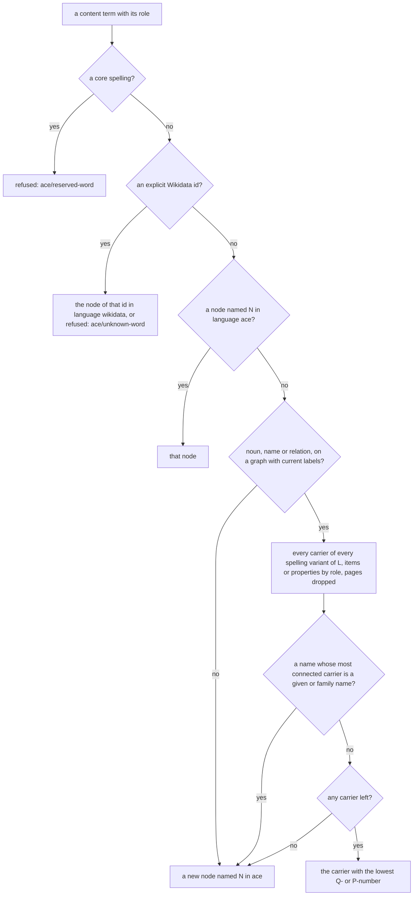

# Words and Wikidata

Every sentence a user types is made of words, and every content word – a noun such as *man*, a name such as *Douglas Adams*, a verb such as *admires* – has to become a node of zelph's graph before anything can be stored or asked. This page specifies how the `ace` front end finds that node. On a graph without Wikidata the answer is simple: `ace` creates a node of its own for each new word, in a naming language of its own, and finds it again the next time the word is used. After a Wikidata import the same words reach Wikidata's items directly through their English labels: "man" is the item Q8441, "Douglas Adams" is Q42, "occupation" is the property P106. A user can then ask Wikidata in English instead of writing SPARQL, and the reasoning runs over Wikidata's own facts.

Labels are ambiguous. Eight items of the test fixture carry the label "man", and in Wikidata over a hundred items carry "Berlin". The front end therefore chooses deterministically – among the items with the label, the one with the lowest Q-number – and never silently: every word bound to a shared label is announced once, with the item chosen and the ways to choose another. Everything the choice needs exists in zelph today, released with zelph 1.1.0, and is documented: the label index that lists every carrier of a label, lookups that create nothing, exact fact probes, node degrees and the subclass closure. Like the rest of the front end, this part is a mapping written as stdlib `.zph` modules on top of those features; it adds no reasoning of its own.

The session below is the second tutorial transcript of the specification, pinned by a test. It runs on the Wikidata-style fixture of this page ([below](#the-wikidata-style-fixture)), a small Wikidata dump that the test suite imports through zelph's real importer; the `.load` line imports a copy of it from a temporary directory, and the `…` line stands for the importer's progress lines.

!!! example "Specified session — the behaviour this specification requires, not yet implemented"

    ```
    zelph> .load /tmp/ace-fixture/ace-fixture.json
    …
    zelph-> .import ace
    zelph-> ace There is a man who admires Douglas Adams.
    Is Douglas Adams a human?
    What is an occupation of Douglas Adams?

    Note [ace/word-senses]: words read as Wikidata items (the lowest Q-number among the items with this label):
      "man" is Q8441 (7 other items carry the label; https://www.wikidata.org/wiki/Q8441)
      "Douglas Adams" is Q42 (3 other items carry the label; https://www.wikidata.org/wiki/Q42)
      "occupation" (relation) is P106 (https://www.wikidata.org/wiki/Property:P106)
      To choose another item, write n:Q… for a noun or p:Q… for a name, or declare the word, e.g. noun_sg(man, 'Q…', masc).
      (ace/senses "man") lists the candidates.
    Answer: Yes. Douglas Adams is a human.
    Answer: p:Q36180 is an occupation of Douglas Adams.
    ```

What happens here, in the order of this page's sections:

- "man", "Douglas Adams" and "occupation" are looked up among the English labels of the graph. Each of these labels has several carriers, so each binding is announced in the one `word-senses` note of the block. "human" has a single carrier, the item Q5, and is bound without a line: a label nobody else carries is no ambiguity.
- "Douglas Adams" is read as one name although the parser first tries the two names "Douglas" and "Adams" (multi-word names: [The multi-word fallback](grammar.md#the-multi-word-fallback)); on this graph it is a known label, so no warning says so.
- *admires* is a verb. Verbs never go through Wikidata's labels; `ace` creates the node `admires` in its own naming language.
- "Is Douglas Adams a human?" is answered through Wikidata's instance property P31 and the subclass closure over P279.
- "occupation" is a relational noun ("an occupation *of* Douglas Adams"). It resolves to the property P106, so the question is asked as the Wikidata statement `Q42 P106 X` and not as a class membership.
- The answer names the item writer (Q36180) as `p:Q36180`: its English label "writer" begins with a lower-case letter and is therefore no spelling of a name, so the answer falls back to the prefixed id, which reads back as the same item.

The texts of this note and of the answers are normative, because the tutorial's test pins them. Elsewhere on this page the wording of a message is illustrative; its id, class, layout and position are the specification ([Messages](block.md#messages)).

## What the Block Writes

The statement "There is a man who admires Douglas Adams." leaves two facts in the graph; the two questions write nothing:

```
Man-<h> P31 Q8441
Man-<h> admires Q42
```

`Man-<h>` is the individual the indefinite "a man" introduces, named in language `ace` by its head noun and 16 hexadecimal digits of a hash over the sentence's content ([below](#individuals)); `admires` is the verb's node in `ace`; Q8441, Q42 and P31 are the fixture's Wikidata nodes. Two pieces of internal bookkeeping are written beside them and are not part of the mapping's output: the profile pin `ace:profile ace:uses ace:wikidata`, which fixes P31 and P279 as this graph's class predicates ([below](#classes-the-instance-and-subclass-predicates)), and the mark `Man-<h> ace:individual nil` that every individual carries. The real run also annotates each fact node with the sentence it came from, under the key `ace:src`; an annotation is no graph fact and adds no node ([Provenance](answers.md#provenance-where-a-sentence-came-from)).

The questions run in a scratch cluster that is dropped afterwards. Their native forms, with the nodes the words resolved to (the class question's variable is the first of its query, so it is `X`):

| ACE question | Native condition list |
|---|---|
| Is Douglas Adams a human? | `Q42 P31 X, ((X P279 Q5) closure zero-or-more)` |
| What is an occupation of Douglas Adams? | `Q42 P106 X` |

These are ordinary zelph queries over ordinary Wikidata facts. The run below imports sixteen of the fixture's entities (the properties P31, P279, P50 and P106; human, person, man, author, writer, the disambiguation-page class; Douglas Adams with `P31 Q5` and `P106 Q36180`; a disambiguation page, a book with `P50 Q42`, two more "man" items and an item "occupation") and asks the native forms of the two questions, of "Is Douglas Adams a person?", "Is Douglas Adams a writer?" and "Who is the author of `` `The Hitchhiker's Guide to the Galaxy` ``?" (Q90000201 in the fixture):

```
zelph-> .lang wikidata
wikidata-> Q42 P31 X, X P279∗ Q5
Answer: Q42 P31 Q5, :P279∗ Q5
wikidata-> Q42 P31 X, X P279∗ Q215627
Answer: Q5 P279∗ Q215627, Q42 P31 Q5
wikidata-> Q42 P31 X, X P279∗ Q36180
wikidata-> Q42 P106 X
Answer: Q42 P106 Q36180
wikidata-> Q90000201 P50 X
Answer: Q90000201 P50 Q42
```

The zero-step answer prints the condition `Q5 P279∗ Q5` as the self-fact `:P279∗ Q5` ([self-facts](../concepts.md#the-self-fact-prefix)): zero steps are a path, so a direct instance of the asked class matches. "Is Douglas Adams a writer?" finds nothing, because Wikidata states occupations with P106, not with P31 ([below](#what-wikidata-models-differently)). The run types the closure with zelph's `∗` sugar: `X P279∗ Q5` is input syntax for the same condition `((X P279 Q5) closure zero-or-more)` and its `∗` reads the same in every language ([Transitive Path Conditions](../logic.md#transitive-path-conditions)); `ace` builds that condition from Janet, from nodes, so the language a user has set never matters to it.

## The Same Block Without Wikidata

Without Wikidata the front end behaves the same, except that it creates nodes where it would otherwise find items. The same text gives the same plan, the same individual names and the same DRS on both graphs; only the resolution step differs. On a fresh graph:

!!! example "Specified session — the behaviour this specification requires, not yet implemented"

    ```
    zelph> .import ace
    zelph> ace There is a man who admires Douglas Adams.
    Is Douglas Adams a human?
    What is an occupation of Douglas Adams?

    Warning [ace/w-multiword]: sentence 1, line 1, column 28: "Douglas Adams" is read as one name.
    Answer: It is not provable that Douglas Adams is a human.
    No answer.
    ```

No word is announced: without Wikidata there is no label to choose from. "Douglas Adams" is still read as one name, but it is no known name on this graph, so the parser says once per session that it merged the two words. The block writes `Man-<h> ~ man` (core `~` is the instance predicate of a graph without Wikidata) and `Man-<h> admires "Douglas Adams"`, its content nodes all named in `ace`, and the pin `ace:profile ace:uses ace:core`. `Man-<h>` is the same name as on the fixture: the hash depends on the sentence, never on the graph.

Nothing the parser decides depends on the graph either. A word's lemma, which feeds the DRS and the individual hashes, comes from the morphology and the lexicon, never from an English label or an `ace` name; the fixture holds a junk label "lik" to pin that "John likes Mary." keeps the lemma `like`. Beyond the node a word reaches (this page), the graph influences only messages, never a DRS: whether a guessed adjective before a noun is a known compound (`[ace/w-compound]` also consults the English labels of a graph with current labels), whether a merged capitalised run is a known name (`[ace/w-multiword]` stays silent for a label or an `ace` name of the graph), and whether a guessed word is a near miss of a lower-case `ace` name, which rejects it as a typo. Guessing and the typo check are specified in [Unknown words, words ACE lacks and near misses](grammar.md#unknown-words-words-ace-lacks-and-near-misses).

## Naming Languages

zelph names nodes per language: one name maps to one node within a language, and one string may name different nodes in different languages. `ace` uses five languages and names every node it creates in an explicit one, never in the language the user has set with `.lang` (decision DEC-CONTENT-NS):

| What | Language | Resolved or created by |
|---|---|---|
| content nodes `ace` creates: nouns, proper names, predicate phrases (`likes`, `is`, `"is in"`, `"is fond of"`, `"is taller than"`), adjectives, adverbs, individuals; the `ace` names a user gives nodes | `ace` | `ace/concept!` and `ace/concept-node!` (step 2 finds, step 4 creates), `ace/individual-name` |
| Wikidata labels, the importer's `mul` fallback included | `en` | read by step 3 through `zelph/lookup-all`; `ace` never creates one |
| Wikidata ids (`Q42`, `P31`) | `wikidata` | step 1, the profile, the answers' fallback; `ace` never creates one |
| user lexicon entries: word nodes and the lexicon's vocabulary (`ace:noun`, `ace:p-<prep>`, …) | `ace-lex` | the lexicon store ([The store](grammar.md#the-store)) |
| internal vocabulary (`refuted`, `opaque`, `ace:individual`, `ace:occurrence`, `ace:manner`, `ace:naf-<h>`, `ace:event-<h>`, `ace:hyp-<h>`, `ace:empty-string`, `ace:can` …, the pin's `ace:profile ace:uses ace:wikidata ace:core`), the importer's marker `wikidata:labels-v2`, characters, digits, the math stack, rule and query variables | `zelph` | named with an explicit `"zelph"`; variables and characters because `ace` runs its execute step under `.lang zelph` |
| core nodes `~ => ! != -> in nil cons conjunction negation` | the same node in every language | never content ([below](#collisions)) |

The reasons for a language of its own: `en` is Wikidata's label space, and a node `ace` creates for a verb ("likes"), an adjective ("red") or an individual must never take or merge a label that an item holds; the behaviour stays the same with and without Wikidata; and the standard library's internal names live in `zelph`, so content never collides with them.

The consequences a user sees:

- `.lang` changes what the native REPL shows and how it reads typed names, never what `ace` resolves. Every public function that may create a node sets `.lang zelph` and restores the user's language on every exit path.
- A native line meets `ace`'s content under `.lang ace`. Under the default `.lang zelph` the same typed words are other nodes.
- A node named only in `ace` displays by that name in every language.
- Under `.lang ace` the internal vocabulary and the math stack, which live in `zelph`, are other nodes when typed.
- On a Wikidata graph the items keep their names in `wikidata` and `en`: a word bound to an item is met natively under `.lang wikidata` by its id, as in the run above.

The run below writes one fact the way `ace` writes it – both names resolved explicitly in `ace` while `.lang zelph` is set – and asks for it under both languages. It also shows how zelph prints a native answer whose name holds a space: quoted, which is the spelling that reads back as the same node.

```
zelph> %(zelph/fact (zelph/resolve "John" "ace") "~" (zelph/resolve "man" "ace"))
<zelph/node John ~ man>
zelph> X ~ man
zelph> .lang ace
ace> X ~ man
Answer: John ~ man
ace> "Douglas Adams" ~ man
ace> X ~ man
Answer: "Douglas Adams" ~ man
Answer: John ~ man
```

## Resolving a Word

In the opening session, "man", "Douglas Adams" and "occupation" were found among the English labels, "human" too, while the verb *admires* got a node of its own. This section specifies how each word gets there.

Every content term of a plan is resolved in the resolution step of `ace/execute!`, after planning and before the dry run, by `ace/concept!`, which creates nothing. The nodes that do not exist yet are created by `ace/concept-node!` in the dry run and again in the real run (decision DEC-WIKIDATA; the block's steps are in [The ace Block](block.md#step-3-resolution-and-checks)).

### Roles

The plan gives every content term a role from its position (data shapes: [Plan](api.md#plan)). The role decides which steps apply:

| Role | Words | Steps |
|---|---|---|
| `:noun` | common nouns: the class of a class statement ("John is a *man*"), a noun in a list or set | 1, 2, 3, 4 |
| `:name` | proper names | 1, 2, 3, 4; a **declared** name 1, 2, 4; a quoted word 2, 3, 4 (a declared quoted word 2, 4); a name with the individual shape 2, 4 |
| `:relation` | relational nouns in a relation position ("the *author* of …"), transitive adjectives ("fond of") | 1, 2, 3, 4 |
| `:verb` | verbs, `is`, the `is <prep>` phrases, comparison phrases | 1, 2, 4 |
| `:adjective` | intransitive adjectives (the object of `is`), adverbs (the object of `ace:manner`) | 1, 2, 4 |

Verbs and adjectives never take a Wikidata label. Measured on the full graph while the rule was designed: of 257 verb lemmas, 1 meets a property, in the wrong sense; of 63 adjectives, 24 meet an item, every one wrong, and no Wikidata fact has the shape `X is <item>`. Structural predicates (`is`, `"is in"`, `"is taller than"`) are verbs for the same reason. A verb or an adjective still reaches a Wikidata node through an explicit id ([below](#choosing-another-sense)).

A name is **declared** when its symbol is the symbol of a proper-name entry of the lexicon, shipped or the user's. The shipped vocabulary `ace-core` declares the common ACE example names (John, Mary, Bill, Sue, Lisa and the further first names the documentation uses, at most 50), each with its gender, so that the canonical ACE texts keep their meaning on a Wikidata graph: an undeclared "John" would otherwise be one of Wikidata's Johns. The list is fixed at M1 from the documentation's examples and leaves out the names that examples use to show an undeclared name: the tests pin "Eugene" and "Zaphod" as undeclared, and this page uses "Laika" in the same way.

### The Word a Term Looks Up

Each term gives two strings: the **node name** N, which step 2 looks up and step 4 creates, and the **label word** L, which step 3 looks up. L equals N except for a transitive adjective, whose node is the phrase `"is fond of"` while step 3 tries the lemma's hyphen and space variants (`based-on` reaches P144 "based on").

- A proper name's N and L are its **canonical symbol**: every run of hyphens and spaces becomes one space, so `Douglas-Adams` and `Douglas Adams` are both "Douglas Adams" and one node, with and without Wikidata (DEC-MULTIWORD). The DRS keeps the form APE gives; `ace/plan` makes the canonical symbol.
- Three kinds of names stay as written: names with the individual shape (`Man-6f1c2a9e1d2b3c4f`), id-shaped symbols, and quoted words. A quoted word's symbol is its content with whitespace runs normalised: `` `Spider-Man` `` is the node "Spider-Man", `` `Douglas  Adams` `` the node "Douglas Adams" (DEC-QWORD). Since a quoted and an unquoted name give the same name in the DRS, a name quoted once is verbatim everywhere in its block.
- Common nouns keep their hyphens (`credit-card`); step 3 tries the spaced variant too.
- Matching is case-exact.

### The Four Steps

The steps run in this order; the first match wins.



0. **A core spelling** (`~ => ! != -> in nil cons conjunction negation`; `ace/reserved?`) is never content: `[ace/reserved-word]`, with `n:Q…` as the hint on a Wikidata graph ([below](#collisions)).
1. **Explicit id.** An `(:id Id Role)` term – a prefixed word such as `p:Q42`, or a lexicon entry whose symbol is an id – is `(zelph/lookup Id "wikidata")`. An id that names no node (a pruned network, or no Wikidata at all) is refused with `[ace/unknown-word]` naming the id: `ace` never creates a node in language `wikidata`.
2. **`ace` node.** `(zelph/lookup N "ace")`: a node `ace` created earlier, or one the user named in `ace`. Never a core node.
3. **Wikidata label**, only on a graph with current labels (below) and only for the roles `:noun`, `:name` and `:relation`:
    - **Candidates**: `zelph/lookup-all` in `en` for every separator variant of L – each run of hyphens and spaces becomes either `-` or ` `, in all combinations – and, for a `:name`, each variant also with a leading `"The "`. At most 16 lookups per word: a word with more variants than fit uses the all-space and the all-hyphen form only (and their `"The "` forms for a name). The candidate sets are united.
    - **Kept**: nodes whose `wikidata` name (`zelph/name n "wikidata" :strict`) is an item `Q…` for `:noun` and `:name`, a property `P…` for `:relation`.
    - **Dropped**: Wikimedia pages, that is a candidate c for which `(zelph/exists c P31 p :exact)` holds for one of the profile's page classes p.
    - **Given and family names**: for a `:name`, if the candidate with the highest `zelph/degree` (ties: the lowest Q-number) is an instance of one of the profile's person-name classes (exact probes), the name is **not bound**: step 4 creates it, and the note announces it as a new individual. An undeclared "Eugene" therefore stays a new individual, although a city named Eugene has a lower id than the given-name item.
    - **Otherwise** the candidate with the **lowest Q-number** wins (the lowest P-number for `:relation`): the numeric part of its `wikidata` name (Q42 → 42), never a node id. Step 3 picks it itself from the candidates. It never assumes that the first carrier `zelph/lookup-all` returns is the label's holder: the order is the engine's rank order, but after a user's `.name` took a label over, the node the label resolves to need not come first.
4. **New node**: named N in `ace`, created by `ace/concept-node!` in the dry and in the real run.

Measured on the full Wikidata graph while these rules were designed: the lowest Q-number is the intended item for 78 of 88 frequent nouns and 25 of 27 names (the importer of the time, which gave a shared label to the item it processed last, was right for 31 and 0); the `"The "` variant raises the names resolved right from 80 to 94 of 101 (`the Hague`, `the Beatles`); the given-name rule keeps 30 of 31 given names as new individuals and leaves 49 of 52 places and 19 of 22 people unchanged. These are the figures of the design measurements, not a property of every dump.

### The Wikidata Profile

The Wikidata-specific constants are data: the table `ace-zelph/wikidata-profile` in `ace-zelph.zph`, which the fixture's tests pin.

| Key | Value |
|---|---|
| `:instance`, `:subclass` | `"P31"`, `"P279"` |
| `:marker` | `"wikidata:labels-v2"` (language `zelph`) |
| `:page-classes` | `"Q4167410" "Q22808320" "Q13406463" "Q4167836" "Q15623926" "Q17362920" "Q21286738"` (disambiguation, list, category and duplicate pages) |
| `:person-name-classes` | `"Q202444" "Q12308941" "Q11879590" "Q3409032" "Q101352"` (given names and family names) |
| `:url-item`, `:url-property` | `"https://www.wikidata.org/wiki/"`, `"https://www.wikidata.org/wiki/Property:"` |

### Relational Nouns

A relational noun such as *author* or *occupation* has two roles in one sentence: the relation in "the author of X", and the class in the class atom that says the answer *is* an author. The two roles are resolved together and give the same result in either order: when step 1 or step 2 finds a node, both roles use it. Otherwise, in step 3, the relation is the property if one carries the label, else the noun's item, else the one `ace` node named N; the noun is the item if there is one, else that same node.

When the relation resolves to a Wikidata property, the class atom is dropped everywhere – in statements, questions, rule conditions and helper bodies (decision DEC-OF). Wikidata states `Q90000201 P50 Q42`, not that Q42 is an instance of "author", so the class atom would make "Who is the author of …?" answer nothing. Dropping it never makes a rule unsafe, because the relation atom binds the same variable. The role whose term is dropped is not announced. Without Wikidata nothing changes: "John is a brother of Bill." writes `Bill brother John` and `John ~ brother`. A referent that the typing of formulas makes numeric gets no class atom on either graph: with `ace-math` imported, "John's age is 30." writes `John age &30` only ([DEC-NUMERIC-REFERENT](decisions.md#dec-numeric-referent)).

### A Graph With Current Labels

Step 3 runs only on a **graph with current labels**: `(zelph/lookup "P31" "wikidata")` and `(zelph/lookup "P279" "wikidata")` find nodes (a **Wikidata graph**), and the importer's marker `(zelph/lookup "wikidata:labels-v2" "zelph")` exists.

The marker matters because of a change in the importer. Before it, the item processed last took a shared `en` label and every earlier carrier lost its English name: in the networks published so far, the intended item holds its label for none of 24 test labels ("man" is a gene of the fruit fly there, "dog" a DNS client), and Q8441, Q5, Q42 and P31 have no English name at all. The importer now keeps every carrier's label, gives the name itself to the first carrier by one ranking (property before item, then the lower number), falls back to the `mul` label for an item without an English one (Q42), and writes the marker after every successful import ([Labels that several entities share](../wikidata.md#labels-that-several-entities-share)). The `.bin` format did not change; only a network imported anew carries the marker.

- On a Wikidata graph **without the marker**, step 3 is off and `[ace/w-old-labels]` is given once per session. Explicit ids still work, and answers print items by their prefixed ids, since no label is trusted to read back.
- When `zelph/lookup-all` answers the keyword `:incomplete` instead of the carriers – after a `.load-partial` that picked fewer name chunks than the file has; the mark is session-wide – step 3 is off and `[ace/w-index-incomplete]` is given once per session.
- Without Wikidata, step 3 never runs and nothing is announced.

The importer writes the marker after every successful import, also after one that added a dump to a non-empty graph holding older labels, where the marker then overstates; such mixed networks do not matter to `ace`.

**Open for M1:** on a Wikidata graph where step 3 is off (no marker, or an incomplete label index), whether an undeclared noun or name that step 4 creates gets a line in the `word-senses` note, and with which parenthesis: the reasons the specification defines for such a line (`:person-name`, `:no-label`) presuppose that step 3 ran. Also open: whether the once-per-session warning comes with the first block on such a graph or with the first block that has a noun, name or relation to resolve. The session below uses declared words only and does not depend on either answer.

!!! example "Specified session — the behaviour this specification requires, not yet implemented"

    ```
    zelph> .load wikidata-20260309-all-pruned-small.bin
    …
    zelph-> .import ace
    zelph-> ace John is a man. Is John a man?

    Warning [ace/w-old-labels]: this Wikidata network was imported by an older zelph, which kept only one English name per label, so ace reads no word as an item by its label here; write ids such as p:Q42 or n:Q5 to reach items.
    Answer: Yes. John is a man.
    ```

The published network still has P31 and P279 in language `wikidata` and no marker. "John" is declared and "man" is created in `ace` by step 4; the class statement is written with P31, the graph's instance predicate.

### The Resolution Record and Its Cache

`(ace/concept! term)` returns a resolution record:

```
{:term t :role r :step 1|2|3|4 :node n :name N :lang l :candidates k :reason kw}
```

`:node` is absent for step 4; `:lang` is `"wikidata"` for steps 1 and 3 and `"ace"` for steps 2 and 4; `:candidates` is the number of candidates left after the filters of step 3; `:reason` is set for step 4 on a Wikidata graph: `:declared` (a declared name, which skips step 3, or a declared noun no label matched), `:person-name` or `:no-label`. It raises `[ace/reserved-word]`, and `[ace/unknown-word]` for an explicit id the graph does not hold. `(ace/concept-node! res)` returns the record's node, or for step 4 `(zelph/resolve N "ace")`, which creates the node in the active cluster: the dry run's `ace:dry`, then the caller's cluster.

The outcome of step 3 is cached per (label word, role) in `(ace/state :resolution)` for the current `(zelph/epoch)`, a counter the engine advances with every `.new`, every load that replaces the graph and every dump import. Steps 0 to 2 cost one hash lookup each and run every time, so a node created or named in `ace` later wins over a cached step-3 result. A label that changes inside one epoch is seen from the next one; a dump imported into the running session advances the epoch, so its labels reach step 3 from the next block, also when `ace` was imported before the dump.

Nothing in this path is linear in the size of the graph: step 3 makes at most 16 label lookups, each proportional to the carriers of one label, and per candidate a few exact probes and one degree read, each a single hash lookup. Removing the nodes of a dropped scratch cluster no longer scans the name maps (the engine change P-drop-names), and a test pins that a block scans none.

### The Engine Side of Step 3

The run below imports the same sixteen entities as above and makes most of the reads step 3 makes. The label "man" has three carriers in this excerpt, listed in rank order; "Douglas Adams" is carried by Q42 – through its `mul` label, since Q42 has no English one – and by a disambiguation page, which the exact probe against the page class Q4167410 recognizes; "occupation" is carried by the property P106 and an item, the property ranked first; "human" has one carrier; "zorbler" has none. The marker shows that the labels are current.

```
zelph-> %(zelph/lookup-all "man" "en")
(<zelph/node "Q8441 - man"> <zelph/node "Q709369 - man"> <zelph/node "Q29719014 - man">)
zelph-> %(map |(zelph/name $ "wikidata" :strict) (zelph/lookup-all "Douglas Adams" "en"))
@["Q42" "Q5301194"]
zelph-> %(zelph/name (zelph/lookup "Q42" "wikidata") "en" :strict)
"Douglas Adams"
zelph-> %(zelph/lookup-all "occupation" "en")
(<zelph/node "P106 - occupation"> <zelph/node "Q12737077 - occupation">)
zelph-> %(zelph/lookup-all "human" "en")
(<zelph/node "Q5 - human">)
zelph-> %(zelph/lookup-all "zorbler" "en")
()
zelph-> .lang wikidata
wikidata-> %(zelph/exists "Q5301194" "P31" "Q4167410" :exact)
true
wikidata-> %(zelph/lookup "wikidata:labels-v2" "zelph")
<zelph/node wikidata:labels-v2>
```

## The `word-senses` Note

On a Wikidata graph a block that binds words prints one consolidated Note `[ace/word-senses]` before its warnings and answers. A block with several kinds of lines, then a second block, in a new session on the fixture:

!!! example "Specified session — the behaviour this specification requires, not yet implemented"

    ```
    zelph-> ace Douglas Adams is a man. Zaphod is a man. Mary is a zorbler.

    Note [ace/word-senses]: words read as Wikidata items (the lowest Q-number among the items with this label):
      "Douglas Adams" is Q42 (3 other items carry the label; https://www.wikidata.org/wiki/Q42)
      "man" is Q8441 (7 other items carry the label; https://www.wikidata.org/wiki/Q8441)
      "Zaphod" is a new individual (no item carries the label)
      "zorbler" is a new noun (no item carries the label)
      To choose another item, write n:Q… for a noun or p:Q… for a name, or declare the word, e.g. noun_sg(man, 'Q…', masc).
      (ace/senses "man") lists the candidates.
    zelph-> ace Is Zaphod a man? Eugene is a man.

    Note [ace/word-senses]: words read as Wikidata items (the lowest Q-number among the items with this label):
      "Eugene" is a new individual (the label belongs to given-name items)
      To choose another item, write n:Q… for a noun or p:Q… for a name, or declare the word, e.g. pn_sg('Eugene', 'Q…', undef).
      (ace/senses "Eugene") lists the candidates.
    Answer: Yes. Zaphod is a man.
    ```

"Douglas Adams" and "man" are bound to shared labels; "Zaphod" and "zorbler" are new, the one a name, the other a guessed noun; "Mary" is declared in `ace-core` and has no line. In the second block, "Zaphod" is found by step 2 and "man" is already announced. Of the two carriers of "Eugene", the given-name item has the higher degree (three people carry it as their given name), so the name stays a new individual although the city has the lower id. The two blocks write `Q42 P31 Q8441`, `Zaphod P31 Q8441`, `Mary P31 zorbler` and `Eugene P31 Q8441`, `Zaphod`, `zorbler` and `Eugene` being nodes in `ace`.

The rules of the note (DEC-WIKIDATA):

- **Announced**: every (word, role) that step 3 bound to a label with more than one carrier – the union `zelph/lookup-all` returned for the word's variants, before the role and page filters – and every `:noun` or `:name` that step 4 created and the lexicon does not declare.
- **Not announced**: a label only one node carries ("human" → Q5, "car park" → Q108607906); a declared name and an entry with an id symbol, which never reach step 3 – their meaning was declared; a word step 4 creates for a declared entry; a role the resolution step drops (the class atom of a relational noun whose relation is a property); verbs and adjectives, which never take step 3. A declared noun without an id symbol is announced when step 3 binds it to a shared label: `man`, which `ace-core` declares as a person noun, gets its line, because its entry declared the word's grammar, not its meaning.
- **Once** per word, role and session (epoch). An announcement counts only when the block succeeds: a rejected block appends its note to the error and uses up nothing.
- `(ace/option :warnings false)` never silences it: it is a Note, not a warning. Without Wikidata there is no note.

**Layout.** The header line, one line per announced (word, role) in the order of the words' first occurrence in the block, the line of a relation (`"occupation" (relation) is P106 (…)`, without a count), the two forms of a new word ("a new individual", "a new noun") and the two hint lines are specified with the other messages in [The word-senses Note](block.md#the-word-senses-note). Three points belong to word resolution:

- The decision to announce counts the carriers before the role and page filters; the count a line prints, "N other items carry the label" (singular "1 other item carries the label"), is taken after them, the chosen carrier excluded: the fixture's "Douglas Adams" has five carriers, one of them a page, so 3.
- The parenthesis of a new word gives the resolution record's `:reason`: `:person-name` → "the label belongs to given-name items" or "… family-name items", after the class the most connected candidate matched; `:no-label` → "no item carries the label".
- The hint's example declaration names the note's first noun line with its lemma and its entry's gender (`neutr` for an undeclared noun), else its first name line as `pn_sg('<form>', 'Q…', <gender>)`, the form written with hyphens as the lexicon requires (`New-York`) and an undeclared name with the gender of its reading, `undef`; the `(ace/senses …)` line names the same word.

Spelling variants and quoted labels, in a new session on the fixture:

!!! example "Specified session — the behaviour this specification requires, not yet implemented"

    ```
    zelph-> ace John is a car-park. `Washington, D.C.` is a city. New-York is a city.

    Note [ace/word-senses]: words read as Wikidata items (the lowest Q-number among the items with this label):
      "New York" is Q1384 (1 other item carries the label; https://www.wikidata.org/wiki/Q1384)
      To choose another item, write n:Q… for a noun or p:Q… for a name, or declare the word, e.g. pn_sg('New-York', 'Q…', undef).
      (ace/senses "New-York") lists the candidates.
    ```

"car-park" reaches Q108607906 through its spaced variant "car park", the label's only carrier, and gets no line. The quoted word reaches Q61, the only carrier of "Washington, D.C.", the route to a label with punctuation. "New-York" has the canonical symbol "New York"; its variants "New York" and "New-York" are carried by Q1384 and Q19128023, and the lower id wins. "John" and "city" are silent: one is declared, the other has a single carrier. A name is also tried with a leading "The": "The Hague is a city." reaches Q36600 "The Hague", while "Hague" alone is a disambiguation page and dropped. The two spellings tried have two carriers before the page filter, so the word is announced, and its count, taken after the filter, is 0: `"Hague" is Q36600 (0 other items carry the label; https://www.wikidata.org/wiki/Q36600)`.

## Choosing Another Sense

The lowest Q-number is a rule, not an understanding of the text. When it picks the wrong item, the user chooses another in one of two ways, both part of the sentence or the lexicon, never a setting: an explicit id, or a lexicon entry whose symbol is an id. `(ace/senses w)` lists the candidates to choose from. The three together, in a new session on the fixture:

!!! example "Specified session — the behaviour this specification requires, not yet implemented"

    ```
    zelph-> ace Berlin is a city.

    Note [ace/word-senses]: words read as Wikidata items (the lowest Q-number among the items with this label):
      "Berlin" is Q64 (22 other items carry the label; https://www.wikidata.org/wiki/Q64)
      To choose another item, write n:Q… for a noun or p:Q… for a name, or declare the word, e.g. pn_sg('Berlin', 'Q…', undef).
      (ace/senses "Berlin") lists the candidates.
    zelph-> %(length (ace/senses "Berlin"))
    Candidates of "Berlin" as a name (* the one ace takes):
    * Q64         Berlin   instance of big city (Q1549591)
      Q821244     Berlin   instance of town (Q3957)
      Q90000101   Berlin
    …
      Q90000118   Berlin
    23
    zelph-> ace-lexicon pn_sg('Berlin', 'Q821244', neutr).

    zelph-> ace Is Berlin a town? Is p:Q64 a town?

    Answer: Yes. Berlin is a town.
    Answer: It is not provable that p:Q64 is a town.
    ```

The listing shows 20 of the 23 carriers the fixture gives "Berlin"; the returned tuple holds all 23 in rank order, Q64 first (the layout of the rows is illustrative; the session asks for the tuple's `length` because the REPL prints the value of a `%` line). After the entry, "Berlin" is the town Q821244, reached by step 1, and its answer prints the entry's form. Q64 can still be named by its id; its label "Berlin" no longer reads back as Q64, so the answer prints it as `p:Q64` ([below](#how-answers-name-a-node)).

**Explicit ids.** A prefixed word whose word is a Wikidata id names that node directly (step 1). The prefixes are ACE's own (they select a word class for an unknown word); `ace` adds the reading of an id after them:

| Written | Role | Reaches | Example |
|---|---|---|---|
| `p:Q42` | name | the item | `p:Q42 is a writer.` |
| `n:Q8441` | noun | the item | `John is a n:Q8441.` |
| `n:P50` | relation | the property | the relational noun of "the n:P50 of …" |
| `v:P155` | verb | the property | `Rex v:P155 Fido.` |
| `a:Q3142` | adjective | the item | `Rex is a:Q3142.` |
| `h:Q…`, `m:Q42`, `f:Q…` | name or noun with a gender | the item | `m:Q42` is Douglas Adams with masculine gender, so `he` finds him; `p:Q42` is neuter like every `p:` name |

An explicit id is never announced. `ace/predicate-name` is not applied to it: a verb `v:P155` stays `P155`. A bare `Q42` is an ACE variable, as in APE, and stays one: after "Q42 is a man." the item Q42 gains no fact. A quoted `` `Q42` `` is the literal name "Q42", an `ace` node, unless the same block also writes `p:Q42`: the DRS gives both the same name, and the explicit id wins for both, for the whole block.

**Lexicon entries with an id symbol.** A lexicon entry's second argument is its logical symbol, the lemma the DRS uses. When that symbol is a Wikidata id, the entry binds its word to the node (DEC-LEX-SYNTAX):

```
pn_sg('Berlin', 'Q821244', neutr).
noun_sg(man, 'Q8441', masc).
tv_finsg(follows, 'P155').
```

The binding is role-aware by the entry's word class (a noun entry with a `P` symbol is a relational noun bound to a property); several forms may share one symbol; no node is merged. User entries are graph facts on word nodes in language `ace-lex`, so they persist with `.save` (the entry whose symbol is `Q8441` names a word node in `ace-lex`, never the item). A declared name is resolved by steps 1, 2 and 4 only: declared names are the user's. A user who wants Berlin to be a node of their own declares `pn_sg('Berlin', 'Berlin', neutr).`, one who wants a particular item `pn_sg('Berlin', 'Q821244', neutr).`, and a user entry replaces the shipped entry of the same form and class, so `pn_sg('John', 'Q…', masc).` turns `ace-core`'s John into an item. Lexicon entries in full: [Declaring words](grammar.md#declaring-words-the-ulex-reader-and-the-ace-lexicon-keyword).

**`(ace/senses w &opt role)`** lists the candidates step 3 would consider for a word, at most 20 rows, each with its id, its label, one superclass and a mark on the chosen one, and returns all of them as a tuple of structs `{:id :node :label :class :chosen}`. The role defaults to `:noun`, `:name` for a capitalised word. The superclass is the object of the candidate's `P279` fact, else of its `P31` fact, skipped for a candidate whose degree exceeds 100,000, so that the listing never walks a hub. It writes nothing and announces nothing. On a graph without current labels it prints one line saying why there is nothing to list and returns `()`.

**Why not `.name`.** A word can also be bound by naming a node natively in `ace`: `.lang wikidata` and then `.name Q5288153 ace dog` makes step 2 find the item for "dog". `ace` itself never calls `.name`, and the documentation and every hint name the lexicon route only, because `.name` onto a name another node already holds does not move the name: two atoms, and the node of a word is one, **merge** with all their facts, across languages and within one, also under `.lang ace` ([DEC-RELOAD](decisions.md#dec-reload); merges of statements and set constants follow content identity and are refused where it does not hold: [DEC-MERGE-CONTENT](decisions.md#dec-merge-content), [DEC-NAME-MERGE](decisions.md#dec-name-merge)). So `.name … ace dog` after `ace` has created its own word `dog` merges that node into the item. The run below shows both cases on the same excerpt: naming Q8441 in `ace` while no `ace` node "man" exists, and naming Q5 after a native line under `.lang ace` has created the `ace` node "human".

```
zelph-> .lang wikidata
wikidata-> .name Q8441 ace man
Node 'Q8441' ('wikidata') exists, assigned name 'man' in 'ace'.
wikidata-> %(zelph/lookup "man" "ace")
<zelph/node Q8441>
wikidata-> .lang ace
ace-> John ~ human
ace-> .lang wikidata
wikidata-> .name Q5 ace human
Warning: (B) Merging Node 29 into Node 15 due to name conflict 'human' in language 'ace'.
Node 'Q5' ('wikidata') / 'human' ('ace') have the requested names, but are different nodes => Merging them.
wikidata-> X P31 Q5
Answer: Q42 P31 Q5
wikidata-> .lang ace
ace-> X ~ human
Answer: John ~ "Q5 - human"
```

After the merge, one node carries the import's `Q42 P31 Q5` and the session's `John ~ human`; under `.lang ace` the last answer names it `"Q5 - human"`, the way zelph displays an item by its id and its name in the current language, here its `ace` name ([Labels that several entities share](../wikidata.md#labels-that-several-entities-share)). The query `X P31 Q5` still finds only Douglas Adams: John's fact was written with core `~`, which no Wikidata class question reads. That is why the front end writes class statements with the graph's own instance predicate, the subject of the next section.

## Classes: the Instance and Subclass Predicates

ACE says "X is a C" in one way; graphs say it in two. zelph's own idiom is the core node `~`; Wikidata states instances with P31 and subclasses with P279, both ordinary nodes, and a `~` class atom matches no Wikidata instance fact. Naming `~` as P31 is no way out: on the pruned small network that would re-create 7,034,880 facts and change how `~` prints everywhere. `ace` therefore has two vocabulary entries, the **instance predicate** `(:vocab :instance)` and the **subclass predicate** `(:vocab :subclass)`, decided per graph (decision DEC-PATHS). In a new session on the fixture:

!!! example "Specified session — the behaviour this specification requires, not yet implemented"

    ```
    zelph-> ace John is a man. Is John a human? Is John a person?

    Note [ace/word-senses]: words read as Wikidata items (the lowest Q-number among the items with this label):
      "man" is Q8441 (7 other items carry the label; https://www.wikidata.org/wiki/Q8441)
      To choose another item, write n:Q… for a noun or p:Q… for a name, or declare the word, e.g. noun_sg(man, 'Q…', masc).
      (ace/senses "man") lists the candidates.
    Answer: Yes. John is a human.
    Answer: Yes. John is a person.
    ```

The block writes `John P31 Q8441`, with the graph's own instance predicate, and the questions follow P279 upward from the class John was given: Q8441, Q5, Q215627. On a graph without Wikidata the same block writes `John ~ man`, and both questions are not provable: no subclass fact exists there, and "human" and "person" name no node.

**The pin.** The two predicates are pinned per graph by one fact in internal vocabulary (language `zelph`):

- `ace:profile ace:uses ace:wikidata` – instance P31, subclass P279, the nodes of those names in `wikidata`;
- `ace:profile ace:uses ace:core` – instance core `~`, no subclass predicate.

No node is renamed and no name setter is used: an `ace` name on core `~` would make every `~` fact display as `ace:instance` under `.lang ace`.

- **Reading.** In the resolution step of every block that has a class item: the pin fact, probed with `zelph/exists … :exact` after looking its four names up in `zelph`; without a pin, the profile the pin will take: `ace:wikidata` on a Wikidata graph (P31 and P279 found in `wikidata`), else `ace:core`. Then the user bindings, looked up at the start of each block: a node the user named `ace:instance` or `ace:subclass` in `ace` (`.name <node> ace ace:subclass`; `(zelph/lookup "ace:subclass" "ace")`) wins over the profile for that predicate. Under `ace:core` that is the only way to a subclass predicate. The result goes into the resolution map; it is never part of the block's context or of a plan, so the same text gives the same plan on every graph.
- **Writing.** On a graph without a pin, each run writes the pin fact right before the first write action that holds a class item (a statement, or a rule with one in a head or a condition), outside any rule-building thunk. The dry run's copy goes with its scratch cluster; the real run's stays. A question writes nothing, so a block of questions pins nothing. The pin is no plan action and `ace/zelph-of` does not render it.
- **A graph that looks different.** When a later block finds a graph pinned to `ace:core` that holds P31 and P279 in `wikidata` (Wikidata imported afterwards), it warns `[ace/w-profile]` once per session and keeps the pin.
- **Moving a binding.** A second `.name <other> ace ace:subclass` merges the two predicate nodes instead of moving the name. A binding is moved with `.delname ace:subclass ace` first, then the new `.name`.

**Class items.** One function, `ace-drs/class-pattern` in `ace/plan`, builds every class item. Statements and rule heads write the atom `T <instance> C`. Questions and rule conditions use the pattern `(:class T C V)`, which the resolution step expands into `T <instance> V, ((V <subclass> C) closure zero-or-more)` when there is a subclass predicate – zero steps include V = C, so direct members match – and into `T <instance> C` when there is none. V is a variable of the rule's or question's naming scope and takes its letter in the order of first occurrence, like every variable: in "Is John a human?" it is `X`. Where the expansion has no V – the core profile without a subclass predicate – the pattern consumes no letter: "Every man owns a dog." is `(*{(X ~ man)} ~ conjunction) => (X owns Y) (Y ~ dog)` in the core profile, while on a Wikidata graph the pattern of "man" takes `Y` and the dog is `Z` ([DEC-VAR-LETTERS](decisions.md#dec-var-letters)). A pattern the expansion leaves without a variable becomes ground atoms, which a yes/no question checks as it checks every ground atom: with an exact probe first and, on a miss while the graph may hold facts with several objects, with the plain probe, which reads the subject's facts with that predicate and scans nothing ([DEC-YESNO-WIDER](decisions.md#dec-yesno-wider); [Yes/No Questions](answers.md#yesno-questions)). Answers name the asked class, never the class the closure walked through. The rest of the mapping – the refuted atom behind a `No.` answer, a negated class item in a rule condition, which goes through a positive helper – is [Class Patterns and the Graph Profile](semantics.md#class-patterns-and-the-graph-profile).

**Milestones.** The pin, the class-pattern function and the subclass closure in yes/no questions arrive in M1, whose smoke slice writes class atoms and asks yes/no questions: a pin made later would find M1's facts written with the wrong predicate. Wh-questions and relational nouns use them from M3, rule conditions from M4. The profile has no construct id: it changes a mapping, not the language.

**Large classes.** For every rule and helper a block writes, each class pattern in its conditions whose class resolves to an existing node with `(zelph/degree C)` above 100,000 gives `[ace/w-large-rule]` naming the sentence and the class: the rule derives one fact per instance. Only the asked class's own degree is read; subclasses are not counted; the rule is still asserted (M4). Since the engine changes P-closure-delta and P-pidx-local, such a rule is not matched again by unrelated writes, and a question's closure keeps its predicate index.

A user's own subclass predicate on a graph without Wikidata:

!!! example "Specified session — the behaviour this specification requires, not yet implemented"

    ```
    zelph> .import ace
    zelph> ace Rex is a dog. Is Rex an animal?

    Answer: It is not provable that Rex is an animal.
    zelph> .lang ace
    ace> dog sub animal
    ace> .name sub ace ace:subclass
    ace> ace Is Rex an animal?

    Answer: Yes. Rex is an animal.
    ```

The first block pins `ace:core` and writes `Rex ~ dog`. The native line meets `ace`'s nodes under `.lang ace`, and `.name` renames the node `sub` to `ace:subclass` in `ace` (`sub` then names nothing); from the next block on, the question's class pattern is `Rex ~ X, ((X ace:subclass animal) closure zero-or-more)`.

A graph that changes its profile keeps its pin:

!!! example "Specified session — the behaviour this specification requires, not yet implemented"

    ```
    zelph> .import ace
    zelph> ace John is a man.

    zelph> .lang wikidata
    wikidata> Q1 P279 Q2
    wikidata> Q3 P31 Q1
    wikidata> .lang zelph
    zelph> ace Is John a man?

    Warning [ace/w-profile]: this graph was pinned to zelph's own class predicate ~ when ace first wrote a class; it now also holds P31 and P279 in language wikidata, and ace keeps using ~.
    Answer: Yes. John is a man.
    ```

## What Wikidata Models Differently

Wikidata's data model is not ACE's, and some questions that read naturally have no answer there. The front end does not paper over this; the documentation says how to ask instead. In a new session on the fixture:

!!! example "Specified session — the behaviour this specification requires, not yet implemented"

    ```
    zelph-> ace Laika is a dog.
    Is Laika an animal?
    Is Laika a mammal?
    Is Douglas Adams a writer?
    What is an occupation of Douglas Adams?

    Note [ace/word-senses]: words read as Wikidata items (the lowest Q-number among the items with this label):
      "Laika" is a new individual (no item carries the label)
      "mammal" is Q7377 (1 other item carries the label; https://www.wikidata.org/wiki/Q7377)
      "Douglas Adams" is Q42 (3 other items carry the label; https://www.wikidata.org/wiki/Q42)
      "occupation" (relation) is P106 (https://www.wikidata.org/wiki/Property:P106)
      To choose another item, write n:Q… for a noun or p:Q… for a name, or declare the word, e.g. noun_sg(mammal, 'Q…', neutr).
      (ace/senses "mammal") lists the candidates.
    Answer: Yes. Laika is an animal.
    Answer: It is not provable that Laika is a mammal.
    Answer: It is not provable that Douglas Adams is a writer.
    Answer: p:Q36180 is an occupation of Douglas Adams.
    ```

"Laika" is a new individual; "dog" (Q144) and "animal" (Q729) have one carrier each and get no line. The answers show the first two of these points:

- **Memberships stated with other properties.** Wikidata states occupations with P106 and sex with P21, not with P31. "Is Douglas Adams a writer?" is therefore not provable; "What is an occupation of Douglas Adams?" asks the relation and answers with the item writer through `Q42 P106 Q36180`. "Is a writer an occupation of Douglas Adams?" is not provable either, by design: its indefinite asks for an instance of writer, and the occupation is the class Q36180 itself.
- **Class paths.** "dog" (Q144) reaches the taxon animal (Q729) through a non-taxon "mammal" item (Q110551885), while "mammal" resolves by the lowest Q-number to the taxon Q7377, which dog does not reach. So "Is a dog a mammal?" is not provable through P279, while "Is a dog an animal?" and "Is a horse a mammal?" hold on today's Wikidata. Examples and the tutorial use relations that hold.
- **Every rank.** The importer reads every item-valued claim whatever its rank, so a relational question lists the value of every rank: "What is a capital of Germany?" answers Berlin (rank preferred) and Bonn (rank normal).
- **Inverse and sub-properties.** A relation answers only through the property its word resolves to: facts stated with the sub-properties father (P22) and mother (P25) do not answer a question about "parent" (P8810), and "student" (P802) and "student of" (P1066) are inverses that each answer only their own direction.
- **Values that are not items** (dates, quantities such as a population) are not imported, so ACE cannot ask for them. Importing quantities as data is an optional importer extension, not part of this work.
- **Imported facts have no provenance.** An imported fact carries no `ace:src` annotation, so from M4 a report that names one calls it "a fact of the loaded graph". Continuing the session:

!!! example "Specified session — the behaviour this specification requires, not yet implemented"

    ```
    zelph-> ace Douglas Adams is not a human.

    Error in line "ace Douglas Adams is not a human.": Contradiction [ace/contradiction]: sentence 1, line 1, column 1: zelph already holds the opposite of this sentence, from "Douglas Adams is a human." (a fact of the loaded graph).
      <>Douglas Adams is not a human.
    ```

## How Answers Name a Node

An answer is ACE text that must read back as the same nodes (the round trip: an answer line entered as a block creates no node). The verbaliser renders each node in the role of its position from the first of four sources that gives a spelling of that role which reads back: its `ace` name; a form of a lexicon entry whose symbol is the node's Wikidata id; its `en` label, only on a graph with current labels and only when resolving that spelling in the node's role – silently, without announcements and without touching the cache – gives the node back; else its prefixed id, `p:Q123` (name), `n:Q123` (noun), `n:P50` (relation), `v:P155` (verb) or `a:Q123` (adjective), never a bare `Q123`, which would read back as a variable (decision DEC-WIKIDATA, "Verbalising"). The order, the spelling rule of each role and the node without a name are specified in [Rendering a Node](answers.md#rendering-a-node), beside the answer templates. Examples, most of them from the sessions above:

| Node | Role | Printed as | Why |
|---|---|---|---|
| the `ace` node `John` | name | `John` | its `ace` name |
| Q821244 after `pn_sg('Berlin', 'Q821244', neutr).` | name | `Berlin` | the form of the lexicon entry, whatever the label |
| Q42, label "Douglas Adams" | name | `Douglas Adams`; strict mode `Douglas-Adams` | its label, a capitalised run that reads back through the multi-word fallback; strict mode never merges, so it hyphenates |
| Q61, label "Washington, D.C." | name | `` `Washington, D.C.` `` | its label, backquoted because of the punctuation |
| Q36180, label "writer" | name | `p:Q36180` | a label that begins with a lower-case letter is no name spelling |
| Q64 after "Berlin" was bound to Q821244 | name | `p:Q64` | "Berlin" reads back as Q821244 |
| Q6256, label "country" | noun | `country` | the check is role-aware: the noun role gives Q6256, while the plain `en` name map gives the property P17 |
| Q5 on a network without the marker | noun | `n:Q5` | labels are not used there, because their holders are wrong |

Two capitalised names are never printed side by side ("John gives Bill to Mary"); where it cannot be avoided, the second is backquoted, and a capitalised run counts as one name.

**Native answers** of zelph itself, typed under `.lang ace`, are the host's, not `ace`'s: a name that holds a space prints quoted (`Answer: "Douglas Adams" ~ man`), which is what makes the line read back natively – typed unquoted, `Douglas Adams ~ man` is a fact with subject `Douglas` and predicate `Adams` – and the answers come in the engine's match order, which depends on the session's history. Tests compare native answer lines as a multiset.

**`ace/zelph-of`**, the function behind the option `:show-zelph`, renders the plan's names ([What ace/zelph-of Prints](semantics.md#what-acezelph-of-prints)); its lines read back natively under `.lang ace` with no new node. On a Wikidata graph every line is followed by a display line `# nodes: …` naming the resolved nodes (their `wikidata` id, else their `ace` name); it is a zelph comment, and no read-back promise holds there. A path over a multi-word predicate is rendered in the explicit `((S p O) closure …)` form, because a `"is subclass of"∗` line does not parse; `closure` and its mode are names in `zelph`, so such a line is exact only under `.lang zelph`.

## Names ace Makes Itself

Besides the words of the text, `ace` names predicate phrases, individuals and its internal vocabulary. The data shapes are in [Naming in the Graph](api.md#naming-in-the-graph); the mapping that uses them is in [Terms, Roles and Individuals](semantics.md#terms-roles-and-individuals). This section fixes what each name is and in which role it is resolved.

### Predicate Names

DRS lemmas stay as APE gives them; node names are derived at mapping time by `ace/predicate-name` (its name patterns: [Node Names](grammar.md#node-names)).

| Kind | Node name | Example | Role |
|---|---|---|---|
| `:verb` | with a verb entry: the entry's third person singular; a guessed verb: the third person singular of the morphology rules, so that a later declaration keeps the node; a verb written with `v:`: the lemma as written. Trailing particle and preposition segments joined with spaces | `likes`, `"lives at"`, `"fills in"`; guessed `blork` → `blorks`; `v:gives` → `gives`, `v:look-back-at` → `"look back at"` | `:verb` |
| intransitive verb object | core `nil` | `John waits nil` | – |
| `:noun` | the singular lemma as written, hyphens kept | `man`, `credit-card` | `:noun` |
| `:name` | the canonical symbol | `Douglas Adams` | `:name` |
| `:adj` | the lemma; the predicate is `is` | `John is rich` | `:adjective` |
| `:adj-tr` | `is` + lemma, hyphens as spaces; the term's label is the lemma | `"is fond of"` | `:relation` |
| `:comp-than`, `:pos-as` | `is` + the comparative phrase; ternary names with a subject/object mark | `"is taller than"`, `"is as rich as"`, `"is more fond of than of"` | `:verb` |
| `:located` | `is` + the preposition, for every preposition; event modifiers too | `John "is in" Park-6f1c2a9e1d2b3c4f` | `:verb` |
| `:relational` | the noun lemma; the possessor is the subject | `John father Bill`; on Wikidata `Q90000201 P50 Q42` | `:relation` |
| `:adverb` | the lemma (object of `ace:manner`) | `manually` | `:adjective` |

A preposition reaches the graph only inside a phrase, so core `in`, which would turn its object into a collection, never becomes a predicate: `"is in"` is an ordinary node.

### Individuals

Every top-level referent that survives normalisation is a named node, never an anonymous one: an anonymous node prints as `??` or as its class and does not read back. Its name comes from `ace/individual-name` (decision DEC-INDIVIDUALS):

- **`<Head>-<h>`** in language `ace`, h the 16 lower-case hexadecimal digits of FNV-1a-64 over the canonical text of the referent's group plus the referent's index in it ([Canonical Text and Names](semantics.md#canonical-text-and-names)). Head is the head noun's lemma with its first letter upper-cased (`Man`, `Credit-card`); `Something` or `Somebody` for referents without a noun, and `Something` for a lemma that would not then begin with `A`-`Z`. There is no counter suffix: the same description is the same individual everywhere, inside one block too, so "There is a man." twice is one man – a departure from APE, documented, which makes re-entering a text add nothing.
- **Referents inside an opaque box** (M8, a modal or that-clause): `<Head>-<h>` in `ace`, the hash over the group that holds the box, written only where they are mentioned, not claimed, and without the individual mark.
- **Event individuals** (M6): `ace:event-<h>` in `zelph`. **Hypothetical witnesses** (M4): `ace:hyp-<h>` in `zelph`, only inside a question's scratch cluster. **Helper predicates** (M4): `ace:naf-<h>` in `zelph`.
- **The individual shape** `^[A-Z][^-]*(-[^-]+)*-[0-9a-f]{16}$`: the annotator reads such a capitalised word as a known proper name with the gender of its head noun, without a warning, so answers that name an individual read back cleanly. Individual names skip the canonical symbol and step 3.

With 16 hexadecimal digits two different groups of one head collide with a probability of about 2.7 × 10⁻⁸ at 1,000,000 individuals; 8 digits would merge two descriptions silently at the volumes this is meant for (1.2 % at 10,000 individuals per head noun).

**The individual mark.** A zelph pattern cannot see whether a node is a name. So every individual `ace` creates – the node of every top-level referent with a head noun, plural members and portions included – carries the fact `I ace:individual nil` in `zelph`, written with it in both runs, outside any rule thunk. Occurrence events and the referents of an opaque box carry none; Wikidata items, names, strings and numbers need none. The "at most" and "less than" denials of M7 skip marked witnesses with `¬(W ace:individual nil)`. The mark is written from M3, read from M7, and not rendered by `ace/zelph-of`.

### Internal Vocabulary

| Term | Node | Language |
|---|---|---|
| `(:vocab :instance)` | the instance predicate: a node the user named `ace:instance` in `ace`, else the pin's (P31 under `ace:wikidata`, core `~` under `ace:core`) | per graph |
| `(:vocab :subclass)` | the subclass predicate: a node the user named `ace:subclass` in `ace`, else P279 under `ace:wikidata`; absent under `ace:core` without such a node | per graph |
| `(:vocab :tilde)` | core `~`, whatever the profile: markings (`((F) ~ refuted)`), the condition-set tag `~ conjunction`, opacity declarations (`P ~ opaque`); never in a class atom | core |
| `(:vocab :nil)`, `(:vocab :false)`, `(:vocab :in)` | `nil`; `!` (the consequence of a denial); `in`, only in patterns over set constants (M7) | core |
| `(:vocab :refuted)` | `refuted` | `zelph` |
| `(:vocab :occurrence)`, `(:vocab :manner)` | `ace:occurrence`, `ace:manner` (M6) | `zelph` |
| `(:vocab :empty-string)` | `ace:empty-string`, the empty string | `zelph` |
| `(:vocab :can)` … `(:vocab :may)` | `ace:can`, `ace:must`, `ace:should`, `ace:may`, declared opaque (M8) | `zelph` |
| `(:vocab :opaque)` | `opaque`, the engine's opacity class | `zelph` |
| `(:vocab :individual)` | `ace:individual`, the individual mark | `zelph` |
| `(:vocab "ace:naf-<h>")` | a helper predicate | `zelph` |

Internal names contain a colon, which no ACE token can, so no content word collides with them.

### Collisions

- **Core spellings** (`~ => ! != -> in nil cons conjunction negation`) are the same node in every language, `ace` included: `(zelph/lookup "negation" "ace")` returns the core tag of negation as failure. They are a closed class: never guessed, never declared, never resolved as content (`[ace/reserved-word]`, step 0). zelph refuses to give a core node's spelling to another node, and `ace` never names a node with one.
- **Standard-library names** (the 124 names math creates in `zelph`) never meet ACE content, which lives in `ace`; there is no list and no warning.
- **`of`** is never a predicate: after `.import math` an `of` fact prints as a function application.
- **Id-shaped names**: a quoted `` `Q42` `` is the literal name "Q42" in `ace`, unless the same block writes `p:Q42` ([above](#choosing-another-sense)).

!!! example "Specified session — the behaviour this specification requires, not yet implemented"

    ```
    zelph-> ace John is a negation.

    Error in line "ace John is a negation.": Lexicon error [ace/reserved-word]: sentence 1, line 1, column 11: "negation" is one of zelph's own names and cannot be a word of a sentence.
      John is a <>negation.
      To mean the Wikidata item with this label, write n:Q190558.
    ```

On a graph without Wikidata the same error comes without the hint. The hint is computed with the same candidate lookup `(ace/senses …)` uses, without printing.

## A Network for ace

The published pruned networks (`-small`, `-medium`; [Binary Data Files](../binaries.md)) lack most of what `ace`'s everyday words should reach. That is a consequence of the pruning recipe, not of the labels: animal Q729, mammal Q7377, bird Q5113, plant Q756 and horse Q726 are taxa (`P31 Q16521`) and are removed in the phase that removes taxa (3,807,270 nodes in the published run); Earth Q2 and the planets carry the claim `P6259 Q1264450` and go in another phase (8,072,988 nodes); countries carry `P17` pointing at themselves and cities carry `P131`, and both are removed (5,095,523 and 13,627,258 nodes); people (`P31 Q5`) and given names go in a later phase, before which `-medium` is saved. `-small` also lacks the properties P17 and P131 themselves. A regenerated network fixes the labels, not this content, and while an intended item is pruned its word binds to some other carrier ([Generation of the Pruned Files](../binaries.md#generation-of-the-pruned-files)).

`ace` therefore gets a network of its own, `<stem>-ace.bin`, named after the dump like the other networks: an import into an empty graph of a subset of the dump, chosen by criteria that are data (decision DEC-WIKIDATA). No engine change is needed for it. The criteria file is `dev_scripts/ace-network.json` in the repository; the tool that reads it is `dev_scripts/wikidata-subset.py`. The file as it stands:

```json
{
 "about": "Criteria of the Wikidata network <stem>-ace.bin for dev_scripts/wikidata-subset.py: every property, the subclass-of graph without the instances of seven chemistry, biology and coin classes, and the notable items with their claims among each other. Thresholds and class ids are data; the module documentation of the tool describes every key.",
 "instance_of": "P31",
 "subclass_of": "P279",
 "quantities": ["P1082"],
 "languages": ["en", "mul"],
 "keep": [
  {"reason": "property", "entity_type": "property"},
  {"reason": "sitelinks>=30", "min_sitelinks": 30, "not_instance_of_subclass_of": ["Q17442446"]},
  {"reason": "state", "instance_of": ["Q3624078", "Q6256"], "keep_values_of": {"P36": "capital"}},
  {"reason": "settlement pop>=100000", "instance_of_subclass_of": ["Q486972"], "min_quantity": {"P1082": 100000}},
  {"reason": "taxon rank>=order", "instance_of": ["Q16521"], "has_value": {"P105": ["Q36732", "Q38348", "Q37517", "Q36602"]}},
  {"reason": "taxon sitelinks>=20", "instance_of": ["Q16521"], "min_sitelinks": 20},
  {"reason": "given name", "instance_of_subclass_of": ["Q202444"]}
 ],
 "value_items": {"reason": "value of >=20 kept", "min_referrers": 20, "ignore_properties": ["P31", "P279"]},
 "ancestors": {"reason": "P279 ancestor"},
 "class_graph": {
  "reason": "P279 graph",
  "exclude_instances_of": ["Q113145171", "Q7187", "Q8054", "Q59199015", "Q277338", "Q113813711", "Q427087"]
 },
 "absent_samples": [
  {"name": "taxon", "instance_of": "Q16521"},
  {"name": "person", "instance_of": "Q5"},
  {"name": "village", "instance_of": "Q532"}
 ],
 "acceptance": {
  "labels": {"en": [
   ["animal", "Q729"], ["mammal", "Q7377"], ["bird", "Q5113"], ["plant", "Q756"], ["horse", "Q726"],
   ["dog", "Q144"], ["cat", "Q146"], ["water", "Q283"], ["night", "Q575"], ["Earth", "Q2"],
   ["Sun", "Q525"], ["Moon", "Q405"], ["human", "Q5"], ["man", "Q8441"], ["woman", "Q467"],
   ["writer", "Q36180"], ["city", "Q515"], ["Germany", "Q183"], ["France", "Q142"], ["Berlin", "Q64"],
   ["Paris", "Q90"], ["London", "Q84"], ["Bonn", "Q586"], ["New York City", "Q60"], ["Douglas Adams", "Q42"],
   ["occupation", "P106"], ["author", "P50"], ["capital", "P36"], ["instance of", "P31"],
   ["subclass of", "P279"], ["country", "P17"], ["given name", "P735"]
  ]},
  "carried_labels": {"en": [["country", "Q6256"], ["given name", "Q202444"]]},
  "facts": [
   ["Q42", "P31", "Q5"], ["Q42", "P106", "Q36180"], ["Q3107329", "P50", "Q42"],
   ["Q183", "P36", "Q64"], ["Q183", "P36", "Q586"], ["Q2", "P31", "Q3504248"]
  ],
  "paths": [
   ["Q7377", "P279*", "Q729"], ["Q144", "P279*", "Q729"], ["Q726", "P279*", "Q7377"],
   ["Q64", "P31/P279*", "Q515"], ["Q183", "P31/P279*", "Q6256"]
  ],
  "no_instances_of": ["Q4167836"],
  "present_reasons": ["state", "capital"],
  "marker": "wikidata:labels-v2",
  "targets": {"nodes": 10000000, "ram_gib": 3, "file_bytes": 1200000000, "load_seconds": 10}
 }
}
```

**What it keeps.** An entity matched by a keep rule is a full line: its labels in English and `mul` and every item-valued claim whose object is also kept, at every rank. The class graph adds class-only lines: their labels and their P279 claims, nothing else.

| Reason in the keep list | Rule | Why `ace` needs it |
|---|---|---|
| `property` | every property | every relation word reaches its property; P17 and P131 are among them |
| `sitelinks>=30` | at least 30 sitelinks, not an instance of a subclass of Q17442446 (Wikimedia internal items) | the notable items everyday words mean |
| `state`, `capital` | a direct instance of Q3624078 or Q6256, and the values of their P36 claims at every rank | sovereign states, countries and their capitals |
| `settlement pop>=100000` | an instance of a subclass of Q486972 with a population (P1082) of at least 100,000 | cities |
| `taxon rank>=order` | a direct instance of Q16521 whose taxon rank (P105) is one of the four ranks from order up | animal, mammal, bird, plant |
| `taxon sitelinks>=20` | a direct instance of Q16521 with at least 20 sitelinks | the better-known taxa below order |
| `given name` | an instance of a subclass of Q202444 | the given-name rule of step 3 needs the given-name items |
| `value of >=20 kept` | an item that at least 20 kept entities point at, through properties other than P31 and P279 | the common values that relational questions answer with |
| `P279 ancestor` | the upward P279 closure of every kept entity | the classes the subclass closure walks |
| `P279 graph` | every subject and object of a P279 claim, as a class-only line, unless it is a direct instance of one of seven chemistry, biology and coin classes | the class hierarchy, without millions of instances of those classes |

No family-name items are kept, so on this network the family-name branch of step 3 never applies. `absent_samples` makes `keep` report the first instance of a taxon, a person and a village that the subset leaves out, so that the acceptance can check they are absent.

**What the acceptance checks.** The `accept` subcommand writes a zelph session that loads the network and checks, without creating nodes: that each listed word resolves to its id under `en` (the words "country" and "given name" resolve to the properties P17 and P735, which the importer's ranking puts before items, so the list expects those properties and `carried_labels` checks separately that the items Q6256 and Q202444 carry the labels; step 3's noun role keeps only items and so reaches Q6256 and Q202444); the listed facts and paths (`Q7377 P279∗ Q729`, `Q144 P279∗ Q729`, `Q726 P279∗ Q7377`, …); that no category page (Q4167836) has an instance; that the samples are absent; that every entity kept as a state or capital is present with a label; that the marker exists. The `verdict` subcommand reads the session's log, prints the figures (nodes, RAM, file size, load time, names per language) with a warning for each one above its target, and fails when a check failed or did not run.

**The tool.** `dev_scripts/wikidata-subset.py` uses the Python standard library only and streams every pass. `scan` reads the dump once (a `.json` or a `.json.bz2` through `lbzip2` or `bzip2`) and writes one table row per entity: its sitelinks, the largest amount of each quantity the criteria name, and every item-valued main-snak claim at every rank – exactly the claims zelph's importer reads. `keep` decides the subset from the table alone in four streaming passes and writes a keep list with the reasons of every entity. `extract` reads the dump a second time and writes the kept entities as a dump of their own: each statement as its main snak in the dump's key order without a hash, plus type, id and rank; no qualifiers, references, descriptions, aliases or sitelinks. `accept` and `verdict` are above; `criteria` validates a criteria file. The module documentation describes every key. The ctest entry `wikidata_subset_holds_what_its_criteria_keep` runs `tools/check_wikidata_subset.py`, a 62-entity dump in the real layout with 24 named cases. The general use of the tool is documented under [Advanced Commands](../wikidata.md#advanced-commands) of the Wikidata page. Building the tool found an importer bug, fixed with its tests: a property whose first claim had no value lost all its item claims, and a main snak that carried a `"hash"` field yielded nothing.

**Size and status.** Estimated from today's Wikidata, not measured: 6.8 to 7.8 million nodes, 1.8 to 2.5 GiB of RAM, 0.7 to 0.9 GB on disk, 6 to 8 seconds to load; the targets are at most 10 million nodes, 3 GiB, 1.2 GB and 10 seconds. The table of the full dump is estimated at 13 to 15 GB, and the five network stages of the maintainer's regeneration script (`ace-scan`, `ace-keep`, `ace-extract`, `ace`, `accept-ace`) at about two hours, without the 224 GiB phase of the full network. The tooling and the stages are built and their self-test passes; the regeneration has not been run, so the network does not exist yet. Once it is published with the other networks, `ace` is evaluated on it first, then on the regenerated `-small` and `-medium`. Until the networks are regenerated, the published ones carry the old labels and `[ace/w-old-labels]` says so; unit tests and the documentation's transcripts use the fixture below, never a network.

**Memory of the labels.** Keeping every carrier's label costs, measured on a synthetic fixture of 300,000 items, about 52 bytes per English name of an item that does not hold its label, about 63 bytes per shared label plus 8 bytes per carrier for the label index, and about 61 bytes per `mul` name on disk. Extrapolated to the full graph, an estimate: about 0.24 GB for the index, about 0.5 GB for the index and the extra names together, about 2 to 2.3 GB with the `mul` fallback (about 1 % of the full graph's 224 GiB); about 85 MB on `-small` (1.4 %).

## The Wikidata-Style Fixture

The tests of this page, and every Wikidata transcript of the user documentation, run on one small Wikidata dump committed with the tests, `src/test/data/wikidata/ace-fixture.json`: a plain Wikidata JSON dump of 86 entities with nothing specific to ACE in its format. It is imported through zelph's real importer with `.load`, so the label assignment, the `mul` fallback, the marker and the label index are exercised exactly as on a regenerated network. A fixture built from Janet could not give one English label to several nodes – naming a node hands the name over to the last node that takes it – and would write no marker.

Its entities are chosen so that every rule of this page has a case:

- the properties P31, P279, P50, P106, P155, P735 and P36, and two items that share the labels "instance of" and "subclass of";
- classes with their P279 chains: human → person, man → human, writer → author, big city → city, dog → a non-taxon "mammal" item → animal, and the taxon "mammal" beside it; the page and given-name classes of the profile;
- Douglas Adams (Q42) with only a `mul` label, `P31 Q5` and `P106 Q36180`; a disambiguation page and three more items with his label, so that the tutorial's count is 3;
- eight carriers of "man", so that the tutorial's count is 7; three "John" items (a person, a page, a given name); two "Eugene" items, a city with the lower id and a given name that three people carry; 23 carriers of "Berlin", for the 20-row cap of `ace/senses`;
- "Washington, D.C.", the spellings "New York", "New-York" and "New York City", "The Hague" beside the page "Hague", the single carrier of "car park", a book with `P50 Q42`, an escaped label, the junk label "lik", and Germany's two capitals at the ranks preferred and normal.

The line order is chosen so that the importer's old rule – the line processed last takes a shared label – would pick the wrong holder for every shared label, which makes the fixture's first self-check fail on an importer without the current label assignment. The tests build four variants from the file: the current import; one without the marker (`.remove wikidata:labels-v2`), which is what `ace` reads off every network imported before the current label assignment; a partial load with an incomplete label index; and the empty graph. In the tests the file is compiled into the test binary; the documentation's transcripts copy it into a temporary directory and `.load` the copy, because a `.load` of a `.json` into an empty graph writes a `.bin` cache beside it. The entity table line by line, the variants and the test helper `load_ace_fixture` are specified in [The Wikidata-Style Fixture](tests.md#the-wikidata-style-fixture).

## Tests

The tests of this area are named `ace words: …`; each is listed with what it pins in [Words and Wikidata](tests.md#words-and-wikidata) on the tests page. Related groups there are the `ace names: …` tests ([Names](tests.md#names)), the fixture's self-checks ([Fixture Self-Checks](tests.md#fixture-self-checks)), the work counts on a large graph ([Work on a Large Graph](tests.md#work-on-a-large-graph)) and the tutorial pin `ace tutorial: words reach Wikidata items` ([Tutorial Pins](tests.md#tutorial-pins)). Tests that read resolution alone call `(ace/concept! term)` with a plan term, for example `(ace/concept! '(:name "man" :noun))`, and compare the record's `:node` and `:step`. In short, they pin:

- **from M1**: every step of word resolution on the fixture (the lowest Q-number, explicit ids, `ace` nodes, the refused core spelling with its hint, declared names that never reach a label, pages that are never candidates, the given-name rule, the hyphen, space and "The " variants, verbs and adjectives that never take a label), and that resolving creates nothing; the `word-senses` note (which words get a line, once per session, the singular count, nothing without Wikidata, a rejected block uses up nothing, `:warnings false` keeps it); `ace/senses`; the graphs without the marker and with a partial index; the pin, the user's `ace:subclass` binding, the class question over the subclass closure and `[ace/w-profile]`; `:show-zelph` on a Wikidata graph; the fixture loaded after the import; an entry with an id symbol;
- **from M2**: a junk label never decides a lemma;
- **from M3**: relational nouns (the property and the item, a noun without a property, the values of every rank, the occupation asked as a relation), answers that name Wikidata items in a spelling that reads back, and the tutorial pin;
- **from M4**: a rule condition over the subclass closure, `[ace/w-large-rule]` (a slow test), and a report that names an imported fact "a fact of the loaded graph".

## What This Builds On in zelph

Every engine feature this page relies on is built, released with zelph 1.1.0 and documented; the front end calls them from Janet:

- **Every carrier of a label.** The importer keeps the English label of every item that has it, falls back to `mul`, resolves the name to the first-ranked carrier and writes the marker `wikidata:labels-v2` (engine change P-wd-labels); the engine keeps an index from a shared label to all its carriers, maintained through removals, renames and merges (P-label-index). See [Labels that several entities share](../wikidata.md#labels-that-several-entities-share) and [Wikidata labels and the label index](foundation.md#wikidata-labels-and-the-label-index).
- **Lookups that create nothing.** `zelph/lookup`, `zelph/lookup-all` (`:incomplete` after a partial load), `zelph/name … :strict` and `zelph/lang` (P-lookup and the binding of P-label-index), and `zelph/epoch` for the caches. See [Looking Names Up](../janet.md#looking-names-up-zelphlookup-and-zelphlang) and [Node Names](../janet.md#node-names-zelphname).
- **Exact probes and degrees.** `zelph/exists … :exact` and `zelph/degree`, each a single hash lookup (P-exact). See the [Janet API reference](../janet.md#janet-api-reference-zelph).
- **The subclass closure.** Path conditions over an indexed closure, `S p∗ O` and `((S p O) closure zero-or-more)`, with an index a write of another predicate no longer clears (P-pidx-local) and rules that are not matched again by unrelated writes (P-closure-delta). See [Transitive Path Conditions](../logic.md#transitive-path-conditions).
- **Scratch clusters without cost.** Questions run in a cluster that is dropped without scanning name maps (P-drop-names) and without disarming the fact stores (P-scratch-drop).
- **The Wikidata importer and the subset tool.** `.load` of a dump, its `.bin` cache, and `dev_scripts/wikidata-subset.py` ([Advanced Commands](../wikidata.md#advanced-commands); [The ace network tooling](foundation.md#the-ace-network-tooling)).

The broader list of what the front end relies on is [What zelph Already Provides](foundation.md); the decisions named on this page are explained on [Design Decisions](decisions.md): [DEC-WIKIDATA](decisions.md#dec-wikidata), [DEC-CONTENT-NS](decisions.md#dec-content-ns), [DEC-PATHS](decisions.md#dec-paths), [DEC-OF](decisions.md#dec-of), [DEC-MULTIWORD](decisions.md#dec-multiword), [DEC-QWORD](decisions.md#dec-qword), [DEC-THE-NAME](decisions.md#dec-the-name), [DEC-UNKNOWN](decisions.md#dec-unknown), [DEC-LEX-SYNTAX](decisions.md#dec-lex-syntax), [DEC-RELOAD](decisions.md#dec-reload), [DEC-NAME-MERGE](decisions.md#dec-name-merge), [DEC-MERGE-CONTENT](decisions.md#dec-merge-content), [DEC-INDIVIDUALS](decisions.md#dec-individuals), [DEC-PROV](decisions.md#dec-prov), [DEC-VAR-LETTERS](decisions.md#dec-var-letters), [DEC-NUMERIC-REFERENT](decisions.md#dec-numeric-referent) and [DEC-YESNO-WIDER](decisions.md#dec-yesno-wider).
